# Construction and application of third diagonal in cyclic quadrilaterals by Nārāyaṇa Paṇḍita

- Author Display: Prasad A. Jawalgekar et al.
- Year: 2023
- Journal Label: IJHS-58-2023-Issue-4
- Source Url: https://insa.nic.in/(S(eh1ucortlbqqezipwgliy3mn))/writereaddata/UpLoadedFiles/IJHS/02-58_4.pdf

<!-- source: gemini page-chunk extraction -->

Indian Journal of History of Science (2023) 58:250–270
https://doi.org/10.1007/s43539-023-00110-3
ARTICLE

# Construction and application of third diagonal in cyclic quadrilaterals by Nārāyaṇa Paṇḍita

Prasad A. Jawalgekar $^1$ · D. G. Sooryanarayan $^1$ · K. Ramasubramanian $^1$
Received: 18 September 2023 / Accepted: 30 October 2023 / Published online: 2 January 2024
© Indian National Science Academy 2023, corrected publication 2024

### Abstract

In his comprehensive mathematical treatise *Gaṇitakaumudī*, Nārāyaṇa Paṇḍita has presented a nuanced, systematic, and elaborate exposition of cyclic quadrilaterals. Here, besides discussing its key properties, Nārāyaṇa fashions a “third diagonal" by interchanging two sides of a cyclic quadrilateral. He also provides a variety of mathematical expressions for computing the area, altitude, circumradius, and so on of a cyclic quadrilateral. It turns out that some of these expressions come out very elegant when we involve the third diagonal in them. In this paper, apart from bringing out the verses of Nārāyaṇa, we also present modern mathematical derivations for the results given by him pertaining to the cyclic quadrilateral.
**Keywords** *Gaṇitakaumudī* · Nārāyaṇa Paṇḍita · Cyclic quadrilateral · Third diagonal · Circumradius

## 1 Introduction

The study of geometry in India begins in the Vedic age, where the geometric principles were applied in the construction of diverse fire altars, called *citis* or *vedis*. Though the mention of these sacrificial altars can be traced back to the Vedas, the earliest known class of texts that deal with geometry are the *Śulbasūtras* ($\sim$c. 800–600 BCE), whose primary purpose is to aid the construction of fire altars.[^1] According to the strict injunctions of the Vedic scriptures, sacrifices must be performed in the altars of prescribed shapes and sizes. Hence it was paramount to make these constructions as accurate as possible without any irregularities.
Several authors have composed the *Śulbasūtra* texts. Only seven of them, namely the *Baudhāyana-śulbasūtra*, *Āpastamba-śulbasūtra*, *Kātyāyana-śulbasūtra*, *Mānava-śulbasūtra*, *Maitrāyaṇa-śulbasūtra*, *Vārāha-śulbasūtra*, and *Vādhūla-śulbasūtra*, are extant today. These texts cover a variety of topics ranging from the units of linear measurement, the construction of rectilinear and curvilinear shapes, the theorem of the diagonal of a square (the so called Pythagorean theorem), the area-preserving transformations of geometrical figures, the plans for various fire altars, the details of the bricks (their number, sizes, shapes, etc.), the principles behind the choice of materials for brick making, the process of manufacturing bricks, and so on. Having made significant progress in the development of geometry in ancient times, in due course, the Indian mathematicians, instead of confining themselves to work on problems that have practical utility such as construction of altars, began to cultivate geometry as a key chapter in their mathematical works.
In the Indian mathematical treatises such as *Līlāvatī* (12th cent.), the sections that deal with planar figures are generally referred to by the word ‘*kṣetravyavahāra*.’ Geometry pertaining to solid figures, including problems related to mensuration, were dealt in sections titled ‘*khāta*’ (excavations), ‘*citi*’ (piling of bricks), ‘*rāśi*’ (mounds of grains), and ‘*krākacika*’ (saw). The epithet ‘*kṣetragaṇita*’ occurs as early as the works of Siddhasena Gaṇi (c. 550 CE) (Datta & Singh, 1980, p. 127). The term ‘*kṣetra*’ denoting a planar figure also appears in the *Gaṇitasārasaṅgraha* of Mahāvīrācārya (c. 850 CE). We find many illustrious Indian mathematicians and astronomers such as Āryabhaṭa I (c. 499 CE), Brahmagupta (c. 628 CE), Bhāskarācārya I (c. 630 CE), Śrīdharācārya (c. 750 CE), Mahāvīra (c. 850 CE), Śrīpati (c. 1039 CE), Bhāskarācārya II (c. 1150 CE), and so on devoting a fairly large part of their treatises to deal with ‘*kṣetravyavahāra*’ (study of planar figures).
---
[^1] Cell for Indian Science and Technology in Sanskrit, IIT Bombay, Mumbai, India
[^1] The *Śulbasūtras* form a part of the *Kalpa*, which is one of the six *Vedāṅgas*.
---
251 Indian Journal of History of Science (2023) 58:250–270
Nārāyaṇa Paṇḍita is a 14th century Indian mathematician, whose comprehensive work is titled *Gaṇitakaumudī* (c.1356 CE). The number of verses in this text ($\sim$ 900) is more than three times the number of verses found in the famous work *Līlāvatī* of Bhāskarācārya. The contents and the range of topics covered also span wider than the *Līlāvatī*. Unfortunately, the number of available manuscripts of this work is very small, and the entire text came into light relatively recently (see Sect. 3 for details). Thus, this text presents an excellent opportunity for scholars to study and bring out its mathematical aspects from multiple perspectives.
In this paper, we focus on the treatment of cyclic quadrilaterals provided by Nārāyaṇa Paṇḍita in the fourth chapter, titled ‘*kṣetravyavahāra*.’ The paper also vividly brings out Nārāyaṇa’s novel mathematical exposition of the “third diagonal" in cyclic quadrilaterals and his ingenious *vidhis* (rules) that present various properties of a cyclic quadrilateral involving the third diagonal in their formulae. In Sect. 2 of this paper, an overview of the historic development on the study of cyclic quadrilaterals in Indian mathematical tradition is presented. Section 3 provides the significant details about Nārāyaṇa Paṇḍita, his text and its salience. In Sect. 4, select verses that capture Nārāyaṇa’s envisioning of a third diagonal in a cyclic quadrilateral, the nature of it in comparison with the other two diagonals depending upon the type of quadrilateral (square, trapezium, etc.), and a variety of formulae enunciated by him for altitude, area, circumdiameter, etc. are presented with modern derivations. The paper concludes by highlighting the mathematical creativity of Nārāyaṇa.

## 2 An overview of the development of study of the cyclic quadrilaterals in the Indian context

Among quadrilaterals that can be inscribed in a circle, the square, rectangle and isosceles trapezium have been dealt with in Indian mathematics as early as the *Śulbasūtras*. Geometrical methods for construction of a trapezium and transformation of a square or rectangle into an isosceles trapezium of the same area have also been given in the *Śulbasūtras* (Sarasvati Amma, 1999, p. 70). Moreover, computing the exact area of an isosceles trapezium was well known to the *Śulbakārās* (authors and practitioners of the *Śulbasūtras*).
The earliest known Indian treatise exclusively dealing with mathematics and astronomy is the *Āryabhaṭīya* of Āryabhaṭa, composed in 499 CE. In the *Gaṇitapāda* (mathematics section) of the *Āryabhaṭīya*, the eighth verse presents the formula for the area of an isosceles trapezium. He also gives the segment lengths of the altitude at the intersection of the diagonals of the isosceles trapezium (Shukla & Sarma, 1976, pp. 42–43). In his commentary, Bhāskara I has also provided example problems for this verse (Shukla, 2019, p. 91).
However, the astronomers and mathematicians do not generally present the proofs of various mathematical results stated by them in their texts. This is characteristic of the Indian mathematical tradition that the source text only presents the rules, principles, and examples. The absence of proofs or explanation in the source works does not imply that they were not aware of the proofs. It would have been simply passed on by the teacher to the taught. It may also be recalled that in this tradition, the transmission of knowledge across generations was primarily oral. Moreover, the tradition also highly valued the principle of parsimony. Hence, the absence of proofs in the source works is completely understandable. However, some of the commentators with the intent of facilitating the readers, keeping in mind the distance posterity, provide explanations of the technical terms, and at times expand and illustrate concepts, present detailed demonstrations (referred to as *upapattis* or *yuktis*) for the various results that are presented in aphoristic style (*sūtra*) in the source works.
In the history of mathematics, it is in the works of Brahmagupta we find the earliest presentation of the formula for the area of a cyclic quadrilateral and the formulae for the diagonals. Born in 598 CE, he made numerous path-breaking original contributions to mathematics and astronomy through two highly acclaimed treatises, the *Brāhmasphuṭasiddhānta* (628 CE) and the *Khaṇḍakhādyaka* (c. 665 CE). The reputation enjoyed by Brahmagupta can be gleaned from the epithet “*Gaṇakacakracūḍāmaṇi*" (crest-jewel among the galaxy of mathematicians) employed by Bhāskarācārya to extol the ingenious contributions made by the former.
While there has been a debate among the historians of mathematics around the premise if Brahmagupta knew that his results were applicable only to a class of (cyclic) quadrilaterals, scholarly research has brought out that he indeed knew the domain of applicability of his results (Kichenassamy, 2010, p. 31; Sarasvati Amma, 1999, p. 81). However, based on the published works in Indian mathematical treatises nowhere is the concept of third diagonal enunciated until the time of Nārāyaṇa Paṇḍita. More importantly, it is in the *Gaṇitakaumudī* (c. 1356 CE), we find the first cases of formulations for various properties of the cyclic quadrilateral using the third diagonal.
Sarasvati Amma, who has done pioneering research work on Indian contributions to geometry and trigonometry, credits Nārāyaṇa for these feats (Sarasvati Amma, 1999, p. 96):
“Nārāyaṇa Paṇḍita takes the study of the cyclic quadrilateral much farther than Brahmagupta. In fact, though
---
252 Indian Journal of History of Science (2023) 58:250–270
we have not as yet, any clear evidence that he belonged to the Āryabhaṭa School, the advances in circle geometry (and series mathematics) achieved in this school seem to be foreshadowed by the *Gaṇitakaumudī*. The theorem of the three diagonals is the most important of these.”
Moreover, none of the five important treatises on mathematics that have been authored between Brahmagupta (7th cent. CE) and Nārāyaṇa (14th cent. CE)– the *Pāṭīgaṇita* and *Triśatikā* of Śrīdhara, the *Gaṇitasārasaṅgraha* of Mahāvīra, the *Gaṇitatilaka* of Śrīpati, and the *Līlāvatī* of Bhāskarācārya– refer to the third diagonal, though some of them present certain mathematical results pertaining to cyclic quadrilateral. In fact, Nārāyaṇa Paṇḍita critiques (Padmākara, 1942, p. 175) the tradition from the times of Brahmagupta for having presented a formula that is not general enough without specifying the domain of its applicability:
ब्रह्मगुप्तलल्लाभ्यां यत् हृदयानयनमुक्तं तन्न। तत्र ब्रह्मगुप्तस्य सूत्रम्-  
‘हृदयं विषमस्य भुजप्रतिभुजकृतियोगमूलार्धम्’ इति।  
अस्य सूत्रस्य दूषणम् अव्यापकत्वात्। लल्लास्यापि सूत्रम्-  
‘विषमस्य भुजप्रतिभुजकृतिसंयुतिपददलं भवेत् हृदयम्’ इति।  
तथा च श्रीपतेरपि सूत्रम्-  
‘अतुल्यबाहोः प्रतिबाहुबाहुवर्गैक्यमूलस्य दलं हि हृत् वा।’
*brahmaguptalallābhyāṃ yat hṛdayānayanam uktaṃ tat na | tatra brahmaguptasya sūtram-*  
*‘‘hṛdayaṃ viṣamasya bhujapratibhujakṛtiyogamūlārdham’ iti |*  
*asya sūtrasya dūṣaṇam avyāpakatvāt | lallāsyāpi sūtram-*  
*‘viṣamasya bhujapratibhujakṛtisaṃyutipadadalaṃ bhavet hṛdayam’ iti |*  
*tathā ca śrīpaterapi sūtram-*  
*‘atulyabāhoḥ pratibāhubāhuvargaikyamūlasya dalaṃ hi hṛt vā |’*
All the three quotations given above from the works of Brahmagupta, Lalla, and Śrīpati essentially present the same formula for computing the circumradius of a quadrilateral which in words may be stated as,
Half the square root of sum of the squares of side and opposite side of an inequilateral [quadrilateral] would be the circumradius.
This expression for circumradius is applicable only for specific quadrilaterals such as squares and certain trapezia. This has been observed even by Pandit Sudhakara Dvivedi while commenting on the 26th verse of chapter XII of the *Brāhmasphuṭasiddhānta* (Dvivedi, 1902, p. 191):
वृत्तान्तर्गते विषमचतुर्भुजे यत्र भुजप्रतिभुजयोः अर्थात् सम्मुखभुजयोः उपरि चापयोर्योगः परिध्यर्धसमः तत्रैवाचार्यमते व्यासदलज्ञानं भवति।
*vṛttāntargate viṣamacaturbhuje yatra bhujapratibhujayoḥ arthāt sammukhabhujayoḥ upari cāpayoryogaḥ paridhyardhasamaḥ tatraivācāryamate vyāsadalajñānaṃ bhavati |*
As stated by *ācārya*, this is applicable only in case where the sum of arcs corresponding to the side and opposite side, i.e., sides in front of each other is equal to half the circumference in case of a cyclic, inequilateral quadrilateral.
We shall be returning to this verse and its contents in greater detail in Sect. 4.3.1 of the paper later.
Noticing that a series of mathematicians and astronomers following Brahmagupta have simply repeated the result given by Brahmagupta for the circumradius, not realizing its limited applicability, Nārāyaṇa expresses his dissatisfaction a little strongly:
एते अन्धपरम्परयैव अविचार्य सूत्राणि कृतवन्तः।
*ete andhaparamparayaiva avicārya sūtrāṇi kṛtavantaḥ |*
These [astronomers] have composed the formulae by blindly following the predecessors without any deliberation.
Given the fact that Nārāyaṇa has presented the most general formula for computing the circumradius of any form of quadrilateral in terms of the third diagonal, and also the fact that he critiques the earlier mathematicians for blindly repeating in their works what Brahmagupta has given, one could possibly argue that it was Nārāyaṇa who introduced the concept of third diagonal to the Indian mathematical tradition for the first time. He has also presented a variety of mathematical results that are found nowhere earlier.
The application of the third diagonal in finding the area of cyclic quadrilateral as given by Nārāyaṇa Paṇḍita[^2] is found in a later Malayalam work, the *Gaṇitayuktibhāṣā* of Jyeṣṭhadeva (Ramasubramanian et al., 2009, p. 111) composed in 16th century. Since the purpose of these two texts are quite different, the approach to the topic as well as its treatment are also different. The number of topics discussed in the *Gaṇitakaumudī* is much more than what one finds in the *Gaṇitayuktibhāṣā*. That said, before getting into the details of the topics, we would like to provide
---
[^2] Since the *Gaṇitayuktibhāṣā* does not refer to Nārāyaṇa Paṇḍita or his work, we are not sure whether the Kerala mathematicians were aware of Nārāyaṇa’s work.
---
253 Indian Journal of History of Science (2023) 58:250–270
a brief rundown of the author of the *Gaṇitakaumudī* and his works.

## 3 About the Gaṇitakaumudī and its author

Unlike the *Līlāvatī* of Bhāskarācārya, we have no clue as to how much popularity was enjoyed by the text *Gaṇitakaumudī* in the remote past. However, we know for sure that this text has not been popular in the recent past as the number of manuscripts available for this text is really meager compared to other mathematical works. The content of this text in its entirety came to light only in the early 20th century with the efforts of Pandit Padmakara Dvivedi, the son of the famous scholar Pandit Sudhakara Dvivedi. Dvivedi has stated (Padmākara, 1942, p. i) that he had accidentally discovered a complete manuscript of the *Gaṇitakaumudī* in his father’s collection, and looking into its contents, he decided to bring out an edited version of the work. This was subsequently brought out as a two part publication in the years 1936 and 1942. A preliminary translation has been presented by Paramanand Singh (Paramanand, 1998, 1999, 2002) for the entire text. Dvivedi conjectures that the *Gaṇitakaumudī* must have been intended to be an alternative to the widely renowned *Līlāvatī* of Bhāskarācārya. We may mention here that though the verses in the *Gaṇitakaumudī* may not match the literary beauty of the verses of the *Līlāvatī*, as far as the mathematical content is concerned, the former is superior to the latter in certain aspects as it covers many more topics in mathematics which are completely untouched by the *Līlāvatī* or any other work authored hitherto.

### 3.1 The author Nārāyaṇa Paṇḍita

The earliest known allusion to Nārāyaṇa Paṇḍita is in the *Buddhivilāsinī*, which is a well-known commentary to the famous text *Līlāvatī*. The *Buddhivilāsinī* was composed by Gaṇeśa Daivajña in 1546 CE. While presenting the details of various topics discussed by the earlier mathematicians, Gaṇeśa Daivajña makes a specific mention of Śrīdhara and Nārāyaṇa and points out that they have explored some distinct topics that are not generally discussed in many texts. The following is the quote from the *Buddhivilāsinī* (Apte, 1937, p. 6).
श्रीधरनारायणादिभिरपि भाण्डजात्यादिकम् अन्यदप्युक्तम्।
*śrīdhara-nārāyaṇādibhirapi bhāṇḍajātyādikam anyat apyuktam |*
Other [topics] such as barter, fractional procedures, and so on are also discussed [in *pāṭīgaṇita*] by Śrīdhara, Nārāyaṇa, and others.
Unfortunately, not much is known about Nārāyaṇa Paṇḍita’s date of birth, whereabouts, and other biographical details. Only very little information has been provided by him in the verses towards the end of the text *Gaṇitakaumudī*. One verse in *Sragdharā* meter that has been dedicated to capture the glory of his father is as follows:
आसीत् सौजन्यदुग्धाम्बुधिरवनिसुरश्रेणिमुख्यो जगत्यां  
प्रख्यः श्रीकण्ठपादद्वयनिहितमनाः शारदाया निवासः।  
श्रौतस्मार्तार्थवेत्ता सकलगुणनिधिः शिल्पविद्याप्रगल्भः  
शास्त्रे शस्त्रे च तर्क प्रचुरतरगतिः श्रीनृसिंहो नृसिंहः॥
*āsīt saujanya-dugdhāmbudhiravanisura-śreṇimukhyo jagatyāṃ*  
*prakhyaḥ śrīkaṇṭhapādadvaya-nihitamanāḥ śāradāyā nivāsaḥ |*  
*śrauta-smārtārthavettā sakalaguṇa-nidhiḥ śilpavidyā-pragalbhaḥ*  
*śāstre śastre ca tarke pracuratara-gatiḥ śrīnṛsiṃho nṛsiṃhaḥ ||*
Nṛsiṃha, the lion among men, the foremost among the assembly of the *brāhmaṇas* (*avanisura*), and the treasure of all the good qualities, was celebrated in the world. Having infixed his mind on the two feet of Lord Śiva, his benevolence resembled the ocean of milk (*dugdhāmbudhi*). Being conversant with the meanings of Vedic and traditional scriptures, skilled in the knowledge of architecture, and adept in scriptures, weapons, and logic, he was the abode of Goddess Sarasvatī (*śāradāyā nivāsaḥ*).
From the above verse we understand that Nārāyaṇa’s father was named Nṛsiṃha and that he was an outstanding scholar in several branches of knowledge. Besides this, no other personal details of Nārāyaṇa Paṇḍita are known. Undoubtedly, the contents of *Gaṇitakaumudī* stand testimony to the genius of this 14th century mathematician of India. The *Bījagaṇitāvataṃsa* is known to be another work of Nārāyaṇa Paṇḍita with only one incomplete manuscript available in Benares (Hayashi, 2004, p. 388; Shukla, 1970, p. i).

### 3.2 The date of composition of the Gaṇitakaumudī

The date of composition of the *Gaṇitakaumudī* has been given by Nārāyaṇa Paṇḍita himself in the following verse that appears at the end of the text:
गजनगरविमिताशके दुर्मुखवर्षे च बाहुले मासि।
*gajanagaravi-mitaśāke durmukhavarṣe ca bāhule māsi |*
---
254 Indian Journal of History of Science (2023) 58:250–270
धातृतिथौ कृष्णदले गुरौ समाप्तिं गतं गणितम्[^3]॥
*dhātṛtithau kṛṣṇadale gurau samāptiṃ gataṃ gaṇitam ||*
The mathematics [intended to be conveyed through this text] was completed on Thursday, on the *dhātṛtithi* of the dark half part of *Kārtika* month of the *śaka* year 1278 (i.e., 1356 CE) named *Durmukha*.
One may tend to think the word *gaṇitam* employed at the end of the verse could have been used as a short form to the name of the text *Gaṇitakaumudī*. While this cannot be completely ruled out, that seems quite unlikely since the author would have found other ways to express it explicitly if that were his intent. The intent here in using the word *gaṇitam* is perhaps to convey the jubilance experienced by the author in covering the entire gamut of topics in mathematics that were prevalent around in his time plus something that the author himself would have discovered and added. The phrase employed here is akin to the statement “that’s it, and no more," that many of us use when a discussion comes to a meaningful conclusion.
The importance of the presence of such verses giving the date of composition in the literature cannot be overstated. It enables us to precisely know the period of composition of the work. Such pointers are not available in many of the ancient works, and hence, we are left in the lurch while tracing the evolution of great mathematical ideas that emerged in the Indian civilization.
Another interesting feature to be noted in the above verse is the way of specifying the count of tithis. Here, we don’t find an explicit mention of the count of the tithi such a *prathamā*, *dvitīyā*, etc. It has, however, been indirectly indicated by the mention of *devatā* of the tithi. Based on the list available from the *muhūrta* texts, we know that *dhātṛtithi* corresponds to *dvitīyā* or second tithi. For instance, in the text *Muhūrtacintāmaṇi* (Chandika Prasad Avasthi, 2004, p. 2), we have the following verse.
तिथीशा वह्निको गौरी गणेशोऽहिर्गुहो रविः।  
शिवो दुर्गान्तको विश्वे हरिः कामः शिवः शशी॥
*tithīśā vahnikau gaurī gaṇeśo’hirguho raviḥ |*  
*śivo durgāntako viśve hariḥ kāmaḥ śivaḥ śaśī ||*
The deities of the lunar days are: Agni, Brahmā, Gaurī, Gaṇeśa, Snake-god, Kārtikeya, Sūrya, Śiva, Durgā, Yama, Viśvedevas, Hari, Kāma, Śiva, and Candra.
Here starting from ‘*vahni*’ upto ‘*śaśī*’ we have 15 names listed. These are the deities (*devatās*) associated with the 15 *tithis* commencing from *prathamā* to *pūrṇimā*. The *devatā* for the second tithi (*dvitīyā*) is mentioned to be ‘*ka*’ here. One of the meanings of ‘*ka*’ is Brahmā, which is a synonym of *dhātṛ*. Thus the *dhātṛtithi* corresponds to *dvitīyā*.

### 3.3 The contents, structure, and significance of the Gaṇitakaumudī

The text *Gaṇitakaumudī* contains fourteen chapters called *vyavahāras*. With about 547 *sūtra* verses and 385 *udāharaṇa* verses, the *Gaṇitakaumudī* is almost thrice the size of Bhāskarācārya’s *Līlāvatī*. While most of these verses in the *Gaṇitakaumudī* are composed in the *Āryā* meter, Nārāyaṇa uses many other meters as well. Table 1 presents the variety of meters employed by Nārāyaṇa along with the predominantly used *Āryā* which is a moric meter (*mātrāvṛtta*).
The nature of the foundational mathematics discussed in this text, including the special chapter on magic squares, indeed makes this text a sought-after repository of Indian mathematical heritage. Nārāyaṇa Paṇḍita has also written his own short commentary called *Vāsanā*, which succinctly presents the explanations to the *sūtras* or rules and solutions to the examples. Table 2 presents a brief summary of the contents of the *Gaṇitakaumudī*.

### 3.4 Treatment of cyclic quadrilaterals in Gaṇitakaumudī

It is quite interesting to note that close to one-fourth of the verses in the entire text of *Gaṇitakaumudī* are present in *Kṣetravyavahāra* (the fourth chapter), making it the biggest of the fourteen chapters. Among the 245 verses constituting this chapter, Nārāyaṇa Paṇḍita spreads the discussion of the cyclic quadrilaterals over one-third of the chapter. The kind of topics covered by him include:
1. Diagonals of a cyclic quadrilateral
2. Area of a cyclic quadrilateral
3. Diameter or radius of the circumcircle
4. Segments of intersecting diagonals in a cyclic quadrilateral
5. Altitudes of a cyclic quadrilateral
6. Areas of triangles formed by the segments of diagonals of a cyclic quadrilateral
7. Formation of a cyclic quadrilateral from another cyclic quadrilateral having equal diagonals, radius of circumcircle, and area
8. Area of a cyclic triangle
9. Segments of altitudes and diagonals from their intersection
10. Altitude and segments of base from the intersection of two diagonals
11. Perpendicular from center of circle on a side
---
[^3] अत्र गणितम् इति पदोत्तरे पठितव्यामिति शेष इत्यवधर्तव्यम्।

12. Altitude, sides, and segments of base of $s\bar{u}c\bar{\imath}$ formed by dropping perpendicular on the base from the vertex.
13. Extended sides and altitudes of quadrilateral upto their intersection
14. *Rajju*, *vaṃśa*, and altitude and segments of base of $s\bar{u}c\bar{\imath}$ in terms of *rajju* and *vaṃśa*
15. Side of a regular polygon in terms of the number of sides and the diameter of circle in which it is inscribed
16. Formations of various rational, cyclic trapeziums
17. Formation of rational, inequilateral, cyclic quadrilateral
18. Formation of cyclic, rational rectangles from cyclic, inequilateral quadrilateral
19. Formation of rational, cyclic, right-angled triangles having equal hypotenuse
20. Formation of cyclic, isosceles and scalene triangles from two rational triangles having equal hypotenuse
In what follows, we shall focus on Nārāyaṇa Paṇḍita’s presentation of cyclic quadrilaterals with a specific focus on the third diagonal conceived by him. In other words, the scope of this paper is restricted to the first six topics listed above. The remaining topics would be the part of
Table 1 Variety of meters employed in *Gaṇitakaumudī*

| No. | Name of meter | No. of syllables | No. of verses in the form of | No. of verses in the form of | Total number |
| :--- | :--- | :--- | :--- | :--- | :--- |
| | | | *sūtras* | *udāharaṇas* | |
| 1 | *Āryā* | – | 452 | 103 | 555 |
| 2 | *Anuṣṭup* | 8 | 68 | 117 | 185 |
| 3 | *Indravajrā* | 11 | 0 | 9 | 9 |
| 4 | *Upajātiḥ* | 11 | 4 | 34 | 38 |
| 5 | *Rathoddhatā* | 11 | 0 | 4 | 4 |
| 6 | *Śālinī* | 11 | 0 | 1 | 1 |
| 7 | *Indravaṃśā* | 12 | 0 | 2 | 2 |
| 8 | *Drutavilambitam* | 12 | 0 | 1 | 1 |
| 9 | *Bhujaṅgaprayātam* | 12 | 0 | 1 | 1 |
| 10 | *Śiśirā* | 12 | 0 | 1 | 1 |
| 11 | *Sragviṇī* | 12 | 0 | 9 | 9 |
| 12 | *Vasantatilakā* | 14 | 8 | 63 | 71 |
| 13 | *Mālinī* | 15 | 0 | 2 | 2 |
| 14 | *Śikhariṇī* | 17 | 0 | 3 | 3 |
| 15 | *Hariṇī* | 17 | 0 | 1 | 1 |
| 16 | *Śārdūlavikrīḍitam* | 19 | 3 | 23 | 26 |
| 17 | *Sragdharā* | 21 | 1 | 4 | 5 |

Table 2 An overview of the topics discussed in *Gaṇitakaumudī*

| No. | Chapter Title | Mathematical topics covered | No. of verses |
| :--- | :--- | :--- | :--- |
| 1 | *Prakīrṇaka-vyavahāraḥ* | Logistics, weights and measures | 146 |
| 2 | *Miśraka-vyavahāraḥ* | Partnership, sales, interest, etc. | 99 |
| 3 | *Śreḍhī-vyavahāraḥ* | Sequences and series | 47 |
| 4 | *Kṣetra-vyavahāraḥ* | Geometry of planar figures | 245 |
| 5 | *Khāta-vyavahāraḥ* | Volume of excavations like inverted pyramids | 15 |
| 6 | *Citi-vyavahāraḥ* | Problems pertaining to stacks of hay, sawn timber pieces, and so on | 6 |
| 7 | *Rāśi-vyavahāraḥ* | Volume of mounds of grain | 5 |
| 8 | *Chāyhā-vyavahāraḥ* | Finding the heights and distances of objects using shadows measurement | 13 |
| 9 | *Kuṭṭakam* | Indeterminate equation of first degree | 37 |
| 10 | *Vargaprakṛtiḥ* | Indeterminate equation of second degree | 27 |
| 11 | *Bhāgādānam* | Factorization of numbers | 19 |
| 12 | *Aṃśāvatāraḥ* | Partitioning unity into unit-fractions | 41 |
| 13 | *Aṅkapāśaḥ* | Combinatorics | 142 |
| 14 | *Bhadragaṇitam* | Magic squares: Theory and Construction | 72 |

***
subsequent papers that the authors intend to write in due course.

## 4 The cyclic quadrilateral and its third diagonal

As indicated earlier, the treatment of cyclic quadrilateral by Nārāyaṇa in his *Gaṇitakaumudī* is quite elaborate. In Fig. 1, $ABCD$ is the cyclic quadrilateral with the sides $AB$, $BC$, $CD$, and $DA$ denoted by $s_1, s_2, s_3$, and $s_4$ respectively. For convenience, and with no loss of generality, we can assume that the base $s_1$ to be the largest side and the face $s_3$ to be the shortest one. This is just a convention adopted for demonstration. Let the diagonals $AC$ and $BD$ be $d_1$ and $d_2$. $O$ is center of the circumcircle.

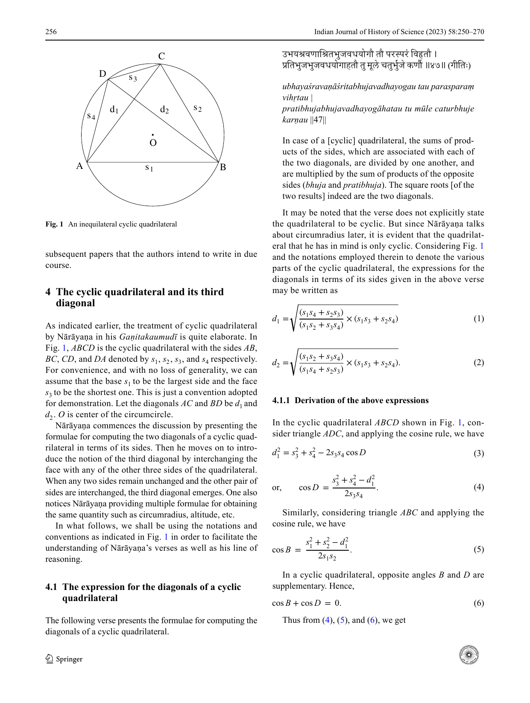

*Fig. 1. An inequilateral cyclic quadrilateral*

<!-- figure-resolved-page-render: page=7 image=media/p07_page.webp -->

<!-- figure-meta: page=7, position=top, type=diagram -->

Nārāyaṇa commences the discussion by presenting the formulae for computing the two diagonals of a cyclic quadrilateral in terms of its sides. Then he moves on to introduce the notion of the third diagonal by interchanging the face with any of the other three sides of the quadrilateral. When any two sides remain unchanged and the other pair of sides are interchanged, the third diagonal emerges. One also notices Nārāyaṇa providing multiple formulae for obtaining the same quantity such as circumradius, altitude, etc.
In what follows, we shall be using the notations and conventions as indicated in Fig. 1 in order to facilitate the understanding of Nārāyaṇa’s verses as well as his line of reasoning.

### 4.1 The expression for the diagonals of a cyclic quadrilateral

The following verse presents the formulae for computing the diagonals of a cyclic quadrilateral.
उभयश्रवणाश्रितभुजवधयोगौ तौ परस्परं विहृतौ ।
प्रतिभुजभुजवधयोगाहतौ तु मूले चतुर्भुजे कर्णौ ॥४७॥ (गीति:)
*ubhayaśravaṇāśritabhujavadhayogau tau parasparaṃ vihṛtau |*
*pratibhujabhujavadhayogāhatau tu mūle caturbhuje karṇau ||47||*
In case of a [cyclic] quadrilateral, the sums of products of the sides, which are associated with each of the two diagonals, are divided by one another, and are multiplied by the sum of products of the opposite sides (*bhuja* and *pratibhuja*). The square roots [of the two results] indeed are the two diagonals.
It may be noted that the verse does not explicitly state the quadrilateral to be cyclic. But since Nārāyaṇa talks about circumradius later, it is evident that the quadrilateral that he has in mind is only cyclic. Considering Fig. 1 and the notations employed therein to denote the various parts of the cyclic quadrilateral, the expressions for the diagonals in terms of its sides given in the above verse may be written as

$$d_1 = \sqrt{\frac{(s_1s_4 + s_2s_3)}{(s_1s_2 + s_3s_4)} \times (s_1s_3 + s_2s_4)} \qquad (1)$$

$$d_2 = \sqrt{\frac{(s_1s_2 + s_3s_4)}{(s_1s_4 + s_2s_3)} \times (s_1s_3 + s_2s_4)}. \qquad (2)$$

#### 4.1.1 Derivation of the above expressions

In the cyclic quadrilateral $ABCD$ shown in Fig. 1, consider triangle $ADC$, and applying the cosine rule, we have

$$d_1^2 = s_3^2 + s_4^2 - 2s_3s_4 \cos D \qquad (3)$$

$$\text{or, } \cos D = \frac{s_3^2 + s_4^2 - d_1^2}{2s_3s_4}. \qquad (4)$$

Similarly, considering triangle $ABC$ and applying the cosine rule, we have

$$\cos B = \frac{s_1^2 + s_2^2 - d_1^2}{2s_1s_2}. \qquad (5)$$

In a cyclic quadrilateral, opposite angles $B$ and $D$ are supplementary. Hence,

$$\cos B + \cos D = 0. \qquad (6)$$

Thus from (4), (5), and (6), we get
***

$$ \left[ \frac{s_1^2 + s_2^2 - d_1^2}{2s_1s_2} \right] + \left[ \frac{s_3^2 + s_4^2 - d_1^2}{2s_3s_4} \right] = 0. \qquad (7) $$

Doing some algebraic manipulation, and rearranging the terms, we get

$$ d_1^2(s_1s_2 + s_3s_4) = s_1s_3(s_1s_4 + s_2s_3) + s_2s_4(s_1s_4 + s_2s_3) $$

$$ = (s_1s_4 + s_2s_3)(s_1s_3 + s_2s_4) $$

$$ \text{or, } d_1^2 = \frac{(s_1s_4 + s_2s_3)(s_1s_3 + s_2s_4)}{(s_1s_2 + s_3s_4)}. $$

Thus we have

$$ d_1 = \sqrt{\frac{(s_1s_4 + s_2s_3)(s_1s_3 + s_2s_4)}{(s_1s_2 + s_3s_4)}}. \qquad (8) $$

Similarly, considering the triangles $ADB$ and $BCD$, it can be shown that

$$ d_2 = \sqrt{\frac{(s_1s_2 + s_3s_4)(s_1s_3 + s_2s_4)}{(s_1s_4 + s_2s_3)}}. \qquad (9) $$

The Eqs. (8) and (9) are the same as (1) and (2) given in the text.

#### 4.1.2 Connecting the phrases of the verse with the formula for diagonals

Indian mathematicians and astronomers have long been guided by the principle of parsimony (*lāghava*). We can witness here in this verse of Nārāyaṇa, an expert usage of a compound word constituting six component words in order to precisely and parsimoniously convey the terms of the expressions in Eqs. (1) and (2) respectively. This subsection is devoted to bring forth the nuanced coining of expressions of Nārāyaṇa. The derivation of the compound word that appears right at the beginning of the verse in the *gīti* meter penned above is—
उभयश्रवणाश्रितभुजवधयोगौ उभये श्रवणे उभयश्रवणे । तयोः (पक्षद्वये उपरि अधोभागे च त्रिकोणाकारक्षेत्र-पूरकत्वेन) आश्रितौ यौ भुजौ उभयश्रवणाश्रितभुजौ । तयोर्वधौ उभयश्रवणाश्रित-भुजवधौ । तयोर्योगौ उभयश्रवणाश्रितभुजवधयोगौ ।
*ubhayaśravaṇāśrita-bhujavadhayogau* ubhaye śravaṇe ubhayaśravaṇe | tayoḥ (*pakṣadvaye upari adhobhāge ca trikoṇākārakṣetra-pūrakatvena*) āśritau yau bhujau ubhayaśravaṇāśritabhujau | tayorvadhau ubhayaśravaṇāśrita-bhujavadhau | tayoryogau ubhayaśravaṇāśrita-bhujavadhayogau |
The compound word essentially prescribes us to perform two mathematical operations.
1. To compute the product of the two sides (*bhujas*) that rests on a diagonal (*śravaṇa*) forming two triangles (the upper and lower).
2. To find the sum of these two products of the sides of the upper and lower triangles resting on the diagonal.
By upper and lower triangles, we mean the triangles that are formed with the face and base of the quadrilateral respectively. For instance, in Fig. 1, the triangle $ADC$ which sides $s_3$ and $s_4$ forms the upper triangle, whereas the triangle $ABC$ with sides $s_1$ and $s_2$ forms the lower triangle. This is with reference to the diagonal $d_1$. Similarly, with reference to the diagonal $d_2$, $BDC$ and $ADB$ form the upper and lower triangles. Now, the phrase ‘*ubhayaśravaṇāśrita-bhujavadhayogau*’ refers to the two quantities

$$ (s_1s_2 + s_3s_4) \text{ and } (s_1s_4 + s_2s_3), $$

respectively. Then the text prescribes us to mutually divide the two sums of the products (*tau parasparaṃ vihṛtau*) to obtain the two ratios:

$$ \frac{(s_1s_2 + s_3s_4)}{(s_1s_4 + s_2s_3)} \text{ and } \frac{(s_1s_4 + s_2s_3)}{(s_1s_2 + s_3s_4)}. \qquad (10) $$

Then it says that these two ratios are to be multiplied by the sum of products of the opposite sides (*pratibhujabhujavadhayoga*). That is, by the sum, $(s_1s_3 + s_2s_4)$. Thus we obtain

$$ \frac{(s_1s_2 + s_3s_4)}{(s_1s_4 + s_2s_3)} \times (s_1s_3 + s_2s_4) \qquad (11) $$

$$ \frac{(s_1s_4 + s_2s_3)}{(s_1s_2 + s_3s_4)} \times (s_1s_3 + s_2s_4). \qquad (12) $$

Finally, it is said that the square roots of the products obtained above would be the “mutual” diagonals ($d_2$ and $d_1$) of the quadrilateral (*caturbhuje (parasparaṃ) karṇau bhavataḥ*).

$$ d_2 = \sqrt{\frac{(s_1s_2 + s_3s_4)}{(s_1s_4 + s_2s_3)} \times (s_1s_3 + s_2s_4)} \qquad (13) $$

$$ d_1 = \sqrt{\frac{(s_1s_4 + s_2s_3)}{(s_1s_2 + s_3s_4)} \times (s_1s_3 + s_2s_4)}. \qquad (14) $$

The above two expressions are precisely the (2) and (1) given by Nārāyaṇa in his verse. Here, it may noted that the numerators of the two expressions in (10) are obtained by taking the sum of products of the sides that rest upon diagonals $d_1$ and $d_2$ respectively. However, the magnitudes of the diagonals generated using these two expressions given by
***
(13) and (14) correspond to $d_2$ and $d_1$. It is for this reason, we have supplied the word mutual (*parasparam*) as a qualifier to the word ‘*karṇau*’ by borrowing it from the first half of the verse. This process of supplying it once more is technically called as *anuvṛtti* and is not uncommon in the technical literature in Sanskrit.
One can argue that it may possible to completely avoid this *anuvṛtti* by having slightly different interpretation for the phrase ‘*śravaṇāśritabhujavadha*.’ In that case, one may have to present the derivation of the compound ‘*śravaṇāśritabhujau*’ as
श्रवणयोः (कोणद्वये) आश्रितौ यौ भुजौ तयोर्वधः श्रवणाश्रितभुजवधः ।
*śravaṇayoḥ (koṇadvaye) āśritau yau bhujau tayor vadhaḥ śravaṇāśritabhujavadhaḥ |*
The product of the sides that are associated with the two edges of the diagonals.
It is true that such an interpretation would enable us to arrive at the formulae (1) and (2) without having to invoke the word ‘*parasparaṃ*’ once more.[^4] However, with such an interpretation we would miserably fail in arriving at a couple of results that have been presented by Nārāyaṇa later in the chapter. In fact, our interpretation of the phrase ‘*śravaṇāśritabhujavadhayoga*’ is indeed correct gets confirmed by the use of identical phrases in the text in two more instances. One such instance may be gleaned from the discussion in Sect. 4.4.1 of this paper itself.

### 4.2 The third diagonal and its nature

A quadrilateral is by definition a four-sided figure. It can be either equilateral, equitrilateral, equidichastic (where pairs of sides are equal, as in a rectangle or kite), equibilateral, or inequilateral. In the following verses, having introduced the novel concept called the third diagonal (*tṛtīyakarṇa*) and how it has to be generated, Nārāyaṇa also explains the nature of this third diagonal in different forms of quadrilaterals listed above. All this has been done in just two-and-a-half verses in *Āryā* meter. What is noteworthy is the concision and precision with which Nārāyaṇa is able to express the ideas.
सर्वचतुर्बाहूनां मुखस्य परिवर्तने यदा विहिते ।
कर्णस्तदा तृतीयः परमिति कर्णत्रयं भवति ॥४८॥ (आर्या)
तुल्यं कर्णत्रितयं समचतुरश्रे तथा त्रिसमदोष्णि।
द्विद्विसमे तु द्विसमे तुल्यौ द्वावसडृशश्चान्यः ॥४९॥ (आर्या)
कर्णत्रयमसमं स्यात् विषमे च चतुर्भुजे नियतम् । (गीति)
*sarvacaturbāhūnāṃ mukhasya parivartane yadā vihite |*
*karṇastadā tṛtīyaḥ paramiti karṇatrayaṃ bhavati ||48||*
*tulyaṃ karṇatritayaṃ samacaturaśre tathā trisamadoṣṇi|*
*dvidvisame tu dvisame tulyau dvāvasadṛśaścānyaḥ ||49||*
*karṇatrayamasamaṃ syāt viṣame ca caturbhuje niyatam |*
In all the four-sided figures, when the face (*mukha*) is interchanged [with other sides] then there would be subsequently (*param*) a third diagonal. Thus, there are three diagonals for all quadrilaterals. Of course, the three diagonals are equal for equilateral (*samacaturaśra*) and equitrilateral (*trisamadoṣan*) quadrilaterals, two diagonals are equal and other is unequal for equidichastic (*dvidvisamacaturaśra*) and equibilateral (*dvisamacaturaśra*) quadrilaterals, and the three diagonals are unequal for an irregular or inequilateral (*viṣamacaturaśra*) quadrilateral.
The third diagonal envisioned by Nārāyaṇa becomes manifest once we interchange the face with any of the other three sides of the quadrilateral. While the term *mukha* and its synonyms are used to denote the face of the quadrilateral, the term *bhūmi* (earth) and its synonyms are used to denote its base. The flank sides are generally referred to by the generic word *bāhu* or *bhuja* (hand) and its synonyms.
The figure that results by swapping the face of the cyclic quadrilateral shown in Fig. 1 with one of the flank sides is shown in Fig. 2. It may be noted that the resultant cyclic quadrilateral $ABCE$ would have one of the diagonals retained as such because a pair of sides have not been changed. It is also to be noted that a new diagonal $d_3$ is born because of the interchanging of these sides. The magnitude of this diagonal $BE$ and its relation with the sides can be derived similar to the derivation of (1) and (2) by considering triangles $AEB$ and $CEB$, and using the cosine rule.

$$ d_3 = \sqrt{\frac{(s_1s_2 + s_3s_4)(s_1s_4 + s_2s_3)}{(s_1s_3 + s_2s_4)}}. \qquad (15) $$

Following the definition of the third diagonal, Nārāyaṇa presents three propositions on the nature of the third diagonal that has to do with the type of the quadrilateral circumscribed in the circle. The three propositions are:
1. The three diagonals are all equal in an equilateral or equitrilateral cyclic quadrilateral.
***

<!-- figure-resolved-page-render-hidden: image=media/p10_page.webp caption="Fig. 2. Cyclic quadrilateral with interchanged sides $s_3$ and $s_4$ and the third diagonal $d_3$" -->

<!-- figure-meta: page=10, position=top-left, type=diagram -->

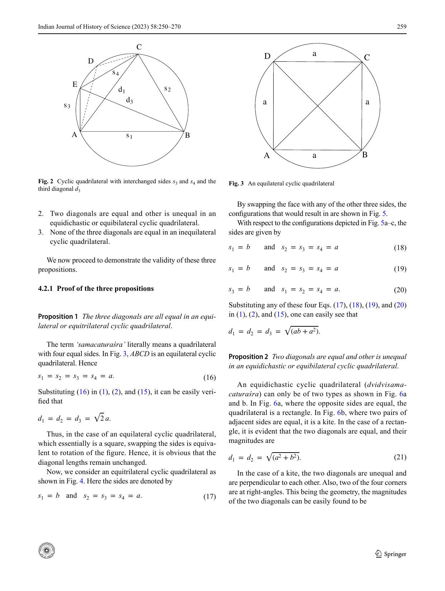

*Fig. 3. An equilateral cyclic quadrilateral*

<!-- figure-resolved-page-render: page=10 image=media/p10_page.webp -->

<!-- figure-meta: page=10, position=top-right, type=diagram -->

2. Two diagonals are equal and other is unequal in an equidichastic or equibilateral cyclic quadrilateral.
3. None of the three diagonals are equal in an inequilateral cyclic quadrilateral.
We now proceed to demonstrate the validity of these three propositions.

#### 4.2.1 Proof of the three propositions

**Proposition 1** *The three diagonals are all equal in an equilateral or equitrilateral cyclic quadrilateral.*
The term ‘*samacaturaśra*’ literally means a quadrilateral with four equal sides. In Fig. 3, $ABCD$ is an equilateral cyclic quadrilateral. Hence

$$s_1 = s_2 = s_3 = s_4 = a. \qquad (16)$$

Substituting (16) in (1), (2), and (15), it can be easily verified that

$$d_1 = d_2 = d_3 = \sqrt{2}a.$$

Thus, in the case of an equilateral cyclic quadrilateral, which essentially is a square, swapping the sides is equivalent to rotation of the figure. Hence, it is obvious that the diagonal lengths remain unchanged.
Now, we consider an equitrilateral cyclic quadrilateral as shown in Fig. 4. Here the sides are denoted by

$$s_1 = b \text{ and } s_2 = s_3 = s_4 = a. \qquad (17)$$

By swapping the face with any of the other three sides, the configurations that would result in are shown in Fig. 5.
With respect to the configurations depicted in Fig. 5a–c, the sides are given by

$$s_1 = b \quad \text{and} \quad s_2 = s_3 = s_4 = a \qquad (18)$$

$$s_1 = b \quad \text{and} \quad s_2 = s_3 = s_4 = a \qquad (19)$$

$$s_3 = b \quad \text{and} \quad s_1 = s_2 = s_4 = a. \qquad (20)$$

Substituting any of these four Eqs. (17), (18), (19), and (20) in (1), (2), and (15), one can easily see that

$$d_1 = d_2 = d_3 = \sqrt{ab + a^2}.$$

**Proposition 2** *Two diagonals are equal and other is unequal in an equidichastic or equibilateral cyclic quadrilateral.*
An equidichastic cyclic quadrilateral (*dvidvisamacaturaśra*) can only be of two types as shown in Fig. 6a and b. In Fig. 6a, where the opposite sides are equal, the quadrilateral is a rectangle. In Fig. 6b, where two pairs of adjacent sides are equal, it is a kite. In the case of a rectangle, it is evident that the two diagonals are equal, and their magnitudes are

$$d_1 = d_2 = \sqrt{a^2 + b^2}. \qquad (21)$$

In the case of a kite, the two diagonals are unequal and are perpendicular to each other. Also, two of the four corners are at right-angles. This being the geometry, the magnitudes of the two diagonals can be easily found to be
***

[^4]: It may be mentioned that the text *Gaṇitayuktibhāṣā* (Ramasubramanian et al., 2009, p. 114 and p. 242) uses this kind of interpretation.

<!-- figure-resolved-page-render-hidden: image=media/p11_page.webp caption="Fig. 4. An equitrilateral cyclic quadrilateral" -->

<!-- figure-meta: page=11, position=top-left, type=diagram -->

$$d_1 = \frac{2 a b}{\sqrt{(a^2 + b^2)}}$$ (22)

$$d_2 = \sqrt{(a^2 + b^2)}.$$ (23)
It may be noted that expression (23) is the same as the diagonal of the rectangle (21). This is because the two sides forming the diagonal are perpendicular to each other. With this preamble, we now proceed to analyze what happens to the third diagonal in these two cases separately.
**Case A: The equidichastic quadrilateral is a rectangle**
Here again there are two possibilities. (i) swapping the face with any of the two sides and (ii) swapping the face with the base. In the first case, by swapping the face with any of the two sides, the resultant figure would be a kite which is depicted in Fig. 6b. In the second case, by swapping the face with the base, the resultant figure would be identical to the rectangle in Fig. 6a. Thus, by swapping the sides, the third diagonal that is generated will be either equal to (22) or (23).

<!-- figure-resolved-page-render-hidden: image=media/p11_page.webp caption="Fig. 6. An equidichastic cyclic quadrilateral" -->

<!-- figure-meta: page=11, position=top-right, type=diagram -->

**Case B: The equidichastic quadrilateral is a kite**
Here, it can be easily visualized that by changing the face with the base or sides, the resulting configuration would either be identical to a kite or a rectangle, and hence the geometry would not be different from what has been depicted in Fig. 6a and b. Therefore, the magnitude of the third diagonal that is generated by swapping has to be necessarily given by (22) or (23).
By substituting $s_1 = s_3 = a$ and $s_2 = s_4 = b$ in (1), (2), and (15), it can be easily seen that

$$d_1 = d_2 = \sqrt{(a^2 + b^2)}$$ (24)

$$d_3 = \frac{2 a b}{\sqrt{(a^2 + b^2)}}.$$ (25)
Now, we consider equibilateral (*dvisama*) cyclic quadrilateral as depicted in Fig. 7a. Here the sides are denoted by

$$s_1 = b; \quad s_2 = s_4 = a; \quad \text{and} \quad s_3 = c.$$ (26)
When its face is interchanged with the base as shown in Fig. 7b, it is equivalent to a simple rotation of the figure, and hence the magnitudes of the diagonals remain

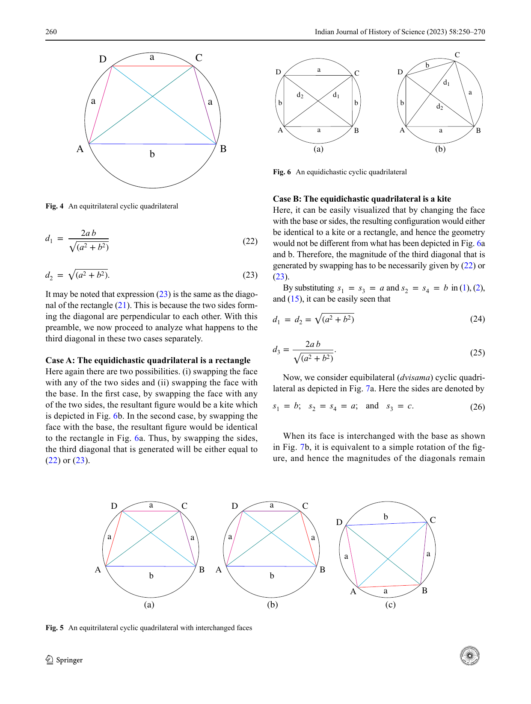

*Fig. 5. An equitrilateral cyclic quadrilateral with interchanged faces*

<!-- figure-resolved-page-render: page=11 image=media/p11_page.webp -->

<!-- figure-meta: page=11, position=bottom, type=diagram -->

260 Indian Journal of History of Science (2023) 58:250–270
---
unchanged. With the configuration shown in Fig. 7b, the sides are given as

$$s_1 = c; \quad s_2 = s_4 = a; \quad \text{and} \quad s_3 = b.$$ (27)
With an interchange of the face with any of the two sides, the Fig. 7a transforms into either Fig. 7c or d. After the interchange, one of the diagonals remains the same, while other undergoes a change. Thus, from these Figs. 7c and d, the lengths of the sides are seen to be

$$s_1 = b; \quad s_2 = c; \quad \text{and} \quad s_3 = s_4 = a$$ (28)

$$s_1 = b; \quad s_2 = s_3 = a; \quad \text{and} \quad s_4 = c.$$ (29)
By substituting these values of $s_1, s_2, s_3, s_4$ given by (26), (27), (28), and (29) in (1), (2), and (15), the values of the three diagonals can be obtained as

$$d_1 = \frac{ab + ac}{\sqrt{a^2 + bc}}$$ (30)

$$d_2 = d_3 = \sqrt{a^2 + bc}.$$ (31)

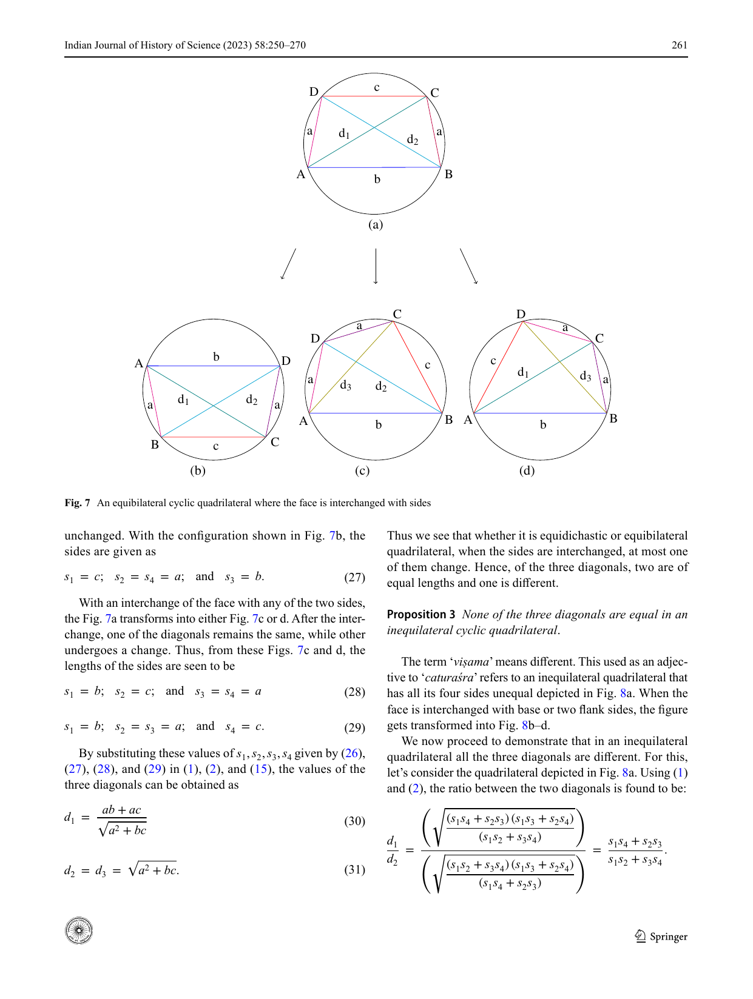

*Fig. 7. An equibilateral cyclic quadrilateral where the face is interchanged with sides*

<!-- figure-resolved-page-render: page=12 image=media/p12_page.webp -->

<!-- figure-meta: page=12, position=top, type=diagram -->

Thus we see that whether it is equidichastic or equibilateral quadrilateral, when the sides are interchanged, at most one of them change. Hence, of the three diagonals, two are of equal lengths and one is different.
**Proposition 3** *None of the three diagonals are equal in an inequilateral cyclic quadrilateral.*
The term ‘*viṣama*’ means different. This used as an adjective to ‘*caturaśra*’ refers to an inequilateral quadrilateral that has all its four sides unequal depicted in Fig. 8a. When the face is interchanged with base or two flank sides, the figure gets transformed into Fig. 8b–d.
We now proceed to demonstrate that in an inequilateral quadrilateral all the three diagonals are different. For this, let’s consider the quadrilateral depicted in Fig. 8a. Using (1) and (2), the ratio between the two diagonals is found to be:

$$\frac{d_1}{d_2} = \frac{\left(\sqrt{\frac{(s_1s_4 + s_2s_3)(s_1s_3 + s_2s_4)}{(s_1s_2 + s_3s_4)}}\right)}{\left(\sqrt{\frac{(s_1s_2 + s_3s_4)(s_1s_3 + s_2s_4)}{(s_1s_4 + s_2s_3)}}\right)} = \frac{s_1s_4 + s_2s_3}{s_1s_2 + s_3s_4}.$$

261 Indian Journal of History of Science (2023) 58:250–270
---
If $d_1 = d_2$, then the above ratio should be equal to one. That is

$$\frac{s_1s_4 + s_2s_3}{s_1s_2 + s_3s_4} = 1$$

or, $s_1s_4 + s_2s_3 = s_1s_2 + s_3s_4$.
Regrouping the terms, we have
$s_1(s_4 - s_2) - s_3(s_4 - s_2) = 0$
or, $(s_1 - s_3)(s_4 - s_2) = 0$. (32)
For (32) to be satisfied, either $s_1 = s_3$ or $s_4 = s_2$. But $s_1 \neq s_3$ and $s_4 \neq s_2$. This means $d_1 \neq d_2$.

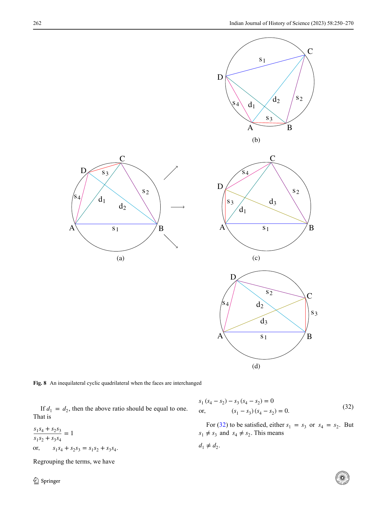

*Fig. 8. An inequilateral cyclic quadrilateral when the faces are interchanged*

<!-- figure-resolved-page-render: page=13 image=media/p13_page.webp -->

<!-- figure-meta: page=13, position=middle, type=diagram -->

262 Indian Journal of History of Science (2023) 58:250–270
---
Proceeding along similar lines by considering other pairs of diagonals $d_1, d_3$, and $d_2, d_3$, we can show that $d_1 \neq d_3$ and $d_2 \neq d_3$.
Thus in an inequilateral quadrilateral, all the three diagonals are different.

### 4.2.2 There can at most be three different diagonals

In this subsection, we try to present a visual picture of how the orientation of the quadrilateral changes by changing the sides.
We know that the four sides of an inequilateral quadrilateral can be arranged in $4! = 24$ ways. However, by keeping the base fixed in the same position, and interchanging the sides with face, we can get six possible orientations. These are depicted in Fig. 9.
In Fig. 9a–f, the four sides of the quadrilateral starting from the base (in anti-clockwise manner) may be referred to as the base, right side, face, and left side, and they are denoted by $G, R, F,$ and $L$ respectively. The magnitudes of the sides of these quadrilaterals are $s_1, s_2, s_3,$ and $s_4$. The magnitudes of the first and second diagonals are $d_1$ and $d_2$ (see Fig. 9a). Let $d_3$ be the third diagonal that would get generated by changing the sides.
In Fig. 9b, the face is interchanged with the left side. Thus $F = s_4$ and $L = s_3$. Consequently, of the two diagonals, $d_1$ remains unchanged and $d_2$ changes to $d_3$. Now, we change the face (in Fig. 9b) with the right side. Because of this, $s_2$ and $s_4$ get interchanged resulting in $F = s_2$ and $R = s_4$, as shown in Fig. 9c. In a similar fashion, if we go on changing the sides, we get different pairs of diagonals. However, the magnitudes of these pairs of diagonals in all the cases can only be any two of the three diagonals $d_1, d_2,$ and $d_3$.

## 4.3 Area of a cyclic quadrilateral involving the third diagonal

As early as the 7th century, Brahmagupta has given an expression for computing the area of a cyclic quadrilateral. It is purely in terms of the sides of the quadrilateral and does not involve the diagonals. If $a, b, c, d$ refer to the sides, and $s = \frac{a+b+c+d}{2}$, then the expression given by Brahmagupta may be expressed as (Kichenassamy, 2010, p. 29):

$$\text{Area} = \sqrt{(s - a)(s - b)(s - c)(s - d)}.$$

The phrase employed by Brahmagupta to express the above formula is
भुजयोगार्धचतुष्टयभुजोनघातात् पदं सूक्ष्मम् ।
*bhujayogārdhacatuṣṭayabhujonaghātāt padaṃ sūkṣmam |*

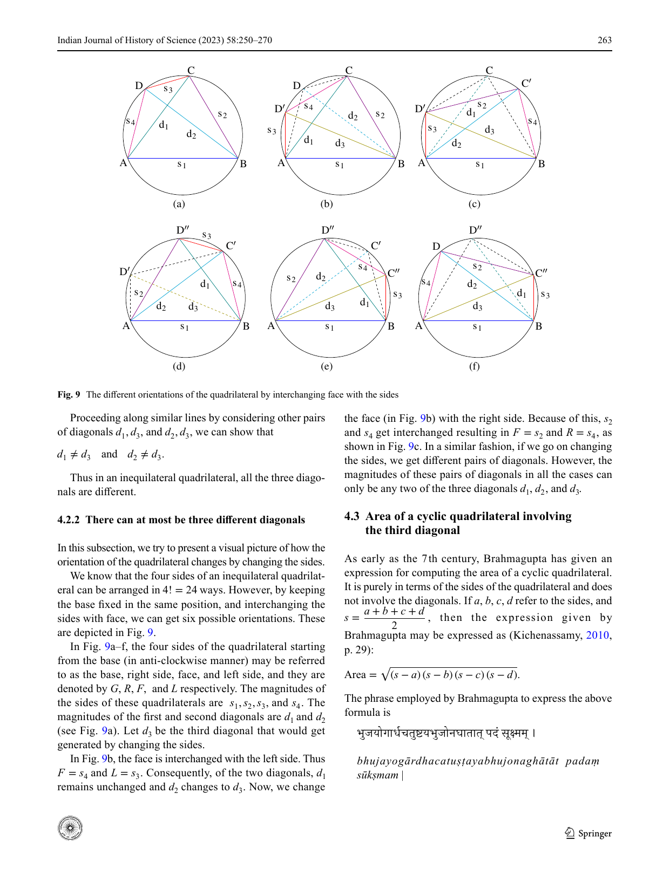

*Fig. 9. The different orientations of the quadrilateral by interchanging face with the sides*

<!-- figure-resolved-page-render: page=14 image=media/p14_page.webp -->

<!-- figure-meta: page=14, position=top, type=diagram -->

263 Indian Journal of History of Science (2023) 58:250–270
---
The square root of half the sum of [all] the sides set down four times, lessened by the [individual] sides (*bhujona*), being multiplied (*ghātāt*) gives the accurate [area].
Nārāyaṇa, apart from giving this formula, defines the area in terms of the three diagonals. The diagonals, of course, would be in terms of the sides. But, the expression for the area in terms of the diagonals is quite elegant, and hence very appealing to the mind. Before presenting the relation given by Nārāyaṇa, we would like to discuss another important result given by him pertaining to the relation between the sides of a triangle and the circumdiameter. As this result would be extremely useful in arriving at the expression for the area of cyclic quadrilateral, Nārāyaṇa too in his text presents this result in the verse that’s just preceding the verse that gives the expression for the area.

### 4.3.1 Relation between the sides of the triangle and its circumdiameter

त्रिभुजस्य भुजाभ्यासे लम्बविभक्ते प्रजायते व्यासः ॥५१॥
(उद्गीतिः)
*tribhujasya bhujābhyāse lambavibhakte prajāyate vyāsaḥ ||51||*
The product of [two] sides of a triangle divided by its altitude gives the diameter [of circumcircle].
This verse essentially presents the lemma that the product of diameter and altitude is equal to the product of the adjacent sides.
We demonstrate this by considering the triangle $ABC$ inscribed in a circle as shown in Fig. 10. The altitude of this triangle is $CM$. Here, $O$ is the center of the circle. A point $D$ is chosen such that the vertex $C$ joining this point becomes the diameter. Now, we join $DB$. Since $CD$ is the diameter, $\angle CBD = 90^\circ$. Also, $\angle AMC = 90^\circ$.
Now, we consider the side $BC$ of the triangle. It can be visualized as the chord corresponding to the arc $BC$, which in turn may be visualized as a bow. By the “bow tie” property, the angles subtended by this chord at the vertices $A$ and $D$ of the triangles $ABC$ and $BCD$ are one and same. Thus we have,

$$\angle BAC = \angle BDC = \angle MAC.$$ (33)
Since the two pairs of the angles are equal, triangles $CAM$ and $CDB$ are similar. Hence,

$$\frac{CA}{CM} = \frac{CD}{CB} \quad \text{or,} \quad CD = \frac{CA \times CB}{CM}.$$ (34)
It is precisely this relation that is stated in the verse as,

$$vy\bar{a}sa = \frac{bhuj\bar{a}bhy\bar{a}sa}{lamba}.$$ (35)
This may also be expressed as,

$$(\text{Circumdiameter}) \times (\text{Altitude}) = \text{Product of adjacent sides of a triangle.}$$

This result is also explicitly mentioned in *Gaṇitayuktibhāṣā* (Ramasubramanian et al., 2009, p. 247). In fact, even Brahmagupta in the 7th century presents this important result in his *Brāhmasphuṭasiddhānta* (Dvivedi, 1902, pp. 190–191). Verse 26 of the XII chapter, which was alluded to in Sect. 2 of the paper, goes as:
अविषमपार्श्वभुजगुणः कर्णो द्विगुणावलम्बकविभक्तः । हृदयं ...
*aviṣamapārśvabhujaguṇaḥ karṇo dviguṇāvalambakavibhaktaḥ | hṛdayaṃ ...*
In the case of a non-inequilateral (*aviṣama*) [quadrilateral], the diagonal multiplied by the flank side (*pārśvabhuja*) and divided by twice the perpendicular is the circumradius (*hṛdaya*). ...
The term *aviṣama* used by Brahmagupta signifies a non-inequilateral quadrilateral. This could in principle mean any of the figures: equilateral, equitrilateral, equidichastic, or equibilateral quadrilateral. In order to demonstrate the rule given by Brahmagupta, we consider an equibilateral quadrilateral $ABCD$ as shown in Fig. 11. The verse talks of the product of a flank side (*pārśvabhuja*) and the diagonal (*karṇa*). For this, we consider the segments $AB$ and $AC$ respectively. It also speaks of a perpendicular (*avalambaka*). Though one could in principle conceive of any of the two avalambakas $DE$ and $AF$, intuitively one would opt for the latter, (though unstated) as this is the one that is connected to the meeting point of the diagonal and the flank side.

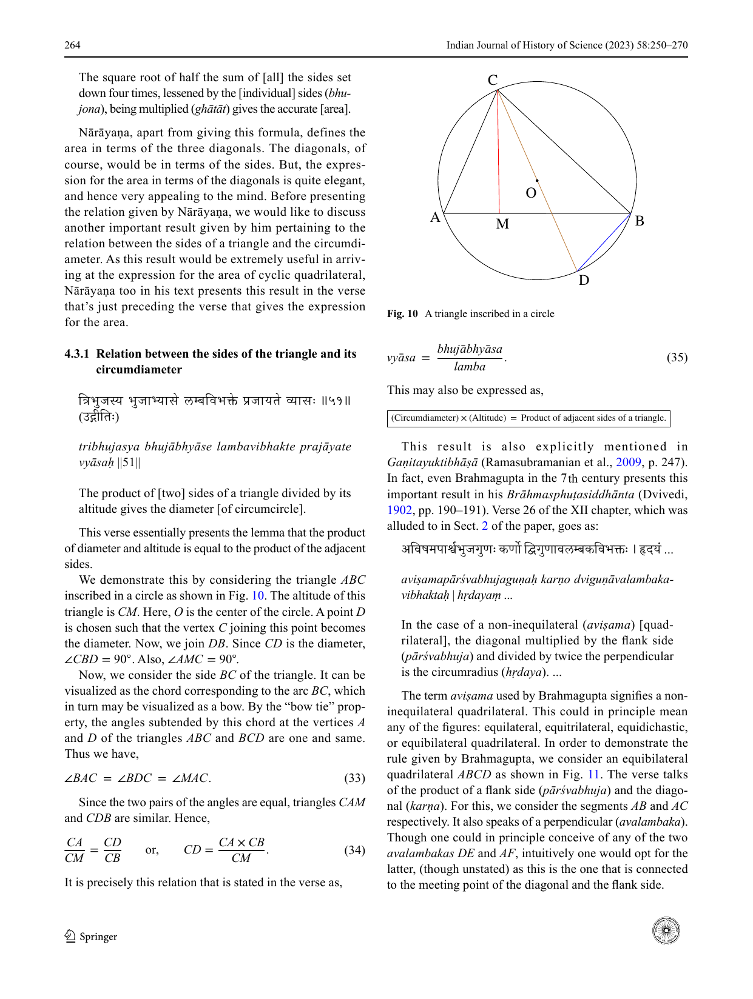

*Fig. 10. A triangle inscribed in a circle*

<!-- figure-resolved-page-render: page=15 image=media/p15_page.webp -->

<!-- figure-meta: page=15, position=top-right, type=diagram -->

264 Indian Journal of History of Science (2023) 58:250–270

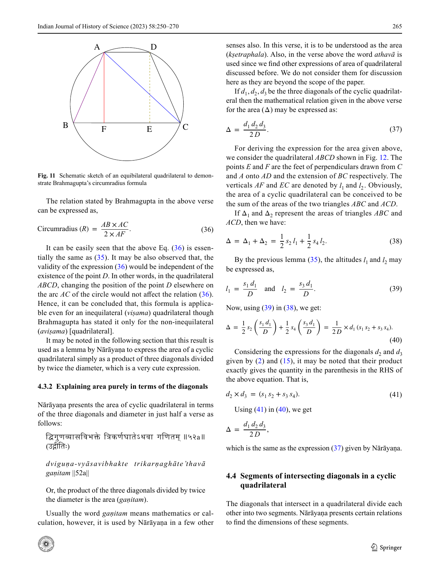

*Fig. 11. Schematic sketch of an equibilateral quadrilateral to demonstrate Brahmagupta's circumradius formula*

<!-- figure-resolved-page-render: page=16 image=media/p16_page.webp -->

<!-- figure-meta: page=16, position=top, type=diagram -->

The relation stated by Brahmagupta in the above verse can be expressed as,

$$ \text{Circumradius } (R) = \frac{AB \times AC}{2 \times AF} \tag{36} $$

It can be easily seen that the above Eq. (36) is essentially the same as (35). It may be also observed that, the validity of the expression (36) would be independent of the existence of the point $D$. In other words, in the quadrilateral $ABCD$, changing the position of the point $D$ elsewhere on the arc $AC$ of the circle would not affect the relation (36). Hence, it can be concluded that, this formula is applicable even for an inequilateral (*viṣama*) quadrilateral though Brahmagupta has stated it only for the non-inequilateral (*aviṣama*) [quadrilateral].
It may be noted in the following section that this result is used as a lemma by Nārāyaṇa to express the area of a cyclic quadrilateral simply as a product of three diagonals divided by twice the diameter, which is a very cute expression.

### 4.3.2 Explaining area purely in terms of the diagonals

Nārāyaṇa presents the area of cyclic quadrilateral in terms of the three diagonals and diameter in just half a verse as follows:
द्विगुणव्यासविभक्ते त्रिकर्णघातेऽथवा गणितम् ॥५२a॥
(उद्गीतिः)
*dviguṇa-vyāsavibhakte trikarṇaghāte’thavā gaṇitam ||52a||*
Or, the product of the three diagonals divided by twice the diameter is the area (*gaṇitam*).
Usually the word *gaṇitam* means mathematics or calculation, however, it is used by Nārāyaṇa in a few other senses also. In this verse, it is to be understood as the area (*kṣetraphala*). Also, in the verse above the word *athavā* is used since we find other expressions of area of quadrilateral discussed before. We do not consider them for discussion here as they are beyond the scope of the paper.
If $d_1, d_2, d_3$ be the three diagonals of the cyclic quadrilateral then the mathematical relation given in the above verse for the area ($\Delta$) may be expressed as:

$$ \Delta = \frac{d_1 d_2 d_3}{2 D} \tag{37} $$

For deriving the expression for the area given above, we consider the quadrilateral $ABCD$ shown in Fig. 12. The points $E$ and $F$ are the feet of perpendiculars drawn from $C$ and $A$ onto $AD$ and the extension of $BC$ respectively. The verticals $AF$ and $EC$ are denoted by $l_1$ and $l_2$. Obviously, the area of a cyclic quadrilateral can be conceived to be the sum of the areas of the two triangles $ABC$ and $ACD$.
If $\Delta_1$ and $\Delta_2$ represent the areas of triangles $ABC$ and $ACD$, then we have:

$$ \Delta = \Delta_1 + \Delta_2 = \frac{1}{2} s_2 l_1 + \frac{1}{2} s_4 l_2. \tag{38} $$

By the previous lemma (35), the altitudes $l_1$ and $l_2$ may be expressed as,

$$ l_1 = \frac{s_1 d_1}{D} \quad \text{and} \quad l_2 = \frac{s_3 d_1}{D}. \tag{39} $$

Now, using (39) in (38), we get:

$$ \Delta = \frac{1}{2} s_2 \left( \frac{s_1 d_1}{D} \right) + \frac{1}{2} s_4 \left( \frac{s_3 d_1}{D} \right) = \frac{1}{2 D} \times d_1 (s_1 s_2 + s_3 s_4). \tag{40} $$

Considering the expressions for the diagonals $d_2$ and $d_3$ given by (2) and (15), it may be noted that their product exactly gives the quantity in the parenthesis in the RHS of the above equation. That is,

$$ d_2 \times d_3 = (s_1 s_2 + s_3 s_4). \tag{41} $$

Using (41) in (40), we get

$$ \Delta = \frac{d_1 d_2 d_3}{2 D}, $$

which is the same as the expression (37) given by Nārāyaṇa.

## 4.4 Segments of intersecting diagonals in a cyclic quadrilateral

The diagonals that intersect in a quadrilateral divide each other into two segments. Nārāyaṇa presents certain relations to find the dimensions of these segments.

<!-- figure-resolved-page-render-hidden: image=media/p17_page.webp caption="Fig. 12. A cyclic quadrilateral with additional verticals drawn" -->

<!-- figure-meta: page=17, position=top, type=diagram -->

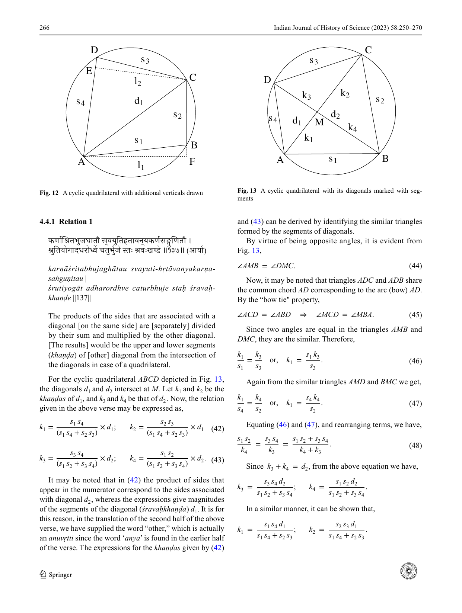

*Fig. 13. A cyclic quadrilateral with its diagonals marked with segments*

<!-- figure-resolved-page-render: page=17 image=media/p17_page.webp -->

<!-- figure-meta: page=17, position=top, type=diagram -->

### 4.4.1 Relation 1

कर्णाश्रितभुजघातौ स्वयुतिहृतान्यकर्णसङ्गुणितौ ।
श्रुतियोगादधरूर्ध्वे चतुर्भुजे स्तः श्रवःखण्डे ॥१३७॥ (आर्या)
*karṇāśritabhujaghātau svayuti-hṛtāvanyakarṇasaṅguṇitau |*
*śrutiyogāt adharordhve caturbhuje staḥ śravaḥkhaṇḍe ||137||*
The products of the sides that are associated with a diagonal [on the same side] are [separately] divided by their sum and multiplied by the other diagonal. [The results] would be the upper and lower segments (*khaṇḍa*) of [other] diagonal from the intersection of the diagonals in case of a quadrilateral.
For the cyclic quadrilateral $ABCD$ depicted in Fig. 13, the diagonals $d_1$ and $d_2$ intersect at $M$. Let $k_1$ and $k_2$ be the *khaṇḍas* of $d_1$, and $k_3$ and $k_4$ be that of $d_2$. Now, the relation given in the above verse may be expressed as,

$$ k_1 = \frac{s_1 s_4}{(s_1 s_4 + s_2 s_3)} \times d_1; \quad k_2 = \frac{s_2 s_3}{(s_1 s_4 + s_2 s_3)} \times d_1 \tag{42} $$

$$ k_3 = \frac{s_3 s_4}{(s_1 s_2 + s_3 s_4)} \times d_2; \quad k_4 = \frac{s_1 s_2}{(s_1 s_2 + s_3 s_4)} \times d_2 \tag{43} $$

It may be noted that in (42) the product of sides that appear in the numerator correspond to the sides associated with diagonal $d_2$, whereas the expressions give magnitudes of the segments of the diagonal (*śravaḥkhaṇḍa*) $d_1$. It is for this reason, in the translation of the second half of the above verse, we have supplied the word "other," which is actually an *anuvṛtti* since the word '*anya*' is found in the earlier half of the verse. The expressions for the *khaṇḍas* given by (42) and (43) can be derived by identifying the similar triangles formed by the segments of diagonals.
By virtue of being opposite angles, it is evident from Fig. 13,

$$ \angle AMB = \angle DMC. \tag{44} $$

Now, it may be noted that triangles $ADC$ and $ADB$ share the common chord $AD$ corresponding to the arc (bow) $AD$. By the "bow tie" property,

$$ \angle ACD = \angle ABD \Rightarrow \angle MCD = \angle MBA. \tag{45} $$

Since two angles are equal in the triangles $AMB$ and $DMC$, they are the similar. Therefore,

$$ \frac{k_1}{s_1} = \frac{k_3}{s_3} \quad \text{or, } k_1 = \frac{s_1 k_3}{s_3}. \tag{46} $$

Again from the similar triangles $AMD$ and $BMC$ we get,

$$ \frac{k_1}{s_4} = \frac{k_4}{s_2} \quad \text{or, } k_1 = \frac{s_4 k_4}{s_2}. \tag{47} $$

Equating (46) and (47), and rearranging terms, we have,

$$ \frac{s_1 s_2}{k_4} = \frac{s_3 s_4}{k_3} = \frac{s_1 s_2 + s_3 s_4}{k_4 + k_3}. \tag{48} $$

Since $k_3 + k_4 = d_2$, from the above equation we have,

$$ k_3 = \frac{s_3 s_4 d_2}{s_1 s_2 + s_3 s_4}; \quad k_4 = \frac{s_1 s_2 d_2}{s_1 s_2 + s_3 s_4}. $$

In a similar manner, it can be shown that,

$$ k_1 = \frac{s_1 s_4 d_1}{s_1 s_4 + s_2 s_3}; \quad k_2 = \frac{s_2 s_3 d_1}{s_1 s_4 + s_2 s_3}. $$

These are precisely the expressions (42) and (43) given in the verse.

### 4.4.2 Relation 2

Having presented the expressions for the four segments of the diagonals in which the two diagonals themselves appear in the RHS, Nārāyaṇa proceeds to present a far more elegant and simpler expression in which the third diagonal alone appears. The following verse prescribes these expressions.
तार्तीयने श्रवसा कुमुखे भक्ते पृथक् पृथक् ताभ्याम् ।
बाहू गुणितौ श्रवसोऽधरस्थिता ऊर्ध्वगे च खण्डे ॥१३८॥ (आर्या)
*tārtīyena śravasā kumukhe bhakte pṛthak pṛthak tābhyām |*
*bāhū guṇitau śravaso’dharasthita ūrdhvage ca khaṇḍe ||138||*
When the base and face are divided by the third diagonal, and are multiplied separately by the flank sides in two different ways, the results obtained would be the lower and upper segments of the diagonals.
In Fig. 13, $s_1$ and $s_3$ are the base and face (*kumukhe*) of the quadrilateral. They are separately divided by the third diagonal $d_3$.

$$ \frac{s_1}{d_3} \quad \text{and} \quad \frac{s_3}{d_3}. \tag{49} $$

These two results when separately multiplied by the two sides $s_2$ and $s_4$ would be lower and upper segments of the diagonals $d_1$ and $d_2$, which are represented by $k_1$ and $k_2$, and $k_4$ and $k_3$ respectively.

$$ k_1 = \frac{s_1}{d_3} \times s_4; \quad k_2 = \frac{s_3}{d_3} \times s_2; \quad k_3 = \frac{s_3}{d_3} \times s_4; \quad k_4 = \frac{s_1}{d_3} \times s_2. \tag{50} $$

The validity of these expressions can be easily checked by considering expressions (1), (2), and (15). By multiplying (1) and (15), and (2) and (15), it can be shown that

$$ d_1 d_3 = (s_1 s_4 + s_2 s_3) \quad \text{and} \quad d_2 d_3 = (s_1 s_2 + s_3 s_4), \tag{51} $$

respectively. Using (51) in (50), and eliminating $d_3$, it can be easily seen that, the latter turn out to be the same as equations given in (42) and (43).
The equation in (50), besides being elegant, hugely reduces the complexity of calculations. Here, to compute a segment of a diagonal, all that we need to do is to find the product of two sides connected to it and divide it by the third diagonal. Comparing with (42) and (43), it can be easily seen that this reduces as much as four mathematical operations in obtaining the magnitude of each segment.

## 4.5 Altitudes of a cyclic quadrilateral

Having given the expressions for the segments of diagonals, Nārāyaṇa prescribes how to compute the altitudes of the two edges of the face of a cyclic quadrilateral from its base.

### 4.5.1 Relation 1

भूहतकर्णविभक्ते स्वाधराखण्डाहते फले द्विगुणे ।
कर्णाग्रस्पृक् लम्बो द्विसमादिचतुर्भुजेष्वथवा ॥१३९॥ (आर्या)
*bhūhatakarṇa-vibhakte svādhara-khaṇḍāhate phale dviguṇe |*
*karṇāgraspṛk lambo dvisamādi-caturbhujeṣvathavā ||139||*
Or, in case of an equibilateral and other quadrilaterals, twice the area is divided by a diagonal, which is multiplied by the base. [The quotient] multiplied by lower segment of the same diagonal (*svādharakhaṇḍa*) is the altitude that touches the tip of the [other] diagonal (*karṇāgraspṛk*).
Here, the word '*karṇāgraspṛk*' has a significance. Nārāyaṇa has conceived of many problems connected with determining altitudes that can be drawn from the *sūcī* to the base of the quadrilateral. By using this word '*karṇāgraspṛk*,' he limits it to only two altitudes that can be drawn from the upper tips of the diagonals. It may be noted that the word 'other' (*anya*) has to be supplied to '*karṇāgraspṛk*' to get the correct expressions for the altitudes. Also, in the verse above the word '*athavā*' is used since we find other expressions for altitudes discussed before.
Consider a cyclic quadrilateral $ABCD$ as shown in Fig. 14 with altitudes $l_1$ and $l_2$ measured from the edges of the face $D$ and $C$ respectively from the base $AB$. Let $\Delta$ be the area of the quadrilateral. Then, as per the prescription given in this verse, the expressions for the altitudes $l_1$ and $l_2$ may be expressed as:

$$ l_1 = \frac{2 \Delta}{s_1 d_1} \times k_1; \quad l_2 = \frac{2 \Delta}{s_1 d_2} \times k_4. \tag{52} $$

For showing the validity of the above expressions, we recall the lemma given in (35). By this lemma,

$$ l_1 = \frac{s_4 d_2}{D}. \tag{53} $$

From (37) and (50), we have

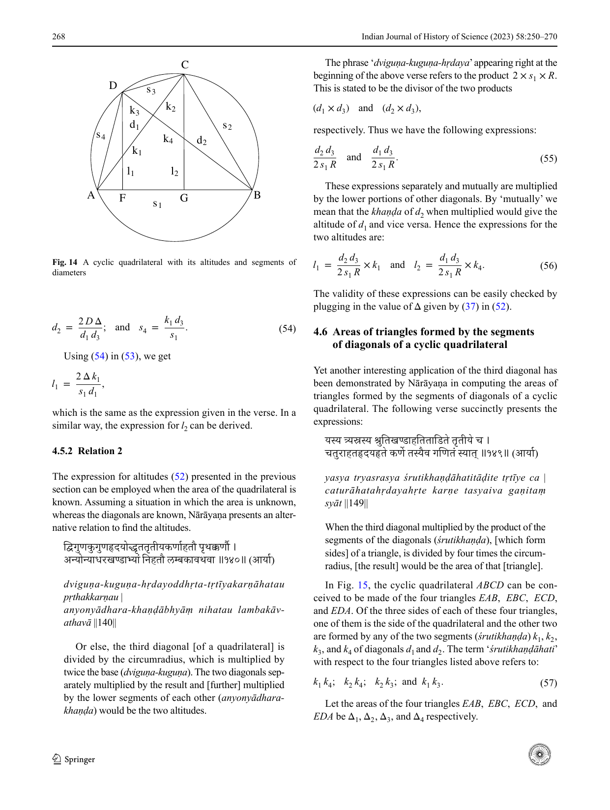

*Fig. 14. A cyclic quadrilateral with its altitudes and segments of diameters*

<!-- figure-resolved-page-render: page=19 image=media/p19_page.webp -->

<!-- figure-meta: page=19, position=top, type=diagram -->

Using (54) in (53), we get

$$ d_2 = \frac{2 D \Delta}{d_1 d_3}; \quad \text{and} \quad s_4 = \frac{k_1 d_3}{s_1}. \tag{54} $$

$$ l_1 = \frac{2 \Delta k_1}{s_1 d_1}, $$

which is the same as the expression given in the verse. In a similar way, the expression for $l_2$ can be derived.

### 4.5.2 Relation 2

The expression for altitudes (52) presented in the previous section can be employed when the area of the quadrilateral is known. Assuming a situation in which the area is unknown, whereas the diagonals are known, Nārāyaṇa presents an alternative relation to find the altitudes.
द्विगुणकुगुणहृदयोद्धृतत्रितीयकर्णाहतौ पृथक्कर्णौ ।
अन्योन्याधरखण्डाभ्यां निहतौ लम्बकावथवा ॥१४०॥ (आर्या)
*dviguṇa-kuguṇa-hṛdayoddhṛta-tṛtīyakarṇāhatau pṛthakkarṇau |*
*anyonyādhara-khaṇḍābhyāṃ nihatau lambakāvathavā ||140||*
Or else, the third diagonal [of a quadrilateral] is divided by the circumradius, which is multiplied by twice the base (*dviguṇa-kuguṇa*). The two diagonals separately multiplied by the result and [further] multiplied by the lower segments of each other (*anyonyādharakhaṇḍa*) would be the two altitudes.
The phrase ‘*dviguṇa-kuguṇa-hṛdaya*’ appearing right at the beginning of the above verse refers to the product $2 \times s_1 \times R$. This is stated to be the divisor of the two products
$(d_1 \times d_3)$ and $(d_2 \times d_3)$,
respectively. Thus we have the following expressions:

$$ \frac{d_2 d_3}{2 s_1 R} \quad \text{and} \quad \frac{d_1 d_3}{2 s_1 R}. \tag{55} $$

These expressions separately and mutually are multiplied by the lower portions of other diagonals. By ‘mutually’ we mean that the *khaṇḍa* of $d_2$ when multiplied would give the altitude of $d_1$ and vice versa. Hence the expressions for the two altitudes are:

$$ l_1 = \frac{d_2 d_3}{2 s_1 R} \times k_1 \quad \text{and} \quad l_2 = \frac{d_1 d_3}{2 s_1 R} \times k_4. \tag{56} $$

The validity of these expressions can be easily checked by plugging in the value of $\Delta$ given by (37) in (52).

## 4.6 Areas of triangles formed by the segments of diagonals of a cyclic quadrilateral

Yet another interesting application of the third diagonal has been demonstrated by Nārāyaṇa in computing the areas of triangles formed by the segments of diagonals of a cyclic quadrilateral. The following verse succinctly presents the expressions:
यस्य त्र्यस्रस्य श्रुतिखण्डाहतिताडिते तृतीये च ।
चतुराहतहृदयहृते कर्णे तस्यैव गणितं स्यात् ॥१४९॥ (आर्या)
*yasya tryasrasya śrutikhaṇḍāhatitāḍite tṛtīye ca |*
*caturāhatahṛdayahṛte karṇe tasyaiva gaṇitaṃ syāt ||149||*
When the third diagonal multiplied by the product of the segments of the diagonals (*śrutikhaṇḍa*), [which form sides] of a triangle, is divided by four times the circumradius, [the result] would be the area of that [triangle].
In Fig. 15, the cyclic quadrilateral $ABCD$ can be conceived to be made of the four triangles $EAB$, $EBC$, $ECD$, and $EDA$. Of the three sides of each of these four triangles, one of them is the side of the quadrilateral and the other two are formed by any of the two segments (*śrutikhaṇḍa*) $k_1, k_2, k_3,$ and $k_4$ of diagonals $d_1$ and $d_2$. The term ‘*śrutikhaṇḍāhati*’ with respect to the four triangles listed above refers to:

$$ k_1 k_4; \quad k_2 k_4; \quad k_2 k_3; \quad \text{and} \quad k_1 k_3. \tag{57} $$

Let the areas of the four triangles $EAB, EBC, ECD,$ and $EDA$ be $\Delta_1, \Delta_2, \Delta_3,$ and $\Delta_4$ respectively.

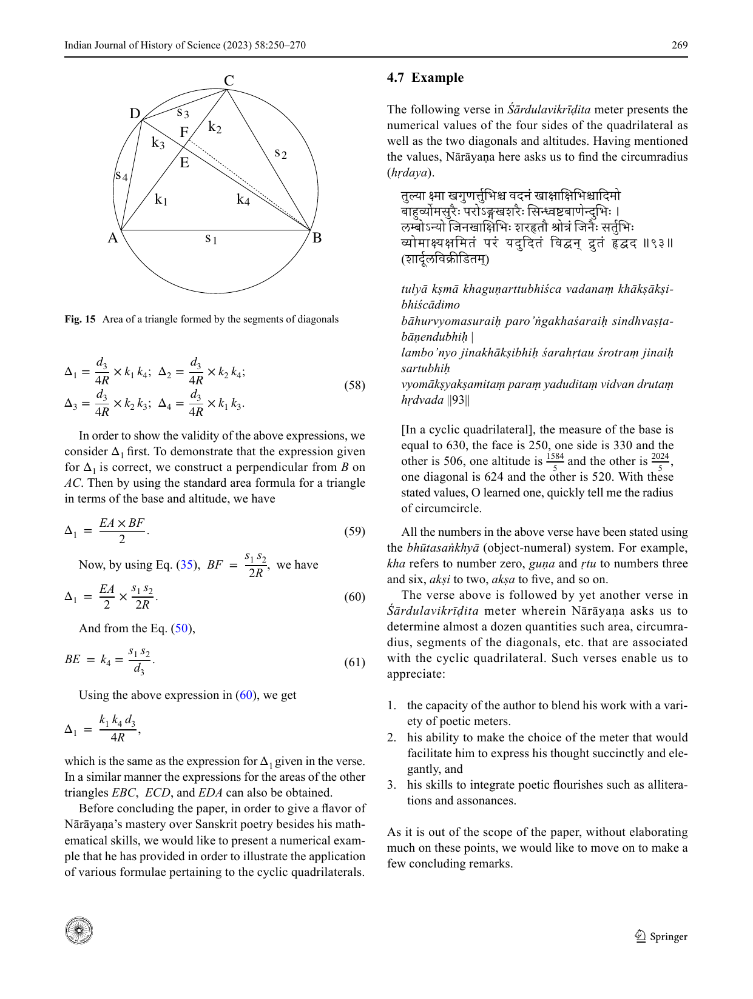

*Fig. 15. Area of a triangle formed by the segments of diagonals*

<!-- figure-resolved-page-render: page=20 image=media/p20_page.webp -->

<!-- figure-meta: page=20, position=top, type=diagram -->

$$ \Delta_1 = \frac{d_3}{4R} \times k_1 k_4; \quad \Delta_2 = \frac{d_3}{4R} \times k_2 k_4; $$

$$ \Delta_3 = \frac{d_3}{4R} \times k_2 k_3; \quad \Delta_4 = \frac{d_3}{4R} \times k_1 k_3. \tag{58} $$

In order to show the validity of the above expressions, we consider $\Delta_1$ first. To demonstrate that the expression given for $\Delta_1$ is correct, we construct a perpendicular from $B$ on $AC$. Then by using the standard area formula for a triangle in terms of the base and altitude, we have

$$ \Delta_1 = \frac{EA \times BF}{2}. \tag{59} $$

Now, by using Eq. (35), $BF = \frac{s_1 s_2}{2R}$, we have

$$ \Delta_1 = \frac{EA}{2} \times \frac{s_1 s_2}{2R}. \tag{60} $$

And from the Eq. (50),

$$ BE = k_4 = \frac{s_1 s_2}{d_3}. \tag{61} $$

Using the above expression in (60), we get

$$ \Delta_1 = \frac{k_1 k_4 d_3}{4R}, $$

which is the same as the expression for $\Delta_1$ given in the verse. In a similar manner the expressions for the areas of the other triangles $EBC, ECD,$ and $EDA$ can also be obtained.
Before concluding the paper, in order to give a flavor of Nārāyaṇa’s mastery over Sanskrit poetry besides his mathematical skills, we would like to present a numerical example that he has provided in order to illustrate the application of various formulae pertaining to the cyclic quadrilaterals.

## 4.7 Example

The following verse in *Śārdulavikrīḍita* meter presents the numerical values of the four sides of the quadrilateral as well as the two diagonals and altitudes. Having mentioned the values, Nārāyaṇa here asks us to find the circumradius (*hṛdaya*).
तुल्या क्ष्मा खगुणर्त्तुभिश्च वदनं खाक्षाक्षिभिश्वादिमो
बाहुर्व्योमसुरैः परोऽङ्गखशरैः सिन्ध्वष्टबाणेन्दुभिः ।
लम्बोऽन्यो जिनखाक्षिभिः शरहृतौ श्रोत्रं जिनैः सर्त्तुभिः
व्योमाक्ष्याक्षमिनं परं यदुदितं विद्वन् द्रुतं हृद्वद ॥९३॥
(शार्दूलविक्रीडितम्)
*tulyā kṣmā khaguṇarttubhiśca vadanaṃ khākṣākṣibhiścādimo*
*bāhurvyomasuraiḥ paro’ṅgakhaśaraiḥ sindhvaṣṭabāṇendubhiḥ |*
*lambo’nyo jinakhākṣibhiḥ śarahṛtau śrotraṃ jinaiḥ sartubhiḥ*
*vyomākṣyākṣamitaṃ paraṃ yaduditaṃ vidvan drutaṃ hṛdvada ||93||*
[In a cyclic quadrilateral], the measure of the base is equal to 630, the face is 250, one side is 330 and the other is 506, one altitude is $\frac{1584}{5}$ and the other is $\frac{2024}{5}$, one diagonal is 624 and the other is 520. With these stated values, O learned one, quickly tell me the radius of circumcircle.
All the numbers in the above verse have been stated using the *bhūtasaṅkhyā* (object-numeral) system. For example, *kha* refers to number zero, *guṇa* and *ṛtu* to numbers three and six, *akṣi* to two, *akṣa* to five, and so on.
The verse above is followed by yet another verse in *Śārdulavikrīḍita* meter wherein Nārāyaṇa asks us to determine almost a dozen quantities such area, circumradius, segments of the diagonals, etc. that are associated with the cyclic quadrilateral. Such verses enable us to appreciate:
1. the capacity of the author to blend his work with a variety of poetic meters.
2. his ability to make the choice of the meter that would facilitate him to express his thought succinctly and elegantly, and
3. his skills to integrate poetic flourishes such as alliterations and assonances.
As it is out of the scope of the paper, without elaborating much on these points, we would like to move on to make a few concluding remarks.

270 Indian Journal of History of Science (2023) 58:250–270

## 5 Conclusion

Sharing the sheer joy of the select creative mathematical expositions of cyclic quadrilaterals by Nārāyaṇa Paṇḍita through appropriate derivations is the key motive of this paper. We commenced the paper by setting the context and highlighting the development of mathematical ideas in relation to cyclic quadrilaterals in the Indian context. Then, we provided an overview of the text *Gaṇitakaumudī* and also shared whatever details that can be gleaned from the work about the author Nārāyaṇa Paṇḍita. Since the entire text of *Gaṇitakaumudī* came into light relatively in recent times compared to the well-known ancient Indian mathematical treatises, it presents an excellent opportunity to study and bring forth the salient mathematical aspects and developments of Nārāyaṇa’s time.
In this paper, we have focused on the fundamental properties of cyclic quadrilaterals provided by Nārāyaṇa Paṇḍita in the fourth chapter, titled ‘*Kṣetravyavahāra*.’ We also elaborated on Nārāyaṇa’s ingenious invention of the third diagonal. Based on the current historic records of Indian mathematics, we are almost certain that, it is Nārāyaṇa who for the first time proposed the third diagonal. It is quite remarkable that he has meticulously constructed various mathematical relations using the third diagonal for obtaining the area, circumradius, altitude, segments of diagonals, and so on. Naturally, many of these relations are not be found in any of the earlier works including very prominent texts such as the *Līlāvatī*.
Based on our study of the *Gaṇitakaumudī* so far, it is clear to us that Nārāyaṇa’s approaches have always been to improve upon his predecessors and bring in corrections wherever needed by suitably pointing out the errors he could notice in the earlier formulations. Even in comparison to later works such as the *Gaṇitayuktibhāṣā*, which contain the third diagonal, the treatment given by Nārāyaṇa is found to be more elaborate. We intend to bring out other contributions of Nārāyaṇa in future publications.
**Acknowledgement** The authors would like to place on record their sincere gratitude to History of Mathematics in India (HoMI) Project of IITGandhinagar for the generous support extended to them to carry out research activities on this text.
**Data availability** Not applicable.

## References

Apte, V. G. (1937). *Līlāvatī*—Part 1. Anandashram.
Chandika Prasad Avasthi. (2004). *Muhūrttacintāmaṇi*. Tejkumar Book Depo Pri Limited.
Datta, B., & Singh, A. N. (1980). (Revised by K. S. Shukla.) Hindu geometry. *Indian Journal of History of Science*, *15*(2), 121–188.
Hayashi, T. (2004) Two Benares Manuscripts of Nārāyaṇa Paṇita’s *Bājagaṇitāvataṃsa* (*Bījagaṇitāvataṃsa* part II). Studies in the History of the Exact Sciences in Honour of David Pingree / Edited by Charles Burnett ... [et Al.]. Brill, 386–496.
Kichenassamy, S. (2010). Brahmagupta’s derivation of the area of a cyclic quadrilateral. *Historia Mathematica*, *37*(1), 28–61.
Padmākara, D. (1936). *The Gaṇita Kaumudī (Part I)* (Vol. 1). The Princess of Wales Saraswati Bhavana Texts.
Padmākara, D. (1942). *The Gaṇita Kaumudī (Part II)* (Vol. 2). The Princess of Wales Saraswati Bhavana Texts.
Paramanand, S. (1998). The Gaṇita Kaumudī of Nārāyaṇa Paṇḍita. *Gaṇita Bhāratī*, *20*(1–4), 25–82.
Paramanand, S. (1999). The Gaṇita Kaumudī of Nārāyaṇa Paṇḍita Chapter IV. *Gaṇita Bhāratī*, *21*(1–4), 10–73.
Paramanand, S. (2002). The Gaṇita Kaumudī of Nārāyaṇa Paṇita Chapter XIV. *Gaṇita Bhāratī*, *24*(1–4), 35–98.
Ramasubramanian, K., Srinivas, M. D., & Sriram, M. S. (2009). *Gaṇita-yukti-bhāṣā* (Vol. 1). Springer.
Sarasvati Amma, T. A. (1999). *Geometry in ancient and medieval India*. Motilal Banarsidass Publishers Private Limited.
Shukla, K. S. (1970). *Nārāyaṇa Paṇḍita’s Bījagaṇitāvataṃsa (Part I)* (Part I). Akhila Bharatiya Sanskrit Parishad.
Shukla, K. S. (2019). Hindu mathematics in the seventh century as found in Bhāskara I’s commentary on the *Āryabhaṭīya* (II). In A. Kolachana, K. Mahesh, & K. Ramasubramanian (Eds.), *Studies in Indian Mathematics and Astronomy: Selected Articles of Kripa Shankar Shukla* (pp. 88–106). Singapore: Springer.
Shukla, K. S., & Sarma, K. V. (1976). *Ā ryabhaīya of Ā ryabhaa* (Vol. 1). Indian National Science Academy.
Sudhākara, D. (1902). *Brāhmasphuṭasiddhānta*. Queen’s College.
Springer Nature or its licensor (e.g. a society or other partner) holds exclusive rights to this article under a publishing agreement with the author(s) or other rightsholder(s); author self-archiving of the accepted manuscript version of this article is solely governed by the terms of such publishing agreement and applicable law.
1 3
