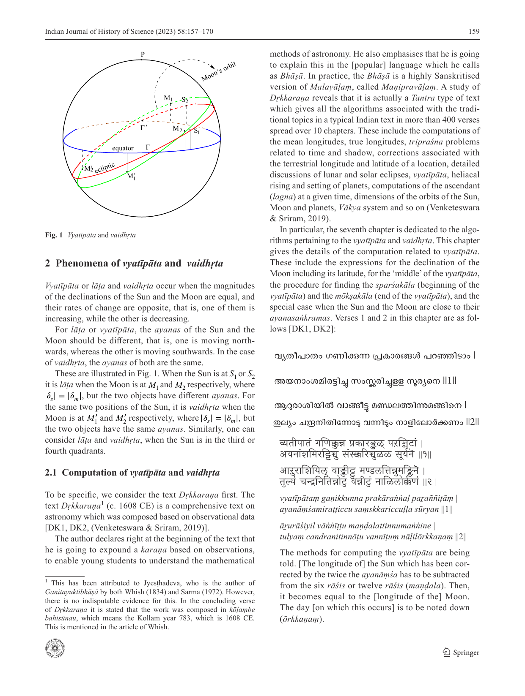
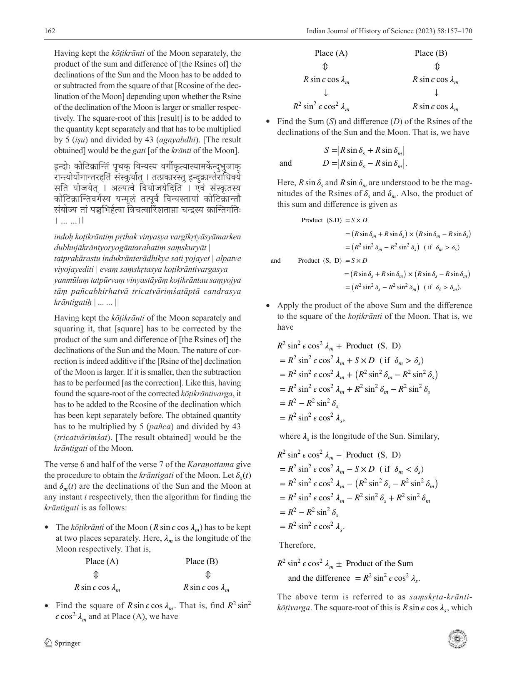
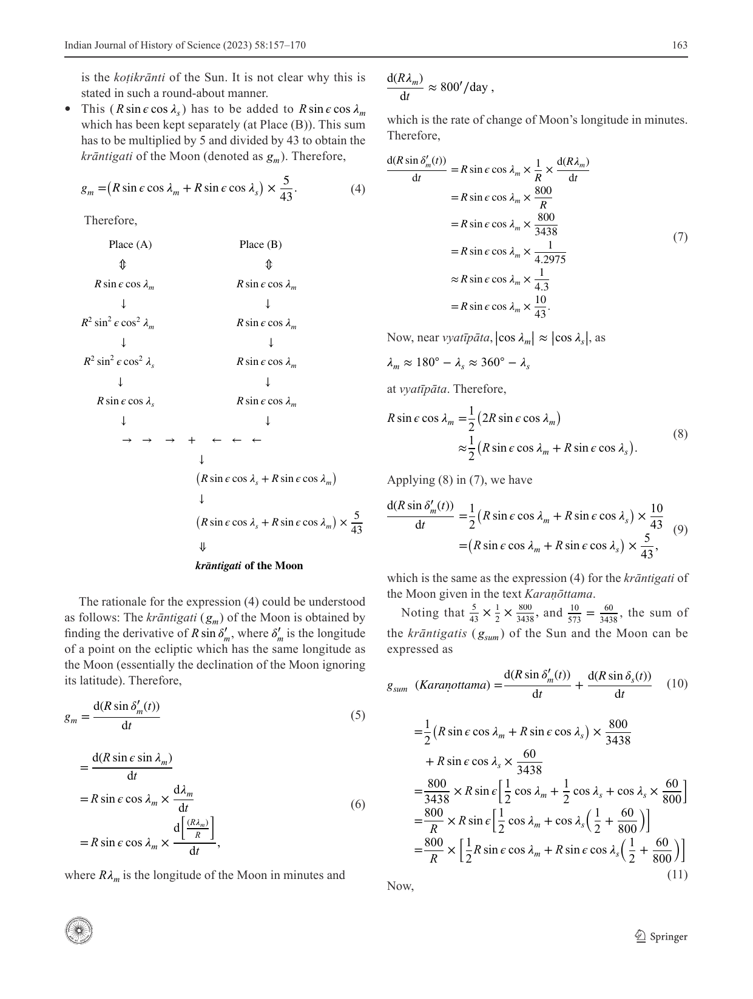
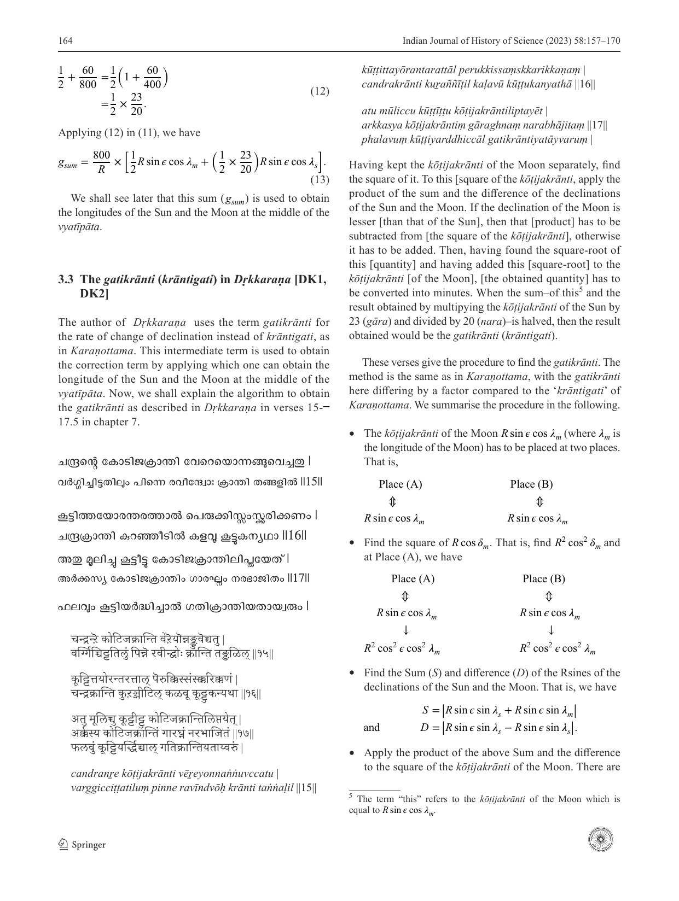
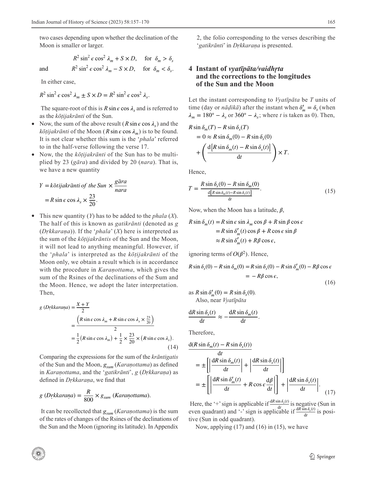
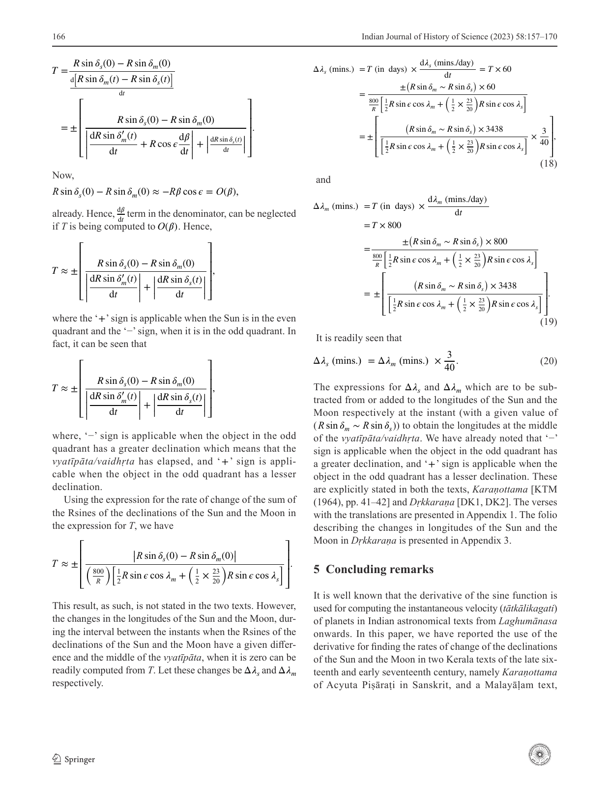
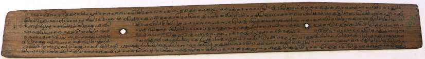

# Use of the concept of derivative in the computation of vyatīpāta in two Kerala texts

- Author Display: Venketeswara Pai R., M. S. Sriram
- Year: 2023
- Journal Label: IJHS-58-2023-Issue-3
- Source Url: https://insa.nic.in/(S(eh1ucortlbqqezipwgliy3mn))/writereaddata/UpLoadedFiles/IJHS/IJHS_58_3_1.pdf

<!-- source: page-chunk extraction; methods recorded in assembly-manifest.json -->
<!-- Page ranges and pdf-page markers are 1-based physical PDF positions, not printed pagination. -->

<!-- decode-chunk: pages=1-5 source_sha256=1588194fffdf6c373c25610c587f333eca488721ff179b78ad5b83894c9b236f -->
<!-- pdf-page: 1 -->

Indian Journal of History of Science (2023) 58:157–170
https://doi.org/10.1007/s43539-023-00090-4
**ARTICLE**

# Use of the concept of derivative in the computation of *vyatīpāta* in two Kerala texts

Venketeswara Pai R. $^1$ · M. S. Sriram $^2$
Received: 2 January 2023 / Accepted: 30 June 2023 / Published online: 13 October 2023
© Indian National Science Academy 2023
**Abstract**
It is well known that the concept of derivative was used in finding the rates of motion of planets in Indian astronomy texts beginning with *Laghumānasa* (c. 932 CE). In his *Vāsanābhāṣya* of his own work, *Siddhāntaśiromaṇi* (c.1150 CE), Bhāskarācārya explains the necessity of using the concept of *tātkālikagati* (instantaneous rates of motion) of planets, which involves using the derivative of the sine function, and discusses the retrograde motion of planets also, using the concept. Later, Kerala texts like *Tantrasaṅgraha* also discuss this concept. In two Kerala texts, *Karaṇottama* of Acyuta Piṣāraṭi (late sixteenth century) and *Dṛkkaraṇa* (1608 CE), the use of the concept of derivative is used in a very different context, namely, computations pertaining to *vyatīpāta*. In this paper, we describe the algorithms involving the ‘*krāntigati*’ or the rate of change of the declinations of the Sun and the Moon involving the derivative concept, in these two texts.
**Keywords** Derivative · *Dṛkkaraṇa* · *Krāntigati* · *Karaṇottama* · *Vyatīpāta*

## 1 Introduction

Calculus related concepts are to be found in Indian Siddhāntic texts, from *Laghumānasa* of Muñjāla (932 CE) onwards (Datta et al., 1984; Sriram, 2014; LM, 1944; Ramasubramanian & Srinivas, 2010). They are in the context of the rates of motion of the planets. Due to the eccentricity of the orbit of a planet, an ‘equation of centre’ correction should be applied to the mean planet, $\theta_0$ (which moves uniformly with time) to obtain the ‘true’ planet, $\theta_t$. In many texts, the expression for the true planet, $\theta_t$, is of the form

$$\theta_t = \theta_0 - \frac{r_0}{R} f(M) \sin M$$

as such, or in an approximation. Here, $M = \theta_0 - \theta_A$ is the *manda-kendra* (anomaly), where $\theta_A$ is the ‘apogee’. Here, $\frac{r_0}{R}$ is the ratio of the radius of the *manda*-epicycle and the radius of the mean planet's orbit. Also, $f(M) \approx 1$ is a function of $M$. The second term in the above equation is the *mandaphala* or the ‘equation of centre’.
In earlier texts, the rate of motion of the planet was found by just computing the true planet, $\theta_t$ at the mean sunrise on two successive days. The difference between them was considered the true rate of motion throughout the intervening day.
It is in *Laghumānasa* that the rate of motion is treated very differently. In this text, $\theta_t$ has the form (LM, 1944, pp. 38–49; Shukla, 1990, pp. 125–127)

$$\theta_t = \theta_0 - \frac{r_0}{R} \times \frac{\sin M}{1 + \frac{r_0}{2R} \cos M},$$

and the true rate of motion is given as

$$\frac{\Delta \theta_t}{\Delta t} = \frac{\Delta \theta_0}{\Delta t} - \frac{r_0}{R} \times \frac{\cos M}{1 + \frac{r_0}{2R} \cos M} \times \frac{\Delta M}{\Delta t},$$

where the first term in the RHS is the *madhyamagati* or the ‘mean rate of motion’ and the second term is the *gatiphala* (result of correction to the mean rate of motion). This is the rate of motion at any instant or ‘instantaneous velocity’, though it is not stated explicitly in the text *Laghumānasa*. Here, it is clear that $\frac{\Delta \sin M}{\Delta t}$ is taken as $\cos M \times \frac{\Delta M}{\Delta t}$, and the variation due to the factor $\frac{1}{1 + \frac{r_0}{2R} \cos M}$ is not taken into account. Clearly it is recognised that the derivative of $\sin M$ is $\cos M$, $(\frac{\Delta \sin M}{\Delta t} = \frac{\Delta \sin M}{\Delta M} \times \frac{\Delta M}{\Delta t} = \cos M \times \frac{\Delta M}{\Delta t})$, though not stated as such.
---
[^1] IISER Pune: Indian Institute of Science Education Research Pune, Pune, India
[^2] K V Sarma Research Foundation, KVSRF, Chennai, India
$\ast$ Venketeswara Pai R.
venkateswara@iiserpune.ac.in

<!-- pdf-page: 2 -->

158 Indian Journal of History of Science (2023) 58:157–170
In the *Mahāsiddhānta* of Āryabhaṭa-II (tenth century CE) (MS, 1910, p. 58), the *manda-sphuṭa-graha* is given by

$$\theta_t = \theta_0 - \frac{r_0}{R} \times \sin M,$$

and the rate of motion is given as

$$\frac{\Delta \theta_t}{\Delta t} = \frac{\Delta \theta_0}{\Delta t} - \frac{r_0}{R} \times \cos M \times \frac{\Delta M}{\Delta t}.$$

Here also, the derivative of sine is recognised as the cosine.
In the *Grahagaṇitādhyāya* part of *Siddhāntaśiromaṇi*, in the chapter on *Spaṣṭādhikāra* (SS, 2005, chapter 2, verse 30, p. 50), Bhāskara's expression for $\theta_t$ is

$$\theta_t = \theta_0 - \left(\frac{r_0}{R} \times \sin M \right).$$

Then, the rate of motion would be:

$$\frac{\Delta \theta_t}{\Delta t} = \frac{\Delta \theta_0}{\Delta t} - \frac{r_0}{R} \times \cos M \times \frac{\Delta M}{\Delta t},$$

which is the same as in *Mahāsiddhānta*. It is stated in verse 37 of this chapter (SS, 2005, chapter 2, p. 52), as follows:
कोfिटफलग्रघ्नी मृदुक्रेन्द्रभुfिfस्त्रज्योध्द्धृता कर्किमिृगािदिक्रेन्द्रे ।
तया युतोना ग्रहमिध्यभुfिः तात्काfलकी मिन्दपfरस्फुटा स्यात् ।।
*koṭiphalaghnī mṛdukendrabhukti strijyoddhṛtā karkimṛgādikendre |*
*tayā yutonā grahamadhyabhukti tātkālikī mandaparisphuṭā syāt ||*
The daily motion of the *mandakendra* (mean anomaly) being multiplied by the *koṭiphala* and divided by the radius, and the result being added to or subtracted from the mean motion depending upon whether the anomaly is in *karkyādi* or *mṛgādi* gives the true **instantaneous** [rate of motion] of *manda-sphuṭa*.
In the next verse, Bhāskara stresses the need for using the instantaneous rate of motion in the case of the Moon whose rate of motion of anomaly is large:
समीपfतथ्यन्तसमीपचालनं fवधोस्तु तत्कालजयैव युज्यते ।
*samīpatithyantasamīpacālanaṃ vidhostu tatkālajayaiva yujyate |*
In the case of the Moon, the ending moment or the beginning time of a *tithi* which is near at hand is to be computed using the instantaneous (*tatkāla*) rate of motion only.
This is explained in far greater detail in the *vāsanā* for the verses. Here, it is pointed out that the earlier computation of the rate of motion (by just finding the difference between the true longitudes at successive sunrises) is only approximate, and a more precise instantaneous rate of motion has to be computed.
The actual planets, Mars, Mercury, Jupiter, Venus and Saturn have one more correction, namely, *Śīghra*. Finding their exact rates of motion is challenging and Bhāskara solves this by adopting a novel approach, in which only the derivative of the sine function is involved (SS, 2005, pp. 54–58).
In *Tantrasaṅgraha* of Nīlakaṇṭha Somayājī [Ramasubramanian & Sriram (2011), chapter 2, p. 76, p. 90 and pp. 114–116], the *manda*-correction (*mandaphala*) for the mean planet to obtain the true planet is of the form $-\sin^{-1} (\frac{r_0}{R} \sin M)$. Nīlakaṇṭha gives the exact expression for the correction to the rate of motion of the planet due to this *mandaphala* as

$$- \frac{\frac{r_0}{R} \cos M \times \frac{\Delta M}{\Delta t}}{\sqrt{\left( 1 - \frac{r_0^2}{R^2} \sin^2 M \right)}}.$$

So, the derivative of the inverse sine function is calculated correctly in this text.
In his *Sphuṭanirṇayatantra* (late sixteenth century) (SNT, 1974, chapter 3, verses 17–18 p. 20), Acyuta Piṣāraṭi essentially considers a *mandaphala* of the form:

$$- \frac{\frac{r_0}{R} \sin M}{(1 + \frac{r_0}{R} \cos M)}$$

also, as in *Laghumānasa*. Acyuta gives the correct expression for the correction to the rate of motion due to this *mandaphala* which is a ratio of two functions, $-\frac{r_0}{R} \sin M$ and $(1 + \frac{r_0}{R} \cos M)$, as

$$- \frac{\left[ \frac{r_0}{R} \cos M + \frac{(\frac{r_0}{R} \sin M)^2}{(1 + \frac{r_0}{R} \cos M)} \right]}{(1 + \frac{r_0}{R} \cos M)} \frac{\Delta M}{\Delta t}$$

(SNT, 1974, chapter 3, verses 19–20, pp. 20–21; Ramasubramanian & Srinivas, 2010, pp. 279–280).
All these are in the context of the rates of motion of planets. However, a recent study of two Kerala texts, namely *Karaṇottama* (KTM, 1964) of Acyuta Piṣāraṭi, and *Dṛkkaraṇa* [DK1, DK2, Venketeswara and Sriram (2019)] by us has revealed that the calculus concepts (essentially the derivative of the sine function) are used in another context. This is in the context of finding the instant of *vyatīpāta* or *vaidhṛta*, when the magnitudes of the declinations of the Sun and the Moon are equal, whereas their rates of change are opposite (with one increasing and the other, decreasing). The computation involves the rates of change of the declinations of the Sun and the Moon, wherein use is made of $\frac{d}{dt} \sin \lambda = \cos \lambda \frac{\Delta \lambda}{\Delta t}$, where $\lambda$ is the longitude of the Sun or the Moon. In this paper, we elaborate the use of the derivative concept in finding the instant of *vyatīpāta* or *vaidhṛta* in the two texts.

<!-- pdf-page: 3 -->

159 Indian Journal of History of Science (2023) 58:157–170

*Fig. 3. Vyatīpāta and vaidhṛta*

<!-- figure-resolved-page-render: page=3 image=media/p03_page.webp reason=no-extracted-figure -->

<!-- figure-meta: page=3, position=top, type=diagram -->

Fig. 1 *Vyatīpāta* and *vaidhṛta*

## 2 Phenomena of *vyatīpāta* and *vaidhṛta*

*Vyatīpāta* or *lāṭa* and *vaidhṛta* occur when the magnitudes of the declinations of the Sun and the Moon are equal, and their rates of change are opposite, that is, one of them is increasing, while the other is decreasing.
For *lāṭa* or *vyatīpāta*, the *ayanas* of the Sun and the Moon should be different, that is, one is moving northwards, whereas the other is moving southwards. In the case of *vaidhṛta*, the *ayanas* of both are the same.
These are illustrated in Fig. 1. When the Sun is at $S_1$ or $S_2$ it is *lāṭa* when the Moon is at $M_1$ and $M_2$ respectively, where $|\delta_s| = |\delta_m|$, but the two objects have different *ayanas*. For the same two positions of the Sun, it is *vaidhṛta* when the Moon is at $M'_1$ and $M'_2$ respectively, where $|\delta_s| = |\delta_m|$, but the two objects have the same *ayanas*. Similarly, one can consider *lāṭa* and *vaidhṛta*, when the Sun is in the third or fourth quadrants.

### 2.1 Computation of *vyatīpāta* and *vaidhṛta*

To be specific, we consider the text *Dṛkkaraṇa* first. The text *Dṛkkaraṇa*[^1] (c. 1608 CE) is a comprehensive text on astronomy which was composed based on observational data [DK1, DK2, (Venketeswara & Sriram, 2019)].
The author declares right at the beginning of the text that he is going to expound a *karaṇa* based on observations, to enable young students to understand the mathematical methods of astronomy. He also emphasises that he is going to explain this in the [popular] language which he calls as Bhāṣā. In practice, the Bhāṣā is a highly Sanskritised version of Malayāḷam, called Maṇipravāḷaṃ. A study of *Dṛkkaraṇa* reveals that it is actually a *Tantra* type of text which gives all the algorithms associated with the traditional topics in a typical Indian text in more than 400 verses spread over 10 chapters. These include the computations of the mean longitudes, true longitudes, *tripraśna* problems related to time and shadow, corrections associated with the terrestrial longitude and latitude of a location, detailed discussions of lunar and solar eclipses, *vyatīpāta*, heliacal rising and setting of planets, computations of the ascendant (*lagna*) at a given time, dimensions of the orbits of the Sun, Moon and planets, *Vākya* system and so on (Venketeswara & Sriram, 2019).
In particular, the seventh chapter is dedicated to the algorithms pertaining to the *vyatīpāta* and *vaidhṛta*. This chapter gives the details of the computation related to *vyatīpāta*. These include the expressions for the declination of the Moon including its latitude, for the ‘middle’ of the *vyatīpāta*, the procedure for finding the *sparśakāla* (beginning of the *vyatīpāta*) and the *mōkṣakāla* (end of the *vyatīpāta*), and the special case when the Sun and the Moon are close to their *ayanasaṅkramas*. Verses 1 and 2 in this chapter are as follows [DK1, DK2]:
വ്യാതീപാതം ഗണിക്കുന്ന പ്രകാരങ്ങൾ പറഞ്ഞിടാം |
അയനാംശമിരട്ടിച്ച് സംസ്ക്കരിച്ചുള്ള സൂര്യൻ ||1||
ആറുരാശിയിൽ വാങ്ങിട്ടു മണ്ഡലത്തിനുമങ്ങിനെ |
തുല്യം ചന്ദ്രനിതിനോടു വന്നീടും നാളിലൊർക്കണം ||2||
व्यतीपातं गणिक्कुन्न प्रकारङ्ङळ् परञ्ञिटाम् |
अयनांशमिरट्टिच्चु संस्क्करिच्चुळ्ळ सूर्यन् ||१||
आरुराशियिल् वाङ्ङीट्टु मण्डलत्तिन्नुमङ्ङिने |
तुल्यं चन्द्रनितिन्नोटु वन्नीटुं नाळिलोर्क्कणम् ||२||
*vyatīpātaṃ gaṇikkunna prakāraṅṅaḷ paṟaññiṭāṃ |*
*ayanāṃśamiraṭṭiccu saṃskkariccuḷḷa sūryan ||1||*
*ārurāśiyil vāṅṅīṭṭu maṇḍalattinnumaṅṅine |*
*tulyaṃ candranitinnōṭu vannīṭuṃ nāḷilōrkkaṇaṃ ||2||*
The methods for computing the *vyatīpāta* are being told. [The longitude of] the Sun which has been corrected by the twice the *ayanāṃśa* has to be subtracted from the six *rāśis* or twelve *rāśis* (*maṇḍala*). Then, it becomes equal to the [longitude of the] Moon. The day [on which this occurs] is to be noted down (*ōrkkaṇaṃ*).
---
[^1] This has been attributed to Jyeṣṭhadeva, who is the author of *Ganitayuktibhāṣā* by both Whish (1834) and Sarma (1972). However, there is no indisputable evidence for this. In the concluding verse of *Dṛkkaraṇa* it is stated that the work was composed in *kōḷaṃbe bahisūnau*, which means the Kollam year 783, which is 1608 CE. This is mentioned in the article of Whish.

<!-- pdf-page: 4 -->

160 Indian Journal of History of Science (2023) 58:157–170
The author states that different methods for computing *vyatīpāta* or *vaidhṛta* would be told. Now, at the *vyatīpāta* or *vaidhṛta*, the declinations of the Sun and the Moon should be equal and their rates of change should be opposite. Now, for a celestial object on the ecliptic,

$$\sin \delta = \sin \epsilon \sin \lambda,$$

where $\lambda$ is the tropical or the *sāyana* longitude of the object. Hence, if the latitude of the Moon is ignored (to begin with), then the equality of the magnitudes of the declinations of the Sun and the Moon implies that[^2]

$$\sin \lambda_m = \sin \lambda_s,$$

where $\lambda_m$ and $\lambda_s$ are the *sāyana* longitudes of the Moon and the Sun. This implies that

$$\lambda_m = 180^\circ - \lambda_s$$

if the Sun and the Moon have opposite *ayanas*, or

$$\lambda_m = 360^\circ - \lambda_s$$

when they have the same *ayana*. Now, $\lambda_m = (\lambda_m)_n + a$ and $\lambda_s = (\lambda_s)_n + a$, where $(\lambda_m)_n$ and $(\lambda_s)_n$ are the *nirayaṇa* longitude[^3] of the Moon and the Sun respectively. Hence, for the computation of *vyatīpāta* or *vaidhṛta*, first find the instant at which

$$(\lambda_m)_n = 180^\circ - ((\lambda_s)_n + 2a)$$

or

$$(\lambda_m)_n = 360^\circ - ((\lambda_s)_n + 2a),$$

respectively, as stated in the verses.

### 2.2 *Lāṭavaidhṛtadoṣas*

ലാടവൈധൃതദോഷങ്ങൾ രവിചന്ദ്രൗ ച പാതനും |
ഗണിച്ചിട്ടയനാംശത്തെ സംസ്ക്കരിച്ചങ്ങു വെക്കണം ||3||
ചന്ദ്രാർക്കന്മാരെ വെച്ചിട്ടു ക്രാന്തിജ്യാവങ്ങു കൊള്ളുക |
लाटवैधृतदोषुळ्ळु रविचन्द्रौ च पातुं |
गणिच्चिट्टयनांशत्ते संस्क्करिच्चुट्टु वेक्कणं ||३||
चन्द्रार्क्कन्मारे वेच्चिट्टु क्रान्तिज्यावङ्ङु कोळ्ळुक |
*lāṭavaidhṛtadōṣaṅṅaḷ ravicandrau ca pātanuṃ |*
*gaṇicciṭṭayanāṃśatte saṃskkariccaṅṅu vekkaṇaṃ ||3||*
*candrārkkanmāre vecciṭṭu krāntijyāvaṅṅu koḷḷuka |*
[For obtaining the *lāṭa* and *vaidhṛta-doṣas*], place [the longitudes of] the Sun, the Moon and the node (*pāta*) which have been computed and corrected by the *ayanāṃśa*.[^4] Then, find the Rsine of declination corresponding to the Sun and the Moon.
For obtaining the declination of the Sun, it is sufficient to know its *sāyana* longitude, that is the *nirayaṇa* longitude corrected by the *ayanāṃśa*. As the Moon's orbit is inclined to the ecliptic, it is necessary to find its latitude also, to obtain its declination. For this, it is necessary to obtain its node (*pāta*) as well. The procedure to obtain the declination of the Moon, taking into account its latitude is described elsewhere in the text.

## 3 Use of the derivative of the sine function in *Karaṇottama* and *Dṛkkaraṇa*

For finding the instant of *vyatīpāta* or *vaidhṛta*, the law of proportions and an iterative procedure was prescribed in the earlier texts such as *Brāhmasphuṭa-siddhānta* (BSS, 1966, vol. 3, chapter 14, verses 39–40, pp. 1023–1025), *Karaṇaratna* of Devācārya [KR (1979), chapter 1, verses 54–57, pp. 37–38], *Śiṣyadhīvṛddhida* of Lalla (SVT, 1981, part 1, chapter 12, verses 6–9, pp. 171–173), and also later texts. This method has also been discussed in some recent articles (Plofker, 2014, pp. 1–11; Venketeswara Pai et al., 2015, pp. 69–89).
The same procedure is described in the *Pātādhikāra* of the *Grahagaṇita* part of *Siddhāntaśiromaṇi*. We summarise this procedure which is described elsewhere in detail (Venketeswara Pai et al., 2015).
Let $t_1$ be a suitable instant at which the declinations of the Sun and the Moon are $\delta_s$ and $\delta_m$ respectively (including the sign). Now, finding their difference, we have $\Delta_1 = \delta_s - \delta_m$. Now, again find the difference in declinations, $\Delta_2 = \delta_s - \delta_m$, at some other instant $t_2$. Then, the instant of *vyatīpata* is found by the law of proportion. If the difference in the declinations of the Sun and the moon changes by an amount equal to $\Delta_1 - \Delta_2$ in the time interval, $t_2 - t_1$, what is the instant $T$, when it has changed by an amount $\Delta_1$, making the declinations equal, that is, when $\Delta(T) = 0$. This is given by
---
[^2] In Indian astronomy texts, the sine or cosine of any variable refers to its magnitude only. In this paper also, we adhere to this meaning throughout.
[^3] This is with respect to the *mēṣādi* which is a fixed point on the ecliptic.
[^4] In the verse, the phrase “*ayanāṃśatte saṃskkariccaṅṅu*” is to be understood as “*ayanāṃśatte koṇtu saṃskkariccaṅṅu*” which means “corrected by the *ayanāṃśa*”. Here, the word “*koṇtu*” is implicit. If we do not consider the “*koṇtu*”, then the meaning would be “correct the *ayanāṃśa*” which is incorrect in the present context.

<!-- pdf-page: 5 -->

161 Indian Journal of History of Science (2023) 58:157–170

$$T - t_1 = \frac{t_2 - t_1}{\Delta_1 - \Delta_2} \times \Delta_1.$$

This formula is in terms of $\Delta$s including the sign.
Now, at instant $T$, $\delta_s$ and $\delta_m$ are found again. In general, they would not be equal. Hence, $\delta_s - \delta_m$ is computed at $T$, and some other nearby instant, and the process is iterated, till an ‘invariable’ quantity is obtained, when the values of the instants of *vyatīpāta* in the successive stages of iteration are equal.
In the texts *Karaṇottama* and *Dṛkkaraṇa*, a different strategy is used for finding the instant of *vyatīpāta* implicitly, using the derivative of the declination.
*Karaṇottama* is an important *karaṇa* text composed by Acyuta Piṣāraṭi (1550–1621 CE). The author himself has written a commentary on the work. It consists of 119 verses divided into five chapters, which deal with the standard topic in a Siddhānta text. This includes the computations related to *vyatīpāta* / *vaidhṛta* in the fifth chapter.
Both *Karaṇottama* and *Dṛkkaraṇa* describe the procedure for obtaining the longitudes of the Sun and the Moon at the middle of the *vyatīpāta*. The algorithms given in both the texts are similar and an intermediate term referred to as *krāntigati* / *gatikrānti* (translated as rate of motion of the declination) is used by the authors to arrive at the true longitudes at the middle of the *vyatīpāta*. In the expressions for *krāntigatis*, we find the application of the differential calculus. In the following subsections, we would explain the procedure for *krāntigatis* as described in the texts *Karaṇottama* [KTM (1964), p. 41] and *Dṛkkaraṇa* [DK1, DK2] respectively.

### 3.1 The *krāntigati* of the Sun in *Karaṇottama* [KTM (1964), p. 41]

तत्राक्कस्य क्रान्तिगत्यायनामाह –
*tatrārkasya krāntigatyāyanamāha –*
There, the procedure for obtaining the rate of motion of Sun's declination is being told.
कोfिटक्रान्ते र्वेिद्घ्नयाfस्त्रशैलेषु हता गfतः ।।५।।
*kōṭikrānte raverdigghnyāstriśaileṣu hṛtā gatiḥ ||5||*
The *kōṭikrānti* of the Sun when multiplied by 10 (*dik*) and divided by 573 (*tri-śaila-iṣu*), the *gati* is obtained.
रfवकोfिटज्यायाः क्रान्तिमान्तीय तां दशfभर्हत्वा
गोसमेन हृत्वा सूयार्स्यापक्रमगfतfरfत ।।
*ravikōṭijyāyāḥ krāntimānīya tāṃ daśabhirhatvā*
*gōsamena hṛtvā sūryasyāpakramagatiriti ||*
Having obtained the declination from the Rcosine of the longitude of the Sun and multiplying that by 10 (*daśa*) and divided by 573 (*gōsama*), the *gati* of the declination [of the Sun is obtained].
Let $\delta_s(t)$ be the declination of the Sun at any instant $t$, then the *krānti-gati* ($g_s$) of the Sun is given as

$$g_s = \text{kotikrānti of the Sun} \times \frac{10}{573}$$

$$= R \sin \epsilon \cos \lambda_s \times \frac{10}{573}, \qquad (1)$$

where $\lambda_s$ is the longitude of the Sun.
The rationale for the expression (1) can be understood as follows:
Let the declination of the Sun be $\delta_s(t)$ at any instant $t$, then the *krāntigati* of the Sun ($g_s$) can be expressed as

$$g_s = \frac{d(R \sin \delta_s(t))}{dt} = \frac{d(R \sin \epsilon \sin \lambda_s)}{dt}$$

$$= R \sin \epsilon \cos \lambda_s \times \frac{d\lambda_s}{dt}$$

$$= R \sin \epsilon \cos \lambda_s \times \frac{d[\frac{(R\lambda_s)}{R}]}{dt}. \qquad (2)$$

Here, the term $R \sin \epsilon \cos \lambda_s$ is referred to as the *kōṭikrānti* in the text. Also, $R\lambda_s$ is the longitude of the Sun in minutes and

$$\frac{d(R\lambda_s)}{dt} \approx 60'/day.$$

Therefore,

$$\frac{d(R \sin \delta_s(t))}{dt} = R \sin \epsilon \cos \lambda_s \times \frac{d[\frac{(R\lambda_s)}{R}]}{dt}$$

$$= R \sin \epsilon \cos \lambda_s \times \frac{60}{R}$$

$$= R \sin \epsilon \cos \lambda_s \times \frac{60}{3438}$$

$$= R \sin \epsilon \cos \lambda_s \times \frac{10}{573}, \qquad (3)$$

which is the same as the expression (1).

### 3.2 The ‘*krāntigati*’ of the Moon in *Karaṇottama* [KTM (1964), p. 41]

इन्दोर्गर्त्यायनामाह –
*indōrgatyāyanamāha –*
[Now, the procedure for] obtaining the rate of motion of Moon's declination is being told.
कोfिटक्रान्तिः पृथक्स्थेन्दोर्वfगर्तता सfहतोfनता ।
क्रान्fतयुत्यान्तरघ्नया स्वदोःक्रान्त्याfधक्यकाश्यर्योः ।।६।।
तत्पदाढ्या पृथक्स्थेषु हताग्न्व्यब्fधहृता गfतः ।
*koṭikrāntiḥ pṛthaksthendorvargitā sahitonitā |*
*krāntiyutyāntaraghnyā svadoḥkrāntyādhikya*
*kārśyayoḥ ||6||*
*tatpadāḍhyā pṛthakstheṣu hatāgnyabdhihṛtā gatiḥ |*
<!-- /decode-chunk -->

<!-- decode-chunk: pages=6-10 source_sha256=2f86440e0aa89cd003ad3c432b78b508eea98ccf0e81ec0ab21bd78ea501bdec -->
<!-- pdf-page: 6 -->

162 Indian Journal of History of Science (2023) 58:157–170
Having kept the $kōṭikrānti$ of the Moon separately, the product of the sum and difference of [the Rsines of] the declinations of the Sun and the Moon has to be added to or subtracted from the square of that [Rcosine of the declination of the Moon] depending upon whether the Rsine of the declination of the Moon is larger or smaller respectively. The square-root of this [result] is to be added to the quantity kept separately and that has to be multiplied by 5 ($iṣu$) and divided by 43 ($agnyabdhi$). [The result obtained] would be the gati [of the $krānti$ of the Moon].
... ...
इन्दोः कोटिक्रान्तिं पृथक् विन्यस्य वर्गीकृत्यास्यामार्केन्द्वोर्भुजाक्रान्त्योर्योगान्तरहतिं संस्कुर्यात् । 
तत्प्रकारस्तु इन्दुकृान्तेराधिक्ये सति योजयेत् । अल्पत्वे वियोजयेदिति । एवं संस्कृतस्य कोटिक्रान्तिवर्गस्य यन्मूलं तत्पूर्वं विन्यस्तायां कोटिक्रान्तौ संयोज्य तां पञ्चभिर्हत्वा त्रिचत्वारिंशताप्ता चन्द्रस्य क्रान्तिगतिः । ... ... ।।
*indoḥ koṭikrāntiṃ pṛthak vinyasya vargīkṛtyāsyāmarkendubhujākrāntyoryogāntarahatiṃ saṃskuryāt |*
*tatprakārastu indukrānterādhikye sati yojayet | alpatve viyojayediti | evaṃ saṃskṛtasya koṭikrāntivargasya yanmūlaṃ tatpūrvaṃ vinyastāyāṃ koṭikrāntau saṃyojya tāṃ pañcabhirhatvā tricatvāriṃśatāptā candrasya krāntigatiḥ | ... ... ||*
Having kept the $kōṭikrānti$ of the Moon separately and squaring it, that [square] has to be corrected by the product of the sum and difference of [the Rsines of] the declinations of the Sun and the Moon. The nature of correction is indeed additive if the [Rsine of the] declination of the Moon is larger. If it is smaller, then the subtraction has to be performed [as the correction]. Like this, having found the square-root of the corrected $kōṭikrāntivarga$, it has to be added to the Rcosine of the declination which has been kept separately before. The obtained quantity has to be multiplied by 5 ($pañca$) and divided by 43 ($tricatvāriṃśat$). [The result obtained] would be the $krāntigati$ of the Moon.
The verse 6 and half of the verse 7 of the *Karaṇottama* give the procedure to obtain the $krāntigati$ of the Moon. Let $\delta_s(t)$ and $\delta_m(t)$ are the declinations of the Sun and the Moon at any instant $t$ respectively, then the algorithm for finding the $krāntigati$ is as follows:
* The $kōṭikrānti$ of the Moon ($R \sin \epsilon \cos \lambda_m$) has to be kept at two places separately. Here, $\lambda_m$ is the longitude of the Moon respectively. That is,

| Place (A) | Place (B) |
| :---: | :---: |
| $\Updownarrow$ | $\Updownarrow$ |
| $R \sin \epsilon \cos \lambda_m$ | $R \sin \epsilon \cos \lambda_m$ |

* Find the square of $R \sin \epsilon \cos \lambda_m$. That is, find $R^2 \sin^2 \epsilon \cos^2 \lambda_m$ and at Place (A), we have

| Place (A) | Place (B) |
| :---: | :---: |
| $\Updownarrow$ | $\Updownarrow$ |
| $R \sin \epsilon \cos \lambda_m$ | $R \sin \epsilon \cos \lambda_m$ |
| $\downarrow$ | $\downarrow$ |
| $R^2 \sin^2 \epsilon \cos^2 \lambda_m$ | $R \sin \epsilon \cos \lambda_m$ |

* Find the Sum ($S$) and difference ($D$) of the Rsines of the declinations of the Sun and the Moon. That is, we have

$$S = |R \sin \delta_s + R \sin \delta_m|$$

and

$$D = |R \sin \delta_s - R \sin \delta_m|.$$

Here, $R \sin \delta_s$ and $R \sin \delta_m$ are understood to be the magnitudes of the Rsines of $\delta_s$ and $\delta_m$. Also, the product of this sum and difference is given as

$$\text{Product } (S, D) = S \times D$$

$$= (R \sin \delta_m + R \sin \delta_s) \times (R \sin \delta_m - R \sin \delta_s)$$

$$= (R^2 \sin^2 \delta_m - R^2 \sin^2 \delta_s) \text{ (if } \delta_m > \delta_s \text{)}$$

and

$$\text{Product } (S, D) = S \times D$$

$$= (R \sin \delta_s + R \sin \delta_m) \times (R \sin \delta_s - R \sin \delta_m)$$

$$= (R^2 \sin^2 \delta_s - R^2 \sin^2 \delta_m) \text{ (if } \delta_s > \delta_m \text{)}.$$

* Apply the product of the above Sum and the difference to the square of the $koṭikrānti$ of the Moon. That is, we have

$$R^2 \sin^2 \epsilon \cos^2 \lambda_m + \text{Product } (S, D)$$

$$= R^2 \sin^2 \epsilon \cos^2 \lambda_m + S \times D \text{ (if } \delta_m > \delta_s \text{)}$$

$$= R^2 \sin^2 \epsilon \cos^2 \lambda_m + (R^2 \sin^2 \delta_m - R^2 \sin^2 \delta_s)$$

$$= R^2 \sin^2 \epsilon \cos^2 \lambda_m + R^2 \sin^2 \delta_m - R^2 \sin^2 \delta_s$$

$$= R^2 - R^2 \sin^2 \delta_s$$

$$= R^2 \sin^2 \epsilon \cos^2 \lambda_s,$$

where $\lambda_s$ is the longitude of the Sun. Similary,

$$R^2 \sin^2 \epsilon \cos^2 \lambda_m - \text{Product } (S, D)$$

$$= R^2 \sin^2 \epsilon \cos^2 \lambda_m - S \times D \text{ (if } \delta_m < \delta_s \text{)}$$

$$= R^2 \sin^2 \epsilon \cos^2 \lambda_m - (R^2 \sin^2 \delta_s - R^2 \sin^2 \delta_m)$$

$$= R^2 \sin^2 \epsilon \cos^2 \lambda_m - R^2 \sin^2 \delta_s + R^2 \sin^2 \delta_m$$

$$= R^2 - R^2 \sin^2 \delta_s$$

$$= R^2 \sin^2 \epsilon \cos^2 \lambda_s.$$

Therefore,

$$R^2 \sin^2 \epsilon \cos^2 \lambda_m \pm \text{Product of the Sum and the difference} = R^2 \sin^2 \epsilon \cos^2 \lambda_s.$$

The above term is referred to as $saṃskṛta\text{-}krānti\text{-}kōṭivarga$. The square-root of this is $R \sin \epsilon \cos \lambda_s$, which

*Fig. 6. Springer Logo*

<!-- figure-resolved-page-render: page=6 image=media/p06_page.webp reason=no-extracted-figure -->

<!-- figure-meta: page=6, position=bottom, type=photograph -->

<!-- pdf-page: 7 -->

Indian Journal of History of Science (2023) 58:157–170 163
is the $koṭikrānti$ of the Sun. It is not clear why this is stated in such a round-about manner.
* This ($R \sin \epsilon \cos \lambda_s$) has to be added to $R \sin \epsilon \cos \lambda_m$ which has been kept separately (at Place (B)). This sum has to be multiplied by 5 and divided by 43 to obtain the $krāntigati$ of the Moon (denoted as $g_m$). Therefore,

$$g_m = (R \sin \epsilon \cos \lambda_m + R \sin \epsilon \cos \lambda_s) \times \frac{5}{43}. \tag{4}$$

Therefore,

| Place (A) | Place (B) |
| :---: | :---: |
| $\Updownarrow$ | $\Updownarrow$ |
| $R \sin \epsilon \cos \lambda_m$ | $R \sin \epsilon \cos \lambda_m$ |
| $\downarrow$ | $\downarrow$ |
| $R^2 \sin^2 \epsilon \cos^2 \lambda_m$ | $R \sin \epsilon \cos \lambda_m$ |
| $\downarrow$ | $\downarrow$ |
| $R^2 \sin^2 \epsilon \cos^2 \lambda_s$ | $R \sin \epsilon \cos \lambda_m$ |
| $\downarrow$ | $\downarrow$ |
| $R \sin \epsilon \cos \lambda_s$ | $R \sin \epsilon \cos \lambda_m$ |
| $\downarrow$ | $\downarrow$ |
| $\rightarrow \rightarrow \rightarrow$ | $+$ $\leftarrow \leftarrow \leftarrow$ |
| | $\downarrow$ |
| | $(R \sin \epsilon \cos \lambda_s + R \sin \epsilon \cos \lambda_m)$ |
| | $\downarrow$ |
| | $(R \sin \epsilon \cos \lambda_s + R \sin \epsilon \cos \lambda_m) \times \frac{5}{43}$ |
| | $\Downarrow$ |
| | **krāntigati of the Moon** |

The rationale for the expression (4) could be understood as follows: The $krāntigati$ ($g_m$) of the Moon is obtained by finding the derivative of $R \sin \delta'_m$, where $\delta'_m$ is the longitude of a point on the ecliptic which has the same longitude as the Moon (essentially the declination of the Moon ignoring its latitude). Therefore,

$$g_m = \frac{d(R \sin \delta'_m(t))}{dt} \tag{5}$$

$$= \frac{d(R \sin \epsilon \sin \lambda_m)}{dt} \tag{6}$$

$$= R \sin \epsilon \cos \lambda_m \times \frac{d\lambda_m}{dt}$$

$$= R \sin \epsilon \cos \lambda_m \times \frac{d \left[ \frac{(R \lambda_m)}{R} \right] }{dt},$$

where $R\lambda_m$ is the longitude of the Moon in minutes and $\frac{d(R \lambda_m)}{dt} \approx 800' / \text{day}$, which is the rate of change of Moon's longitude in minutes. Therefore,

$$\frac{d(R \sin \delta'_m(t))}{dt} = R \sin \epsilon \cos \lambda_m \times \frac{1}{R} \times \frac{d(R \lambda_m)}{dt}$$

$$= R \sin \epsilon \cos \lambda_m \times \frac{800}{R}$$

$$= R \sin \epsilon \cos \lambda_m \times \frac{800}{3438}$$

$$= R \sin \epsilon \cos \lambda_m \times \frac{1}{4.2975}$$

$$\approx R \sin \epsilon \cos \lambda_m \times \frac{1}{4.3}$$

$$= R \sin \epsilon \cos \lambda_m \times \frac{10}{43}. \tag{7}$$

Now, near *vyatīpāta*, $|\cos \lambda_m| \approx |\cos \lambda_s|$, as $\lambda_m \approx 180^\circ - \lambda_s \approx 360^\circ - \lambda_s$ at *vyatīpāta*. Therefore,

$$R \sin \epsilon \cos \lambda_m = \frac{1}{2} (2R \sin \epsilon \cos \lambda_m) \tag{8}$$

$$\approx \frac{1}{2} (R \sin \epsilon \cos \lambda_m + R \sin \epsilon \cos \lambda_s).$$

Applying (8) in (7), we have

$$\frac{d(R \sin \delta'_m(t))}{dt} = \frac{1}{2} (R \sin \epsilon \cos \lambda_m + R \sin \epsilon \cos \lambda_s) \times \frac{10}{43} \tag{9}$$

$$= (R \sin \epsilon \cos \lambda_m + R \sin \epsilon \cos \lambda_s) \times \frac{5}{43},$$

which is the same as the expression (4) for the $krāntigati$ of the Moon given in the text *Karaṇōttama*.
Noting that $\frac{5}{43} \approx \frac{1}{2} \times \frac{800}{3438}$, and $\frac{10}{573} = \frac{60}{3438}$, the sum of the *krāntigatis* ($g_{sum}$) of the Sun and the Moon can be expressed as

$$g_{sum} (\text{Karaṇottama}) = \frac{d(R \sin \delta'_m(t))}{dt} + \frac{d(R \sin \delta_s(t))}{dt} \tag{10}$$

$$= \frac{1}{2} (R \sin \epsilon \cos \lambda_m + R \sin \epsilon \cos \lambda_s) \times \frac{800}{3438} + R \sin \epsilon \cos \lambda_s \times \frac{60}{3438} \tag{11}$$

$$= \frac{800}{3438} \times R \sin \epsilon \left[ \frac{1}{2} \cos \lambda_m + \frac{1}{2} \cos \lambda_s + \cos \lambda_s \times \frac{60}{800} \right]$$

$$= \frac{800}{R} \times R \sin \epsilon \left[ \frac{1}{2} \cos \lambda_m + \cos \lambda_s \left( \frac{1}{2} + \frac{60}{800} \right) \right]$$

$$= \frac{800}{R} \times \left[ \frac{1}{2} R \sin \epsilon \cos \lambda_m + R \sin \epsilon \cos \lambda_s \left( \frac{1}{2} + \frac{60}{800} \right) \right].$$

Now,

*Fig. 7. Springer Logo*

<!-- figure-resolved-page-render: page=7 image=media/p07_page.webp reason=no-extracted-figure -->

<!-- figure-meta: page=7, position=bottom, type=photograph -->

<!-- pdf-page: 8 -->

164 Indian Journal of History of Science (2023) 58:157–170

$$\frac{1}{2} + \frac{60}{800} = \frac{1}{2} \left( 1 + \frac{60}{400} \right) \tag{12}$$

$$= \frac{1}{2} \times \frac{23}{20}.$$

Applying (12) in (11), we have

$$g_{sum} = \frac{800}{R} \times \left[ \frac{1}{2} R \sin \epsilon \cos \lambda_m + \left( \frac{1}{2} \times \frac{23}{20} \right) R \sin \epsilon \cos \lambda_s \right]. \tag{13}$$

We shall see later that this sum ($g_{sum}$) is used to obtain the longitudes of the Sun and the Moon at the middle of the *vyatīpāta*.

### 3.3 The $gatikrānti$ ($krāntigati$) in *Dṛkkaraṇa* [DK1, DK2]

The author of *Dṛkkaraṇa* uses the term *gatikrānti* for the rate of change of declination instead of *krāntigati*, as in *Karaṇottama*. This intermediate term is used to obtain the correction term by applying which one can obtain the longitude of the Sun and the Moon at the middle of the *vyatīpāta*. Now, we shall explain the algorithm to obtain the *gatikrānti* as described in *Dṛkkaraṇa* in verses 15–17.5 in chapter 7.
ചന്ദ്രന്റെ കോടിജക്രാന്തി വേറെയൊന്നാങ്ങുവെച്ചതു |
വർഗിച്ചിട്ടതിലും പിന്നെ രവീന്ദ്വോഃ ക്രാന്തി തങ്ങളിൽ || 15 ||
കൂട്ടിട്ടയോരന്തരത്താൽ പെരുക്കിസ്സംസ്ക്കരിക്കണം |
ചന്ദ്രക്രാന്തി കുറഞ്ഞീടിൽ കളവൂ കൂട്ടുകന്യഥാ || 16 ||
അതു മൂലിച്ചു കൂട്ടിട്ടു കോടിജക്രാന്തിലിപ്തയേത് |
അർക്കസ്യ കോടിജക്രാന്തിം ഗാരഘ്നം നരഭാജിതം || 17 ||
ഫലവും കൂട്ടിയർദ്ധിച്ചാൽ ഗതിക്രാന്തിയിതായ്‌വരും |
चन्द्रन्टे कोटिजक्रान्ति वेऱेयौन्नाङ्ङुवेच्चतु ।
वर्गिच्चिट्टतिलुं पिन्ने रवीन्द्वोः क्रान्ति तङ्ङळिल् ॥१५॥
कूट्टिट्टयोयोरन्तरत्ताल् पेरुक्किस्संस्कर्क्किकणम् ।
चन्द्रक्रान्ति कुऱञ्ञीट्टिल् कळवू कूट्टुकन्यथा ॥१६॥
अतु मूलिच्चु कूट्टिट्टु कोटिजक्रान्तिलिप्तयेत् ।
अर्कस्य कोटिजक्रान्तिं गारघ्नं नरभाजितम् ॥१७॥
फलवुं कूट्टियर्द्धिच्चाल् गतिक्रान्तियताय्वरुम् ।
*candranṟe kōṭijakrānti vēṟeyonnaṅṅuvccatu |*
*varggicciṭṭatiluṃ pinne ravīndvōḥ krānti taṅṅaḷil ||15||*
*kūṭṭittayōrantarattāl perukkissaṃskkarikkaṇaṃ |*
*candrakrānti kuṟaññīṭil kaḷavū kūṭṭukanyathā ||16||*
*atu mūliccu kūṭṭīṭṭu kōṭijakrāntiliptayēt |*
*arkkasya kōṭijakrāntiṃ gāraghnaṃ narabhājitaṃ ||17||*
*phalavuṃ kūṭṭiyarddhiccāl gatikrāntiyatāyvaruṃ |*
Having kept the *kōṭijakrānti* of the Moon separately, find the square of it. To this [square of the *kōṭijakrānti*, apply the product of the sum and the difference of the declinations of the Sun and the Moon. If the declination of the Moon is lesser [than that of the Sun], then that [product] has to be subtracted from [the square of the *kōṭijakrānti*], otherwise it has to be added. Then, having found the square-root of this [quantity] and having added this [square-root] to the *kōṭijakrānti* [of the Moon], [the obtained quantity] has to be converted into minutes. When the sum of this[^5] and the result obtained by multiplying the *kōṭijakrānti* of the Sun by 23 (*gāra*) and divided by 20 (*nara*)—is halved, then the result obtained would be the *gatikrānti* (*krāntigati*).
These verses give the procedure to find the *gatikrānti*. The method is the same as in *Karaṇottama*, with the *gatikrānti* here differing by a factor compared to the ‘*krāntigati*’ of *Karaṇottama*. We summarise the procedure in the following.
* The *kōṭijakrānti* of the Moon $R \sin \epsilon \cos \lambda_m$ (where $\lambda_m$ is the longitude of the Moon) has to be placed at two places. That is,

| Place (A) | Place (B) |
| :---: | :---: |
| $\Updownarrow$ | $\Updownarrow$ |
| $R \sin \epsilon \cos \lambda_m$ | $R \sin \epsilon \cos \lambda_m$ |

* Find the square of $R \sin \epsilon \cos \lambda_m$. That is, find $R^2 \sin^2 \epsilon \cos^2 \lambda_m$ and at Place (A), we have

| Place (A) | Place (B) |
| :---: | :---: |
| $\Updownarrow$ | $\Updownarrow$ |
| $R \sin \epsilon \cos \lambda_m$ | $R \sin \epsilon \cos \lambda_m$ |
| $\downarrow$ | $\downarrow$ |
| $R^2 \sin^2 \epsilon \cos^2 \lambda_m$ | $R^2 \sin^2 \epsilon \cos^2 \lambda_m$ |

* Find the Sum ($S$) and difference ($D$) of the Rsines of the declinations of the Sun and the Moon. That is, we have

$$S = |R \sin \epsilon \sin \lambda_s + R \sin \epsilon \sin \lambda_m|$$

and

$$D = |R \sin \epsilon \sin \lambda_s - R \sin \epsilon \sin \lambda_s|.$$

* Apply the product of the above Sum and the difference to the square of the *kōṭijakrānti* of the Moon. There are

[^5]: The term “this” refers to the *kōṭijakrānti* of the Moon which is equal to $R \sin \epsilon \cos \lambda_m$.

*Fig. 8. Springer Logo*

<!-- figure-resolved-page-render: page=8 image=media/p08_page.webp reason=no-extracted-figure -->

<!-- figure-meta: page=8, position=bottom, type=photograph -->

<!-- pdf-page: 9 -->

Indian Journal of History of Science (2023) 58:157–170 165
two cases depending upon whether the declination of the Moon is smaller or larger.

$$R^2 \sin^2 \epsilon \cos^2 \lambda_m + S \times D, \text{ for } \delta_m > \delta_s$$

and

$$R^2 \sin^2 \epsilon \cos^2 \lambda_m - S \times D, \text{ for } \delta_m < \delta_s.$$

In either case,

$$R^2 \sin^2 \epsilon \cos^2 \lambda_m \pm S \times D = R^2 \sin^2 \epsilon \cos^2 \lambda_s.$$

The square-root of this is $R \sin \epsilon \cos \lambda_s$ and is referred to as the *kōṭijakrānti* of the Sun.
* Now, the sum of the above result ($R \sin \epsilon \cos \lambda_s$) and the *kōṭijakrānti* of the Moon ($R \sin \epsilon \cos \lambda_m$) is to be found. It is not clear whether this sum is the ‘*phala*’ referred to in the half-verse following the verse 17.
* Now, the the *kōṭijakrānti* of the Sun has to be multiplied by 23 (*gāra*) and divided by 20 (*nara*). That is, we have a new quantity

$$Y = kōṭijakrānti \text{ of the Sun} \times \frac{gāra}{nara}$$

$$= R \sin \epsilon \cos \lambda_s \times \frac{23}{20}.$$

* This new quantity ($Y$) has to be added to the *phala* ($X$). The half of this is known as *gatikrānti* (denoted as $g$ (*Dṛkkaraṇa*)). If the ‘*phala*’ ($X$) here is interpreted as the sum of the *kōṭijakrāntis* of the Sun and the Moon, it will not lead to anything meaningful. However, if the ‘*phala*’ is interpreted as the *kōṭijakrānti* of the Moon only, we obtain a result which is in accordance with the procedure in *Karaṇottama*, which gives the sum of the Rsines of the declinations of the Sum and the Moon. Hence, we adopt the later interpretation. Then,

$$g (\textit{Dṛkkaraṇa}) = \frac{X + Y}{2} \tag{14}$$

$$= \frac{\left( R \sin \epsilon \cos \lambda_m + R \sin \epsilon \cos \lambda_s \times \frac{23}{20} \right)}{2}$$

$$= \frac{1}{2} (R \sin \epsilon \cos \lambda_m) + \frac{1}{2} \times \frac{23}{20} \times (R \sin \epsilon \cos \lambda_s).$$

Comparing the expressions for the sum of the *krāntigatis* of the Sun and the Moon, $g_{sum}$ (*Karaṇottama*) as defined in *Karaṇottama*, and the ‘*gatikrānti*’, $g$ (*Dṛkkaraṇa*) as defined in *Dṛkkaraṇa*, we find that

$$g (\textit{Dṛkkaraṇa}) = \frac{R}{800} \times g_{sum} (\textit{Karaṇottama}).$$

It can be recollected that $g_{sum}$ (*Karaṇottama*) is the sum of the rates of changes of the Rsines of the declinations of the Sun and the Moon (ignoring its latitude). In Appendix 2, the folio corresponding to the verses describing the ‘*gatikrānti*’ in *Dṛkkaraṇa* is presented.

## 4 Instant of $vyatīpāta/vaidhṛta$ and the corrections to the longitudes of the Sun and the Moon

Let the instant corresponding to *Vyatīpāta* be $T$ units of time (day or *nāḍikā*) after the instant when $\delta'_m = \delta_s$ (when $\lambda_m = 180^\circ - \lambda_s$ or $360^\circ - \lambda_s$; where $t$ is taken as 0). Then,

$$R \sin \delta_m(T) - R \sin \delta_s(T)$$

$$= 0 \approx R \sin \delta_m(0) - R \sin \delta_s(0) + \left( \frac{d [R \sin \delta_m(t) - R \sin \delta_s(t)]}{dt} \right) \times T.$$

Hence,

$$T = \frac{R \sin \delta_s(0) - R \sin \delta_m(0)}{\frac{d[R \sin \delta_m(t) - R \sin \delta_s(t)]}{dt}}. \tag{15}$$

Now, when the Moon has a latitude, $\beta$,

$$R \sin \delta_m(t) = R \sin \epsilon \sin \lambda_m \cos \beta + R \sin \beta \cos \epsilon$$

$$= R \sin \delta'_m(t) \cos \beta + R \cos \epsilon \sin \beta$$

$$\approx R \sin \delta'_m(t) + R \beta \cos \epsilon,$$

ignoring terms of $O(\beta^2)$. Hence,

$$R \sin \delta_s(0) - R \sin \delta_m(0) = R \sin \delta_s(0) - R \sin \delta'_m(0) - R \beta \cos \epsilon \tag{16}$$

$$= - R \beta \cos \epsilon,$$

as $R \sin \delta'_m(0) = R \sin \delta_s(0)$.
Also, near *Vyatīpāta*

$$\frac{dR \sin \delta_s(t)}{dt} \approx - \frac{dR \sin \delta_m(t)}{dt}.$$

Therefore,

$$\frac{d(R \sin \delta_m(t) - R \sin \delta_s(t))}{dt} \tag{17}$$

$$= \pm \left[ \left| \frac{dR \sin \delta_m(t)}{dt} \right| + \left| \frac{dR \sin \delta_s(t)}{dt} \right| \right]$$

$$= \pm \left[ \left| \frac{dR \sin \delta'_m(t)}{dt} + R \cos \epsilon \frac{d\beta}{dt} \right| \right] + \left| \frac{dR \sin \delta_s(t)}{dt} \right|.$$

Here, the ‘+’ sign is applicable if $\frac{dR \sin \delta_s(t)}{dt}$ is negative (Sun in even quadrant) and ‘-’ sign is applicable if $\frac{dR \sin \delta_s(t)}{dt}$ is positive (Sun in odd quadrant).
Now, applying (17) and (16) in (15), we have

*Fig. 9. Springer Logo*

<!-- figure-resolved-page-render: page=9 image=media/p09_page.webp reason=no-extracted-figure -->

<!-- figure-meta: page=9, position=bottom, type=photograph -->

<!-- pdf-page: 10 -->

166 Indian Journal of History of Science (2023) 58:157–170

$$T = \frac{R \sin \delta_s(0) - R \sin \delta_m(0)}{\frac{d [R \sin \delta_m(t) - R \sin \delta_s(t)]}{dt}}$$

$$= \pm \left[ \frac{R \sin \delta_s(0) - R \sin \delta_m(0)}{\left| \frac{dR \sin \delta'_m(t)}{dt} + R \cos \epsilon \frac{d\beta}{dt} \right| + \left| \frac{dR \sin \delta_s(t)}{dt} \right|} \right].$$

Now,

$$R \sin \delta_s(0) - R \sin \delta_m(0) \approx -R\beta \cos \epsilon = O(\beta),$$

already. Hence, $\frac{d\beta}{dt}$ term in the denominator, can be neglected if $T$ is being computed to $O(\beta)$. Hence,

$$T \approx \pm \left[ \frac{R \sin \delta_s(0) - R \sin \delta_m(0)}{\left| \frac{dR \sin \delta'_m(t)}{dt} \right| + \left| \frac{dR \sin \delta_s(t)}{dt} \right|} \right],$$

where the ‘+’ sign is applicable when the Sun is in the even quadrant and the ‘−’ sign, when it is in the odd quadrant. In fact, it can be seen that

$$T \approx \pm \left[ \frac{R \sin \delta_s(0) - R \sin \delta_m(0)}{\left| \frac{dR \sin \delta'_m(t)}{dt} \right| + \left| \frac{dR \sin \delta_s(t)}{dt} \right|} \right],$$

where, ‘−’ sign is applicable when the object in the odd quadrant has a greater declination which means that the $vyatīpāta/vaidhṛta$ has elapsed, and ‘+’ sign is applicable when the object in the odd quadrant has a lesser declination.
Using the expression for the rate of change of the sum of the Rsines of the declinations of the Sun and the Moon in the expression for $T$, we have

$$T \approx \pm \left[ \frac{|R \sin \delta_s(0) - R \sin \delta_m(0)|}{\left( \frac{800}{R} \right) \left[ \frac{1}{2} R \sin \epsilon \cos \lambda_m + \left( \frac{1}{2} \times \frac{23}{20} \right) R \sin \epsilon \cos \lambda_s \right]} \right].$$

This result, as such, is not stated in the two texts. However, the changes in the longitudes of the Sun and the Moon, during the interval between the instants when the Rsines of the declinations of the Sun and the Moon have a given difference and the middle of the *vyatīpāta*, when it is zero can be readily computed from $T$. Let these changes be $\Delta\lambda_s$ and $\Delta\lambda_m$ respectively.
and

$$\Delta\lambda_s \text{ (mins.)} = T \text{ (in days)} \times \frac{d\lambda_s \text{ (mins./day)}}{dt} = T \times 60 \tag{18}$$

$$= \frac{\pm(R \sin \delta_m \sim R \sin \delta_s) \times 60}{\frac{800}{R} \left[ \frac{1}{2} R \sin \epsilon \cos \lambda_m + \left( \frac{1}{2} \times \frac{23}{20} \right) R \sin \epsilon \cos \lambda_s \right]}$$

$$= \pm \left[ \frac{(R \sin \delta_m \sim R \sin \delta_s) \times 3438}{\left[ \frac{1}{2} R \sin \epsilon \cos \lambda_m + \left( \frac{1}{2} \times \frac{23}{20} \right) R \sin \epsilon \cos \lambda_s \right]} \times \frac{3}{40} \right],$$

and

$$\Delta\lambda_m \text{ (mins.)} = T \text{ (in days)} \times \frac{d\lambda_m \text{ (mins./day)}}{dt} = T \times 800 \tag{19}$$

$$= \frac{\pm(R \sin \delta_m \sim R \sin \delta_s) \times 800}{\frac{800}{R} \left[ \frac{1}{2} R \sin \epsilon \cos \lambda_m + \left( \frac{1}{2} \times \frac{23}{20} \right) R \sin \epsilon \cos \lambda_s \right]}$$

$$= \pm \left[ \frac{(R \sin \delta_m \sim R \sin \delta_s) \times 3438}{\left[ \frac{1}{2} R \sin \epsilon \cos \lambda_m + \left( \frac{1}{2} \times \frac{23}{20} \right) R \sin \epsilon \cos \lambda_s \right]} \right].$$

It is readily seen that

$$\Delta\lambda_s \text{ (mins.)} = \Delta\lambda_m \text{ (mins.)} \times \frac{3}{40}. \tag{20}$$

The expressions for $\Delta\lambda_s$ and $\Delta\lambda_m$ which are to be subtracted from or added to the longitudes of the Sun and the Moon respectively at the instant (with a given value of $(R \sin \delta_m \sim R \sin \delta_s)$) to obtain the longitudes at the middle of the *vyatīpāta/vaidhṛta*. We have already noted that ‘−’ sign is applicable when the object in the odd quadrant has a greater declination, and ‘+’ sign is applicable when the object in the odd quadrant has a lesser declination. These are explicitly stated in both the texts, *Karaṇottama* [KTM (1964), pp. 41–42] and *Dṛkkaraṇa* [DK1, DK2]. The verses with the translations are presented in Appendix 1. The folio describing the changes in longitudes of the Sun and the Moon in *Dṛkkaraṇa* is presented in Appendix 3.

## 5 Concluding remarks

It is well known that the derivative of the sine function is used for computing the instantaneous velocity (*tātkālikagati*) of planets in Indian astronomical texts from *Laghumānasa* onwards. In this paper, we have reported the use of the derivative for finding the rates of change of the declinations of the Sun and the Moon in two Kerala texts of the late sixteenth and early seventeenth century, namely *Karaṇottama* of Acyuta Piṣāraṭi in Sanskrit, and a Malayāḷam text,

*Fig. 10. Springer Logo*

<!-- figure-resolved-page-render: page=10 image=media/p10_page.webp reason=no-extracted-figure -->

<!-- figure-meta: page=10, position=bottom, type=photograph -->
<!-- /decode-chunk -->

<!-- decode-chunk: pages=11-14 source_sha256=fa1abb7ead7d0d0c5c0eba0f53bba6115727fccecb91bf0e4381170500729faf -->
<!-- pdf-page: 11 -->

Indian Journal of History of Science (2023) 58:157–170 167
*Dṛkkaraṇa*. This is used for the computation of the instant of *vyatīpāta* / *vaidhṛta* implicitly, which used to be computed using proportionality arguments earlier. It would be interesting to investigate whether the concept of derivative is used in other contexts also, in later Kerala texts.

## Appendix 1

We present the algorithms, given in *karaṇottama* and *dṛkkaraṇa*, for finding the longitudes of the Sun and the Moon at the middle of the *vyatīpāta*.

### Obtaining the longitudes of the Sun and the Moon at the middle of the *vyatīpāta* as per *karaṇōttama*

द्विष्ठात् क्रान्त्यन्तरात् षष्ट्या खखनागैश्च ताडितात् ।
गतियुत्याप्तलिप्ताः स्वं क्रमादर्कशशाङ्कयोः ।
अल्पाचेदोजगाक्रान्तिर्महती चेदृणं तयोः ॥७॥
*dviṣṭhāt krāntyantarāt ṣaṣṭyā khakhanāgaiśca tāḍitāt |*
*gatiyutyāptaliptāḥ svaṃ kramādarkaśaśāṅkayoḥ |*
*alpācedojagākrāntirmahatī cedṛṇaṃ tayoḥ ||7||*
The difference in [Rsines of] the declinations [of the Sun and the Moon] which have been kept separately at two places have to be multiplied by 60 (*ṣaṣṭi*) and 800 (*khakhanāga*) respectively and divided by the sum of the *gatis* of their declinations (sum of the *gatikrāntis* of the Sun and the Moon). The obtained results, in minutes, have to be added to the longitude of the Sun and the Moon respectively when the declination of the object (Sun/Moon) situated at the odd-quadrant is lesser than that of the other one. If the declination is larger, then those [results] have to be subtracted.
सूर्येन्दुक्रान्त्योरन्तरं द्वयोः स्थानयोर्निधायैकं षष्ट्यान्धं शताष्टकेन च ताडयेत् । क्रान्तिगत्योर्योगेन विभजेच्च । तत्र प्रथमं फलं लिप्तल्पकमर्के संस्कार्यम् । द्वितीयं फलं चन्द्रे संस्कार्यम् । संस्कारप्रकारस्तु अर्केन्द्वोर्मध्ये य ओजपदगतस्तस्य क्रान्तिल्पा चेद् धनं महती चेदृणमिति । ... ...
*sūryendukrāntyorantaraṃ dvayoḥ sthānayornidhāyaikaṃ ṣaṣṭyānyaṃ śatāṣṭakena ca tāḍayet | krāntigatyoryogena vibhajecca | tatra prathamaṃ phalaṃ liptālpakamarke saṃskāryam | dvitīyaṃ phalaṃ candre saṃskāryam | saṃskāraprakārastu arkendvormadhye ya ojapadagatastasya krāntiralpā ced dhanaṃ mahatī cedṛṇamiti | ... ...*
Having kept the difference in [Rsines of] the declinations of the Sun and the Moon at two places, multiply [the term at] the first place by 60 (*ṣaṣṭi*) and [the term at] the other (second) place by 800 (*śatāṣṭaka*). Also, divide [both the quantities] by the sum of the rates of motion (*krāntigatiyōga* / (*gatikrāntiyōga*)) [of the Sun and the Moon]. There, the first result in the form of minutes has to be applied to [the longitude of] the Sun. The second result has to be applied to the Moon. The nature of correction is like this. Among the Sun and the Moon, if the declination of the one which is situated at the odd quadrant is smaller [than that of the other one], then addition is to be performed. If it is larger, then the subtraction [is to be performed].
Verse 7 of *Karaṇōttama* gives an algorithm to obtain the longitudes of the Sun and the Moon at the middle of the *vyatīpāta*. This is as follows:
* Place the difference in Rsines of the declinations of the Sun and the Moon at two places. That is, we have

| Place (A) | Place (B) |
| :---: | :---: |
| $\Updownarrow$ | $\Updownarrow$ |
| $R \sin \delta_m \sim R \sin \delta_s$ | $R \sin \delta_m \sim R \sin \delta_s$ |

* Multiply by 60 at one place and by 800 at the second place. That is,

| Place (A) | Place (B) |
| :---: | :---: |
| $\Updownarrow$ | $\Updownarrow$ |
| $R \sin \delta_m \sim R \sin \delta_s$ | $R \sin \delta_m \sim R \sin \delta_s$ |
| $\Updownarrow$ | $\Updownarrow$ |
| $(R \sin \delta_m \sim R \sin \delta_s) \times 60$ | $(R \sin \delta_m \sim R \sin \delta_s) \times 800$ |

* Divide both the results by the sum of the rates of motion (*gatikrāntiyōga*) of the Sun and the Moon. These are the corrections to be applied to the longitudes of the Sun and the Moon respectively. Therefore, correction to the Sun’s longitude is given by

$$
\begin{aligned}
\Delta\lambda_s &= \frac{(R \sin \delta_m \sim R \sin \delta_s) \times 60}{gatikrāntiy\bar{o}ga} \\
&= \frac{(R \sin \delta_m \sim R \sin \delta_s) \times 60}{R \cos \delta_s \times \frac{10}{573} + (R \cos \delta_m + R \cos \delta_s) \times \frac{5}{43}} \\
&= \frac{(R \sin \delta_m \sim R \sin \delta_s) \times 60}{R \cos \delta_s \times \frac{10}{573} + (R \cos \delta_m + R \cos \delta_s) \times \frac{5}{43}} \\
&= \frac{(R \sin \delta_m \sim R \sin \delta_s) \times 60}{R \sin \epsilon \left[ R \cos \lambda_s \times \frac{10}{573} + (R \cos \lambda_m + R \cos \lambda_s) \times \frac{5}{43} \right]} .
\end{aligned} \tag{21}

$$
* Similarly, the correction to the Moon’s longitude is given by

<!-- pdf-page: 12 -->

168 Indian Journal of History of Science (2023) 58:157–170

$$
\begin{aligned}
\Delta\lambda_m &= \frac{(R \sin \delta_m \sim R \sin \delta_s) \times 800}{gatikrāntiy\bar{o}ga} \\
&= \frac{(R \sin \delta_m \sim R \sin \delta_s) \times 800}{R \cos \delta_s \times \frac{10}{573} + (R \cos \delta_m + R \cos \delta_s) \times \frac{5}{43}} \\
&= \frac{(R \sin \delta_m \sim R \sin \delta_s) \times 800}{R \cos \delta_s \times \frac{10}{573} + (R \cos \delta_m + R \cos \delta_s) \times \frac{5}{43}} \\
&= \frac{(R \sin \delta_m \sim R \sin \delta_s) \times 800}{R \sin \epsilon \left[ R \cos \lambda_s \times \frac{10}{573} + (R \cos \lambda_m + R \cos \lambda_s) \times \frac{5}{43} \right]} .
\end{aligned} \tag{22}

$$
* Now, corrections given by the expressions (21) and (22) have to be applied to the longitudes of the Sun and the Moon respectively. Therefore,

$$ \lambda_s(T) = \lambda_s(0) \pm \Delta\lambda_s $$

and $$ \lambda_m(T) = \lambda_m(0) \pm \Delta\lambda_m, $$

where ‘+’ has to be used if the declination of the object which is situated at the odd quadrant is smaller than that of the other one. Otherwise, ‘–’ sign has to be used.

### Obtaining the longitudes of the Sun and the Moon at the middle of the *vyatīpāta* in *Dṛkkaraṇa* [DK1, DK2]

ക്രാന്ത്യന്തരം ജാലഭോഗൈഃ പെരുക്കീട്ടു ഹരിക്കണം ||18||
ഗതിക്രാന്ത്യാ ഫലം വന്നാൽ ചന്ദ്രനിൽ സംസ്ക്കരിക്കണം |
അതു വേറൊന്നു വെച്ചിട്ടു ഗാനം കൊണ്ടു പെരുക്കിയാൽ ||19||
നാഭികൊണ്ടു ഹരിച്ചിട്ടങ്ങർക്കന്റെ ലിപ്തയിൽ തദാ |
ഓജപാദഗ്രഹത്തിന്റെ ക്രാന്തിയെറില് കളഞ്ഞിടൂ ||20||
കുറകില് കൂട്ടി വെക്കേണമവിടെ ക്രാന്തികൊണ്ടുടൻ |
ക്ഷേപവും സംസ്ക്കരിച്ചിട്ടു ക്രാന്തിസാമ്യം വരുത്തുക ||21||
*krāntyantaraṃ jālabhōgaiḥ perukkīṭṭu harikkaṇaṃ ||18||*
*gatikrāntyā phalaṃ vannāl candranil saṃskkarikkaṇaṃ |*
*atu vēṟonnu vecciṭṭu gānaṃ koṇṭu perukkiyāl ||19||*
*nābhikoṇṭu haricciṭṭaṅṅarkkanṟe liptayil tadā |*
*ōjapādagrahattinṟe krāntiyēṟil kaḷaññiṭū ||20||*
*kuṟakil kūṭṭi vekkēṇamaviṭe krāntikoṇṭuṭan |*
*kṣēpavuṃ saṃskkaricciṭṭu krāntisāmyaṃ varuttuka ||21||*
Now, having multiplied the difference in declinations (*krāntyantara*) by 3438 (*jālabhōga*), divide it by the *gatikrānti*; the result obtained is to be applied to [the longitude of] the Moon. Having kept this aside, multiply this by 03 (*gāna*) and divide by 40 (*nābhi*). Both these results in minutes have to be subtracted from [their respective longitudes] if the declination of the odd-quadrant-planet is larger, if it is smaller they have to be added. Thereby the equality in declinations is to be obtained by correcting this by the latitude as well.
* Multiply the difference in Rsines of the declinations of the Sun and the Moon by 3438 (*jālabhōga*) and divided by the *gatikrānti*. The result is the correction ($\Delta\lambda_m$) applied to the Moon’s longitude. Therefore,

$$ \begin{aligned} \Delta\lambda_m &= \frac{kr\bar{a}ntyantara \times j\bar{a}labh\bar{o}ga}{gatikr\bar{a}nti} \\ &= \frac{(R \sin \delta_m \sim R \sin \delta_s) \times 3438}{\frac{1}{2}(R \sin \epsilon \cos \lambda_m) + \frac{1}{2} \times \frac{23}{20} \times (R \sin \epsilon \cos \lambda_s)} . \end{aligned} \tag{23} $$

* The correction ($\Delta\lambda_s$) applied to the longitude of the Sun is obtained by multiplying $\Delta\lambda_m$ by 03 (*gāna*) and divided by 40 (*nābhi*). That is,

$$ \begin{aligned} \Delta\lambda_s &= \Delta\lambda_m \times \frac{3}{40} \\ &= \frac{(R \sin \delta_m \sim R \sin \delta_s) \times 3438}{\frac{1}{2}(R \sin \epsilon \cos \lambda_m) + \frac{1}{2} \times \frac{23}{20} \times (R \sin \epsilon \cos \lambda_s)} \times \frac{3}{40}. \end{aligned} \tag{24} $$

* Now the longitudes of the Sun and the Moon at the instant of the middle of the *vyatīpāta* are given by

$$ \lambda_s(T) = \lambda_s(0) \pm \Delta\lambda_s $$

and $$ \lambda_m(T) = \lambda_m(0) \pm \Delta\lambda_m, $$

where ‘+’ has to be used if the declination of the object which is situated at the odd quadrant is smaller than that of the other one. Otherwise, ‘–’ sign has to be used.
* From $\lambda_s(T)$ and $\lambda_m(T)$, the declinations of the Sun and the Moon can be obtained respectively.
* The true declination of the Moon can be found by applying the correction due to the latitude. The true declination of the Moon is expressed as

$$ R \sin \delta_m(T) \approx R \cos \beta \sin \delta'_m(T) + R\beta \cos \epsilon, $$

taking the latitude of the Moon into account.

<!-- pdf-page: 13 -->

Indian Journal of History of Science (2023) 58:157–170 169

## Appendix 2

See Fig. 2.

*Fig. 2 Folio corresponding to gatikrānti in Dṛkkaraṇa, Trav. c. 7c., Kerala University Oriental Research Institute and Manuscript Library, Trivandrum*

<!-- figure-resolved-extracted: page=13 image=media/p13_fig01.jpg -->

<!-- figure-meta: page=13, position=top, type=photograph -->

## Appendix 3

See Fig. 3.

*Fig. 3 Folio corresponding to the longitudes of the Sun and the moon at the middle of the vyatīpāta, Trav. c. 7c., Kerala University Oriental Research Institute and Manuscript Library, Trivandrum*

<!-- figure-resolved-extracted: page=13 image=media/p13_fig02.jpg -->

<!-- figure-meta: page=13, position=middle, type=photograph -->

**Acknowledgements** We are thankful to Prof. K. V. Sarma Research Foundation, Chennai and Kerala University Oriental Research Institute and Manuscript Library, Trivandrum for providing us soft copies of the manuscripts of *Dṛkkaraṇa*, available with them. The authors also thank the Indian Council of Historical Research, New Delhi for funding a project on *Dṛkkaraṇa*.

## References

BSS. (1966). *Brāhmasphuṭasiddhānta* of Brahmagupta with *Vāsana*, *Vijñāna* and Hindi commentaries. In R. S. Sharma, et al. in 4 volumes. Indian Institute of Astronomical and Sanskrit Research.
Datta, B., Narayan Singh, A., & Shukla, K. S. (1984). Use of calculus in Hindu Mathematics. *Indian Journal of History of Science*, 19(2), 95–104.
DK1. *Trav. c. 7c, Palm-leaf manuscript on Dṛkkaraṇa (16 ff.)*. KUOML.
DK2. *Hand-written manuscript of Dṛkkaraṇa, no. 355*, Prof. K. V. Sarma Research Foundation, based on the manuscript in Ref. 3.
KR. (1979). *Karaṇaratna of Devācārya*. In K. S. Shukla (Ed.), Department of Mathematics and Astronomy, Lucknow University.
KTM. (1964). “Karaṇottamam” with explanation by Acyuta Piṣāraṭi. In R. Pillai (Ed.), University of Kerala.
LM. (1944). *Laghumānasa* of Muñjālācārya with English translation and notes by N. K. Majumder. India Research Institute.
MS. (1910). *Mahāsiddhānta of Āryabhaṭa*, with his own commentary by Sudhākara Dvivedi, Braj Bhushan Das and Co.
Plofker, K. (2014). Mathematical models and Data in the Brāhmapakṣa school of Indian Astronomy. *Gaṇita Bhārati*, 36(1), 1–11.
Ramasubramanian, K., & Srinivas, M. D. (2010). Development of calculus in India. In C. S. Seshadri (Ed.), *Studies in the History of Indian Mathematics* (pp. 201–286). Hindustan Book Agency.
Ramasubramanian, K., & Sriram, M. S. (2011). *Tantrasaṅgraha of Nīlakaṇṭha Somayājī* Trans. with Mathematical notes, HBA. Springer.
Sarma, K. V. (1972). *A history of the Kerala school of Hindu astronomy*. Vishveshvaranand Institute.
Shukla, K. S. (1990). *A critical study of the Laghumānasa of Muñjāla*. Indian National Science Academy.
SNT. (1974). *Sphuṭanirṇayatantra of Acuyta with auto-commentary*. In K. V. Sarma (Ed.), VVRI, Panjab University.
Sriram, M. S. (2014). ‘Instantaneous Motion (*tātkālikagati*) and the “Derivative” of the Sine function in Bhāskara-II’s. *Siddhāntaśiromaṇi, Gaṇita Bhāratī*, 36(1–2), 221–236.
SS. (2005). “Siddhāntaśiromaṇi” of Bhāskarācārya with his *Vāsanābhāṣya*. In Bāpu Deva Śāstri (Ed.), revised by Ganapati Śāstri (4th ed.). Chaukhambha Sanskrit Sansthan.
SVT. (1981). *Śiṣyadhīvṛddhidatantra of Lalla with the Commentary of Mallikārjuna Sūri* by Bina Chatterjee, Part I: Critical edition with commentary, Part II: Translation with mathematical notes, Indian National Science Academy.
Venketeswara Pai, R., & Sriram, M. S. (2019). Nearest-integer continued fractions in *Dṛkkaraṇa*. *Ganita Bhārati*, 41(1–2), 69–89.
Venketeswara Pai, R., Sriram, M. S., & Sita Sundar, R. (2015). Some aspects of Pātādhikāra in *Siddhāntaśiromaṇi*. *Gaṇita Bhārati*, 37(1–2), 39–68.

<!-- pdf-page: 14 -->

170 Indian Journal of History of Science (2023) 58:157–170
Whish, C. M. (1834). On the Hindu quadrature of the circle and the infinite series of the proportion of the circumference to the diameter exhibited in the four shastras, Tantrasangraham, Yucti Bhasa, Carana Paddhati and Sadratnamala. *Transactions of the Royal Asiatic Society of Great Britain and Ireland*, 3, 509–523.
Springer Nature or its licensor (e.g. a society or other partner) holds exclusive rights to this article under a publishing agreement with the author(s) or other rightsholder(s); author self-archiving of the accepted manuscript version of this article is solely governed by the terms of such publishing agreement and applicable law.
<!-- /decode-chunk -->
