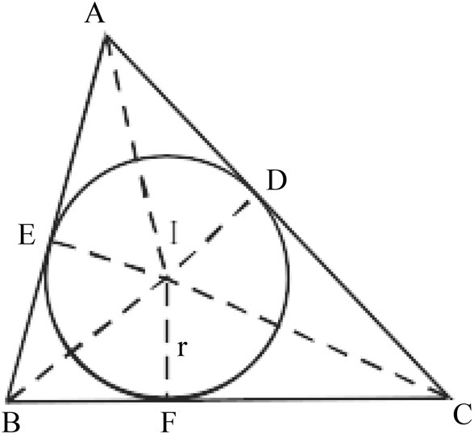
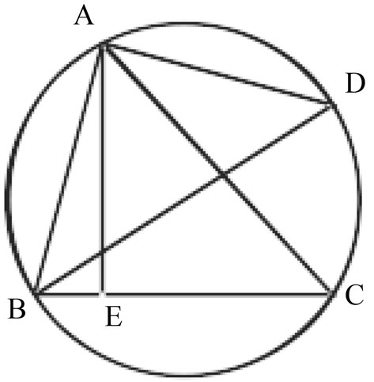
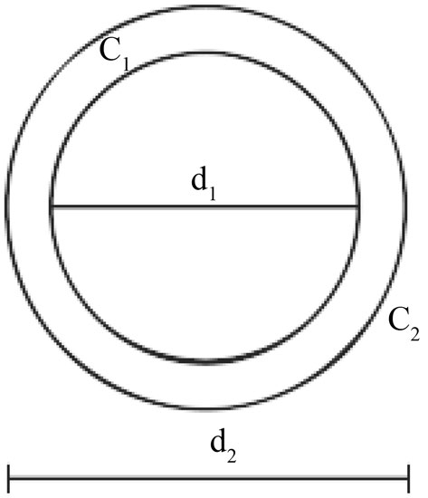
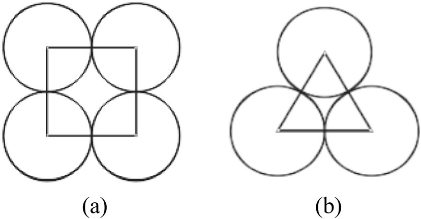
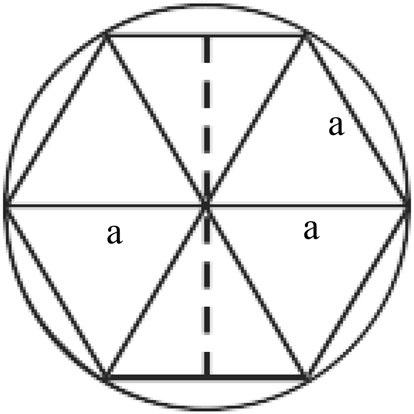
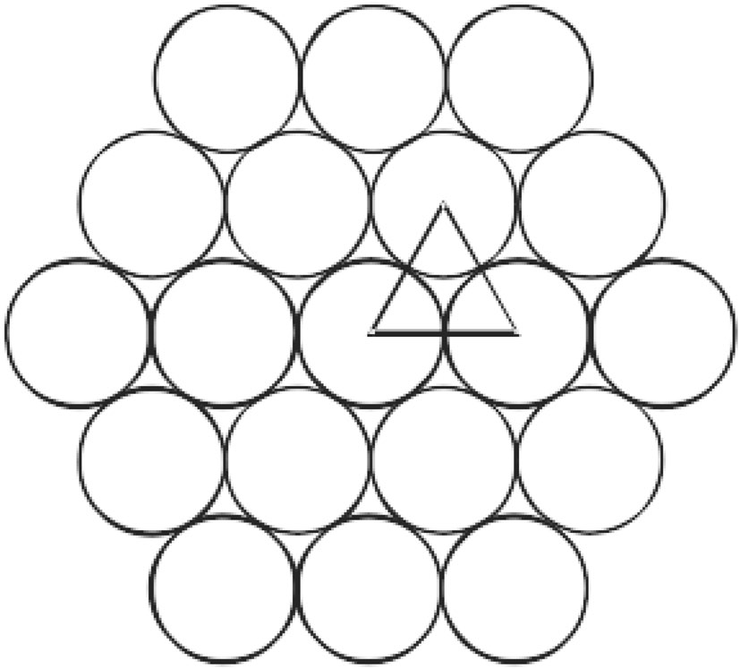
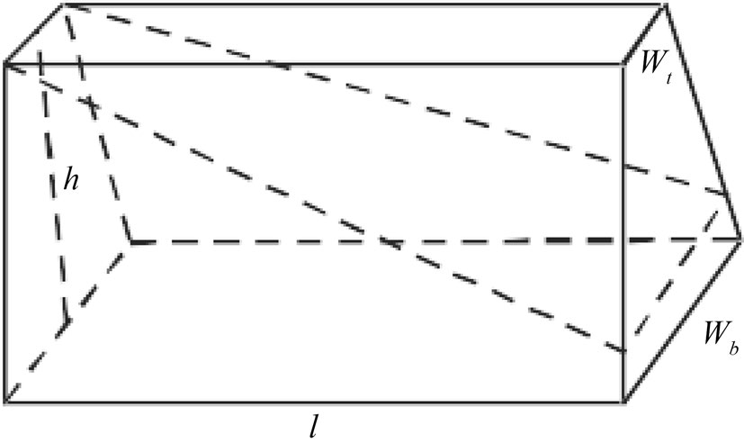

# Geometry in the Gaṇita-sāra-saṅgraha of Mahāvīrācārya

- Author Display: Sanatan Koley
- Year: 2025
- Journal Label: IJHS-60-2025-Issue-1
- Source Url: https://insa.nic.in/(S(eh1ucortlbqqezipwgliy3mn))/writereaddata/UpLoadedFiles/IJHS/IJHS_60_1_2.pdf

<!-- source: gemini page-chunk extraction -->

Vol:.(1234567890)
Indian Journal of History of Science (2025) 60:12–26
https://doi.org/10.1007/s43539-025-00151-w

# ARTICLE

# Geometry in the *Gaṇita‑sāra‑saṅgraha* of Mahāvīrācārya

Sanatan Koley¹
Received: 3 December 2022 / Accepted: 24 January 2025 / Published online: 20 May 2025
© Indian National Science Academy 2025

### Abstract

The Jainas have always been very interested in mathematics. A renowned 9th century Jaina mathematician monk Mahāvīrācārya authored the famous book *Gaṇita-sāra-saṅgraha* in 850 CE. Though the work mainly deals with arithmetic, many topics on algebra, geometry and mensuration are also discussed here. In this article an effort is made to discuss about his contributions pertaining to geometry in detail. We shall also highlight some concepts of present-day geometry (including mensuration) that are implicit in this medieval work.
**Keywords** *Āryabhaṭīya* · *Brahmagupta* · *Brāhma-sphuṭa-siddhānta* · *Gaṇita-sāra-saṅgraha* · *Mahāvīrācārya* · *Triśatikā* · *Tattvārthādhigama-sūtra-bhāṣya*
**Abbreviations**
*Br.Sp.Si.* *Brāhma-sphuṭa-siddhānta*
*G.S.S.* *Gaṇita-sāra-saṅgraha*
*IJHS* *Indian Journal of History of Science*

## 1 Introduction

India produced a number of mathematicians and astronomers like Āryabhaṭa I, Varāhamihira, Brahmagupta, Bhāskara I, Lalla, Śrīdharācārya and others during 5th–8th century CE. Among them Varāhamihira, Bhāskara I and Lalla are mainly astronomers; as a result their works are based on astronomy chiefly.[^1] Many of us probably know of the books *Āryabhaṭīya* composed in 499 CE by Āryabhaṭa I, *Brāhma-sphuṭa-siddhānta* written in 628 CE by Brahmagupta and *Triśatikā* of Śrīdharācārya (c. 750 CE). The first two among them i.e., *Āryabhaṭīya* and *Brāhma-sphuṭa-siddhānta* are more or less based on astronomy and mathematics (including geometry and mensuration). Whereas, in the other book *Triśatikā* only mathematics, that is, arithmetic, geometry, mensuration etc. are discussed.
Mahāvīrācārya or briefly Mahāvīra (c. 800–875 CE), who belonged to *Digambara* sect of the Jainas, was a distinguished mathematician of 9th century CE and was well known for his creative works. Unlike his predecessors, Mahāvīra was not an astronomer. His work is confined to pure mathematics. In c. 850 CE, he wrote his famous book *Gaṇita-sāra-saṅgraha*, that consists of more than 1130 verses, which throws light mainly upon arithmetic, but many topics on algebra and geometry have also been discussed. It is the earliest Indian text entirely devoted to mathematics. Its commentator in Sanskrit was Varadarāja. The book was widely used in South India, and was translated into Telugu language by Pāvulūri Mallana in 11th century CE.
Possibly Mahāvīra was born in or close to the present-day City of Mysore, in southern India and was associated with the School of Mysore. However, his works are essentially based on improving and extending the results or rules given by his predecessors, particularly Brahmagupta. He expounded on the same topics like, solution of rational triangles and quadrilaterals, cyclic quadrilaterals with rational sides, etc., those works were done by Brahmagupta earlier, but he expressed them more lucidly. His book *Gaṇita-sāra-saṅgraha* (*G.S.S.* briefly) has been edited and translated to English by Prof. M. Raṅgācārya in 1912 CE. Later on, in 1963 CE Prof. L.C. Jain brought out a Hindi translation of the work.
We will now make an attempt to discuss in detail those verses of the *G.S.S.* which have to do with geometry and mensuration.
---
*Sanatan Koley
sanatankoley2017@gmail.com
¹ Jagacha High School (H.S.), Haora, India

[^1]: Lalla is reported to have authored a text on mathematics which is evident from the statement of Bhāskarācārya or Bhāskara II (c. 1114–1185 CE) in his *Vāsanābhāṣya* on the *Siddhāntaśiromaṇi* (Chap. *Bhuvanakoṣa*, verses 44–47).

## 2 Rational triangles

### 2.1 Rational right‑angled triangles

It is worth mentioning that Brahmagupta was the first Indian mathematician who gave the general solution (without proof) of the equation $x^2 + y^2 = z^2$ in integers as $u^2 - v^2, 2uv, u^2 + v^2$, where $u, v$ are any two unequal integers (*Br.Sp.Si.*, verse XII.33). Mahāvīra also gives the general solution for the rational right-angled triangle (*G.S.S.*, VII. $90 \frac{1}{2}$), which is stated as follows:
वर्गविशेषः कोटिः
       संवर्गो द्विगुणितो भवेद् बाहुः।
वर्गसमासः कर्णः
       चायतचतुरस्रजन्यस्य॥ ९०½ ॥
*vargaviśeṣaḥ koṭiḥ
     saṃvargo dviguṇito bhaved bāhuḥ|
vargasamāsaḥ karṇaḥ
     cāyatacaturasrajanyasya|| 90 \frac{1}{2} ||*
The difference of the squares (of two unequal *bījas* i.e., elements) is the upright, twice their product is the base and the sum of their squares is the diagonal of a generated rectangle.
Let any two unequal integers $u$ and $v$ are chosen as the *bījas* (elements) from which the rational right-angled triangle is to be generated. Then according to this verse the general solution for the triangle is $u^2 - v^2, 2uv$ and $u^2 + v^2$.
It is noteworthy that Mahāvīra, like Brahmagupta and previously the Śulbakāras i.e., the authors of the *Śulbasūtras*, speak of the rectangle, not the right-angled triangle.

### 2.2 Rational right‑angled triangles having a given side

The solution for a rational right-angled triangle with a side ($a$) adjacent to the right angle provided, that is, the rational solution of the equation $x^2 + a^2 = z^2$ is given earlier by Brahmagupta (*Br.Sp.Si.*, XII.35). His solution is: $a, \frac{1}{2}(\frac{a^2}{u} - u), \frac{1}{2}(\frac{a^2}{u} + u)$, where $a =$ the given side and $u =$ any rational number.
Mahāvīra’s solution for the same is similar to that of Brahmagupta. This solution has been stated by Mahāvīra in the 1st half of the verse VII. $97 \frac{1}{2}$ of the *G.S.S.* as below:
कोटिकृतेश्छेदाप्त्योः
     संक्रमणे श्रुतिभुजौ भुजकृतेर्वा।
*koṭikṛteśchedāptyoḥ
     saṃkramaṇe śrutibhujau bhujakṛtervā|*
The operation of *saṃkramaṇa* conducted between any optional divisor of the square of the given upright or the base and the respective quotient gives the diagonal and the base or upright.
In this verse he used the word *saṃkramaṇa* (concurrence), which is a technical term for finding two quantities viz., $m$ and $n$ from their sum $m + n$ and difference $m - n$. Clearly $m = \frac{1}{2}\{(m + n) + (m - n)\}$ and $n = \frac{1}{2}\{(m + n) - (m - n)\}$. The above process, as explained by the commentator Gaṅgādhara (1420 CE), can be stated as: “the investigation of two quantities concurrent or grown together in the form of their sum and difference” (Datta and Singh, Part II, 1962, p. 43).
Therefore, if the rational number $u$ be any optional divisor of the square of the given upright or the base $a$, then the quotient will be $\frac{a^2}{u}$. Hence, according to Mahāvīra, the operation of *saṃkramaṇa* conducted between $u$ and $\frac{a^2}{u}$ gives the diagonal $\frac{1}{2}(\frac{a^2}{u} + u)$ and the base or upright $\frac{1}{2}(\frac{a^2}{u} - u)$ of the triangle. So, the rational right-angled triangle formed is:

$$a, \frac{1}{2}(\frac{a^2}{u} - u), \frac{1}{2}(\frac{a^2}{u} + u).$$

### 2.3 Rational right‑angled triangles having a given hypotenuse

The solution for a rational right-angled triangle with a given hypotenuse ($c$), that is, the rational solution of $x^2 + y^2 = c^2$ is found in the 2nd half of the verse VII. $97 \frac{1}{2}$ of the *G.S.S.* of Mahāvīra. The verse is stated as follows:
अथवा श्रुतीष्टकृत्योः
     अन्तरपदमिष्टमपि च कोटिभुजे।
*athavā śrutịṣṭakṛtyoḥ
     antarapadamiṣṭamapi ca koṭibhuje|*
Or, the square-root of the difference of the squares of the hypotenuse and an optional number and the optional number itself are the upright and the base.
That is, if $c$ be the given hypotenuse and $n$ be any rational number, then the solution is: $\sqrt{c^2 - n^2}, n$ and $c$. Clearly this solution is faulty in the sense that $\sqrt{c^2 - n^2}$ may not be rational unless $n$ is suitably chosen.
Mahāvīra gives another rule (*G.S.S.*, verse VII. $122 \frac{1}{2}$) for the same, which is of greater importance. As per this rule, we have to obtain at first the general solution of the rational right-angled triangle, viz., $u^2 - v^2, 2uv, u^2 + v^2$. Then we have to divide the given hypotenuse ($c$) by its hypotenuse $u^2 + v^2$. On multiplying each of the sides $u^2 - v^2, 2uv, u^2 + v^2$ by this quotient $\frac{c}{u^2+v^2}$, we get Mahāvīra’s solution as:

$$\left( \frac{u^2 - v^2}{u^2 + v^2} \right)c, \left( \frac{2uv}{u^2 + v^2} \right)c, c.$$

It may be mentioned here that Brahmagupta did not deal with the above problem. Later on in Europe Leonardo Fibonacci of Pisa, Italy, in 1202 CE, rediscovered this method of Mahāvīra (Datta and Singh, Part-II, 1962, p. 214).

### 2.4 Rational isosceles triangles

The rule for finding the general solution for the rational isosceles triangle given by Mahāvīra closely follows that of Brahmagupta’s (verse XII.33, *Br.Sp.Si.*). He gives the rule for obtaining an isosceles triangle from a single generated rectangle in the verse VII. $108 \frac{1}{2}$ of the *G.S.S.*. The concerned verse is:
कर्णेभुजद्वयं स्याद्
     बाहुर्द्विगुणीकृतो भवेद् भूमिः।
कोटिरवलम्बकोऽयं
     द्विसमत्रिभुजे धनं गणितम्॥१०८½॥
*karṇe bhujadvayaṃ syād
     bāhurdviguṇīkṛto bhaved bhūmiḥ|
koṭiravalambako’yaṃ
     dvisamatribhuje dhanaṃ gaṇitam||108 \frac{1}{2} ||*
In the required isosceles triangle, the two diagonals of a generated rectangle are the two sides, twice its side is the base, the vertical side (i.e., upright) is the altitude, and the area of the generated rectangle is the area.
It is to be remembered here that a rectangle generated from two unequal numbers i.e., the *bījas* $u$ and $v$ has its sides equal to $u^2 - v^2$ and $2uv$, and its diagonal equal to $u^2 + v^2$.
So, if $u$ and $v$ be two unequal integers, then following the above stated rule the sides of all rational isosceles triangles with integral sides will be
(i) $u^2 + v^2, u^2 + v^2$ and $2(u^2 - v^2)$; or,
(ii) $u^2 + v^2, u^2 + v^2$ and $4uv$.
Evidently the altitude of the former triangle is $2uv$ and that of the latter $u^2 - v^2$, and the area in either case is $2uv(u^2 - v^2)$.

### 2.5 Rational scalene triangles

It is known to the scholars of Indian mathematics that, according to the verse XII.34 of the *Br. Sp. Si.* of Brahmagupta, the sides of a rational scalene triangle are:

$$\frac{1}{2} \left( \frac{u^2}{v} + v \right), \frac{1}{2} \left( \frac{u^2}{w} + w \right) \text{ and } \frac{1}{2} \left( \frac{u^2}{v} + \frac{u^2}{w} - v - w \right),$$

where $u, v, w$ are any rational numbers. Here $u$ also denotes the altitude of the triangle.
The method of Mahāvīra’s solution, for this geometrical proposition, is different. He gives the concerned rule in the verse VII. $110 \frac{1}{2}$ of his treatise *G.S.S.* as below:
जन्यभुजार्धं छित्त्वा
     केनापि च्छेदलब्धजं चाभ्याम्।
कोटियुतिर्भूः कर्णौ
     भुजौ भुजा लम्बका विषमे॥११०½॥
*janyabhujārdhaṃ chittvā
     kenāpi cchedalabdhajaṃ cābhyām|
koṭiyutirbhūḥ karṇau
     bhujau bhujā lambakā viṣame||110 \frac{1}{2} ||*
Divide half the base of a derived rectangle by any optional number and obtain another rectangle with this divisor and the quotient. Then the diagonals of these two rectangles will be the sides of the scalene triangle, the sum of the vertical sides, its base and the base of either rectangle its altitude.
The rule is narrated as below (Datta and Singh, Part II, 1962, pp. 226–227):
If $u, v$ be any two unequal rational numbers, the rational rectangle CA′AD generated from them is $u^2 - v^2, 2uv$ and $u^2 + v^2$. Again, if $g, h$ be any two unequal rational factors of $uv$, that is, if $uv = gh$ (or, $\frac{uv}{g} = h$), the second rectangle CB′BD formed from them is $g^2 - h^2, 2gh$ and $g^2 + h^2$.
Now, juxtaposing these two rectangles so that they do not overlap (Fig. 1a), we obtain the sides of the rational scalene triangle (ABC) as $u^2 + v^2, g^2 + h^2$ and $\{(u^2 - v^2) + (g^2 - h^2)\}$, where $uv = gh$. Evidently these two rectangles can be juxtaposed so as to overlap (Fig. 1b). Then the sides of the required scalene triangle (ABC) will be $u^2 + v^2, g^2 + h^2$ and $\{(u^2 - v^2) \sim (g^2 - h^2)\}$.
The altitude of the rational scalene triangle thus obtained is $2uv$ or $2gh$ and the segments of the base are $u^2 - v^2$ and $g^2 - h^2$.
**Example:** (Srinivasiengar, 1988, p. 62): If $CD = 12$, then we can take $AD = 5, AC = 13, DB = 9, BC = 15$. Thus we obtain scalene triangle ABC with sides (13, 15) and base (14) or (4) having altitude (12).
It may be cited here that, in particular, putting $u = 12, v = 6, w = 8$ in Brahmagupta’s general solution (for the sides of the rational scalene triangles) mentioned above, Pṛthūdakasvāmī, commentator on the *Br.Sp.Si.*, derives a rational scalene triangle with sides (13, 15), base (14) and altitude (12). Clearly this triangle is identical to the scalene triangle ABC with sides (13, 15, 14) having altitude (12) in the aforesaid example.
Besides this, in particular, if we take $u = 3, v = 2, g = 2\sqrt{3}$ and $h = \sqrt{3}$, where $uv = gh$, in Mahāvīra’s general solution, we obtain the sides of the rational scalene triangle (ABC) as 13, 15, 14 or 13, 15, 4 having altitude 12. Thus, **we can obtain rational scalene triangle even if $g, h$ are irrational factors.**

### 2.6 Segments and altitudes of a triangle

Mahāvīra gives the rules for finding the segments of the base and the altitude of a triangle in the verse VII.49 of the treatise *G.S.S.* For a ready reference, the verse is mentioned hereunder:
भुजकृत्यन्तरभूहत-
     भूसाङ्क्रमणं त्रिबाहुकाबाधे।
तद्भुजवर्गान्तरपदम्
     अवलम्बकमाहुराचार्याः॥४९॥
*bhujakṛtyantarabhūhṛta-
    bhūsaṅkramaṇaṃ tribāhukābādhe|
tadbhujavargāntarapadam
    avalambakamāhurācāryāḥ||49||*
Divide the difference between the squares of the two sides by the base. The operation of *saṃkramaṇa*, conducted between this quotient and the base, gives the values of two segments of the base of the triangle; the square-root of the difference between the squares of either of the segments and the corresponding adjacent side gives the length of the altitude: so say the learned teachers.
Let ABC be a triangle with sides $a, b, c$, base $a$ and altitude $h$. Then according to the 1st half of the verse $\frac{1}{2} (a + \frac{b^2 \sim c^2}{a})$ and $\frac{1}{2} (a - \frac{b^2 \sim c^2}{a})$ will be the values of two segments ($x$ and $y$) of the base; the 2nd half of it states $h = \sqrt{b^2 - x^2} = \sqrt{c^2 - y^2}$.
It should be mentioned at this point that Brahmagupta (628 CE) and Bhāskara I (629 CE) individually gave the same set of formulae earlier in the *Br.Sp.Si.* (verse XII.22) and in the commentary on the *Āryabhaṭīya* (verse II.6) respectively. Another set of rules for the same are also found to occur in the work *Triśatikā*, verse 50, of Śrīdhara (c.750 CE).

*Fig. 1. Rational scalene triangles*

<!-- figure-resolved-page-render: page=4 image=media/p04_page.png -->

<!-- figure-meta: page=4, position=top, type=diagram -->

## 3 Rational quadrilaterals

### 3.1 Rational isosceles trapeziums

Mahāvīra’s method for constructing a rational isosceles trapezium (*G.S.S.*, VII. $99 \frac{1}{2}$) is somewhat different from that of Brahmagupta’s (*Br.Sp.Si.*, XII.36). Brahmagupta gives its sides in terms of the sides (and diagonal) of a rectangle and an optional number without interpreting the method of construction. Whereas Mahāvīra makes it clear that two rectangles are to be used and gives us the rule how to get *bījas* (elements) for the two rectangles, so that they have a common side. The *bījas* for the second rectangle are, the rational divisor of half the base of the first rectangle and the quotient. That is, if $u, v$ ($u \neq v$) be the *bījas* of the first rectangle wherein the base will be $2uv$, then the *bījas* for the second will be $g, h$ ($g \neq h$) where $\frac{uv}{g} = h$.
The method is interpreted as follows (Datta, Vol. XX, 1928–1929, pp. 277–279):
The first rectangle AA′BE formed from $u, v$ is $(u^2 - v^2), 2uv$ and $(u^2 + v^2)$. And the second rectangle AD′CE generated from the rational factors $g, h$ is $(g^2 - h^2), 2gh$ and $(g^2 + h^2)$ where $gh = uv$. Now juxtaposing these two rectangles judiciously, we shall obtain the required type of isosceles trapezium ABCD (Fig. 2a), where
$AB = CD = u^2 + v^2, \text{ if } u^2 - v^2 < g^2 - h^2$,
$BC = (g^2 - h^2) + (u^2 - v^2)$,
$AD = (g^2 - h^2) - (u^2 - v^2)$.
But, when $u^2 - v^2 > g^2 - h^2$, then ACBD will be the required type of isosceles trapezium (Fig. 2b) where $AC = BD = g^2 + h^2, BC = (u^2 - v^2) + (g^2 - h^2), AD = (u^2 - v^2) - (g^2 - h^2)$.

### 3.2 Rational trapeziums with three equal sides

The problem for constructing a rational trapezium with three equal sides is nearly the same as that of the rational isosceles trapezium. The difference is that in this case one of the parallel sides is also equal to the slant sides. The solution of the problem given by Mahāvīra is less simple. He indicates the method for obtaining it in the verse VII. $101 \frac{1}{2}$ of the *G.S.S.* as written below:
भुजपदहतबीजान्तर-
     हृतजन्यघनाप्तभागहाराभ्याम्।
तद्भुजकोटिभ्यां च
     द्विसम इव त्रिसमचतुरस्रे॥१०१½॥
*bhujapadahatabījāntara-
     hṛtajanyaghanāptabhāgahārābhyām|
tadbhujakoṭibhyāṃ ca
     dvisama iva trisamacaturasre||101 \frac{1}{2} ||*

<!-- figure-resolved-page-render-hidden: image=media/p05_page.png caption="Fig. 2. Rational isosceles trapeziums" -->

<!-- figure-meta: page=5, position=top, type=diagram -->

For a trapezium with three equal sides proceed as in the case of the isosceles trapezium with the rectangles generated: (i) from the quotient obtained by dividing the area of a given rational rectangle by the square-root of its *bhuja* multiplied by the difference of its *bījas*, and the divisor and (ii) from the *bhuja* and *koṭi* of the given rectangle as *bījas*.
It is described as follows (Datta, Vol. XX, 1928–1929, pp. 279–280):
If the sides of the given rational rectangle be $u^2 - v^2, 2uv$ and its diagonal $u^2 + v^2$, then calculate $\frac{2uv(u^2-v^2)}{\sqrt{2uv}(u-v)} = \sqrt{2uv(u+v)}$. Thereafter from the quotient $\sqrt{2uv(u+v)}$ and divisor $\sqrt{2uv(u-v)}$ generate the rectangle AECB′ with sides $8u^2v^2, 4uv(u^2 - v^2)$ and diagonal $4uv(u^2 + v^2)$ (Fig. 3).
Again taking the *bhuja* $2uv$ and *koṭi* $u^2 - v^2$ of the given rational rectangle as *bījas* form another rectangle AEDA′ with sides $6u^2v^2 - u^4 - v^4, 4uv(u^2 - v^2)$ and diagonal $(u^2 + v^2)^2$.
Now juxtaposing these two rectangles judiciously, we get the required rational trapezium ABCD, where $AB = EC - DE = 8u^2v^2 - (6u^2v^2 - u^4 - v^4) = (u^2 + v^2)^2 = AD = BC$ and $CD = 8u^2v^2 + (6u^2v^2 - u^4 - v^4) = 14u^2v^2 - u^4 - v^4$.
It is noticeable that, this trapezium is same as that of Brahmagupta’s rational trapezium with three equal sides (*Br.Sp.Si.*, XII.37).

*Fig. 3. A rational trapezium with three equal sides*

<!-- figure-resolved-page-render: page=5 image=media/p05_page.png -->

<!-- figure-meta: page=5, position=bottom, type=diagram -->

### 3.3 Area of a cyclic quadrilateral

According to Brahmagupta (*Br.Sp.Si.*, verse XII.21), it is known that if $a, b, c, d$ are the four sides of a quadrilateral taken in order, we have its area ($A$) as: $A = \sqrt{(s - a)(s - b)(s - c)(s - d)}$, where $s = \frac{1}{2}(a + b + c + d)$.
If we take $d = 0$, then the quadrilateral becomes a triangle with sides $a, b, c$. Thus we get its area ($A$) as: $A = \sqrt{s(s - a)(s - b)(s - c)}$.
Śrīdhara also treats the triangle as a particular case of the quadrilateral and the formula for the area of a triangle, given by him (*Triśatikā*, verse 43) is same as that of Brahmagupta. This formula is found to occur also in the work *G.S.S.* of Mahāvīra. In the verse VII.50 of this treatise, he states the concerned rule as follows:
भुजयुत्यर्धचतुष्काद्
     भुजहीनाद् घातितात् पदं सूक्ष्मम्।
अथवा मुखतलयुतिदलम्
     अवलम्बकगुणं न विषमचतुरस्रे॥५०॥
*bhujayutyardhacatuṣkād
     bhujahīnād ghātitāt padaṃ sūkṣmam|
athavā mukhatalayutidalam
     avalambakaguṇaṃ na viṣamacaturasre||50||*
The square-root of the product of half the sum of the sides severally diminished by each of the four sides is the exact area. Or, the measure of the area may be obtained by multiplying half the sum of the lengths of base and face by the perpendicular from the face to the base; but it does not hold good in the case of a *viṣama* (scalene) quadrilateral.
From the 1st half of the verse it is clear that Mahāvīra reproduced the aforesaid Brahmagupta’s formula $A = \sqrt{(s - a)(s - b)(s - c)(s - d)}$ and the triangle is treated as a quadrilateral with one side=0.
It needs to be mentioned here that, though none of the said scholars did mention explicitly that the quadrilateral is cyclic, still it seems to have been implied by them. However,
<<<CONTINUE>>>

in illustration of the above formula, Mahāvīrācārya gives few examples of cyclic quadrilaterals which are found in the verses VII.57, 58, 59 of his treatise $G.S.S.$
Now, according to the 2nd half of the verse VII.50
Area of a quadrilateral $= \frac{b+f}{2} \times h$ (except in the case of a scalene quadrilateral), where $h$ is the measure of either of the perpendiculars drawn to the base from the vertices of the face.
Area of a triangle $= \frac{b}{2} \times h$, where $h$ is the height of the vertex from the base.
The formula here given for triangles is correct; but the one given for quadrilaterals holds good only in the case of those quadrilaterals, which when divided by any of their diagonals, form two triangles having the same altitude. Also, the formula for quadrilaterals is valid for those figures in which at least one pair of opposite sides are parallel, when otherwise stated. It is to be cited here that, a scalene trapezium is the only scalene quadrilateral, for which the above formula holds good.

## 3.4 Diagonals of a cyclic quadrilateral

Here it may be pointed out that in the verse XII.28 of the $Br.Sp.Si.$, Brahmagupta expresses the theorem for the lengths of the diagonals of any cyclic scalene quadrilateral in terms of its sides. Nearly the same theorem is also found to occur in the verse VII.54 of the $G.S.S.$ In this verse Mahāvīrācārya pronounces:
> क्षितिहतविपरीतभुजौ
> मुखगुणभुजमिश्रितौ गुणच्छेदौ।
> छेदगुणौ प्रतिभुजयोः
> संवर्गयुतेः पदं कर्णौ॥५४॥
> *kṣitihataviparītabhujau*
> *mukhaguṇabhujamiśritau guṇacchedau|*
> *chedaguṇau pratibhujayoḥ*
> *saṃvargayuteḥ padaṃ karṇau||54||*
One of the two flanks multiplied by the base and added to the other flank as multiplied by the face are the multiplier and divisor and the vice versa respectively of the sum of the products of the opposite sides. The square-roots of the results so obtained will be the diagonals.
That is, if $m$ and $n$ are the diagonals of a cyclic scalene quadrilateral $(a, b, c, d)$ then according to the theorem:

$$m = \sqrt{\frac{(ad + bc)(ac + bd)}{(ab + cd)}} \quad \text{and}$$

$$n = \sqrt{\frac{(ab + cd)(ac + bd)}{(ad + bc)}}$$

Clearly, these expressions for the diagonals of a cyclic scalene quadrilateral are same as Brahmagupta gives earlier. Inspite of repetition, it may be stated here that, both Mahāvīrācārya and his predecessor Brahmagupta did not mention explicitly that these formulae hold for cyclic quadrilaterals only. But it is evident from the illustrative examples given by Pṛthūdakasvāmī, Brahmagupta’s commentator and Mahāvīrācārya, that all of the quadrilaterals are of the said type.
It may be mentioned here that, Brahmagupta’s rule ($Br.Sp.Si.$ verse XII.26) for determining the circum-radius of a cyclic scalene quadrilateral is valid only when its diagonals are at right angles. Besides, it is noticed from the verse XII.38 of the $Br.Sp.Si.$ that, the diagonals of any cyclic scalene quadrilateral intersect each other at right angles if its greatest and least sides are opposite to each other. The quadrilaterals of this kind are sometimes called ‘Brahmagupta’s quadrilaterals’. In illustration of the said verse XII.38, Pṛthūdakasvāmī gives an example of Brahmagupta’s quadrilateral with sides 60, 39, 25 and 52 taken in order, whose circum-radius is found 65/2. Later on, the same example was given by Mahāvīrācārya in the $G.S.S.$, verse VII.$217\frac{1}{2}$. For a ready reference, we may quote the verse below:
> व्येका चत्वारिंशद्बाहुः
> प्रतिबाहुको द्विपञ्चाशत्।
> षष्टिर्भूमिर्वदनं
> पञ्चकृतिः कोऽत्र विष्कम्भः॥२१७॥
> *vyekā catvāriṃśadbāhuḥ*
> *pratibāhuko dvipañcāśat|*
> *ṣaṣṭirbhūmirvadanaṃ*
> *pañcakṛtiḥ ko’tra viṣkambhaḥ||217\frac{1}{2}||*
In a (scalene) quadrilateral, one of the lateral sides is 39, the other lateral side is 52; the base is 60 and the top-side is 25. What is its circum-diameter?
Since the diagonals of such quadrilaterals intersect each other at right angles, the area will be half the product of the diagonals (*phalaṃ śrutiguṇārdham*) as per verse VII.$107\frac{1}{2}$ of the $G.S.S.$ (Jain, 1963, p. 210).

# 4 The circle

## 4.1 Circum-diameter of a cyclic quadrilateral or a triangle

The rule for determining the circum-radius of an isosceles trapezium and that of a cyclic scalene quadrilateral in which the diagonals are at right angles, are previously given by Brahmagupta ($Br.Sp.Si.$, verse XII.26). He also gives, in the verse XII.27, the rule for the same of a triangle. Like Brahmagupta, Mahāvīrācārya too gives the rule for finding the circum-diameter of a cyclic quadrilateral or a triangle. In the verse VII.$213\frac{1}{2}$ of the $G.S.S.$, Mahāvīrācārya says the rule as below:
> श्रुतिरवलम्बकभक्ता
> पार्श्वभुजघ्ना चतुर्भुजे त्रिभुजे।
> भुजघातो लम्बहृतो
> भवेद् बहिर्वृत्तविष्कम्भः॥२१३॥
> *śrutiravalambakabhaktā*
> *pārśvabhujaghnā caturbhuje tribhuje|*
> *bhujaghāto lambahṛto*
> *bhaved bahirvṛttaviṣkambhaḥ||213\frac{1}{2}||*
In case of a quadrilateral, the diagonal divided by the altitude and multiplied by the flank (lateral) side is the diameter of its circum-circle; that of a triangle is the product of the two sides divided by the altitude.
The rule is narrated as follows (Raṅgācārya, 1912, p. 252):
Let ABC be a triangle inscribed in a circle having diameter BD, and AE perpendicular on BC, AD is joined (Fig. 4). Now the triangles BAD and AEC being similar, we have

$$\frac{BD}{AC} = \frac{AB}{AE} \text{ or, } BD = \frac{AC \cdot AB}{AE}.$$

This is the formula given in the rule for the diameter of the circum-circle of a quadrilateral ABCD or a triangle ABC.
Furthermore, in the verse VII.$219\frac{1}{2}$ of the $G.S.S.$, Mahāvīrācārya gives an example for determining the circum-diameter of a triangle, which is mentioned below:
> बाहू पञ्चत्र्युत्तरदशकौ
> भूमिश्चतुर्दशो विषमे।
> त्रिभुजक्षेत्रे बाहिर-
> वृत्तव्यासं ममाचक्ष्व॥२१९॥
> *bāhū pañcatryuttaradaśakau*
> *bhūmiścaturdaśo viṣame|*
> *tribhujakṣetre bāhira-*
> *vṛttavyāsaṃ mamācakṣva||219\frac{1}{2}||*
In a (scalene) triangle 15 and 13 are two unequal sides with base 14. Tell what will be its circum-diameter.
Obviously, in this problem area of the triangle = 84, height = 12 and its circum-diameter = $16\frac{1}{4}$.

*Fig. 7. A cyclic quadrilateral or a triangle*

<!-- figure-resolved-extracted: page=7 image=media/p07_fig01.jpg -->

<!-- figure-meta: page=7, position=bottom-left, type=diagram -->

## 4.2 In-radius of a triangle

It is worth mentioning that Mahāvīrācārya is the first Indian mathematician who gave the rule for the in-radius of a triangle. In the verse VII.$223\frac{1}{2}$ of the $G.S.S.$, he enunciates the rule in the following words:
> परिधेः पादेन भजेत्
> अनायतक्षेत्रसूक्ष्मगणितं तत्।
> क्षेत्राभ्यन्तरवृत्ते
> विष्कम्भोऽयं विनिर्दिष्टः॥२२३॥
> *paridheḥ pādena bhajet*
> *anāyatakṣetrasūkṣmagaṇitaṃ tat|*
> *kṣetrābhyantaravṛtte*
> *viṣkambho’yaṃ vinirdiṣṭaḥ||223\frac{1}{2}||*
Divide the exact area of any rectilinear figure other than a rectangle by one-fourth of its perimeter; the quotient is specified as the diameter of the inscribed circle.
The rule is explained as below:
Let $r$ be the radius of the circle inscribed within the triangle ABC with sides $a, b, c$ (Fig. 5). It is clear from the figure that, the area of that triangle $(\Delta) = \frac{1}{2}a \cdot r + \frac{1}{2}b \cdot r + \frac{1}{2}c \cdot r = \frac{1}{2} \cdot \frac{d}{2}(a + b + c)$, where $d =$ the diameter of the inscribed circle.
So we get $d = \frac{\Delta}{\frac{1}{4}(a+b+c)}$ i.e, diameter $= \frac{\text{area}}{\frac{1}{4}\text{perimeter}}$. In other words, we may write $2r = \frac{4\Delta}{2s}$ i.e., $r = \frac{\Delta}{s}$, which is correct.

*Fig. 7. In-radius computation of a triangle*

<!-- figure-resolved-extracted: page=7 image=media/p07_fig02.jpg -->

<!-- figure-meta: page=7, position=bottom-right, type=diagram -->

## 4.3 Circumference and area of a circle

It should be mentioned here that the formulae for the circumference and also the area of a circle are found in the early Jaina religious and semi-religious works like *Tattvārthādhigama-sūtra-bhāṣya* etc. of Umāsvātī (c. 1st century CE). These formulae have been reproduced by Mahāvīrācārya almost in the same form in the verse VII.60 of his treatise $G.S.S.$ In this verse he writes:
> वृत्तक्षेत्रव्यासो
> दशपदगुणितो भवेत् परिक्षेपः।
> व्यासचतुर्भागगुणः
> परिधिः फलमर्धमर्धे तत्॥६०॥
> *vṛttakṣetravyāso*
> *daśapadaguṇito bhavet parikṣepaḥ|*
> *vyāsacaturbhāgaguṇaḥ*
> *paridhiḥ phalamardhamardhe tat||60||*
The diameter of a circle multiplied by the square root of ten, is its circumference. The circumference multiplied by the fourth part of the diameter, is the area, half of which is the area of a semicircle.
That is, if $C$ be the circumference of a circle of diameter $d$ and $A$ be its area, then according to this verse $C = d \cdot \sqrt{10}$ and $A = C \cdot \frac{d}{4}$.
Since the early Jainas have usually used the value of $\pi$ as $\sqrt{10}$, so we may write $C = \pi d$ and $A = \pi \frac{d^2}{4}$.

## 4.4 Wheel-circle

The ‘wheel-circle’ is a plane figure as shown in Fig. 6. For finding the gross value of the area of a wheel-circle (i.e., an annulus), Mahāvīrācārya gives the rule in the 2nd half of the verse VII.7 of his work $G.S.S.$ The concerned verse is:
> नेमेर्भुजयुत्यर्धं व्यासगुणं ...
> *nemerbhujayutyardhaṃ vyāsaguṇaṃ ...*
The area of an annulus (*nemi*) is the product of half the sum of the two edges (*bhujas*) and the breadth.
**Note:** Here, the word *vyāsa* means the breadth of the annulus, not the diameter.
That is, according to the verse the area ($A$) of an annulus with inner circumference and diameter $C_1, d_1$ and outer ones $C_2, d_2$ is $\frac{C_1+C_2}{2} \cdot \frac{d_2-d_1}{2}$.
It is to be noted here that the formula for the area of the annulus yields, indeed, the accurate value of it. This can be justified as follows:
If $r_1$ and $r_2$ are the inner and outer radii of the annulus, then we have $d_1 = 2r_1, C_1 = 2\pi r_1, d_2 = 2r_2$ and $C_2 = 2\pi r_2$. Thus the aforesaid formula reduces to $A = \pi (r_1 + r_2)(r_2 - r_1) = \pi (r_2^2 - r_1^2)$.
Moreover, for finding the exact value of the area of an annulus, Mahāvīrācārya also gives a rule in the verse VII.$80\frac{1}{2}$ of the $G.S.S.$ The concerned verse is given below:
> पृष्ठोदरसंक्षेपः
> षड्भक्तो व्यासरूपसंगुणितः।
> दशमूलगुणो नेमेः
> बालेन्द्विभदन्तयोश्च तस्यार्धम्॥८०॥
> *pṛṣṭodarasaṃkṣepaḥ*
> *ṣaḍbhakto vyāsarūpasaṃguṇitaḥ|*
> *daśamūlaguṇo nemeḥ*
> *bālendvibhadantayośca tasyārdham||80\frac{1}{2}||*
The sum of the inner and outer circumferences divided by 6 and multiplied by the breadth and $\sqrt{10}$, is the area of an annulus (*nemi*).
That is to say, $A = \frac{C_1+C_2}{6} \cdot \frac{d_2-d_1}{2} \cdot \sqrt{10}$ (exact).
Clearly the so-called ‘exact’ value of the area of the annulus has an extraneous factor of $\frac{\sqrt{10}}{3}$ in it, which was probably intended to correct the expression for having computed the circumferences $C_1$ and $C_2$ with 3 instead of $\sqrt{10}$ (Plofker 2009, p. 170).

*Fig. 8. Wheel-circle*

<!-- figure-resolved-extracted: page=8 image=media/p08_fig01.jpg -->

<!-- figure-meta: page=8, position=bottom-left, type=diagram -->

## 4.5 Area of the space bounded by three or four equal circles touching each other

In the verses VII.$82\frac{1}{2}$ and $84\frac{1}{2}$ of the $G.S.S.$, Mahāvīrācārya gives respectively the accurate formula for determining the area of the space bounded by 4 (four) and 3 (three) equal circles touching each other. In the verse VII.$82\frac{1}{2}$ he says:
> विष्कम्भवर्गराशेः
> वृत्तस्यैकस्य सूक्ष्मफलम्।
> त्यक्त्वा समवृत्तानाम्
> अन्तरजफलं चतुर्णां स्यात्॥८२॥
> *viṣkambhavargarāśeḥ*
> *vṛttasyaikasya sūkṣmaphalam|*
> *tyaktvā samavṛttānām*
> *antarajaphalaṃ caturṇāṃ syāt||82\frac{1}{2}||*
Subtract the accurate value of the area of one of the circles from the square of a diameter; the expression thus obtained, will be the accurate value of the area of the space bounded by four equal circles touching each other.
That is to say, if $d$ be the diameter of one of the circles, then according to Mahāvīrācārya, the accurate value of the required area will be $d^2 - \frac{\pi d^2}{4}$ (Fig. 7a).
Let us now come to the discussion about the verse VII.$84\frac{1}{2}$ which is stated as follows:

*Fig. 9. Three or four equal circles touching each other*

<!-- figure-resolved-extracted: page=9 image=media/p09_fig01.jpg -->

<!-- figure-meta: page=9, position=top, type=diagram -->

> विष्कम्भमानसमक-
> त्रिभुजक्षेत्रस्य सूक्ष्मफलम्।
> वृत्तफलार्धविहीनं
> फलमन्तरजं त्रयाणां स्यात्॥८४॥
> *viṣkambhamānasamaka-*
> *tribhujakṣetrasya sūkṣmaphalam|*
> *vṛttaphalārdhavihīnaṃ*
> *phalamantarajaṃ trayāṇāṃ syāt||84\frac{1}{2}||*
Diminish half the area of one of the circles from the accurate value of the area of an equilateral triangle each side of which is equal to a diameter; the expression so obtained will be the area of the space bounded by three equal circles touching each other.
That is, if $d$ be the diameter of one of the circles, then according to the verse, the value of the required area will be $\frac{\sqrt{3}}{4} d^2 - \frac{1}{2} \cdot \frac{\pi d^2}{4}$ (Fig. 7b). In this case, since the angles of the three minor sectors are $60^\circ$ each so each of the three sectors will be equal to the sixth part of the circle. Therefore 3 (three) sectors together will be equal to half the circle (semicircle). Hence the rule.

## 4.6 Measurements of a segment of a circle

Mahāvīrācārya gives two sets of formulae for finding both the area of a minor segment and the length of the arc of that segment of a circle. The first set gives approximate values for the same (verse VII.43, $G.S.S.$), while the second set gives nearly precise results (verses VII.$70\frac{1}{2}$, VII $73\frac{1}{2}$, $G.S.S.$).
We will now discuss only the computation of nearly precise results. In the verse VII. $70\frac{1}{2}$ of the $G.S.S.$, Mahāvīrācārya says:
> इषुपादगुणश्च गुणो
> दशपदगुणितश्च भवति गणितफलम्।
> यवसंस्थानक्षेत्रे
> धनुराकारे च विज्ञेयम्॥७०॥
> *iṣupādaguṇaśca guṇo*
> *daśapadaguṇitaśca bhavati gaṇitaphalam|*
> *yavasaṃsthānakṣetre*
> *dhanurākāre ca vijñeyam||70\frac{1}{2}||*
...Chord multiplied by one-fourth the arrow and also by the square-root of ten would be the area of a segment of a circle.
That is, if $c$ be the length of the chord of a circle and $h$ be the height or arrow (*śara*) of the minor segment of it, then according to Mahāvīrācārya, the area of this segment will be $\frac{\sqrt{10}}{4} ch$.
The same formula for finding the area of a segment of a circle is found to occur before in the work *Vṛhat Kṣetrasamāsa*, i.122 of Jinabhadra Gaṇi (c. 529–589 CE) [Datta and Singh, 15(2), 1980, p. 162]. Besides, the formula for the same is found also in the treatise *Triśatikā* (verse 47) of Śrīdhara. According to him the area of the segment $= \sqrt{\{h(\frac{c+h}{2})\}^2 \times \frac{10}{9}}$.
Next, we will come to discuss about the length of the arc of a minor segment of the circle. In the verse VII.$73\frac{1}{2}$ of the $G.S.S.$, Mahāvīrācārya enunciates the rule for finding the said length as conferred below:
> शरवर्गः षड्गुणितो
> ज्यावर्गसमन्वितस्तु यस्तस्य।
> मूलं धनुर्गुणेषु-
> प्रसाधने तत्र विपरीतम्॥७३॥
> *śaravargaḥ ṣaḍguṇito*
> *jyāvargasamanvitastu yastasya|*
> *mūlaṃ dhanurguṇeṣu-*
> *prasādhane tatra viparītam||73\frac{1}{2}||*
The square of the arrow is to be multiplied by six and then this is to be added to the square of the chord; the square-root of that result is the arc. ...
That is, if $a$ be the length of the arc of a minor segment of the circle, $c$ be the length of its chord and $h$ be its height or arrow (*śara*), then the rule gives $a = \sqrt{6h^2 + c^2}$.
It is to be noted that, this rule is adopted from the early Jaina religious and semi-religious works like *Tattvārthādhigama-sūtra-bhāṣya* of Umāsvātī (c. 1st century CE) and others.

## 4.7 Arrows of intercepted arcs of two intersecting circles

It may be referred here that in the verse II.18 of the treatise *Āryabhaṭīya*, Āryabhaṭa I gives the rule for determining the arrows in terms of diameters of two intersecting circles and breadth of the erosion. If $d_1$ and $d_2$ are the diameters of the two circles and the breadth of the erosion $b$ is the sum of the corresponding arrows $h_1$ and $h_2$, then according to the rule $h_1$ and $h_2$ are as follows (Koley, 2021, p. 41):

$$h_1 = \frac{(d_2 - b)b}{(d_1 - b) + (d_2 - b)},$$

$$h_2 = \frac{(d_1 - b)b}{(d_1 - b) + (d_2 - b)}.$$

Further, this rule is noticed also in the verse XII.42 of the $Br.Sp.Si.$ of Brahmagupta.
The same rule is given by Mahāvīrācārya later in his work $G.S.S.$, verse VII. $231\frac{1}{2}$.

## 4.8 Finding the sides of any rational triangle and quadrilateral inscribed in a circle of given diameter

Mahāvīrācārya gives an interesting rule for finding the sides of any rational triangle and quadrilateral inscribable in a circle of known diameter. This rule has been stated by him in the verse VII.$221\frac{1}{2}$ of the $G.S.S.$ as follows:
> लब्धव्यासेनेष्ट-
> व्यासो वृत्तस्य तस्य भक्तश्च।
> लब्धेन भुजा गुणयेत्
> भवेच्च जातस्य भुजसङ्ख्या॥२२१॥
> *labdhavyāseneṣṭa-*
> *vyāso vṛttasya tasya bhaktaśca|*
> *labdhena bhujā guṇayet*
> *bhavecca jātasya bhujasaṅkhyā||221\frac{1}{2}||*
Divide the given diameter of the circle by the circumdiameter of any generated figure of the required kind (i.e., rational triangle or quadrilateral). The sides of that generated figure multiplied by the quotient will be the sides of the required figure.
The rule is narrated as below:
The sides of a rational scalene triangle, as stated by Mahāvīrācārya in the verse VII.$110\frac{1}{2}$ of the $G.S.S.$, have been noted earlier in the running article. According to him the sides are $u^2 + v^2, g^2 + h^2, \{(u^2 - v^2) \tilde{+} (g^2 - h^2)\}$ and its altitude is $2uv$ or $2gh$, where $u, v, g, h$ are any rational numbers such that $uv = gh$. The circum-diameter of this triangle is $\frac{(u^2+v^2)(g^2+h^2)}{2uv}$.
Then, in accordance with the afore-said rule, the sides of a rational triangle inscribed in a circle of diameter $d$ will be

$$\frac{2uvd}{g^2 + h^2}, \frac{2uvd}{u^2 + v^2}, \frac{2uvd \cdot \{(u^2 - v^2) \tilde{+} (g^2 - h^2)\}}{(u^2 + v^2)(g^2 + h^2)}.$$

Again, it has been found before (in an article of the present author) in the section entitled ‘Rational cyclic scalene quadrilateral’ regarding explanation of the verse XII.38 of the $Br.Sp.Si.$ of Brahmagupta (Koley, unpublished) that, if $(a, b, c)$ and $(p, q, r)$ be the sides of two right-angled triangles such that $a^2 + b^2 = c^2$ and $p^2 + q^2 = r^2$ then $cq, ar, cp, br$ will be the sides of a cyclic scalene quadrilateral taken in order, and having its diagonals at right angles. The circum-diameter of this quadrilateral is $cr$.
Then, according to Mahāvīrācārya, the sides of a rational quadrilateral inscribed in a circle of diameter $d$ will be $cq \cdot \frac{d}{cr}, ar \cdot \frac{d}{cr}, cp \cdot \frac{d}{cr}, br \cdot \frac{d}{cr}$ or, $\frac{qd}{r}, \frac{ad}{c}, \frac{pd}{r}, \frac{bd}{c}$.
It is noteworthy that, the problem of inscribing rational polygons in a given circle was later attempted by two European mathematicians L. Euler (c. 1781 CE) and H. Schubert (1905 CE), which was pointed out by B.B. Datta in an article published in the *Bulletin of the Calcutta Mathematical Society* (BCMS, XX, 1928-29, p.292).

# 5 Miscellaneous figures

## 5.1 Polygons

Mahāvīrācārya gives a general rule for determining the gross area of all rectilinear figures. In the verse VII.39 of the $G.S.S.$, he says about the rule as below:
> रज्ज्वर्धकृतित्र्यंशो
> बाहुविभक्तो निरेकबाहुगुणः।
> सर्वेषामश्रवतां
> फलं हि बिम्बान्तरे चतुर्थांशः॥३९॥
> *rajjvardhakṛtitryaṃśo*
> *bāhuvibhakto nirekabāhuguṇaḥ|*
> *sarveṣāmaśravatāṃ*
> *phalaṃ hi bimbāntare caturthāṃśaḥ||39||*
Divide one-third of the square of the semiperimeter by the number of sides and then multiply it by the number of sides diminished by one. The result so obtained will be the gross area of all rectilinear figures. One-fourth of this will be the area of the interspace enclosed between the circles (centered at the vertices of the polygon) touching each other.
That is, if $s$ denotes the semiperimeter of a polygon of $n$ sides, whether regular or not, then according to the rule its gross area ($A$) will be $A = \frac{s^2(n-1)}{3n}$.
The area of the interspace enclosed between the circles, centered at the vertices of the polygon, touching each other will be $\frac{1}{4} \cdot \frac{s^2(n-1)}{3n}$.
Here, by taking particular examples, we can clearly see that this rule is not equally consistent in all cases and obviously needs some corrections to be suitably called a generalization.

## 5.2 Inscribed polygons

It was known in India quite early that, the side of an inscribed regular hexagon is equal to the radius of the circle. In the verse VII.$86\frac{1}{2}$ of the $G.S.S.$, Mahāvīrācārya calculates the value of its diagonal, the square of the altitude, and the square of the area all in terms of its side. The said verse is given below:
> भुजभुजकृतकृति वर्गा
> द्वित्रित्रिगुणा यथाक्रमेणैव।
> श्रुत्यवलम्बककृति धन-
> कृतयश्च षडश्रके क्षेत्रे॥८६॥
> *bhujabhujakṛtikṛtivargā*
> *dvitritriguṇā yathākrmeṇaiva|*
> *śrutyavalambakakṛtidhana-*
> *kṛtayaśca ṣaḍaśrake kṣetre||86\frac{1}{2}||*

22 Indian Journal of History of Science (2025) 60:12–26

*Fig. 8. An inscribed regular polygon*

<!-- figure-resolved-extracted: page=11 image=media/p11_fig01.jpg -->

<!-- figure-meta: page=11, position=top, type=diagram -->

$$
\text{भुजभुजकृतिकृतिवर्गा} \\
\text{द्वित्रित्रिगुणा यथाक्रमेणैव।} \\
\text{श्रुत्यवलम्बककृतिधन-} \\
\text{कृतयश्च षडश्रके क्षेत्रे॥८६}\frac{1}{2}\text{॥}

$$
*bhujabhujakṛtikṛtivargā*
*dvitritriguṇā yathākrameṇaiva|*
*śrutyavalambakakṛtidhana-*
*kṛtayaśca ṣaḍaśrake kṣetre||86\frac{1}{2}||*
In case of the regular hexagon, the side, its square and its biquadrate multiplied by $2, 3$ and $3$ would give in order the value of its diagonal, the square of the altitude, and the square of its area.
That is to say, if $a$ be the side of a regular hexagon, then its diagonal, the square of the altitude, and the square of its area will be $2a, 3a^2$ and $3a^4$ respectively.
It is evident from the figure (Fig. 8) that the value of a diagonal and the altitude of a regular hexagon given by Mahāvīra are correct, but he gives an incorrect formula for its area.

## 5.3 Ellipse

Although the Indians knew about the ellipse as early as c. 400 BCE (Datta and Singh, 15(2), 1980, p. 172), any formula for its mensuration is not found to occur in any of their works on mathematics, except the G.S.S. (c. 850 CE) of Mahāvīra. Both in the verses VII.21 and VII.63 of the said treatise, Mahāvīra attempts to give expressions for the circumference and also area of an ellipse, perhaps treating it as an arbitrary extension of a circle.
In the verse VII.21 he says:
The longer diameter of an ellipse combined with half its shorter diameter and multiplied by two, gives the gross value of its circumference. The circumference multiplied by one fourth the shorter diameter gives the gross value of the area.
That is, if $2a$ and $2b$ respectively are the longer diameter (major axis) and shorter diameter (minor axis) of an ellipse, then according to Mahāvīra
Gross Circumference = $2(2a + b)$,
Gross Area = Circumference $\times \frac{2b}{4} = b(2a + b)$.
Moreover, in the verse VII.63 Mahāvīra says:
The square-root of six times the square of the shorter diameter combined with the square of twice the longer diameter, gives the exact value of the circumference of an ellipse. The circumference multiplied by one fourth the shorter diameter gives the exact value of the area.
So, according to this verse

$$\text{Exact Circumference} = \sqrt{6(2b)^2 + (4a)^2} = \sqrt{16a^2 + 24b^2},$$

$$\text{Exact Area} = \sqrt{16a^2 + 24b^2} \cdot \frac{2b}{4} = \frac{b}{2}\sqrt{16a^2 + 24b^2}.$$

We must mention here that, the above results given by Mahāvīra are incorrect and the correct ones are, Area = $\pi ab$ and perimeter = $2\pi\sqrt{\frac{a^2+b^2}{2}}$.

## 5.4 Number of small cylinders having same diameter in a cylindrical container

Finding the number of small cylinders having same diameter in a cylindrical container, when the number of small cylinders in the outermost layer is known, is an interesting calculation done by Mahāvīra. The problem is connected with the arrangement of arrows in a quiver and the solution has been stated in the verse VI. 288 of the G.S.S. For a ready reference, the verse is mentioned below:

$$
\text{शरपरिधित्रिकमिलनं} \\
\text{वर्गितमेतत् पुनस्त्रिभिः सहितम्।} \\
\text{द्वादशहृतेऽपि लब्धं} \\
\text{शरसङ्ख्या स्यात् कलापाकाविष्टा॥२८८॥}

$$
*śaraparidhitrikamilanaṃ*
*vargitametat punastribhiḥ sahitam|*
*dvādaśahṛte’pi labdhaṃ*
*śarasaṅkhyā syāt kalāpakāviṣṭā.||288||*
The number of arrows, forming the circumferential layer, is added to 3; then square this resulting sum and again added to 3. Finally divide it by 12; the quotient thus obtained will be the total number of arrows in the quiver.
That is to say, if $n$ is the number of arrows in the circumferential layer, then according to Mahāvīra the total number of arrows ($N$) in the quiver will be $N = \frac{(n+3)^2+3}{12}$.
This formula is based on two independent concepts, viz. (i) only six equal circles can be drawn around a circle of equal diameter touching it and each other simultaneously, (ii) lines joining the centres of 3 equal circles touching one another is an equilateral triangle (Raṅgācārya, 1912, p. 167). Then the number of circles in succeeding layers will be $2 \times 6, 3 \times 6, \dots$ etc., (Fig. 9).
---
Indian Journal of History of Science (2025) 60:12–26 23

*Fig. 9. Small cylinders having same diameter in a cylindrical container*

<!-- figure-resolved-extracted: page=12 image=media/p12_fig01.jpg -->

<!-- figure-meta: page=12, position=top, type=diagram -->

Applying these concepts, let us now come to discuss about the justification of the above formula given by Mahāvīra (Sarasvati Amma 1999, pp. 193–194).
The total number of circles ($N$) in $m$ layers along with the central circle = $1 + 1 \times 6 + 2 \times 6 + 3 \times 6 + \dots + m \times 6 = 1 + 6(1 + 2 + 3 + \dots + m) = 1 + 6 \times \frac{m(m+1)}{2} = 1 + 3m(m + 1)$.
Now, if the $m$th layer contains $n$ circles, then $m \times 6 = n$, i.e., $m = \frac{n}{6}$.
Hence, $N = 1 + \frac{3n}{6}(\frac{n}{6} + 1) = 1 + \frac{n^2}{12} + \frac{n}{2} = \frac{12+n^2+6n}{12} = \frac{(n+3)^2+3}{12}$.

# 6 Volumes of solids

## 6.1 Volume of a tetrahedron

It is known to the scholars of Indian mathematics that in the verse XII.44 of the *Br.Sp.Si.*, Brahmagupta gives the correct formula for finding the volume of a pyramid or a cone. According to him, Volume of a pyramid or a cone = $\frac{1}{3}$(area of the base) $\times$ height.
More than two centuries later than that of Brahmagupta, in the verse VIII.30$\frac{1}{2}$ of the work G.S.S. of Mahāvīra, the formulae for the approximate and also for the accurate volume of a tetrahedron are found. In this verse he pronounces:

$$
\text{भुजकृतिदलघनगुणदश-} \\
\text{पदनवहृद्व्यावहारिकं गणितम्।} \\
\text{त्रिगुणं दशपदभक्तं} \\
\text{शृङ्गाटकसूक्ष्मघनगणितम्॥३०}\frac{1}{2}\text{॥}

$$
*bhujakṛtidalaghanaguṇadaśa-*
*padanavahṛdvyāvahārikaṃ gaṇitam|*
*triguṇaṃ daśapadabhaktaṃ*
*śṛṅgāṭakasūkṣmaghanagaṇitam||30\frac{1}{2}||*
Multiply the cube of half the square of the side (of the regular tetrahedron) by 10. The square-root of the product divided by 9 gives the approximate volume. This value multiplied by 3 and divided by $\sqrt{10}$ gives the exact volume.
That is, if $a$ is the edge of a regular tetrahedron, then according to this verse, the approximate volume of it will be $\frac{1}{9}\sqrt{(\frac{a^2}{2})^3 \cdot 10} = \frac{\sqrt{10}a^3}{18\sqrt{2}}$.
Then the exact volume = $\frac{\sqrt{10}a^3}{18\sqrt{2}} \cdot \frac{3}{\sqrt{10}} = \frac{a^3}{6\sqrt{2}}$, which is the correct expression.
The justification of the above expression is given below:
Let $a$ be the edge of a regular tetrahedron. Then the altitude and area of its base will be $\frac{\sqrt{3}}{2}a$ and $\frac{\sqrt{3}}{4}a^2$ respectively. The perpendicular distance from the centroid of the base to the middle point of a side of the base is $\frac{1}{3} \times \frac{\sqrt{3}}{2}a = \frac{a}{2\sqrt{3}}$. So the height of the tetrahedron will be

$$ \sqrt{(\frac{\sqrt{3}}{2}a)^2 - (\frac{a}{2\sqrt{3}})^2} = \sqrt{\frac{3}{4}a^2 - \frac{a^2}{12}} = \frac{\sqrt{2}a}{\sqrt{3}}. $$

Then volume of the tetrahedron = $\frac{1}{3} \cdot \frac{\sqrt{3}}{4}a^2 \cdot \frac{\sqrt{2}a}{\sqrt{3}} = \frac{a^3}{6\sqrt{2}}$, which is same as Mahāvīra’s expression.

## 6.2 Volume of a frustum of a pyramid or a cone

It is noteworthy that, in the verses XII.45–46 of the work *Br.Sp.Si.*, Brahmagupta gives a general method for calculating the volume of a frustum of a solid such as a pyramid, a cone and a wedge whose upper and lower faces are parallel. This method is followed by Mahāvīra in the verses VIII. 9-11$\frac{1}{2}$ of his treatise *G.S.S.*
For an illustration of his rule, Mahāvīra has given examples (verses VIII. 12$\frac{1}{2}$ - 18$\frac{1}{2}$) relating to truncated pyramids with triangular, square, rectangular bases, frustum of a right circular cone and also a truncated wedge (Bag 1979, p.164). The example relating to the truncated wedge (verse VIII.16$\frac{1}{2}$) is as follows:

$$
\text{नवति रशीतिः सप्ततिः} \\
\text{आयाामश्चोोर्ध्ववमध्यमूूलेेषुु।} \\
\text{विस्ताारोो द्वाात्रिंंशत्} \\
\text{षोोडश दश सप्त वेेधोोऽयम्॥१६}\frac{1}{2}\text{॥}

$$
*navatiraśītiḥ saptatiḥ*
*āyāmaścordhvamadhyamūleṣu|*
*vistāro dvātriṃśat*
*ṣoḍaśa daśa sapta vedho’yam||16\frac{1}{2}||*
In a well with rectangular sections, the lengths at the face (top), middle and base are 90, 80 and 70; and the breadths are 32, 16, and 10 respectively. Its depth being 7; find the volume of the well.
---
24 Indian Journal of History of Science (2025) 60:12–26
Regarding this example, it is to be noted here that, B.B. Datta and A.N. Singh pointed out that, it will be 22 instead of 32. (They wrote, “in the printed text 22 is wrongly stated as 32”, in the article ‘Hindu Geometry’, published in the *IJHS*, Vol. 15, No. 2, 1980, p. 177, footnote 6). A.K. Bag has also opined the same in his book ‘Mathematics in Ancient and Medieval India’, 1979, p. 164, Footnote 1.

## 6.3 Few notable examples

In this section, we may at first consider the following problem that has been stated in the verse VIII.51$\frac{1}{2}$ of the *G.S.S.*
The said verse is given below:

$$
\text{द्वादशषोडशविंशतिः} \\
\text{उत्सेधाः सप्त षट् च पञ्चाधः।} \\
\text{व्यासा मुखे चतुस्त्रि-} \\
\text{द्विकाश्चतुर्विंशतिर्दीर्घः॥५१}\frac{1}{2}\text{॥}

$$
*dvādaśaṣoḍaśaviṃśatiḥ*
*utsedhāḥ sapta ṣaṭ ca pañcādhaḥ|*
*vyāsā mukhe catustri-*
*dvikāścaturviṃśatirdīrghaḥ||51\frac{1}{2}||*
At three different points of a construction (at one end, middle and other end respectively) the heights are 12, 16 and 20 cubits; the breadths (at these three points) respectively are 7, 6 and 5 cubits at the base and 4, 3 and 2 cubits at the top; the length being 24 cubits. Find out the number of bricks used in the construction.
Here, average height = $\frac{12+16+20}{3} = 16$ cubits, average breadth = $\frac{1}{3}(\frac{7+4}{2} + \frac{6+3}{2} + \frac{5+2}{2}) = \frac{9}{2}$ cubits (Fig. 10).
$\therefore$ The volume of the construction = $24 \cdot \frac{9}{2} \cdot 16 = 1728$ cubic cubits.
Again, volume of a brick = $1 \cdot \frac{1}{2} \cdot \frac{1}{6} = \frac{1}{12}$ cubic cubits (dimensions of the brick are as mentioned in the *G.S.S.*).
Accordingly, the number of bricks is $1728 \div \frac{1}{12} = 20,736$.

*Fig. 10. The construction showing the measurement at three different points*

<!-- figure-resolved-page-render: page=13 image=media/p13_page.png -->

<!-- figure-meta: page=13, position=top, type=diagram -->

Further, finding the volumes of the part of a slant wall with a trapezoidal cross section blown off by storm obliquely and the part remaining, the dimensions of the wall being known, is an interesting calculation done by Mahāvīra. A sample of this method of solution is found in the verse VIII.54$\frac{1}{2}$, *G.S.S.*
The verse, for ready reference, is given as follows:

$$
\text{भुिमुखे द्विगुणे} \\
\text{मुखभूमियुतेऽभग्नभूदययुतोने।} \\
\text{दैर्घ्योोदयषष्ठांंशघ्नेे} \\
\text{स्थितपतितेष्टकाः क्रमेण स्युः॥५४}\frac{1}{2}\text{॥}

$$
*bhūmimukhe dviguṇe*
*mukhabhūmiyute’bhagnabhūdayayutone|*
*dairghyodayaṣaṣṭhāṃśaghne*
*sthitapatiteṣṭakāḥ krameṇa syuḥ||54\frac{1}{2}||*
The bottom and the top breadth each are doubled. To these are respectively added the top and bottom breadth. The resulting sums are respectively combined with and diminished by the height (above the ground) of the unbroken part of the wall; and then the results so obtained are multiplied by the length and the sixth part of the total height. Thus the volume of the wall intact and that of the wall fallen off, respectively are obtained.
Let the wall built with a trapezoidal cross section, having width $w_b$ and $w_t$ respectively at its bottom and top, total height $h$, length $l$, and $d$ be the height above the ground of the unbroken part of the wall. If it is broken along the slanting surface shown in Fig. 11, then according to the verse $\frac{lh}{6}(2w_b + w_t + d)$ and $\frac{lh}{6}(2w_t + w_b - d)$ represent the volume of the wall intact and that of the wall fallen off respectively (Raṅgācārya, 1912, p. 271).
This can be justified as follows:
Volume of the wall intact + volume of the wall fallen off = $\frac{lh}{6}\{(2w_b + w_t + d) + (2w_t + w_b - d)\} = \frac{1}{2}(w_b + w_t)hl$, which represents the volume of a trapezoidal prism having length $l$, height $h$, width $w_b$ and $w_t$ at its bottom and top respectively. Obviously this expression is same as the total volume of the wall. It is noteworthy that, the formulae for determining the volume of both the intact and fallen off parts of the wall have been given correctly, which quite remarkably manifests the unique knowledge in geometry and mensuration acquired in those days.

## 6.4 Volume of a sphere

The authentic mention of the sphere is found first in the work *Āryabhaṭīya* of Āryabhaṭa I. But he gives an incorrect formula for the volume of a sphere (verse II.7). Brahmagupta does not deal with the sphere. Śrīdhara’s formula for the same of radius $r$ is $\frac{38}{9}r^3$, which represents the approximate volume (verse 56, *Triśatikā*).
---
Indian Journal of History of Science (2025) 60:12–26 25

*Fig. 11. Broken and unbroken parts of a slant wall*

<!-- figure-resolved-extracted: page=14 image=media/p14_fig01.jpg -->

<!-- figure-meta: page=14, position=top, type=diagram -->

Mahāvīra also gives the formula for the volume of a sphere. In the verse VIII.28$\frac{1}{2}$ of the *G.S.S.*, he enunciates the formula for the same as written below:

$$
\text{व्यासाार्धघनाार्धगुुणाा} \\
\text{नव गोोलव्याावहाारिकंं फलम्।} \\
\text{तद्दशमांंशंं नवगुुण-} \\
\text{मशेेषसूूक्ष्मंं फलंं भवति॥२८}\frac{1}{2}\text{॥}

$$
*vyāsārdhaghanārdhaguṇā*
*nava golavyāvahārikaṃ phalam|*
*taddaśamāṃśaṃ navaguṇa-*
*maśeṣasūkṣmaṃ phalaṃ bhavati||28\frac{1}{2}||*
Nine times the half of the cube of the radius is the vyāvahārika (working) formula for the volume of a sphere. Its tenth part multiplied by nine is the accurate volume.
That is, if $r$ be the radius of a sphere, then according to this verse, the working formula for its volume will be $9 \cdot \frac{r^3}{2} = \frac{3}{2} \cdot \pi r^3$ (taking $\pi = 3$ for practical purposes) and the accurate volume = $\frac{9}{10} \cdot \frac{9}{2} r^3 = \frac{81}{20} r^3$. Substituting $\pi = \sqrt{10}$, this expression may reduce to $\frac{81}{20\sqrt{10}}\pi r^3 = 1.28072 \pi r^3 = 1.3 \pi r^3$ (nearly), which is not far from the correct expression $\frac{4}{3} \pi r^3$.

## 6.5 Volume of a pit of non‑uniform depth

We have noticed, in the 2nd half of the verse XII.44 of the work *Br.Sp.Si.* of Brahmagupta, a correct method for measuring the (average) volume of an excavation of non-uniform depth. Further, Pṛthūdakasvāmī, commentator on the *Br.Sp.Si.*, interprets this method with the help of an example. It is also included in an article ‘Hindu Geometry’ of B.B. Datta and A. N. Singh (*IJHS*, 15(2), 1980, p.182).
Mahāvīra also gives a rule, for calculating the average volume of a pit of non-uniform depth, in the 2nd half of the verse VIII.4 of his treatise *G.S.S.* The verse is stated as follows:

$$
\text{मुखतलयुुतिदलमथ तत्सङ्ख्यााप्तंं} \\
\text{स्याात्समीीकरणम्।}

$$
*mukhatalayutidalamatha tatsaṅkhyāptaṃ*
*syātsamīkaraṇam|*
The half of the sum of the top and corresponding bottom dimensions of the pit divided by the number of these halved quantities gives the average equivalent value.
In fact, the rule is quite confusing. This is because, here in the verse it seems that all the three dimensions i.e., length, breadth and depth of the pit vary simultaneously. If there had been only one varying element (here depth), the other two being constant, we could have easily calculated its weighted mean. We find the application of this concept in an example (about measuring the average volume of a tank having non-uniform depth) given by Pṛthūdakasvāmī, as mentioned above.

# 7 Conclusion

Finally, it may be stated that, Mahāvīra’s works are essentially based on improving and extending the results or rules given by his predecessors, particularly Brahmagupta. He expounded on the same topics like solution of rational triangles and quadrilaterals, area of a triangle, area and diagonals of a cyclic quadrilateral, circum-radius of a triangle and a cyclic quadrilateral, etc., which were also treated by Brahmagupta earlier. The formulae for the circumference and area of a circle were adopted by Mahāvīra from early Jaina works of Umāsvātī. Again, the area of a minor segment of a circle and length of its arc were reproduced by him respectively from the works of Jinabhadra Gaṇi and Umāsvātī.
His works, which were found to be incorrect are area of a cyclic non-scalene quadrilateral (partly correct), area of an inscribed regular hexagon, circumference and area of an ellipse etc. And the rule for calculating the volume of a pit of non-uniform depth, as given by him, is quite confusing. The formulae for finding the in-radius of a triangle and the area of an annulus, given by Mahāvīra, are correct. Mahāvīra’s method of solution for rational right-angled triangles having a given hypotenuse is of great importance and was later rediscovered in Europe (Datta and Singh, Part-II, 1962, p. 214). Therefore Mahāvīra’s originality is of course assured. Besides, the formulae or rules for determining the area of the space bounded by three or four equal circles touching each other, diagonal and the altitude of a regular hexagon, number of small cylinders having same diameter in a cylindrical container, volume of a tetrahedron and volumes of the part of a slant wall with a trapezoidal cross section blown off by storm obliquely and the part remaining, given by him, are also correct. And the rule for finding the volume of a sphere, is almost correct.
To sum up, Mahāvīra’s works are to some extent, the repetitions and extensions of the works of his predecessors mainly Brahmagupta. This is evident from the fact that
---
26 Indian Journal of History of Science (2025) 60:12–26
his work *G.S.S.* (a widely used textbook) is a compilation of his original works on geometry (also on arithmetic and algebra) along with the works of some of his predecessors; so repetitions are obvious. However, most of his original contributions are correct and few are incorrect. Remarkably, he was the first Indian mathematician, who dealt with topics like in-radius of a triangle and perimeter and area of an ellipse. In fact, he gave the correct formula for determining the in-radius of a triangle. The results on ellipse, given by him, though incorrect, are quite appreciable, since he introduced the study of conic sections in India, which began in Greece a long time ago. Hence, we may conclude that, the contributions made by Mahāvīra of course have some relevance in the present-day geometry and mensuration.
**Acknowledgements** The author is grateful to Dr. A.K. Bag, former Editor, *Indian Journal of History of Science*, INSA, New Delhi, for his constant encouragement towards the present author’s academic endeavours. He also expresses his deep sense of gratitude to Dr. Pradip Kumar Majumdar, former Professor of Indian Astronomy, Rabindra Bharati University, Kolkata, for providing him with source-books and giving valuable suggestions towards the improvement of this article. Further, the author wishes to acknowledge with gratitude the valuable comments and suggestions of the learned reviewers on various aspects of the relevant manuscript.

# Declaration

**conflict of interest** There is no conflict of interest.

# References

Bag, A. K. (1979). *Mathematics in ancient and Medieval India* (p. 164). Chaukhambha Orientalia.
Datta, B. B. (1928–1929). On Mahāvīra’s solution of rational triangles and quadrilaterals. *Bulletin of the Calcutta Mathematical Society*, XX, 277–280, 292.
Datta, B. B., & Singh, A. N. (1962). *History of Hindu mathematics*. Part II (pp. 43, 214, 226–227). Asia Publishing House.
Datta, B. B., & Singh, A. N. (1980). Revised by Shukla, K.S. “Hindu Geometry”, *Indian Journal of History of Science*, 15(2), 162, 172, 177, 182.
Jain, L. C. (1963). *Mahāvīrācārya’s Gaṇita-sāra-saṅgraha: Edited with a Hindi translation and introduction etc* (p. 210). Jaina Saṃskṛti Saṃrakṣā saṅgha.
Koley, S. (n.d.). Contributions of Brahmagupta to geometry. *Accepted for Publication in the Journal of the Asiatic Society, Kolkata*.
Koley, S. (2021). Geometry in the works of Aryabhaṭa I and its relevance in the field of the present-day high school geometry. *Journal of the Asiatic Society*, LXIII (4), 41.
Plofker, K. (2009). *Mathematics in India* (p. 170). Princeton University Press.
Raṅgācārya, M. (1912). *The Gaṇita-sāra-saṅgraha of Mahāvīrācārya: Edited with English translation and notes* (pp. 167, 252, 271). Government of Madras.
Sarasvati Amma, T. A. (1999). *Geometry in ancient and Medieval India* (pp. 193–194). Motilal Banarsidass Publishers Private Ltd.
Srinivasiengar, C. N. (1988). *The history of ancient Indian mathematics* (p. 62). The World Press Private Ltd.
