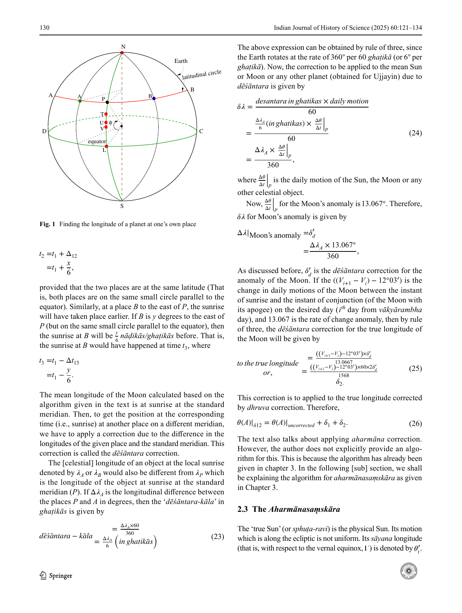
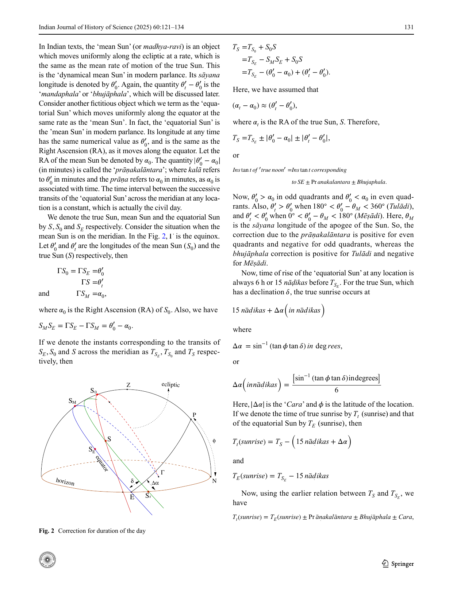
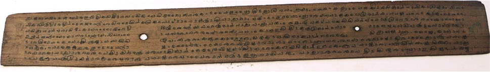

# Obtaining the longitude of the moon through mnemonics – An example from a medieval Kerala text, ...

- Author Display: Venketeswara R. Pai
- Year: 2025
- Journal Label: IJHS-60-2025-Issue-2
- Source Url: https://insa.nic.in/(S(eh1ucortlbqqezipwgliy3mn))/writereaddata/UpLoadedFiles/IJHS/IJHS_60_2_2.pdf

<!-- source: page-chunk extraction; methods recorded in assembly-manifest.json -->
<!-- Page ranges and pdf-page markers are 1-based physical PDF positions, not printed pagination. -->

<!-- decode-chunk: pages=1-5 source_sha256=d66b69a8d6d0dbd4ad6954d2bfe07566e44d4607d9e2f1ee6fc4112ac78254fa -->
<!-- pdf-page: 1 -->

Vol.:(0123456789)
Indian Journal of History of Science (2025) 60:121–134
https://doi.org/10.1007/s43539-025-00165-4
**ARTICLE**

# Obtaining the longitude of the moon through mnemonics – An example from a medieval Kerala text, *Dṛkkaraṇa*

**Venketeswara R. Pai**¹ 
[ORCID: 0000-0003-2475-4309]
Received: 10 December 2024 / Accepted: 20 May 2025 / Published online: 25 August 2025
© Indian National Science Academy 2025
**Abstract**
In modern astronomy, the expression for the longitude of the Moon has a large number of terms to include the effects of the Sun, planets etc. apart from the Earth. If the desired accuracy is an arc minute or so, it is sufficient to include only about 5 to 6 terms. The Moon-mnemonics (*Candravākyas*) are based on a simple epicycle model for the Moon (with only one correction to the mean longitude to obtain the true longitude). Moon’s longitude can be computed in a few simple steps using these *vākyas* This paper presents the details of the actual method for computing Moon’s longitude using *vākyas* in one of the texts, namely, *Dṛkkaraṇa* from medieval Kerala. It highlights the simplicity and ingenuity of the method in taking various corrections into account.
**Keywords** *Vākya*/mnemonics— · True longitude of the Moon · *Candravākyas* · *Dṛkkaraṇa*

## 1 Introduction

Based on the complexity involved in the computations and the choice of the epoch, the Indian astronomical works fall into two major categories, namely, *siddhānta* and *karaṇa* texts. Actually, there is another class of texts, known as *vākya*, which can be traced back to the time of Vararuci (Venketeswara Pai et al., 2018). The work by Vararuci is known as *Candravākyas* or Moon Sentences, the oldest available work of the *vākya* system. These are also known as *gīrnaśreyādivākyas*,[^1] which give the true longitude of the Moon, reasonably accurately, for each day in an anomalistic cycle of 248 days (Venketeswara et al., 2016; Venketeswara Pai et al., 2018; Venketeswara, 2019).
A fully developed *vākya* system is outlined in the famous *karaṇa* text of the 13th century, the *Vākyakaraṇa*. The author of this text is not known. Since this school of astronomy was more prevalent in the Tamil-speaking area, the author probably hailed from the same region. Manuscripts of the work are available in various manuscript libraries of South India, especially Tamilnadu. In the edition of *Vākyakaraṇa*, Kuppanna Sastri and K. V. Sarma estimate that it was composed between 1282 and 1316 CE (Sarma and Sastri, 1962; Chandra, 2001, 2003).
A standard *vākya* text such as *Vākyakaraṇa* discusses several sets of *vākyas* pertaining to the Sun, the Moon, and other planets. The *vākya* sets such as *Yogyādi* (Venketeswara Pai and Sriram, 2015; Venketeswara Pai et al., 2018) *Śrīguṇamitrādi* (Venketeswara, 2019) and *Bhūpajñādi* (Venketeswara Pai, 2025) are used to find the accurate longitudes of the Sun. The scheme for expressing the longitudes of the actual planets (Mercury, Venus, Mars, Jupiter, and Saturn) as *vākyas* is not that easy. They are first organized into various cycles, and the periods and epochal positions corresponding to those are given in the “*Maṇḍalavākyas*” (Venketeswara Pai et al., 2018; Venketeswara Pai, 2019a), before the *vākyas* for the longitudes are given. However, the Scheme for the Moon is relatively simple, and the set of intermediate *vākyas* used in the computation of the moon’s longitude is known as *Candravākyas* (or moon-sentences/

[^1]: Refer Table 2

---
✉ Venketeswara R. Pai
venpai79@gmail.com; venkateswara@iiserpune.ac.in
¹ Department of Humanities and Social Sciences, Indian Institute of Science Education and Research, Pune 411008, India

<!-- pdf-page: 2 -->

122 Indian Journal of History of Science (2025) 60:121–134
phrases/mnemonics). Several sets of *Candravākyas* are found in the literature, composed by different astronomers. For instance, Vararuci and Mādhava-*vākyas* are the *Candravākyas* (Venketeswara et al., 2016) composed by Vararuci and Mādhava respectively.
Though the text *Dṛkkaraṇa* is not a *vākya* text, it gives an algorithm for finding the moon’s longitude using *vākyas*. Interestingly, the text provides an efficient algorithm for computing the moon’s longitude at any desired location and time.

## 2 True longitude of the moon using *vākyas* as per *Dṛkkaraṇa*

The text *Dṛkkaraṇa*[^2] (c. 1608 CE) is a comprehensive text on astronomy which was composed based on observational data (DK1; DK2; Venketeswara Pai and Sriram, 2019; Venketeswara and Sriram, 2023).
The author declares right at the beginning of the text that he is going to expound a *karaṇa* based on observations, to enable young students to understand the mathematical methods of astronomy. He also emphasises that he is going to explain this in the [popular] language which he calls as *Bhāṣā*. In practice, the *Bhāṣā* is a highly Sanskritised version of Malayāḷaṃ. A study of *Dṛkkaraṇa* reveals that it is actually a *Tantra* type of text which gives all the algorithms associated with the traditional topics in a typical Indian text in more than 400 verses spread over 10 chapters. These include the computations of the mean longitudes, true longitudes, *tripraśna* problems related to time and shadow, corrections associated with the terrestrial longitude and latitude of a location, detailed discussions of lunar and solar eclipses, *vyatīpāta*, heliacal rising and setting of planets, computations of the ascendant (*lagna*) at a given time, dimensions of the orbits of the Sun, Moon and planets, *Vākya* system and so on (Venketeswara Pai and Sriram, 2019; Venketeswara and Sriram, 2023).
Following are the verses (27–35.5) from Chapter 10 of *Dṛkkaraṇa*, which describe the algorithm for finding the moon’s longitude based on *vākya* system (DK1; DK2).
पुत्रं दातुनृसौख्यो नु ऎन्नु वाण्णु कलेर्दिनात् |  
हंसपल्लवन्क्कोण्टुं गानवैशष्यनात् पुन: || २७ ||
शिष्टं काल नगैः पन्नॆ दवीन्द्रै श्च |  
वाक्यसंखयवरुं शेषं ; ध्रुवङ्ङळ् पऱयुनिनि || २८ ||
सत्बुधोत्रदने भानुनरज्ञो रोमनाळनूत् |  
रुद्रो योगासनाढ्योऽयं नीलांगो वतसरो ननु || २९ ||
तन्ऱॆ तन्ऱॆ फलं कोण्टु  
गुणच्चिट्टण्णु कूट्टियाल् |  
सोमोरणसुखेली न  
कूट्टुम्पोळ् ध्रुवमामत् || ३० ||
भारविदेशके चॊल्लि सूक्ष्मं खण्डतिनद्ध्रुवं |  
अन्तरं कण्टुकोळ्ळेणं इष्टकालतिनाक्कुवान् || ३१ ||
गानवैशष्यलब्धाढ्यं गोघ्नं कालानलैहृतं |  
वेदयुक्तमृणं ततु देवेन्द्राप्तं भटैर्हतं || ३२ ||
देशान्तरवलिप्तानां नागांशाढ्यं धनं तयो: |  
अन्तराप्तो जितामान्यो ध्रुवसंस्क्कारहारकः || ३३ ||
वाक्यान्तरत्तॆ वॆच्चिट्टु  
गीर्न्ननश्रेयॆन्नु वाङयाल् |  
शेषत्तॆ लिप्तयाक्कीट्टु  
हारकेण हरच्चुटन् || ३४ ||
उण्टाकुं ध्रुवसंस्क्कारं चन्द्रनल् संस्क्करक्कणं |  
वाक्यं वॆच्चु ध्रुवं कूट्टीट्ट हर्मानकृतेः पुन: || ३५ ||
ध्रुवसंस्क्कारवुं चॆय्ताल्  
चन्द्रन् दृक्तुल्यनाय्वरुं |
*putraṃ dātunṛsaukhyōnu*  
*ennu vāṇṇu kalērdināt |*  
*haṃsapallavankkoṇṭuṃ*  
*gānavaiśiṣyanāt punaḥ ||27||*
*śiṣṭaṃ kālanagaiḥ pinne*  
*divīndraiśca harēt kramāt |*  
*vākyasaṃkhyavaruṃ*  
*śēṣaṃ; dhruvaṇṇaḷ paṟayunnini ||28||*
*satbudhōtradinē bhānu*  
*narajñō rōmanāḷanūt |*  
*rudrō yōgāsanāḍhyō’yaṃ*  
*nīlāṃgō vatsarō nanu ||29||*
*tanṟe tanṟe phalaṃ koṇṭu*  
*guṇicciṭṭaṇṇu kūṭṭiyāl |*  
*sōmōraṇasukhēlīna*  
*kūṭṭumpōḷ dhruvamāmat̆ ||30||*
*bhāravidēśakē colli*  
*sūkṣmaṃ khaṇḍattiniddhruvaṃ |*  
*antaraṃ kaṇṭukḷḷēṇaṃ*  
*iṣṭakālattinākkuvān ||31||*

[^2]: This has been attributed to Jyeṣṭhadeva, who is the author of *Gaṇitayuktibhāṣā* by both Whish (1834) and Sarma (1972)). However, there is no indisputable evidence for this. In the concluding verse of *Dṛkkaraṇa* it is stated that the work was composed in ‘*kōḷaṃbe bahisūnau*’, which means the Kollam year 783, which is 1608 CE. This is mentioned in the article of C. M. Whish.

<!-- pdf-page: 3 -->

Indian Journal of History of Science (2025) 60:121–134 123
*gānavaiśiṣyalabdhāḍhyaṃ*  
*gōghnaṃ kālānalaihṛtaṃ |*  
*vēdayuktamṛṇaṃ tattu*  
*dēvēndrāptaṃ bhaṭairhataṃ ||32||*
*dēśāntaraviliptānāṃ*  
*nāgāṃśāḍhyaṃ dhanaṃ tayōḥ |*  
*antarāptō jitāmānyō*  
*dhruvasaṃskkārahārakaḥ ||33||*
*vākyāntaratte vecciṭṭu*  
*gīrnnaśrēynnu vāṇṇiyāl |*  
*śēṣatte liptayākkīṭṭu*  
*hārakēṇa hariccuṭan ||34||*
*uṇṭākuṃ dhruvasaṃskkāraṃ*  
*candranil saṃskkarikkaṇaṃ |*  
*vākyaṃ veccu dhruvaṃ*  
*kūṭṭīṭṭaharmmānakṛtēḥ punaḥ ||35||*
*dhruvasaṃskkāravuṃ ceytāl*  
*candran dṛktulyanāyvaruṃ |*
Subtract 1706821 (*putraṃdātunṛsaukhyōnu*) from the number of Kali days elapsed (*Kalidina*). [This difference has to be divided] by 43178 (*haṃsapallava*). [The quotient has to be stored at a place and the remainder has to be] again [divided] by 15403 (*gānavaiśiṣya*). The remainder obtained here has to be divided by 3031 (*kālanaga*) and then by 248 (*divīndra*) in order. The number corresponding to the *vākya* (*vākyasaṇkhyā*) is obtained as the remainder. Now, [I am going] to tell the *dhruvas* [corresponding to these divisors]. These are $04^{r} 08^{\circ} 29^{\prime} 37^{\prime\prime}$ (*satbudhō’tradine bhānu*), $09^{r} 05^{\circ} 20^{\prime} 20^{\prime\prime}$ (*narajñō rōmanāḷanut*), $11^{r} 07^{\circ} 31^{\prime} 22^{\prime\prime}$ (*rudrō yōgāsanāḍhyō’yam*) and $0^{r} 27^{\circ} 43^{\prime} 30^{\prime\prime}$ (*nīlāṃgō vatsarō nanu*) respectively. These [*dhruvas*] have to be multiplied by the respective quotients obtained and the sum of all the results has to be found. To this [sum, the *dhruva* corresponding to the *khaṇḍa*, 1706821 which is equal to] $03^{r} 27^{\circ} 52^{\prime} 57^{\prime\prime}$ (*sōmōraṇasukhēlīna*) is to be added. This *dhruva* (*sōmōraṇasukhēlīna*) is the accurate one that corresponds to the *khaṇḍa* (*putraṃdātunṛsaukhyōnu*) defined earlier. Now, The difference [in longitudes of anomaly at the instant of sunrise and the instant of the conjunction of the Moon with its apogee referred to as] *antara* is to be found to obtain [the true longitude of the Moon at the sunrise] of the desired day (*iṣṭakāla*)[^3]. The sum of [the quotient obtained when divided by] 15403 (*gānavaiśiṣya*), 3 (*gō*) multiplied by [the quotient obtained when] divided by 3031 (*kālānala*) and 84 [minutes] (*vēda*) has to be subtracted from the (*ṛṇam*) product of 14 (*bhaṭa*) and [the quotient obtained when divided by] 248 (*dēvēndra*). [The result obtained here is the “*antara*” or difference in mean longitudes of the Moon and its apogee at the *vākyārambhakāla*[^4]]. The one-thirtieth ($nāga = 30$; $nāgāṃśa = \frac{1}{30}$) of the longitudinal correction (*dēśāntara*), expressed in seconds (*viliptā*), is to be added (*āḍhya*) to [the earlier obtained result. The sum (*dhanam*) of these two [quantities, where one is the previous result which is the finite anomaly of the Moon at the sunrise, and the other one is the one-thirtieth of the longitudinal correction in seconds. This is referred to as the *antara* in the text. When there is no *dēśāntarasaṃskāra*, then the *Antra* is just the previous result which is the longitude of anomaly of the Moon at the sunrise]. The divisor corresponding to the *dhruvasaṃskāra* (*dhruvasaṃskāra-hāraka*) is the result obtained when 1568 [minutes] (*jitāmānya*) is divided by the difference [in mean longitudes of the Moon and its apogee at the *vākyārambhakāla*]. Now, having kept the difference in [successive] *vākyas*, and subtract $12^{\circ} 03^{\prime}$ (*gīrnaśrēya*) from this [difference]; the remainder, converted into minutes, has to be divided by the [*dhruvasaṃskāra*]-*hāraka*. Then, the correction pertaining to the *dhruva* (*dhruvasaṃskāra*) is obtained and this [correction] is to be applied to the [longitude of the Moon]. Now, having kept the *vākya* and adding *dhruva* to it, perform the *aharmāna* correction. Thereafter, applying the *dhruvasaṃskāra*, the [longitude of the] Moon would be in accordance with the observed Moon.
The verses give the procedure for finding the true longitude of the Moon for any desired day. The method is similar to the one described in the text *Vākyakaraṇa*. Now, we shall describe the algorithm given in the text which is a modified version of the *Vākyakaraṇa* procedure.
Let $A$ be the *ahargaṇa* on which the longitude of the Moon is desired, and the *khaṇḍadina* is the number of kali days elapsed corresponding to a day at the mean sunrise of which the Moon’s anomaly is close to zero. The *khaṇḍadina* ($K$) given in the text is 1706821 (*putraṃdātunṛsaukhyonu*).
*   Initially we have to find the difference between the *ahargaṇa* and the *khaṇḍa* which is generally referred to as *khaṇḍaśeṣa*. That is

[^3]: The term *iṣṭakāla* means the desired moment. In this case, it is the moment of sunrise of the desired day.

[^4]: *Vākyārambhakāla* refers to the instant of sunrise on a given day, marking the moment when the practice of applying the "candravākyas" begins. Ideally, the longitude of the Moon’s anomaly should be zero. However, there will be a finite anomaly value at this moment, and that value computed is an integral part the quantity which is referred to as “*antara*” in the text.

<!-- pdf-page: 4 -->

124 Indian Journal of History of Science (2025) 60:121–134

$$khaṇḍaśeṣa = \Delta_{k} = A - K$$

*   This *khaṇḍaśeṣa* is to be divided by *haṃsapallava*. The quotient and the remainder thus obtained are to be stored separately.

    $$ \frac{\Delta_{k}}{haṃsapallava} = \frac{\Delta_{k}}{43178} = q_{1} + \frac{r_{1}}{43178} \tag{1} $$

    eq: *khandasesaq1*
*   Now, we have to divide the remainder ($r_{1}$) by *gānavaiśiṣya*.

    $$ \frac{r_{1}}{gānavaiśiṣya} = \frac{r_{1}}{15403} = q_{2} + \frac{r_{2}}{15403} \tag{2} $$

Having stored the quotient ($q_{2}$) and remainder ($r_{2}$) separately, the process has to be repeated with $r_{2}$ and the number *kālanaga*. Thus we have

    $$ \frac{r_{2}}{kālanaga} = \frac{r_{2}}{3031} = q_{3} + \frac{r_{3}}{3031} \tag{3} $$

The remainder $r_{3}$ has to be divided by *divīndra* and $q_{3}$ has to be stored separately.

    $$ \frac{r_{3}}{divīndra} = \frac{r_{3}}{248} = q_{4} + \frac{r_{4}}{248} \tag{4} $$

Here, 43178 (*haṃsapallava*), 15403 (*gānavaiśiṣya*), 3031 (*kālanaga*) and 248 (*divīndra*) are the number of days in which Moon’s anomaly makes integral number of revolutions. Now, the *khaṇḍaśēṣa* ($\Delta_{k}$), in terms of these quotients, can be expressed as

$$\Delta_{k} = A - K$$

$$ = q_{1} \times 43178 + q_{2} \times 15403 + q_{3} \times 3031 + q_{4} \times 248 + i.$$

Here, $i = r_{4}$, where $1 \le i \le 248$. Let the Moon’s mean longitude at the *khaṇḍadina* be $D_{0}$, and let the increase in Moon’s longitude after 43178, 15403, 3031 and 248 days be denoted by $D_{1}, D_{2}, D_{3}$, and $D_{4}$ respectively. Then, the true longitude ($\theta_{t}(A)$) of the Moon corresponding to the *ahargaṇa*, $A$ is given by

$$\theta_{t}(A) = [D_{0} + q_{1} \times D_{1} + q_{2} \times D_{2} + q_{3} \times D_{3} + q_{4} \times D_{4}] + V_{i}, \tag{5}$$

where $V_{i}$ represents the *vākya* corresponding to the number $r_{4} = i$ which is to be read off from the table of Moon’s *vākyas*. The table contains 248 *vākyas* which are generally known as *gīrnaśreyādi-vākyas* composed by Vararuci (prior to 4th cent. CE). Mādhava has composed a more accurate set of 248 *cāndravākyas* commencing with “*śīlaṃ rājñaḥ śriye*”. A representative sample of the Vararuci *vākyas* have been tabulated in Table 2.
It may be noted that the expression for the longitude $\theta_{t}(A)$ given by (5), essentially consists of two parts, which may be called as the “*dhruva-part*” and the “*vākya-part*”. The expression corresponding to the former is enclosed in the square bracket (“[]”) in order to distinguish it from the latter. We note that it depends on $D_{i}$’s ($i = 0, 1, 2, 3, 4$) and $q_{i}$’s ($i = 0, 1, 2, 3, 4$). While $q_{i}$’s are to be obtained from the equations (1) – (4), the values of $D_{i}$’s are to be taken from the text.
The *dhruvas* $D_{0}, D_{1}, D_{2}, D_{3}$ and $D_{4}$ given in the text *Dṛkkaraṇa* are listed in Table 1.
The true longitude of the moon ($\theta_{t}(A)$) for the *ahargaṇa*, $A$ expressed by the equation (5) is not accurate and can be referred to as uncorrected true longitude $\theta_{t}(A)|_{uncorrected}$. Various corrections are mentioned in the text to be applied to the uncorrected true longitude to obtain the accurate one. These are *dhruvasaṃskāra* ($\delta_{1}$), *dēśāntarasaṃskāra* ($\delta_{2}$), and the *aharmānasaṃskāra* ($\delta_{3}$). Applying all these corrections to $\theta_{t}(A)|_{uncorrected}$ would yield the corrected-true longitude of the Moon for the desired day and desired location at true sunrise. Now, we shall be explaining each of these corrections one by one.

### 2.1 Dhruvasaṃskāra

The true longitude of the Moon obtained by (5) is for the Indian prime meridian, which passes through Lanka and Ujjain. Also, the result is inaccurate (hence, it is referred to
**Table 1** The *dhruvas* as given in *Dṛkkaraṇa*

| $i$ | *Dhruvas* ($D_{i}$’s) given in the text *Dṛkkaraṇa* | | |
|---|---|---|---|
| | in *kaṭapayādi* | in numerals | in degrees |
| 0 | सोमोराणसुखे लीन *sōmōraṇasukhē līna* | $03^{r} 27^{\circ} 52^{\prime} 57^{\prime\prime}$ | 117.8825 |
| 1 | सत्बुधोऽत्रदिने भानु *satbudhō’tradine bhānu* | $04^{r} 08^{\circ} 29^{\prime} 37^{\prime\prime}$ | 128.4936 |
| 2 | नरज्ञो रोमनाळनुत् *narajñō rōmanāḻanut* | $09^{r} 05^{\circ} 20^{\prime} 20^{\prime\prime}$ | 275.3389 |
| 3 | रुद्रो योगासनाढ्योऽयम् *rudrō yōgāsanāḍhyō’yam* | $11^{r} 07^{\circ} 31^{\prime} 22^{\prime\prime}$ | 337.5228 |
| 4 | नीलांगो वत्सरो ननु *nīlāṃgō vatsarō nanu* | $0^{r} 27^{\circ} 43^{\prime} 30^{\prime\prime}$ | 27.7250 |

<!-- pdf-page: 5 -->

Indian Journal of History of Science (2025) 60:121–134 125
as uncorrected) as the computational procedure is based on several assumptions. The entire computational procedure is based on the assumption the longitude of the anomaly is zero at the sunrise on the day of the *khaṇḍa* and on the day when the counting of *vākyas* to be started (*vākyārambhadina*). However, the Moon’s anomaly does not return to its original value exactly after 248, 3031, or 15403 days at sunrise. There will be a time difference between the instant of the conjunction of the Moon with its apogee and the instant of sunrise. The moon’s anomaly completes (57753320 − 488122 = 57265198) revolutions in a *mahāyuga* which has 1577917500 civil days. Hence, the increase in the longitude of the anomaly after 248, 3031, and 15403 days have the following values after 248, 3031, 15403, and 43178 days respectively.
$Anomaly_{248} = [\frac{57265198 \times 248}{1577917500}]_{frac} \times 360 \times 60 = 7.0031^{\prime} \approx 7^{\prime} \text{ (in 248 days)}$
$Anomaly_{3031} = [\frac{57265198 \times 3031}{1577917500}]_{frac} \times 360 \times 60 = 1.508^{\prime} \approx 1.5^{\prime} \text{ (in 3031 days)}$
$Anomaly_{15403} = [\frac{57265198 \times 15403}{1577917500}]_{frac} \times 360 \times 60 = 0.5161^{\prime} \approx 0.5^{\prime} \text{ (in 15403 days)}$
$Anomaly_{43178} = [\frac{57265198 \times 43178}{1577917500}]_{frac} \times 360 \times 60 = 0.0455^{\prime} \approx 0^{\prime} \text{ (in 43178 days).}$
Also, at the *khaṇḍadina* whose *ahargaṇa* in 1706821 days, the anomaly is not zero. Taking into account the fact that the epochal values (*Kalyādidhruvās*) of the moon and its apogee are $4^{\circ} 45^{\prime} 47^{\prime\prime}$ and $119^{\circ} 16^{\prime} 16^{\prime\prime}$ respectively, the anomaly at the *khaṇḍadina* of 1706821 days has the value,
$Anomaly_{1706821} = [\frac{57265198 \times 1706821}{1577917500}]_{frac} \times 360 + 4^{\circ} 45^{\prime} 47^{\prime\prime} - 119^{\circ} 16^{\prime} 16^{\prime\prime}$
$= 113.804^{\circ} + 4.763^{\circ} - 119.27^{\circ}$
$= -0.703^{\circ}$
$= -42.18^{\prime}$
$\approx -42^{\prime}.$
Hence, as the *Vākyārambha* day, that is, $q_{1} \times 43178 + q_{2} \times 15403 + q_{3} \times 3031 + q_{4} \times 248$ days after the *khaṇḍadina*, the Moon’s anomaly ($\theta_{v}$) has the value:
$\theta_{v} = q_{4} \times 7^{\prime} - q_{3} \times 1.5^{\prime} - q_{2} \times 0.5^{\prime} - 42^{\prime}$
$= \frac{1}{2} [q_{4} \times 14^{\prime} - q_{3} \times 3^{\prime} - q_{2} \times 1^{\prime} - 84^{\prime}].$
The expansion for $\theta_{A}(t)$ in (5) is made under the assumption that the anomaly is zero on the *Vākyārambha* day. As the anomaly then is actually $\theta_{v}$, a correction has to be made to $V_{i}$ which depends upon the anomaly.
The verses above appear to define an ’Antara’ which is,
$antara = 2\theta_{v} + \frac{d\bar{e}śāntaraviliptās}{30}$
$= [q_{4} \times 14^{\prime} - q_{3} \times 3^{\prime} - q_{2} \times 1^{\prime} - 84^{\prime}] + \frac{d\bar{e}śāntaraviliptās}{30}. \tag{6}$
The *antara* given by the previous equation (as per the verses) has the *dēśāntara* component in it. In the case of places such as Ujjain etc. (which is on Indian Prime meridian), the *dēśāntara* component is zero. Therefore, the *antara* with respect to Ujjain would be given by
$2\theta_{v} = [q_{4} \times 14^{\prime} - q_{3} \times 3^{\prime} - q_{2} \times 1^{\prime} - 84^{\prime}], \tag{7}$
and the *dhruvasamskāra-hāraka*, $H_{\delta_{1}}$ is given by
$H_{\delta_{1}} = \frac{jitamānyā}{antara}$
$= \frac{1568^{\prime}}{antara}$
$= \frac{1568^{\prime}}{[q_{4} \times 14^{\prime} - q_{3} \times 3^{\prime} - q_{2} \times 1^{\prime} - 84^{\prime}]}.$
This becomes the divisor for the correction-term, corresponding to the *dhruva*, to be applied to the uncorrected true longitude of the Moon. This correction-term is referred to as *dhruvasaṃskāra*, $\delta_{1}$. Now, the correction term described in the verse as
वाक्यान्तरत्तॆ वेच्चिट्टुगी गीर्न्ननश्र्एय्न्नुवाणियाल्  
श्एषत्तेलप्तयाक्कीट्टु हारक्एण हरच्चुटन्  
उण्टाकुं ध्रुवसंस्क्कारं चन्द्रनल् संस्क्करक्कणं  
*vākyāntaratte vecciṭṭu gīrnnaśrēynnu vāṇṇiyāl |*  
*śēṣatte liptayākkīṭṭu hārakēṇa hariccuṭan ||*  
*uṇṭākuṃ dhruvasaṃskkāraṃ candranil saṃskkarikkaṇaṃ |*  
Having kept the difference in [successive] *vākyas*, and subtract $12^{\circ} 03^{\prime}$ (*gīrnaśrēya*) from this [difference]; the remainder, converted into minutes, has to be divided
<<<CONTINUE>>>
<!-- /decode-chunk -->

<!-- decode-chunk: pages=6-10 source_sha256=76370bafdeb00831b928e524fdff7b759600ef40960bf9d0020ce52f02a349bc -->
<!-- pdf-page: 6 -->

126 Indian Journal of History of Science (2025) 60:121–134
by the [*dhruvasaṃskāra*]-*hāraka*. Then, the correction pertaining to the *dhruva* (*dhruvasaṃskāra*) is obtained and this [correction] is to be applied in the [longitude of the Moon].
Explanation of the above verse for *dhruvasaṃskāra* is as follows:
*   Find the *vākyāntara*. Here, *vākyyāntara* refers to the difference in *vākyas*. This value gives the true daily motion of the Moon for the desired day. Suppose, if we apply $V_i$ to the total ($D_{\text{total}}$) for obtaining uncorrected true longitude of the Moon for the desired *ahargaṇa*, as discussed earlier, then the *vākyyāntara* is the difference between $V_i$ and $V_{i+1}$. Therefore, *vākyyāntara*, $\Delta_{V_i} = V_{i+1} - V_i$.
*   Subtract *gīrnaśrēya* from the above result. Therefore, we have

    $$\Delta_{V_i}^1 = (V_{i+1} - V_i) - g\bar{i}rna\acute{s}r\bar{e}ya$$

    $$= \Delta_{V_i} - V_1$$

    $$= \Delta_{V_i} - 12^\circ 03',$$

    where *gīrnaśrēya* is the first *vākya* ($V_1$) among 248 *candravākyas* of Vararuci. The first *vākya* is ideally applied when the conjunction of the Moon and the apogee occurs. When the Moon coincides with its apogee, its velocity will be low. Hence, the value $12^\circ 03'$ is the true longitude of the Moon when it is slowest. It is also the longitude of the apogee. Therefore, $\Delta_{V_i}^1$ is the difference between the true daily motion of the Moon on $i^{\text{th}}$ day and the daily motion of the Moon at the *v̄kyārambhakāla* (zero-th day). The longitude $12^\circ 03'$ represented by *gīrnaśrēya* is the true longitude of the Moon on a day whose previous day had the longitude zero. That is, *vākyas* represent the true longitudes for successive days starting from a day on which the longitude of the Moon is zero.
*   Convert $\Delta_{V_i}^1$ into minutes by multiplying it by 60.

    $$\therefore \Delta_{V_i}^1 (\text{minutes}) = \Delta_{V_i}^1 (\text{degrees}) \times 60.$$

*   Now, the *dhruvasaṃskāra*, $\delta_1$ is given by

    $$\delta_1 = \frac{\Delta_{V_i}^1 (\text{minutes})}{\text{dhruva-saṃskāra-hāraka}}$$

    $$= \frac{((V_{i+1} - V_i) - 12^\circ 03') \times 60}{H_{\delta 1}}$$

    $$= \frac{((V_{i+1} - V_i) - 12^\circ 03') \times 60}{\left( \frac{1568}{[q_4 \times 14' - q_3 \times 3 - q_2 \times 1 - 84']} \right)} \tag{8}$$

    $$= \frac{((V_{i+1} - V_i) - 12^\circ 03') \times 60}{1568 \times [q_4 \times 14' - q_3 \times 3' - q_2 \times 1' - 84}$$

This is the expression for *dhruvasaṃskāra* given in *Dṛkkaraṇa*. We compare this with the description given for *dhruvasaṃskāra* in *Vākyakaraṇa* of Paramēśvara.

### 2.1.1 Description of *dhruvasaṃskāra* in *Vākyakaraṇa* of Paramēśvara

आनीय तुङ्गमध्येन्दू वाक्यारम्भदिनोदये |
तयोरन्तरमानीय तेनेन्दोर्मध्यमां गतिम् ||
चन्द्रोच्चभुक्तिरहितां विभजेल्लब्धमत्र तु |
ध्रुवसंस्कारसंज्ञः स्याद्धारकः स्वर्णसंज्ञितः ||
*ānīya tuṅgamadhyendū vākyārambhadinodaye |*
*tayorantaramānīya tenendormadhyamāṃ gatim ||*
*candroccabhuktirahitāṃ vibhajellabdhamatra tu |*
*dhruvasaṃskārasaṃjñaḥ syāddhārakaḥ svarṇasaṃjñitaḥ ||*
Having obtained the mean longitudes of the Moon and its apogee at the sunrise on the day when the counting of the *vākyas* starts and having obtained their difference, and by that [difference] the difference in rates of motion of the Moon and its apogee is to be divided. This is known as the *dhruvasaṃskāra-hāraka*. This has both positive and negative nature.
The above verses describe the procedure for obtaining the *dhruvasaṃskāra-hāraka*. Let $\theta_{00}$ and $\theta_{a0}$ are the mean longitude of the Moon and its apogee at the sunrise on the *vākyārambha* day, then the *dhruvasaṃskāra-hāraka* is given by

$$H_d = \frac{\theta_k|_{v\bar{a}ky\bar{a}rambha}}{\theta_{00} - \theta_{a0}}$$

$$= \frac{13.065^\circ}{\theta_v}, \tag{9}$$

where $\theta_k|_{v\bar{a}ky\bar{a}rambha}$ and $\theta_v$ are the mean rate of motion[^5] and the mean longitude of anomaly respectively at the sunrise on the *vākyārambha* day. The *hāraka* ($H_d$) given by (9) is the ratio of the rate of motion to the mean longitude of the anomaly at the sun rise on the *vākyārambha*-day. That is,

$$H_d = \frac{1}{\Delta t_v}, \tag{10}$$

where $\Delta t_v$ is the time difference between the instant of sunrise and the instant of conjunction of the Moon and its apogee on *vākyārambha*-day. Now, again another

[^5]: The rate of increase of the anomaly per day is the difference between the rates of motion of the "mean" Moon and its apogee which is $13^\circ 4'$ per day or $13.065^\circ$ per day.

<!-- pdf-page: 7 -->

Indian Journal of History of Science (2025) 60:121–134 127
verse which describes the correction-term for the *dhruva* (*dhruvasaṃskāra*), appears in *Vākyakaraṇa* or Paramēśvara, is as follows:
रत्नश्रेयेति संशोध्य स्वोदयस्फुटभुक्तितः |
हारकेण विभज्याप्तं स्वर्णं कुर्यान्निशाकरे ||
*ratnaśrēyēti saṃśodhya svodayasphuṭabhuktitaḥ |*
*hārakeṇa vibhajyāptaṃ svarṇaṃ kuryānniśākare ||*
The ‘*ratnaśrēya*’ ($12^\circ 02'$) is to be subtracted from the true rate of motion of the Moon. [The result] has to be divided by the *hāraka*. [What is obtained here] has to be applied positively and negatively to the longitude of the Moon.
Based on the algorithm given in the above verse, the expression for the *dhruvasaṃskāra* ($\delta_{1|vk} = \frac{(\text{sphuṭabhukti of the Moon}) - \text{ratnaśrēya}}{\text{dhruvasaṃskāra-hāraka}} = \frac{(\text{True rate of motion of the Moon})}{H_d}$) is given by

$$\delta_{1|vk} = \frac{(\text{sphuṭabhuti of the Moon}) - \text{ratnaśrēya}}{\text{dhruvasaṃskāra-hāraka}}$$

$$= \frac{(\text{True rate of motion of the Moon}) - 12^\circ 02'}{H_d} \tag{11}$$

The term ‘*ratnaśrēya*’ gives the numerical value of the rate of motion of the Moon when it has the slowest motion. The value encoded in the term ‘*ratnaśrēya*’ is $12^\circ 02'$. This is the value when the Moon has the slowest motion. This happens when the Moon coincides with its apogee. In other words, it is the rate of motion of the Moon when its anomaly is zero. The true rate of motion of the Moon on desired *ahargaṇa* would be the difference between corresponding successive *vākyas*. Therefore,

$$\text{True rate of motion of the Moon} = \frac{\Delta \theta_i}{\Delta t}$$

$$= V_{i+1} - V_i. \tag{12}$$

Now, applying (12) in (11), we have

$$\delta_{1|vk} = \frac{(\text{True rate of motion of the Moon}) - 12^\circ 02'}{H_d}$$

$$= \frac{(V_{i+1} - V_i) - 12^\circ 02'}{H_d}$$

$$= \frac{(V_{i+1} - V_i) - 12^\circ 02'}{\left( \frac{13.065^\circ}{\theta_v} \right)}. \tag{13}$$

The above equation gives the correction as defined in *Vākyakaraṇa* of Paramēśvara.
Multiplying both the numerator and denominator of (13) by 60, and using the expression for $\theta_v$, we have the correction,

$$\Delta \theta_i|_{va} = \frac{((V_{i+1} - V_i) - 12^\circ 03')}{13.065^\circ} \times \theta_v$$

$$= \frac{((V_{i+1} - V_i) - 12^\circ 03') \times 60}{13.065^\circ \times 60} \times \theta_v$$

$$= \frac{((V_{i+1} - V_i) - 12^\circ 03') \times 60}{13.065^\circ \times 60} \times \left[ \frac{q_4 \times 14' - q_3 \times 3' - q_2 \times 1' - 84'}{2} \right]$$

$$= \frac{((V_{i+1} - V_i) - 12^\circ 03') \times 60}{1567.8} \times [q_4 \times 14' - q_3 \times 3' - q_2 \times 1' - 84'] \tag{14}$$

$$\approx \frac{((V_{i+1} - V_i) - 12^\circ 03') \times 60}{1568} \times [q_4 \times 14' - q_3 \times 3' - q_2 \times 1' - 84']$$

$$= \delta_1 (\text{dhruvasaṃskāra}),$$

as the desired result. Applying this correction term $\delta_1$ to the uncorrected true longitude $\theta_t(A)|_{\text{uncorrected}}$, we get the corrected true longitude of the Moon. Therefore

$$\theta_t(A)|_{\text{corrected}} = \theta_t(A)|_{\text{uncorrected}} + \delta_1. \tag{15}$$

This is the true longitude of the Moon with respect to the prime meridian passess through Ujjain, Lanka etc. For obtaining the true longitude at ones own desired place, one has to apply the *dēśāntara* correction. In the next subsection, we shall explain the *dēśāntara* correction given in the text and its rationale.

### 2.1.2 An alternate expression for *dhruvasaṃskāra* based on the rationale given in *Karaṇapaddhati*

While determining the true longitude of the Moon from *candravākyas*, the text *Vākyakaraṇa* ($13^{\text{th}}$ CE) also refers to a similar correction term. In the Appendix of the work on *Karaṇapaddhati*, we have provided the rationale for the same (Pai, Venketeswara, 2018, pp. 356–357). We present this below, using the expression for $\delta = \theta_v$ in *Dṛkkaraṇa*.
Let $X$ be the anomaly without any correction. Hence, the actual anomaly would be $X + \theta_v$. The equation of center would now be $-\sin^{-1}\left[\frac{7}{80} \sin(X + \theta_v)\right]$ instead of $-\sin^{-1}\left[\frac{7}{80} \sin(X)\right]$. Hence the correction to the equation of centre is given by

$$-\sin^{-1}\left[\frac{7}{80} \sin(X + \theta_v)\right] + \sin^{-1}\left[\frac{7}{80} \sin(X)\right]$$

$$\approx -\frac{d}{dX} \left[ \sin^{-1} \left( \frac{7}{80} \sin X \right) \right] \times \theta_v.$$

The true longitude is given by

$$\theta_t = \theta_m - \sin^{-1} \left( \frac{7}{80} \sin X \right).$$

Now in one day, $X$ increases by $13^\circ 4'$. Therefore,

<!-- pdf-page: 8 -->

128 Indian Journal of History of Science (2025) 60:121–134

$$g_{mt} \approx g_{m0} - \frac{d}{dX} \left[ \sin^{-1} \left( \frac{7}{80} \sin X \right) \right] \times 13^\circ 4',$$

or

$$-\frac{d}{dX} \left[ \sin^{-1} \left( \frac{7}{80} \sin X \right) \right] \approx \frac{g_{mt} - g_{m0}}{13^\circ 4'}, \tag{16}$$

where $g_{mt}$ is the rate of motion of the true longitude of Moon/day and $g_{m0}$ is rate of motion of the mean longitude of Moon/day, in degrees.

$$-\frac{d}{dX} \left[ \sin^{-1} \left( \frac{7}{80} \sin X \right) \right] \times \theta_v \approx \frac{g_{mt} - g_{m0}}{13^\circ 4'} \times \theta_v \text{ (in degrees)}.$$

As per *Dṛkkaraṇa*, $\delta$ is given by

$$\theta_v = [q_4 \times 7' - q_3 \times 1.5' - q_2 \times 0.5' - 42']. \tag{17}$$

Substituting (17) in (16), we get

$$-\frac{d}{dX} \left[ \sin^{-1} \left( \frac{7}{80} \sin X \right) \right] \times \theta_v$$

$$\approx (g_{mt} - g_{m0}) \times \frac{[q_4 \times 7' - q_3 \times 1.5' - q_2 \times 0.5' - 42']}{13.06}$$

$$= (g_{mt} - g_{m0}) \times \frac{[q_4 \times 14' - q_3 \times 3' - q_2 \times 1' - 84'] \times 60}{13.06 \times 2 \times 60}$$

$$= (g_{mt} - g_{m0}) \times \frac{[q_4 \times 14' - q_3 \times 3' - q_2 \times 1' - 84'] \times 60}{1567.2}$$

$$\approx (g_{mt} - g_{m0}) \times \frac{[q_4 \times 14' - q_3 \times 3' - q_2 \times 1' - 84'] \times 60}{1568}.$$

Here, $g_{mt} = V_{i+1} - V_i$ is the true rate of motion (between days $i$ and $i+1$) and $g_{m0}$ is the mean rate of motion of the Moon. It is nearly $13^\circ 10'$ per day. Then, *Dhruvasaṃskāra* ($\delta_1^{kp}$) would be

$$\delta_1^{kp} = \frac{[(V_{i+1} - V_i) - 13^\circ 10'] \times 60}{1568} \tag{18}$$

$$= \times [q_4 \times 14' - q_3 \times 3' - q_2 \times 1' - 84'].$$

However, in *Dṛkkaraṇa*, it is the above expression with $13^\circ 10'$ replaced by $12^\circ 03'$, that is, the mean rate of motion is replaced by the first *vākya*, which is the increase in the true longitude of the Moon after one day. The author of *Dṛkkaraṇa* and Paramēśvara in his *Vākyakaraṇa* do not seem to have provided the reason. It is true that when the Moon coincides with its apogee, its velocity is lowest, and it is per day then.

## 2.2 *Dēśāntarasaṃskāra*

*Deśāntarassṃskāra* is the correction used for obtaining the true longitude of the planet at any desired place. The term *Deśāntara* is the longitude of a place measured to the east or west from the standard (or prime) meridian. In Indian astronomy, the prime meridian is the great circle of the Earth passing through the north and south poles, Ujjayini and Lañkä, where Lañkä was assumed to be a fictitious point on the Earth’s equator.
The Sun completes a rotation (of $360^\circ$) in one day due to the diurnal motion. Therefore, the angular distance covered by the Sun is

$$\frac{360}{60} = 6^\circ \text{ (in one nad̄⋅ikā)}$$

This means if the Sun rises at time $t_1$ at a place ($P$), then the sunrise at another place ($A$), $x$ degrees to the west of the first place, will be $\frac{x}{6}$ *nāḍikās* later. That is, the sunrise at the place would be at

$$t_2 = t_1 + \Delta t_{12}$$

$$= t_1 + \frac{x}{6},$$

provided that the two places are at the same latitude (That is, both places are on the same small circle parallel to the equator). Similarly, at a place $B$ to the east of $P$, the sunrise will have taken place earlier. If $B$ is $y$ degrees to the east of $P$ (but on the same small circle parallel to the equator), then the sunrise at $B$ will be $\frac{y}{6}$ *nāḍikās* before. That is, the sunrise at $B$ would have happened at time $t_3$, where

$$t_3 = t_1 - \Delta t_{13}$$

$$= t_1 - \frac{y}{6}.$$

Now, the *dēśāntara* correction given in *Dṛkkaraṇa*, in the context of finding the longitude of the Moon based on *vākya* method, is described in the first half of verse 33. The correction mentioned here is an integral part of the *dhruvasaṃskāra*. The correction ($\delta_1$) discussed in the previous section (2.1.1) is the *dhruvasaṃskāra* for the Ujjain, where the *dēśāntara* correction $\delta_2$ is zero. Let the $\delta_{12}$ is the integrated correction term pertaining to both *dhruvasaṃskāra* and *dēśāntara* correction. As per the verse, the *dēśāntara* correction, expressed in seconds, has to be first divided by the 30 (*nāga*) and it has to be added to the quantity referred to as “antara". The verse given above is
देशान्तरविलिप्तानां नागांशाढ्यं......
*dēśāntaraviliptānāṃ nāgāṃśāḍhyaṃ......*
The result obtained by dividing the *dēśāntara* correction, expressed in seconds, by 30 (*nāga*) is to be added.
Let $\delta''_d$ be the *dēśāntara* correction in seconds, then $\frac{\delta''_d}{30}$ to be added to the *antara* defined in the previous [sub-]section. Therefore, by integrating the *dēśāntara* correction, we have the new *antara* which is given by

<!-- pdf-page: 9 -->

Indian Journal of History of Science (2025) 60:121–134 129

$$antara|_{\text{new}} = [q_4 \times 14' - q_3 \times 3 - q_2 \times 1 - 84'] + \frac{\delta''_d}{30}$$

$$= [q_4 \times 14' - q_3 \times 3 - q_2 \times 1 - 84'] + \frac{2\delta''_d}{2 \times 30}$$

$$= [q_4 \times 14' - q_3 \times 3 - q_2 \times 1 - 84'] + \frac{2\delta''_d}{60}$$

$$= [q_4 \times 14' - q_3 \times 3 - q_2 \times 1 - 84'] + 2\delta'_d,$$

where $\delta'_d$ is the *dēśāntara* correction in minutes and is the same as (6). Also, RHS of the above equation is twice the sum of $\theta_v$ and $\delta'_d$. That is,

$$antara|_{\text{new}} = 2(\theta_v + \delta'_d).$$

Now, the integrated correction $\delta_{12}$ can be written as

$$\delta_{12} = \frac{\Delta_{V_i}^1 (\text{minutes})}{\text{dhruva-saṃskāra-hāraka}}$$

$$= \frac{((V_{i+1} - V_i) - 12^\circ 03') \times 60}{H_{\delta 1}}$$

$$= \frac{((V_{i+1} - V_i) - 12^\circ 03') \times 60}{\left( \frac{1568}{anatara|_{\text{new}}} \right)} \tag{19}$$

$$= \frac{((V_{i+1} - V_i) - 12^\circ 03') \times 60}{1568 \times [q_4 \times 14' - q_3 \times 3 - q_2 \times 1 - 84' + 2 \delta'_d]}$$

$$= \frac{((V_{i+1} - V_i) - 12^\circ 03') \times 60}{1568 \times [q_4 \times 14' - q_3 \times 3 - q_2 \times 1 - 84']} + \frac{((V_{i+1} - V_i) - 12^\circ 03') \times 60 \times 2 \delta'_d}{1568}$$

$$= \delta_1 + \delta_2, \tag{20}$$

where $\delta_2$ is the *dēśāntara* correction term, which is to be added to the true longitude of the Moon to reduce it to the desired place. Since the correction application is positive, it is meant for the places situated west of the Indian Prime meridian. Now,

$$\delta_2 = \frac{((V_{i+1} - V_i) - 12^\circ 03') \times 60 \times 2 \delta'_d}{1568} \tag{21}$$

$$= \frac{((V_{i+1} - V_i) - 12^\circ 03') \times \delta'_d}{13.0667}, \tag{22}$$

where $\frac{1568}{60 \times 2} = 13.0667$ is nothing but the rate of increase in the Moon’s anomaly per day. Therefore, the correction $\delta_2$ depends on the $V_i$ and $V_{i+1}$ values and the value corresponding to $\delta'_d$. It appears that $\delta'_d$ is the *dēśāntara* correction for the anomaly of the Moon.
We shall now provide the rationale for *dēśāntara* correction based on the description given in chapter 3.
Figure 1 depicts the Earth, with the standard meridian (corresponding to zero terrestrial longitude, as per Indian texts) passing through Laṇkā (**L**), Vātsyapura (**V**), Avanti or Ujjayinī (**U**), Sthānēśvara (**T**), and the north pole or *Mēru* (**N**; referred to as *Surālaya* or abode-of-the-gods in the text).
Let $P$ represent a location on the standard meridian, and $B$ and $A$ represent locations on different meridians (with different terrestrial longitudes) with the same latitude as $P$, but east and west of it respectively. Because of the east-to-west rotation of the celestial sphere around the axis of the Earth (as viewed from the latter), the local sunrise at $B$ or $A$ would be earlier or later respectively, than the sunrise at $X$ on the standard meridian. This time difference is called the ‘*Dēśāntara-kāla*’ and denoted by $\Delta t_D$. The same time difference would be operative for the instants of first contact (*sparśa*) or release (*mōkṣa*) in an eclipse, and other celestial phenomena. Therefore, the time of local sunrise is obtained by subtracting or adding $\Delta t_D$ to the time of sunrise at standard meridian. where $\Delta t_D$ is the ‘*Dēśāntara-kāla*’ and ‘$-$’ is applicable if the location is east of $P$, as at $B$, and ‘$+$’ if the location is west of $P$, as at $A$.
As discussed before, the Sun completes a rotation (of $360^\circ$) in one day due to the diurnal motion. Therefore, the angular distance covered by the Sun is

$$\frac{360}{60} = 6^\circ \text{ (in one nad̄⋅ikā)}$$

This means if the Sun rises at time $t_1$ at a place ($P$), then the sunrise at another place ($A$), $x$ degrees to the west of the first place, will be $\frac{x}{6}$ *nāḍikās/ghaṭikās* later. That is, the sunrise at the place would be at

<!-- pdf-page: 10 -->

130 Indian Journal of History of Science (2025) 60:121–134

*Fig. 1. Finding the longitude of a planet at one’s own place*

<!-- figure-resolved-page-render: page=10 image=media/p10_page.webp reason=no-extracted-figure -->

<!-- figure-meta: page=10, position=top, type=diagram -->

$$t_2 = t_1 + \Delta t_{12}$$

$$= t_1 + \frac{x}{6},$$

provided that the two places are at the same latitude (That is, both places are on the same small circle parallel to the equator). Similarly, at a place $B$ to the east of $P$, the sunrise will have taken place earlier. If $B$ is $y$ degrees to the east of $P$ (but on the same small circle parallel to the equator), then the sunrise at $B$ will be $\frac{y}{6}$ *nāḍikās/ghaṭikās* before. That is, the sunrise at $B$ would have happened at time $t_3$, where

$$t_3 = t_1 - \Delta t_{13}$$

$$= t_1 - \frac{y}{6}.$$

The mean longitude of the Moon calculated based on the algorithm given in the text is at sunrise at the standard meridian. Then, to get the position at the corresponding time (i.e., sunrise) at another place on a different meridian, we have to apply a correction due to the difference in the longitudes of the given place and the standard meridian. This correction is called the *dēśāntara* correction.
The [celestial] longitude of an object at the local sunrise denoted by $\lambda_A$ or $\lambda_B$ would also be different from $\lambda_P$ which is the longitude of the object at sunrise at the standard meridian ($P$). If $\Delta \lambda_A$ is the longitudinal difference between the places $P$ and $A$ in degrees, then the ‘*dēśāntara-kāla*’ in *ghaṭikās* is given by

$$d\bar{e}\acute{s}antara - k\bar{a}la = \frac{\Delta \lambda_A \times 60}{360} = \frac{\Delta \lambda_A}{6} \text{ (in ghaṭikās)} \tag{23}$$

The above expression can be obtained by rule of three, since the Earth rotates at the rate of $360^\circ$ per 60 *ghaṭikā* (or $6^\circ$ per *ghaṭikā*). Now, the correction to be applied to the mean Sun or Moon or any other planet (obtained for Ujjayin) due to *dēśāntara* is given by

$$\delta \lambda = \frac{d\bar{e}s\bar{a}ntara \text{ in ghaṭikās} \times \text{daily motion}}{60}$$

$$= \frac{\frac{\Delta \lambda_A}{6} \text{ (in ghaṭikās)} \times \frac{\Delta \theta}{\Delta t}|_p}{60} \tag{24}$$

$$= \frac{\Delta \lambda_A \times \frac{\Delta \theta}{\Delta t}|_p}{360},$$

where $\frac{\Delta \theta}{\Delta t}|_p$ is the daily motion of the Sun, the Moon or any other celestial object.
Now, $\frac{\Delta \theta}{\Delta t}|_p$ for the Moon’s anomaly is $13.067^\circ$. Therefore, $\delta \lambda$ for Moon’s anomaly is given by

$$\Delta \lambda|_{\text{Moon's anomaly}} = \delta'_d = \frac{\Delta \lambda_A \times 13.067^\circ}{360},$$

As discussed before, $\delta'_d$ is the *dēśāntara* correction for the anomaly of the Moon. If the $((V_{i+1} - V_i) - 12^\circ 03')$ is the change in daily motions of the Moon between the instant of sunrise and the instant of conjunction (of the Moon with its apogee) on the desired day ($i^{\text{th}}$ day from *vākyārambha* day), and $13.067$ is the rate of change anomaly, then by rule of three, the *dēśāntara* correction for the true longitude of the Moon will be given by

$$\text{to the true longitude} = \frac{((V_{i+1} - V_i) - 12^\circ 03') \times \delta'_d}{13.0667} \tag{25}$$

$$\text{or,} = \frac{((V_{i+1} - V_i) - 12^\circ 03') \times 60 \times 2\delta'_d}{1568} = \delta_2.$$

This correction is to applied to the true longitude corrected by *dhruva* correction. Therefore,

$$\theta(A)|_{\delta_{12}} = \theta(A)|_{\text{uncorrected}} + \delta_1 + \delta_2. \tag{26}$$

The text also talks about applying *aharmāna* correction. However, the author does not explicitly provide an algorithm for this. This is because the algorithm has already been given in chapter 3. In the following [sub] section, we shall be explaining the algorithm for *aharmānasaṃskāra* as given in Chapter 3.

## 2.3 The *Aharmānasaṃskāra*

The ‘true Sun’ (or *sphuṭa-ravi*) is the physical Sun. Its motion which is along the ecliptic is not uniform. Its *sāyana* longitude (that is, with respect to the vernal equinox, $\Gamma$) is denoted by $\theta'_t$.
<!-- /decode-chunk -->

<!-- decode-chunk: pages=11-14 source_sha256=bff35a482df0298b43172a7d8fedb04d6ef6aaae484a0c8526aa9858aaf42a26 -->
<!-- pdf-page: 11 -->

Indian Journal of History of Science (2025) 60:121–134 131
In Indian texts, the ‘mean Sun’ (or *madhya-ravi*) is an object which moves uniformly along the ecliptic at a rate, which is the same as the mean rate of motion of the true Sun. This is the ‘dynamical mean Sun’ in modern parlance. Its *sāyana* longitude is denoted by $\theta'_0$. Again, the quantity $\theta'_t - \theta'_0$ is the ‘*mandaphala*’ or ‘*bhujāphala*’, which will be discussed later. Consider another fictitious object which we term as the ‘equatorial Sun’ which moves uniformly along the equator at the same rate as the ‘mean Sun’. In fact, the ‘equatorial Sun’ is the ’mean Sun’ in modern parlance. Its longitude at any time has the same numerical value as $\theta'_0$, and is the same as the Right Ascension (RA), as it moves along the equator. Let the RA of the mean Sun be denoted by $\alpha_0$. The quantity $|\theta'_0 - \alpha_0|$ (in minutes) is called the ‘*prāṇakalāntara*’; where *kalā* refers to $\theta'_0$ in minutes and the *prāṇa* refers to $\alpha_0$ in minutes, as $\alpha_0$ is associated with time. The time interval between the successive transits of the ‘equatorial Sun’ across the meridian at any location is a constant, which is actually the civil day.
We denote the true Sun, mean Sun and the equatorial Sun by $S$, $S_0$ and $S_E$ respectively. Consider the situation when the mean Sun is on the meridian. In the Fig. 2, $\Gamma$ is the equinox. Let $\theta'_0$ and $\theta'_t$ are the longitudes of the mean Sun ($S_0$) and the true Sun ($S$) respectively, then

$$\Gamma S_0 = \Gamma S_E = \theta'_0$$

$$\Gamma S = \theta'_t$$

and

$$\Gamma S_M = \alpha_0,$$

where $\alpha_0$ is the Right Ascension (RA) of $S_0$. Also, we have

$$S_M S_E = \Gamma S_E - \Gamma S_M = \theta'_0 - \alpha_0.$$

If we denote the instants corresponding to the transits of $S_E, S_0$ and $S$ across the meridian as $T_{S_E}, T_{S_0}$ and $T_S$ respectively, then

$$T_S = T_{S_0} + S_0 S$$

$$= T_{S_E} - S_M S_E + S_0 S$$

$$= T_{S_E} - (\theta'_0 - \alpha_0) + (\theta'_t - \theta'_0).$$

Here, we have assumed that

$$(\alpha_t - \alpha_0) \approx (\theta'_t - \theta'_0),$$

where $\alpha_t$ is the RA of the true Sun, $S$. Therefore,

$$T_S = T_{S_E} \pm |\theta'_0 - \alpha_0| \pm |\theta'_t - \theta'_0|,$$

or

$$\text{Instant of 'true noon'} = \text{Instant corresponding to } S_E \pm Prāṇakalāntara \pm Bhujāphala.$$

*Fig. 2. Correction for duration of the day*

<!-- figure-resolved-page-render: page=11 image=media/p11_page.webp reason=no-extracted-figure -->

<!-- figure-meta: page=11, position=bottom, type=diagram -->

**Fig. 2** Correction for duration of the day
Now, $\theta'_0 > \alpha_0$ in odd quadrants and $\theta'_0 < \alpha_0$ in even quadrants. Also, $\theta'_t > \theta'_0$ when $180^\circ < \theta'_0 - \theta_M < 360^\circ$ (*Tulādi*), and $\theta'_t < \theta'_0$ when $0^\circ < \theta'_0 - \theta_M < 180^\circ$ (*Mēṣādi*). Here, $\theta_M$ is the *sāyana* longitude of the apogee of the Sun. So, the correction due to the *prāṇakalāntara* is positive for even quadrants and negative for odd quadrants, whereas the *bhujāphala* correction is positive for *Tulādi* and negative for *Mēṣādi*.
Now, time of rise of the ‘equatorial Sun’ at any location is always 6 h or 15 *nāḍikas* before $T_{S_E}$. For the true Sun, which has a declination $\delta$, the true sunrise occurs at

$$15 \text{ nāḍikas} + \Delta\alpha (\text{in nāḍikas})$$

where

$$\Delta\alpha = \sin^{-1}(\tan \phi \tan \delta) \text{ in degrees,}$$

or

$$\Delta\alpha (\text{in nāḍikas}) = \frac{[\sin^{-1}(\tan \phi \tan \delta) \text{ in degrees}]}{6}$$

Here, $|\Delta\alpha|$ is the ‘Cara’ and $\phi$ is the latitude of the location. If we denote the time of true sunrise by $T_t(\text{sunrise})$ and that of the equatorial Sun by $T_E(\text{sunrise})$, then

$$T_t(\text{sunrise}) = T_S - (15 \text{ nāḍikas} + \Delta\alpha)$$

and

$$T_E(\text{sunrise}) = T_{S_E} - 15 \text{ nāḍikas}$$

Now, using the earlier relation between $T_S$ and $T_{S_E}$, we have

$$T_t(\text{sunrise}) = T_E(\text{sunrise}) \pm Prāṇakalāntara \pm Bhujāphala \pm Cara,$$

<!-- pdf-page: 12 -->

132 Indian Journal of History of Science (2025) 60:121–134
where

$$Cara = |\Delta\alpha| = \frac{[\sin^{-1}(\tan \phi \tan \delta) \text{ in degrees}]}{6}.$$

Here, the *Cara* is to be applied negatively when the Sun’s declination is north, and positively when the Sun’s declination is south.
Therefore, two corrections, namely *bhujāphala* and *prāṇakalāntara* have to be applied to the noon corresponding to the equatorial Sun, $T_{S_E}$ to obtain the true-noon, $T_S$. An additional correction, namely ‘Cara’ (apart from *bhujāphala* and *prāṇakalāntara*) has to be applied to the ‘equatorial sunrise’, $T_E(\text{sunrise})$ to obtain the time of true sunrise, $T_t(\text{sunrise})$. Let

$$\Delta T (\text{in prāṇas}) = |T_t(\text{sunrise}) - T_E(\text{sunrise})| (\text{in prāṇas})$$

For any planet $P$, the change in its mean longitude $\Delta\theta_{0p}$ in the time interval $\Delta T$ is given by

$$\Delta\theta_{0p} = \pm \Delta T \times \frac{\dot{\theta}_{0p}}{21600},$$

where $\dot{\theta}_{0p}$ is the rate of motion of the mean planet per day, so that $\frac{\dot{\theta}_{0p}}{21600}$ is the rate of motion of the mean planet per *prāṇa*. This has to be applied positively or negatively to the mean longitude of the planet, $\theta_{0p}$ at equatorial sunrise to obtain the mean longitude at true sunrise, $T_t(\text{sunrise})$. The positive sign is applicable when $T_t > T_E$ and negative sign is applicable when $T_t < T_E$. This is the ‘*Aharmāna-saṃskāra*’.

### 2.3.1 Illustrative example

We shall now illustrate the procedure outlined above by means of a numerical example. For this, we choose the *Kalyahargaṇa* $A = 1872050$ corresponding to *Nija-āṣāḍha-kṛṣṇa-caturthī*, Śaka 2102. (July 24, 2024 CE).

$$ahargana \text{ } A = 1872050,$$

$$khandak \text{ } K = 1706821$$

$$khandasesa \text{ } \Delta_k = 1872050 - 1706821 = 165229,$$

$$\text{First quotient of } \frac{165229}{43178}, q_1 = 3,$$

$$\text{First remainder of } \frac{165229}{43178}, r_1 = 35695,$$

$$\text{Second quotient of } \frac{35695}{15403}, q_2 = 2,$$

$$\text{Second remainder of } \frac{35695}{15403}, r_2 = 4889$$

$$\text{Third quotient of } \frac{4889}{3031}, q_3 = 1,$$

$$\text{Third remainder of } \frac{4889}{3031}, r_3 = 1858$$

$$\text{Fourth quotient of } \frac{1858}{248}, q_4 = 7,$$

$$\text{Fourth remainder of } \frac{1858}{248}, r_4 = 122$$

From the quotients obtained above and the values of the *dhruvas* given in the Table 1, we get the net *dhruva* ($D_{total}$) of the Moon to be

$$D_{total} = D_0 + (D_1 \times q_1) + (D_2 \times q_2) + (D_3 \times q_3) + (D_4 \times q_4)$$

$$= 117.8825 + (128.4936 \times 3) + (275.3389 \times 2) + (337.5228 \times 1) + (27.7250 \times 7)$$

$$= 145.6389^\circ \text{ } \text{ } \text{ (27)}$$

Now, the *vākya* corresponding to the number 122 ($r_4 = i$) is “धन्यो मान्योऽम्शे / *dhanyo mānyo’mśe*” (see Table 2). The longitude encoded by this phrase is $5^r 15^\circ 19' = 165.317^\circ$. Adding $165.317^\circ$ to the above *dhruva* ($D_{total}$), $145.6389^\circ$, we get the uncorrected true longitude of the Moon as

$$\theta_t(A)|_{\text{uncorrected}} = D_{total} + V_{122}$$

$$= 145.6389^\circ + 165.317^\circ$$

$$= 310.9559^\circ \text{ } \text{ } \text{ (28)}$$

Now, the *dhruvasaṃskāra* is to be applied to the uncorrected true longitude for obtaining the corrected true longitude of the Moon for Ujjain. Here, $V_i = V_{122} = 165.317^\circ$ and $V_{i+1} = V_{123} = 179.567^\circ$. The correction $\delta_1$ stated earlier is given by

$$\delta_1 = \frac{((V_{i+1} - V_i) - 12^\circ 03') \times 60}{1568 \times [q_4 \times 14' - q_3 \times 3 - q_2 \times 1 - 84']}$$

$$= \frac{((179.567^\circ - 165.317^\circ) - 12^\circ 03') \times 60}{1568 \times [7 \times 14' - 1 \times 3 - 2 \times 1 - 84']}$$

$$= \frac{(14.25^\circ - 12.05^\circ) \times 60}{1568' \times 9'}$$

$$= 0.7577' = 0.0126^\circ. \text{ } \text{ } \text{ (29)}$$

Therefore, $\theta(A)|_{\text{corrected}}$ for July 24, 2024 is obtained by

$$\theta(A)|_{\text{corrected}} = \theta(A)|_{\text{uncorrected}} + \delta_1$$

$$= 310.9559^\circ + 0.0126^\circ$$

$$= 310.9685^\circ.$$

Ephemeris (Ephemeris 2023-2024) value for the Moon’s longitude on July 24, 2024 $= 312.24618^\circ$. The difference between the value obtained from the *vākya* method and the ephemeris value is $1.24933^\circ = 74.96'$. In general, it appears that the Moon’s longitude obtained from the *vākya* method is accurate upto a degree.

## 3 Concluding Remarks

The paper effectively illustrates the scientific ingenuity of medieval Indian astronomers by highlighting how the *Dṛkkaraṇa* text from Kerala provided a mnemonic-based algorithm for

<!-- pdf-page: 13 -->

Indian Journal of History of Science (2025) 60:121–134 133
calculating the Moon’s longitude. This method, which relies on *Candravākyas*, strikes an elegant balance between simplicity and computational efficiency. Systematic application of corrections such as *dhruvasaṃskāra*, *dēśāntarasaṃskāra*, and *aharmānasaṃskāra*, improves the efficacy of the method. This study underscores the significance of traditional algorithms and their potential applications for understanding historical astronomical practices and knowledge systems.
The text “*Dṛkkaraṇa*” significantly refines the “*vākya*” algorithm used for calculating the Moon’s position, building upon the methods outlined in the earlier and widely-acknowledged text “*Vākyakaraṇa*,” which was popular in the Tamil region of South India. This advancement underscores the innovative developments within Kerala’s astronomical tradition. Furthermore, the use of the “*vākya*” system in Kerala is evident in texts written in “*Maṇipravāḷaṃ*,” a semi-vernacular language that combines elements of Sanskrit and Malayalam. This demonstrates the system’s accessibility and regional popularity. Overall, this study highlights the enduring legacy and widespread appeal of the “*vākya*” system in medieval Indian astronomy.

*Fig. 3. Folio corresponding to Vākya method for Moon in Dṛkkaraṇa*

<!-- figure-resolved-extracted: page=13 image=media/p13_fig01.jpg -->

<!-- figure-meta: page=13, position=top, type=photograph -->

**Fig. 3** Folio corresponding to *Vākya* method for Moon in *Dṛkkaraṇa*, Trav. c. 7c., Oriental Research Institute and Manuscript Library (ORIML), University of Kerala, Trivandrum
**Table 2** *Candravākyas* of Vararuci

| *vākya* | *Candravākyas* of Vararuci | | |
| :--- | :--- | :--- | :--- |
| 1 | गीर्नः श्रेयः | *gīrnaḥ śreyaḥ* | $12^\circ 03'$ |
| 2 | धेनवः श्रीः | *dhenavaḥ śrīḥ* | $24^\circ 09'$ |
| 3 | रुद्रस्तु नम्यः | *rudrastu namyaḥ* | $1^r 06^\circ 22'$ |
| 4 | भवो हि याज्यः | *bhavo hi yājyaḥ* | $1^r 18^\circ 44'$ |
| 5 | धन्येयं नारी | *dhanyeyaṃ nārī* | $2^r 01^\circ 19'$ |
| 6 | धनवान् पुत्रः | *dhanavān putraḥ* | $2^r 14^\circ 09'$ |
| 7 | गृह्या सुरा राज्ञा | *gṛhyā surā rājñā* | $2^r 27^\circ 13'$ |
| 8 | बालेन कुलम् | *bālena kulam* | $3^r 10^\circ 33'$ |
| 9 | धनुर्भिः खलैः | *dhanurbhiḥ khalaiḥ* | $3^r 24^\circ 09'$ |
| 10 | दश सूनवः | *daśa sūnavaḥ* | $4^r 07^\circ 58'$ |
| 11 | होमस्य स्रुवः | *homasya sruvaḥ* | $4^r 21^\circ 58'$ |
| $\vdots$ | $\vdots$ | $\vdots$ | $\vdots$ |
| 118 | विशुद्धो योगी | *viśuddho yogī* | $3^r 19^\circ 54'$ |
| 119 | ताराङ्गं नभः | *tārāṇgaṃ nabhaḥ* | $4^r 03^\circ 26'$ |
| 120 | प्रियार्थं कविः | *priyārthaṃ kaviḥ* | $4^r 17^\circ 12'$ |
| 121 | पापोऽयं निशि | *pāpo’yaṃ niśi* | $5^r 01^\circ 11'$ |
| 122 | धन्यो मान्योऽम्शे | *dhanyo mānyo’mśe* | $5^r 15^\circ 19'$ |
| 123 | भोगार्धं रामा | *bhogārdhaṃ rāmā* | $5^r 29^\circ 34'$ |
| 124 | रामा गीयते | *rāmā gīyate* | $6^r 13^\circ 52'$ |
| $\vdots$ | $\vdots$ | $\vdots$ | $\vdots$ |
| 237 | तव मानदः | *tava mānadaḥ* | $8^r 05^\circ 46'$ |
| 238 | षड्विधं पदम् | *ṣaḍvidhaṃ padam* | $8^r 19^\circ 46'$ |
| 239 | मङ्गलं नीळम् | *maṇgalaṃ nīḷam* | $9^r 03^\circ 35'$ |
| 240 | योग्यः संयुद्धे | *yogyaḥ saṃyuddhe* | $9^r 17^\circ 11'$ |
| 241 | योगो ज्ञानिनः स्यात् | *yogo jñāninaḥ syāt* | $10^r 00^\circ 31'$ |
| 242 | शैलालयो नम्यः | *śailālayo namyaḥ* | $10^r 13^\circ 35'$ |
| 243 | मन्त्रितं प्राज्ञाय | *mantritaṃ prājñāya* | $10^r 26^\circ 25'$ |
| 244 | अनधानं कपेः | *anidhānaṃ kapeḥ* | $11^r 09^\circ 00'$ |
| 245 | श्रोत्रियः प्रियस्य | *śrotriyaḥ priyasya* | $11^r 21^\circ 22'$ |
| 246 | मङ्गलम् | *maṇgalam* | $3^\circ 35'$ |
| 247 | कवेः शक्यम् | *kaveḥ śakyam* | $15^\circ 41'$ |
| 248 | भवेत् सुखम् | *bhavet sukham* | $27^\circ 44'$ |

<!-- pdf-page: 14 -->

134 Indian Journal of History of Science (2025) 60:121–134
**Acknowledgements** The author would like to express gratitude to the Prof. K. V. Sarma Research Foundation in Chennai and the Kerala University Oriental Research Institute and Manuscript Library in Trivandrum for providing soft copies of the manuscripts of *Dṛkkaraṇa* that are in their possession. The author also extends thanks to the Indian Council of Historical Research in New Delhi for funding a project on *Dṛkkaraṇa*. The author would like to express gratitude to the referee for their valuable suggestions.
**Data availability** Not applicable.

## References

Chandra, Hari K. (2003). *Indian Journal of History of Science*, 38, 231.
Chandra, Hari K. (2001). *Indian Journal of History of Science*, 36, 127.
DK1: *Trav. c. 7c, Palm-leaf manuscript on Dṛkkaraṇa (16 ff.)*, KUOML, Trivandrum.
DK2: *Hand-written manuscript of Dṛkkaraṇa, no. 355*, Prof. K. V. Sarma Research Foundation, Chennai, based on the manuscript in Ref. 3.
Ephemeris (2023–24), Indian Astronomical Ephemeris, Positional Astronomy Centre, Kolkata, https://www.packolkata.gov.in/indian-astronomical-ephemeris.php
Sarma, K. V. (1972). *A History of the Kerala School of Hindu Astronomy*. Vishveshvaranand Institute.
Sarma K. V. & Sastri Kuppanna (1962), *Vākyakaraṇa with the commentary by (ed) Sundararāja*, KSRI, Madras.
Sriram, M. S. (2022). The Vakya system of Astronomy. In K. Gopinath & S. D. Sarma (Eds.), *The Computation Meme* (pp. 377–402). IISc Press.
Venketeswara Pai R. (2025), Bhūpajñādivākyas - A quick tool to extract the longitude of the Sun, Jointly published by Indian Academy of Sciences (IAS), Astronomical Society of India (ASI) and Springer, 46:4.
Venketeswara, Pai R., & Sriram, M. S. (2023). Use of the concept of derivative in the computation of Vyatīpāta in two Kerala texts. *Indian Journal of History of Science*, INSA and Springer, 58, 157–170.
Venketeswara Pai R. & M. S. Sriram (2019), Nearest-Integer Continued Fractions in *Dṛkkaraṇa*, *Gaṇita Bhāratī*, 41
Venketeswara Pai R. (2019a), Mandalavakyas: An Intermediate Numerical Table Used in the Computation of Planetary Longitudes, *East-West Encounter in the Science of Heaven and Earth* (eds) Tokimasa Takeda, Bill M. Mak, Institute for Research in Humanities, Kyoto University, p. 50
Venketeswara, Pai R. (2019). The Rationale for Śrīguṇamitrādivākyas as described in the Laghuprakāśikā. *Journal of Astronomical History and Heritage*, 22, 545.
Venketeswara Pai, K. Ramasubramanian, M. S. Sriram & M. D. Srinivas (2018), *Karaṇapaddhati of Putumana Somayājī, tr with detailed mathematical Notes*, jointly published by Hindusthan Book Agency, New Delhi and Springer.
Venketeswara, Pai R., Ramasubramanian, K., Sriram, M. S., & Srinivas, M. D. (2016). The Candravākyas of Mādhava. *Gaṇita Bhāratī*, 38, 111.
Venketeswara, Pai R., Ramasubramanian, K., & Sriram, M. S. (2015). Rationale for Vākyas pertaining to the Sun in Karaṇapaddhati. *Indian Journal of History of Science*, 50, 245.
Venketeswara, Pai R., Joshi, Dinesh M., & Ramasubramanian, K. (2009). The Vākya method of finding the moon’s longitude. *Gaṇita Bhāratī*, 31, 39.
Whish, C. M. (1834). On the Hindu quadrature of the circle and the infinite series of the proportion of the circumference to the diameter exhibited in the four shastras, Tantrasangraham, Yucti Bhasa, Carana Paddhati and Sadratnamala. *Trans. R. Asiatic Soc. (GB)*, 3, 509–523.
<!-- /decode-chunk -->
