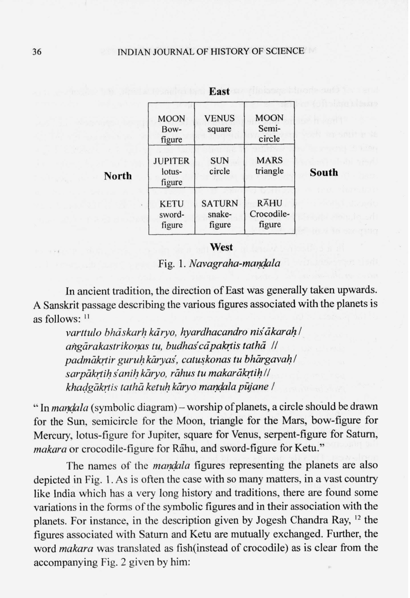
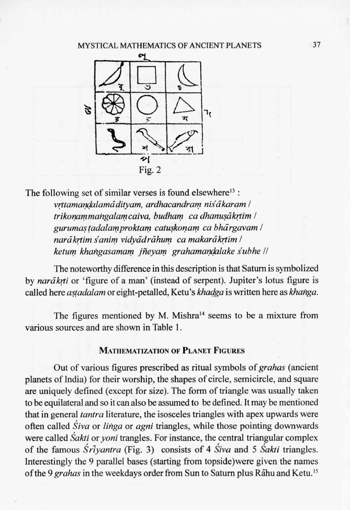
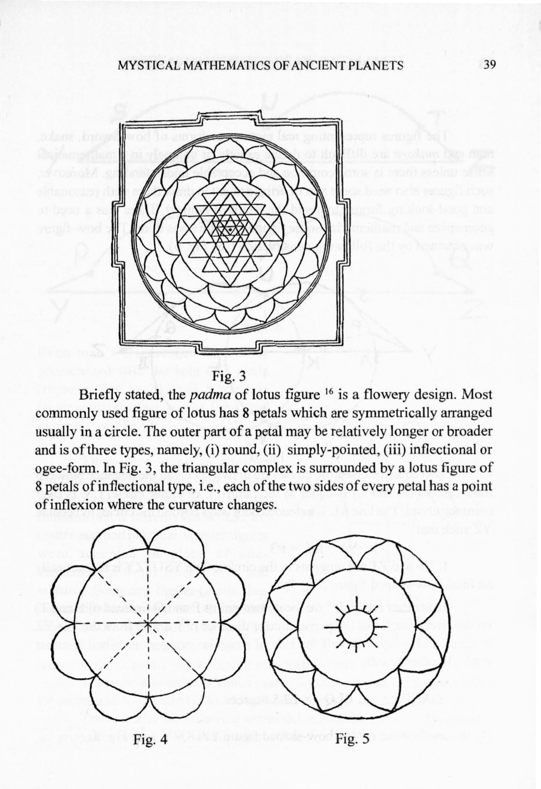
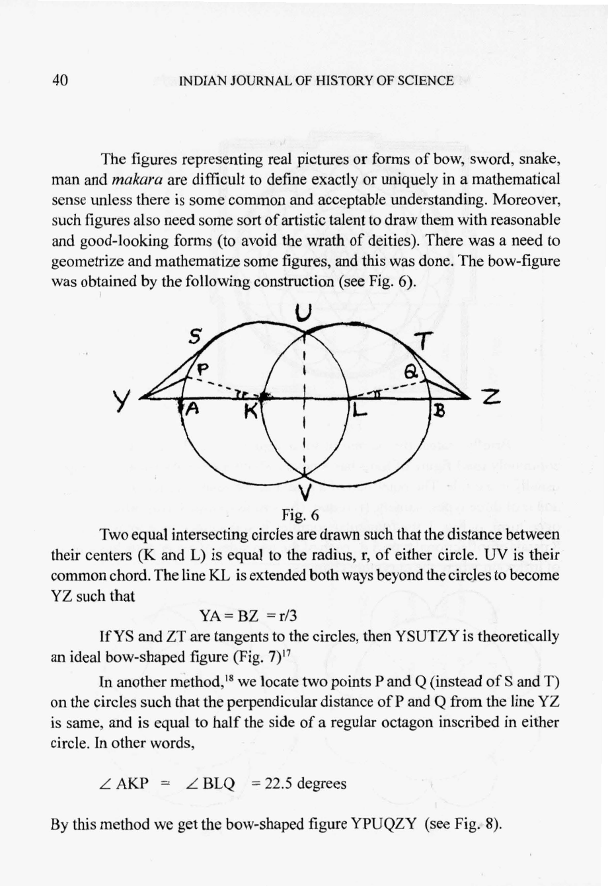
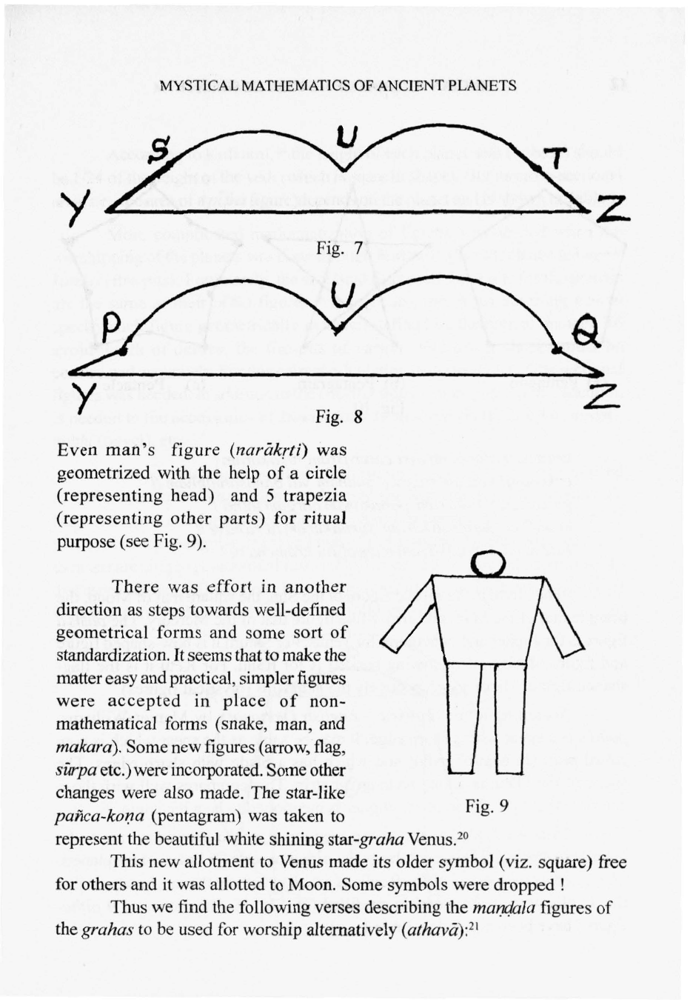
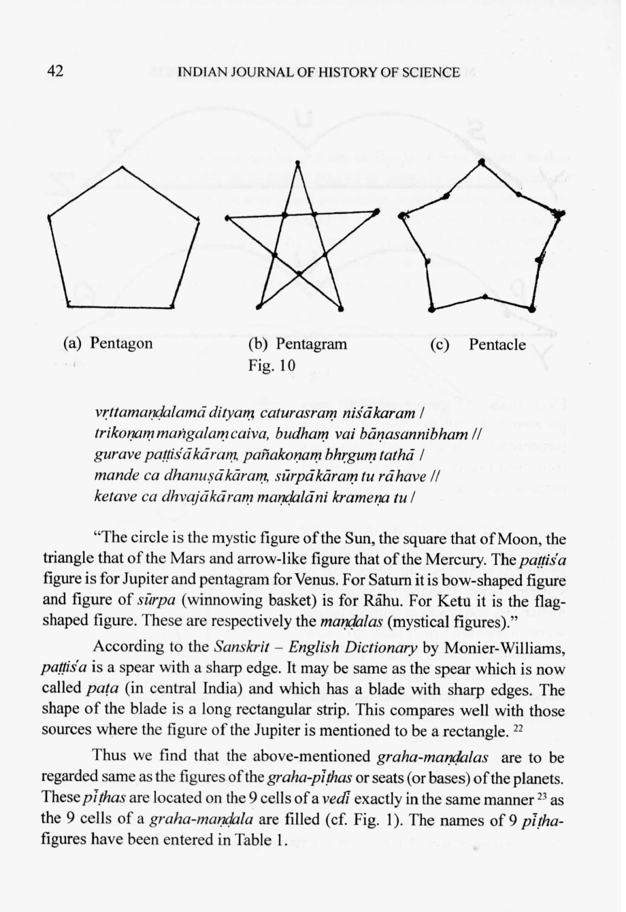
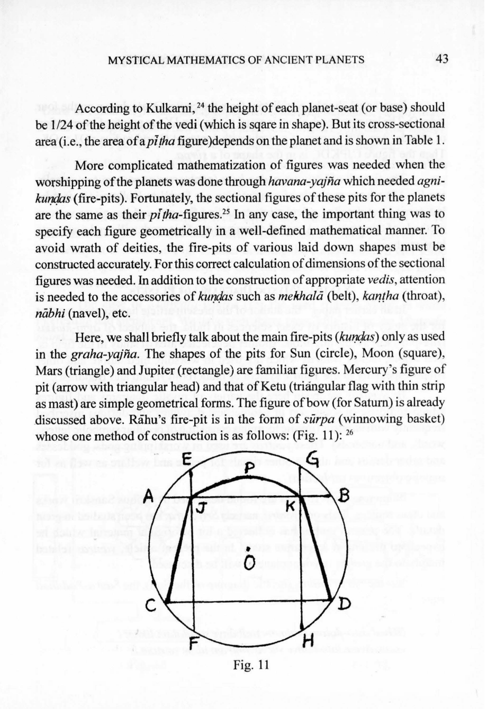
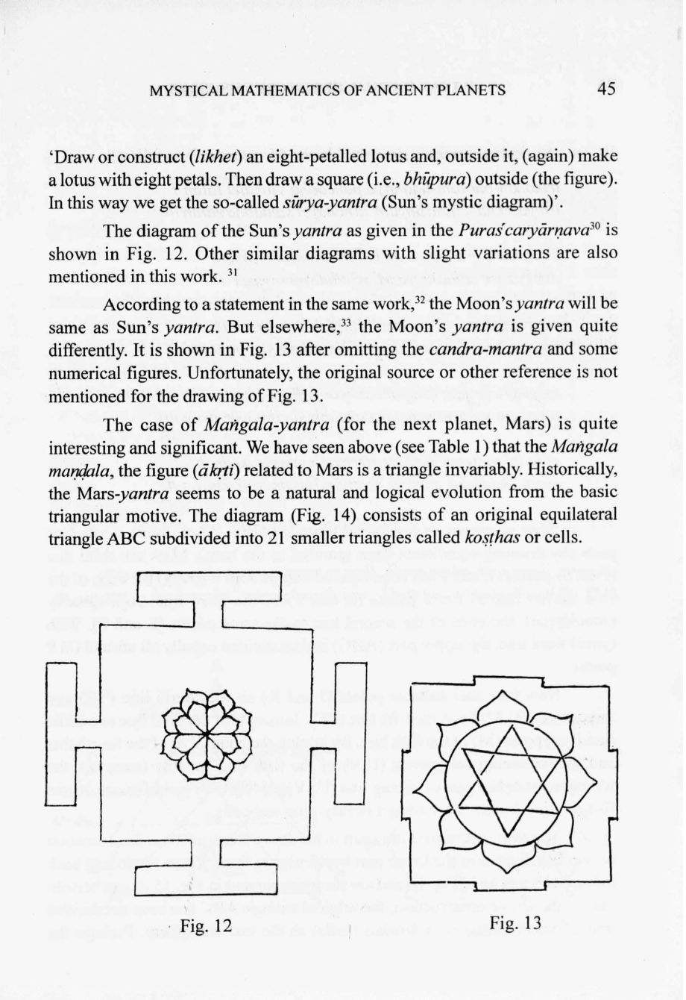
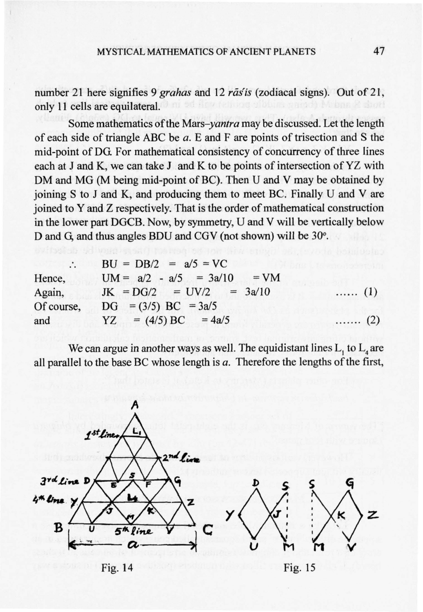

# Mystical Mathematics of Ancient Planets

- Author Display: RC Gupta
- Year: 2005
- Journal Label: IJHS-40-2005-Issue-1
- Source Url: https://insa.nic.in/(S(eh1ucortlbqqezipwgliy3mn))/writereaddata/UpLoadedFiles/IJHS/Vol1_2005_03_MYSTICAL%20MATHEMATICS%20IN%20ANCIENT%20PLANETS.pdf

<!-- source: gemini page-chunk extraction -->

*Indian Journal of History of Science*, 40.1 (2005) 31-53

# MYSTICAL MATHEMATICS OF ANCIENT PLANETS

**R. C. GUPTA***
*(Received 19 February 2004)*
The traditional Indian *navagrahas* include Sun, Moon, Mars, etc. (in order of weekdays) plus Rāhu and Ketu. The belief that planets exert great influence on life and events of individuals and world gave rise to planet worship among various peoples.
For worship in a *maṇḍala* (symbolic diagram) various geometrical figures and forms were used to reprent the planets. These include square, circle, semi-circle, triangle, pentagon, bow-figure and the popular lotus-figure.
The present paper gives a mathematical discussion of the geometrical figures connected with planet worship. It also deals with the *yantras* (mystic diagrams) of the ancient planets as well as with the magic squares associated with them. Original Sanskrit verses have been appropriately given and some possible inter-cultural connections mentioned.
**Key words:** Ancient and Medieval mathematics, Medieval geometry, Magic squares, Planet worship, *Yantras*.

## INTRODUCTION

The modern heliocentric astronomy has nine planets in our solar system. These are Mercury, Venus, Earth, Mars, Jupiter, Saturn, Uranus, Neptune, and Pluto.
They are listed here in the order of their increasing distances from the Sun around which they revolve with different periods of revolution (ranging from 0.24 to 248.43 years). Uranus was discovered in 1781, Nepune in 1846, and Pluto in 1930.
The pre-heliocentric (or pre-Copernican) concept or ancient difinition of planet (*graha*) was different. The ancient astronomy was geocentric and so
---
* Ganita Bhāratī Academy, R-20, Ras Bahar Colony, Jhansi 284003, India.
32 INDIAN JOURNAL OF HISTORY OF SCIENCE
Earth was not taken as a *graha*. In addition to the Sun and the Moon, the ancient peoples could find, by naked eyes’ observations, only the following five planets (*tārāgrahas*): Mars, Mercury, Jupiter, Venus, and Saturn. These seven heavenly shining bodies were found to have angular motions relative to fixed stars. They constituted the early list of seven planets after whom the weekdays are named in order from Sunday to Saturday. The current universal practice of using almost the same and similar names of the seven weekdays and in exactly same order throughout the world indicates that the present concept of a 7-day week was most probably started in a single place and diffused to other places (according to diffusion theory).
In India, Rāhu (ascending node of the moon) and Ketu (descending node of the moon) were also taken as *grahas* later on, thus making the traditional list of *navagrahas* (‘nine-planets’) of the Indian *Jyotiṣa-śāstra*. Rāhu and Ketu are called *chāyā-grahas*. According to Prof. K. S. Shukla[^1], Rāhu and Ketu are mentioned in the *Maitrāyaṇī-upaniṣad* alongwith Śani (Saturn). According to traditional interpretation, the word *graha*, as a *bhūta-saṃkhyā* (word-numeral) stands for ‘nine’.
Ancient peoples believed that the positions and configurations of planets have great influence on the life of individuals and on the course of events in the world and nature. Since remote times, man has been worshipping objects of nature and was involved in their personification (e.g.cf. *Pṛthvī-mātā* or mother earth) and deification (e.g. cf. *Sūryadeva* or the Sungod). The confident belief of the ancients that the planets exert both beneficial and malefic influence on the life and activities of human beings led them to attach great importance to the planets. The planets were not only personified but accepted as deities. From the point of view of history of science, the note-worthy thing is that the practice of recognizing planetary deities was prevalent in almost all ancient cultures. Their nomenclature reflects connections with classical gods and goddesses. Jupiter was the highest and most powerful among the Roman gods. He was the god of heaven and determined the course of all human affairs. Among the Greeks he was called Jeus or Zeus (cf. Sanskrit word *Jīva* for Jupiter or Bṛhaspati who was *suraguru* of heavenly gods).
Venus (cf. *Vena* mentioned in the *Ṛgveda*)[^2] was Roman goddess of love. Interestingly the Indian *graha* *Śukra* (Venus) is a god or male deity who
MYSTICAL MATHEMATICS OF ANCIENT PLANETS 33
was also called *Bhārgava* (son of Bhṛgu) and *Sita* (‘white’).[^3] In the same mythological style *Bhauma* (Mars) is son of Earth, *Budha* (Mercury) is regarded son of Moon, and *Śani* (Saturn) that of Sun.
In ancient India, all the nine planets (*navagrahas*) were personified as male deities and were associated with attributes in analogy to other gods of Hindu pantheon. They were worshipped through various modes. Vedic, Smārtya, and Tāntrika rituals were devised to perform *graha-yajñas* to please and pacify them (*graha-śānti*) and to avoid their evil influence (*aniṣṭa*). Elaborate procedures and details of the planetary rites appear in several texts and works like *Gṛhya-sūtras*, *Purāṇas*, *Smṛtis*, on *Kuṇḍas* and *jyotiṣa*, and in other monographs and manuals.
In the present paper, we are primarily concerned with those aspects which involve the history of exact sciences (geometrical and mathematical matters). Some other general and related relevant matters will also be mentioned.

## GEOMETRICAL FIGURES ASSOCIATED WITH PLANETS

A general and historical perspective of associating specific geometrical forms to certain objects and other aspects of speculative human thinking may be briefly mentioned first. The figures of square, circle and semicircle are associated with the three *nitya-agnis* (‘obligatory fires’) whose Aryan tradition is older than the *Ṛgveda* which is the oldest of the four Vedas.
The old concept of basic *bhūtas* (gross elements) is found not only in India but in some other ancient civilizations also. Among the Greeks, Empedocles (490-435 BC) was the first to declare four of these gross elements (or forms of matter) to be earth, water, fire and air which were the material principles from which the universe was evolved.[^4] The discovery of the regular solids of polyhedra led the Greeks to connect them with the elements. There are five such regular polyhedra which are also called by other names such as Platonic solids, mathematical figures, and cosmic figures. In the final tally, the Greeks believed that the figure tetrahedron (or triangular pyramid) corresponds to fire, cube to earth, octahedron to air, icosahedron to water, and the dodecahedron to the sphere of the universe (the vessel of the sphere itself was taken to be the fifth body or element).[^5]
34 INDIAN JOURNAL OF HISTORY OF SCIENCE
In Ancient India, the traditional number of gross elements was five and these were called *pañca-mahā-bhūtas* (‘the five gross elements’). The whole *brahmāṇḍa* (universe or cosmos) is pervaded by these elements which are *kṣiti* (earth), *jala* (water), *pāvaka* (fire), *vāyu* (air), and *ākāśa* which is variously translated as sky, heaven, ether or empty space (which must be distinguished from the corporeal and invisible air). Their age-old geometrical association is described in the cognate text *Śāradātilaka*, I. 23-24 as follows:[^6]
> “The circle is the *maṇḍala* (symbolic diagram) of the heaven or sky; the (circle) decorated by six dots is (the figure) of wind; the triangle with *svastika* is that of fire; the half-moon (i.e. semicircle) with lotus is that of water; and the square with *vajra* (thunderbolt weapon, figure or diamond-like figure) that of earth. The wisemen have thus spoken of the above *maṇḍalas* for the respective *bhūtas*.”
It is interesting to note that while the Greeks connected the gross elements with three dimensional solid figures, in India the elements were associated with two-dimensional plane figures. The case of elements is mentioned here just to point out that there was a tradition of connecting geometrical figures with them. The case of planets will be discussed now in detail.
The *Graha-śānti* section in *Ācārādhyāya* chapter of the *Yājñavalkya-Smṛti* (about AD 300 or later) contains the main features for the worship of the planets (*grahas*) according to Hindu tradition. The names of these ancient nine planets (first seven in the order of weekdays) are mentioned in the work (I..295b-296a)[^7]as:
sūryaḥ somo mahīputraḥ somaputro bṛhaspatiḥ // 295 //
śukraḥ śanaiścaro rāhuḥ ketuś ceti grahāḥ smṛtāḥ /
> “The Sun, Moon, Mars, Mercury, Jupiters, Venus, Saturn, Rāhu, and Ketu are said to be the planets.”
The same work also states (I. 306b, p. 193)
yaś ca yasya yadā duṣṭaḥ sa taṃyatnena pūjayet // 306 //
MYSTICAL MATHEMATICS OF ANCIENT PLANETS 35
> “One should specially worship that (planet) which, and whenever, it is cruel (malefic) to him.”
Thus it seems that the planets may be worshipped separately (i.e., one at a time)or they may be worshipped more at a time, or collectively for the peace, progress and welfare of an individual or a group. For worship, either their idols (*mūrtis*) made of specified materals are used or their images are made (*lekhyāḥ* or painted) on *paṭas* (cloth pieces or plates) with specified materials and in specified colours. In the absence of the above two type of objects (idols or picture-images), the specified figures (*ākṛtis*) associated with the planets should be used as their symbolic representations to serve the same purpose of worship.
In a collective worship of all the nine planets, their idols, images or their representative figures are to be placed in a *maṇḍala* (ritual diagram). The *nava-graha-maṇḍala* consists of a square subdivided into nine equal square cells. The *Bṛhat-Parāśara Saṃhitā*[^8] calls the diagram as *nava-bhuvanakaṃ catasra-maṇḍalam* (‘nine-celled square diagram’). The placement of the symbols of the planets in the nine cells is described in the same *Saṃhitā* as follows:[^9]
madhye tu bhāskaraḥ sthāpyaḥ pūrvadakṣiṇataḥ śaśī /
dakṣiṇena dharāsūnur budhaḥ pūrvottareṇa tu //
uttarasyāṃ surācāryaḥ pūrvasyāṃ bhṛgunandanaḥ /
paścimāyāṃ śaniḥ kuryāt rāhur dakṣiṇa paścime //
paścimottarataḥ ketur iti sthāpyāḥ grahāḥ kramāt /
> “Place Sun in the centre, Moon in the south-east (cell), Mars in the south, Mercury in the north-east, Jupiter in the north, Venus in the east. Do the placement of Saturn in the west cell, Rāhu in south-west (and) Ketu in north-west. Thus the planets should be placed in order.”
The same placement is described in the *Matsya Purāṇa*[^10] but the description does not follow the weekday order of planets.
The placement of planets in *navagraha maṇḍala* is shown in Fig. 1

[^1]: K.S. Shukla, ‘Main Characteristics and Achievements of Ancient Indian Astronomy in Historical Perspective’ in G. Swarup, A. K. Bag and K. S. Shukla (ed.), *History of Oriental Astronomy*, Cambridge University Press, Cambridge, U.K., 1987, pp. 9-22; see note 2 on p.20.

[^2]: Ibid., p.9.

[^3]: According to the *Sanskrit-English Dictionary* of M. Monier-Williams (Delhi reprint, 1972, p. 1080), the word *śukla* (‘white’) itself is a later form of *śukra*.

[^4]: T. L. Heath, *A History of Greek Mathematics*, Vol. I, Dover Publications, New York, 1981, p.158.

[^5]: Ibid., p.159. Also see, *Historical Topics for the Mathematics Classroom*, N.C.T.M. 31st Year book, Washington, 1969, p.220.

[^6]: Lakṣmaṇa Deśikendra, *Śāradātilaka*. edited by Jivananda Bhattacharyya, Calcutta, 1892, p.3. The translation given here preserves mathematical meaning.

[^7]: *Yājñavalkya-smṛti* with *Mitākṣarā-vyākhyā* (along with two commentaries) ed. By S. S. Setlur, Brahmavadin Press, Madras, 1912, p.189.

[^8]: *Bṛhat-Parāśara-Saṃhitā* included in the *Dharmaśāstra-Saṅgraha* ed. By Jivananda Bhattacharyya, Calcutta, 1876, part II, pp. 53-309, p252.

[^9]: Ibid., p. 252.

[^10]: *Matsya-purāṇa*, ed. with Hindi Translation by Shriram Sharma, two parts, Bareily, 1970; Part 1, p. 313.

36 INDIAN JOURNAL OF HISTORY OF SCIENCE

| | East | |
| :--- | :--- | :--- |
| **North** | MOON Bow-figure | VENUS square | MOON Semi-circle | **South** |
| | JUPITER lotus-figure | SUN circle | MARS triangle | |
| | KETU sword-figure | SATURN snake-figure | RĀHU Crocodile-figure | |
| | West | |

*Fig. 1. Navagraha-maṇḍala*

<!-- figure-resolved-page-render: page=6 image=media/p06_page.webp -->

<!-- figure-meta: page=6, position=top, type=diagram -->

In ancient tradition, the direction of East was generally taken upwards. A Sanskrit passage describing the various figures associated with the planets is as follows: [^11]
*varttulo bhāskaraḥ kāryo, hyardhacandro niśākaraḥ /*
*aṅgārakastrikoṇas tu, budhaś cāpakṛtis tathā //*
*padmākṛtir guruḥ kāryaś, catuṣkoṇas tu bhārgavaḥ /*
*sarpākṛtiḥ śaniḥ kāryo, rāhus tu makarākṛtiḥ //*
*khaḍgākṛtis tathā ketuḥ kāryo maṇḍala pūjane /*
“In *maṇḍala* (symbolic diagram) – worship of planets, a circle should be drawn for the Sun, semicircle for the Moon, triangle for the Mars, bow-figure for Mercury, lotus-figure for Jupiter, square for Venus, serpent-figure for Saturn, *makara* or crocodile-figure for Rāhu, and sword-figure for Ketu.”
The names of the *maṇḍala* figures representing the planets are also depicted in Fig. 1. As is often the case with so many matters, in a vast country like India which has a very long history and traditions, there are found some variations in the forms of the symbolic figures and in their association with the planets. For instance, in the description given by Jogesh Chandra Ray, [^12] the figures associated with Saturn and Ketu are mutually exchanged. Further, the word *makara* was translated as fish (instead of crocodile) as is clear from the accompanying Fig. 2 given by him:
***
MYSTICAL MATHEMATICS OF ANCIENT PLANETS 37

*Fig. 2. Diagram showing Navagraha-maṇḍala with Devanagari labels.*

<!-- figure-resolved-page-render: page=7 image=media/p07_page.webp -->

<!-- figure-meta: page=7, position=top, type=diagram -->

<!-- figure-content: 
Top labels: बु (Bu), शु (Śu), चं (Caṃ)
Middle labels: बृ (Bṛ), सू (Sū), मं (Maṃ)
Bottom labels: श (Śa), के (Ke), रा (Rā)
Directional labels: पू (Pū - East, top), द (Da - South, right), प (Pa - West, bottom), उ (U - North, left) 
-->
The following set of similar verses is found elsewhere [^13]:
*vṛttamaṇḍalamādityam, ardhacandraṃ niśākaram /*
*trikoṇammaṅgalaṃ caiva, budhaṃ ca dhanuṣākṛtim /*
*gurumaṣṭadalaṃ proktaṃ catuṣkoṇaṃ ca bhārgavam /*
*narākṛtiṃ śaniṃ vidyādrāhuṃ ca makarākṛtim /*
*ketuṃ khaṅgasamamaṃ jñeyaṃ grahamaṇḍalake śubhe //*
The noteworthy difference in this description is that Saturn is symbolized by *narākṛti* or ‘figure of a man’ (instead of serpent). Jupiter’s lotus figure is called here *aṣṭadalam* or eight-petalled, Ketu’s *khaḍga* is written here as *khaṅga*.
The figures mentioned by M. Mishra [^14] seems to be a mixture from various sources and are shown in Table 1.

## MATHEMATIZATION OF PLANET FIGURES

Out of various figures prescribed as ritual symbols of *grahas* (ancient planets of India) for their worship, the shapes of circle, semicircle, and square are uniquely defined (except for size). The form of triangle was usually taken to be equilateral and so it can also be assumed to be defined. It may be mentioned that in general *tantra* literature, the isosceles triangles with apex upwards were often called *Śiva* or *liṅga* or *agni* triangles, while those pointing downwards were called *Śakti* or *yoni* trangles. For instance, the central triangular complex of the famous *Śrīyantra* (Fig. 3) consists of 4 *Śiva* and 5 *Śakti* triangles. Interestingly the 9 parallel bases (starting from topside) were given the names of the 9 *grahas* in the weekdays order from Sun to Saturn plus Rāhu and Ketu. [^15]
***
38 INDIAN JOURNAL OF HISTORY OF SCIENCE

### Table 1: Mystic Mathematical Data for Planet

| Planet or *Graha* | Placement in *maṇḍala* | Planet’s *ākṛti* for worship | *Ākṛti* according to M. Mishra | Shape of fire-pit and and *pīṭha* (base) | Area of base in sq. *aṅgulas* | Diameter of basic Circle for *kuṇḍa racanā* (from Kulkarni, ref. 18) | Talisman Magic Square (order) | Talisman Magic Square (Magic number) |
| :--- | :--- | :--- | :--- | :--- | :--- | :--- | :--- | :--- |
| Sun | Centre | Circle | Circle | Circular | 12 | 27.0937 *aṅg.* | 6 | 111 |
| Moon | South-east | semicircle | semicircle | Square | 24 | 33.9375 *aṅg.* | 9 | 369 |
| Mars | South | triangle | triangle | triangular | 4 | 42.125 *aṅg.* | 5 | 65 |
| Mercury | North-east | bow-shaped | arrow | arrow-shaped | 4 | 58.875 *aṅg.* | 8 | 260 |
| Jupiter | North | lotus figure | lotus figure | rectangular | 6 | 36.4844 *aṅg.* | 4 | 34 |
| Venus | East | Square | pentagram | pentagram (or pentagon) | 9 | 39.25, or 20 *aṅg.* | 7 | 175 |
| Saturn | West | Snake figure | man’s figure | bow-shaped | 6 | 29.3125 *aṅg.* | 3 | 15 |
| Rāhu | South-west | Crocodile figure | Crocodile (*makara*) | winnowing basket | 25 | 39.0937 *aṅg.* | 4 | 34 |
| Ketu | North-west | Sword | flag | triangular flag | 8 | 58.1875 *aṅg.* | 4 | 34 |

***
MYSTICAL MATHEMATICS OF ANCIENT PLANETS 39

<!-- figure-resolved-page-render-hidden: image=media/p09_page.webp caption="Fig. 3. Śrīyantra diagram" -->

<!-- figure-meta: page=9, position=top, type=diagram -->

Fig. 3
Briefly stated, the *padma* of lotus figure [^16] is a flowery design. Most commonly used figure of lotus has 8 petals which are symmetrically arranged usually in a circle. The outer part of a petal may be relatively longer or broader and is of three types, namely, (i) round, (ii) simply-pointed, (iii) inflectional or ogee-form. In Fig. 3, the triangular complex is surrounded by a lotus figure of 8 petals of inflectional type, i.e., each of the two sides of every petal has a point of inflexion where the curvature changes.

<!-- figure-resolved-page-render-hidden: image=media/p09_page.webp caption="Fig. 4. Simple 8-petalled lotus design" -->

<!-- figure-meta: page=9, position=bottom, type=diagram -->

Fig. 4

*Fig. 5. Lotus design with pointed petals and central circle*

<!-- figure-resolved-page-render: page=9 image=media/p09_page.webp -->

<!-- figure-meta: page=9, position=bottom, type=diagram -->

Fig. 5
***
40 INDIAN JOURNAL OF HISTORY OF SCIENCE
The figures representing real pictures or forms of bow, sword, snake, man and *makara* are difficult to define exactly or uniquely in a mathematical sense unless there is some common and acceptable understanding. Moreover, such figures also need some sort of artistic talent to draw them with reasonable and good-looking forms (to avoid the wrath of deities). There was a need to geometrize and mathematize some figures, and this was done. The bow-figure was obtained by the following construction (see Fig. 6).

*Fig. 6. Geometric construction of a bow-figure using intersecting circles and tangents.*

<!-- figure-resolved-page-render: page=10 image=media/p10_page.webp -->

<!-- figure-meta: page=10, position=middle, type=diagram -->

Fig. 6
Two equal intersecting circles are drawn such that the distance between their centers (K and L) is equal to the radius, $r$, of either circle. $UV$ is their common chord. The line $KL$ is extended both ways beyond the circles to become $YZ$ such that

$$YA = BZ = r/3$$

If $YS$ and $ZT$ are tangents to the circles, then $YSUTZY$ is theoretically an ideal bow-shaped figure (Fig. 7) [^17]
In another method, [^18] we locate two points P and Q (instead of S and T) on the circles such that the perpendicular distance of P and Q from the line $YZ$ is same, and is equal to half the side of a regular octagon inscribed in either circle. In other words,

$$\angle AKP = \angle BLQ = 22.5 \text{ degrees}$$

By this method we get the bow-shaped figure $YPUQZY$ (see Fig. 8).
***

[^11]: Taranatha Tarkavachaspati, *Vācaspatyam*, Vol. IV, Chowkhamba, Varanasi, 1990, p. 2760 where the verses are quoted from *Śāntidīpikā* (‘Śāntidīpikoktaḥ’).

[^12]: J. C. Ray, *Āmādera Jyotiṣī O Jyotiṣa* (in Bengali), Vol. I, Calcutta, 1903, p. 482.

[^13]: The five Sanskrit lines are found (quoted anonymously?) in the *Graha-Śānti Prayogaḥ with Bhāṣāṭīkā* and notes by Daulatram Gaud, revised ed., Varanasi, 2001, p. 191.

[^14]: Makkhanlal Mishra, ‘Navagraha-upāsanā, (in Hindi), *Kalyāṇa*, 42(1) (Upāsanā-aṅka) (1968), 532-535.

[^15]: For details see R. C. Gupta, ‘A Little-known Text and Version of Śrīyantra’, *Gaṇita-Bhāratī*, 25 (2003), 22-28 (in press).

[^16]: See *Graha Śānti Prayogaḥ* (ref. 13 above), pp. 170-171.

[^17]: Ibid., p. 184

[^18]: Ibid., p. 183, and R. P. Kulkarni, *Engineering Geometry of Yajña-kuṇḍas and Yajña-maṇḍapas*, Jnana Prabodhi, Pune, 1998, p. 74 where the method is said to be taken from *Kuṇḍa Ratnāvalī* of Rāmacandra Kṛṣṇa Dīkṣita alias Jade (Varanasi, 1868).

MYSTICAL MATHEMATICS OF ANCIENT PLANETS 41

<!-- figure-resolved-page-render-hidden: image=media/p11_page.webp caption="Fig. 7" -->

<!-- figure-meta: page=11, position=top, type=diagram -->

<!-- figure-resolved-page-render-hidden: image=media/p11_page.webp caption="Fig. 8" -->

<!-- figure-meta: page=11, position=middle, type=diagram -->

Even man’s figure (*narākṛti*) was geometrized with the help of a circle (representing head) and 5 trapezia (representing other parts) for ritual purpose (see Fig. 9).
There was effort in another direction as steps towards well-defined geometrical forms and some sort of standardization. It seems that to make the matter easy and practical, simpler figures were accepted in place of non-mathematical forms (snake, man, and makara). Some new figures (arrow, flag, *śūrpa* etc.) were incorporated. Some other changes were also made. The star-like *pañca-koṇa* (pentagram) was taken to represent the beautiful white shining star-*graha* Venus.[^20]

*Fig. 9*

<!-- figure-resolved-page-render: page=11 image=media/p11_page.webp -->

<!-- figure-meta: page=11, position=bottom-right, type=diagram -->

This new allotment to Venus made its older symbol (viz. square) free for others and it was allotted to Moon. Some symbols were dropped!
Thus we find the following verses describing the *maṇḍala* figures of the *grahas* to be used for worship alternatively (*athavā*):[^21]
42 INDIAN JOURNAL OF HISTORY OF SCIENCE

*Fig. 10*

<!-- figure-resolved-page-render: page=12 image=media/p12_page.webp -->

<!-- figure-meta: page=12, position=top, type=diagram -->

(a) Pentagon (b) Pentagram (c) Pentacle
*vṛttamaṇḍalamā dityam caturasraṃ niśākaram |*
*trikoṇammaṅgalamcaiva, budhaṃ vai bāṇasannibham ||*
*gurave paṭṭiśākāraṃ, pañakoṇaṃ bhṛguṃ tathā |*
*mande ca dhanuṣākāraṃ, śūrpākāraṃ tu rāhave ||*
*ketave ca dhvajākāraṃ maṇḍalāni krameṇa tu |*
“The circle is the mystic figure of the Sun, the square that of Moon, the triangle that of the Mars and arrow-like figure that of the Mercury. The *paṭṭiśa* figure is for Jupiter and pentagram for Venus. For Saturn it is bow-shaped figure and figure of *śūrpa* (winnowing basket) is for Rāhu. For Ketu it is the flag-shaped figure. These are respectively the *maṇḍalas* (mystical figures).”
According to the *Sanskrit - English Dictionary* by Monier-Williams, *paṭṭiśa* is a spear with a sharp edge. It may be same as the spear which is now called *pata* (in central India) and which has a blade with sharp edges. The shape of the blade is a long rectangular strip. This compares well with those sources where the figure of the Jupiter is mentioned to be a rectangle.[^22]
Thus we find that the above-mentioned *graha-maṇḍalas* are to be regarded same as the figures of the *graha-pīṭhas* or seats (or bases) of the planets. These *pīṭhas* are located on the 9 cells of a *vedī* exactly in the same manner[^23] as the 9 cells of a *graha-maṇḍala* are filled (cf. Fig. 1). The names of 9 *pīṭha*-figures have been entered in Table 1.
MYSTICAL MATHEMATICS OF ANCIENT PLANETS 43
According to Kulkarni,[^24] the height of each planet-seat (or base) should be $1/24$ of the height of the *vedī* (which is square in shape). But its cross-sectional area (i.e., the area of a *pīṭha* figure) depends on the planet and is shown in Table 1.
More complicated mathematization of figures was needed when the worshipping of the planets was done through *havana-yajña* which needed *agni-kuṇḍas* (fire-pits). Fortunately, the sectional figures of these pits for the planets are the same as their *pīṭha*-figures.[^25] In any case, the important thing was to specify each figure geometrically in a well-defined mathematical manner. To avoid wrath of deities, the fire-pits of various laid down shapes must be constructed accurately. For this correct calculation of dimensions of the sectional figures was needed. In addition to the construction of appropriate *vedīs*, attention is needed to the accessories of *kuṇḍas* such as *mekhalā* (belt), *kaṇṭha* (throat), *nābhi* (navel), etc.
Here, we shall briefly talk about the main fire-pits (*kuṇḍas*) only as used in the *graha-yajña*. The shapes of the pits for Sun (circle), Moon (square), Mars (triangle) and Jupiter (rectangle) are familiar figures. Mercury’s figure of pit (arrow with triangular head) and that of Ketu (triangular flag with thin strip as mast) are simple geometrical forms. The figure of bow (for Saturn) is already discussed above. Rāhu’s fire-pit is in the form of *śūrpa* (winnowing basket) whose one method of construction is as follows: (Fig. 11):[^26]

*Fig. 11*

<!-- figure-resolved-page-render: page=13 image=media/p13_page.webp -->

<!-- figure-meta: page=13, position=bottom, type=diagram -->

44 INDIAN JOURNAL OF HISTORY OF SCIENCE
Four equal chords, equidistant from the center O, are drawn on the four sides O. The length of each chord is equal to $\sqrt{3}r$. J and K are points of intersection of chords. Arc JPK is part of a circle with center at O and radius $= OJ = OK$. Then the figure CJPKDC is in the shape of a *śūrpa*.
The fire-pit of Venus is *pañca-koṇa* (pentagram or pentarn or pentacle; see Fig. 10) whose methods of construction are found in Kulkarni. In fact he has carried out detailed calculations regarding fire-pits and has given various methods of construction. A critical examination of his work will need a separate long study.[^27]

### Yantras (Mystic Diagrams) of Planets

In an earlier paper[^28] the author of the present article has pointed out that for the study of history of exact sciences in India, the subject of *agni-kuṇḍas* (fire-pits) still awaits attention. Another neglected area of study in the field is, as a whole, that of *yantras* which are used in worship, meditation, and other rituals especially in the Tantric system of India (both Hindu and Buddhist).
By *yantras* we mean here the variety of mystic diagrams and figures which comprise of some sort of geometrical drawings and designs inscribed frequently with *mantras* (mystic formulas consisting of peculiar symbolic letters, words, and numerals). These *yantras* are used in worshipping gods, goddesses and other deities and also in other rituals for peace and welfare as well as for malefic objectives (*abhicāra*).
Numerous such *yantras* are found described in various Sanskrit works and other sources. Only one *yantra*, namely *Śrīyantra*, has been studied in great details. The present author has collected a lot of original material which he expects to present in a separate study. In the present article, *yantras* related mainly to the *grahas* (ancient planets) will be discussed.
For the *Sūrya-yantra* (mystic diagram of the Sun), the *Saura-Paddhati* states:[^29]
*likhed aṣṭa-dalaṃ padmaṃ tadbāhye 'ṣṭa-dalaṃ likhet |*
*caturasraṃ tato bāhye sūryayantram idaṃ smṛtam ||*
MYSTICAL MATHEMATICS OF ANCIENT PLANETS 45
‘Draw or construct (*likhet*) an eight-petalled lotus and, outside it, (again) make a lotus with eight petals. Then draw a square (i.e., *bhūpura*) outside (the figure). In this way we get the so-called *sūrya-yantra* (Sun’s mystic diagram)’.
The diagram of the Sun’s *yantra* as given in the *Puraścaryārṇava*[^30] is shown in Fig. 12. Other similar diagrams with slight variations are also mentioned in this work.[^31]
According to a statement in the same work,[^32] the Moon’s *yantra* will be same as Sun’s *yantra*. But elsewhere,[^33] the Moon’s *yantra* is given quite differently. It is shown in Fig. 13 after omitting the *candra-mantra* and some numerical figures. Unfortunately, the original source or other reference is not mentioned for the drawing of Fig. 13.
The case of *Maṅgala-yantra* (for the next planet, Mars) is quite interesting and significant. We have seen above (see Table 1) that the *Maṅgala maṇḍala*, the figure (*ākṛti*) related to Mars is a triangle invariably. Historically, the Mars-*yantra* seems to be a natural and logical evolution from the basic triangular motive. The diagram (Fig. 14) consists of an original equilateral triangle ABC subdivided into 21 smaller triangles called *koṣṭhas* or cells.

<!-- figure-resolved-page-render-hidden: image=media/p15_page.webp caption="Fig. 12" -->

<!-- figure-meta: page=15, position=bottom-left, type=diagram -->

*Fig. 13*

<!-- figure-resolved-page-render: page=15 image=media/p15_page.webp -->

<!-- figure-meta: page=15, position=bottom-right, type=diagram -->

[^20]: Ibid., pp. 172-173, and p. 242. Also see Kulkarni, op.cit. (under ref. 18 above), pp. 68-70, and p. 91.

[^21]: Quoted in *Graha Śānti Prayogaḥ*, p. 191. We have corrected some printing mistakes. Also see p. 208 for a description of various planet figures (*ākāras*).

[^22]: Ibid., p. 208 (*dīrgha-caturasra*) and p. 242. Also see Kulkarni (ref. 18) pp. 90-91.

[^23]: Kulkarni (ref. 18) pp. 89-91.

[^24]: Ibid., pp. 89-90.

[^25]: Ibid., p. 89.

[^26]: Ibid., pp. 72-73 where the method is stated to be taken from the *Kuṇḍa Ratnāvalī* (see ref. 18 above). Our Fig. 11 yields a figure of the *śūrpa* which resembles with that which is given in the *Graha Śānti Prayogaḥ* (ref. 13, p. 187, quoting *Laghupīṭha Mālā*). The last work is also stated to contain a simpler *śūrpa* figure which is an isosceles trapezium whose base is 28, top 20, and altitude 24 *aṅgulas*.

[^27]: For a critical review of Kulkarni's book (ref. 18), see *Gaṇita Bhāratī* 23 (2001) 138-143. Also see IJHS 38.1 (2003), pp. 7-8.

[^28]: R. C. Gupta, ‘Agni-kuṇḍas — a Neglected Area of Study in the History of Ancient Indian Mathematics’, IJHS 38.1 (2003) 1-15.

[^29]: As quoted in the Pratāpasiṃha Sāhadeva’s (King of Nepal), *Puraścaryārṇava* (1775) ed. by Murlidhar Jha, Chowkhamba Pratishthan, Delhi, 1985, p. 1140.

[^30]: Ibid., plate-page 6.

[^31]: Ibid., p. 1141, where text for Sun's yantra is quoted from *Mahākramārcana Paddhati*, and two more variant yantras are mentioned.

[^32]: Ibid., p. 1158 where it states: *Aṣṭadala-kamala-dvayātmakaṃ Candra-yantram* (*bhūpura* is to be supplied invariably to all yantras).

[^33]: Radheshyam Mishra, *Camatkārī Yantra Elābāma* (in Hindi), Raja Pocket Books, Delhi, p. xxvii.

46 INDIAN JOURNAL OF HISTORY OF SCIENCE
Its construction is concisely described in the *Merutantra*[^34] as follows:
> *trikoṇampūrvam-uddhṛtya pañcadhā vibhajet tataḥ /*
> *tṛtīyarekhā-cihnābhyāṃ lāñchayet samabhāgataḥ //*
>
> *ādyarekhāgra-yugalam tṛtīyācihnayor nyaset /*
> *dvitīyāgre samākṛṣya tṛtīyācihnayor-nyaset //*
>
> *yutārekhā tṛtīyā tu samābhājya samam tataḥ /*
> *turyā cihna-dvayenātha tribhiś-cihnaśca pañcamī //*
>
> *tṛtīyāgre prakurvītapāñcabhyāmadhya-cihnaje /*
> *turyāgre yojayet samyak pañcabhyā cihnayor dvayoh //*
>
> *atha mīnadvaye dadyāt sūtrayugmam vicakṣaṇah /*
> *evam ekādhikā samyak koṣṭhānāṃ viṃśatir bhavet //*
'First construct an equilateral triangle (ABC). Then divide it into five parts (by drawing equidistant lines parallel to the base). Mark the third line (DG) by points (E and F) of three equal division. Join (crossly) the ends of the first (*ādya*) line to these points (E and F) of the third line. Join directly (*samākṛṣya*) the ends of the second line to the same points (E and F). With (*yutā*) third line, the upper part (ADG) is thus divided equally all around (in 9 parts).
Now take two suitable points (J and K) on the fourth line (YZ) and three points (U, M, V) on the fifth line (BC). Join ends of the third line to middle (*madhya*) point (M) of the fifth line. By joining the ends (Y, Z) of the fourth line and the remaining two points (U, V) of the fifth line suitably (*samyak*), the wiseman made the pair of zigzag line (USV and DMG?) yield figures of two fishes (*mīnadvaya*). Thus we get twenty-plus-one cells.
The stringently interesting part in the above construction is the formation of two fish-figures in the lower part by the zigzag lines. These are joined back to back at S and M in Fig. 14 and are shown separated in Fig. 15. It can be seen that by the above construction, the original triangle ABC has been subdivided into 21 small triangles or *koṣṭhas* (cells) as the text calls them. Perhaps the
MYSTICAL MATHEMATICS OF ANCIENT PLANETS 47
number 21 here signifies 9 *grahas* and 12 *rāśis* (zodiacal signs). Out of 21, only 11 cells are equilateral.
Some mathematics of the *Mars-yantra* may be discussed. Let the length of each side of triangle ABC be $a$. E and F are points of trisection and S the mid-point of DG. For mathematical consistency of concurrency of three lines each at J and K, we can take J and K to be points of intersection of YZ with DM and MG (M being mid-point of BC). Then U and V may be obtained by joining S to J and K, and producing them to meet BC. Finally U and V are joined to Y and Z respectively. That is the order of mathematical construction in the lower part DGCB. Now, by symmetry, U and V will be vertically below D and G; and thus angles BDU and CGV (not shown) will be 30°.
$\therefore BU = DB/2 = a/5 = VC$
Hence, $UM = a/2 - a/5 = 3a/10 = VM$
Again, $JK = DG/2 = UV/2 = 3a/10$ ...... (1)
Of course, $DG = (3/5) BC = 3a/5$
and $YZ = (4/5) BC = 4a/5$ ...... (2)
We can argue in another ways as well. The equidistant lines $L_1$ to $L_4$ are all parallel to the base BC whose length is $a$. Therefore the lengths of the first,

*Fig. 14 and Fig. 15*

<!-- figure-resolved-page-render: page=17 image=media/p17_page.webp -->

<!-- figure-meta: page=17, position=bottom, type=diagram -->

48 INDIAN JOURNAL OF HISTORY OF SCIENCE
second, third and fourth lines will be $a/5$, $2a/5$, $3a/5$ and $4a/5$, respectively. Both S and M (being middle points) will be in the same vertical line (which passes through A also). Thus, we will have UV equal to DG ($=3a/5$). Finally, we see that:
$YJ = KZ = (YZ-JK)/2 = a/4$ by (1) and (2).
In this way, the bases of all the 21 small triangles (whether pointing upward or downward) have been found. It may be noted that J and K are not the points of equal trisection of YZ, and U is not the mid-point, BM, and so, about V. The exact locations of these intermediary points (J, K, U, and V) have been found above mathematically in order to give a consistent and coherent figure of 21 cells. Without using the exact lengths of the segments of YZ and BC (as calculated above), the figure will not be perfect (there may be defective intersections at J and K).
The diagram of the *Mars-yantra* frequently appears in various books and magazines.[^35] It is usually found to be inscribed with numerals and a *mantra* for the planet (such as *Om kujāya namaḥ*). But the writers of the articles on *Maṅgala-yantra* are generally found to present their description and discussion without citing any original text, source, or mathematical calculation which are necessary for authority, reliance, and authenticity.
For other planets (Mercury to Ketu), it is stated that[^36]:
> *budhādīnāṃ yantram tu bhūpurāvṛtāṣṭadala-kamalam*
'The *yantra* of Mercury etc. is the eight-petal lotus surrounded by *bhūpura* (square with four gates)'.
However, various *yantras* of these planets do appear elsewhere (but usually without supported text or authority).[^37]

## MAGIC SQUARES ASSOCIATED WITH PLANETS

Let $n$ be a natural whole number (i.e., a positive integer). Suppose a square be divided into $n^2$ small squares (called cells) which are arranged in an array of $n$ rows and $n$ columns. (similar to arrangement of 64 cells in a chess board). If all the cells are filled with numbers (positive integers) in such a way
MYSTICAL MATHEMATICS OF ANCIENT PLANETS 49
that the sum of the numbers along any row, any column, and along the two main diagonals is the same, then the figure formed by the square-arrangement is called a magic square of order $n$. The constant sum is called magic constant or magic number of that magic square. (Fig. 16 is a magic square of order 3 and constant 15).
In Sanskrit, a magic square is called *yantra* or better, *aṅka-yantras* (to distinguish it from other types of *yantras*). There are *aṅka-yantras* which are associated with the nine *grahas* (ancient planets). They are used (like other type of *yantras*), in various ways as instruments to worship and pacify the planets, and for avoiding their malefic influence.
The *aṅka-yantras* (magic square) associated with the Sun is of the order of three and is shown in Fig. 16. The corresponding magic squares for other eight planets (from Moon to Ketu) can be consolidated and expressed in general form as shown in Fig. 17, where $x = 1$ to 8 is to be taken for the eight remaining planets, Moon to Ketu, respectively. Of course, the case $x = 0$ gives Sun's magic square (Fig. 16). All these nine *graha*-magic squares have been mentioned by Chawdhri[^38] separately but without mentioning the Sanskrit verses or his source. Elsewhere, the name of the legendary Garga (a popular ancient authority on *Jyotiṣa*) is mentioned in connection with the above nine magic squares of the planets.[^39]

| 6 | 1 | 8 |
|---|---|---|
| 7 | 5 | 3 |
| 2 | 9 | 4 |

**Fig. 16**

| $6+x$ | $1+x$ | $8+x$ |
|---|---|---|
| $7+x$ | $5+x$ | $3+x$ |
| $2+x$ | $9+x$ | $4+x$ |

**Fig. 17**
Interestingly, Chawdhri[^40] mentions another set of magic squares of the ancient planets but they are called *talismans* (instead of *yantras*) by him (pp. 42-47) (but he still translates this word as 'mystic diagram', p. 313). The noteworthy thing is that these talismanic magic squares are not of one and the same order. For example, Jupiter talisman is of order 4 and is as follows (Fig. 18) (one printing mistake has been corrected by us). It is formed from numbers 1 to 16, and its magic constant is 34. It can be proved mathematically that when a magic square of order $n$ is formed from numbers 1 to $n^2$, its magic constant will be $(n^2+1)n/2$.

| 1 | 15 | 14 | 4 |
|---|---|---|---|
| 12 | 6 | 7 | 9 |
| 8 | 10 | 11 | 5 |
| 13 | 3 | 2 | 16 |

**Fig. 18**
50 INDIAN JOURNAL OF HISTORY OF SCIENCE
The full list of the planets along with the order their talismanic magic squares is : Sun (order 6), Moon (9), Mars (5), Mercury (8), Jupiter (4), Venus (7), Saturn (3), Rāhu (4), and Ketu (4).
In this regard I noticed a very significant and surprising fact recently. I found that the magic squares of exactly the same orders for the first seven planets are given in a Latin magic text which was 'translated (or adapted) from an Arabic one of Moorish origin' and copied in the 14th century.[^41] The orders of the magic squares do indicate that the earlier order of planets was not in weekdays order (as listed above).
In fact, the Latin text presents the planetary magic squares in the following order: Saturn (3), Jupiter (4), Mars (5), Sun (6), Venus (7), Mercury (8), and Moon (9). It is possible that the (Indian) talismans were also constructed in this very order. And those for Rāhu and Ketu were added (perhaps the order of talisman was restricted to 9 as there were *navagrahas*).

| 2 | 9 | 4 |
|---|---|---|
| 7 | 5 | 3 |
| 6 | 1 | 8 |

**Fig. 19**
As far as the magic squares themselves are concerned, they are not the same but comparable. For instance, the Saturn's magic square from the Latin text (Fig. 19) and the Saturn talisman (Fig. 20) are shown here. The difference is only of the reversion of digits in each row. Perhaps this was also due to mode of writing — right to left (semitic) and left to right (Indian). Also cf. Fig. 16. For Jupiter the magic square from the Latin text (Fig. 21) may be compared with Jupiter talisman (Fig. 18). As we go to higher orders, the divergence increases. But the talisman for Rāhu and Ketu is the same and it can be obtained by just reversing the numbers in each row in Fig. 21.

| 4 | 9 | 2 |
|---|---|---|
| 3 | 5 | 7 |
| 8 | 1 | 6 |

**Fig. 20**

| 16 | 3 | 2 | 13 |
|---|---|---|---|
| 5 | 10 | 11 | 8 |
| 9 | 6 | 7 | 12 |
| 4 | 15 | 14 | 1 |

**Fig. 21**
The most important thing to note is that the practical uses of magic squares as described in the Latin text reads just like a typical Indian prescription in a tantric work on the so-called *ṣaṭ-karmas* (*stambhana, vaśīkaraṇa, māraṇa, mohana, śāntika,*

[^34]: As quoted in *Merutantra*, p. 1158.

[^35]: E.g., see R. Mishra (ref. 33), pp. xxvi; and S.L. Shukla, 'Maṅgala-Yantra' (in Hindi), *Nanasāyara* (Delhi), No. 22 (June 1996), 43-46.

[^36]: See *Puras'caryārṇava* (ref. 29), p. 1158.

[^37]: For instance, see R. Mishra, (ref. 33), pp. xxviii and xxix where *yantras* for Jupiter and Venus appear (each being essentially a hexagram enclosed in *bhūpura*).

[^38]: L. R. Chawdhri, *Practicals of Yantras*, Sagar Publications, New Delhi, 1984, pp. 47-48.

[^39]: See T. Kusuba, *Combinatorics and Magic squares in India etc.*, Ph.D. Thesis, Brown Univ. 1993, p. 169.

[^40]: Chawdhri, op.cit. (ref 38 above), pp. 42-47.

[^41]: The Latin text 'Incipiunt figure 7 planetarum' (The figures of the seven planets) along with English translation has been published in J. Sesiano, "Magic Squares for Daily Life", pp. 715-734 in Burnett et al. (ed.) *Studies in the History of Exact Sciences etc.*, Brill, Leiden, 2004.

MYSTICAL MATHEMATICS OF ANCIENT PLANETS 51
etc). About the *aṅka-yantras*, the Latin text says that these ‘seven figures’ contain ‘seven names of God’ hidden in them by ‘ancient philosophers and scholars.’ In India also the *yantras* (mystic diagrams or figures) were of both deities themselves as well as instruments for worshipping them.

## REFERENCES AND NOTES

1. K. S. Shukla, ‘Main Characteristics and Achievements of Ancient Indian Astronomy in Historical Perspective’ in G. Swarup, A. K. Bag and K. S. Shukla (ed.), *History of Oriental Astronomy*, Cambridge University Press, Cambridge, U.K., 1987, pp. 9-22; see note 2 on p.20.
2. Ibid., p.9.
3. According to the *Sanskrit-English Dictionary* of M. Monier-Williams (Delhi reprint, 1972, p.1080), the word *śukla* (‘white’) itself is a later form of *śukra*.
4. T. L. Heath, *A History of Greek Mathematics*, Vol. I, Dover Publications, New York, 1981, p.158.
5. Ibid., p.159. Also see, *Historical Topics for the Mathematics Classroom*, N.C.T.M. 31 $^{st}$ Year book, Washington, 1969, p.220.
6. Lakṣmaṇa Deśikendra, *Śāradātilaka*, edited by Jivananda Bhattacharyya, Calcutta, 1892, p.3. The translation given here preserves mathematical meaning.
7. *Yājñavalkya-smṛti* with *Mitākṣarā-vyākhyā* (along with two commentaries) ed. By S. S. Setlur, Brahmavadin Press, Madras, 1912, p.189.
8. *Bṛhat-Parāśara-Saṃhitā* included in the *Dharmaśāstra-Saṅgraha* ed. By Jivananda Bhattacharyya, Calcutta, 1876, part II, pp. 53-309, p.252.
9. Ibid., p. 252.
10. *Matsya-purāṇa*, ed. with Hindi Translation by Shriram Sharma, two parts, Bareily, 1970; Part 1, p. 313.
11. Taranatha Tarkavachaspati, *Vācaspatyam*, Vol. IV, Chowkhamba, Varanasi, 1990, p.2760 where the verses are quoted from *Śāntidīpikā* (‘*Śāntidīpikoktaḥ*’).
12. J. C. Ray, *Āmādera Jyotiṣa O Jyotiṣa* (in Bengali), Vol. I, Calcutta, 1903, p.482.
13. The five Sanskrit lines are found (quoted anonymously?) in the *Graha-Śānti Prayogaḥ* with *Bhāṣāṭīkā* and notes by Daulatram Gaud, revised ed., Varanasi, 2001, p. 191.
14. Makkhanlal Mishra, ‘Navagraha-upāsanā’, (in Hindi), *Kalyāṇa*, 42(1) (*Upāsanā-aṅka*) (1968), 532-535.
15. For details see R. C. Gupta, ‘A Little-known Text and Version of *Śrīyantra*’, *Gaṇita-Bhāratī*, 25 (2003), 22-28 (in press).
16. See *Graha Śānti Prayogaḥ* (ref. 13 above), pp. 170-171.
52 INDIAN JOURNAL OF HISTORY OF SCIENCE
17. Ibid., p. 184
18. Ibid., p. 183, and R. P. Kulkarni, *Engineering Geometry of Yajña-kuṇḍas and Yajña-maṇḍapas*, Jnana Prabodhi, Pune, 1998, p.74 where the method is said to be taken from *Kuṇḍa Ratnāvalī* of Rāmacandra Kṛṣṇa Dīkṣita alias *Jade* (Varanasi, 1868).
19. See *Graha Śānti Prayogaḥ* (ref. 13), p. 181 where dimensions of the trapezia and circle are also given. The man’s figure is stated to be drawn according to *Saṃskāra Gaṇapati*.
20. Ibid., pp. 172-173, and p. 242. Also see Kulkarni, op.cit. (under ref. 18 above), pp. 68-70, and p. 91.
21. Quoted in *Graha Śānti Prayogaḥ*, p.191. We have corrected some printing mistakes. Also see p. 208 for a description of various planet figures (*ākāras*).
22. Ibid., p.208 (*dīrgha-caturasra*) and p. 242. Also see Kulkarni (ref. 18) pp. 90-91.
23. Kulkarni (ref. 18) pp. 89-91.
24. Ibid., pp. 89-90.
25. Ibid., p.89.
26. Ibid., pp. 72-73 where the method is stated to be taken from the *Kuṇḍa Ratnāvalī* (see ref. 18 above). Our Fig. 11 yields a figure of the *śūrpa* which resembles with that which is given in the *Graha Śānti Prayogaḥ* (ref. 13, p. 187, quoting *Laghupīṭha Mālā*). The last work is also stated to contain a simpler *śūrpa* figure which is an isosceles trapezium whose base is 28, top 20, and altitude 24 *aṅgulas*.
27. For a critical review of Kulkarni’s book (ref.18), see *Gaṇita Bhāratī* 23 (2001) 138-143. Also see *IJHS* 38.1 (2003), pp.7-8.
28. R. C. Gupta, ‘Agni-kuṇḍas — a Neglected Area of Study in the History of Ancient Indian Mathematics’, *IJHS* 38.1 (2003) 1-15.
29. As quoted in the Pratāpasiṃha Sāhadeva’s (King of Nepal), *Puraścaryārṇava* (1775) ed. by Murlidhar Jha, Chowkhamba Pratishthan, Delhi, 1985, p. 1140.
30. Ibid., plate-page 6.
31. Ibid., p. 1141, where text for Sun’s *yantra* is quoted from *Mahākramārcana Paddhati*, and two more variant *yantras* are mentioned.
32. Ibid., p. 1158 where it states: *Aṣṭadala-kamala-dvayātmakam Candra-yantram* (*bhūpura* is to be supplied invariably to all *yantras*).
33. Radheshyam Mishra, *Camatkārī Yantra Elabama* (in Hindi), Raja Pocket Books, Delhi, p. xxvii.
34. As quoted in *Puraścaryārṇava* (ref. 29), p. 1158.
35. E.g., see R. Mishra (ref. 33), pp. xxvi; and S. L. Shukla, ‘Maṅgala-Yantra’ (in Hindi), *Nānāśayāra* (Delhi), No. 22 (June 1996), 43-46.
36. See *Puraścaryārṇava* (ref. 29), p. 1158.
MYSTICAL MATHEMATICS OF ANCIENT PLANETS 53
37. For instance, see, R. Mishra, (ref. 33), pp. xxviii and xxix where *yantras* for Jupiter and Venus appear (each being essentially a hexagram enclosed in *bhūpura*).
38. L. R. Chawdhri, *Practicals of Yantras*, Sagar Publications, New Delhi, 1984, pp. 47-48. There are two misprints in the Mercury *yantra*.
39. See T. Kusuba, Combinatorics and Magic squares in India etc., Ph.D. Thesis, Brown Univ. 1993, p. 169.
40. Chawdhri, op.cit. (ref 38 above), pp. 42-47.
41. The Latin text ‘Incipiunt figure 7 planetarum’ (The figures of the seven planets) along with English translation has been published in J. Sesiano, “Magic Squares for Daily Life”, pp. 715-734 in Burnett et al. (ed.) *Studies in the History of Exact Sciences etc.*, Brill, Leiden, 2004.
