# Astronomical Instruments

- Author Display: R N Rai
- Year: 1985
- Journal Label: IJHS-20-1985-Issue-1to4
- Source Url: https://insa.nic.in/(S(eh1ucortlbqqezipwgliy3mn))/writereaddata/UpLoadedFiles/IJHS/Vol20-1to4_11_RNRai.pdf

<!-- source: page-chunk extraction; methods recorded in assembly-manifest.json -->
<!-- Page ranges and pdf-page markers are 1-based physical PDF positions, not printed pagination. -->

<!-- decode-chunk: pages=1-5 source_sha256=689114abc265e2229601dfbb2283e4e5c9b452ff7d1e86ac96651444f548b3d7 -->
<!-- pdf-page: 1 -->

# 10 ASTRONOMICAL INSTRUMENTS

R. N. Rai
Astronomy is an observational science. The position and movements of heavenly bodies have to be observed and recorded very accurately before a theory to explain their motions can be propounded. All theories have to be revised if their predictions are not in accordance with observational results. Also for many purposes the time since sun-rise has to be measured precisely. However, visual observations are not very accurate and it is necessary to devise instruments to ascertain the positions and motions of heavenly bodies and measure the duration of time.
Indian astronomers have devised a number of instruments and the most important of these is the armillary sphere. The earliest armillary spheres were very simple instruments. Ptolemy in his *Almagest* enumerates at least three. The simplest of all was the equinoctial armilla, a ring of bronze fixed in the plane of the equator. This was used to determine the time of the arrival of the equinoxes when the shadow of the upper half of the ring exactly covered the lower half. They had also the solstitial armilla which was a double ring, erected in the plane of the meridian with a rotating inner circle. This was used to measure the solar altitude. Probably Eratosthenes (c. 276-C.196 B.C.) used it for measuring the obliquity of the ecliptic. The complete armillary sphere with nine circles was built by the Alexandrian Greeks in the second century A.D.
However, the armillary sphere described by Bhāskara II and other Indian astronomers is a very elaborate affair. It consisted of a *bhagola* or the sphere of the fixed stars, a *khagola* or the sphere of the sky outside the *bhagola*. Then outside the *khagola*, there is a third sphere in which the circles forming both the spheres *khagola* and *bhagola* are mixed together. This is known as the *dṛggola*.
To construct the *bhagola*, a straight and cylindrical rod of any good quality wood is chosen as the *dhruva yaṣṭi* or polar axis. This is inserted in a small sphere which is held in the centre of the rod a little loosely so that the rod may move freely through it. The meridian circle is firmly fixed to the axis and the zenith and nadir points are chosen on it so that when the structure is suspended from the zenith point the axis will be pointing towards the north pole. Inside the meridian circle and attached to it are the circles of horizon, the equinoctial circle and the ecliptic. Every point of the horizon is at $90^\circ$ from the zenith point. The equinoctial circle cuts the meridian circle in two points, one to the south of the zenith and one to the north of the nadir, the distance being equal to the latitude of the place. The ecliptic cuts the equinoctial at the first point of Aries, at the ascending node, and at the first point of Libra at the descending node. The ecliptic is marked with the twelve signs. It is to the north of the equinoctial by the obliquity of the ecliptic ($24^\circ$ according to Hindu astronomers)

<!-- pdf-page: 2 -->

ASTRONOMICAL INSTRUMENTS | 309
at the first point of Cancer and by the same amount to the south of the equinoctial at the first point of Capricorn. In its annual motion, the Sun moves in the forward direction but the equinox point moves backward.
The planes of the orbits of the planets Moon, Mars etc. are inclined to the ecliptic and they should be so placed that the planetary orbits cut the ecliptic at the ascending and descending nodes and pass through the points three signs away from the ascending node, east and west, at a distance from the ecliptic, north and south, equal to the rectified latitude of the planet is obtained by multiplying the greatest mean latitude of the planet by the radius and dividing the product by the *śīghra karṇa*. Like the equinox point, the nodal points of the planets also move backwards and should be marked on the ecliptic by obtaining the position by calculation. Thus the position of the planetary orbits will be changing with time.
On either side of the equinoctial, three diurnal circles should be attached to the end points of the three signs beginning with Aries to the north and with Libra to the south, at distances equal to their respective declinations. They are all parallel to the celestial equator. The same circles considered in a contrary direction are the diurnal circles of the next three signs. The celestial equator and the six diurnal circles fixed parallel to it should be marked with $60$ *ghaṭīs*. The other circles should be marked with $360$ divisions corresponding to $360$ degrees.
One should also construct diurnal circles for the asterisms situated in the southern and northern hemispheres, of Abhijit, of the seven sages, of Agastya, of Brahma-Hṛdaya etc. The *bhagola* thus constructed should be firmly fixed to the polar axis.
The *khagola* is made up of the prime-vertical passing through the east and west points of the horizon and the zenith and nadir, the meridian circle passing through the north and south points of the horizon and the zenith and nadir, and the two vertical *koṇavṛttas* passing through the north-east and south-west and north-west and south-east points of the horizon. The horizon is placed transversely in the middle of them. Another circle known as *unmaṇḍala* is fixed to the horizon at the east and west points and passes through the north and south poles at a distance above and below the horizon equal to the latitude of the place. All these are marked with $360^\circ$.
The equinoctial, i.e., celestial equator (called *viṣuvadvṛtta* or *nāḍi-valaya*), marked with $60$ *ghaṭīs*, should be placed so as to pass through the east-west points of the horizon, and also to pass over the meridian at a point south from the zenith equal to the latitude of the place for which the sphere is constructed and north of the nadir at the same distance. Another smaller vertical circle is now fixed to the zenith and nadir points by nails so that it can revolve freely within them. This is the azimuth vertical circle and should be capable of being placed so as to cover the planet, wherever it may happen to be.
The *khagola* is now attached to two hallow cylinders in which the polar axis is inserted. Having thus separately fixed these two spheres, one attaches, beyond these,

<!-- pdf-page: 3 -->

310 | HISTORY OF ASTRONOMY IN INDIA
by means of two other hollow cylinders, a third sphere in which the circles forming both the spheres *khagola* and *bhagola* are mixed together. For this reason this third sphere is called *dṛggola*, the double sphere. Thus the *bhagola* is firmly fixed to the polar axis which can be rotated without disturbing the two outer spheres.
To find the time since sun-rise and the *lagna* at that time the armillary sphere is set so that the east point is exactly towards the east and the horizon as level as water. The position of the Sun on the ecliptic is now obtained by calculation and the *bhagola* is rotated to bring this point of the ecliptic on the eastern horizon and a pin is fixed here to mark the position of the Sun. A pin is also fixed for mark the point of the equinoctial in the *bhagola* intersected by the eastern horozon, viz. east point. The *bhagola* is now rotated westward till the Sun throws its shadow on the centre of the Earth. The distance between the mark made on the equinoctial and the new eastern point of the horizon will represent the time from sun-rise. The point of the ecliptic now cut by the horizon will be the *lagna* or orient ecliptic point.

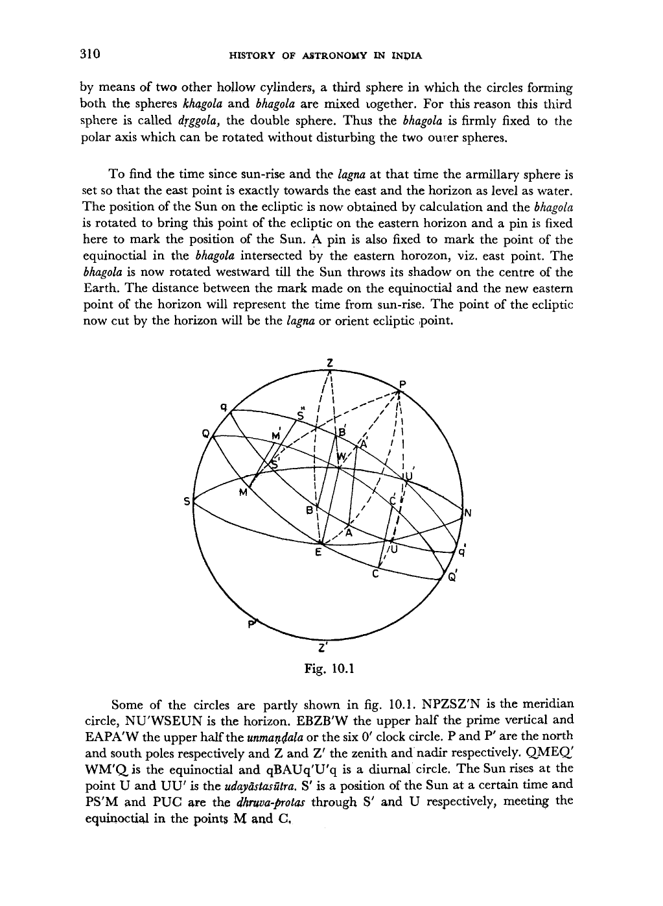

*Fig. 10.1*

<!-- figure-resolved-page-render: page=3 image=media/p03_page.webp -->

<!-- figure-meta: page=3, position=middle, type=diagram -->

Some of the circles are partly shown in fig. 10.1. NPZSZ'N is the meridian circle, NU'WSEUN is the horizon. EBZB'W the upper half the prime vertical and EAPA'W the upper half the *unmaṇḍala* or the six O' clock circle. P and P' are the north and south poles respectively and Z and Z' the zenith and nadir respectively. QMEQ' WM'Q is the equinoctial and qBAUQ'q is a diurnal circle. The Sun rises at the point U and UU' is the *udayāstasūtra*. S' is a position of the Sun at a certain time and PS'M and PUC are the *dhruva-protas* through S' and U respectively, meeting the equinoctial in the points M and C.

<!-- pdf-page: 4 -->

ASTRONOMICAL INSTRUMENTS | 311

<!-- figure-resolved-page-render-hidden: image=media/p04_page.webp caption="Fig. 10.2" -->

<!-- figure-meta: page=4, position=top, type=diagram -->

Fig. 10.2 shows the projection of the circles in fig. 10.1 on the meridian circle. U is the point where the Sun rises and S' is its position at a certain time. OG is the gnomon and GH its mid-day shadow on the equinoctial day. This and the other perpendiculars will be needed in later discussions. Similarly fig. 10.3 is the projection of fig. 10.1 on the equinoctial and fig. 4 is its projection on the diurnal circle. These will also be needed in later discussion. In fig. 10.4 UU' is the *udayāsta-Sūtra*.

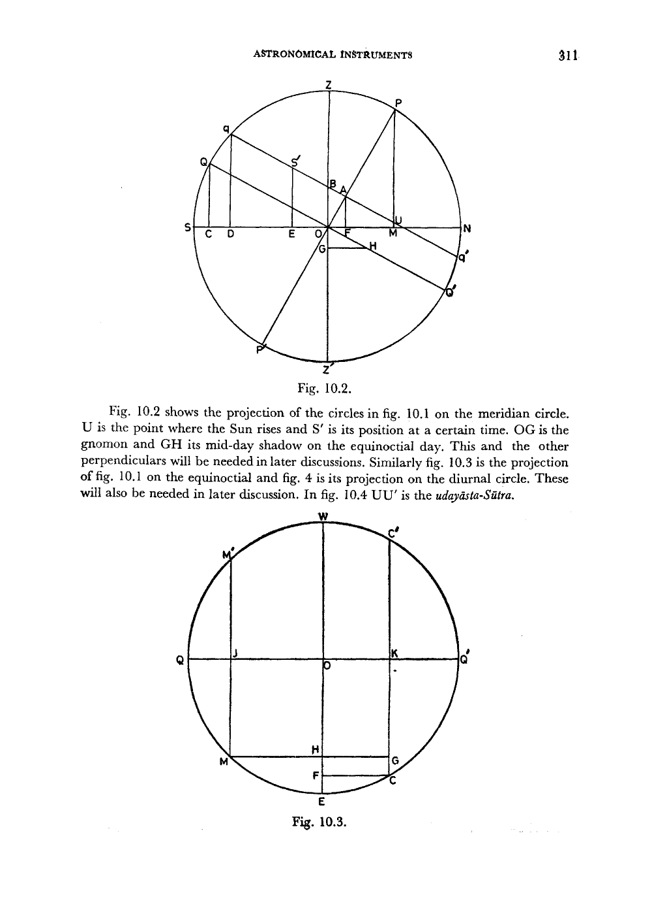

*Fig. 10.3*

<!-- figure-resolved-page-render: page=4 image=media/p04_page.webp -->

<!-- figure-meta: page=4, position=bottom, type=diagram -->

<!-- pdf-page: 5 -->

312 | HISTORY OF ASTRONOMY IN INDIA

<!-- figure-resolved-page-render-hidden: image=media/p05_page.webp caption="Fig. 10.4" -->

<!-- figure-meta: page=5, position=top, type=diagram -->

### THE NĀḌĪVALAYA-YANTRA

The *Nāḍīvalaya*—This instrument is shown in figure 10.5. It is a large circular wooden disc with an axis in the centre. It is divided into $60$ *ghaṭikās* and also into $12$ signs of the ecliptic which do not occupy equal arcs of the circumference but such variable arcs as correspond with the periods of their risings in the place of observation. The twelve periods thus marked are again subdivided into two *horās*, three *dreṣkāṇas*, into ninths, twelfths and thirtieths. These are called the *ṣaḍvargas* or six classes. The signs, however, must be inscribed in the reverse order of the signs, that is first Aries, then Taurus to the West of Aries and so on.

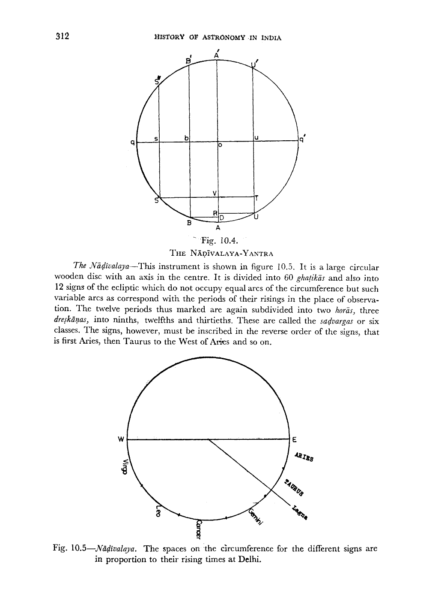

*Fig. 10.5—Nāḍīvalaya. The spaces on the circumference for the different signs are in proportion to their rising times at Delhi.*

<!-- figure-resolved-page-render: page=5 image=media/p05_page.webp -->

<!-- figure-meta: page=5, position=bottom, type=diagram -->
<!-- /decode-chunk -->

<!-- decode-chunk: pages=6-10 source_sha256=55fdf4a518753449ffb5c3786a52f302a6359873e5f28660a97bb02528739e92 -->
<!-- pdf-page: 6 -->

# ASTRONOMICAL INSTRUMENTS

ASTRONOMICAL INSTRUMENTS .313
It is now placed in a plane parallel to the equinoctial so that the axis in the centre points towards the north pole. Now the longitude of the Sun in signs, degrees etc. for the sun-rise of the given days is obtained by calculation and that position is marked on the circle and the disc is rotated round the axis so that the shadow of the axis falls on the mark made for the position of the Sun at sun-rise. The disc now is fixed in position. In figure 10.5, the letters E and W have been put only to show that on the disc the sign of Taurus is to the west of the sign Aries, though in the sky Taurus is to the east of Aries. Now as the Sun rises, the shadow of the axis advances from the marks made for the point of the sun-rise to the nadir. The number of *ghaṭis* will be seen between the point of sun-rise to the position of the shadow which will also indicate the *lagna* or the sign on the eastern horizon since the arcs occupied by the different signs on the circumference of the disc are in proportion to their rising times.
This is the situation when the Sun is in the northern hemisphere. The same disc, graduated in a similar fashion on its other side and with the axis protruding on the other side, can be used to determine the *lagna* and the time since sun-rise, when the Sun is in the southern hemisphere. In the alternative another disc, similarly graduated, with an axis perpendicular to its plane may be placed with its plane parallel to the equinoctial and may be used when the Sun is south of the equator.
In fixing the point of the ecliptic at sun-rise on the eastern horizon in the case of the armillary sphere and in adjusting the position of the *nāḍivalaya* so that the shadow of the axis falls at the position of the Sun at sun-rise, one should take into account the precession of the equinoxes which should again be taken into account in determining the *lagna*.
A similar instrument has been described by Lalla and called by him the *bhagaṇa-yantra*.

### The Pitha-Yantra and Chatra-Yantra :

The Chatra-Yantra and the Pitha-Yantra described respectively by Āryabhaṭa and by Brahmagupta and others are similar. But, unlike the Nāḍīvalaya, they are placed in a horizontal plane. They are made of metal or good wood and are circular in shape in which east-west and north-south directions have been marked and of which the circumference has been divided into $360^{\circ}$. In the centre, a staff is put equal to the radius of the circle. The instruments are to be put at eye-height. The distance of the end of the shadow of the staff at sun-rise from the west point is the Sun's *agrā*. This point is known as the setting point. Similarly the end of the Sun's *agrā* in the east is the rising point. From the setting point to the rising point, on the northern half of the diurnal circle lie the graduations of the degrees of time in these instruments. The degrees on the diurnal circle intervening between the end of the shadow and the setting point in the west, divided by six give the *nāḍis* elapsed during the day. But this is not quite accurate.

<!-- pdf-page: 7 -->

314 HISTORY OF ASTRONOMY IN INDIA

## KARTTARI-YANTRA

The Karttari-Tantra described by Brahmagupta consists of two semicircular plates. One of these is in the plane of the celestial equator and is its lower half. The other semicircular plate is in the meridian plane below the polar axis, the diameter of the latter being evidently along the polar axis. At the junction of the east-west line and the north-south line, (i.e. at the centre of the plates) a needle is fixed pointing towards the pole. From the shadow of the index on the equatorial plate, time from sun-rise can be determined.
It is evident that the equatorial plate can be rotated in its own plane in order that the shadow of the needle may fall at sun-rise on the plate whatever may be the sign in which the Sun is lying. In this respect it resembles one half of the Nāḍīvalaya of Bhāskara II.
The Karttari-Yantra described by Lalla and Śrīpati is not actually this instrument at all since it consists of only one semi-circular plate fixed in the plane parallel to the celestial equator with the needle fixed at the centre and pointing towards the pole.

## THE GOLA-YANTRA

The armillary sphere and the Nāḍīvalaya described so far will measure the time and indicate the *lagna* only after sun-rise on a day when the sky is clear. However, it is necessary to measure time during night time also and to determine the *lagna* at a particular instant. For this purpose, Hindu astronomers had devised other instruments. One of these was the automatic sphere which is described by Āryabhaṭa thus :
"The sphere (Gola-Yantra) which is made of wood, perfectly spherical, uniformly dense all round but light (in weight) should be made to rotate keeping with time with the help of mercury, oil and water by the application of one's own intellect".
Its working has been described by the commentator Suryadeva as follows :—
"Having set up two pillars on the ground, one towards the south and the other towards the north, mount on them the ends of the iron needle (rod) (which forms the axis of rotation of the sphere). In the holes of the sphere, at the south and north poles, pour some oil, so that the sphere may rotate smoothly. Then, underneath the west point of the sphere dig a pit and put into it a cylindrical jar with a hole in the bottom and as deep as the circumference of the sphere. Fill it with water. Then having fixed a nail at the west point of the sphere, and having fastened one end of a string to it, carry the string downwards along the equator towards the east point, then

<!-- pdf-page: 8 -->

ASTRONOMICAL INSTRUMENTS 315
stretch it upwards and carry it to the west point (again), and then fasten it to it a dry hollow gourd (appropriately) filled with mercury and place it on the surface of water inside the cylindrical jar underneath, which is already filled with water. Then open the hole at the bottom of the jar so that with the outflow of water, the water level inside the jar goes down. Consequently, the gourd which, due to the weight of the mercury within it, does not leave the water pulls the sphere westwards. The outflow of water should be manipulated in such a way that in $30$ *ghaṭis* ($= 12$ hours) half the water of the jar flows out and the sphere makes one-half of a rotation, and similarly, in the next $30$ *ghaṭis* the entire water of the jar flows out, the gourd reaches the bottom of the jar and the sphere performs one complete rotation. This is how one should, *by using one's intellect, rotate the sphere keeping pace with time.* (Translation due to Dr. K. S. Shukla and Dr. K. V. Sarma, Āryabhaṭīya of Āryabhaṭa.)
This device is described by Lalla also. The amount of mercury put into the gourd should be chosen in such a way that the gourd may float in the water. However, the flow of the water cannot be uniform. When the cylindrical jar is full the pressure on its bottom will be high and the water will flow out more rapidly than when the jar is nearly empty. Thus the rotation of the sphere cannot be uniform.
A variant of this instrument has been described by Āryabhaṭa in his *Āryabhaṭa-siddhānta* which is now lost. In this a smooth cavity is constructed inside a pillar with a hole at the bottom. The whole length of the pillar is divided by the number of *ghaṭis* taken by the water to flow out completely. This gives the measure of *aṅgula* which corresponds to one *ghaṭi*. The measure of a *ghaṭi* is the basis for the determination of the height of the pillar and of the length of the cord to be used in connection with the time-measuring instruments. A man or other animals are attached to the pillar to make the total height equal to sixty *aṅgulas* as determined above. A cylindrical rod the circumference of which is equal to one *aṅgula* is inserted through the ears of the animals and it is wrapped sixty times round the rod and its one end is attached to the dry gourd containing appropriate amount of mercury. The gourd is now placed inside the cavity of the pillar, water from which flows out through suitable holes in the animals. As an *aṅgula* of water now flows out in a *nāḍi*, the gourd within the pillar goes down by an *aṅgula*. The cord wrapped around the rod also goes down towards the hole underneath due to the pull of the gourd and the rod is rotated through one turn. At one extremity of the rod, protruding outside the instrument, another cord is suspended and the number of coils made by this cord on the rod will indicate the *nāḍis* elapsed.
Similar instruments are mentioned by other astronomers also. The non-uniformity in the flow of water out of the orifice with change in the amount of water inside the cavity occurs in this variation too. It should also be remembered that the duration of time from one sun-rise to the next is not the same for all solar days. It varies from day to day. The longest solar day occurs about December 22, and the shortest solar day about September 17, the difference between the longest and shortest days being about 51 seconds.

<!-- pdf-page: 9 -->

316 HISTORY OF ASTRONOMY IN INDIA

## THE GHAṬĪ-YANTRA

The Clepsydra or the Ghaṭī-Yantra seems to have been in use in India since very ancient times. It has been described in the *Vedāṅga Jyotiṣa*, *Divyāvadāna* the *Purāṇas* and Kautilya's *Arthaśāstra* and by Āryabhaṭa and other astronomers. But the measure of the vessel and of the hole in its bottom through which the water flows is given differently by different authorities. According to *Divyāvadāna*, the volume of the vessel, which is in the form of the lower half of a spherical water-pot called *kalaśa*, is a *droṇa* of water; according to *Vedāṅga Jyotiṣa* it is a *droṇa* less three *kuḍavas* and is thus equal to $61/64$ *droṇa*; and according to Kautilya and the *Purāṇas* it is one *āḍhaka*, i.e., $1/4$th of *droṇa*. The size of the hole is not given in the *Vedāṅga Jyotiṣa*. According to *Divyāvadāna*, the hole was made by a pin, needle, wire or rod four *aṅgulas* or finger-breadths in length, which was drawn from a piece of gold which weighed one *suvarṇa*. But according to Kautilya and the *Purāṇas*, it was drawn from a piece of gold weighing four *māṣās*, i.e. one-fourth of a *suvarṇa*. Evidently one *suvarṇa* is equal to one *karṣa* as defined by Bhāskara II in *Līlāvati*. Thus the size of the hole given by Kautilya and the *Purāṇas* is one-fourth the size of the hole given by *Divyāvadāna* as their vessel is one-fourth the size of the latter vessel. But there is a slight difference in the size of the vessel prescribed by the *Vedāṅga Jyotiṣa* and that given in *Divyāvadāna*. Perhaps *Vedāṅga Jyotiṣa* gave a precise value for the size of the vessel while the other three were satisfied with a rough practical measure.
In the form described by the astronomers of the siddhānta period, the water does not flow out of the hemispherical vessel, but the vessel is floated in a large receptacle of water and water-flows into it through the hole and its sinks in one *ghaṭikā*. However, Varāhamihira has described both forms in the *Pañcasiddhāntikā*. According to Āryabhaṭa, the hemispherical bowl is to be manufactured of copper, $10$ *palas*, in weight and six *aṅgulas* in height, and twelve *aṅgulas* in diameter at the top. At its bottom, the hole is to be made by a needle eight *aṅgulas* in length and one *pala* in weight. But Lalla says that the hole is to be bored by a needle of uniform circular cross-section and four *aṅgulas* in length made of $3\frac{1}{2}$ *māṣās* of gold. This is the specification of Śrīpati also. However, Bhāskara II says that it is very difficult to construct a vessel and make a hole in it which will sink exactly $60$ times during day and night. Therefore one should divide $60$ by the number of times the vessel sinks into the receptacle to get a measure of the clepsydra.
Any copper vessel with a hole at the bottom and made in such a way that it sinks in the receptacle $60$ times in a day and night is called *Kapāla* by Āryabhaṭa and the *Sūrya-siddhānta*. But according to Varāhamihira, *Kapāla-Yantra* is another instrument which will be described later.
When the clepsydra is used by the flow out of water method, the flow of water will decrease as the height of water in the vessel decreases. But since the area of cross-section of the vessel also decreases, the two could be adjusted so that equal decrease in height denotes equal time. Alternatively the clepsydra can be calibrated with the help of the Gola-Yantra. But when the water flows into the bowl, the pressure

<!-- pdf-page: 10 -->

ASTRONOMICAL INSTRUMENTS 317
difference between the water in the receptacle and that in the bowl supports the weight of the bowl. Thus the pressure difference will be more when the cross section is small, i.e. for the initial flow of water, than when the bowl is nearly full. So the instrument will have to be calibrated to give fractions of a *ghaṭikā*.
In Babylonia, a cylindrical vessel was used as a water-clock. From there the instrument was introduced to Egypt. The oldest specimen of an Egyptian water-clock dates from about 1400 B.C.

## THE GNOMON

The gnomon was perhaps the most versatile instrument with the Indian astronomers. It was used by all ancient nations for the measurement of time. Most probably it was invented by the Babylonians around 1750 B.C. But no word for gnomon occurs in Babylonian gnomon tables which have been preserved. Only the shadow is mentioned and measured. The gnomon was introduced in Egypt in about 1500 B.C. and later from Egypt to Greece. In the *Aitareya Brāhmaṇa* it has been said that the sun remains stationary at the summer solstice for 7 days. This must have been observed with the gnomon.
In ancient times the gnomon was probably no more than a stick stuck vertically in the ground, thus forming a rudimentary sun-dial, and was the first astronomical instrument. In early Greece and late dynastic Egypt, the gnomon rose like a slender obelisk from the centre of a graduated circular pavement. When the shadow of the pillar was at its shortest length on any day, the gnomon indicated midday. To obtain some idea of the time of the morning or afternoon, the observer noted the length and direction of the shadow.
An alternative shadow clock took the form of a portable L-shaped piece of wood which in use was laid on its back in the direction of the Sun. The shorter leg then served as a vertical gnomon and cast its shadow on graduations marked on the longer horizontal leg. In another type of sun-dial, called the *hemicycle* and said to have been introduced at Athens by Berosus, the shadow of a vertical gnomon fell on the inner surface of a hemisphere. The end of the shadow traced a curve, the position of which depended on the time of the year.
The gnomon was used for the measurement of time, the determination of the solstices, the equinoxes and of geographical latitudes. Knowing the height of the gnomon and the length of the shadow, one can calculate the Sun's meridian zenith distance which at the time of the equinoxes is equal to the latitude of the place of observation. Using this method, Eratosthenes had available the approximate latitudes of Alexandria, Syene, Carthage, Rhodes and Byzantium.
The gnomon was generally of a standard length. But for greater accuracy one could use a very tall gnomon. By means of a gnomon some 180 feet high, Ulugh Beg and his assistants determined the latitude of Samarqand and the obliquity of the ecliptic with great precision. In India the standard length for the gnomon was $12$ *aṅgulas*. But some authors say that it can be as high as $96$ *aṅgulas* or any multiple of $12$. Bhāskara I in some questions takes the height of the gnomon to be $30$ *aṅgulas* and 15
<!-- /decode-chunk -->

<!-- decode-chunk: pages=11-15 source_sha256=aeab876c0abe37b5b8e9d1cbbc5b2571bb1f64f1215b63dabf04415a833a847e -->
<!-- pdf-page: 11 -->

318 HISTORY OF ASTRONOMY IN INDIA
*aṅgulas*. Whatever the height of the gnomon, it is generally divided into 12 divisions, each division being called an *aṅgula* or finger. According to al-Bīrūnī, it may be divided into 60 divisions called ‘parts’ or into seven divisions called ‘feet’.
Āryabhaṭa describes three kinds of gnomons. The first is uniformly circular and two *aṅgulas* in diameter at the bottom. This kind has been mentioned also by Lalla and Śrīpati. The second kind is one having equal circles at the top and bottom. This has been described by Bhāskara II who says that it should be made of ivory instead of strong timber. The third kind was, according to the trranslation of Prof. K. S. Shukla, ‘pointed at the top, and massive at the bottom (i.e. conical in shape); (associated with its is) another true gnomon of the same height, mounted verticaly on two (horizontal) nails fixed (to the previous gnomon) at the top and bottom thereof.’ It is not very clear what Āryabhaṭa means by this kind of gnomon. Perhaps in this the associated gnomon was of the kind envisaged by al-Bīrūnī which casts the shadow on a vertical surface, e.g. when the gnomon is fixed perpendicular to a wall. The shadow cast on the ground by the gnomon fixed verticaly is called *umbra recta* while the shadow directed towards the ground is called *umbra versa*.
The first use of the gnomon in India appears to be to fix the cardinal points. For this purpose the gnomon is placed on a plastered surface, made level with a water-level, and a circle of any desired size is drawn on the surface with its centre at the gnomon. The two points where the shadow touches the circle in the forenoon and afternoon are marked and with these points as centres, a fish figure is drawn. Then the line passing through the mouth and the tail of the fish will be the north-south line.
This method of finding the north-south line would have been correct if the declination of the Sun remains unaltered between the forenoon and the afternoon positions. On account of the motion of the Sun on the ecliptic, the declination changes and the line joining the forenoon and afternoon points is not in the east-west direction.

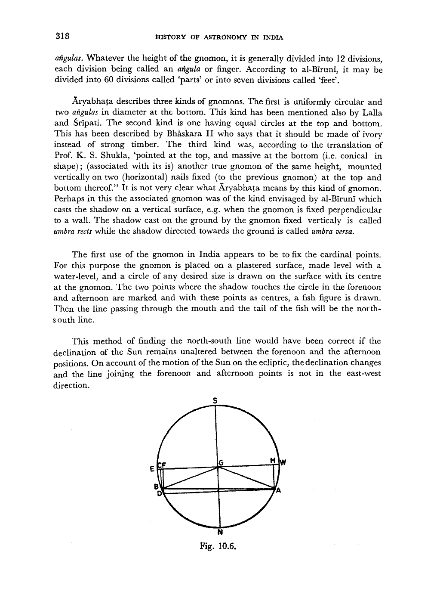

*Fig. 10.6.*

<!-- figure-resolved-page-render: page=11 image=media/p11_page.webp -->

<!-- figure-meta: page=11, position=bottom, type=diagram -->

<!-- pdf-page: 12 -->

ASTRONOMICAL INSTRUMENTS 319
In fig. 10.6, G is the foot of the gnomon. ENWS is the circle drawn with G as the cet.e, A is the point where the shadow touches the circle in the forenoon and B is the point where the shadow touches the circle in the afternoon. The distances of A and B from the east-west line are not equal and the line AB is not in the east-west direction. Now Burgess, in his notes on verse 7 of *Sūrya-siddhānta* has proved that

$$\frac{kar\d{n}a\ v\d{r}tt\bar{a}gr\bar{a}}{\text{hypotenuse of the shadow}} = \frac{agrajy\bar{a}}{trijy\bar{a}}, \text{ where } kar\d{n}a\ v\d{r}tt\bar{a}gr\bar{a} \text{ is the distance of the end}$$

point of the shadow from the equinoctial shadow line. Now from fig. 10.2.

$$agrajy\bar{a} = OU = \frac{OA}{\cos \phi} = \frac{R \sin \delta}{\cos \phi}$$

$$\therefore kar\d{n}a\ v\d{r}tt\bar{a}gr\bar{a} = H \frac{R \sin \delta}{R \cos \phi} = \frac{H \sin \delta}{\cos \phi}, \text{ where } H = \text{hypotenuse.}$$

If the Sun is in the southern hemisphere, $bhuja = kar\d{n}a\text{-}v\d{r}tt\bar{a}gr\bar{a} + \text{equinoctial shadow}$, and if the Sun is in the northern hemisphere and north of the prime vertical, $bhuja = kar\d{n}a\text{-}v\d{r}tt\bar{a}gr\bar{a}$, if the Sun is south of the prime vertical which is the case in fig. 10.6.
Assuming that $\delta$ is positive when it is north, $bhuja$ is positive when the Sun is north of the prime-vertical and the equinoctial shadow is always positive, the second equation holds. Taking sign into consideration, the others have also the same form.

$$\Delta bhuja = \Delta kar\d{n}a\text{-}v\d{r}tt\bar{a}gr\bar{a}, \text{ for figs 10.2 and 10.6,}$$

$$= \Delta \frac{\sin \delta}{\cos \phi},$$

since the equinoctial shadow remains constant.
Hence in fig. 10.6,

$$BC - AH = - \frac{H}{\cos \phi} (\sin \delta_2 - \sin \delta_1), \text{ since the } bhuja \text{ in fig. 10.6 has a nega-}$$

tive sign. Since $\delta_1$ and $\delta_2$ can be calculated, we can obtain the correct value of the $bhuja\ DF$ by applying this correction. The fish figures drawn from $D$ and $A$ as centres will give the correct north-south and east-west directions. By a repetition of the same process, the intermediate points of direction can be obtained.

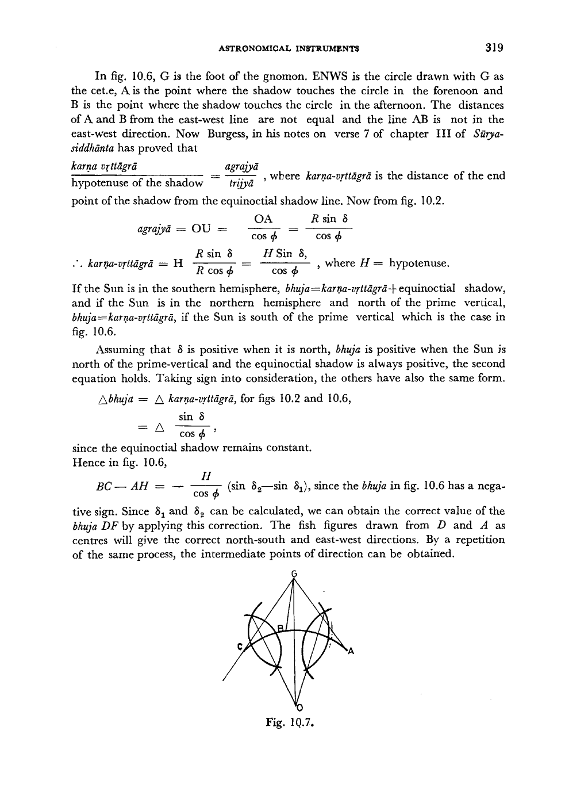

*Fig. 10.7.*

<!-- figure-resolved-page-render: page=12 image=media/p12_page.webp -->

<!-- figure-meta: page=12, position=bottom, type=diagram -->

<!-- pdf-page: 13 -->

320 HISTORY OF ASTRONOMY IN INDIA
Varāhamihira, Brahmagupta, Bhāskara I, Vaṭeśvara and Śrīpati have all described another method for drawing the north-south meridian line by taking three points $A$, $B$ and $C$ in the path of the shadow of the gnomon $G$ as illustrated in fig. 10.7. Here two fish figures are drawn by taking the points $(A, B)$ and $(B, C)$. The two straight lines drawn through the mouth and tail of the fish figures meet at the point $0$. Then $GO$ is the meridian line. Here two assumptions are made. One is that the declination of the Sun does not change during the day. The second is that the path of the end point of the shadow is a circle. None of these is correct, the path being a hyperbola. Bhāskara II therefore, criticizes this method of determining the east-west and north-south lines.
We can obtain the time elapsed since sun-rise or the time to elapse before sunset with the help of the gnomon and its shadow. Bhāskara I says:
“Multiply the $R$ sine of the Sun’s altitude derived from the given shadow (of the gnomon) by the radius and divide (the product) by (the $R$ sine of) the colatitude. Then subtract the minutes of the earth-sine from or add them to the resulting quantity according as the sun is in the six signs beginning with Aries or in the southern hemisphere. Multiply the resulting quantity by the radius and divide (the product) by the day-radius. To the corresponding arc apply the ascensional difference contrarily to the above; thus is obtained the number of *asus* (elapsed since sun-rise in the forenoon or to elapse before sunset in the forenoon)”.
In fig. 10.2 $S'E$ is the $R$ sine of the Sun’s altitude. Multiplying this by $R$ and dividing the product by the $R$ sine of the colatitude is equivalent to dividing $S'E$ by $\cos \phi$ where $\phi$ is the latitude. This gives $S'U$ or $S'T$ of figure 10.4. Subtracting from this the earthsine $UR$, we get $S'L$. Multiplying this by $R$ and dividing by the day-radius is equivalent to dividing it by $\cos \delta$. The result is equal to $MH$ of Fig. 10.3. The arc corresponding to $MH$ is $ME$. On adding to this the ascensional difference $EC$ we obtain the arc $MC$ which gives the time since sun-rise.
If we subtract $MG = MH + CF$ from the *antyā* $QK$, we get the distance $QJ$ which is the versine of the arc $QM$ which gives the *natakāla*.
Bhāskara I gives two other methods both of which are essentially the same as the above method. Knowing the time from sun-rise, it is possible to determine the *lagna* (orient ecliptic point) after taking into account the precession of the equinoxes.
Assuming that the declination of the Sun does not change appreciably on any day, it is possible to determine the equinoctial shadow by measuring two shadows of the gnomon on any day. Writing $b$ for $bhuja$, $a$ for $kar\d{n}a\text{-}v\d{r}tt\bar{a}gr\bar{a}$, and $s$ for the equinoctial shadow and taking into account their signs, the relation between them can be written as :

$$b = a - s.$$

<!-- pdf-page: 14 -->

ASTRONOMICAL INSTRUMENTS 321
If the two shadows have the same direction and all quantities in the above equation are positive,

$$b_1 = \frac{H_1 \sin \delta}{\cos \phi} - s \text{ and } b_2 = \frac{H_2 \sin \delta}{\cos \phi} - s.$$

From these two equations, we obtain

$$s = \frac{b_1 H_2 - b_2 H_1}{H_1 - H_2}.$$

If the shadows are in opposite directions of the east-west line, then writing $-b_2$ for $b_2$, we obtain:

$$s = \frac{b_1 H_2 + b_2 H_1}{H_1 - H_2}.$$

From the equinoctial shadow we can obtain the corresponding hypotenuse. Now multiplying the shadow by $R$ and dividing by the hypotenuse we can obtain the $R$ sine of the latitude and the corresponding arc divided by 60 gives the latitude of the place in degrees.
The measurement of the midday shadow gives the Sun’s zenith distance at midday. If this is $Z$, we have $\delta = Z - \phi$ or $\phi - Z$ according as $Z > \phi$ or $Z < \phi$ if the sun is to the south of the zenith. If the Sun is to the north of the zenith then $\delta = \phi + Z$. From a knowledge of $\delta$, one can then calculate $\lambda$ by the equation

$$\sin \delta = \sin \lambda \sin \epsilon.$$

This will give a value of $\lambda < 90^\circ$. One can then obtain the correct value of $\lambda$ from a consideration of the seasons. If the Sun is in the second quarter, this angle has to be subtracted from $180^\circ$; if the Sun is in the third quarter; it has to be added to $180^\circ$, and if the Sun is in the fourth quarter, it has to be subtracted from $360^\circ$. This will give the *sāyana* longitude of the Sun. From this the precession of the equinoxes has to be subtracted to get the true longitude of the Sun which would otherwise be obtained from *aharga\d{n}a*.

## THE YAṢṬI OR STAFF

The use of the Yaṣṭi for determining different astronomical quantities depends on the assumption that the declination of the Sun does not change substantially on any particular day. These determination therefore are more accurate when the time of observation is near the summer or the winter solstice.
For using the Yaṣṭi to make different measurements, one should draw on the ground, levelled with a water-level, a circle of radius equal to the length of the Yaṣṭi. One should draw the east-west and north-south lines by the method described earlier. At sun-rise one should determine the point where the Sun rises. This is done by placing one end of the Yaṣṭi at the centre of the circle and pointing the other end of the staff towards the Sun so that it gives no shadow. The distance of this point from the east-west line, multiplied by $R$, the radius of the great circle, and the product divided by the length of the staff, gives *agrajyā*, i.e. the distance $OU$ in

<!-- pdf-page: 15 -->

322 HISTORY OF ASTRONOMY IN INDIA
fig. 10.2. This multiplied by the length of the gnomon and divided by the equinoctial hypotenuse gives $OA$, i.e. $R \sin \delta$. From this we get the radius of the diurnal circle. Multiplying this by the length of the staff and dividing by $R$ we get the radius of the diurnal circle to be drawn on the ground with the same centre.
Now at any time of the day when we wish to determine the time from sun-rise, we place one end of the Yaṣṭi at the centre of the circle and point the other end towards the Sun so that it gives no shadow. We now measure the distance between the sun-rise point on the first circle and the top of Yaṣṭi. This distance then used as a chord on the diurnal circle drawn cuts off an arc, the number of degrees of which divided by six give, in the forenoon, the number of *gha\d{t}ik\bar{s}* from sun-rise, and in the afternoon the number of *gha\d{t}ik\bar{s}* to sunset.
If the length of the Yaṣṭi is equal to $R$, it is plain that the distance between the rising point and the top of the staff is the chord of the arc of the diurnal circle passing through the sun, intercepted between the horizon and the Sun. For this reason, the arc subtended by the distance in question in this interior circle, described with a radius equal to the diurnal circle, will denote the time after sun-rise or to sun-set.
Alternatively, one can take half of the chord, multiply it by the radius $R$, divide the product by the radius of the diurnal circle drawn and find the arc corresponding to this resulting half chord. Then twice this arc will be a measure of the time from sun-rise or to sun-set.
If the length of the Yaṣṭi itself is equal to $R$, the radius of the great circle, it is not necessary to multiply the measurements by $R$ and divide the product by the length of the staff. We will assume herein after that the length of the staff is equal to t he radius $R$.
The perpendicular let fall from the point of Yaṣṭi on the ground is called the *śaṅku* or *mahāśaṅku* to distinguish it from the ordinary *śaṅku* or Gnomon of 12 *aṅgulas*. It is equal to the $R$ sine of the altitude of the Sun. The distance between the *śaṅku* and he rising-setting line is called the *śaṅkutala*. This is the distance $EU$ in fig. 10.2. where $S'$ is the position of the Sun on the diurnal circle. Multiplying the *śaṅkutala* by 12 and dividing by the *śaṅku*, we obtain the equinoctial shadow. This is easily seen from the similarity of the triangles $S'EU$ and $OGH$, where $OG$ is the gnomon of 12 *aṅgulas* and $GH$ the equinoctial shadow.
The distance between the *śaṅku* and the east-west line is known as the *bhuja*. This is $EO$ in fig. 10.2. If we observe two *śaṅkus* and find out the *bhujas* for them, then their difference when they are of the same denomination, and their sum when they are of the opposite denominations, when multiplied by 12 and the product divided by the difference of the two *śaṅkus* gives the equinoctial shadow. In fig. 10.2,
<!-- /decode-chunk -->

<!-- decode-chunk: pages=16-20 source_sha256=1f5e6942a5b9165c696c3cea05ecdf9751b20e25cae3c44e5c9093ee1d64a955 -->
<!-- pdf-page: 16 -->

ASTRONOMICAL INSTRUMENTS 323
if $q$, $S'$ and $A$ are three positions of the Sun on the diurnal circle when the *śaṅkus* are observed, it is clear that :

$$GH = \frac{(DO-EO) OG}{q D-S' E} = \frac{(EO+OF) OG}{S' E-AF} .$$

If the *śaṅku* is observed at three different times by the Yaṣṭi, it is possible to determine with their help the equinoctial shadow, declination etc. of the three *śaṅkus*, one should be in the morning, the second near midday and the third near the evening. A thread is now drawn from the top of the first to the top of the third. Now a thread is drawn from the top of the second *śaṅku* to the eastern and western points of the horizontal circumference drawn on the ground so as to touch the thread drawn between the first and third *śaṅkus*. The line drawn, so as to connect the two points on the horizontal circumference, will be the rising-setting line and the distance between this line and the centre will give the *agrā* or $R$ sine of amplitude. The line drawn through the centre parallel to the rising-setting line at the distance of the $R$ sine of the amplitude is the east-west line.
Since the tops of the three *śaṅkus* are in the plane of the diurnal circle, the line drawn from the top of the first *śaṅku* to that of the last; will also be in the same plane. Hence the two lines drawn, touching this line, from the top of the second *śaṅku* to the circumference of the circle drawn on the ground will also be in the same plane. Thus the two points on the horizon, one to the east and the other to the west, and the line joining them are in the plane of the diurnal circle and the line is the rising-setting line.
One can now determine the equinoctial shadow as before and also the equinoctial hypotenuse, $GH$ and $OH$ respectively in fig. 10.2. From the similarity of the triangles $OGH$ and $OAU$, one determines $OA$, $R$ sine $\delta$, by multiplying by 12 the $R$ sine of the amplitude and dividing the product by the equinoctial hypotenuse. This again multiplied by the radius and the product divided by $R$ sine of the Sun’s greatest declination will give the $R$ sine of the *bhuja* of the Sun’s longitude. Thus we can get the *sāyana* longitude of the Sun.
Again taking two tubes equal in length to the radius of the circle drawn on a raised level surface and joining them at one end by means of a nail so as to form $V$-shaped tubes, one can simultaneously observe the Sun through one tube and the Moon through the other tube. Then putting their junction on the centre of the circle and their tips on the circumference graduated with the 360 divisions of degrees, one can determine the number of degrees between the Sun and the Moon. These when divided by 12, give the *tithis* elapsed in the light half of the month or the *tithis* to elapse in the dark half of the month.
By a similar method one can determine the angle between two planets. For this purpose, one observes one of the planets by pointing one of the tubes in the east-west

<!-- pdf-page: 17 -->

324 HISTORY OF ASTRONOMY IN INDIA
direction. One then rotates the other tube in the north-south direction at the proper angle so as to observe the other point. The arc between the two tubes gives the angle between the planets.
In order to determine the *agrā* of a planet, one should take a *yaṣṭi* in the form of a needle and put it on the circle, on the raised platform, along with the east-west direction. One should now put another needle at its western end at right angles to the first needle. The second needle should be chosen to be of such a length that the observer with his eye at the top of it and his line of sight passing through the other end of the first needle sees a planet rising at the horizon in the same straight line. Then one can find the *agrā* of the planet by multiplying the length of the second needle by $R$ and dividing the product by the length of the first needle.
By taking a *yaṣṭi* and directing it towards the north on a level surface and putting the eye at the lower end of the *yaṣṭi*, it is adjusted in such a way that its tip is directed at the pole star. Then the perpendicular from its tip on the level surface is the *bhuja* and is proportional to the $R$ sine of the terrestrial latitude and the distance between the base of the perpendicular and the base of the staff is proportional to the $R$-sine of the terrestrial colatitude and is called the *koṭi*. The *koṭi* multiplied by 12 and divided by the *bhuja* gives the equinoctial shadow.

### THE CAKRA-YANTRA

The Cakra-Yantra has been described by Varāhamihira as follows :—
“Take a circular hoop, on whose circumference the 360 degrees are evenly marked, whose diameter is one *hasta* and which is half an *aṅgula* broad. In the middle of the breadth of that hoop make a hole. Through this small hole made in the circumference allow a ray of the Sun at noon to enter in the oblique direction. The degrees, intervening on the lower half of the circle between (the spot illuminated by the ray and) the spot reaching by a string hanging perpendicularly from the centre of the circle, represent the degrees of the zenith distance of the midday Sun.”
It is not explained how the time will be determined. Other astronomers recommend that the Cakra-Yantra should be made of in the form of a plate of metal or seasoned wood and a needle should be fixed at the centre, the shadow of which, when the instrument is held so that both sides of the circle are illuminated by the rays of the Sun, will give the angular height of the Sun from the number of degrees between the point where the shadow falls and the point representing the horizon which is at a distance of three signs or $90^\circ$ from the point at which it is suspended. For accuracy the Cakra-Yantra should be made of metal and be about 3 metres in diameter.
Bhāskara II says that some former astronomers have given the following rule for making a rough calculation of the time, viz. multiply the half length of day by the obtained altitude and divide the product by the meridian altitude of the Sun and the

<!-- pdf-page: 18 -->

ASTRONOMICAL INSTRUMENTS 325
quotient will be the time sought. But Brahmagupta had already criticized this rough method of determining time. According to him, the *iṣṭahṛti* should be obtained by multiplying the sine of angular height by the radius of the diurnal circle and the equinoctial shadow and dividing the product by the gnomon length and the time determined as already explained in the section on determining time by the gnomon.

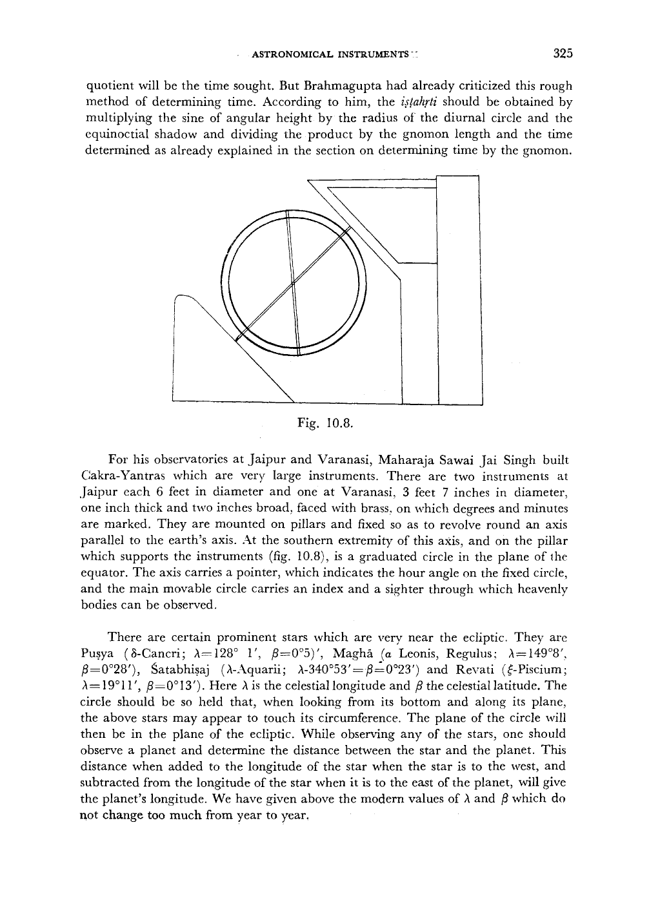

*Fig. 10.8.*

<!-- figure-resolved-page-render: page=18 image=media/p18_page.webp -->

<!-- figure-meta: page=18, position=middle, type=diagram -->

For his observatories at Jaipur and Varanasi, Maharaja Sawai Jai Singh built Cakra-Yantras which are very large instruments. There are two instruments at Jaipur each 6 feet in diameter and one at Varanasi, 3 feet 7 inches in diameter, one inch thick and two inches broad, faced with brass, on which degrees and minutes are marked. They are mounted on pillars and fixed so as to revolve round an axis parallel to the earth’s axis. At the southern extremity of this axis, and on the pillar which supports the instruments (fig. 10.8), is a graduated circle in the plane of the equator. The axis carries a pointer, which indicates the hour angle on the fixed circle, and the main movable circle carries an index and a sighter through which heavenly bodies can be observed.
There are certain prominent stars which are very near the ecliptic. They are Puṣya ($\delta$-Cancri; $\lambda = 128^\circ\ 1'$, $\beta = 0^\circ\ 5'$); Maghā ($\alpha$ Leonis, Regulus; $\lambda = 149^\circ\ 8'$, $\beta = 0^\circ\ 28'$); Śatabhiṣaj ($\lambda$-Aquarii; $\lambda - 340^\circ\ 53' = \beta = 0^\circ\ 23'$) and Revatī ($\xi$-Piscium; $\lambda = 19^\circ\ 11'$, $\beta = 0^\circ\ 13'$). Here $\lambda$ is the celestial longitude and $\beta$ the celestial latitude. The circle should be so held that, when looking from its bottom and along its plane, the above stars may appear to touch its circumference. The plane of the circle will then be in the plane of the ecliptic. While observing any of the stars, one should observe a planet and determine the distance between the star and the planet. This distance when added to the longitude of the star when the star is to the west, and subtracted from the longitude of the star when it is to the east of the planet, will give the planet’s longitude. We have given above the modern values of $\lambda$ and $\beta$ which do not change too much from year to year.

<!-- pdf-page: 19 -->

326 HISTORY OF ASTRONOMY IN INDIA

## DHANURYANTRA

Half the circle is the *cāpa* or Dhanuryantra of which the circumference is divided into $180^\circ$ and the sub-divisions of a degree. At its centre a fine hole is made through which a needle is inserted. It is held in such a way that the chord is horizontal, i.e. the central part of the circumference is resting on the ground. Then it is rotated so that both sides are equally illuminated by the rays of the Sun as in the case of the Cakra-Yantra. Then the number of degrees between the point where the shadow of the needle falls on the circumference and the nearer horizontal line give the altitude of the Sun and the number of degrees between the shadow point and the lowest point of the circumference give the zenith distance of the Sun. From this the time from sunset can be calculated as described earlier.
The Dhanuryantra should also be large in size so that the observations may be accurate.
But the Dhanuryantra described by Āryabhaṭa seems to be a little different in the manner of its use. We give below the translation given by K. S. Shukla.
“The chord of the Dhanuryantra is equal to the diameter of the circle (i.e. the perfect circle), and its arrow is equal to the radius. It is mounted on the circle vertically with the two ends of its arc coinciding with the east and west points. The eastern end of the Dhanuryantra should be moved along (the circumference of) the circle until the Dhanuryantra is towards the Sun. The shadow of the gnomon will then fall along the chord of the Dhanuryantra, and (the shadow-end being at the centre of the circle) the distance between the gnomon as measured from the centre of the circle, will always be equal to the shadow for desired time. The degrees intervening between the (eastern) end of the Dhanuryantra and the rising point of the sun divided by six, give the *ghatīs* elapsed in the day”.
It seems the chord end of the Dhanuryantra described by Āryabhaṭa was placed on the ground and the gnomon could be moved on the circumference and placed in such a way that its shadow falls on the centre. If now a plumb line is suspended from the gnomon, its distance from the centre along the diameter will give the shadow for the desired time.

### *The Turiya-Yantra or the Quadrant*

The Turiya-Yantra is so named because it forms the fourth part of a circle. For accuracy, it should be made of metal which is absolutely flat and each arm of which is about 1.5 metres in length. It should be graduated into $90^\circ$ and each degree should also be sub-divided. It can be used to determine the obliquity of the ecliptic. For this a small nail, machined on a lathe, is fixed at the centre. The quadrant is now put in the meridian plane with the help of the north-south direction drawn on a circle on local ground by the method already described. One arm of the quadrant is horizontal and the other vertical. The end of the shadow of the nail on the graduations

<!-- pdf-page: 20 -->

ASTRONOMICAL INSTRUMENTS 327
of the quadrant then gives the zenith distance of the Sun at any time. The zenith distance at midday is least on the day when the Sun enters the sign of Cancer and the midday zenith distance greatest on the day when the Sun enters the sign of Capricorn. The position of shadow on these days is noted and half the angular distance between these two positions gives the obliquity of the ecliptic.
In another form a small tube is fixed at the centre pointing towards the point on the circumference along one of the arms. Another small tube is fixed at this end pointing towards the centre. This end is known as the horizontal point while the point on the circumference at the end of the other arm is known as the sky point. A plumb line is suspended from the centre. The quadrant is now held in such a way that rays from the Sun entering the tube at the centre fall on the tube at the horizontal point. The number of degrees between this point and the position of the plumb line gives the zenith distance of the Sun and the number of degrees between the plumb line and the other side give the angular height of the Sun. From this the time from sunrise can be calculated as described earlier. The Moon, the planets and the stars can be observed by placing the eye at the horizontal point and observing the heavenly bodies by directing the instrument at them so that they will be observed by the light entering both the tubes.
The *Yantracintāmaṇi* recommends that each arm should be divided into 30 parts and half chords parallel to the other arm should be drawn from each point. Also an index rod should be fixed to the tube at the centre rather loosely so that it will revolve freely along the circumference. Most of the astronomical results can easily be obtained with this instrument.
An instrument of solid silver, made according to the directions of the *Yantracintāmaṇi* was presented by Maharaja Ram Singh of Kota to the Government of India and has been described by Mr. Middleton in the *Journal of the Asiatic Society of Bengal* (1899). This is shown in fig. 10.9. In this an index rod revolves freely in the vertical upon an axis at the centre of the plate and there is a tube about one sixth of an inch in diameter which runs along the whole length of one side of the instrument from the centre to the circumference. From this end of the circumference, degrees from zero to 90 are marked on an outer circle. On a slightly inner circle, the instrument is graduated from the other end to the first end into fifteen divisions.
When the Sun or any heavenly object is viewed through the tube, the position of the index rod on the outer divisions gives the zenith distance of the heavenly body. The position of the index rod on the inner circle multiplied by the semi-duration of the day and divided by the meridian altitude of the Sun will give a rough estimate of the *nāḍis* elapsed since sun-rise. As already noted, this method of estimating the time was criticized by both Brahmagupta and Bhāskara II.
Along the twelfth division on the side on which the viewing tube is placed, the numbers 1, 2, 3 etc. have been written. It is evident that the position of the index rod on this line can be read with the help of these numbers and will give the length of
<!-- /decode-chunk -->

<!-- decode-chunk: pages=21-25 source_sha256=fe5337f8e5bab0928195bf1ddd0270ac4121a9f2c45a5da8481f27411954f1c9 -->
<!-- pdf-page: 21 -->

328 HISTORY OF ASTRONOMY IN INDIA
the shadow of a gnomon of length equal to 12 units at any time. On the equinoctial day, this will give the length of the equinoctial shadow and the position of the index rod on the outer circle will give the latitude of the place of observation.

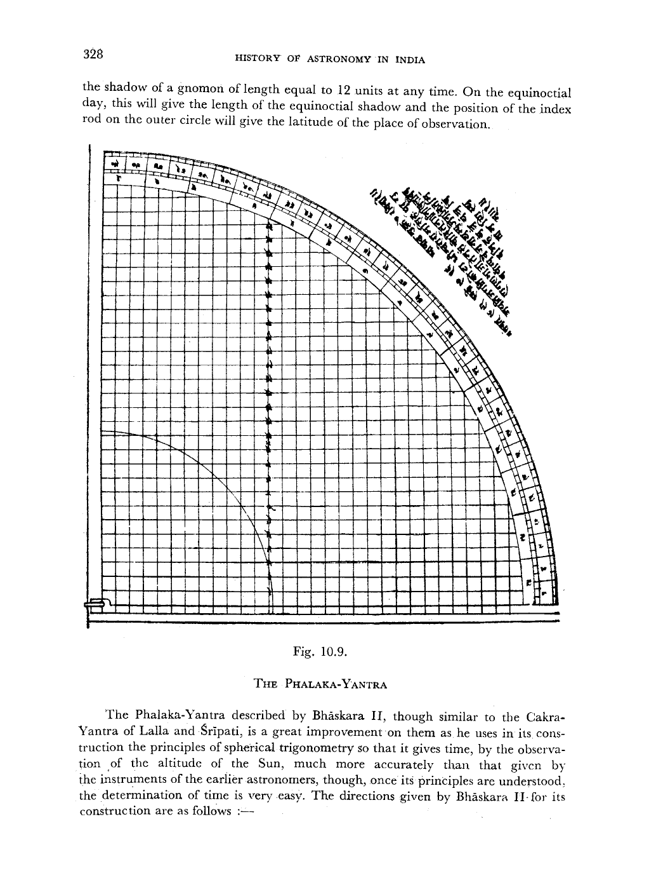

*Fig. 10.9. The Phalaka-Yantra*

<!-- figure-resolved-page-render: page=21 image=media/p21_page.webp -->

<!-- figure-meta: page=21, position=middle, type=diagram -->

Fig. 10.9.

### THE PHALAKA-YANTRA

The Phalaka-Yantra described by Bhāskara II, though similar to the Cakra-Yantra of Lalla and Śrīpati, is a great improvement on them as he uses in its construction the principles of spherical trigonometry so that it gives time, by the observation of the altitude of the Sun, much more accurately than that given by the instruments of the earlier astronomers, though, once its principles are understood, the determination of time is very easy. The directions given by Bhāskara II for its construction are as follows :—

<!-- pdf-page: 22 -->

ASTRONOMICAL INSTRUMENTS 329

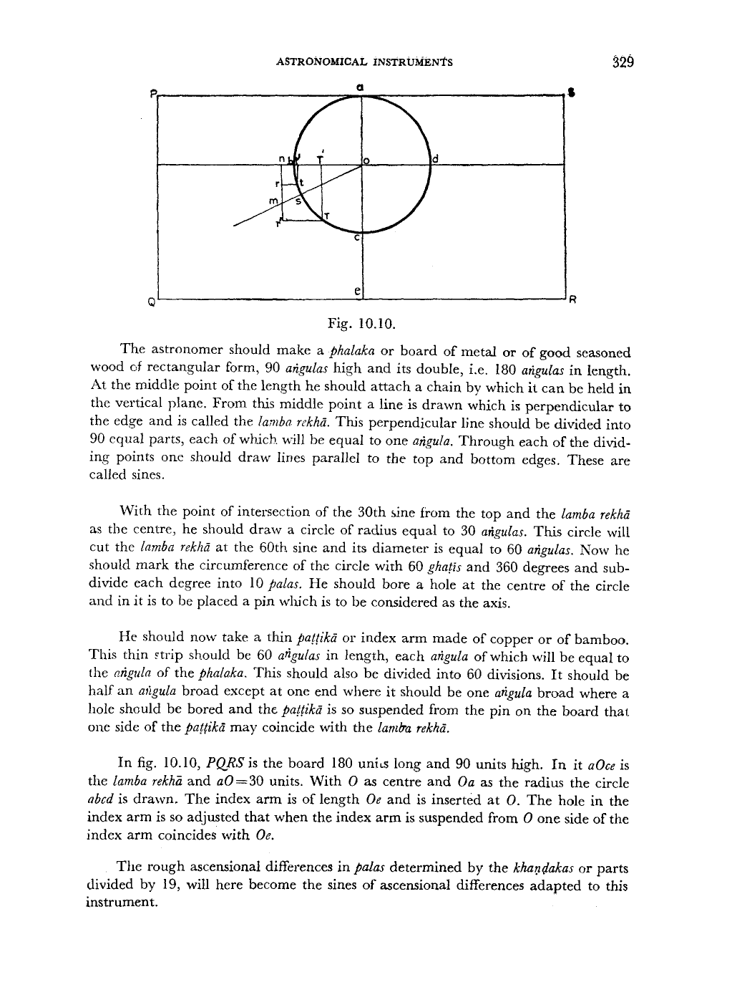

*Fig. 10.10.*

<!-- figure-resolved-page-render: page=22 image=media/p22_page.webp -->

<!-- figure-meta: page=22, position=top, type=diagram -->

Fig. 10.10.
The astronomer should make a *phalaka* or board of metal or of good seasoned wood of rectangular form, 90 *aṅgulas* high and its double, i.e. 180 *aṅgulas* in length. At the middle point of the length he should attach a chain by which it can be held in the vertical plane. From this middle point a line is drawn which is perpendicular to the edge and is called the *lamba rekhā*. This perpendicular line should be divided into 90 equal parts, each of which will be equal to one *aṅgula*. Through each of the dividing points one should draw lines parallel to the top and bottom edges. These are called sines.
With the point of intersection of the 30th sine from the top and the *lamba rekhā* as the centre, he should draw a circle of radius equal to 30 *aṅgulas*. This circle will cut the *lamba rekhā* at the 60th sine and its diameter is equal to 60 *aṅgulas*. Now he should mark the circumference of the circle with 60 *ghaṭīs* and 360 degrees and sub-divide each degree into 10 *palas*. He should bore a hole at the centre of the circle and in it is to be placed a pin which is to be considered as the axis.
He should now take a thin *paṭṭikā* or index arm made of copper or of bamboo. This thin strip should be 60 *aṅgulas* in length, each *aṅgula* of which will be equal to the *aṅgula* of the *phalaka*. This should also be divided into 60 divisions. It should be half an *aṅgula* broad except at one end where it should be one *aṅgula* broad where a hole should be bored and the *paṭṭikā* is so suspended from the pin on the board that one side of the *paṭṭikā* may coincide with the *lamba rekhā*.
In fig. 10.10, $PQRS$ is the board 180 units long and 90 units high. In it $aOce$ is the *lamba rekhā* and $aO=30$ units. With $O$ as centre and $Oa$ as the radius the circle $abcd$ is drawn. The index arm is of length $Oe$ and is inserted at $O$. The hole in the index arm is so adjusted that when the index arm is suspended from $O$ one side of the index arm coincides with $Oe$.
The rough ascensional differences in palas determined by the *khaṇḍakas* or parts divided by 19, will here become the sines of ascensional differences adapted to this instrument.

<!-- pdf-page: 23 -->

330 HISTORY OF ASTRONOMY IN INDIA
The $R\sin\text{ (ascensional difference)}=R\tan\phi\tan\delta$, and the rough values of the arcs corresponding to the first, second and third signs at a place, when the equinoctial shadow is one *aṅgula*, are 10, 8 and $3\frac{1}{3}$ *palas* respectively. These are the values when $R=3438$. When the radius is 30, the arcs corresponding to the three signs will be these values multiplied by 30 and divided by 3438. If we wish to find the arcs in asus, they will have to be further multiplied by 6. Hence the arcs in *asus* corresponding to the three signs will be $(10,\,8,\,3\frac{1}{3})\times\frac{30\times 6}{3438}=(10,\,8,\,3\frac{1}{3})/19$. These will be the values for the instrument devised by Bhāskara II. Since the arcs involved are small the *jyā* corresponding to these values will also approximately be the same.
The numbers 4, 11, 17, 18, 13, 5 multiplied severally by the equinoctial hypotenuse and divided by 12, will be the *khaṇḍakas* or portions at the given place; each of these being for each 15 degrees (of the *bhuja* of the Sun's longitude) respectively. The *sāyana* longitude of the Sun should be found by applying the correction due to the precession of the equinoxes and adding together as many *khaṇḍakas* or portions as correspond the *bhuja* of the Sun's longitude above found, and the sum should be divided by 60 and the quotient obtained should be added to the equinoctial hypotenuse. The result is now multiplied by 10 and divided by 4. The quotient here is called *yaṣṭi* in digits and the number of digits thus found is to be marked off on the arms of the *paṭṭikā* counting from its hole penetrated by the axis.

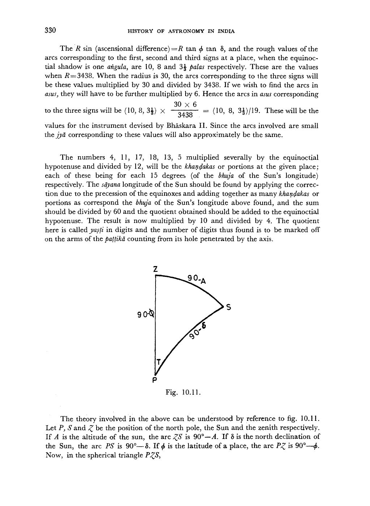

*Fig. 10.11.*

<!-- figure-resolved-page-render: page=23 image=media/p23_page.webp -->

<!-- figure-meta: page=23, position=middle, type=diagram -->

Fig. 10.11.
The theory involved in the above can be understood by reference to fig. 10.11. Let $P$, $S$ and $Z$ be the position of the north pole, the Sun and the zenith respectively. If $A$ is the altitude of the sun, the arc $ZS$ is $90^\circ-A$. If $\delta$ is the north declination of the Sun, the arc $PS$ is $90^\circ-\delta$. If $\phi$ is the latitude of a place, the arc $PZ$ is $90^\circ-\phi$. Now, in the spherical triangle $PZS$,

<!-- pdf-page: 24 -->

ASTRONOMICAL INSTRUMENTS 331

$$
\cos (90 - A) = \cos (90 - \delta) \cos (90 - \phi) + \sin (90 - \delta) \sin (90 - \phi) \cos T,

$$
$\text{or}\quad \sin A = \sin\delta\sin\phi + \cos\delta\cos\phi\cos T$,

$$
\text{or}\quad \cos T = \frac{\sin A - \sin\phi\sin\delta}{\cos\phi\cos\delta}

$$
where $T$ is the time to midday or from midday. If the Sun is in the southern hemisphere, $\delta$ is negative. Hence we have

$$
\begin{aligned}
R\cos T &= \frac{R\sin A}{\cos\phi\cos\delta} \mp R\tan\phi\tan\delta \\
&= \frac{R\sin A}{\cos\phi\cos\delta} \mp R\sin\text{ (ascensional difference)},
\end{aligned}

$$
according as the declination is north or south.
Now, $\frac{1}{\cos\phi} = \frac{h}{12}$, where $h$ is the equnoctial hypotenuse of gnomon of 12 *aṅgulas*.
Therefore

$$
\begin{aligned}
R\cos T &= \frac{h}{12}\cdot\frac{R\sin A}{\cos\delta} \mp \sin\text{ (ascensional difference)}, \\
&= y\sin A \mp R\sin\text{ (ascensional difference)},
\end{aligned}

$$
where $y = \frac{h}{12}\cdot\frac{R}{\cos\delta}$ and is called that *Yaṣṭi*
Now,

$$
\begin{aligned}
y = \frac{h}{12}\cdot\frac{R}{\cos\delta} &= \frac{R}{12}\cdot\frac{h}{12}\left(\frac{12}{\cos\delta}\right) = \frac{R}{12}\cdot\frac{h}{12}\left[12 + \frac{12(1-\cos\delta)}{\cos\delta}\right], \\
&= \frac{R}{12}\left[h + \frac{h}{12}\cdot\frac{12(1-\cos\delta)}{\cos\delta}\right].
\end{aligned}

$$
When the *bhuja* of the Sun's longitude is 15, 30, 45, 60, 75, 90, the value of $12(1-\cos\delta)/\cos\delta$ is 4, 15, 32, 50, 63, 68 sixtieths respectively. The differences of these values are 4, 11, 17, 18, 13, 5 which have been given above. On multiplying the differences by $h$, the equinoctial hypotenuse, and dividing by 12, the quotients found are called the *khaṇḍas* for the given place. By assuming the *bhuja* of the Sun's longitude as an argument, one has to find the result through the *khaṇḍas*. Let $r$ be this result. Then,

$$
\begin{aligned}
y &= \frac{R}{12}\left(h + \frac{r}{60}\right), \\
&= \frac{10}{4}\left(h + \frac{r}{60}\right),
\end{aligned}

$$
because in the instrument $R = 30$.

<!-- pdf-page: 25 -->

332 HISTORY OF ASTRONOMY IN INDIA
Thus,

$$
R\cos T = \frac{10}{4}\left(h + \frac{r}{60}\right)\sin A \mp R\sin\text{ (ascensional difference)}.

$$
It is evident that the value of the *yaṣṭi*, $y$ will always be greater than 30 because $h$ is always greater than 12 except at the equator where $h$ is equal to 12. At the equator the *Yaṣṭi* will be equal to 30 only if $\delta=0$. If on holding the instrument so that the rays of the Sun shall illuminate both its sides (to secure its being in a vertical plane), the shadow of the axis at $O$ cuts the circumference of the circle $a\ b\ c\ d$ in $s$, the angle $sob$ is equal to the angular height of the Sun.
Now the index arm is put on the axis and putting it over the place where the shadow cuts the circle and measuring along the index arm a length equal to the *yaṣṭi* found above, let $m$ be the point so obtained. Then,

$$
mn = y\sin A,

$$
if the place is at the equator, we have to find $T$ such that $R\cos T = mn$. Then $T$ gives the value of time in degrees to or after midday.
At any other place, the correction on account of the ascensional difference has to be applied. If the Sun is in the northern hemisphere $R\sin\text{ (ascensional difference)}$ has to be substracted from $mn$. Let the amount to be subtracted be $mr$. Then $R\cos T = lt'$ and the angle is given by the arc $Ct$. If the Sun is in the southern hemisphere, the amount $mr'$, the correction due to the ascensional difference, has to be added and $R\cos T = TT'$ and the angle is given by the arc $CT$.
Once a table of the values of the *yaṣṭi* and of the correction on account of the ascensional difference for the different *bhujas* of the Sun's longitude for a particular place has been constructed, the instrument will give the time very easily and quickly.

### THE KAPĀLA-YANTRA

The Kapāla-Yantra described by Varāhamihira and others is very different from the Kapāla-Yantra described by Āryabhaṭa and *Sūrya-siddhānta*, the latter being actually water instruments. This instrument is a hemisphere with a gnomon in the centre. The length of the gnomon is equal to the radius of the hemisphere so that the upper tip of the gnomon is at the centre of the hemisphere. It is placed on even ground and raised so that the elevation is equal to the latitude of the place and plane of its rim coincides with the plane determined by the east-west line and the direction of the north pole. Thus the gnomon points towards the point of intersection of the meridian circle and the celestial equator. The instrument may be made of metal or of good wood. At the centre of the hemisphere also cross two wires stretched between the east-west and north-south points of the rim.
On the rim the signs of the zodiac are marked in the reverse order. At the time of sun-rise the instrument is rotated so that the shadow of the gnomon falls on the sign in which the Sun is. As the sun rises the shadow of the gnomon point moves downwards from which the angular height of the Sun may be obtained. And thus the time since sun-rise can be calculated as well as the sign which is at the horizon at that instant may be obtained. This has already been discussed earlier.
<!-- /decode-chunk -->

<!-- decode-chunk: pages=26-29 source_sha256=ebed773d45d68fdc8677a09590d7f564d1feed634383bfb729409f626adb3425 -->
<!-- pdf-page: 26 -->

ASTRONOMICAL INSTRUMENTS 333

### THE NALAKA-YANTRA

This is a simple little tube formed generally of bamboo. Its use is only to verify the correctness of the computation of the shadow and *bhuja*. If the computation is wrong the planet will not be seen in the direction indicated by the values of the computed *bhuja* and *koṭi*. If the planet is in the east, the computed *koṭi* must be marked in the west, but if the planet is in the western hemisphere, it must be marked in the east. The *bhuja* is now marked in its own direction and the shadow is the hypotenuse of the right-angled triangle formed by the *koṭi* and the *bhuja*. A thread connecting the point of the intersection of the *bhuja* and the shadow to the top of the gnomon forms the *chāyākarṇa*. If now the tube is directed along the direction of the *chāyākarṇa*, the planet will be visible.
In actual practice the Nalaka-Yantra is mounted on two bamboo sticks, so that its lower end is at the height of the eye and it is pointing the direction of the *chāyākarṇa*. In the case of the Sun, one can actually observe the gnomon shadow or one can compute it knowing the declination etc. In the case of a planet, the shadow cannot be seen. But its *koṭi* and *bhuja* can be calculated from its computed position and its declination. The Nalaka-Yantra will then verify the correctness of the computation.
One can see the reflection of the planet in water. Since the angle of incidence is equal to the angle of reflection, the reflected light will be making the same angle with the surface of water but will be directed upwards in the plane of the incident ray. The Nalaka-Yantra will have thus to be directed downwards by the same amount as it was previously raised upwards while making the direct observations.

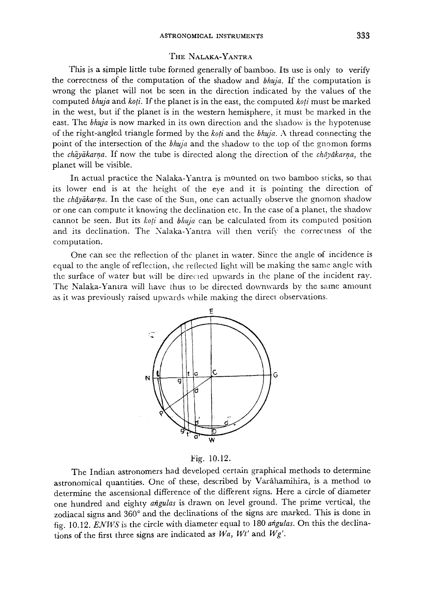

*Fig. 10.12.*

<!-- figure-resolved-page-render: page=26 image=media/p26_page.webp -->

<!-- figure-meta: page=26, position=middle, type=diagram -->

Fig. 10.12.
The Indian astronomers had developed certain graphical methods to determine astronomical quantities. One of these, described by Varāhamihira, is a method to determine the ascensional difference of the different signs. Here a circle of diameter one hundred and eighty *aṅgulas* is drawn on level ground. The prime vertical, the zodiacal signs and $360^\circ$ and the declinations of the signs are marked. This is done in fig. 10.12. $ENWS$ is the circle with diameter equal to $180$ *aṅgulas*. On this the declinations of the first three signs are indicated as $Wa$, $Wt'$ and $Wg'$.

<!-- pdf-page: 27 -->

334 HISTORY OF ASTRONOMY IN INDIA
Lines parallel to $EW$ are drawn through $a'$, $t'$ and $g'$ meeting the line $NS$ in $a$, $t$ and $g$ respectively. Then $aa'$, $tt'$ and $gg'$, are respectively the radius of the day circles when the Sun is at the end of the first three signs. With the same centre $C$, one has to draw these other circles with radii equal to $aa'$, $tt'$ and $gg'$ (only one of these with a radius equal to $aa'$ is drawn in the figure). One now cuts off the arc $NP$ equal to the latitude of the place and joins the line $CP$ which cuts $aa'$ in $d$.
Now we measure a chord $d'd''$ equal to twice $ad$. Then arc $d'd''$ is equal to twice the ascensional difference for the first sign. Since

$$\frac{ad}{ac} = \frac{Pl}{lc} = \frac{R \sin \phi}{R \cos \phi}$$

$ad = ac \tan \phi,$
$= R \sin \delta \tan \phi.$
This is what is known as the earth sine. If the angle subtended by the arc $d'd''$ at the centre is $2\theta$,

$$R \cos \delta \sin \theta = \frac{d'd''}{2} = R \sin \delta \tan \phi,$$

or $R \sin \theta = R \tan \delta \tan \phi$
which is the *cara-dala-jyā*. The corresponding angle is the right ascension. Similarly we can get the *vināḍikās* corresponding to Aries + Taurus and Aries + Taurus + Gemini from the intersection $CP$ with $tt'$ and $gg'$ respectively and the two circles with radii $tt'$ and $gg'$ which have not been drawn in fig. 10.12.

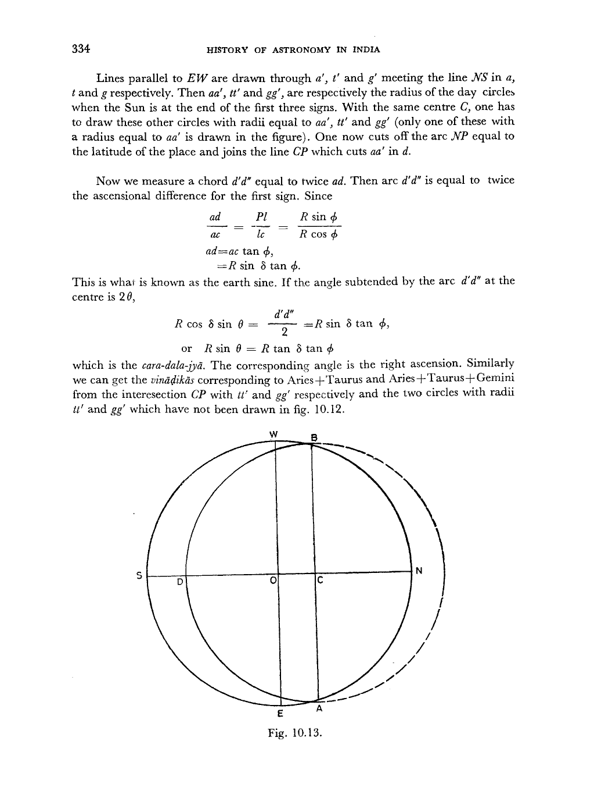

*Fig. 10.13.*

<!-- figure-resolved-page-render: page=27 image=media/p27_page.webp -->

<!-- figure-meta: page=27, position=bottom, type=diagram -->

Fig. 10.13.

<!-- pdf-page: 28 -->

ASTRONOMICAL INSTRUMENTS 335
Āryabhaṭa has described a Chāyā-Yantra shown in fig. 10.13. On level ground a circle $NWSE$ is drawn with Centre $O$ and radius equal to $57$ *aṅgulas* which is equal to the number of degrees in a radian. The north-south and east-west directions are drawn on it as explained before. The $R$ sines of the Sun's declination and the Sun's longitude are now determined from the hypotenuse of the shadow of the gnomon when the Sun is on the prime vertical or from the hypotenuse of the shadow when the Sun is in a mid-direction.
When the Sun is on the prime vertical, the shadow of the gnomon falls on the east-west line. The value of the *mahāśaṅku* when the Sun is on the prime vertical, i.e. the value of $OB$ in fig. 10.2., is given by the relation :

$$OB = \frac{12 R}{\text{hypotenuse when the Sun is on the prime vertical}}$$

$$= \frac{12 R}{K},$$

where $K = $ hypotenuse when the Sun is on the prime vertical.
Also from fig. 10.2, the $R$ sine of the declination of the Sun is given by $OA$ and $OA = OB \times \sin \phi$ where $\phi$ is the latitude of the place,
or $OA = OB \sin \phi$
The *agrā* $OU = \frac{OA}{\cos \phi},$
$= OB \tan \phi,$
$= \frac{12 R \tan \phi}{K}.$
knowing $R \sin \delta$, we can get the $R$ sine $\lambda = \frac{R \sin \delta}{\sin \epsilon}$ where $\epsilon$ is the obliquity of the ecliptic and $\lambda$ is the longitude of the Sun.
But when the Sun is in the southern hemisphere, it never crosses the prime vertical. Then the midday hypotenuse is given by

$$H = \frac{12}{\cos (\phi + \delta)}$$

where $H$ is the midday hypotenuse and $\delta$ is the southern declination of the Sun. From this $\delta$, *agrā* and $R$ sine of the longitude of the Sun can be determined.
The points $A$ and $B$ at the ends of the Sun's *agrā* are now laid off in the east and west in their proper direction and also $OC$ is equal to the Sun's *agrā*. $A$ is the point where the Sun rises in the east and $B$ is the point where the Sun sets in the west and $AB$ is the rising-setting line. With $C$ as centre and $CB$ as radius a circle $BDA$ is drawn which is the diurnal circle for the day.

<!-- pdf-page: 29 -->

336 HISTORY OF ASTRONOMY IN INDIA
The gnomon is now so placed at the end of each *ghatị* that the end of the shadow may lie at the centre $O$ of the circle. The point of the circle $BDA$ where the shadow cuts it corresponds to that particular *ghaṭi*. $BDA$ is thus marked in *ghaṭis* and the intervals between the *ghaṭis* are equally divided into six degrees. The Chāyā-yantra constructed in this way is used to determine the *ghaṭis* and degrees elapsed since sun-rise.
The same circle cannot be used to determine the time for different days and 365 different circles will have to be drawn for the 365 days of the year.
None of the instruments described by Indian astronomers before the time of Maharaja Jai Singh survive today. Perhaps they were made of perishable materials like wood and bamboo. Admittedly also they were not very sophisticated. But it must be remembered that mechanical clocks had not been devised upto that time and it was not possible to measure time very accurately.
<!-- /decode-chunk -->
