# Precision Instruments of Sawai Jai Singh

- Author Display: V N Sharma
- Year: 1991
- Journal Label: IJHS-26-1991-Issue-3
- Source Url: https://insa.nic.in/(S(eh1ucortlbqqezipwgliy3mn))/writereaddata/UpLoadedFiles/IJHS/Vol26_3_2_VNSharma.pdf

<!-- source: gemini page-chunk extraction -->

*Indian Journal of History of Science*, **26** (3), 1991

# PRECISION INSTRUMENTS OF SAWAI JAI SINGH

VIRENDARA NATH SHARMA
Department of Physics and Astronomy  
University of Wisconsin Center-Fox Valley  
Menasha, WI 54952-8002, USA
and
ANJANI K. MEHRA
Department of Physics  
University of Wisconsin-Green Bay  
Green Bay, WI 54311, USA
(Received 24 January, 1991)
Sawai Jai Singh, the astronomer king of eighteenth century India, unaware of the development of astronomical instruments in Europe, designed and built masonry instruments of varying degrees of precision. This paper analyzes Jai Singh's high precision instruments, namely, the *Samrāṭ*, *Ṣaṣṭhāṃśa*, and *Dakṣiṇottara Bhitti*, for the precision inherent in their design and achieved in their construction. The paper also investigates the precision achieved by Jai Singh and his European assistants as well as the precision one can obtain with them today.
This article shows that with the *Ṣaṣṭhāṃśa yantra* (instrument), Jai Singh and his coworkers obtained a precision within 1 arc minute, which is widely regarded as the limit for naked eye observations. His *Ṣaṣṭhāṃśa* of Jaipur is still capable of providing accuracies of this order. Finally, namely, the Great *Samrāṭ* of Jaipur and his *Ṣaṣṭhāṃśa yantra*, were optimally designed for generally accepted naked eye precision of 1 arc-minute.

## I. INTRODUCTION

The most widely known astronomical sites in the world are the observatories of Raja Swai Jai Singh (1688-1743) of India. The observatories with their monumental instruments, built in the early 18th century, have fascinated the scientist and layman alike for more than 250 years. What makes them fascinating is that they were built in a day and age when astronomy had ceased to be medieval, and great strides had been made in its development in Europe. Newton already had published in 1685 his *Principia* which provided a solid basis for the theoretical aspect of celestial mechanics. In 1656, Huygens invented the pendulum clock for accurate time keeping. John Flamsteed had published his celebrated catalog of stars with an unprecedented accuracy of $\pm 10''$ of arc. Micrometer and cross-wire fitted telescopes were a common sight in observatories.
Jai Singh, unaware of the developments in Europe, erected naked-eye instruments of masonry and stone in the tradition of medieval astromers such as Ulugh beg. Jai Singh's instruments still exist at Jaipur, Delhi, Varanasi, and Ujjain. They represent fine examples of the art of instrumentation in masonry and stone practiced in the medieval period. His instruments have been discussed in serious and popular literature alike, however, few have attempted any systematic investigation of them.
Jai Singh built his instruments with varying degree of precision ranging from low to high[^1]. The object of this paper is to evaluate his high precision instruments, namely, the *Samrāṭ*, *Ṣaṣṭhāṃśa* and *Dakṣiṇottara Bhitti*. The paper addresses following four basic questions about each instrument, although not necessarily in the same order:
1. What is the precision inherent in the design of an instrument?
2. How is this precision affected by practical consideration and by errors of construction?
3. What was the precision obtained by Jai Singh in his data collected with the instrument?
4. What kind of precision can one obtain with that instrument today?
Finally, the paper assesses Jai Singh as a designer of precision instruments.
Jai Singh built his *Ṣaṣṭhāṃśa yantras* at Delhi and Jaipur only, but he built *Samrāṭ* and *Dakṣiṇottara Bhitti yantras* at almost all of his observatories, as indicated in Table 1. Because the instruments built at Jaipur and Delhi had the highest precision, this paper will investigate these instruments only.

### Table 1. High Precision Instruments of Jai Singh.

| Instrument | Number | Location |
| :--- | :---: | :--- |
| 1. *Samrāṭ* (Equinoctial sundial) | 6 | Delhi, Jaipur (2), Ujjain, Varanasi (2) |
| 2. *Ṣaṣṭhāṃśa* (60 deg meridian chamber) | 5 | Delhi, Jaipur (4) |
| 3. *Dakṣiṇottara Bhitti* (Meridian dial) | 6 | Delhi, Jaipur, Ujjain Varanasi (2), Mathura |

## II. SAMRĀṬ YANTRA

A *Samrāṭ yantra* is an equinoctial sundial. Jai Singh turned this simple dial of the ancients into an instrument of great precision for measuring time, hour angle, and declination of a celestial object.

### 1. Principle

Fig. 1 illustrates a *Samrāṭ*'s principle. The instrument consists of a meridian wall ABC, in the shape of a right triangle, with its hypotenuse or the gnomon CA pointing toward the north celestial pole and its base BC horizontal along a north-south line. The angle ACB between the hypotenuse and the base equals the latitude of the place. Projecting upward from a point S near the base of the triangle are two quadrants $\text{SQ}_1$ and $\text{SQ}_2$ of radius DS, in a plane parallel to the equatorial plane. The center of the two "quadrant arcs" lies at point D on the hypotenuse. The length and radius of the quadrants are such that, if put together, they would form a semicircle in the plane of the equator.

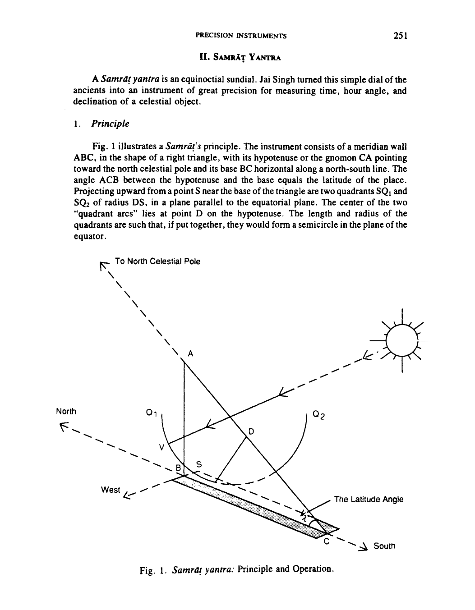

*Fig. 1. Samrāṭ yantra: Principle and Operation.*

<!-- figure-resolved-page-render: page=3 image=media/p03_page.webp -->

<!-- figure-meta: page=3, position=bottom, type=diagram -->

The quadrants are graduated into equal-length divisions of time measuring units, such as *ghaṭikās* and *palas* according to the Hindu system;[^2] or hours, minutes and seconds, according to the Western system. The upper two ends $\text{Q}_1$ and $\text{Q}_2$ of the quadrants indicate either the 15 *ghaṭikā* marks for the Hindu system, or the 6 a.m. and the 6 p.m. marks according to the Western system. The bottommost point of both quadrants, on the other hand, indicates the Zero *ghaṭikā* or 12 noon.
The hypotenuse or the gnomon edge AC is graduated to read the angle of declination. The declination scale is a tangential scale in which the division-lengths gradually increase in proportion to the tangent of the declination angle as illustrated[^3] in Fig. 2. The zero marking of this scale is at point D. Further, the gnomon scale AC is divided into two sections, such that the section DA reads the angle of declination to the north of the celestial equator, and the section DC to the south as illustrated in Fig. 2.

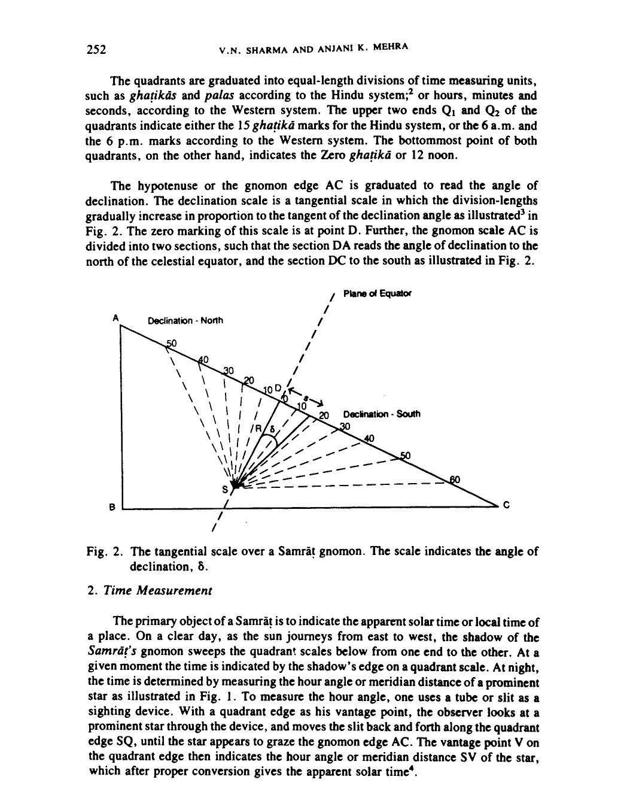

*Fig. 2. The tangential scale over a Samrāṭ gnomon. The scale indicates the angle of declination, $\delta$.*

<!-- figure-resolved-page-render: page=4 image=media/p04_page.webp -->

<!-- figure-meta: page=4, position=middle, type=diagram -->

### 2. Time Measurement

The primary object of a *Samrāṭ* is to indicate the apparent solar time or local time of a place. On a clear day, as the sun journeys from east to west, the shadow of the *Samrāṭ*'s gnomon sweeps the quadrant scales below from one end to the other. At a given moment the time is indicated by the shadow's edge on a quadrant scale. At night, the time is determined by measuring the hour angle or meridian distance of a prominent star as illustrated in Fig. 1. To measure the hour angle, one uses a tube or slit as a sighting device. With a quadrant edge as his vantage point, the observer looks at a prominent star through the device, and moves the slit back and forth along the quadrant edge SQ, until the star appears to graze the gnomon edge AC. The vantage point V on the quadrant edge then indicates the hour angle or meridian distance SV of the star, which after proper conversion gives the apparent solar time[^4].
Since a *samrāṭ*, like any other sundial, measures the local time or apparent solar time and not the "standard time" of a country, a correction has to be applied to its readings in order to obtain the standard time[^5].

### 3. Declination

For measuring the declination of the sun the observer moves a rod over the gnomon surface AC, up or down (Fig. 1) until the rod's shadow falls on a quadrant scale below. The location of the rod on the gnomon scale then gives the declination of the sun. The declination measurement of a star or a planet requires the collaboration of two observers. One observer stays near the quadrants below, and sighting the star through his sighting device, guides his assistant, who moves a rod up or down along the gnomon scale. This is done until the vantage point V on a quadrant edge below aligns with the gnomon edge above where the rod is placed and with the star. The location of the rod on the gnomon scale then indicates the declination of the object. In this exercise, a torch bearer may also be necessary to shine light on the rod on the gnomon edge so that the principal observer near the quadrants below may see it clearly.
In actual practice, a quadrants of the *Samrāṭ* are not thin arcs as illustrated in Fig. 1 but curved surfaces of finite width over thick walls and engraved with two parallel time measuring scales near their edges, (See Fig. 3.). With this arrangement time can be

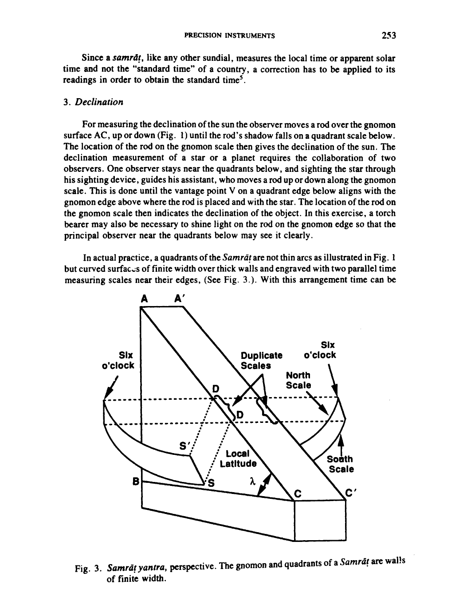

*Fig. 3. Samrāṭ yantra, perspective. The gnomon and quadrants of a Samrāṭ are walls of finite width.*

<!-- figure-resolved-page-render: page=5 image=media/p05_page.webp -->

<!-- figure-meta: page=5, position=bottom, type=diagram -->

[^1]: For Jai Singh's observatories and instruments see George R. Kaye, *The Astronomical Observatories of Jai Singh*, Archaeological Survey of India, 1918; reprint, 1981.

[^2]: A *ghaṭikā* equals 24 min and a *pala* 24 sec.

[^3]: The declination angle $\delta$ is given by the distance measured along the hypotenuse of the right triangle of the gnomon. For a given angle of declination $\delta$, the distance along the hypotenuse, measured from the zero marking, equals $R \tan \delta$, where $R$ is the radius of the quadrant and $\delta$ the declination.

[^4]: For the conversion, the observer has to find the right ascension of the star, and of the sun for that day from an ephemeris. Next, by adding or subtracting the difference between the two right ascensions, the apparent solar time is determined.

[^5]: The correction for the Indian Standard Time is as follows.  

The Indian Standard Time = Local Time $\pm$ Equation of Time $\pm$ Longitude difference  
The longitude difference is obtained by subtracting or adding the longitude of the place in time units to 5 hr 30 min East. The latter is the longitude for the Indian Standard Time in time-units. The longitude differences for Jaipur and Delhi converted into time units are $+ 26\text{ m } 43\text{ sec}$ and $+ 21\text{ min } 8\text{ sec}$ respectively. Elaborate tables for the Equation of Time are available in books such as the Indian Astronomical Ephemeris, published yearly, by the Govt. of India Press, Delhi.

measured by two observers simultaneously and then compared for accuracy. For measuring the declination of a star, the northern edge of quadrant is used if the star is to the south of the equator, and the southern edge if it is to the north. Further, because of the finite width of the quadrant surface, duplicate scales of length equal to the quadrant surface, duplicate scales of length equal to the quadrant-width become necessary on the gnomon surface above. These scales, as shown in Fig. 3, are engraved at the zero marking on the gnomon.

### 4. The Samrāṭs of Delhi and Jaipur

Jai Singh built his *Samrāṭs* in several sizes with varying degrees of accuracy. His smallest unit, with a least count of 1 minute, is located at Varanasi, whereas the largest, the Great *Samrāṭ*, almost ten times as big and having a least count of 2 sec, is at Jaipur. The Great *Samrāṭ* of Jaipur is the largest sundial in the world. The gnomon of this instrument consists of a 2.35 m wide and 22.62 m high triangular wall with a 44.58-meter base, and a 50.09 m long hypotenuse. The quadrants on either side of the gnomon have a radius of $15.15 \pm 0.01\text{ m}$ and are 2.84 m wide.
The instrument of Delhi is the second largest *Samrāṭ* of Jai Singh. It has a base length of 34.59 m, a hypotenuse of 39.2 m and a quadrant radius of 15.1 m. The least count of the instrument is 2 sec in time or the same as that of the Jaipur instrument and the average length of a division 2.2 mm. Unfortunately, the instrument currently is in bad shape and needs extensive restoration (Photograph 1).

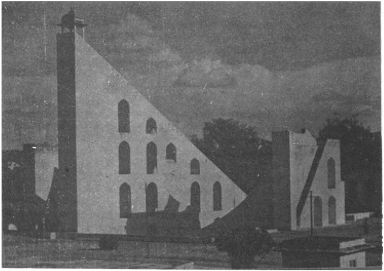

*Photo 1. The Great Samrāṭ of Jaipur. A pair of Ṣaṣṭhāṃśas are located in an enclosed chamber attached to the west quadrant of the Samrāṭ on the right.*

<!-- figure-resolved-extracted: page=6 image=media/p06_fig01.webp -->

<!-- figure-meta: page=6, position=bottom, type=photograph -->

## 5. Design, Construction and Precision

The precision or accuracy of a *Samrāṭ* depends on a number of factors some of which are inherent in its design and others that depend on the care taken in construction.

### 5.1 Precision in the Measurement of Time

#### 5.1.1 The Penumbra

The first and foremost factor affecting the precision of time measurements, and which is inherent in the very design of the instrument, is the width of penumbra. For large *Samrāṭs*, such as those in Delhi and Jaipur, it could be several centimeters wide. The sun, because of the finite width of its disc, casts a diffused shadow of objects. As a result, pinpointing the location of the shadow-edge becomes difficult as well as a subjective matter. The penumbra at the Great *Samrāṭ* of Jaipur, at mid-morning on a clear day, can be as wide as 3 cm or more, making it difficult to read time with accuracies better than $\pm 15\text{ seconds}$. However, when the sun is strong, the difficulty may be eliminated, and the procedure of measuring time made objective by superimposing on the penumbra the shadow of thin object. We discovered that using a needle or a string can be quite effective. By holding a taut string parallel to the shadow edge, about a cm or so above the instrument surface, and reading the scale where the string's shadow merges with the shadow of the gnomon edge, we could repeat our readings with an accuracy of $\pm 3\text{ sec}$ or better[^6]. We believe that the astronomers of Jai Singh must have used some device similar to that of the string for overcoming the problem of the penumbra[^7].

#### 5.1.2 Penumbra and the quadrants

Another source of inaccuracy directly attributed to the penumbra is the fact that the two quadrants of the instrument indicate time that differs from the true local time. The west quadrant of the instrument of Jaipur, for instance, read in the morning hours, indicates time ahead of the true local time, whereas the east quadrant indicates time behind the true local time. In other words, a *Samrāṭ* clock runs fast in the morning and slow in the afternoon.

#### 5.1.3 Penumbra and noon-hour

The penumbra effect, just discussed, becomes quite evident and at the same time perplexing when one observes the noon hour at the quadrants. Theoretically, at the noon hour, the shadow of the gnomon, disappearing from the west quadrant must reappear immediately on the east quadrant. However, in actual practice this does not occur. At the Great *Samrāṭ* of Jaipur, the shadow after disappearing from the west quadrant, takes about 80 sec to reappear on the east[^8].
The lapse of 80 seconds or so the shadow takes to travel from one side to the other and the discrepancy of time-readings at the two quadrant-scales may be understood as follows: The width of the penumbra in mid January produced by the entire disc of the sun should be as wide as the disc of the sun, which is 1/2 degree (See Fig. 4). A one-half degree wide penumbra would be about 14.3 cm across at the Great *Samrāṭ* of Jaipur;[^9] and, ideally, the midpoint of this penumbra, corresponding to the midpoint of the sun, should indicate the true local time. However, the visible part of the penumbra in midmorning, say, around 10 o'clock, is only about 3 cm wide. It is not produced by the entire disc of the sun but a part of it or, more precisely, by its western 1/5 part only[^10]. Any point selected in this 3-cm wide region, as a result, does not correspond to the midpoint of the sun and, therefore, does not indicate the true local time. The point that we selected, while reading time with a string in the morning hours, corresponds to a point somewhere within the one-fifth of the disc measured from the sun's western edge. As a consequence, the time readings of the western quadrant are always ahead of true local time. In the afternoon the situation becomes quite the reverse. In the afternoon, the visible penumbra is cast by the eastern 1/5 of the disc, and then any point within it, selected as the edge of the shadow to indicate the time is behind the true local time.

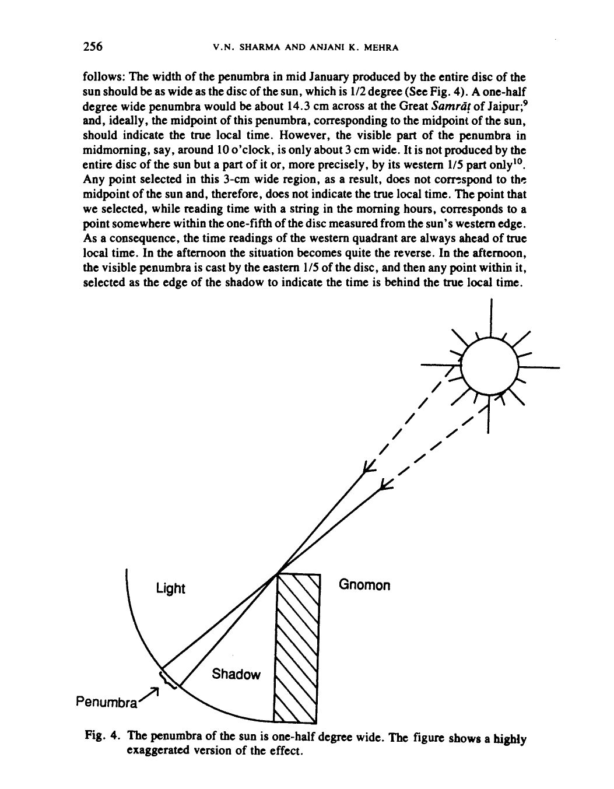

*Fig. 4. The penumbra of the sun is one-half degree wide. The figure shows a highly exaggerated version of the effect.*

<!-- figure-resolved-page-render: page=8 image=media/p08_page.webp reason=no-extracted-figure -->

<!-- figure-meta: page=8, position=bottom, type=diagram -->

The discrepancy regarding the noon hour arises due to this penumbral effect. As pointed out above, the visible-penumbra marking the edge of the shadow is cast by 1/5 disc of the sun. The edge of the shadow from the west quadrant disappears as soon as a little over 1/5 of the sun's disc crosses the meridian, (See Fig. 5a.). The shadow-edge or the visible-penumbra on the eastern quadrant is cast, on the other hand, by the eastern 1/5 of the disc of the sun. This edge appears on the east quadrant when most of the sun has crossed the meridian, and only its eastern 1/5 remains behind, (See Fig. 5b). In other words, no shadow appears on the east quadrant until the 3/5 disc of the sun, around its midpoint, has crossed the meridian, which takes about 72 seconds. The time lag thus calculated comes close to our observation of 80 seconds which is in reasonable agreement in view of the various uncertainties in the measurement of time intervals.

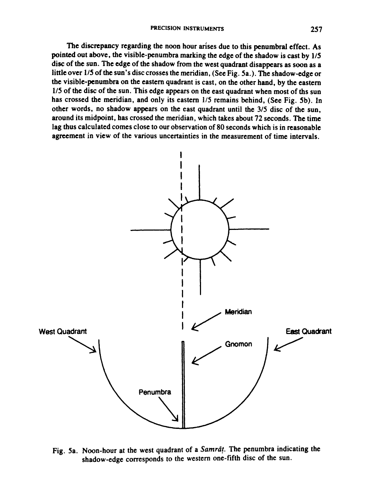

*Fig. 5a. Noon-hour at the west quadrant of a Samrāṭ. The penumbra indicating the shadow-edge corresponds to the western one-fifth disc of the sun.*

<!-- figure-resolved-page-render: page=9 image=media/p09_page.webp reason=no-extracted-figure -->

<!-- figure-meta: page=9, position=bottom, type=diagram -->

It should be emphasized that the errors arising from penumbra can be eliminated by applying proper corrections. It is not known, however, if Jai Singh's astronomers applied any such corrections to their data.

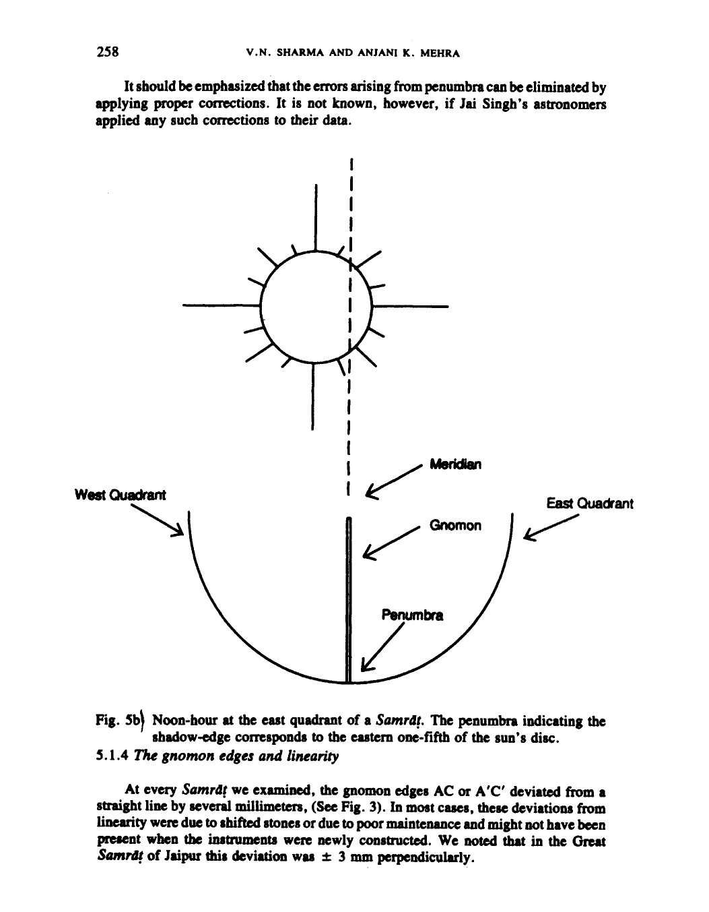

*Fig. 5b. Noon-hour at the east quadrant of a Samrāṭ. The penumbra indicating the shadow-edge corresponds to the eastern one-fifth of the sun's disc.*

<!-- figure-resolved-page-render: page=10 image=media/p10_page.webp reason=no-extracted-figure -->

<!-- figure-meta: page=10, position=middle, type=diagram -->

#### 5.1.4 The gnomon edges and linearity

At every *Samrāṭ* we examined, the gnomon edges AC or A′C′ deviated from a straight line by several millimeters, (See Fig. 3). In most cases, these deviations from linearity were due to shifted stones or due to poor maintenance and might not have been present when the instruments were newly constructed. We noted that in the Great *Samrāṭ* of Jaipur this deviation was $\pm 3\text{ mm}$ perpendicularly.

[^6]: Blanpied, basing his criticism on the problem of penumbra encountered in reading time, concludes that the large *Samrāṭs* of Jai Singh are over-designed and their subdivisions exceed the intrinsic precision of the instrument. However, as we have indicated, the problem can be easily eliminated with a string. Blanpied, William A., "Raja Sawi Jai Singh II: An 18th Century Medieval Astronomer," *Am. J. Physics*, Vol. 43, no. 12, 1025-1035, (1975).

[^7]: At the observatory of Jaipur, the authors saw an experienced guide achieving almost similar results with the tip of his index finger.

[^8]: The large *Samrāṭ* of Varanasi appears to be an exception to the "delay of the shadow" effect and needs to be investigated further. At that *Samrāṭ*, at noon hour, the shadow on the east quadrant can be seen almost 2 min before it disappears from the west quadrant.

[^9]: As the disc of the sun in mid January is 0;32,35 of arc, its shadow should be $[(0;32,35)/30^{\prime\prime}] \times 2.2\text{ mm}$ or 14.3 cm wide. The average length of a small division measuring $30^{\prime\prime}$ of arc on the quadrant scale is 2.2 mm.

[^10]: A 3-cm penumbra corresponds to approximately one-fifth of the angular diameter of the sun which measures 14.3 cm on the quadrant scale.

With reference to Fig. 6, let ABC represent the true edge of the gnomon and let A'B'B repesent the actual edge. Further, let BB', or the distance S, representing the linear deviation from the true edge, make an angle $\phi$ with the vertical. Let the rays of the sun be incident at an angle $\theta$ with the vertical. If the solar rays are displaced by a distance d, due to the deviation, then $\text{d} = \text{S}\sin(\theta + \phi)$. Hence the error arising from the nonlinearity changes continuously as the angle $(\theta + \phi)$ changes during the course of a day. Or the error varies as the shadow of the gnomon travels from one end of a quadrant to the other during the hours of observation. It is maximum when the rays fall perpendicularly to BB', or when the sun of the two angles $\theta$ and $\phi$ equals 90 deg.

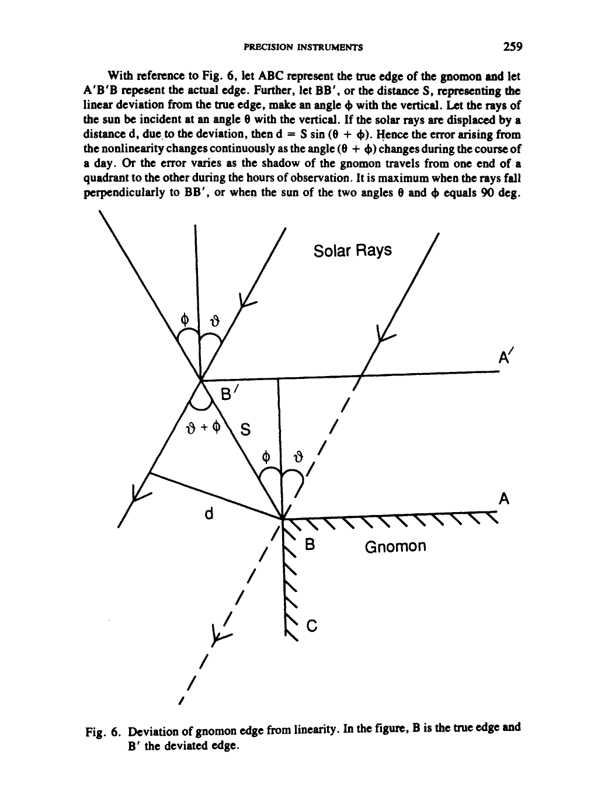

*Fig. 6. Deviation of gnomon edge from linearity. In the figure, B is the true edge and B' the deviated edge.*

<!-- figure-resolved-page-render: page=11 image=media/p11_page.webp -->

<!-- figure-meta: page=11, position=middle, type=diagram -->

Similarly, the error is $\text{S}\sin\phi$ at the noon hour and $\text{S}\cos\phi$ at 6 o'clock. Further, if the gnomon deviates from one point to the other along its entire length, the error will change from one day to the other as the declination of the sun changes with seasons. The maximum error due to this effect at the Great *Samrāṭ* of Jaipur would be nearly 4 sec at sunrise or sunset. A rectification of the nonlinearity error would require elaborate calibration curves, one curve for each day of the sun's journey from one solstice to the other.

### 5.1.5 *The 6 o'clock marks and the gnomon plane*

Another defect that we noted concerns the line joining the 6 o'clock marks on either side of the gnomon wall (See Fig. 3). We noted that, in a number of instruments, contrary to the requirement of the theory of the instrument, the line was non-tangential to the scales on the gnomon surface. At the Delhi *Samrāṭ*, the line was observed about 3-4 cm above the surface of the scales. There could be two reasons for this defect. One, either the quadrant markings of these instruments have been inaccurately done, or the surfaces with scales do not have proper elevation. At the Delhi *Samrāṭ*, the defect should cause errors of the order of 27 to 36 sec in time readings around 6 o'clock[^11].
We did not notice this defect at the Great *Samrāṭ* of Jaipur, however. There, the plane of the gnomon does not lie below the line joining the two 6 o' clock marks.

### 5.1.6 *The gnomon and the polar axis*

With reference to Fig. 7, let $\Delta\theta$ be the deviation of the gnomon from the polar axis, and let y be the linear distance of a point indicating the declination of a celestial object such as the sun, on the gnomon scale. The distance y is measured from the bottom of the scale. As a result of the deviation $\Delta\theta$, the error in the measurement of declination should also be $\Delta\theta$. One would not observe any error in his time-readings at noon, when the rays of the sun are tangential to the gnomon wall. However, at 6 o'clock the shadow of the gnomon would register a shift of $\Delta\text{s} = \text{y}\Delta\theta$ on the quadrant scale. The error due to this shift would be dependent on the declination of the sun as the equation indicates.
Lieutenant A. ff. Garrett, who supervised the restoration of the Jaipur observatory, writes that the gnomon of the Great *Samrāṭ* there deviates less than 1' of arc from the polar axis[^12]. At the Great *Samrāṭ* of Jaipur, a 1 arc-minute deviation, will contribute to an error of about 7 sec in time-readings taken around 6 o'clock at the time of equinox[^13]. The declination readings will have an error of 1 arc-minute, and they will be independent of the time of measurement.

### 5.1.7 *The radius of curvature of the quadrants*

We also investigated the error caused by variations in the radius of curvature of a quadrant from one place to the other. We noted that such deviation at the Great *Samrāṭ*, which has a radius of 15.15 m, is less than 1 cm. We found that the error caused in time measurement by such small variations would be negligible[^14].

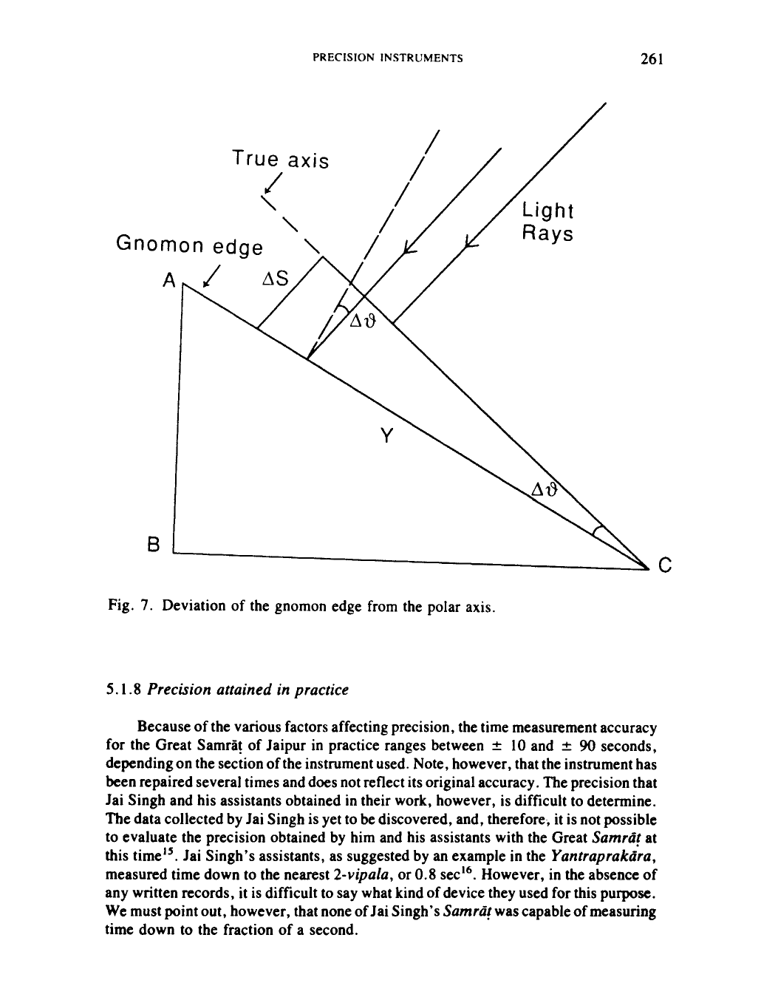

*Fig. 7. Deviation of the gnomon edge from the polar axis.*

<!-- figure-resolved-page-render: page=13 image=media/p13_page.webp -->

<!-- figure-meta: page=13, position=top, type=diagram -->

### 5.1.8 *Precision attained in practice*

Because of the various factors affecting precision, the time measurement accuracy for the Great *Samrāṭ* of Jaipur in practice ranges between $\pm$ 10 and $\pm$ 90 seconds, depending on the section of the instrument used. Note, however, that the instrument has been repaired several times and does not reflect its original accuracy. The precision that Jai Singh and his assistants obtained in their work, however, is difficult to determine. The data collected by Jai Singh is yet to be discovered, and, therefore, it is not possible to evaluate the precision obtained by him and his assistants with the Great *Samrāṭ* at this time[^15]. Jai Singh's assistants, as suggested by an example in the *Yantraprakāra*, measured time down to the nearest 2-vipala, or 0.8 sec[^16]. However, in the absence of any written records, it is difficult to say what kind of device they used for this purpose. We must point out, however, that none of Jai Singh's *Samrāṭ* was capable of measuring time down to the fraction of a second.

## 5.2 *Precision in the measurement of declination*

### 5.2.1 *Graduations on the Gnomon*

The precision of a *Samrāṭ*'s declination measurements depends on the graduations on its gnomon scale. Referring to Fig. 2, the declination angle $\delta$ is measured as the length S along the gnomon edge. Since $\text{S} = \text{R}\tan\delta$, the uncertainty $\Delta\text{s} = \sec^2\delta\ \Delta\delta$. At equinox when the rays of the sun are perpendicular to the gnomon, and $\delta$ is zero, and the uncertainty $\Delta\text{s} = \text{R}\ \Delta\delta$. For measurements with the unaided eye, the uncertainty $\Delta\delta$ equals 1' of arc or $2.9 \times 10^{-4}\text{ rad}$. Taking $\text{R} = 15.15\text{ m}$, the uncertainty in length $\Delta\delta$ equals 0.44 cm. The uncertainty increases with $\sec^2\delta$, and thus at 53 deg, the uncertainty is 1.21 cm[^17].
At the Great *Samrāṭ* of Jaipur, the division-length for one arc-minute at the zero point of gnomon scale is about 4 mm, whereas the division-length at 53 deg is 1.2 cm. Hence, division-length of the Great *Samrāṭ*'s gnomon are compatible with the uncertainty of naked eye observations.

### 5.2.2 *The quadrant-plane and the equatorial plane*

According to the theory of the instrument, the plane in which the quadrants are built should be parallel to the equatorial plane. If this is not the case, the horizontal line joining the two 6 o'clock marks on the quadrants on either side of the gnomon may not pass through the zero markings of the declination scale on the gnomon, (See Fig. 3.). This horizontal line would then be either to the north or to the south of the zero markings on the gnomon scale. This mismatch allows us to calculate the deviation of the quadrant plane from the true equatorial plane. An estimation of this deviations is described below.
Referring to Fig. 8, let the light from a point source such as a star fall on point P of the quadrant scale. Let $\phi$ be the hour angle of the star. Let $\omega$ be the angular separation between the equatorial plane and the plane of the quadrant. Let $\Delta\text{s}$ be the linear separation between the two planes at P. If r is the perpendicular distance of point P from the horizontal line passing through the lower end of the quadrant, then as a first order approximation, $\Delta\text{s} = \text{r}\omega$. The linear separation $\Delta\text{s}$ will show up as an error in the measurement of declination. For an object on the equator, such as the sun at equinox, the value of r is equal to $(\text{R} - \text{R}\cos\phi)$ where R is the radius of the quadrant. Therefore, $\Delta\text{s}$ would be largest for objects at the horizon for which $\phi = 90\text{ deg}$. Under these conditions, the error $\Delta\text{s}$, becomes equal to $\text{R}\omega$. This shows up as a shift of the zero markings of the declination either to the north or to the south of the line joining the two 6 o' clock marks. By measuring this shift, the angle $\omega$ (equal to $\Delta\text{s}/\text{R}$) can be determined.
At the Great *Samrāṭ* of Jaipur, the zero of the declination scale of the gnomon corresponding to the west quadrant was noted to be shifted by about 3 cm toward the south. This suggests that the quadrant plane deviates from the true equatorial plane by 3 cm/15.15 m = 8 arc-minute. The corresponding numbers for the east quadrant are 5 cm to the south and 13' of arc. We have noted defects of this kind and magnitude in almost all of the *Samrāṭ* we have examined.

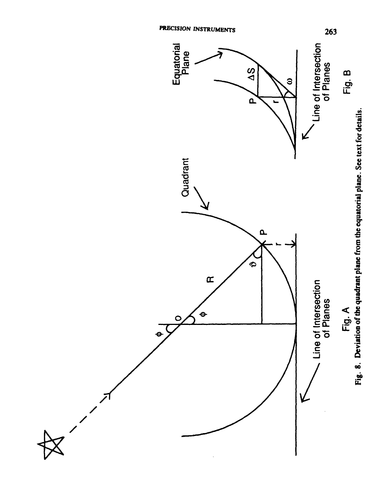

*Fig. A / Fig. B: Deviation of the quadrant plane from the equatorial plane. See text for details.*

<!-- figure-resolved-page-render: page=15 image=media/p15_page.webp -->

<!-- figure-meta: page=15, position=middle, type=diagram -->

### 5.2.3 Declination of the Sun

The measurement of the declination of the sun presents another difficulty. As pointed out earlier, the declination of the sun is measured by holding a rod over the gnomon scale in such a way that its shadow falls on a quadrant edge below. Because of the great distance of the gnomon scale from the quadrants, the shadow is often so weak that it is very easy, particularly, for an inexperienced observer, to miss it completely or to misjudge its midpoint. The problem becomes serious when the sun is near an equinox, and its declination is measured by that section of the gnomon scale where divisions are only 4 to 5 mm apart.
The difficulty may be overcome if the observer, with his vantage point at the quadrant edge, looks directly at the sun through a smoked glass or some such device to filter out the harmful rays of the sun. Looking through the filter, the observer aligns a pencil-thin rod, which is held by an assistant at the edge of the gnomon, with the center of the sun, or better still, with the lower edge of the sun. Using this procedure we took several readings with the Great *Samrāt* of Jaipur[^18].
On 25 December 1981, we measured the declination (south) of the sun at 1:37 p.m. and found it to be $23;23 \pm 1'\text{S}$, which after a refraction correction of $\pm 1'$, became $23;24 \pm 1'$. The computed value of the declination for the day was $23;24$. We repeated our observations the same day, two hours later at 3:31 p.m. and found that the declination readings after refraction correction came out to be $23;22 \pm 1'$. Eight years later, when one of the authors revisited the observatory on 1 January, 1990, he observed the declination of the sun once again. The declination measured that afternoon between 1:30 and 1:37 came out to be $23;2,30 \pm 75$. The expected value for the day was $23;3,41$. Hence, at least, the sections of the Great *Samrāt*’s declination scale checked by the authors still maintain the intended accuracy of $\pm 1'$ of arc.

### 5.2.4 Effect of the Deviations on Precision

Because of the defects and deviations noted by us at the Great *Samrāt*, the accuracies in the measurement of declination can be anywhere from $\pm 1'$ to $\pm 15'$ of arc depending on the time and circumstances of the measurement. Maximum uncertainties would be encountered for objects which are close to the horizon. It is difficult to ascertain if the defects elaborated above were present in the original construction or are the results of the numerous repairs the instrument has undergone from time to time in the past. Garrett reports seeing two scales superimposed upon each other on the gnomon of the Great *Samrāt* of Jaipur, indicating that some errors were indeed made original and rectified later on[^19].
To check the current accuracy of the declination scales of the Great *Samrāt* fc night-time observations, we measured the declination of a number of winter stars. In the following table the declination angles for three winter stars are given.

### Table 2. Declination of three winter stars. The measured readings represent an average of 5 readings taken on an evening of January 1982[^20]. The readings are without refraction correction, which falls within the error of observation.

| Star | Measured Declination | Declination from Ephemeris |
| :--- | :--- | :--- |
| Sirius | $-16;44 \pm 0;3$ | $-16;41$ |
| Rigel | $-\phantom{0}8;19 \pm 0;1$ | $-\phantom{0}8;13$ |
| Capella | $\phantom{-}45;57 \pm 0;1$ | $\phantom{-}45;59$ |

## III. ṢAṢṬHĀṂŚA YANTRA

### 1. Principle

A *Ṣaṣṭhāṃśa Yantra* is a 60-deg arc built in the plane of meridian within a dark chamber. The instrument is used for measuring the declination, zenith distance and diameter of the sun. Fig. 9 explains the principle of its operation. The figure represents

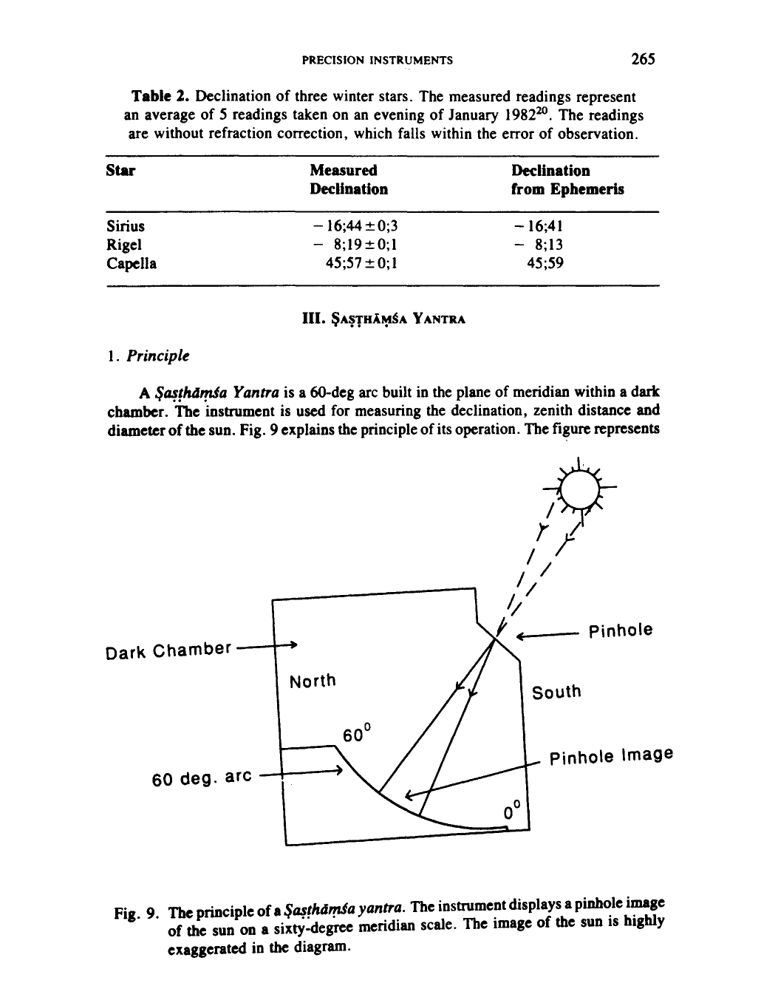

*Fig. 9. The principle of a *Ṣaṣṭhāṃśa yantra*. The instrument displays a pinhole image of the sun on a sixty-degree meridian scale. The image of the sun is highly exaggerated in the diagram.*

<!-- figure-resolved-page-render: page=17 image=media/p17_page.webp -->

<!-- figure-meta: page=17, position=bottom, type=diagram -->

a dark chamber with a 60-degree arc facing south. The arc is divided into degrees and minutes for measuring the zenith angle and declination. High above the arc, at its center on the south wall, is a pinhole to let the sunlight in. As the sun drifts across the meridian at the noon hour, its pinhole image falling on the *Ṣaṣṭhāṃśa* scale below, enables the observer to measure the zenith distance, declination and the diameter of the sun. The image formed on the scale below is usually quite sharp, such that even sunspots may be seen on it usually quite sharp, such that even sunspots may be seen on it at times. Jai Singh built his *Ṣaṣṭhāṃśa yantras* at Delhi and Jaipur only. At Jaipur, there are four units of the *Ṣaṣṭhāṃśa*. They have been built in the lofty chambers flanking the Great *Samrāt* and are in an excellent state of preservation. The instrument was restored in the 1950's and its scales were inscribed in marble. The units are identical and have a radius of about $8.65\text{ m}$ and a least count of $1'$ of arc. The division indicating $1'$ were measured to be $2.53\text{ mm}$ in width on the average.

### 2. Precision

### 2.1 Deviation from Meridian Plane

The four units of *Ṣaṣṭhāṃśa* at Jaipur have two scales each parallel to one another and separated by a distance of $7.5\text{ cm}$ — one measuring declination and the other the zenith distance. A single pinhole serves them both. In the unit we examined closely, the pinhole above the instrument and the scale below do not lie in the plane of the meridian of either two scales. The pinhole lies $15\text{ mm}$ to the east of the vertical plane of the declination scale. However, the error due to this shift should be negligible in the measurements[^21].

### 3. The Pinhole

### 3.1 Aperture broadening

The pinhole of the Jaipur instrument has a diameter of $3.8\text{ mm}$[^22]. Because of this width of the pinhole, the true image of the sun should be surrounded by a halo of light one-half as wide[^23]. Theoretically, the sharpness of the image should taper off to zero at a distance of one-half of $3.8\text{ mm}$, or $1.9\text{ mm}$, from the edge of the true image. However, in actual practice, it is virtually impossible to pinpoint the edge of the true image or to pinpoint the end of the aperture broadening. Therefore, the uncertainty in the readings of the angle of declination at the Jaipur *Ṣaṣṭhāṃśa* is $1.9\text{ mm}$ or nearly $3/4$ of an arc-minute[^24].

### 3.2 Diffraction broadening

Along with the aperture broadening, the image of the sun is also affected by the diffraction phenomenon at the pinhole edges. The diffraction effect begins to predominate if the size of the pinhole is reduced beyond a certain limit in order to minimize the aperture broadening. Because of diffraction, the first minimum of the diffracted image would lie at a certain angle, say, $\theta$ from the edge.
The angle $\theta$ is given by the relation, $\theta = 1.22\ \lambda / d$, where $\lambda$ is the mean wavelength of light and $d$ is the diameter of the hole[^25]. For a $3.8\text{ mm}$ wide hole, and for the mean visible length $\lambda$ of $560\text{ nm}$, the angle $\theta$ equals $0.6'$ of arc. The image of the sun, in other words, is broadened by a total of $1.2\text{ arc-minute}$. For optimum results, the aperture broadening and the diffraction broadening should be equal. It is interesting to note that the two broadenings are nearly equal at the Jaipur *Ṣaṣṭhāṃśa*.
Although the penumbra and the diffraction broadenings will lead to erroneous results regarding the diameter of the sun, they should cause relatively small error in declination measurements, provided one chooses two equally bright points to mark the ends of the image on either side and then takes their midpoint as the midpoint of the sun.

### 3.3 Precision of the Jaipur Ṣaṣṭhāṃśa at present

The *Ṣaṣṭhāṃśa* of Jaipur is Jai Singh's most accurate instrument that still maintains the precision inherent in its design[^26]. The *Ṣaṣṭhāṃśa* can measure the Zenith distance of declination with an accuracy of $\pm 1'$ of arc. For example, we measured the declination of the meridian sun on December 22, 1981, as $23;26 \pm 1'$[^27]. This result compares well with the calculated value of $23;26,20$ for the day. The fact that there is more than one *Ṣaṣṭhāṃśa* built at Jaipur suggests that Jai Singh thought very highly of the instrument just as Ulugh Beg had almost 300 years before him.

### 4. The Ṣaṣṭhāṃśa of Delhi

The *Ṣaṣṭhāṃśa yantra* of Delhi is located within an 8-meter high, 5 meters long, and only about $2\text{ m}$ or so wide chamber against which the east quadrant of the *Samrāt* rests. The chamber is now closed on three sides but has an arched opening facing the *Samrāt* gnomon to the west[^28]. The instrument is now in ruins and only its masonry work survives. From the masonry structure, the radius of the arc is estimated to be $8.25\text{ m}$, and from this its 1 arc-minute division are calculated to be $2.4\text{ mm}$ in width. At the ceiling of the chamber, toward the south, there is an opening, 1 to $1.25\text{ m}$ long and about a third of a meter wide. Until recently, the instrument could only be approached by wading through water collected around the *Ṣaṣṭhāṃśa* base[^29]. Bhavan says that the instrument was not restored in 1909 because the engineers encountered a water seepage problem similar to the one plaguing the *Samrāt* now. Suggestions were made, however, to rebuild the instrument above the water table but were never implemented[^30].
There are reasons to believe that, in its original state, the Delhi *Ṣaṣṭhāṃśa* was an extermely accurate instrument. It approached or surpassed the limit of naked-eye observations, which is generally accepted, as pointed out earlier, to be 1 minute or arc[^31]. The readings taken with this instrument have been reported by Jagannātha Samrāt: "On *Caitra kṛṣṇa* 6, 1786 V.S., the zenith distance of the midday sun measured with the *Vṛttaṣaṣṭhāṃśa* (*Ṣaṣṭhāṃśa yantra*) was 28;44,30."[^32]. Table 2 shows Jagannātha's readings[^33]. A comparison of Jagannātha's readings with our computer-generated results indicates that the instrument had been accurate within $\pm 1'$ of arc[^34].

### Table 3. The zenith distance readings of Jagannātha Samrāt compared with the computer-generated results.

| Date | Jagannātha's Data | Data with Refraction Correction | Computer Results | Difference |
| :--- | :--- | :--- | :--- | :--- |
| 20,3,1729 | 28;44,30 | 28;45,00 | 28;45,33 | $+33''$ |
| 3,6,1729 | 6;18 | 6;18,6 | 6;17,34 | $-32''$ |
| 23,9,1729 | 28;40 | 28;41,14 | 28;41,28 | $+14''$ |

### 5. Boudier's Data

Claude Boudier, a French Jesuit who visited the observatory at the invitation of Jai Singh, used the Delhi *Ṣaṣṭhāṃśa* to measure the Zenith distance and diameter of the sun. Boudier was stationed at a Jesuit mission at Chandernagore, Bengal, and was conducting his own observations of the sun at that time. With an invitation from Jai Singh, he came over to assist Jai Singh in his astronomical undertakings. Leaving Chandernagore in January 1734, Boudier and his fellow priest, Father Pons, reached Delhi sometime in late April or early May. There they joined the observatory staff in observing a solar eclipse which took place on May 3, 1734, a few days after their arrival.
Boudier stayed on in Delhi for a few days and observed the sun before leaving for Jaipur, his final destination. Although Boudier calls the instrument he used a "gnomon", there is little doubt that he is referring to the *Ṣaṣṭhāṃśa* only and not to a *Samrāt* or some other sundial. He says, "The copper plate, in which is located the aperture of the gnomon, is placed parallel to the polar axis. The rays of the sun fall on the concave surface of the quadrant whose radius is about 26 (Paris) feet (8.44 m)"[^35]. The quadrant is graduated in minutes; the chord of 30 minutes is 522 parts, of which the diameter of the aperture is $32$[^36]. The image of the sun was without penumbra, at least as far as one could perceive, so that it was easy to measure it exactly."[^37] In Table 4, Boudier's data is compared with our computer-generated results.
Boudier's data regarding the diameter of the sun in Table 4 was gathered with a specially engraved plate of copper imported from Europe[^38]. Boudier, apparently, had used this plate for observing the sun at Chandernagore also[^39]. "The plate, made by the (French) king's engineer for mathematical instruments, Sr. Bion, had 960 divisions, equivalent to the five inches of a Paris foot," he wrote in one of his letters to Europe[^40]. In this plate, one division equalled approximately $0.13\text{ mm}$[^41],[^42].

[^18]: For a filter, the author used an exposed black and white photographic film.

[^19]: Garrett, *Op. Cit.*, p. 2.

[^20]: The measured readings should be considered merely an illustration of an example. The authors believe that an accomplished observer can obtain readings closer to the accepted results than obtained by one of the authors and his assistant.

[^21]: The declination angle $\delta$ is related to the angle of azimuth by the following relation. $\sin \delta = \sin \lambda \cos Z + \cos \lambda \sin Z \cos A$, where $Z = \text{zenith distance}$, $\lambda = \text{latitude}$, and $A = \text{azimuth}$. At equinox, declination $\delta = 0$, and for the latitude of Jaipur, which is $27\text{ deg}$, the zenith distance is equal to $27\text{ deg}$. For a $1/2\text{ deg}$ deviation from the true meridian plane, i.e., for $\delta A$ equal to $0.5\text{ deg}$, the variation in $\delta$, the declination, is found to be about $0.1\text{ arc-minute}$ with a computer. On the other hand, at winter solstice, the same would be $0.2\text{ arc-minute}$.

[^22]: This plate with a circular aperture was put in 1902. Garrett says that he had found a different plate with a square aperture at the site which he replaced with the present one. (See Garrett, *op. cit.*, p. 37.) It is not certain when the plate with a square aperture was put in, because Jai Singh did not recommend a square aperture as such. See *Yantraprakāra*, p. 17, *Op. Cit.* Also Sarma, *Op. Cit.*, pp. 24-25, 71-73.

[^23]: The image is, in fact, a superposition of a multiple images formed by each point of the pinhole. The edges of this image, because they receive light from fewer points of the pinhole, are not as bright as the middle. We will refer to this broadening as aperture broadening.

[^24]: The $1'$ divisions of the *Ṣaṣṭhāṃśa* are $2.53\text{ mm}$ wide as pointed out earlier.

[^25]: We have adapted the relation from Raleigh's criterion for the resolution of diffraction patterns.

[^26]: We disagree with Prahlad Singh, who states that planets such as Venus can be observed with this instrument. Venus can never be observed with a *Sasāthāṁśa*, because in order to be observed the plant should be at the meridian. But that happens only in broad day light. See Singh Prahlad, *Stone Observatories in India*, p. 110, Varanasi.

[^27]: Garrett writes that the instrument can measure the angular diameter of the sun within 15 arc-seconds. However, in our opinion such precision is unlikely. See Garrett, *Op. Cit.*, p. 37.

[^28]: Contrary to what Kaye writes the instrument is not totally enclosed. Kaye, *Op. Cit.*, p. 42.

[^29]: In January 1990, we observed no water standing at the base of the *Samrāt* perhaps due to a drop in the water table of the area.

[^30]: Bhavan, Gokulchandra, *A Guide the Observatories in India*, (in Hindi), Varanasi, 1911 p. 73.

[^31]: An instrument such as the *Ṣaṣṭhmśa* can have a precision better than 1 arc-minute. This is because the readings are taken off the pinhole image of the sun, and thus the resolving powert of the eye does not come into picture.

[^32]: *Siddhānta Samrāt* of Jagannatha Samraṭ, ed. Chaturvedi, Muralidhar, p. 81, Sagar, 1776. Also *Samrāṭ Siddhānta* of Jagannatha Samraṭ, ed. Sharma, Ram Swarup, Vol. 2, p. 1218, Delhi, 1967.

[^33]: *Ibid*, Chaturveda, pp. 80-81.

[^34]: Computer program used: AstroInfo, Zephyr Services, Pittsburgh, 1990.

[^35]: One Paris foot $= 0.3248\text{ m}$.

[^36]: From Boudier's report the diameter of the aperture turns out to be little over 4 mm. The radius given by Boudier is consistent with our measurements.

[^37]: *The Lettres édifiantes et curieuses, ecrites des Missions strangeres, Nouville Edition. Memoires des Indes*, Tome quinzieme, pp. 269-290, Toulouse, 1810. Also *Lettres Édifiantes*, Vol. XV, pp. 337-360, edition Merigot, 1781.

[^38]: The solar diameter measured by Boudier with the *Ṣaṣṭhmśa* is larger than the true value by about one-half arc-minute. The reason lies both in the broadening of the image due to penumbra and the diffraction of light at the circular aperture of the instrument.

[^39]: For Boudier's observation see Sharma, V.N., and Huberty, L., "Jesuit Astronomers in Eighteenth Century India," *Archives Internationales D' Histoire Des Sciences*, pp. 99-107, Vol. 34, June 1984.

[^40]: *Fonds Brotier*, vol. 78, f.1, Jesuit Archives, Chantilli, france. Also Pius XII Memorial Library, St. Louis U., St. Louis, MO, USA.

[^41]: Sharma, and Huberty, "Jesuit Astronomers ... India," *Op. Cit.*, p. 103. (See table 2).

[^42]: It is difficult to see how the division with as small as 0.13 mm could have been engraved on a copper plate Boudier used. Perhaps, Boudier used a Vernier scale attached to the copper plate for measuring such small distances.

**Table 4. *Ṣaṣṭhāṃśa Yantra* observations of Boudier compared with the computer generated values. For the diameter of the sun Boudier used a specially prepared plate obtained from Paris.**

| Date 1734 | Boudier's Data Zenith Distance | Boudier's Data Diameter of Sun div.* | Computer-generated data Zenith dist. without refraction correction. | Computer-generated data Diameter of Sun | Computer-generated data Refraction Correction | Computer-generated data Deviation with the correction applied** |
| :--- | :--- | :--- | :--- | :--- | :--- | :--- |
| 17 May | 9;36,16 | 558 0;32,04 | 9;36,05 | 0;31,36 | 9" | 2" |
| 18 May | 9;22,30 | 558 0;32,04 | 9;22.38 | 0;31,35 | 9" | $-17"$ |
| 19 May | 9;09,29 | 558 0;32,04 | 9;09,34 | 0;31,35 | 9" | $-14"$ |
| 21 May | 8;44,06 | 558 0;32,04 | 8;44,12 | 0;31,35 | 7" | $-13"$ |
| 25 May | 7;57,50 | 558 0;32,04 | 7;58,01 | 0;31,33 | 7" | $-18"$ |
| 26 May | 7;47,02 | 557 0;32,01 | 7;47,20 | 0;31,33 | 7" | $-25"$ |
| 27 May | 7;36,50 | 557 0;32,01 | 7;37,00 | 0;31,33 | 7" | $-17"$ |
| 28 May | 7;26,50 | 557 0;32,01 | 7;27,03 | 0;31,33 | 7" | $-17"$ |
| 21 June | 5;24,45 | 555 0;31,54 | 5;25,02 | 0;31,28 | 5" | $-22"$ |

\*The division refer to the marking on the copper plate used by Boudier.  
\*\*True zenith distance = apparent zenith distance + referaction correction.
Boudier does not state specifically whether he applied any refraction correction to his readings. From the analysis of his data it is concluded, however, that he did not do so, although he did have in his possession a copy of de La Hire's tables, in which a table for refraction correction had been given. The last column in Table 4 indicates deviation from the computer-generated values with refraction correction applied[^43]. It is noteworthy that Boudier's readings with the *Ṣaṣṭhāṃśa* agree within 30 seconds of the coputer-generated results. Further, as his readings show an average deviation of $-18$ arc-seconds, a zero error of the same amount is suggested, in the instrument[^44]. If the deviation in Boudier's data were indeed due to a zero error in the instrument, the *Ṣaṣṭhāṃśa* of Delhi had a remarkable capability of measuring the declination of the sun within seconds of arc. Such precision is possible in declination measurements as pointed out earlier.
Mercier has also analyzed Boudier's data and determined the latitude of the Delhi observatory from it as 28;37,17[^45]. As this value is only 20" smaller than his calculated value from an Archaeological Survey of India map,[^46] it is further confirmed that the *Ṣaṣṭhīṃśa* was indeed a high-precision instrument capable of measuring angles with one minute of arc.

## IV. Dakṣiṇottara Bhitti

A *Dakṣiṇottara Bhitti yantra* consists of a graduated quadrant or a semicircle inscribed on a north-south wall. At the center of the arc is fixed a horizontal rod. The instrument is used for measuring the meridian altitude, or zenith distance of a celestial object.
Jai Singh built *Dakṣiṇottara Bhitti yantras* at all of his observatories. With *Dakṣiṇottara Bhitti*, the meridian altitude of the sun is discerned from the shadow of the rod falling on the instrument scale at noon on a clear day. Some practice is necessary, however, for working with the large units of this instrument, such as the ones at Jaipur and Ujjain because the shadows of their rods often are indistinct from their surroundings. For measuring the altitude of a star or a planet at meridian, the observer, sighting the star, operates a slit or a viewing device around the circular scale such that the object in the sky, the rod at the center of the arc, and the slit in his hand, all three, fall in one line. The location of the slit on the instrument scale then indicates the meridian altitude of the object in the sky.
Although, in principle, a *Dakṣiṇottara Bhitti* may be used for measuring the altitude of any object at the precise moment of its meridian transit, in practice it is more suitable for the sun. For the sun, the observer has only to locate the shadow of the rod at noon, or at the moment the rod becomes fully lighted with the rays of the sun. For other objects that do not cast a shadow and for which the observer places his viewing device at the scale, some difficulty may be encountered. Because the scales of the instruments have been constructed flush with the surface of the walls thay are inscribed upon and do not project out, measurement at the precise moment of the object's meridian transit is difficult. However, as pointed out for the *Ṣaṣṭhāṃśa*, the error because of this shortcoming is negligible, so long as the object is within one-half degree of the meridian[^47].
From the meridian-altitude measurements, a number of astronomical parameters, such as the local latitude and the obliquity of the ecliptic, may be determined. Jai Singh apparently thought quite highly of the instrument as he built it at all of his observatories.
The observatory of Delhi had a large *Dakṣiṇottara Bhitti* once, but it has long since disappeared. The Delhi instrument is described by Hunter.[^48] and is also mentioned by Jagannātha, Jai Singh's principal astronomer[^49].
The observatory of Jaipur has a well-built *Dakṣiṇottara Bhitti yantra*. The instrument is of relatively recent origin. It was constructed in 1876 to replace the original that had to give way to a road passing next to the observatory. The instrument of Jaipur has in fact two separate *Dakṣiṇottara Bhitti* units-one a double quadrant and the other a semicircle-both inscribed on white marble on the outer walls of a narrow north-south chamber. The double quadrants are inscribed on the east wall of the chamber, and their radius is 6.06 m each. On the west-facing wall of the same chamber, the semicircle is inscribed with its center near the top end of the wall (Photograph 2). At the center of the semicircle, an iron style has been fixed. The diameter of the semicircle is 12.13 m. The least count of this instrument, for both sides, is 2' of arc, and the average division length is 3.53 mm.
In December 1981 and January 1982, we took numerous readings with the instrument and compared them with those calculated from an ephemeris. We found that readings with the instrument on the east-facing wall invariably were lower by an amount anywhere from 17' to 24' of arc. The difference was too large to be accounted for by the uncertainty of the penumbra only, which was about 10' of arc due to the finite width (1.5 cm) of the rod casting the shadow. The west-facing unit of the instrument did slightly better, however. There the dial read approximately 10'-15' higher[^50]. The instrument needs to be investigated further in order to ascertain the source of this error. A few entries from a set of our readings for the noon-hour sun are given in Table 5.

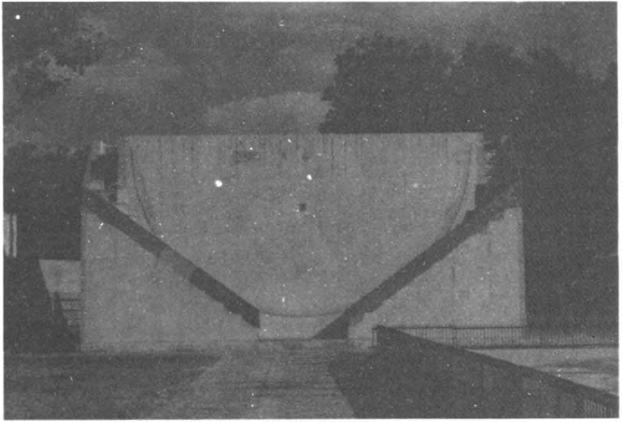

*Photo 2. The west-facing unit of the Dakṣiṇottara Bhitti yantra of Jaipur.*

<!-- figure-resolved-extracted: page=23 image=media/p23_fig01.webp -->

<!-- figure-meta: page=23, position=bottom, type=photograph -->

**Table 5. A number of typical readings from set of noon-hour observations of the sun with the *Dakṣiṇottara Bhitti yantra* of Jaipur. The time was read with an uncalibrated digital watch, and the readings are without refraction correction. The computed results were obtained from an ephemeris.**

| Data | I.S.T. (approx.) | ALtitude Observed | ALtitude computed |
| :--- | :--- | :--- | :--- |
| Dec. 16, 1981 | 12:22:50 | 39;24 | 39;47 |
| 17 | 12:24:30 | 39;24 | 39;46 |
| 18 | 12:23:30 | 39;21 | 39;42 |
| 23 | 12:24:30 | 39;18 | 39;38 |
| Jan. 29, 1982 | 12:40:00 | 45;18 | 44;54 |

With the *Dakṣiṇottara Bhitti*, Jai Singh is said to have determined the obliquity of the ecliptic around 1730. In the following table his values are compared with that of Boudier and with our calculated value.
**Table 6. Obliquity of the ecliptic by Jai Singh and others. The reported values are within 30 arc-sec of calculated values.**

| | Year | Obliquity |
| :--- | :--- | :--- |
| Jai Singh at Delhi[^51],[^52] | 1730 | 23;28,00 |
| Jai Singh at Jaipur[^53] | ? | 23;28,00 |
| Boudier[^54] | 1731 | 23;28,00 |
| Calculated by the authors | 1730 | 23;28,28 |

## V. Jai Singh: The Designer of Instruments

For his observatories, Jai Singh constructed instruments of metal first. However, because the metal instruments did not measure up to his expectations, he turned to masonry and stone instruments which he himself designed. Joseph Du Bois, a French Jesuit, writes that the Raja prepared the wax models of these instruments with his own hands[^55].
The Great *Samrāṭ* of Jaipur, the *Ṣaṣṭhāṃśas* flanking it, and the *Samrāṭ* and *Ṣaṣṭhāṃśa* of Delhi were Jai Singh's highest-precision instruments. With these instruments, he extended the precision of measuring angles to the very limit of naked-eye observations, or 1' of arc[^56]. Realizing that lime plaster can be etched easily with divisions as small as 2.0 mm and marble 2 to 3 mm for reading 1 arc-minute,[^57] Jai Singh apparently planned the size of his precision instruments accordingly.
The small divisions on the quadrants of the Great *Samrāṭ* of Jaipur suggest that Jai Singh intended to measure time down to nearest 5-vipala (2 sec) with this instrument. However, as discussed earlier, the accuracy of time measurements at any *Samrāṭ* is affected by the penumbra of its gnomon's shadow. It is possible that Jai Singh recognized this limitation and applied a correction for it. With the correction applied, the instrument becomes optimally designed for both time and declination measurements[^58].
His other precision instrument, the *Ṣaṣṭhāṃśa* is also very well designed. In this instrument, the two main sources of uncertainties, the aperture broadening and the diffraction effect are less than 1 arc-minute. The data collected with the *Ṣaṣṭhāṃśa* of Delhi which was accurate within 1 arc-minute, confirms our conclusion. Jai Singh's *Ṣaṣṭhāṃśa* at Jaipur still maintains this accuracy of 1 arc-minute.
With his other precision instrument, the *Dakṣiṇottara Bhitti*, Jai Singh measured the obliquity which is also correct within 28 arc-seconds of the true value calculated by us. Hence, his *Dakṣiṇottara Bhitti* also was well constructed. With these well constructed instruments, the accuracy of Jai Singh's measurements for the sun approached that of de La Hire's, who used a telescopic-sight fitted quadrant for his investigations[^59].
Jai Singh made the best use of the technology available to him, the technology of constructing buildings in masonry and stone, which was highly developed in India. His high precision instruments are excellent examples of an art that already had become obsolete with the advent of the telescope.

## Acknowledgement

The work reported in this study was done in 1981 under a grant from the National Science Foundation of the USA[^60]. Some work was also done with the financial support of the University of Wisconsin Center Fox Valley. Asha Sharma's help with the manuscript is appreciated.

## Bibliography

Bhatanagar, V.S. *Life and Times of Swai Jai Singh*, Impex India, New Delhi, 1974.
Blanpied, William A. "The Astronomical Program of Raja Sawai Jai Singh II and Its Historical Context," *Japanese Studies in the History of Science*, No. 13, 1974.
Pingree, David "Indian and Islamic Astronomy at Jayasiṃha's Court," From Deferent to Equant, *Annals of the New York Academy of Science*, pp. 313-328, New York, 1987.
Sharma, Virendra Nath "The Astronomical Endeavors of Sawai Jai Singh and Copernican Revolution," *Indian J. Hist. Sci.*, Vol. 17, No. 2, pp. 333-334, 1982.
---

### Notes and References (for pages 21–25)

[^43]: The refraction correction is based on the *Indian Ephemeris*, published yearly by the Controller of Publications, Government of India, Delhi.

[^44]: The modern practice is to check an instrument for zero error and then apply a correction for the same if necessary.

[^45]: Mercier, Raymond, "The Astromical Tables of Rajah Jai Singh Sawa'i," *Indian J. Hist. Sci.*, 19, 143-171, (1984).

[^46]: Mercier, *Op. Cit.*, p. 161.

[^47]: As the altitude of objects at the meridian changes rather slowly, the error caused by the deviation of the instrument from the meridian plane will be well within the precision of the instrument. See Ref. 21.

[^48]: Hunter, William, "Some Account of the Astronomical Labours of Jayasinha, Rajah of Ambhere, of Jainagar," *Asiatic Researches*, pp. 177-211, (1799).

[^49]: *Siddhānta Samrāṭ*, ed. Chaturveda, pp. 6-7, *Op. Cit.* Also *Samrāṭ Siddhānta*, ed. Sharma, p. 1037, *Op. Cit.*

[^50]: The rod on the west facing wall is off center by about 0.5 cm.

[^51]: *Samrāṭ Siddhānta*, ed. Sharma, *Op. Cit.*, Vol 2, p. 1037,

[^52]: *Siddhānta Samrāṭ* ed. Chaturveda, *Op. Cit.*, p. 7.

[^53]: *Samrāṭ Siddhānta*, ed. Sharma p. 1099, also *Siddhānta Samrāṭ*, ed. Chaturveda, p. 115, Ref. 32.

[^54]: *Fonds Brotier Collection*, Vol. 78, f. 20, *Op. Cit.*

[^55]: Du Bois, Joseph, introductory remarks in the colophon of the *Tabulae Astronomicae* of Phillip de La Hire, ms., Sawi Man Singh II Museum, Jaipur.

[^56]: It is improbable that Jai Singh realized the theoretical limitation of naked eye observations. It is perhaps his own experience of observing that guided him in designing of his instruments.

[^57]: The *Karkarāśi Valaya* of the *Miśra yantra* of Delhi has its scale etched in lime plaster. The average division on this scale is 1.7 mm wide. However, divisions as small as 1 mm wide may also be seen on the scale.

[^58]: A *Samrāṭ* larger than the Great *Samrāṭ* of Jaipur will not improve the accuracy of declination measurements any further, because this accuracy is limited by the resolving power of the eye. A smaller instrument, on the other hand, could not read the declination angle down to 1' of arc.

[^59]: In his *Zīj-i Muḥammad Shāhī*, Jai Singh reports the average motion of the sun for an Arabic Year as 349;16,49,46, which compares well with that of de La Hire's, 349;16,49,51. See Sharma, Virendra Nath, "The Zīj-i Muḥammad Shāhī and the Tables of de La Hire," *Indian J. Hist. Science*, 25 (1-4), 1990.

[^60]: NSF Grant No. INT-8016996.

——, "Astromical Efforts of Sawai Jai Singh — A Review," *History of Oriental Astronomy*, IAU Colloquium 91, ed. G. Swarup, A.K. Bag, and K.S. Shukla, pp. 233-240, Cambridge U. Press, Cambridge, 1987.
Kaye, George R. *The Astronomical Observatories of Jai Singh*, Archaeological Survey of India, 1918; reprint, 1981.

## NOTES AND REFERENCES

[^1]: For Jai Singh's observatories and instruments see George R. Kaye, *The Astronomical Observatories of Jai Singh*, Archaeological Survey of India, 1918; reprint, 1981.

[^2]: A *ghaṭikā* equals 24 min and a *pala* 24 sec.

[^3]: The declination angle $\delta$ is given by the distance measured along the hypotenuse of the right triangle of the gnomon. For a given angle of declination $\delta$, the distance along the hypotenuse, measured from the zero marking, equals $R \tan \delta$, where $R$ is the radius of the quadrant and $\delta$ the declination.

[^4]: For the conversion, the observer has to find the right ascension of the star, and of the sun for that day from an ephemeris. Next, by adding or subtracting the difference between the two right ascensions, the apparent solar time is determined.

[^5]: The correction for the Indian Standard Time is as follows.  

The Indian Standard Time = Local Time $\pm$ Equation of Time $\pm$ Longitude difference  
The longitude difference is obtained by subtracting or adding the longitude of the place in time units to 5 hr 30 min East. The latter is the longitude for the Indian Standard Time in time-units. The longitude differences for Jaipur and Delhi converted into time units are + 26 m. 43 sec and + 21 min 8 sec respectively. Elaborate tables for the Equation of Time are available in books such as the *Indian Astronomical Ephemeris*, published yearly, by the Govt. of India Press, Delhi.

[^6]: Blanpied, basing his criticism on the problem of penumbra encountered in reading time, concludes that the large *Samrāṭs* of Jai Singh are over-designed and their subdivisions exceed the intrinsic precision of the instrument. However, as we have indicated, the problem can be easily eliminated with a string. Blanpied, William A., "Raja Sawi Jai Singh II: An 18th Century Medieval Astronomer," *Am. J. Physics*, Vol. 43, no. 12, 1025-1035, (1975).

[^7]: At the observatory of Jaipur, the authors saw an experienced guide achieving almost similar results with the tip of his index finger.

[^8]: The large *Samrāṭ* of Varanasi appears to be an exception to the "delay of the shadow" effect and needs to be investigated further. At that *Samrāṭ*, at noon hour, the shadow on the east quadrant can be seen almost 2 min before it disappears from the west quadrant.

[^9]: As the disc of the sun in mid January is 0;32,35 of arc, its shadow should be $[(0;32,35)/30''] \times 2.2\text{ mm}$ or $14.3\text{ cm}$ wide. The average length of a small division measuring $30''$ of arc on the quadrant scale is $2.2\text{ mm}$.

[^10]: A 3-cm penumbra corresponds to approximately one-fifth of the angular diameter of the sun which measures $14.3\text{ cm}$ on the quadrant scale.

[^11]: At 6 o'clock the shadow will be shifted by 3 to 4 cm. For a 4 cm shift, the error in time measurement would be $(4\text{ cm}/2.2\text{ mm}) \times 2\text{ sec}$, or 36 sec. The average length of a small division at the Delhi *Samrāṭ* is 2.2 mm.

[^12]: Garrett, A. ff., *The Jaipur Observatory and-its'Builder*, p. 42, Allahabad, 1902.

[^13]: Taking $y = (50.15\text{ m})/2$ or approx. 25 m, and $\Delta\theta$ equal to 1 arc-minute ($2.9 \times 10^{-4}\text{ rad}$), the $\Delta s$ turns out to be 6.6 sec.

[^14]: Let $\theta$ be the angle along the quadrant scale where the radius varies by $\Delta R$. Now $S = R\theta$. Therefore, $\Delta s = R\Delta\theta + \theta\Delta R$. For the graduations of equal length $\Delta s = 0$. Thus $R\Delta\theta = -\theta\Delta R$. If the variation $\Delta R$ does not last more than a degree or two, and if $\Delta R$ is no more than 2 cm at the most, then for the Great *Samrāṭ* of Jaipur (radius 15.15 m), the variation, $\Delta\theta = (\theta\Delta R)/R \approx 9.6''$ of arc, which is less than 1 sec of time.

[^15]: In his *Yantraprakāra*, Jai Singh gives the declination of Jupiter as 23;36, which was observed with a Nāḍīvalaya instrument on the night of *Vaiśākha Kṛṣṇa* 5, Samāvat 1786 (May 16 or 17, 1729) when 4;42,4 *ghaṭikā* time had elapsed. The manuscript consulted by the authors is not clear regarding the *pakṣa* of the month in concern. For *Kṛṣṇa Pakṣa*, the computer-generated value for the declination comes out to be 23;24, whereas, if the *pakṣa* is read as *śukla* instead of *kṛṣṇa*, then the date comes out to be May 2 or 3, and the computed declination 23;32, which is only 4 arc-minutes off from Jai Singh's results. It should be pointed out that Jai Singh could not have taken these readings with the Great *Samrāṭ* of Jaipur because the instrument was not built by then. The Great *Samrāṭ* was constructed four years later, around 1734. Moreover, another instrument, in addition to the *Samrāṭs*, was known as *Nāḍīvalaya* in those days. It is not certain if Jai Singh or his astronomers took their readings with that instrument of with some *Samrāṭ*. See *Yantraprakāra* of Jai Singh, f. 11, Sawai Man Singh II Museum, Jaipur. Also, *Yantraprakāra of Sawai Jai Singh*, ed. and tr., Sarma, Sreeramula Rajeswara, *Supplement to Studies in History of Medicine and Science*, Vol. X & XI, p. 85, (1986, 1987).

[^16]: Ibid.

[^17]: Blanpied has also carried out similar analysis. See Blanpied, *Op. Cit.*

[^18]: For a filter, the author used an exposed black and white photographic film.

[^19]: Garrett, *Op. Cit.*, p. 2.

[^20]: The measured readings should be considered merely an illustration of an example. The authors believe that an accomplished observer can obtain readings closer to the accepted results than obtained by one of the authors and his assistant.

[^21]: The declination angle $\delta$ is related to the angle of azimuth by the following relation.  

$$\sin\delta = \sin\lambda\cos Z + \cos\lambda\sin Z\cos A,$$  

where $Z = \text{zenith distance}$, $\lambda = \text{latitude}$, and $A = \text{azimuth}$. At equinox, declination $\delta = 0$, and for the latitude of Jaipur, which is 27 deg, the zenith distance is equal to 27 deg. For a 1/2 deg deviation from the true meridian plane, i.e., for $\delta A$ equal to 0.5 deg, the variation in $\delta$, the declination, is found to be about 0.1 arc-minute with a computer. On the other hand, at winter solstice, the same would be 0.2 arc-minute.

[^22]: This plate with a circular aperture was put in 1902. Garrett says that he had found a different plate with a square aperture at the site which he replaced with the present one. (See Garrett, *op. cit.*, p. 37.) It is not certain when the plate with a square aperture was put in, because Jai Singh did not recommend a square aperture as such. See *Yantraprakāra*, p. 17, *Op. Cit.* Also Sarma, *Op. Cit.*, pp. 24-25, 71-73.

[^23]: The image is, in fact, a superposition of a multiple images formed by each point of the pinhole. The edges of this image, because they receive light from fewer points of the pinhole, are not as bright as the middle. We will refer to this broadening as aperture broadening.

[^24]: The $1'$ divisions of the *Ṣaṣṭhāṃśa* are 2.53 mm wide as pointed out earlier.

[^25]: We have adapted the relation from Raleigh's criterion for the resolution of diffraction patterns.

[^26]: We disagree with Prahlad Singh, who states that planets such as Venus can be observed with this instrument. Venus can never be observed with a Sasāthāṃśa, because in order to be observed the plant should be at the meridian. But that happens only in broad day light. See Singh Prahlad, *Stone Observatories in India*, p. 110, Varanasi.

[^27]: Garrett writes that the instrument can measure the angular diameter of the sun within 15 arc-seconds. However, in our opinion such precision is unlikely. See Garrett, *Op. Cit.*, p. 37.

[^28]: Contrary to what Kaye writes the instrument is not totally enclosed. Kaye, *Op. Cit.*, p. 42.

[^29]: In January 1990, we observed no water standing at the base of the *Samrāṭ* perhaps due to a drop in the water table of the area.

[^30]: Bhavan, Gokulchandra, *A Guide the Observatories in India*, (in Hindi), Varanasi, 1911 p. 73.

[^31]: An instrument such as the *Ṣaṣṭhmśa* can have a precision better than 1 arc-minute. This is because the readings are taken off the pinhole image of the sun, and thus the resolving powert of the eye does not come into picture.

[^32]: *Siddhānta Samrāṭ* of Jagannātha Samrāṭ, ed. Chaturvedi, Muralidhar, p. 81, Sagar, 1776. Also *Samrāṭ Siddhānta of Jagannatha Samrat*, ed. Sharma, Ram Swarup, Vol. 2, p. 1218, Delhi, 1967.

[^33]: Ibid, Chaturveda, pp. 80-81.

[^34]: Computer program used: AstroInfo, Zephyr Services, Pittsburgh, 1990.

[^35]: One Paris foot $= 0.3248\text{ m}$.

[^36]: From Boudier's report the diameter of the aperture turns out to be little over 4 mm. The radius given by Boudier is consistent with our measurements.

[^37]: *The Lettres édifiantes et curieuses, ecrites des Missions strangeres, Nouville Edition. Memoires des Indes*, Tome quinzieme, pp. 269-290, Toulouse, 1810. Also *Lettres Édifiantes*, Vol. XV, pp. 337-360, edition Merigot, 1781.

[^38]: The solar diameter measured by Boudier with the *Ṣaṣṭhṃśa* is larger than the true value by about one-half arc-minute. The reason lies both in the broadening of the image due to penumbra and the diffraction of light at the circular aperture of the instrument.

[^39]: For Boudier's observation see Sharma, V.N., and Huberty, L., "Jesuit Astronomers in Eighteenth Century India," *Archives Internationales D' Histoire Des Sciences*, pp. 99-107, Vol. 34, June 1984.

[^40]: *Fonds Brotier*, vol. 78, f.1, Jesuit Archives, Chantilli, France. Also Pius XII Memorial Library, St. Louis U., St. Louis, MO, USA.

[^41]: Sharma, and Huberty, "Jesuit Astronomers ... India," *Op. Cit.*, p. 103. (See table 2).

[^42]: It is difficult to see how the division with as small as 0.13 mm could have been engraved on a copper plate Boudier used. Perhaps, Boudier used a Vernier scale attached to the copper plate for measuring such small distances.

[^43]: The refraction correction is based on the *Indian Ephemeris*, published yearly by the Controller of Publications, Government of India, Delhi.

[^44]: The modern practice is to check an instrument for zero error and then apply a correction for the same if necessary.

[^45]: Mercier, Raymond, "The Astromical Tables of Rajah Jai Singh Sawa'i," *Indian J. Hist. Sci.*, 19, 143-171, (1984).

[^46]: Mercier, *Op. Cit.*, p. 161.

[^47]: As the altitude of objects at the meridian changes rather slowly, the error caused by the deviation of the instrument from the meridian plane will be well within the precision of the instrument. see Ref. 21.

[^48]: Hunter, William, "Some Account of the Astronomical Labours of Jayasinha, Rajah of Ambhere, of Jainagar," *Asiatic Researches*, pp. 177-211, (1799).

[^49]: *Siddhānta Samrāṭ*, ed. Chaturveda, pp. 6-7, *Op. Cit.* Also *Samrāṭ Siddhānta*, ed. Sharma, p. 1037, *Op. Cit.*

[^50]: The rod on the west facing wall is off center by about 0.5 cm.

[^51]: *Samrāṭ Siddhānta*, ed. Sharma, *Op. Cit.*, Vol 2, p. 1037,

[^52]: *Siddhānta Samrāṭ* ed. Chaturveda, *Op. Cit.*, p. 7.

[^53]: *Samrāṭ Siddhānta*, ed. Sharma p. 1099, also *Siddhānta Samrāṭ*, ed. Chaturveda, p. 115, Ref. 32.

[^54]: *Fonds Brotier Collection*, Vol. 78, f. 20, *Op. Cit.*

[^55]: Du Bois, Joseph, introductory remarks in the colophon of the *Tabulae Astronomicae of Phillip de La Hire*, ms., Sawi Man Singh II Museum, Jaipur.

[^56]: It is improbable that Jai Singh realized the theoretical limitation of naked eye observations. It is perhaps his own experience of observing that guided him in designing of his instruments.

[^57]: The *Karkarāśi Valaya* of the *Miśra yantra* of Delhi has its scale etched in lime plaster. The average division on this scale is 1.7 mm wide. However, divisions as small as 1 mm wide may also be seen on the scale.

[^58]: A *Samrāṭ* larger than the Great *Samrāṭ* of Jaipur will not improve the accuracy of declination measurements any further, because this accuracy is limited by the resolving power of the eye. A smaller instrument, on the other hand, could not read the declination angle down to $1'$ of arc.

[^59]: In his Zīj-i Muḥammad Shāhī, Jai Singh reports the average motion of the sun for an Arabic Year as 349;16,49,46, which compares well with that of de La Hire's, 349;16,49,51. See Sharma, Virendra Nath, "The Zīj-i Muḥammad Shāhī and the Tables of de La Hire," *Indian J. Hist. Science*, 25 (1-4), 1990.

[^60]: NSF Grant No. INT-8016996.
