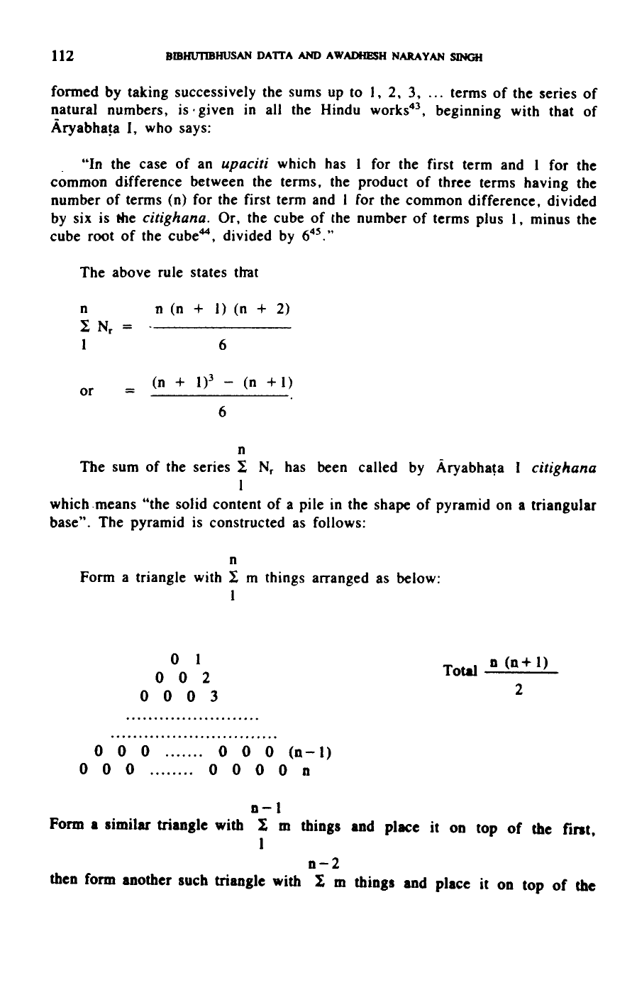
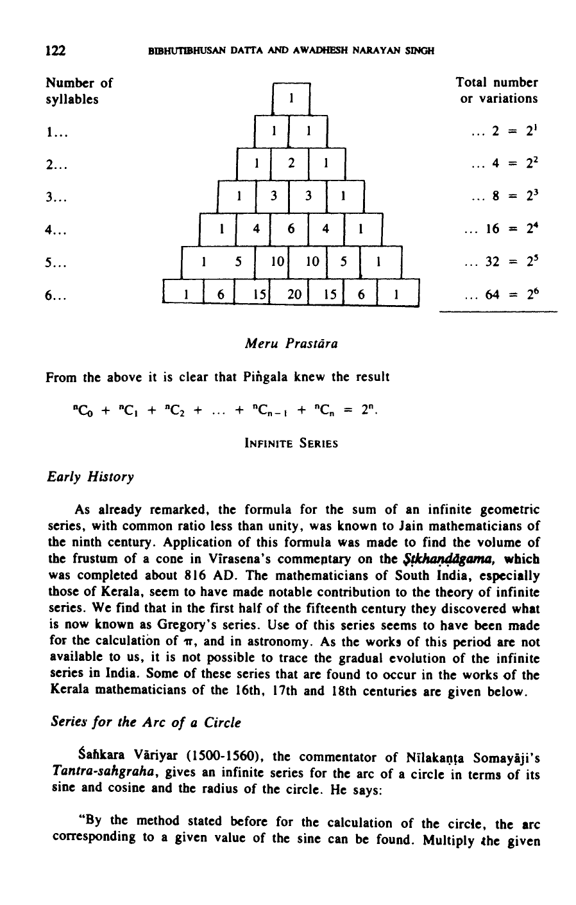

# Use of Series in India

- Author Display: B Datta and A N Singh
- Year: 1993
- Journal Label: IJHS-28-1993-Issue-2
- Source Url: https://insa.nic.in/(S(eh1ucortlbqqezipwgliy3mn))/writereaddata/UpLoadedFiles/IJHS/Vol28_2_3_BDatta.pdf

<!-- source: gemini page-chunk extraction -->

*Indian Journal of History of Science*, 28(2), 1993

# USE OF SERIES IN INDIA

BIBHUTIBHUSAN DATTA AND AWADHESH NARAYAN SINGH  
(Revised by KRIPA SHANKAR SHUKLA)  
Argara, Hussainganj Crossing, Behind Bata Shoe Co.  
Lucknow-226 001
(Received 24 December 1991)
Particular instances of arithmetic and geometric series have been found to occur in Vedic literature as early as 2000 BC. From Jaina literature it appears that the Hindus were in possession of the formulae for the sum of the arithmetic and the geometric series as early as the fourth century BC, or earlier. In the *Bakhshālī Manuscript* and other works on *Pāṭīgaṇita*, series were treated as one of the major topics of study and a separate section was generally devoted to the rules and problems relating to series. In Europe, the series were looked upon as one of the fundamental operations, evidently due to Hindu influence through the Arabs. Besides the arithmetic and the geometric series, a number of other types of series, e.g., the series of sums, the series of squares or cubes of the natural numbers, the arithmetico-geometric series, the series of polygonal or figurate numbers, etc. occur in the works on *Pāṭīgaṇita*. There is, however, no mention of the harmonic series.
Evidence of the use of the infinite geometric series with common ratio less than unity is found in the ninth century. The formula for the sum of this series was known to the Jainas who used it to find the volume of the frustum of a cone. The Kerala mathematicians of the fifteenth century gave the expansions of $\sin x$, $\cos x$, $\tan x$, and $\pi$ long before they were known in Europe or anywhere else.
The present article gives an account of the use of series in Indian literature.

## ORIGIN AND EARLY HISTORY

Series of numbers developing according to certain laws have attracted the attention of people in all times and climes. The Egyptians are known to have used the arithmetic series about 1550 BC[^1]. Arithmetic as well as geometric series are found in the Vedic literature of the Hindus (c. 2000 BC). In the *Taittirīya-Saṃhitā*[^2] we find the series:
(i) $1, 3, 5, \dots\dots, 19, 29, \dots\dots, 99$
(ii) $2, 4, 6, \dots\dots, 20$
(iii) $4, 8, 12, \dots\dots$
(iv) $10, 20, 30, \dots\dots$
(v) $1, 3, 5, \dots\dots, 33$
In the *Vājasaneyī Saṃhitā*[^3], we have the *yugma* ("even") and *ayugma* ("odd") series:
(vi) $4, 8, 12, 16, \dots, 48$
(vii) $1, 3, 5, 7, \dots, 31$.
The *Pañcaviṃśa Brāhmaṇa*[^4] has the following geometric series:
(viii) $12, 24, 48, 96, \dots\dots, 196608, 393216$.
Another geometric series occurs in the *Dīgha Nikāya*[^5]. It is
(ix) $10, 20, 40, \dots\dots, 80000$.
The Hindus must have obtained the formula for the sum of an arithmetic series at a very early date, but when exactly they did so cannot be said with certainty. It is, however, definite that in the 5th century BC, they were in possession of the formula for the sum of the series of natural numbers, for in the *Bṛhaddevatā* (500-400 BC)[^6] we have the result

$$2 + 3 + 4 + \dots + 1000 = 500499.$$

In the *Kalpa-sūtra* of Bhadrabāhu (c. 350 BC), we have the sum of the following geometric series

$$1 + 2 + 4 + \dots + 8192 \text{ (i.e., to } 14 \text{ terms)}$$

given correctly as $16383$, showing that the Hindus possessed some method of finding the sum of the geometric series in the 4th century BC.
The following result occurs in the commentary, entitled, *Dhavalā*[^7], by Vīrasena (c. 9th century AD) on the *Ṣaṭkhaṇḍāgama* of Puṣpadanta Bhūtabali:

$$49\frac{217}{452} (1 + \frac{1}{4} + \frac{1}{4^2} + \frac{1}{4^3} + \dots \text{ ad inf.}) = 65\frac{110}{113}.$$

This shows that the following formula giving the sum of the infinite geometric series was well known in India in the 9th century AD:

$$a + ar + ar^2 + ar^3 + \dots = \frac{a}{1 - r}, \text{ when } r < 1.$$

## KINDS OF SERIES

It thus appears that the Hindus studied the arithmetic and geometric series at a very early date. Āryabhaṭa I (499), Brahmagupta (628) and other posterior writers considered also the cases of the sums of the sums, the squares and the cubes of the natural numbers. Mahāvīra (850) gave a rule for the summation of an interesting arithmetico-geometric series, viz.

$$\sum_1^n t_m$$

where $t_1 = a$ and $t_m = rt_{m-1} \pm b$, $m \ge 2$;  
and Nārāyaṇa (1356) considered the summation of the figurate numbers of higher orders.

## TECHNICAL TERMS

The Sanskrit term for a series is *śreḍhī*, meaning literally "progression", "any set or succession of distinct things", or *śreṇī* (or *śrenī*), literally "line", "row", "series", "succession"; hence in relation to mathematics it implies "a series or progression of numbers". Thus, it is clear that the modern terms progression and series are analogous to the Hindu terms and they seem to have been adopted in the West under Hindu influence, in preference to the Greek term $\epsilon\kappa\theta\epsilon\sigma\iota\varsigma$ (ekthesis) which literally means a setting forth. The Sanskrit name for a term of the series is *dhana*[^8] (literally, "any valued object"). The first term is called *ādi-dhana* ("first term") and any other term *iṣṭa-dhana* ("desired term"). When the series is finite, its last term is called *antya-dhana* ("last term"), and the middle term *madhya-dhana* ("middle term"). Often, for the sake of abridgement, the second words of these compound names are deleted, so that we have the terms *ādi*, *iṣṭa*, *madhya* and *antya* in their places. The first term is also called *prabhava* ("initial term"), *mukha* ("face") or its synonyms. The technical names for the common difference in an arithmetic series are *caya* or *pracaya* (from the root *ci* "to go", hence meaning "that by which the terms goes", that is, "increment"), *uttara* ("difference", "excess"), *vṛddhi* ("increment"), etc. The common ratio in a geometric series is technically called *guṇa* or *guṇaka* ("multiplier") and so this series is distinguished from the arithmetic series by the specific name *guṇa-śreḍhī*. The number of terms in a series is known as *pada* ("step", meaning "the number of steps in the sequence") or *gaccha* ("period"). The sum is called *sarva-dhana* ("total of all terms"), *śreḍhī-phala* ("result of the progression"), *śreḍhī-gaṇita* (or simply *gaṇita*, because the sum of of the series is obtained by computation), and *śreḍhisaṅkalita* (or in short *saṅkalita*, "sum of the series").
The above-mentioned technical terms occur commonly in almost all the known Hindu treatises on arithmetics from the so-called Bakhshali treatise (c. 200) onwards. But in the latter, the series has been designated by *varga* meaning "group". Occasionally, we meet with the terms *paṅkti*[^9] and *dhārā*[^10], which signify "continuous line or series". Nārāyaṇa (1356) has used also a special term, *āya* (literally, "income") for the sum of natural numbers.

## SUM OF AN A.P.

Problems on the summation of arithmetic series are met with in the earliest available Hindu work on mathematics, the *Bakhshali Manuscript*. The statement of the formula for the sum begins with the word *rūponā*, so that summation is indicated by the terms *rūponā karaṇena* ("by the operation *rūponā*, etc.") throughout the work. In the statement of the solution of problems, the first term, the common difference and the number of terms, are written together and the resulting sum after these, as follows:

| $\bar{a}$ | $1$ | $u$ | $1$ | $pa$ | $19$ | *rūponā karaṇena phalam* | $190$ |
| :---: | :---: | :---: | :---: | :---: | :---: | :---: | :---: |
| | $1$ | | $1$ | | $1$ | | $1$ |

In the above, $\bar{a}$ stands for *ādi* ("first term"), $u$ for *uttara* ("common difference"), and $pa$ for *pada* ("number of terms"). The above quotation may be translated thus: "the first term is $\frac{1}{1}$, the common difference is $\frac{1}{1}$, and the number of terms is $\frac{19}{1}$; therefore, performing *rūponā*, etc. the sum is $\frac{190}{1}$."[^11]
Āryabhaṭa I (499) states the formulae for finding the arithmetic mean and the partial sum of a series in A.P. as follows:
"Diminish the given number of terms by one, then divide by 2, then increase by the number of the preceding terms (if any), then multiply by the common difference, and then increase by the first term of the (whole) series: the result is the arithmetic mean (of the given number of terms). This multiplied by the given number of terms is the sum of the given terms. Alternatively, multiply the sum of the first and last terms (of the series or partial series to be summed up) by half the number of terms" [^12].
Let the series be

$$a + (a + d) + (a + 2d) + \dots.$$

Then the rule says that:
(1) the arithmetic mean of the $n$ terms

$$\begin{aligned}
& (a + pd) + (a + \overline{p + 1} d) + \dots + [a + (p + n - 1) d] \\
& = a + (\frac{n - 1}{2} + p) d;
\end{aligned}$$

(2) the sum of the $n$ terms

$$\begin{aligned}
& (a + pd) + (a + \overline{p + 1} d) + \dots + [a + (p + n - 1) d] \\
& = n [a + (\frac{n - 1}{2} + p) d].
\end{aligned}$$

In particular (when $p = 0$)
(3) the arithmetic mean of the series

$$\begin{aligned}
& a + (a + d) + (a + 2d) + \dots + [a + (n - 1) d] \\
& = a + \frac{n - 1}{2} d;
\end{aligned}$$

(4) the sum of the series

$$\begin{aligned}
& a + (a + d) + (a + 2d) + \dots + [a + (n - 1) d] \\
& = n [a + \frac{n - 1}{2} d].
\end{aligned}$$

Alternatively, the sum of $n$ terms of an arithmetic series with $A$ as the first term and $L$ as the last term

$$= \frac{n}{2} (A + L),$$

where $\frac{1}{2} (A + L)$ is the arithmetic mean of the terms.
Brahmagupta says:
"The last term is equal to the number of terms minus one, multiplied by the common difference, (and then) added to the first term. The arithmetic mean (of the terms) is half the sum of the first and the last terms. This (arithmetic mean) multiplied by the number of terms is the sum"[^13].
Similar statements occur in the works of Śrīdhara[^14], Āryabhaṭa II[^15], Bhāskara II[^16] and others. Mahāvīra points out that the common difference may be a positive or negative quantity[^17].
The particular case

$$\sum_1^n r = \frac{n(n + 1)}{2}$$

[^1]: In the Ahmes Papyrus. Cf. Peet, Rhind Papyrus, p. 78; Smith, *History*, II, p. 498.

[^2]: *TS*, vii. 2.12-17; iv. 3.10.

[^3]: *VS*, xvii. 24.25.

[^4]: xviii. 3. Compare also *Lāṭyāyana Śrauta-sūtra*, viii. 10.1 et seq.; *Kātyāyana Śrauta-sūtra*, xxii. 9. 1-6.

[^5]: T.W. Rhys Davids, *Dialogues of the Buddha*, III, 1921. pp. 70-72.

[^6]: *Bṛhaddevatā* edited in original Sanskrit with English translation by A. Macdonell, Harvard, 1904.

[^7]: 1.3.2. Also see A.N. Singh, History of India from Jaina Sources, *JA*, Vol. xvi, Dec. 1950, No. 2 pp. 54-69.

[^8]: In mathematics *dhana* means an affirmative quantity or plus. This probably explains the use of this term to denote the elements of a series which have to be summed up.

[^9]: See Ch. xiii of the *Gaṇita-kaumudī* of Nārāyaṇa.

[^10]: For instance, see the *Triloka-sāra* of Nemicandra (c. 975).

[^11]: The denominator $1$ is written in the case of all the integral quantities. This is to show that the quantities involved may have non-integral values also.

[^12]: *Ā*, ii. 19. The commentator Bhāskara I says that several formulae are set out here. For details see *Āryabhaṭīya*, edited and translated by K.S. Shukla in collaboration with K.V. Sarma, New Delhi (1976), pp. 62-63.

[^13]: *BrSpSi*, xii. 17.

[^14]: *Triś*, p. 28.

[^15]: *MSi*, xv. 47.

[^16]: *L*, p. 27.

[^17]: *GSS*, p. 102, (290).

108 BIBHUTIBHUSAN DATTA AND AWADHESH NARAYAN SINGH
is mentioned in all the Hindu works[^18]

## ORDINARY PROBLEMS ON A.P.

The problems of finding out (1) the first term or (2) the common difference or (3) the number of terms, are common to all Hindu works. They occur first in the *Bakhshali Manuscript*[^19]. The problem of finding the number of terms requires the solution of a quadratic equation[^20]. Some indeterminate problems in which more than one of the above quantities are unknown also occur in the *Bakhshali Manuscript*, the *Gaṇita-sāra-saṅgraha* of Mahāvīra and the *Gaṇita-kaumudī* of Nārāyaṇa. A typical example of such problems is the finding out of an arithmetic series that will have a given sum and a given number of terms.
As illustrations of some other types of Hindu problems arithmetical progression may be mentioned the following:
(1) There were a number of utpala flowers representable as the sum of a series in arithmetical progression, whereof 2 is the first term and 3 the common difference. A number of women divided those flowers equally among them. Each woman had 8 for her share. How many were the women and how many the flowers?[^21]
(2) A person travels with velocities beginning with 4 and increasing successively by the common difference 8. Again, a second person travels with velocities beginning with 10 and increasing successively by the common difference of 2. What is the time of their meeting?[^22]
(3) The continued product of the first term, the number of terms and the common difference is 12. If the sum of the series is 10, find it[^23].
(4) A man starts with a certain velocity and a certain acceleration per day. After 8 days, another man follows him with a different velocity and an acceleration of 2 per day. They meet twice on the way. After how many days do these meetings occur?[^24]

## GEOMETRIC SERIES

Mahāvīra gives the formula:

$$S = \frac{a(r^n - 1)}{r - 1}$$

for the sum of a geometric series whose first term is a and common ratio r. He says:
USE OF SERIES IN INDIA 109
"The first term when multiplied by the continued product of the common ratio, taken as many times as the number of terms, gives rise to the *guṇadhana*. And it has to be understood that this *guṇadhana*, when diminished by the first term and (then) divided by the common ratio lessened by 1, becomes the sum of the series in geometrical progression" [^25].
The same result is stated by him in the following alternative form:
"In the process of successive halving of the number of terms, put zero or 1 according as the result is even or odd. (Whenever the result is odd subtract 1). Multiply by the common ratio when unity is subtracted and multiply so as to obtain square (when otherwise, i.e., when the half is even). When the result of this (operation) is **diminished** by 1 and is then multiplied by the first term and (is then) divided by the common ratio lessened by 1, it becomes the sum of the series"[^26].
If n be the number of terms and r the common ratio, the first half of the above rules gives $r^n$. This process of finding the nth power of a number was known to Piṅgala (c. 200 BC), and has been used by him to find $2^n$. The second half of the rule then gives

$$S = \frac{a(r^n - 1)}{r - 1}$$

The above formula for the sum is stated by Pṛthūdakasvāmī[^27], Āryabhaṭa II[^28] and Bhāskara II[^29] in the second form which appears to be the traditional method of stating the result.
Mahāvīra has given rules for finding the first term, common ratio or number of terms, one of these being unknown and the others as well as the sum being given[^30].
As illustrations of problems on geometric series may be mentioned the following:
(1) Having first obtained 2 golden coins in a certain city, a man goes on from city to city, earning everywhere three times of what he earned immediately before. Say how much he will make on the eighth day?[^31]
(2) When the first term is 3, the number of terms 6 and the sum 4095, what is the value of the common ratio?[^32]
(3) The common ratio is 6, the number of terms is 5. and the sum is 3110. What is the first term here?[^33]
110 BIBHUTIBHUSAN DATTA AND AWADHESH NARAYAN SINGH
(4) How many terms are there in a geometric series whose first term is 3, the second ratio is 5 and the sum is 228881835937?[^34]

## SERIES OF SQUARES

The series whose terms are the squares of natural numbers seems to have attracted attention at a fairly early date in India. The formula

$$\sum_{1}^{n} r^2 = \frac{n(n + 1)(2n + 1)}{6}$$

occurs in the *Āryabhaṭīya*[^35] where it is stated in the following form:
"The sixth part of the product of the three quantities consisting of the number of terms, the number of terms plus 1, and twice the number of terms plus 1, is the sum of the squares."
The formula occurs in all the known Hindu works[^36]
Mahāvīra (*GSS*, vi. 298, 299) gives the sum of a series whose terms are the squares of the terms of a given arithmetic series.
Let

$$a + (a + d) + \dots + (a + \overline{r - 1} d) + \dots + (a + \overline{n - 1} d)$$

be an arithmetic series. Then, according to him,

$$a^2 + (a + d)^2 + \dots + (a + \overline{r - 1} d)^2 + \dots + (a + \overline{n - 1} d)^2$$

$$= n \{(\frac{2n - 1}{6}) d^2 + ad) (n - 1) + a^2\}$$

or $n [ \frac{(2n - 1)(n - 1) d^2}{6} + a^2 + (n - 1) ad ]$.
Śrīdhara[^37] and Nārāyaṇa[^38] give the above result in the following form:

$$\sum_{1}^{n} (a + \overline{r - 1} d)^2 = a \sum_{1}^{n} [a + 2(r - 1) d] + d^2 \sum_{1}^{n - 1} r^2.$$

USE OF SERIES IN INDIA 111

## SERIES OF CUBES

Āryabhaṭa I states the formula giving the sum of the series formed by the cubes of natural numbers as follows:
"The square of the sum of the original series (of natural numbers) is the sum of the cubes" [^39].
Thus, according to him,

$$\sum_{1}^{n} r^3 = (\sum_{1}^{n} r)^2 = \left[ \frac{n(n + 1)}{2} \right]^2$$

The above formula occurs in all the Hindu works. The general case in which the terms of the series are cubes of the terms of a given arithmetic series, has been treated by Mahāvīra[^40].
Let

$$S = \sum_{1}^{n} \alpha_r$$

be an arithmetic series whose first term is a, and common difference d. Then, according to Mahāvīra,

$$\sum_{1}^{n} \alpha_r^3 = d.S^2 \pm Sa (a \sim d),$$

according as a > or < d.
Śrīdhara[^41] and Nārāyaṇa[^42] have also given the above result in the same form as Mahāvīra.

## SERIES OF SUMS

Let

$$N_n = 1 + 2 + 3 + \dots + n.$$

Then the series

$$\sum_{1}^{n} N_r$$

112 BIBHUTIBHUSAN DATTA AND AWADHESH NARAYAN SINGH
formed by taking successively the sums up to 1, 2, 3, ... terms of the series of natural numbers, is given in all the Hindu works[^43], beginning with that of Āryabhaṭa I, who says:
"In the case of an *upaciti* which has 1 for the first term and 1 for the common difference between the terms, the product of three terms having the number of terms (n) for the first term and 1 for the common difference, divided by six is the *citighana*. Or, the cube of the number of terms plus 1, minus the cube root of the cube[^44], divided by 6."
The above rule states that

$$\sum_{1}^{n} N_r = \frac{n(n + 1)(n + 2)}{6}$$

or $= \frac{(n + 1)^3 - (n + 1)}{6}$
The sum of the series $\sum_{1}^{n} N_r$ has been called by Āryabhaṭa I *citighana* which means "the solid content of a pile in the shape of pyramid on a triangular base". The pyramid is constructed as follows:
Form a triangle with $\sum_{1}^{n} m$ things arranged as below:

*Fig. 112. Diagram of numbered dots arranged in a triangle*

<!-- figure-resolved-page-render: page=10 image=media/p10_page.webp -->

<!-- figure-meta: page=10, printed_page=112, position=middle, type=diagram -->

Form a similar triangle with $\sum_{1}^{n-1} m$ things and place it on top of the first, then form another such triangle with $\sum_{1}^{n-2} m$ things and place it on top of the

[^18]: It is sometimes mentioned in connection with addition, as in Śrīdhara’s *Triśatikā* and Mahāvīra’s *Gaṇita-sāra-saṅgraha*.

[^19]: See p. 25; p. 35 problem 9; and p. 36 problem 10. The solution of this problem is incorrectly printed.

[^20]: For the equation and its solution see the section on quadratic equation in the chapter on Algebra in Part II.

[^21]: *GSS*, vi. 295.

[^22]: *GSS*, vi. 323½. A problem of the above type in which one of the men travels with a constant velocity occurs in the *Bakhshali Manuscript*, p. 37.

[^23]: *GK*, *Śreḍhī-vyavahāra*, Ex. under Rule 6.

[^24]: *Ibid*, under Rule 9.

[^25]: *GSS*, ii. 93.

[^26]: *GSS*, ii. 94; also vi. 311½, where the rule is applied to the case in which the common ratio is a fraction.

[^27]: *BrSpSi*, xii. 17, quoted in the commentary.

[^28]: *MSi*, xv. 52-53.

[^29]: *L*, p. 31.

[^30]: *GSS*, ii. 97-103.

[^31]: *GSS*, ii. 96.

[^32]: *GSS*, ii. 102 (first half).

[^33]: *GSS*, ii. 102 (second half).

[^34]: *GSS*, ii. 105 (last half).

[^35]: *Ā*, ii. 22.

[^36]: Although this rule does not occur in the *Triśatikā*, it occurs in Śrīdhara’s bigger work of which the *Triśatikā* is an abridgement. See *PG*, Rule 102.

[^37]: *PG*, Rule 105.

[^38]: *GK*, *Śreḍhī-vyavahāra*, 17½ and the first half of 18.

[^39]: *Ā*, ii. 22.

[^40]: *GSS*, vi. 303.

[^41]: *PG*, Rule 107.

[^42]: *GK*, *Śreḍhī-vyavahāra*, 18 (c-d) f.

[^43]: This rule does not occur in the *Triśatikā* of Śrīdhara, but it occurs in his *Pāṭīgaṇita*. See *PG*, Rule 103.

[^44]: This means $[(n + 1)^3]^{1/3} = (n + 1)$. Recourse is taken to this form of expression for the sake of meter.

USE OF SERIES IN INDIA 113
first two. Proceed as above till there is one thing at the top. The figure obtained in this manner will be a pyramid formed of $n$ layers, such that the base layer consists of $\sum_{1}^{n} r$ things, the next higher layer consists of $\sum_{1}^{n-1} r$ things, and so on. The number of things in the solid pyramid $citighana = \sum_{1}^{n} N_r,$
where $N_r = \sum_{m=1}^{m=r} m.$
The base of the pyramid is called $upaciti$, so that

$$upaciti = \sum_{m=1}^{m=n} m.$$

The above $citighana$ is the series of figurate numbers. The Hindus are known to have obtained the formula for the sum of the series of natural numbers as early as the fifth century BC. It cannot be said with certainty whether the Hindus in those times used the representation of the sum by triangles or not. The subject of piles of shots and other things has been given great importance in the Hindu works, all of which contain a section dealing with $citi$ ("piles"). It will not be a matter of surprise if the geometrical representation of figurate numbers is traced to Hindu sources.

## MAHĀVĪRA’S SERIES

Mahāvīra (850) has generalized the series of sums in the following manner:
Let $\alpha_1 + \alpha_2 + \alpha_3 + \dots + \alpha_n$
be a series in arithmetical progression, the first term being $\alpha_1$, and the common difference $\beta$, so that

$$\alpha_r = \alpha_1 + (r - 1) \beta.$$

Mahāvīra considers the following series

$$\sum_{r=1}^{r=n} \left( \sum_{m=1}^{m=\alpha_r} m \right)$$

and gives its sum as
PAGE 114 BIBHUTIBHUSAN DATTA AND AWADHESH NARAYAN SINGH

$$ \frac{n}{2} [ \{ \frac{(2n - 1) \beta^2}{6} + \frac{\beta}{2} + \alpha_1 \beta \} (n - 1) + \alpha_1 (\alpha_1 + 1) ]^{46}. $$

Nārāyaṇa[^47] gives the above result in another form. According to him

$$ \sum_{r=1}^{r=n} \left( \sum_{m=1}^{m=\alpha_r} m \right) = \left( \sum_{1}^{\alpha_1 + \beta} m - \sum_{1}^{\alpha_1} m \right) \sum_{1}^{n-1} m + n \sum_{1}^{\alpha_1} m + \beta^2 \sum_{1}^{n-2} \left( \sum_{1}^{r} m \right). $$

Denoting by $N_r$ the sum of $r$ terms of the series of natural numbers, Nārāyaṇa’s result may be written in the form

$$ \sum_{r=1}^{r=n} N_{\alpha_r} = (N_{\alpha_1 + \beta} - N_{\alpha_1}) N_{n-1} + n N_{\alpha_1} + \beta^2 \sum_{1}^{n-2} N_r $$

$$ = \left[ \frac{(\alpha_1 + \beta) (\alpha_1 + \beta + 1)}{2} - \frac{\alpha_1 (\alpha_1 + 1)}{2} \right] \frac{n(n - 1)}{2} + \frac{n \alpha_1 (\alpha_1 + 1)}{2} $$

$$ + \beta^2 \frac{(n - 2) (n - 1) n}{6} $$

which can be reduced to Mahāvīra’s form.
Śrīdhara[^48] puts the result in the form

$$ \sum_{r=1}^{r=n} \left( \sum_{m=1}^{m=\alpha_r} m \right) = \frac{1}{2} \left[ \sum_{r=1}^{r=n} \alpha_r^2 + \sum_{r=1}^{r=n} \alpha_r \right] $$

## NĀRĀYAṆA’S SERIES

Nārāyaṇa has given formulae for the sums of series whose terms are formed successively by taking the partial sums of other series in the following manner:
Let the symbol $^nV_1$ denote the arithmetic series of natural numbers up to $n$ terms; i.e., let
$ $^nV_1 = 1 + 2 + 3 + \dots + n.$$

Let $^nV_2$ denote the series formed by taking the partial sums of the series $^nV_1$. Then
USE OF SERIES IN INDIA 115

$$ {}^nV_2 = \sum_{r=1}^{r=n} {}^rV_1 $$

Similarly, let

$$ {}^nV_3 = \sum_{r=1}^{r=n} {}^rV_2 $$

$$ {}^nV_4 = \sum_{r=1}^{r=n} {}^rV_3 $$

$$ \dots \dots \dots \dots \dots \dots \dots \dots $$

$$ {}^nV_m = \sum_{r=1}^{r=n} {}^rV_{m-1} $$

The series $^nV_m$ has been called by Nārāyaṇa as $m-v\bar{a}ra-sa\dot{n}kalita$ ("m-order-series") meaning thereby that the operation of forming a new series by taking the partial sums of a previous series has been repeated $m$ times. The number $m$ may be called the order ($v\bar{a}ra$) of the series.
Nārāyaṇa states the sum $^nV_m$ as follows:
"The terms of the sequence beginning with the $pada$ (number of terms, i.e., $n$) and increasing by $1$ taken up to the order ($v\bar{a}ra$) plus $1$ times are successively the numerators and the terms of the sequence beginning with unity and increasing by $1$ are respectively the denominators. The continued product of these (fractions) gives the $v\bar{a}ra-sa\dot{n}kalita$ ("sum of the iterated series of a given order")."
Thus, according to the above, $n$ being the number of terms of the iterated and $m$ the order, we get the following sequence of numbers:

$$ \frac{n}{1}, \frac{n+1}{2}, \frac{n+2}{3}, \dots, \frac{n+m}{m+1} $$

The sum of the series is the continued product of the above sequence, i.e.,

$$ {}^nV_m = \frac{n \cdot (n+1) \cdot (n+2) \dots (n+m)}{1 \cdot 2 \cdot 3 \dots (m+1)} $$

Putting $m = 1, 2, 3, \dots$, we get
PAGE 116 BIBHUTIBHUSAN DATTA AND AWADHESH NARAYAN SINGH

$$ {}^nV_1 = \sum_{r=1}^{n} r = \frac{n(n+1)}{1 \cdot 2}, $$

$$ {}^nV_2 = \sum_{r=1}^{n} {}^rV_1 = \frac{n \cdot (n+1) (n+2)}{1 \cdot 2 \cdot 3}, $$

$$ {}^nV_3 = \sum_{r=1}^{n} {}^rV_2 = \frac{n(n+1) (n+2) (n+3)}{1 \cdot 2 \cdot 3 \cdot 4} $$

and so on.
Nārāyaṇa (1356) has made use of the numbers of the $v\bar{a}ra-sa\dot{n}kalita$ in the theory of combinations, in chapter xiii of his $Ga\d{n}ita-kaumud\bar{\imath}$. The series discussed above are now known as the series of figurate numbers. They seem to have been first studied in the west by Pascal (1665).

## GENERALISATION

Nārāyaṇa has considered the more general series obtained in the same way as above from a given arithmetical progression.
Let

$$ {}^nS_1 = \sum_{1}^{n} \alpha_r = \alpha_1 + \alpha_2 + \dots + \alpha_n, $$

where $\sum_{1}^{n} \alpha_r$ is an arithmetic series whose first term is $\alpha_1$ and common difference $\beta$. As above, let us define the iterated series $^nS_2, ^nS_3, \dots, ^nS_k$ as follows:

$$ {}^nS_2 = \sum_{r=1}^{r=n} {}^rS_1 $$

$$ {}^nS_3 = \sum_{r=1}^{r=n} {}^rS_2 $$

$$ \dots \dots \dots \dots \dots \dots \dots \dots $$

$$ {}^nS_k = \sum_{r=1}^{r=n} {}^rS_{k-1} $$

USE OF SERIES IN INDIA 117
Nārāyaṇa states the formula for the sum of the series $^nS_m$ thus:
"The sum of the iterated series of the given order derived from the natural numbers equal to the given number minus $1$ is put down at two places. These become the multipliers. The order as increased by unity being divided by the given number of terms as diminished by unity is a multiplier of the first (of these multipliers). The first term and the common difference multiplied respectively by the two quantities and (the results) added together gives the required sum of the iterated series."
Suppose it be required to find $^nS_m$, where $n$ is the $pada$ ("number of terms") and $m$ the $v\bar{a}ra$ ("order") of the iterated series. Let, as before, $^nV_r$ denote the iterated series of the $r$th order derived from the series of $n$ natural numbers. Then, taking ${}^{n-1}V_m$ as two places, and multiplying the first of these by

$$ \frac{m+1}{n-1} \text{ as directed, we get} $$

$$ \frac{m+1}{n-1} {}^{n-1}V_m \text{ and } {}^{n-1}V_m $$

Multiplying the first term ($\alpha_1$) and the common difference ($\beta$) by these two respectively and adding we get the required sum

$$ {}^nS_m = \alpha_1 \frac{m+1}{n-1} {}^{n-1}V_m + \beta {}^{n-1}V_m. $$

### Rationale

The above formula has been evidently obtained by Nārāyaṇa as follows:

$$ {}^nS_1 = \sum_{1}^{n} \alpha_r = \alpha_1 + (\alpha_1 + \beta) + \dots + (\alpha_1 + \overline{n-1} \beta) $$

$$ = n [\alpha_1 + \frac{n-1}{2} \beta] $$

$$ {}^nS_2 = \sum_{1}^{n} {}^rS_1 = \alpha_1 \sum_{1}^{n} r + \beta \sum_{1}^{n} \frac{r(r-1)}{2} $$

$$ = \alpha_1 {}^nV_1 + \beta \cdot {}^{n-1}V_2 $$

***

[^45]: $\bar{A}$, ii. 21.

[^46]: $GSS$, vi. 305-305½.

[^47]: $GK$, I, p. 117, lines 11-16.

[^48]: See $PU$, Rule 106.

118 BIBHUTIBHUSAN DATTA AND AWADHESH NARAYAN SINGH

$$
\begin{aligned}
{}^nS_3 &= \sum_{1}^{n} {}^rS_2 = \alpha_1 \sum_{1}^{n} {}^rV_1 + \beta \sum_{1}^{n} {}^{r-1}V_2 \\
&= \alpha_1 \cdot {}^nV_2 + \beta \cdot {}^{n-1}V_3
\end{aligned}

$$
..................................................................

$$
{}^nS_m = \alpha_1 \cdot {}^nV_{m-1} + \beta \cdot {}^{n-1}V_m

$$
But ${}^nV_{m-1} = \frac{m+1}{n-1} {}^{n-1}V_m$
$\therefore {}^nS_m = \alpha_1 \cdot \frac{m+1}{n-1} {}^{n-1}V_m + \beta \cdot {}^{n-1}V_m$.

### NĀRĀYAṆA'S PROBLEM

The above series have been investigated by Nārāyaṇa in order to solve the following type of problems:
"A cow gives birth to one calf every year. The calves become young and themselves begin giving birth to calves when they are three years old. O learned man, tell me the number of progeny produced during twenty years by one cow."
**Solution**
(i) The number of calves produced during 20 years by the cow is 20.
(ii) The first calf becomes a cow in 3 years and begins giving birth to calves every year, so that the number of its progeny during the period under consideration is $(20 - 3) = 17$. Similarly, the second calf becoming a cow produces, during the period under consideration $(19 - 3) = 16$ calves, and so on.
The total number of calves of the second generation $= \sum_{1}^{17} r = {}^{17}V_1$.
(iii) The first calf of the eldest cow (of the group of 17) produces during the period under consideration $(17 - 3) = 14$ calves; the second calf of the same group produces 13 calves; and so on. The total progeny (of the second generation) of the group of 17 in (ii) is

$$14 + 13 + 12 + \dots + 1 = {}^{14}V_1.$$

Similarly, the total progeny of 16 in (ii) is ${}^{13}V_1$, of the group of 15 in (ii) is ${}^{12}V_1$, and so on. Thus, the total progeny of the third generation is

[^47]: Nārāyaṇa (1356) gives the above result in another form. According to him... [See Notes]

---
USE OF SERIES IN INDIA 119

$$
\sum_{1}^{14} {}^rV_1 = {}^{14}V_2,

$$
Similarly, the total progeny of the fourth generation is

$$
\sum_{1}^{(14-3)} {}^rV_2 = {}^{11}V_3,

$$
and so on.
The total number of cows and calves at the end of 20 years is

$$
1 + 20 + {}^{17}V_1 + {}^{14}V_2 + {}^{11}V_3 + {}^8V_4 + {}^5V_5 + {}^2V_6

$$

$$
= 1 + 20 + \frac{17 \cdot 18}{1 \cdot 2} + \frac{14 \cdot 15 \cdot 16}{1 \cdot 2 \cdot 3} + \frac{11 \cdot 12 \cdot 13 \cdot 14}{1 \cdot 2 \cdot 3 \cdot 4}

$$

$$
+ \frac{5 \cdot 6 \cdot 7 \cdot 8 \cdot 9 \cdot 10}{1 \cdot 2 \cdot 3 \cdot 4 \cdot 5 \cdot 6} + \frac{2 \cdot 3 \cdot 4 \cdot 5 \cdot 6 \cdot 7 \cdot 8}{1 \cdot 2 \cdot 3 \cdot 4 \cdot 5 \cdot 6 \cdot 7}

$$

$$
= 1 + 20 + 153 + 560 + 1001 + 792 + 210 + 8

$$

$$
= 2745.

$$
After giving the solution of the problem Nārāyaṇa remarks:
"An alternative method of solution is by means of the *Meru* used in the theory of combination in connection with (the calculations regarding) metre. This I have given later on."

### MISCELLANEOUS RESULTS

The following results have been given by Śrīdhara, Mahāvīra and Nārāyaṇa:
49: $n^2 = 1 + 3 + 5 + \dots$ to $n$ terms
50: $n^3 = \sum_{1}^{n} [3r(r - 1) + 1]$

$$= 3 \sum_{1}^{n} r(r - 1) + n$$

---
120 BIBHUTIBHUSAN DATTA AND AWADHESH NARAYAN SINGH
51: $n^3 = n + 3n + 5n + \dots$ to $n$ terms
52: $n^3 = n^2 \cdot (n - 1) + \sum_{r=1}^{n} (2r - 1)$
53: $$[(n+3) \frac{n}{4} - 1] (n^2+n) = \sum_{1}^{n} r + \sum_{1}^{n} r^2 + \sum_{1}^{n} r^3 + \sum_{1}^{n} \sum_{1}^{r} (\sum m)$$

$$= \sum_{1}^{n} r (1 + r + r^2 + \frac{r+1}{2})$$

54: $\sum_{1}^{n} r + n^2 = 3 \sum_{1}^{n} r - n$.
$\sum_{1}^{n} r + n^3 = \frac{(6n + 1) (\sum_{1}^{n} r + n^2) + 4n}{9}$
55: $\sum_{1}^{n} r + n^2 + n^3 = \frac{n (n + 1) (2n + 1)}{2}$
56: $\sum_{m=1}^{m=n} \sum_{r=1}^{r=m} \sum_{r=1}^{r=n} \sum_{r=1}^{r=n} r^2 + \sum_{r=1}^{r=n} r^3 = \frac{n (n+1)^2 (n+2)}{4}$
57: $\sum_{r=1}^{a} r + \sum_{r=1}^{a+d} r + \sum_{r=1}^{a+2d} r \dots$ to $n$ terms
$= \frac{1}{2} [ \sum_{r=1}^{n} (a + (r-1)d)^2 + \sum_{r=1}^{n} (a + (r-1)d) ]$.
58: $S \pm (\frac{S}{a} - n) \frac{m}{r-1} = a + (ar \pm m) + [(ar \pm m) + m]$
$\pm [(ar \pm m) r \pm m] r \pm m + \dots$ to $n$ terms.
where $S = a + ar + ar^2 + \dots$ to $n$ terms.
---
USE OF SERIES IN INDIA 121

### BINOMIAL SERIES

The development of $(a + b)^n$ for integral values of $n$ has been known in India from very early times. The case $n = 2$ was known to the authors of the *Śulba Sūtras* (1500-1000 BC). The series formed by the binomial coefficients

$${}^nC_0 + {}^nC_1 + {}^nC_2 + \dots + {}^nC_n$$

seems to have been studied at a very early date. Piṅgala (c. 200 BC), a writer on metrics, knew the sum of the above series[^59] to be $2^n$. This result is found also in the works of Mahāvīra[^60] (850), Pṛthūdakasvāmī[^61] (860) and all later writers.

### PASCAL TRIANGLE

The so-called Pascal triangle was known to Piṅgala, who explained the method of formation of the triangle in short aphorisms (*sūtra*). These aphorisms have been explained by the commentator Halāyudha thus:
"Draw one square at the top; below it draw two squares, so that half of each of them lies beyond the former on either side of it. Below them, in the same way, draw three squares; then below them four; and so on up to as many rows as are desired: this is the preliminary representation of the *Meru*. Then putting down 1 in the first square, the figuring should be started. In the next two squares put 1 in each. In the third row put 1 each of the extreme squares, and in the middle square put the sum of the two numbers in the two squares of the second row. In the fourth row put 1 in each of the two extreme squares; in an intermediate square put the sum of the numbers in the two squares of the previous row which lie just above it. Putting down of numbers in the other rows should be carried on in the same way. Now the numbers in the second row of squares show the monosyllabic forms: there are two forms, one consisting of one long and the other one short syllable. The numbers in the third row give the disyllabic forms: in one form all syllables are long, in two forms one syllable is short (and the other long), and in one all syllables are short. In this row of the squares we get the number of variations of the even verse. The numbers in the fourth row of squares represent trisyllabic forms. There one form has all syllables long, three have one syllable short, three have two short syllables, and one has all syllables short. And so on in the fifth and succeeding rows; the figure in the first square gives the number of forms with all syllables long, that in the last all syllables short, and the figures in the successive intermediate squares represent the number of forms with one, two, etc. short syllables".
Thus, according to the above, the number of variations of a metre containing $n$ syllables will be obtained from the representation of the *Meru* as follows:

[^59]: Piṅgala, *Chandaḥ Sūtra*, viii.23-27.

[^60]: *GSS*, ii. 94.

[^61]: *BrSpSi*, xii. 17 commentary.

---
122 BIBHUTIBHUSAN DATTA AND AWADHESH NARAYAN SINGH

*Fig. 20. Meru Prastāra diagram*

<!-- figure-resolved-page-render: page=20 image=media/p20_page.webp -->

<!-- figure-meta: page=20, printed_page=122, position=top, type=diagram -->

**Meru Prastāra**
From the above it is clear that Piṅgala knew the result

$${}^nC_0 + {}^nC_1 + {}^nC_2 + \dots + {}^nC_{n-1} + {}^nC_n = 2^n.$$

## INFINITE SERIES

### Early History

As already remarked, the formula for the sum of an infinite geometric series, with common ratio less than unity, was known to Jain mathematicians of the ninth century. Application of this formula was made to find the volume of the frustum of a cone in Vīrasena's commentary on the *Ṣaṭkhaṇḍāgama*, which was completed about 816 AD. The mathematicians of South India, especially those of Kerala, seem to have made notable contribution to the theory of infinite series. We find that in the first half of the fifteenth century they discovered what is now known as Gregory's series. Use of this series seems to have been made for the calculation of $\pi$, and in astronomy. As the works of this period are not available to us, it is not possible to trace the gradual evolution of the infinite series in India. Some of these series that are found to occur in the works of the Kerala mathematicians of the 16th, 17th and 18th centuries are given below.

### Series for the Arc of a Circle

Śaṅkara Vāriyar (1500-1560), the commentator of Nīlakaṇṭha Somayājī's *Tantra-saṅgraha*, gives an infinite series for the arc of a circle in terms of its sine and cosine and the radius of the circle. He says:
"By the method stated before for the calculation of the circle, the arc corresponding to a given value of the sine can be found. Multiply the given...

USE OF SERIES IN INDIA 123
value ($iṣṭa$) of the sine ($jyā$) by the radius and divide by the cosine ($koṭijyā$). The result thus obtained is the first quotient. Then operating again and again with the square of the (given) sine as the multiplier and the square of the cosine as the divisor, obtain from the first quotient, other quotients. Divide the successive quotients by the odd numbers 1, 3, 5, etc., respectively. Now subtract the even order of quotients from the odd ones. The remainder is the arc (required)"[^62].
That is to say, if $R$ denotes the radius of a circle, $\alpha$ an arc of it and $\theta$ the angle subtended at the centre by that arc, then

$$R\theta = \alpha = \frac{R \sin \theta}{1 \cdot \cos \theta} - \frac{R \sin^3 \theta}{3 \cdot \cos^3 \theta} + \frac{R \sin^5 \theta}{5 \cdot \cos^5 \theta} - \frac{R \sin^7 \theta}{7 \cdot \cos^7 \theta} + \dots$$

This series will be convergent if $\sin \theta < \cos \theta$, that is, if $\theta < \pi/4$. But if $\theta > \pi/4$, the series will be divergent and so the rule appears to fail. If in that case, however, we take $\sin (\pi/2 - \theta)$ as given instead of $\sin \theta$, then in accordance with the rule, we shall get the series

$$\frac{R\pi}{2} - \alpha = \frac{R \sin (\pi/2 - \theta)}{1 \cdot \cos (\pi/2 - \theta)} - \frac{R \sin^3 (\pi/2 - \theta)}{3 \cdot \cos^3 (\pi/2 - \theta)} + \frac{R \sin^5 (\pi/2 - \theta)}{5 \cdot \cos^5 (\pi/2 - \theta)} - \dots$$

$$\text{or } \frac{R\pi}{2} - \alpha = \frac{R \cos \theta}{1 \cdot \sin \theta} - \frac{R \cos^3 \theta}{3 \cdot \sin^3 \theta} + \frac{R \cos^5 \theta}{5 \cdot \sin^5 \theta} - \dots$$

which is convergent. Knowing the value of $R\pi/2 - \alpha$, we can easily calculate the value of $\alpha$. Thus, the rule will give the desired result even in the case $\theta > \pi/4$. Hence, the author remarks:
"Of the arc and its complement, one should take here (the sine of) the smaller as given ($iṣṭa$): this is what has been stated"[^63].
The above series is stated also by Puthumana Somayāji (c. 1660-1740) and Śaṅkaravarman (1800-38). The former writes:
"Find the first quotient by dividing by the cosine the given sine as multiplied by the radius. Then get the other quotients by multiplying the first and those successively resulting by the square of the sine and dividing them in the same way by the square of the cosine. Now dividing these quotients respectively by 1, 3, 5, etc. subtract the sum of even ones (in the series) from the sum of the odd ones. Thus, the sine will become the arc"[^64].
---
124 BIBHUTIBHUSAN DATTA AND AWADHESH NARAYAN SINGH
Śaṅkaravarman says:
"Divide the product of the radius and the sine by the cosine. Divide this quotient and others resulting successively from it on repeated multiplication by the square of the sine and division by the square of the cosine by 1, 3, 5, etc., respectively. Then subtract the sum of the even quotients (in the series) from the sum of the odd ones. The remainder is the arc (required)"[^65].
Introducing the modern tangent function, the above series can be written as

$$\theta = \tan \theta - \frac{1}{3} \tan^3 \theta + \frac{1}{5} \tan^5 \theta - \frac{1}{7} \tan^7 \theta + \dots$$

This series was rediscovered by James Gregory in 1671 and then by G.W. Leibnitz in 1673. It is now generally ascribed to the former. But rightly speaking, this series was first discovered in India, probably by the Kerala mathematician Mādhava, who lived about 1340-1425 AD.
For the case $\theta = \pi/4$, Jyeṣṭhadeva (c. 1500-c. 1610), in his *Yuktibhāṣā*, gives three successively better approximations to $\pi/4$[^66]
(1) $1 - \frac{1}{3} + \frac{1}{5} - \frac{1}{7} + \dots \pm \frac{1}{n} \mp \frac{1}{n+1}$
(2) $1 - \frac{1}{3} + \frac{1}{5} - \frac{1}{7} + \dots \pm \frac{1}{n} \mp \frac{\frac{1}{2}(n+1)}{(n+1)^2 + 1}$
(3) $1 - \frac{1}{3} + \frac{1}{5} - \frac{1}{7} + \dots \pm \frac{1}{n} \mp \frac{\{ [1/2(n+1)]^2 + 1 \}}{1/2(n+1) \{ [(n+1)^2 + 4 + 1] \}}$
Śaṅkara Vāriyar has also stated (2)[^67] and (3)[^68] and in addition the approximation[^69]

$$\frac{1}{2} + \frac{1}{2^2 - 1} - \frac{1}{4^2 - 1} + \dots \pm \frac{1}{n^2 - 1} \mp \frac{1}{2[(n+1)^2 + 2]}$$

A number of infinite series expansions for $\pi$ (circumference/diameter) occur in the works of Śaṅkara Vāriyar, Puthumana Somayāji and Śaṅkaravarman. Some of these are:

$$\frac{\pi}{4} = 1 - \frac{1}{3} + \frac{1}{5} - \frac{1}{7} + \dots \dots$$

70: $\pi = \sqrt{12} \left[ 1 - \frac{1}{9(2 \cdot 1 - 1)} + \frac{1}{9^2(2 \cdot 3 - 1)} + \frac{1}{9^3(2 \cdot 5 - 1)} + \dots \right]$
---
USE OF SERIES IN INDIA 125

$$- \frac{\sqrt{12}}{3} \left[ \frac{1}{9(2 \cdot 2 - 1)} + \frac{1}{9^2(2 \cdot 4 - 1)} + \frac{1}{9^3(2 \cdot 6 - 1)} + \dots \right]$$

71: $\pi = \sqrt{12} [ 1 - \frac{1}{3 \cdot 3} + \frac{1}{5 \cdot 3^2} - \frac{1}{7 \cdot 3^3} + \dots ]$
72: $\pi = 3 + 4 [ \frac{1}{3^3 - 3} - \frac{1}{5^3 - 5} + \frac{1}{7^3 - 7} - \dots ]$
73: $\pi = 16 [ \frac{1}{1^5 + 4 \cdot 1} - \frac{1}{3^5 + 4 \cdot 3} + \frac{1}{5^5 + 4 \cdot 5} - \dots ]$
74: $\pi = 8 [ \frac{1}{2^2 - 1} - \frac{1}{6^2 - 1} + \frac{1}{10^2 - 1} - \dots ]$
75: $\pi = 4 - 8 [ \frac{1}{4^2 - 1} + \frac{1}{8^2 - 1} + \dots ]$
76: $\pi = 3 + 6 [ \frac{1}{(2 \cdot 2^2 - 1)^2 - 2^2} + \frac{1}{(2 \cdot 4^2 - 1)^2 - 4^2} + \frac{1}{(2 \cdot 6^2 - 1)^2 - 6^2} + \dots ]$

### Series for the Sine and Cosine of an Arc

The Hindus discovered series also for the sine and cosine of an angle in powers of its circular measure. Puthumana writes:
"In the series of quotients obtained by dividing an arc of a circle severally by 2, 3, etc., times the radius, multiply the arc by the first (term); the resulting product by the second (term); this product again by the third (term); and so on. Put down the even terms of the sequence so obtained after the arc and the odd ones after the radius, and subtract the alternative ones. The remainders will respectively be the $Jy\bar{a}$ and $Kojy\bar{a}$ of that arc"[^77].
That is to say,

$$Jy\bar{a} \ \alpha = \alpha - \frac{\alpha^3}{3! R^2} + \frac{\alpha^5}{5! R^4} - \frac{\alpha^7}{7! R^6} \dots$$

---
126 BIBHUTIBHUSAN DATTA AND AWADHESH NARAYAN SINGH

$$Kojy\bar{a} \ \alpha = R - \frac{\alpha^2}{2! R} + \frac{\alpha^4}{4! R^3} - \frac{\alpha^6}{6! R^5} + \dots$$

corresponding to our modern series

$$\sin \theta = \theta - \frac{\theta^3}{3!} + \frac{\theta^5}{5!} - \frac{\theta^7}{7!} + \dots$$

$$\cos \theta = 1 - \frac{\theta^2}{2!} + \frac{\theta^4}{4!} - \frac{\theta^6}{6!} + \dots$$

These series reappear in the works of Śaṅkaravarman[^78]. When $\theta$ is small, we have the approximation

$$\sin \theta = \theta - \frac{1}{6} \theta^3$$

Similarly

$$\theta = \sin \theta + \frac{1}{6} \sin^3 \theta$$

Thus, Puthumana says:
"A small arc being diminished by the sixth part of its cube as divided by the square of the radius becomes the $Jy\bar{a}$. A small $Jy\bar{a}$ being increased in the same way becomes the arc"[^79].
So does Śaṅkaravarman[^80].
Śaṅkara Vāriyar has also given an infinite series expansion for $\sin^2 \theta$. He says:
"(Repeatedly) multiply the square of the arc by the square of the arc and divide successively by the square of the radius as multiplied by the squares of 2, etc. diminished by half of their square roots. Write the square of the arc, and below it the successive results and (then starting from the lowest) subtract the lower from that above it. What is thus obtained is the square of the $Jy\bar{a}$"[^81]. That is to say,

$$Jy\bar{a}^2 \ \alpha = \alpha^2 - \frac{\alpha^4}{(2^2 - 2/2) R^2} + \frac{\alpha^6}{(2^2 - 2/2) (3^2 - 3/2) R^4}$$

---
USE OF SERIES IN INDIA 127

$$- \frac{\alpha^8}{(2^2 - 2/2) (3^2 - 3/2) (4^2 - 4/2) R^6} + \dots$$

or, in modern notation,

$$\sin^2 \theta = \theta^2 - \frac{\theta^4}{(2^2 - 2/2)} + \frac{\theta^6}{(2^2 - 2/2) (3^2 - 3/2)}$$

$$- \frac{\theta^8}{(2^2 - 2/2) (3^2 - 3/2) (4^2 - 4/2)} + \dots$$

## NOTES & REFERENCES

1. In the *Ahmes Papyrus*. Cf. Peet, *Rhind Papyrus*, p.78; Smith, *History*, II, p.498.
2. *TS*, vii. 2.12-17; iv. 3.10.
3. *VS*, xvii. 24.25.
4. xviii. 3. Compare also *Lāṭyāyana Śrauta-sūtra*, viii. 10.1 et seq.; *Kātyāyana Śrauta-sūtra*, xxii. 9. 1-6.
5. T.W. Rhys Davids, *Dialogues of the Buddha*, III, 1921, pp. 70-72.
6. *Bṛhaddevatā* edited in original Sanskrit with English translation by A. Macdonell, Harvard, 1904.
7. 1.3.2. Also see A.N. Singh, *History of India from Jaina Sources*, JA, Vol. xvi, Dec. 1950, No. 2 pp. 54-69.
8. In mathematics *dhana* means an affirmative quantity or plus. This probably explains the use of this term to denote the elements of a series which have to be summed up.
9. See Ch. xiii of the *Gaṇita-kaumudī* of Nārāyaṇa.
10. For instance, see the *Triloka-sāra* of Nemicandra (c. 975).
11. The denominator 1 is written in the case of all the integral quantities. This is to show that the quantities involved may have non-integral values also.
12. *Ā*, ii. 19. The commentator Bhāskara I says that several formulae are set out here. For details see *Āryabhaṭīya*, edited and translated by K.S. Shukla in collaboration with K.V. Sarma, New Delhi (1976), pp. 62-63.
13. *BrSpSi*, xii. 17.
14. *Triś*, p. 28.
15. *MSi*, xv. 47.
16. *L*, p. 27.
17. *GSS*, p. 102, (290).
18. It is sometimes mentioned in connection with addition, as in Śrīdhara’s *Triśatikā* and Mahāvīra’s *Gaṇita-sāra-saṅgraha*.
19. See p. 25; p. 35 problem 9; and p. 36 problem 10. The solution of this problem is incorrectly printed.

[^62]: *Tantrasaṅgrahavyākhyā Yuktidīpikā*, vss. 271-274.

[^63]: *Ibid*, vss. 295-296.

[^64]: *Karaṇapaddhati*, vi. 18.

[^65]: *Sadratnamālā*, iv. 11.

[^66]: C.T. Rajgopal and M.S. Rangachari, "On the Untapped Source of Medieval Keralese Mathematics", *Archives for History of Exact Sciences*, Vol. 18 No. 2, 1978.

[^67]: *Tantrasaṅgrahavyākhyā Yuktidīpikā*, vss. 271-274.

[^68]: *Ibid*, vss. 295-296.

[^69]: *Ibid*, vs. 292.

[^77]: *Karaṇapaddhati*, vi. 12f.

[^78]: *Sadratnamālā*, iv. 5.

[^79]: *Karaṇapaddhati*, vi. 19.

[^80]: *Sadratnamālā*, iv. 12.

[^81]: *Tantrasaṅgrahavyākhyā Yuktidīpikā*, vss. 455-456.

128 BIBHUTIBHUSAN DATTA AND AWADHESH NARAYAN SINGH
20. For the equation and its solution see the section on quadratic equation in the chapter on Algebra in Part II.
21. $GSS$, vi. 295.
22. $GSS$, vi. $323^{1/2}$. A problem of the above type in which one of the men travels with a constant velocity occurs in the *Bakhshālī Manuscript*, p. 37.
23. $GK$, *Śreḍhī-vyavahāra*, Ex. under Rule 6.
24. *Ibid*, under Rule 9.
25. $GSS$, ii. 93.
26. $GSS$, ii. 94; also vi. $311^{1/2}$, where the rule is applied to the case in which the common ratio is a fraction.
27. $BrSpSi$, xii. 17, quoted in the commentary.
28. $MSi$, xv. 52-53.
29. $L$, p. 31.
30. $GSS$, ii. 97-103.
31. $GSS$, ii. 96.
32. $GSS$, ii. 102 (first half).
33. $GSS$, ii. 102 (second half).
34. $GSS$, ii. 105 (last half).
35. $\bar{A}$, ii. 22.
36. Although this rule does not occur in the *Triśatikā*, it occurs in Śrīdhara’s bigger work of which the *Triśatikā* is an abridgement. See $PG$, Rule 102.
37. $PG$, Rule 105.
38. $GK$, *Śreḍhī-vyavahāra*, $17^{1/2}$ and the first half of 18.
39. $\bar{A}$, ii. 22.
40. $GSS$, vi. 303.
41. $PG$, Rule 107.
42. $GK$, *Śreḍhī-vyavahāra*, 18 (c-d) f.
43. This rule does not occur in the *Triśatikā* of Śrīdhara, but it occurs in his *Pāṭīgaṇita*. See $PG$, Rule 103.
44. This means $[(n + 1)^3]^{1/3} = (n + 1)$. Recourse is taken to this form of expression for the sake of meter.
45. $\bar{A}$, ii. 21.
46. $GSS$, vi. $305-305^{1/2}$.
47. $GK$, I, p. 117, lines 11-16.
48. See $PG$, Rule 106.
49. $Triś.$, p. 5; $GSS$, ii. 29; $GK$, i. 18.
50. $Triś.$, p. 6; $GSS$, ii. 45; $GK$, i. 22.
51. $GSS$, ii. 44; $GK$, *Śreḍhī-vyavahāra*, 10-11.
52. *Ibid*.
USE OF SERIES IN INDIA 129
53. $GSS$, vii. $309^{1/2}$.
54. (6) and (7) are given by Nārāyaṇa, $GK$, l.c., Rules 11 and 12.
55. $PG$, Rule 102; $GK$, l.c. Rule 13 (a-b).
56. $PG$, Rule 104.
57. $PG$, Rule 106.
58. $GSS$, vi. 314.
59. Piṅgala, *Chandaḥ Sūtra*, viii. 23-27.
60. $GSS$, ii. 94.
61. $BrSpSi$, xii. 17 commentary.
62. Verses 206-208 of Śaṅkara Vāriyar’s larger commentary on $TS$, (= *Tantra-saṅgraha*) entitled *Yuktidīpikā*, ed. by K.V. Sarma, Hoshiarpur (1977).
63. Verse 209 (a-b) of the commentary *Yuktidīpikā* on $TS$, ii.
64. *Karaṇapaddhati*, vi. 18.
65. *Sadratnamālā*, iv. 11.
66. C.T. Rajgopal and M.S. Rangachari, "On the Untapped Source of Medieval Keralese Mathematics", *Archives for History of Exact Sciences*, Vol. 18 No. 2, 1978.
67. *Tantrasaṅgraha-vyākhyā Yuktidīpikā*, vss. 271-274.
68. *Ibid*, vss. 295-296.
69. *Ibid*, vs. 292.
70. *Sadratnamālā*, iv. 1.
71. *Ibid*, iv. 2.
72. *Karaṇapaddhati*, vi. 2.
73. *Tantrasaṅgraha-vyākhyā Yuktidīpikā*, vss. 287-288.
74. *Ibid*, vss. 293-294.
75. *Ibid*, vss. 293-294.
76. *Karaṇapaddhati*, vi. 4.
77. *Karaṇapaddhati*, vi. 12f.
78. *Karaṇapaddhati*, iv. 5.
79. *Karaṇapaddhati*, vi. 19.
80. *Sadratnamālā*, iv. 12.
81. *Tantrasaṅgraha-vyākhyā Yuktidīpikā*, vss. 455-456.
