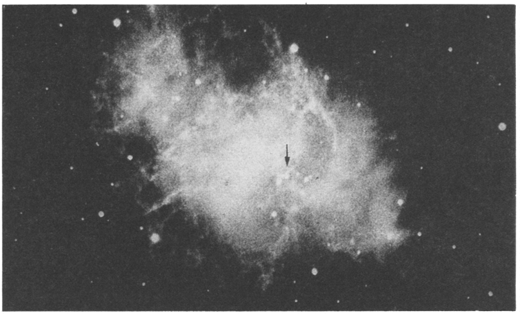

# Project Report: Search for Ancient Indian Records of the Sighting of Supernovae

- Author Display: Jayant V Narlikar and Saroja Bhate
- Year: 2001
- Journal Label: IJHS-36-2001-Issue-3&4
- Source Url: https://insa.nic.in/(S(eh1ucortlbqqezipwgliy3mn))/writereaddata/UpLoadedFiles/IJHS/Vol36_3and4_7_ProjectReport.pdf

<!-- source: page-chunk extraction; methods recorded in assembly-manifest.json -->
<!-- Page ranges and pdf-page markers are 1-based physical PDF positions, not printed pagination. -->

<!-- decode-chunk: pages=1-5 source_sha256=b3ce5ea0afe5da6d92f256373d54a2663db1bd73407028f3874acfbee75ae1eb -->
<!-- pdf-page: 1 -->

Indian Journal of History of Science, 36.3-4 (2001) 171-202

# PROJECT REPORT

## SEARCH FOR ANCIENT INDIAN RECORDS OF THE SIGHTING OF SUPERNOVAE

**JAYANT V. NARLIKAR[^1] AND SAROJA BHATE[^2]**

### INTRODUCTION

What is common amongst the following: A Chinese Emperor of the Sung dynasty, a learned physician from the Middle East, the Red Indian tribes on the American subcontinent, all belonging to the eleventh century and the astronomers of the twentieth century? This may sound like a quiz question, whose cryptic answer is: “They were all witnesses to a spectacular cosmic event, which is still unfolding, an event that was first witnessed on the Earth on July 4, 1054, but whose aftermath is being studied even today, and will continue to be investigated by astronomers in the years to come.”
(1) Let us begin with the Chinese, to whom we are indebted for maintaining records that date back nine and a half centuries. In the *History of Sung Dynasty* by Ho Peng Yoke, published in 1962 the following event is described: “On a Chi-Chhou day in the fifth month of the year of Chi-Ho reign period, ‘a guest star’ appeared at the south east of Thien-Kaun measuring several inches. After more than a year it faded away... ”
What could this event be? How came it to be noticed? What was meant by a guest star? For answers we have to go back a millennium, to the then prevalent Chinese tradition in which the ruling emperor looked to the sky

<!-- pdf-page: 2 -->

172 INDIAN JOURNAL OF HISTORY OF SCIENCE
for any “warnings” from the Almighty, just in case he happened to stray from the straight and narrow path of fairness and justice. Lest he had to pay a heavy penalty for inadvertently missing such a warning, the emperor made sure that a careful watch was kept on the heavens. It was the duty of the court astrologer to maintain a vigil and inform the emperor of anything unusual. It was in that context that the above event was noticed and duly recorded as stated above. And 4 July 1054 is the date as per the modern calendar corresponding to the Chinese record. The word “guest star” indicates that the star did not exist in the sky prior to the event; more correctly, it had not been observable before. Similarly, after the event was “over”, the star disappeared from the heavens, no longer being observable. The Chinese had the custom of describing such transient objects as guests in the sky. The sighting of this object was also recorded in Japan, where too the astrologers kept fairly meticulous records of the heavens.
Indeed, the star which had been previously too faint to be seen, became so bright initially that it could be seen even in daylight, while at night it was five times as bright as the planet Venus in the early morning or late evening. When it was at its brightest, one could read by its light at night.
The guest star, however, did not maintain its initial brightness and it began to fade. With the help of the old records again, we can deduce today that the object was visible in the daytime for about twenty three days and was visible at night for about six months. Eventually, within two years it ceased to be visible. The recorded direction of the object, points to Zeta Tauri in the constellation of the Bull. What do we see there today?
Fig. 1 shows the photograph of that site where, of course, by naked eye we do not see anything. The photograph shows a remarkable cloud-like structure with several filaments sticking out. Because its shape reminded the astronomers who took the first photographs, of a crab, the object was given the name ‘Crab Nebula’. Certainly, whatever is going on there now must be still pretty violent, judging by its highly disturbed appearance.
We will return to this remarkable picture later. We first look at another bit of evidence of its observation, coming from an altogether different part of the world.

<!-- pdf-page: 3 -->

PROJECT REPORT 173

*Fig. 1: The Crab Nebula, the relic of the star that was seen to explode in 1054 AD, the date recorded by the Chinese astronomers corresponding to July 4 of that year. Photograph by courtesy of Palomar Observatory, California Institute of Technology.*

<!-- figure-resolved-extracted: page=3 image=media/p03_fig02.jpg -->

<!-- figure-meta: page=3, position=top, type=photograph -->

(2) In 1955, William C. Miller published a leaflet under the auspices of the Astronomical Society of the Pacific, presenting evidence that the Pueblo Indians in North America had witnessed this event and recorded it not on paper but through pictures on rock, pictures which have survived till today.
In Fig. 2a and 2b we see two different types of pictures. In the first one we see a *pictograph*, which is an image made on rock with paint or chalk (or, with a rock that writes like a chalk). This is found in the Navajo Canyan area. The second picture is a *petroglyph*, that is an image chiselled on rock with a sharp implement. It is from the White Mesa region. The crescent is the Moon, of course; but what is the round object near it? Also, why are the crescents facing the opposite ways in the two pictures?
From old Chinese records one can easily check that the Moon was in a crescent shape when the object was first seen and was at its brightest. The guest star could have been near enough to the Moon for its identification with the round object in these pictures. Moreover, these pictures were found

<!-- pdf-page: 4 -->

174 INDIAN JOURNAL OF HISTORY OF SCIENCE

*Fig. 2(a) The pictograph in the Navajo Canyan area in North America showing crescent Moon along with a bright star-like object. 2 (b) A petroglyph in the white Mesa region which also indicates the same event. Both pictures are ascribed to Pueblo Indians of the eleventh century.*

<!-- figure-resolved-extracted: page=4 image=media/p04_fig02.jpg -->

<!-- figure-meta: page=4, position=top, type=photograph -->

in places from where the eastern horizon was clearly visible. Bearing in mind that such a sight would have been seen near the Eastern horizon, one can attach significance to the locations of these pictures.
Could these pictures represent another more common sight known to observers, namely the occultation of Venus? Miller thinks not, because such occultations occur once in a few years and one would therefore have expected many more such pictures in the area. Rather, one may conclude that the tribes were not routinely interested in astronomy, but still were sufficiently impressed by this particularly rare event, to have immortalized it on rock.
As to the opposite orientation, Miller feels that the artists may have drawn one figure by looking at the original over their shoulders and may have experienced a left-right ambiguity. If one tries to draw a crescent Moon with one’s back to it while looking over one’s shoulder, one may understand the likely confusion with regard to orientation.

<!-- pdf-page: 5 -->

PROJECT REPORT 175
(3) On 29 June 1978, in a letter to the prestigious journal *Nature* Kenneth Brecher from M.I.T. in the United States and the couple Elinor and Alfred Lieber from Jerusalem, Israel presented evidence that the same remarkable sight was seen and recorded in the Middle East by a Christian physician from Baghdad, named Ibn Butan. Although not a professional astronomer or astrologer, Ibn Butan, like his contemporary physicians, was interested in the possibility that diseases on the Earth could be related to cosmic events. Ibn Butan’s biography was recorded in a biographical encyclopaedia prepared by Ibn Abi Usaybia around 1242 AD, in which his report is reproduced. Some extracts out of that report are illuminating: “...One of the well-known epidemics of our own time is that which occurred when the spectacular star appeared in Gemini in the year 446 H. In the autumn of that year fourteen thousand people were buried in the Church of Luke, after all the cemeteries in Constantinople had been filled...As this spectacular star appeared in the sign of Gemini...it caused the epidemic to break out in Fustat when the Nile was low, at the time of its appearance in the year 445 H...”
Here the year is measured on the Islamic Hizri calendar according to which the year 446 H corresponds to the period 12 April 1054 to 1 April 1055 AD, that is encompassing the dates when the Chinese saw the guest star. The apparent discrepancy of the year with the year 445 H relating to the Nile valley, was explained by the authors as due to a copying error on the part of Ibn Abi Usaybia. For, elsewhere in the same encyclopaedia the date checks out to be 446 H. Ibn Butan seems to imply that this event occurred in the summer and caused the epidemic in the following Autumn when the Nile was low. This places the event in the summer of 1054, which agrees with the more precise Chinese date of 4 July 1054 AD.
One additional point needs to be sorted out. The Crab Nebula is seen today in the constellation Taurus, whereas Ibn Butan refers to Gemini. If he were using the astrological convention, he would give the location with respect to the Sun’s location in the zodiac. If one takes into account the

[^1]: * Inter-University Centre for Astronomy and Astrophysics, Ganeshkhind, Pune 411007.

[^2]: ** Department of Sanskrit and Prakrit Languages, Pune University, Ganeshkhind, Pune 411007.

[^3]: [1] *Nature*, 273 (1978), 728-730.
<!-- /decode-chunk -->

<!-- decode-chunk: pages=6-10 source_sha256=da3334cb401d1f8b4da95293abd6e666e4155513b5b9ca7986c553dead032f0d -->
<!-- pdf-page: 6 -->

176 INDIAN JOURNAL OF HISTORY OF SCIENCE
steady precession of the Earth’s rotation axis, the Crab Nebula would have appeared in Gemini about a thousand years ago.
We thus have three different sources of information about the sighting of a unique cosmic event, from China and Japan in East Asia, from the Middle East in West Asia as well as from the American continent in the western hemisphere. Why no records from India or Europe? Why with its long tradition of writing and preserving manuscripts, did Europeans fail to record this event? Here astrophysicist Fred Hoyle and historian of science George Sarton have independently argued that the religious beliefs in Europe of those days assumed that God had created the Cosmos in perfection and as such no new phenomena, like this one would have been considered credible enough to be documented. So the scholars in the monasteries chose to ignore what they saw. Perhaps! But what about India?
In India astronomy was flourishing in the golden era which had started with Āryabhaṭa in the 5th Century and which was to continue till Bhāskara II in the 12th Century. Surely, such an event would have been witnessed by many at least in some part of the subcontinent, despite the July date falling in the Monsoon season. And when something so unusual were seen, the astronomers and astrologers would have been consulted.
The explanation may be that there was not much written tradition in India at the time, the emphasis of scholarship being on reading the ancient texts rather than creating new ones.
Nevertheless some attempts were felt to be necessary to trace old records of the period which might contain at least oblique references to the event. A project was accordingly proposed for support by the Indian National Science Academy under its programmes in the History of Science. This paper is the outcome of the investigations made under this project.
Before coming to those details we summarize the modern interpretation of this strange event.

## THE CRAB SUPERNOVA

Around 1731, an English physician and amateur astronomer named John Bevis found a bright nebula in the Taurus Constellation. In 1758, Charles Messier began his famous catalogue of bright nebulous objects in

<!-- pdf-page: 7 -->

PROJECT REPORT 177
the sky with this bright object labelled M1. Fig. 1 mentioned earlier shows a modern photograph of that remarkable object.
With its direction matching that of the ancient Chinese records, and its physical environment consistent with the remnant of what that event was, astronomers are sure that the guest star did not actually go away, but is still around in the shape of its remnant, the Crab Nebula. The approximate distance of this nebula from us is 5000 light years while the extent of the whole structure of Fig. 1 is as large as 5 to 10 light years. [1 light year is the distance travelled by light in one year, and is approximately ten million million kilometres.]
So this is what remains today of the event that was witnessed by the Chinese, the Red Indians and the Middle Easterns, nine and a half centuries ago. The event is a catastrophic one marking the break up of a star. The star, in its evolutionary course, burns nuclear fuel in its interior. This process serves two purposes. Firstly, it provides the star with an energy reservoir on which to draw in order to continue shining. Secondly, and more importantly for the star’s continued existence, it generates internal pressures which keep the star in a stable equilibrium against its inward force of gravity.
However, at some stage, the nuclear fuel gets fully depleted and the star can no longer keep itself in equilibrium. Its inner core collapses inwards (-implodes) while the outer part, the envelope, explodes outward being disrupted by the shock wave generated by the inner implosion. A vast amount of energy and particles including neutrinos is released which is why the star, now called a supernova, outshines the entire galaxy (containing some hundred billion stars). No wonder, the Crab supernova was seen by the Chinese even during daytime.
Our Milky Way Galaxy is expected to have such stellar explosions three to four times a century. After the Crab, two supernovae were seen in the Galaxy, one by the astronomer Tycho Brahe in 1574 and the other by Johannes Kepler in 1604. The reason why only three were seen in a millennium, is because light absorption prevents us from seeing explosions in most of the galactic disc. Nevertheless, astronomers do see and regularly record supernovae seen in other galaxies.

<!-- pdf-page: 8 -->

178 INDIAN JOURNAL OF HISTORY OF SCIENCE
With these remarks we now come to the project itself, and the search strategies adopted.

## SEARCH STRATEGIES

After considerable brainstorming it was decided to proceed with the following search strategy. It addressed the three questions: What? When? and How?
The opening question with which the strategic planning commenced was: WHAT kind of literature constitutes the material to be searched? The obvious and prompt reply was: of course, astronomical. However, it was realized at the same time that it was not correct to delimit the area of search to astronomy. The reference we were looking for could as well appear in a literary work, an epic, or a poem. It was also likely to be located in a work on history of India or of a region or of a ruling king. A possibility of the mention of a sudden appearance of a bright new staring the sky causing spread of a certain illness among people on the earth could be located in a treatise on medicine or a commentary thereof. Moreover, speculations and flights of imagination arising from the sight of a strange shining body in the sky would not have been out of place in books of folk tales or books on miracles, portents and omens in the literature with Indian ethos.
All these considerations led us to widen the scope of the literature to be explored. The literature thus identified for the purpose of the present project was astronomical, literary, historical, medical, religious and encyclopaedic in character.
This literature was available in three forms: printed books, manuscripts and inscriptions. Although the work plan mentioned manuscripts alone, the research team decided to cover the literature available in all the three forms in order to be exhaustive in its approach.
Apart from the primary sources available in the three forms mentioned above, secondary sources in the form of monographs, surveys and research articles dealing with relevant matter were also included in the search material. But, first of all, the researchers must know WHAT they should look

<!-- pdf-page: 9 -->

PROJECT REPORT 179
for. One of their search tools was their basic understanding of the astronomical event of supernova explosion as well as of different ways of its descriptions in both scientific and ordinary languages. Books in astronomy including those on basics of Indian astronomy were, therefore, recommended to the research scholars as primary reading.
The Jain and Buddhist literature which developed in Ardhamagadhi and Pali languages contemporaneously with Sanskrit also was considered a potential source of information that was sought for. The research team therefore, decided to scan the relevant literature in those two languages along with Sanskrit.
The WHEN question concerned the selection of the literature confined to a certain period. Since the event of the Crab Supernova took place in 1054 AD it was first decided to collect the literary sources existing around this period. However, later it was realized that the description of the event could appear also in the works belonging to the subsequent period, because many Indian authors took delight in imitating their forefathers by repeating, sometimes it ad verbatim, what the latter said. The span of the period of composition of the literature was therefore, extended from 11th to 15th Century.
HOW should the search be carried out? With this question the research team landed into the most difficult part of its strategic planning. It was difficult on account of several factors, including the vastness and the complex variety of the literature and its being scattered in the libraries throughout the country. Step by step march was the policy adopted by the research team which embarked upon the mission of collecting and sifting data, beginning with Pune and fanning outwards.
The first works to be handled by the team were the histories of Indian literature by different authors. The research scholars collected titles of Sanskrit works and their authors from these histories. They further scanned the bibliographies to obtain additional information. Proceedings of national and international conferences, festschrifts and commemoration volumes, indices of papers published in prominent Indological journals and similar other works were perused to collect secondary material in the form

<!-- pdf-page: 10 -->

180 INDIAN JOURNAL OF HISTORY OF SCIENCE
of monographs and research articles. These initial lists were very exhaustive though confined to the four centuries of the history of Indian literature. The literary sources collected by these means constituted printed books and articles (which also included printed copies of inscriptions).
For collecting material from manuscripts the research team carefully went through catalogues of manuscript libraries both in Pune and outside Pune. The *Catalogus Catalogorum* also was consulted for obtaining more information. The five volumes of the *Census of Exact Sciences in India* prepared by David Pingree proved of immense use for the compilation of astronomical data. Thus, after finishing the spadework to a large extent in Pune and preparing a database in terms of titles of books and manuscripts to be perused, the research team proceeded to the second step of actually reading the books and manuscripts in order to locate citations of the event. Pune being a treasure house of Indological literature, the search started with libraries in Pune. The libraries of the University of Pune, Bhandarkar Oriental Research Institute, Vaidik Samshodhana Mandal, Deccan College, Bharat Itihasa Samshodhana Mandala and Anandashrama were visited. The researchers had relatively less difficulty in obtaining epics, poems and other literary works as well as well-known books on religion, history and medicine. The lesser known texts and most of the manuscripts were, however, not available. In spite of a long, exhaustive list of books and manuscripts prepared by the researchers, relatively few books and manuscripts were available to them.
These included the well-known works like the historical poem *Rājataraṅgiṇī*, the biographical poem *Vikramāṅkadevacarita*, the folktale collection *Bṛhatkathāmañjarī*, the *Bhaviṣyapurāṇa*, the astronomical works, like the *Bhadrabāhusaṃhitā* and the manuscripts of astronomy and astrology like *Śāntisāra*, *Camatkāracintāmaṇi* and *Nakṣatracintāmaṇi*. The biographical poem in Prakrit called *Kumārapālacariya* was also studied.
Along with these books directly related to the project, the researchers also read books on the history and culture of the Indian people with reference to the period under discussion and a few research articles on stone inscriptions of the 11th and 12th Centuries.
<!-- /decode-chunk -->

<!-- decode-chunk: pages=11-15 source_sha256=32024dd59fc172bdc8f77727e14d065b646ebf857c777cc8661cbe12346db488 -->
<!-- pdf-page: 11 -->

PROJECT REPORT 181
Expeditions to libraries outside Pune commenced at the next step. Most of the groundwork in the form of preparing lists of books and manuscripts being already accomplished at Pune, the researchers were required to visit different libraries and make on the spot inquiry into the contents of the books made available to them.
After visiting nearby places such as Prajna Pathashala Mandal at Wai, Narlikar Bhavan at Kolhapur and Asiatic Society Library at Mumbai, the researchers visited Bangalore and Chennai in search of fresh material. At this juncture the search strategy was slightly modified. Firstly, it was decided to consult some eminent scholars on the future course of action. Secondly, on the basis of the earlier observations, namely, that the astronomical texts during the period under examination were merely faithful reproductions of the previous works, it was decided to lay less emphasis on the manuscripts of astronomy though search in them was not to be totally abandoned. Dr B.V. Subbarayappa, President, International Union of the History and Philosophy of Science at Bangalore and Dr K. V. Sarma, the veteran Indologist at Adyar, Chennai were among the stalwarts consulted by the research team. The research team proceeded in the light of the guidelines given by these two scholars.
During their visits to different collections at Chennai the research scholars found some material in scripts other than Devanagari. This material was xeroxed and brought to Pune for decipherment of the scripts. Among the works perused at Bangalore and Chennai were books called *Nāradasaṃhitā*, *Yātrāprabandha* and manuscripts called *Mukundavijayaprasasti* and *Jyotiṣaratnamālā*. About 50 books and manuscripts were perused at the Academy of Sanskrit Research at Melkote, and Oriental Research Institute at Mysore.
During his visit to Kerala our research scholar was told that much work has already been done on the Kerala School on astronomy and the searches by eminent scholars were available in the form of publications. The idea of search through Kerala manuscripts was therefore given up. The research scholar however, went through the books and manuscripts not covered so far.

<!-- pdf-page: 12 -->

182 INDIAN JOURNAL OF HISTORY OF SCIENCE
The same search strategy was adopted by the research group which visited Rajasthan, Gujarat and Calcutta. The team could not visit some libraries as they were closed for some reasons. At Ahmedabad and Patna our scholars perused about 30 manuscripts on Jyotiṣa which were selected from a bulk of about 1000 manuscripts. At Varanasi they took the opportunity of addressing a gathering of Jyotiṣa and requesting them to provide whatever information they could on the event.
It will be thus seen that the search strategies have essentially been optimized with slight modifications and additions required by the situation. We should mention that a similar exercise was performed to check the record of earthquakes in medieval times, by R. N. Iyengar, Devendra Sharma and J. M. Siddiqui[^2] who focussed on the period 1200 AD to 1800 AD.

## THE RESULTS

Our searches have not led to anything definitive that can stand alongside the Chinese or Japanese notings of the Crab supernova, nor are they even broadly confirmatory as in the case of Ibn Butan’s records. Our scholars, however, had been instructed to jot down any references that even remotely were suggestive of a supernova explosion. Having looked at a primary list of such findings and eliminating those that do not even remotely resemble the sighting of a supernova, we have short-listed the following seven. Of these 5-7 may have some relevance to the sighting of a star in daytime, which can be a supernova.
1. *Mahābhārata, Bhīṣmaparvan* (Critical Edition, Bhandarkar Oriental Research Institute, 1947), 2.22:
> *jvalitārkendunakṣatraṃ nirviśeṣadinakṣayam /*
> *ahorātraṃ mayā dṛṣṭaṃ tad bhayāya bhaviṣyati //*
Vyāsa warns Dhṛtarāṣṭra of undesirable consequences of the war. He says, “I have seen the day and night with the Sun, the Moon and the constellations burning and the end of he day not differentiable. This will create horror.”

<!-- pdf-page: 13 -->

PROJECT REPORT 183
2. *Rājataraṅgiṇī* (ed. M. A. Stein, Munshiram Manoharlal, New Delhi, 1960), 7.1346:
> *prāg andhakāro deśe 'smin divase 'pi vyajṛmbhata /*
> *rūpikādivasāloka iti yat paprathe janaiḥ //*
The verse is from the story of Harṣa who, during his war expedition, uprooted the idol of local deity, Parihāsakeśava. It describes the incidence as follows: “It was a story among the people that before (the erection of that image) there had been in this land darkness, even at day-time. This has ceased after the erection of the image of Parihāsakeśava, which spread daylight by its silver, it happened again for a month and a half after the destruction of that (image).” (Translation by M.A. Stein).
3. *Jyotiṣakalpataru* of Kavicūḍāmaṇi, L,1754, MS from Alwar Maharaja’s Library.
> *saptame 'hani kampaḥ syān mahān anilasambhavaḥ /*
> *tārolkāpātavidāhair ādīptaṃ lakṣayen nabhaḥ //*
The manuscript describes a certain event as follows: “On the seventh day there would be tremor caused by the wind and one would notice the sky blazing and burning with the falling of meteors and stars.”
4. *Śāntisāra* of Kamalākarabhaṭṭa, 0372, Centre of Advanced Studies in Sanskrit.
> *nakṣatracandrasūryāṇāṃ maholkāpātanaṃ tathā /*
> *divyolkāpātanaṃ tadvad divā nakṣatradarśanam //*
The text describes heavenly events causing calamities on the earth. The list of such events includes the following: “Falling of stars, the Sun, the Moon, similarly, falling of a giant meteor or a heavenly meteor as well as the sight of a star during the day (are bad omens).”
5. *Bṛhatsaṃhitā* of Varāhamihira (ed. Pt. Subrahmanya Shastri, Bangalore, 1947), chapter 46:
> *grahanakṣatratārāṇāṃ darśanaṃ ca divāmbare*
The text describes portents. One of them is sight of stars, heavenly

<!-- pdf-page: 14 -->

184 INDIAN JOURNAL OF HISTORY OF SCIENCE
bodies and constellations during the day (as a portent)
6. *Sarvādbhutatāśānti*, 36, 380, MS from Bharata Itihas Samshodhan Mandal, Pune:
> *divyolkāpātanaṃ tadvad divā nakṣatradarśanam*
The text enlists portents in the same way as above. Two of them are described as follows: “Fall of a meteor during the day and sight of a star during the day (as portents)”
7. *Bhaviṣyapurāṇa* (ed. Pt. Shriram Sharma, Sanskriti Sansthan, Vednagar, Bareilly), *Brahmaparvan*, 153. 29-3:
> *teṣāṃ darpāpahārāya prabodhārthaṃ ca gopate /*
> *tejorūpaṃ samudbhūtam aṣṭaśṛṅgam anupamam //*
> *alakṣyaṃ pāpatamasā mahad vyoma narādhipa /*
> *jvālāmālāvṛtaṃ vīra bahurūpaṃ ca bhāsate //*
> *śatayojanavistīrṇaṃ gatam ūrdhvaṃ bhramaṃ tathā /*
> *gomadhyato mahārāja karṇikevambujasya vā //*
The text narrates the story of the Sun god who, in order to destroy the pride of all the gods, assumed the form of all-pervading brightness. This is described as follows: “O king, to remove their pride and to awaken them, a bright form with eight horns arose in he sky. It was beyond description. The vast sky which was covered with strings of flames and which appeared in multiple forms was invisible for sinners. Like the central bud of lotus a stream of brightness shot from the middle of the earth and spread high up along a hundred yojanas rotating in the heaven.”

## CONCLUSION

This, at first sight, seems a disappointing end to a quest in history of science. One may try to rationalize the lack of any specific evidence with the oral tradition of transmission of knowledge on the subcontinent. Thus the practice of writing down some fact or idea and preserving it for posterity, common in Europe and China, and also in the Middle East, was not so common in India. Also, the practice of debating at length deep

<!-- pdf-page: 15 -->

PROJECT REPORT 185
philosophical concepts in preference to experiments and observations must have played a role. Even the written material, as mentioned before, cannot be authenticated vis-a-vis dates. For, in some cases, portions from earlier manuscripts are simply copied in later ones, presumably because the author felt that it would enhance the overall credibility of the entire text. In other cases, portions were added later, giving the impression that the later insertions belonged to the earlier period.
In this context, the views communicated by Dr K.V. Sarma in his letter dated 23.11.1997 are worth reproducing:
“The possible explanation herein lies in that science in India developed more or less in a utilitarian manner. In other words, when there was a need or use, things were investigated and worked on. However matters which were not of a practical value were ignored and disregarded. For example, eclipses were accurately computed much earlier than when they were to occur (because) tradition and the dharmaśāstra-s prescribed prohibitions, prayers, gifts, fasting and worship at specific kṣetra-s, besides religious bath at the commencement and completion of the eclipses. Also eclipses were common and frequent, but not supernova which were very rare phenomenon, occurring once in a blue moon having no traditional and other injunctions behind them. Neither could they be predicted. Hence they were just witnessed as something supernormal and ignored. In ancient times, in India, it was not the practice ‘to record’, even as the number of times river Ganges overflowed its banks is not recorded during early times but it might be done now by moderners for specific purposes which are necessary today.
“In effect, the supernova which occurred a thousand years back might have been noticed in India also but the date or duration of its sight had not been recorded because there was no practical utility therefor”.
Nevertheless, we feel that the exercise was worth undertaking. It is by no means exhaustive; and some written notings of supernova sightings

[^2]: IJHS 34. 3 (1999) 181-237
<!-- /decode-chunk -->

<!-- decode-chunk: pages=16-20 source_sha256=f9985f2f6639c456aa12492a8a5a797aa0d5ba4879f80caf7ca3d9e932f00358 -->
<!-- pdf-page: 16 -->

186 &nbsp;&nbsp;&nbsp;&nbsp;&nbsp;&nbsp;&nbsp;&nbsp;&nbsp;&nbsp;&nbsp;&nbsp;&nbsp;&nbsp; INDIAN JOURNAL OF HISTORY OF SCIENCE
not found by us, may still be around in stone inscriptions or in Prakrit languages, instead of in Sanskrit. If any scholars in future wish to resume the quest, they may wish to know it what we have already looked at, since this will enable them to concentrate their searches elsewhere. From this point of view, we attach some listings of references to what has been searched in this project, as Appendices I-III of this paper.

### ACKNOWLEDGEMENTS

JVN thanks the Indian National Science Academy for financial support to this project. We wish to record our thanks to the scholars who carried out the searches under this project: Dr P. A. Kale, Ms. Shilpa Mulay, Mr. Ratnakar Bhalerao, Mr. Malhar Kulkarni and to the many libraries who provided search material on request. We are grateful to Dr B. V. Subbarayappa and Dr K. V. Sarma for useful advice.

<!-- pdf-page: 17 -->

PROJECT REPORT &nbsp;&nbsp;&nbsp;&nbsp;&nbsp;&nbsp;&nbsp;&nbsp;&nbsp;&nbsp;&nbsp;&nbsp;&nbsp;&nbsp; 187

## APPENDIX I

### LIST OF INSTITUTES VISITED

1. Ahmedbad
    1. Lalbhai Dalpatbhai Institute.
    2. B. J. Institute
    3. Gujarat University
2. Alwar
    1. Rajasthana Oriental Research Institute, Alwar Branch.
    2. Alwar Maharaja’s Library.
3. Allahabad
    1. Allahabad University
    2. Hindi Sahitya Sammelan
    3. Ganganath Jha Research Institute
4. Bangalore
    1. Camarajendra Pathashala
    2. Mythic Society
    3. Purnaprajna Pathashala
    4. Aksharam
    5. Indian Institute of the World Culture
5. Baroda
    1. Oriental Institute
6. Bombay
    1. Asiatic Society
    2. University of Bombay
7. Calcutta
    1. The Asiatic Society

<!-- pdf-page: 18 -->

188 &nbsp;&nbsp;&nbsp;&nbsp;&nbsp;&nbsp;&nbsp;&nbsp;&nbsp;&nbsp;&nbsp;&nbsp;&nbsp;&nbsp; INDIAN JOURNAL OF HISTORY OF SCIENCE
&nbsp;&nbsp;&nbsp;&nbsp;2. Indian Museum Library
&nbsp;&nbsp;&nbsp;&nbsp;3. National Library, Alipore
&nbsp;&nbsp;&nbsp;&nbsp;4. Central Reference Library
&nbsp;&nbsp;&nbsp;&nbsp;5. Calcutta College of Sanskrit
&nbsp;&nbsp;&nbsp;&nbsp;6. Sanskrit Sahitya Parishad
&nbsp;&nbsp;&nbsp;&nbsp;7. Vangiya Sahitya Parishad
8. Calicut
    1. Department of Sanskrit, University of Calicut
9. Chennai
    1. Adyar Library
    2. Collection of Dr K.V. Sarma
    3. Government Oriental Manuscript Library
10. Jodhpur
    1. Rajasthan Oriental Research Institute
    2. Maharaja Mansingh Pustak Prakashan
11. Kanyakumari
    1. Vedapathshala
12. Kolhapur
    1. Narlikar Bhavan
13. Melkote
    1. Academy of Sanskrit Research
14. Mysore
    1. Mysore Oriental Research Institute
15. Patan
    1. Hemchandracarya Jnana Bhandar
16. Pune
    1. Deccan College

<!-- pdf-page: 19 -->

PROJECT REPORT &nbsp;&nbsp;&nbsp;&nbsp;&nbsp;&nbsp;&nbsp;&nbsp;&nbsp;&nbsp;&nbsp;&nbsp;&nbsp;&nbsp; 189
&nbsp;&nbsp;&nbsp;&nbsp;2. Bhandarkar Oriental Research Institute
&nbsp;&nbsp;&nbsp;&nbsp;3. Bharat Itihas Samshodhan Mandal
&nbsp;&nbsp;&nbsp;&nbsp;4. Centre of Advanced Studies in Sanskrit
&nbsp;&nbsp;&nbsp;&nbsp;5. Tilak Ayurved College
&nbsp;&nbsp;&nbsp;&nbsp;6. Anandashram
&nbsp;&nbsp;&nbsp;&nbsp;7. Papal Seminary
17. Sucindram
    1. Sucindram Temple
18. Trichur
    1. Kerala Sahitya Academy
19. Thiruvananthapuram
    1. Department of Sanskrit, University of Thiruvananthapuram
    2. Oriental Research Institute

<!-- pdf-page: 20 -->

190 &nbsp;&nbsp;&nbsp;&nbsp;&nbsp;&nbsp;&nbsp;&nbsp;&nbsp;&nbsp;&nbsp;&nbsp;&nbsp;&nbsp; INDIAN JOURNAL OF HISTORY OF SCIENCE

## APPENDIX II

### LIST OF INSTITUTES WITH NAMES OF MANUSCRIPTS STUDIED

#### Bhandarkar Oriental Research Institute, Pune

1. *Sūryaprajñaptiṭīkā* of Malayagiri, 19 of 1881-82.
2. *Jambūdvīpaprajñapti* of Sudharmasvāmin, 30 of 1869-70.
3. *Candraprajñaptisūtra*, 429 of 1882-83.
4. *Mayūracitraka* of Nārada, 962 of 1886/92.
5. *Ariṣṭanavanñta* by Navanītanartanakavi, 52 of B 1919/24 & 53 of B 1919/24.
6. *Jyotiṣasukha* of Nīlakaṇṭha, 317 of 1882/83.
7. *Yantracintāmaṇi* of Daāodara, 1140 of 1886/92
8. *Yantraratnāvalī* of Padmanābha, 202 of 1883/89 & 976 of 1886Ū 92, 1400 AD.
9. *Āścaryayogamālā* of Nāgarjuna, 554 of 1892/95.
10. *Āsurīkalpa*, 1106, 1886/92.
11. *Uddhārakoṣa* of Dakṣiṇāmūrtimuni, 962 of 1891/95.
12. *Ākāśabhairavakalpa*, 455 of A1881-82.
13. *Itihāsamuccaya*, 170 of 1892/95.
14. *Karmānuṣṭhānapaddhati* of Bhavadeva, 9 of 1895/98.

#### Centre of Advanced Studies in Sanskrit, Pune.

15. *Śāntisāra* or *Śāntikamalakāra* of Kamalākarabhaṭṭa, 0372:
16. *Praśnānām śakunāvalī*, 0357.
17. *Kāmaratna*, 0361.
18. *Rasaratnākara*, 0362.
19. *Nakṣatraśāntiprayoga*, 0597.
20. *Kālamādhava* of Mādhava, 0385.
<!-- /decode-chunk -->

<!-- decode-chunk: pages=21-25 source_sha256=7cea2d052a2218720f5a7130290d7ed86e6227c638d7a1472fed1ab61c469506 -->
<!-- pdf-page: 21 -->

PROJECT REPORT 191
21. Janamāriśāntiprayoga, 0573.
22. Pravāsavidhi, 0637.
23. Kṛmicikitsā, 0678.
24. Ādityahṛdayastotra, 0501.
25. Lampākaśāstra, 0698.
26. Malamāsamāhātmya, 0703.
27. Bhāviprāyaścitta, 0900, 01029.
28. Dṛgārgala with commentary of Bhaṭṭopala, 01052.
29. Bhaumavrata, 01132.
30. Jyotiṣapraśna, 01134.
31. Vratārka, 0127.
32. Saura, 0623.
33. Vṛkṣārāmotsargavidhi, 0446.

### Bharat Itihasa Samshodhan Mandal, Pune.

34. Bhūgolavarṇana, 59, 165.
35. Keralasiddhānta, 39, 332.
36. Aṣṭaiśvarya, 34, 710.
37. Kālajñāna, 22, 412.
38. Utpātayoga, 37, 33.
39. Kūtavicāra, 52, 159.
40. Kālāmṛta of Veṅkaṭayajvā, 34, 851, Śaka, 1937.
41. Mahāmāriśānti, 57, 221.
42. Meghamālālaksana, 59, 283.
43. Utpātaśānti, 29, 1054.
44. Caturadaśasvapnavarṇana, 876.
45. Gaṇividyāprakīrṇaka, 665.
46. Aupapattikaupāṅgasūtravṛtti, 10874.
47. Kākaruta of Divācārya, 8907.
48. Kalidūṣaṇa, 59.362.

<!-- pdf-page: 22 -->

192 INDIAN JOURNAL OF HISTORY OF SCIENCE
49. Adbhutaśānti of Anantapurāṇika, 43, 67, Śaka, 1749.
50. Upavanavinoda of Śārṅgadhara, 34.339.
51. Oṣadhiprayoga, 7.692.
52. Sarvādbhutaśānti, 36, 380.
53. Rasamañjarī of Vaidyanāthaputra Śālinātha, 2.80.

### Anandashram Sanstha, Pune.

54. Dānamantra, S13-3-73.
55. Daśadānamantra, S13-3-68.
56. Dānamantrapaddhati, S13-3-74.
57. Śāntimayūkha of Nīlakaṇṭhaśaṃkarabhaṭṭa, S9-7-323.
58. Adbhutaśānti of Śaunaka, S15-1-46.

### Asiatic Society, Bombay

59. Aticāra, Roll No. 11.
60. Bappabhaṭṭī, Roll No. 2
61. Dhūrgān, Roll No. 24.
62. Śakuna & Kālajñāna, Roll No.12.

### Mysore Oriental Research Institute.

63. Āryabhaṭasiddhātavyākyā of Śrīdharācārya, A.877/2.
64. Upayuktajyautiṣa, B.613.
65. Jyotiṣaphalabodha, B.584.
66. Jyotiṣavṛttaśataka of Maheśvaropādhyāya, C.4308/1.
67. Tattvamuktāvalīvyākhyā of Veṇīpaṇḍita, C.4050/2.
68. Varṣātantra, C.1807/1.
69. Samarāsarāṭīkā, C.4330/2.

### Lalbhai Dalpatbhai Institute, Ahmedabad.

Catalogue of Saṃskṛta & Prākṛta Manuscripts, Muniraja Punyavijayji’s Collection, Part III, Serial Numbers 6646 to 7611 are on jyotiṣaśāstra.

<!-- pdf-page: 23 -->

PROJECT REPORT 193
Along with the name of the manuscript, the serial number and the accession number are given below.
70. Aṣṭagrahadṛṣṭi, 6643-7783/3.
71. Aṣṭavargāya, 6664-2629/2.
72. Gajacakrāśvacakra, 6711-8989.
73. Durbhikṣavicāra, 6934-8281/4.
74. Doṣapṛcchā, 6935-2517.
75. Yavanajyotiṣaśāstra of Yavanācārya, 7160-5308.
76. Śubhāśubhanirīkṣaṇa, 7242-693/3.
77. Saṃkrāntiphalādi, 7275-6523.
78. Sukāladuṣkālajñāna, 7293-2979/1.
79. Sūryacandramaṇḍalavicāra, 7302-2202.
80. Bhramaraphālaphālavicāra, 7492-6707/1.
81. Madhukaramaṇiparīkṣā, 7493-6928/6.
82. Śvānaruțavicāra, 7532-532.
83. Dantaparīkṣākalpa, 7536-693/2.

### Hemacandracarya Jnanabhandara, Patan, Gujarat.

84. Nāracandrajyotiṣastabaka, 5100.
85. Jyotiṣacaturviṃśikā, svāvacūripañcapāṭha of Naracandropādhyāya, 5101.
86. Ekaviṃśatisnānaprakaraṇa of Siddhasenasūri, 9807.
87. Śakunaśāstra of Siddhisikottari, 9543.
88. Nakstracūḍāmaṇi, 8852.
89. Rātrilakṣaṇavādasthala, 8810.
90. Āmbhasiddhi of Udayaprabhasūri, 8814.
91. Sāmudrikaśāstra, 8913.

### Oriental Institute, Baroda.

92. Vṛṣṭivicāra, Anāvṛṣṭiśānti by Kāśīnātha Bhaṭṭa, Acc. No. 10984, Śaka. 1759.

<!-- pdf-page: 24 -->

194 INDIAN JOURNAL OF HISTORY OF SCIENCE
93. Grahalāghava by Gaṇeśa, Acc. No. 3114.
94. Jyotiṣasamuccaya, Acc. No. 7468.
95. Yātrāprakaraṇa, Acc. No. 4044.
96. Luptābdanirṇaya by Rāmacandra, Acc. No. 3281, D.C. Śaka 1622.
97. Samarasāra by T. Bharata, Acc. No. 8364(b).
98. Kākaśakuna, Acc. No. 3309, author not mentioned, Saṃ. 1942.
99. Pārasīprakāśa by Vedāṅgarāya, Acc. No. 3187, Saṃ. 1820.
100. Bhuvanapradīpaka by Padmaprabhasūri, Acc. No. 2886, Saṃ. 1823.
101. Saṃvatsaraphala by Śiva, Acc. No. 3290, Saṃ. 1940.
102. Khagolādhyāya by Malayacandra, Acc. No. 5500.

### Sampurnananda Sanskrita Vishwavidyalaya, Varanasi.

103. Jyotiṣam vṛttaśatam, 32216.
104. Vasiṣṭhasaṃhitā, 35261.
105. Jyotiḥsāgara, 34399.
106. Vyavahāracamatkāra, 35158.
107. Grahāgamakutūhala, 35602.
108. Viśvaprakāśa, 35759.
109. Saṃvitprakāśa, 35852.
110. Bhūgolapurāṇa, 36989.

### Banaras Hindu University, Varanasi.

111. Jyotiṣacadrārka of Rudradeva, b3300.

### Rajasthan Oriental Research Institute, Jodhpur.

112. Jyotiṣanibandhagrantha, 36453.
113. Jyotiṣamuktāmaṇi, 36572.
114. Jñānadīpikā, 5754.
115. Nakṣasamuccaya, 9828(20).
116. Uḍudāyapradīpa of Pārāśara. 21388.

<!-- pdf-page: 25 -->

PROJECT REPORT 195
117. Ariṣṭādhyāya, 28333.
118. Nāracandrajyotiṣa of Naracandrasūri, 9774.
119. Tājikasāra of Haribhaṭṭa, 4846.
120. Svapnacintāmaṇi of Jagaddeva, 9952.

### Maharaja Mansingh Pustaka Prakashan, Rajasthan.

121. Svapnādhyāya of Bṛhaspati, 170.

### Alwar Maharaja’s Library.

122. Jyotiṣakalpataru or Jātakaskandha of Kavicūḍāmaṇi, L.1754.

### Oriental Research Institute, Thiruvananthapuram.

123. Mālatīmādhava-vyākhyā, 760.
124. Gaṇitakriyā, 765.
125. Bhāṣāsaṃgraha, 947B.
126. Ācārasaṃgraha, 837.

### Adyar Library, Chennai.

127. Yātrāprabandha of Samarapuṃgavadīkṣita, 582.
128. Śīghrabodha of Kāśīnātha, 746a.

### Government Oriental Manuscript Library, Chennai.

129. Rājakālanirṇaya of Vidyāraṇya, D.12772.
130. Adbhutāmṛta, R3228.

### Asiatic Society, Calcutta.

131. Gahanārthaprakāśikā of Viśvanātha Daivajña, 6944.
132. Vyāsasmṛti, 6968.
133. Lomaśasaṃhitā, 6970.
134. Iṣṭaśodhana, 6981.
<!-- /decode-chunk -->

<!-- decode-chunk: pages=26-30 source_sha256=49d4115986fc268a2aedf29def7c900e656890b3841fdfe48751f74b98982daf -->
<!-- pdf-page: 26 -->

196 INDIAN JOURNAL OF HISTORY OF SCIENCE
APPENDIX III :

# BIBLIOGRAPHY OF THE WORKS CONSULTED

1. Acyuta, *Rāśigolasphuṭānīti*, ed. K.V. Sarma, The Adyar Library Research Centre, Adyar, Madras, 1955.
2. Anavāmadarśin Saṅgharāja (1236 AD), *Daivajñakāmadhenu*, ed. Shilaskanda, BSS 25, Banaras.
3. Amitagati (1000-1100 AD), *Subhāṣitaratnasandoha*, ed. Shrilal Jain, published by Pannalal Bakaliwala, Calcutta, 1917.
4. Kalhaṇa (1150 AD), *Rājataraṅgiṇī*, ed. M. A. Stein, Munshiram Manoharlal, New Delhi, 1960.
5. Kamalākarabhaṭṭa, *Śāntiratna*, Jagadhitecchu Chapakhana, Pune, 1890.
6. Kavirāja Paṇḍita, *Rāghavapāṇḍavīya*, ed. Shri Damodar Jha, Chaukhamba Vidyabhavan, Varanasi, 1965.
7. Kālidāsa (1242 AD), *Jyotirvidābharaṇa*, ed. Sitaramsharman Jambhekar, Bombay, 1908.
8. Kāśyapa, *Kāśyapasaṃhitā*, ed. P. V. Tiwari, Chaukhamba Vishwabharati, Varanasi, 1996.
9. Keśava (1050 AD), *Kauṣikapaddhati*, A commentary on *Kauśikasūtra* of *Atharvaveda*, ed. R. N. Dandekar etal, Tilak Maharashtra Vidyapeeth, Pune, 1982.
10. Kṣemendra (1100 AD), *Aucityavicāracarcā*, ed. P. L. Vaidya, Harihara Prakashan, Ramnagar, Varanasi, Sam. 2017.
11. —, *Avadānakalpalatā*, ed. P.L. Vaidya, Mithila Research Institute, Darbhanga, 1959.
12. —, *Bharatamañjarī*, ed. K. N. Dravid, A. P. Bapat Bros., Pune, 1918.
13. —, *Bṛhatkathāmañjarī*, ed. Shivadatta & K.P. Parab, NSP, Bombay, 1931, Edition 2.
14. —, *Caturvargasaṃgraha*, ed. K. P. Parab & Durgaprasad, NSP, Bombay, 1937.

<!-- pdf-page: 27 -->

PROJECT REPORT 197
15. —, *Deśopadeśa*, ed. Madhusudan Kaul, Research Department, Shrinagar, 1920.
16. —, *Darpadalana*, ed. Durgaprasad Parab, NSP, Bombay, 1930.
17. —, *Kavikaṇṭhābharaṇa*, ed. V. K. Lele, Motilal Banarasidas, Delhi, 1967.
18. —, *Narmamālā*, ed. Madhusudan Kaul, Research Department, Shrinagar, 1920.
19. —, *Rāmāyaṇamañjarī*, ed. Pt. Bhavadatta Shastri & K. P. Parab, NSP, Bombay, 1903.
20. —, *Suvṛttatilaka*, ed. Vrajmohan Jha, Caukhamba Sanskrit Series Office, Varanasi, 1968.
21. —, *Samayamātṛkā*, ed. Durgaprasad & K. P. Parab, NSP, Bombay, 1925, 2nd edition.
22. Kullūka (1150 AD), *Manvarthamuktāvalī*, commentary on the *Manusmṛti*, ed. Kavyatirtha Narayanram Acarya, NSP, Bombay, 1946.
23. Cakrapāṇidatta (1100 AD), *Āyurvedadīpikā*, a commentary on *Carakasaṃhitā*, ed. Gangasahay Pandeya, Chaukhamba Sanskrit Publication, Varanasi, 1969.
24. Cakrapāṇidatta & Śivasena, *Dravyaguṇasaṃgraha*, ed. Yadavji Trikamji Acarya, Chaukhamba Orientlia, Varanasi, 1998.
25. Cakravarti Jagadekamalla (1134 AD), *Saṅgītacūḍāmaṇi*, ed. D. V. Velankar, Oriental Institute, Baoda, 1958.
26. Jayadeva (1200 AD), *Gītagovinda*, ed. L. V. Panshikar, NSP, Bombay, 1917.
27. Jinadattasūri (1075-1154 AD), *Upadeśarasāyanarāsa*, Oriental Institute, Baroda, 1967.
28. Jinasena, *Harivaṃśapurāṇa*, ed. Pannalal Jain, Bharatiya Jnanapith, Varanasi, 1962.
29. Prabhācandra, *Prabhāvakacarita*, ed. Jinavijaya Muni, Singhi Jain Granthamala, Ahmedabad-Calcutta, 1940.
30. Pṛthuyaśas, *Ṣaṭpañcāśikā*, ed. Dinanath Jha, Caukamba Sanskrit Series, Banaras, Sam. 2004, 2nd edition.
31. Dhaneśvaramuni (1100 AD), *Surasundarīcarita*, ed. Rajavijayamuni, Banaras, 1916.

<!-- pdf-page: 28 -->

198 INDIAN JOURNAL OF HISTORY OF SCIENCE
32. Dhoyī (1100 AD), *Pavanadūta*, ed. C. H. Cakravarti, Sanskrit Sahitya Parishad, Calcutta, 1926.
33. Dhūlipāla Arka Somayājin, *Jyotirvijñāna*, Varanaseya Samskrita Vishwavidyalaya, Varanasi, 1964.
34. Durgadeva Ācārya (1032 AD), *Riṣṭasamyccaya*, ed. A. S. Gopani, Bharatiya Vidya Bhavan, Bombay, 1945.
35. Nārada (1000 AD), *Nāradasaṃhitā*, ed. Rasikamohan Chattopadhyaya, Calcutta.
36. *Saṅgītamakaranda*, ed. M. R. Telang, Baroda, 1920.
37. Nārāyaṇabhaṭṭa, *Camatkāracintāmaṇi*, ed. Brajviharilal Sharma, Motilal Banarasidas, Delhi, 1975.
38. Parthasārathi Miśra (1050-1120 AD), *Tantraratna*, ed. M. M. Ganganatha Jha, Government Sanskrit Library, Banaras, 1930.
39. Ballālasena (1159-1178 AD), *Adbhutasāgara*, ed. Muralidhar Jha, The Prabhakari & Co. , Banaras, 1905.
40. Basavarāja (1400 AD), *Śivatattvaratnākara*, ed. S. Narayanaswami Shastri et al, 3 vols, Oriental Research Institute, Mysore, 1964, 1969, 1985.
41. Brahmadeva (1092 AD), *Karaṇaprakāśa*, ed. Sudhakara Dvivedin, Chaukhamba Sanskrit Series, 23, Banaras, 1899.
42. Bhadrabāhu, *Bhadrabāhusaṃhitā*, ed. Nemicandra Shastri, Bharatiya Jnanapitha, 1999.
43. Bhaṭṭa Bhavadeva (1100 AD), *Prāyaścittaprakaraṇa*, ed. Girishacandra, Varendra Research Society, Rajashahi, 1927.
44. *Tautatitamatatilaka*, ed. Chinnaswami Shastri & Pattabhiramayya Shastri, Government Sanskrit Library, Banaras, 1939.
45. Bhavabhūti (800 AD), *Mahāvīracarita*, ed. Ramacandra Mishra, Chaukhamba Vidyabhavan, Banaras, 1955.
46. Bhavanāthamiśra, *Nayaviveka*, ed. S. K. Ramanatha Shastri, University of Madras, Madras, 1937.
47. Bhāskara (1140 AD), *Siddhāntaśiromaṇi*, ed. Kedar Datta Joshi, Banaras Hindu University, 3 vols, Varanasi, 1964.

<!-- pdf-page: 29 -->

PROJECT REPORT 199
48. —, *Karaṇakutūhala*, ed. M. S. Purohit with the commentary of Sumati Harṣa, Bombay, 1901.
49. Bhavacandrasūri, *Śāntināthacarita*, Jain Dharma Pracharini Sabha., Bhavnagar, 1922.
50. Bhṛgu, *Bhṛgusaṃhitā*, ed. Rajesh Dikshit, Hind Pustak Bhandar, Delhi, 1981, 3rd edition.
51. Bhoja (1000-1155 AD), *Nāmamālikā*, ed. E. D. Kulkarni & V. D. Gokhale, Deccan College of Research Institute, Pune, 1955.
52. —, *Rājamārtāṇḍa*, ed. Brahmashankar Mishra, Caukhamba Vidya Bhavan, Varanasi, 1966.
53. —, *Rājamṛgāṅka*, ed. David Pingree, Viveka Publications, Aligarh, 1987.
54. —, *Rāmāyaṇacampū*, ed. K. P. Parab, NSP, Bombay, 1820 Śaka.
55. —, *Sarasvatīkaṇṭhābharaṇa*, ed. T. R. Chintamani, University of Madras, 1937.
56. —, *Śṛṅgāraprakāśa*, ed. V. Rahgavan, Karnataka Publishing House, Bombay, 1940.
57. —, *Samarāṅgaṇasūtradhāra*, ed. Dvijendranath Shukla, Meherchand Laxmandas, Delhi, 1965.
58. —, *Śālihotra*, ed. E. D. Kulkarni, Deccan College, Pune, 1953.
59. Bilhaṇa (1100 AD), *Caurapañcāśikā*, ed. S. N. Tadpatrikar, Oriental Book Agency, Pune, 1966.
60. —, *Karṇasundarī*, ed. Durgaprasad & K. P. Parab, NSP, Bombay, 1932, 3rd edition.
61. —, *Vikramāṅkadevacarita*, ed. Vishwanathashastri Bhardvaj, Sanskrit Sahitya Research Committee, Varanasi, 1958.
62. Merutuṅgācārya, *Prabandhacintāmaṇi*, ed. Jinvijaymuni, Sindhi Jain Jnanapitha, Shantiniketan, 1933.
63. Lakṣmīdhara (1130 AD), *Kṛtyakalpataru*, Vol. 5 Dānakāṇḍa, Vol. 10 Śuddhikāṇḍa, ed. K. V. Rangaswami Ayyangar, Oriental Institute, Baroda.
64. Vasantarāja (1090 AD), *Śakunārṇava*, with the commentary of Bhānucandra, ed. Shridhar Jatashankar, Bombay, 1883.

<!-- pdf-page: 30 -->

200 INDIAN JOURNAL OF HISTORY OF SCIENCE
65. Varāhamihira (500 AD), *Bṛhatsaṃhitā*, ed. Subrahmanya Shastri, Bangalore, 1947.
66. Vijayapāla, *Draupadīsvayaṃvara*, Jain Atmananda Sabha, Bhavnagar, 1918.
67. Vijñāneśvara (1100 AD), *Mitākṣarā*, a commentary on Yājñavalkyasmṛti, ed. J. R. Gharpure, V. J. Gharpure, Bombay, 1914.
68. Vādirājasūri (1200 AD), *Yaśodharacarita*, ed. K. Krishnamoorti, Karnataka University, Dharwar, 1963.
69. Vāgbhaṭa (1200 AD), *Neminirvāṇa*, ed. Shivadatta & K. P. Parab, NSP, Bombay, 1936, 2nd edition.
70. Śatānanda (1099 AD), *Bhāsvatī*, ed. Ramjanma Mishra, Chaukhamba Sanskrit Sansthan, 1985, 2nd edition.
71. Śāṇḍilya (1100 AD), *Śāṇḍilyasaṃhitā*, ed. Anantashastri Phadke, Government Sanskrit College, Banaras, 1936.
72. —, *Śāṇḍilyasūtra*, Venketashwara Mudranalaya, Bombay, 1960.
73. Śāradātanaya (1175 -1250 AD), *Bhāvaprakāśana*, ed. Yadugiri Yatiraj Swami & K. S. Ramaswami Shastri, Oriental Institute, 2nd edition, Baroda, 1968.
74. Śrīpati (1100 AD), *Jyotiṣaratnamālā*, ed. M. G. Panase, Deccan College Post-Graduate Institute, Pune 1956.
75. —, *Dhīkoṭīkaraṇa*, ed. N. K. Mujumdar, Asiatic Society of Bengal, Calcutta, 1922.
76. —, *Siddhāntaśekhara*, ed. Shrikrishna Mishra, Calcutta University Press, Calcutta, 1932.
77. Somaprabhasūri (1100 AD), *Sūktimuktāvalī*, ed. Embar Krishnammacarya, Oriental Institute, Baroda, 1938.
78. Someśvara (1131 AD), *Mānasollāsa Abhilāṣitārthacintāmaṇi*, ed. R. Shamashastri, Oriental Library Publications, University of Mysore, 1926.
79. Sūryadevayajvan (1191-1240 AD), *Prakāśikā*, commentary on *Āryabhaṭīya*, ed. K. V. Sarma, Indian National Science Academy, New Delhi, 1976.
<!-- /decode-chunk -->

<!-- decode-chunk: pages=31-32 source_sha256=7e5549e3beda5e27e11e13f9a63085a903b1186c73a7fceba04a5463b146279f -->
<!-- pdf-page: 31 -->

PROJECT REPORT 201
80. Hemacandra (1088-1172 AD), *Abhidhānacintāmaṇi*, ed. Nemicandra Shastri, Chaukhamba Publications, 1964.
81. —, *Kumārapālacarita*, ed. S. P. Pandit, Government of Bombay, 1900.
82. *Pramāṇamīmāṃsā*, Satkari Mukharji & N. Tatia, Tara Publications, Varanasi, 1970.

## PURĀṆA LITERATURE

83. *Agnipurāṇa*, ed. N. Gangadharan, Motilal Banarasidas, Delhi, 1984.
84. *Devīpurāṇa*, ed. Pushpendrakumar Sharma, K. Skt. Vidyapeeth, New Delhi, 1976.
85. *Padmapurāṇa*, ed. Pt. Shriramsharma Acaraya, Samskrti Samsthana, Bareilly, 1968.
86. *Bhaviṣyapurāṇa*, ed. Shriram Sharma, Sanskriti Sansthan, Vednagar, Bareilly.
87. *Brahmāṇḍapurāṇa*, ed. Ganesh Vasudev Tagore, Motilal Banarasidas, Delhi, 1983.
88. *Matsyapurāṇa*, ed. G. V. Lele, H. Sane, published by D. H. Gokhale, Pune, 1912.
89. *Skandapurāṇa*, ed. S. S. Acarya, Sanskriti Sansthan, Bareilly, 1970.

## OTHER WORKS

90. *Sāmrājyalakṣmīpīṭhikā*, ed. K. Vasudevashastri & K. Subrahmanyashastri, T. M. S. S. M. Library, Tanjaore, 1952.
91. *Subhāṣitaratnakoṣa* of Vidyākara, ed. D. D. Kosambi & V. V. Gokhale, Harvard University Press, Cambridge, 1957.
92. *Nyāyaratnākara*, ed. Umesh Mishra, Kameshwarsinha Sanskrit Vidyalaya.
93. *Dharmaparīkṣā*, ed. Caturavijayaji Muni, Jain Atmananda Sabha, Bhavnagar, Sam 1974.
94. *Guhyasamājatantra*, ed. B. Bhattacharyya, Oriental Institute, Baroda, 1967.

<!-- pdf-page: 32 -->

202 INDIAN JOURNAL OF HISTORY OF SCIENCE
95. *Rudrayāmalatantra*, ed. Ramprasad Tripathi, Sampurnananda Samskrta University, Varanasi, 1991.
96. *Jinaratnakośa*, H. D. Velankar, B.O.R.I., 1914.
97. *Jyotiṣakaraṇḍaka*, B.O.R.I., Section - k.v.a. collection.
98. *Jyotṣasārasaṃgraha*, Narsimha Press, Calcutta.
99. *Muditakumudacandra* by Yaśaścandra (c.1200 AD), Banaras, 1906.
100. *Atharvavedapariśiṣṭa*, G. M. Bolling, J. F. Negelein, Ramkumar Rai, Chaukhamba, 1976.
101. *Mahābhārata*, Critical Edition, Bhandarkar Oriental Research Institute, 1947ff, Pune.

## MODERN STUDIES

102. D. M. Bose, S. N. Sen & B. V. Subbarayappa (ed), *A Concise History of Science in India*, INSA, New Delhi, 1971.
103. Gang Ram Garg, *An Encyclopedia of Indian Literature*, Mittal Publishers, Delhi, 1982.
104. B. V. Subbarayappa & K. V. Sarma (ed), *Indian Astronomy: A Source-Book*, Nehru Centre, Bombay, 1985.
105. Shankar Balakrishna Dikshit, *History of Indian Astronomy* (in Marathi), published by H. N. Gokhale, Aryabhushan Chapkhana, Pune, 1896.
106. S. N. Dasgupta & S. K. De, *History of Sanskrit Literature*, University of Calcutta, Calcutta 1962, 2nd editon.
107. M. Krishnamachariar *History of Classical Sanskrit Literature*, Motilal Banarasidas, Varanasi 1970.
108. R. C. Majumdar, A. D. Pusalkar (ed), *History and Culture of the Indian People*, Bharatiya Vidya Bhavan, Bombay, 1951 ff.
109. *Astronomical Works of Daśabala*, ed. David Pingree, Viveka Publications, Aligarh, 1988.
<!-- /decode-chunk -->
