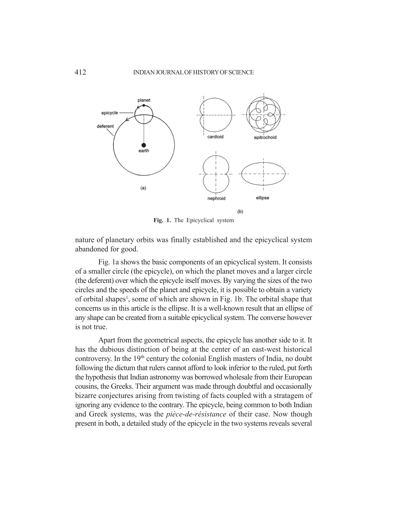
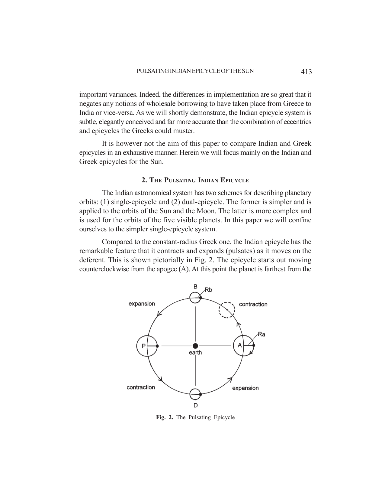
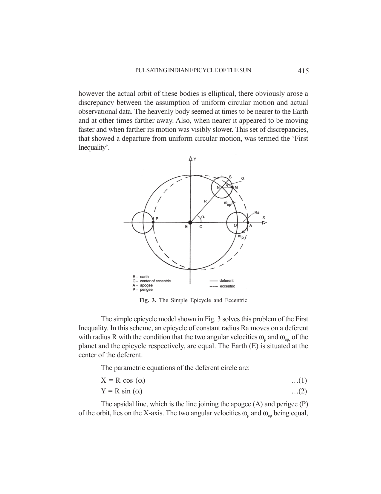
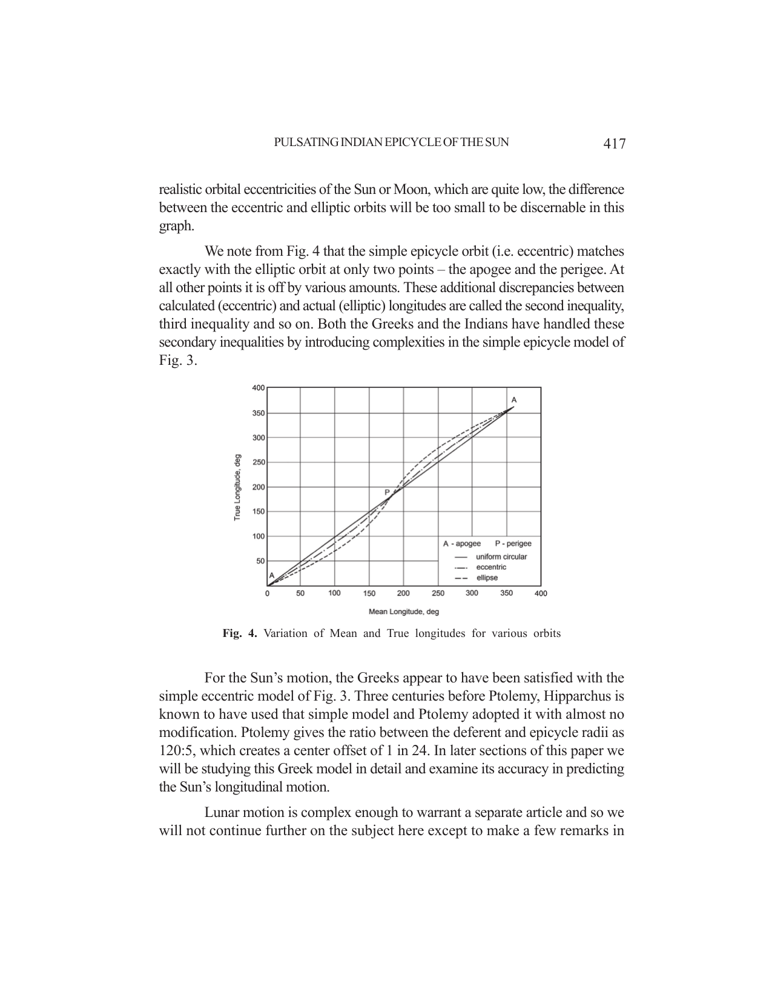
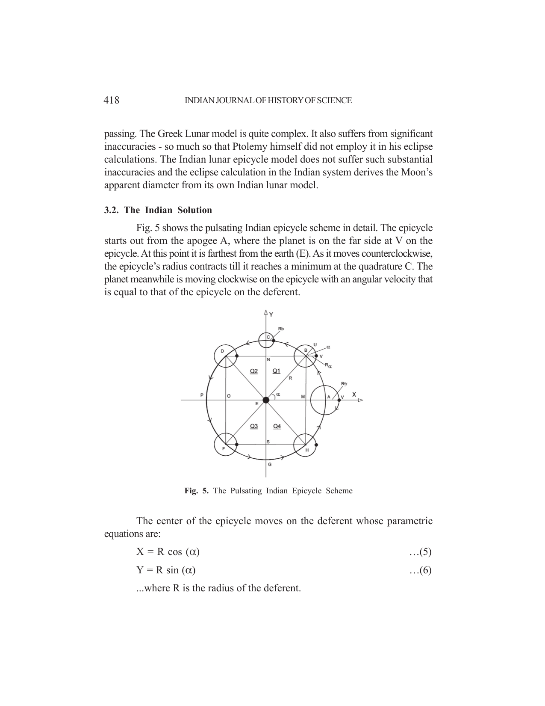
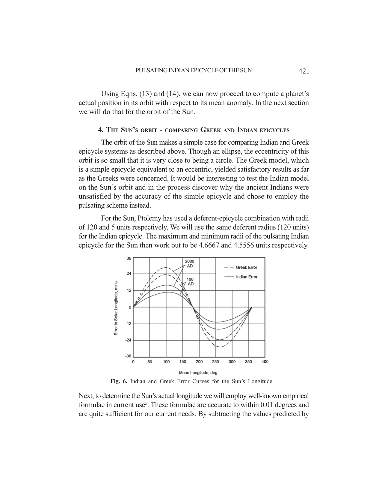
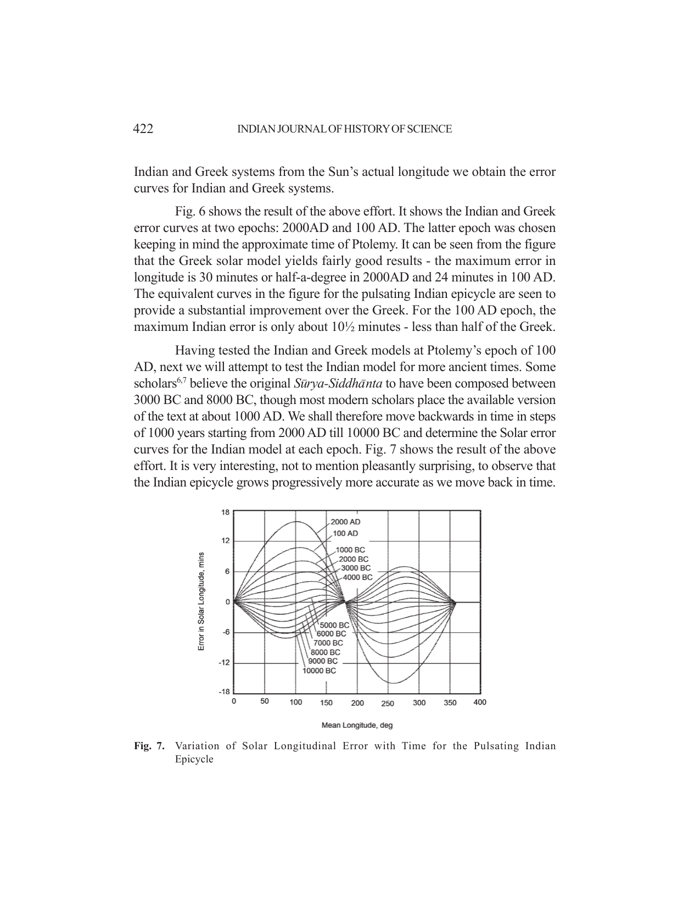
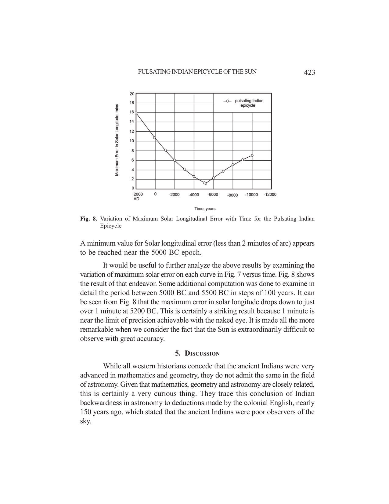

# The Pulsating Indian Epicycle of the Sun

- Author Display: Anil Narayanan
- Year: 2011
- Journal Label: IJHS-46-2011-Issue-3
- Source Url: https://insa.nic.in/(S(eh1ucortlbqqezipwgliy3mn))/writereaddata/UpLoadedFiles/IJHS/Vol46_3_2_ANarayanan.pdf

<!-- source: gemini page-chunk extraction -->

<!-- decode-chunk: pages=1-5 source_sha256=43d647d13fc738509856308d87c5079dc0293522d67ca450e3de7fc191c2942a -->
*Indian Journal of History of Science*, 46.3 (2011) 411-425

# THE PULSATING INDIAN EPICYCLE OF THE SUN

ANIL NARAYANAN\*
(Received 17 February 2011; revised 30 June 2011)
> The pulsating epicycle is a unique feature of ancient Indian astronomy. An analysis of the pulsating epicycle was done and its distinctive features were highlighted. Further, a comparison of Indian and Greek epicycle systems was undertaken with regard to the orbit of the Sun in the timeframe 100–2000 AD. Results showed that the Indian system is far more accurate than the Greek. Finally a timeline analysis was conducted which showed that the pulsating Indian epicycle for the Sun becomes progressively more accurate as we move back in time. The maximum error in solar longitude for the Indian epicycle dips down to the limit of precision achievable with the naked eye in the timeframe 5000 - 5500 BC.
> 
> **Key words:** *Almagest*, Pulsating-Epicycle, *Sūrya-Siddhānta*

## 1. INTRODUCTION

The epicycle is one feature that is common to both Indian and Greek astronomies of old. Today it is well known that the shape of all planetary orbits is an ellipse and that the planets move around the Sun, not the Earth. The ancients however, being unaware of these facts, assumed these orbits to be circular and the Earth to be the center of the universe. Thus they were puzzled at the movements of the planets and of the Sun and Moon. At times these bodies would appear nearer, then farther, sometimes moving slowly and at other times faster, and most perplexing of all - at times some planets were seen going in reverse. To explain these varied phenomena they developed an ingenious geometric orbital model, the so-called epicyclical system, which could explain these variations in orbital speed and position for the heavenly bodies. For nearly 1400 years this model dominated all astronomy in Europe till the middle of the second millennium when the elliptical
---
\* Consultant, Washington DC, 10209 Leslie Ct, #201, Bruke, VA 22015, USA. Former Scientist, Indian Space Research Organization. Email: anilkn_ban@hotmail.com
nature of planetary orbits was finally established and the epicyclical system abandoned for good.
Fig. 1a shows the basic components of an epicyclical system. It consists of a smaller circle (the epicycle), on which the planet moves and a larger circle (the deferent) over which the epicycle itself moves. By varying the sizes of the two circles and the speeds of the planet and epicycle, it is possible to obtain a variety of orbital shapes[^1], some of which are shown in Fig. 1b. The orbital shape that concerns us in this article is the ellipse. It is a well-known result that an ellipse of any shape can be created from a suitable epicyclical system. The converse however is not true.
Apart from the geometrical aspects, the epicycle has another side to it. It has the dubious distinction of being at the center of an east-west historical controversy. In the 19th century the colonial English masters of India, no doubt following the dictum that rulers cannot afford to look inferior to the ruled, put forth the hypothesis that Indian astronomy was borrowed wholesale from their European cousins, the Greeks. Their argument was made through doubtful and occasionally bizarre conjectures arising from twisting of facts coupled with a stratagem of ignoring any evidence to the contrary. The epicycle, being common to both Indian and Greek systems, was the *pièce-de-résistance* of their case. Now though present in both, a detailed study of the epicycle in the two systems reveals several

*Fig. 1. The Epicyclical system*

<!-- figure-resolved-page-render: page=2 image=media/p02_page.webp reason=no-extracted-figure -->

<!-- figure-meta: page=2, position=top, type=diagram -->

important variances. Indeed, the differences in implementation are so great that it negates any notions of wholesale borrowing to have taken place from Greece to India or vice-versa. As we will shortly demonstrate, the Indian epicycle system is subtle, elegantly conceived and far more accurate than the combination of eccentrics and epicycles the Greeks could muster.
It is however not the aim of this paper to compare Indian and Greek epicycles in an exhaustive manner. Herein we will focus mainly on the Indian and Greek epicycles for the Sun.

## 2. THE PULSATING INDIAN EPICYCLE

The Indian astronomical system has two schemes for describing planetary orbits: (1) single-epicycle and (2) dual-epicycle. The former is simpler and is applied to the orbits of the Sun and the Moon. The latter is more complex and is used for the orbits of the five visible planets. In this paper we will confine ourselves to the simpler single-epicycle system.
Compared to the constant-radius Greek one, the Indian epicycle has the remarkable feature that it contracts and expands (pulsates) as it moves on the deferent. This is shown pictorially in Fig. 2. The epicycle starts out moving counterclockwise from the apogee (A). At this point the planet is farthest from the

*Fig. 2. The Pulsating Epicycle*

<!-- figure-resolved-page-render: page=3 image=media/p03_page.webp reason=no-extracted-figure -->

<!-- figure-meta: page=3, position=bottom, type=diagram -->

Earth and the epicycle has its maximum radius ($\mathrm{Ra}$). Note that the planet moves in the opposite direction (clockwise) on the epicycle. As the epicycle moves, its radius shrinks continuously till it reaches quadrature (B), where it attains its minimum radius ($\mathrm{Rb}$). After crossing point B, the epicycle begins expanding till it reaches the perigee (P), where the planet is closest to the Earth and the epicycle has regained its maximum radius ($\mathrm{Ra}$). This scheme then repeats to D and then back to A.
The pulsating system as described above obviously represents a significant advancement over the simple constant-radius epicycle. The intent behind it is also plainly evident. It would appear that the ancient Indian astronomer had fully comprehended that a simple epicycle, as shown in Fig. 1a, was inadequate to portray with sufficient accuracy the actual motion of the heavenly body. Thus he conceived of an additional feature to the basic epicycle in the form of a pulsation (expanding/contracting), which gave a significantly closer fit to his observational data.
A principal question in the pulsating system is this – at what rate does the pulsation occur? We may be surprised if in our arrogance we were to expect these ancient people to employ something simple - like a linear variation perhaps, because there is further complexity in store. The actual variation of pulsation used is not linear, but a sine function. At first glance that may appear an unnecessary twist in an already complex scheme. However, as it turns out, that is the crux of the entire system. This sinusoidal variation of pulsation generates a planetary path that closely corresponds to a combination of conjoined ellipses[^2].

## 3. ANALYSIS

For this paper the Indian text we will refer is the *Sūrya-Siddhānta*[^3], the most revered of ancient astronomical works of India. Also, as mentioned, we will confine ourselves to the single-epicycle scheme - the one that deals with the orbits of the Sun and the Moon. On the Greek side we will refer to the great work authored by Ptolemy called the *Mathematical Syntaxis*, sometimes also referred as the *Almagest*[^4].

### 3.1. The Inequalities

To the very ancient people, the Sun and the Moon appeared to be moving in uniform circular orbits around the Earth; at least they assumed it so. Since however the actual orbit of these bodies is elliptical, there obviously arose a discrepancy between the assumption of uniform circular motion and actual observational data. The heavenly body seemed at times to be nearer to the Earth and at other times farther away. Also, when nearer it appeared to be moving faster and when farther its motion was visibly slower. This set of discrepancies, that showed a departure from uniform circular motion, was termed the ‘First Inequality’.

*Fig. 3. The Simple Epicycle and Eccentric*

<!-- figure-resolved-page-render: page=5 image=media/p05_page.webp reason=no-extracted-figure -->

<!-- figure-meta: page=5, position=middle, type=diagram -->

The simple epicycle model shown in Fig. 3 solves this problem of the First Inequality. In this scheme, an epicycle of constant radius $\mathrm{Ra}$ moves on a deferent with radius $\mathrm{R}$ with the condition that the two angular velocities $\omega_{\mathrm{p}}$ and $\omega_{\mathrm{ep}}$, of the planet and the epicycle respectively, are equal. The Earth (E) is situated at the center of the deferent.
The parametric equations of the deferent circle are:

$$X = R \cos (\alpha) \tag{1}$$

$$Y = R \sin (\alpha) \tag{2}$$

The apsidal line, which is the line joining the apogee (A) and perigee (P) of the orbit, lies on the X-axis. The two angular velocities $\omega_{\mathrm{p}}$ and $\omega_{\mathrm{ep}}$ being equal,
---

[^1]: Will the Real Number of Epicycles Stand Up, 3rd *International Conference on Absolutes*, Houston, Texas, July 16-18, 2007.

[^2]: Madhavan, S., “Quasi-Keplerian Model of Sūrya Siddhānta”, pp. 103-111, *500 Years of Tantrasaṅgraha, A Landmark in the History of Astronomy*, Edited by M. S. Sriram, K. Ramasubramanian and M. D. Srinivas, Indian Institute of Advanced Study, Shimla, 2002.

[^3]: Ebenezer Burgess, *Sūrya-Siddhānta - A Text Book of Hindu Astronomy*, 1858.

[^4]: Ptolemy, *The Almagest*, Translated by Catesby Taliaferro, Great Books of the Western World, Encyclopaedia Britannica, 1952.
<!-- /decode-chunk -->

<!-- decode-chunk: pages=6-10 source_sha256=14eafeb539f6ee0ce69213f566f8ce9a6256d73d04933401af591739696c793d -->
the arcs SM and ON will always be equal i.e. angles $\angle\text{NEO}$ and $\angle\text{SNM}$ are always equal. From basic geometrical principles we see that this simple epicycle scheme has the unique property that the line (NM) drawn from the center of the epicycle to the planet is always parallel to the apsidal line or X-axis. Thus the X-coordinate of the planet always maintains a difference of Ra with that of the center of the epicycle while the Y-coordinate of the planet remains identical with that of the epicycle center.
Therefore we can write the parametric equations of the planet’s path as:

$$X = R \cos (\alpha) + \text{Ra} \tag{3}$$

$$Y = R \sin (\alpha) \tag{4}$$

It is seen from Eqns. (3) and (4) that the resultant orbit of the planet is a circle with the same dimensions as that of the deferent, with the difference that the center of the planet’s orbit circle is displaced along the X-axis by an amount equal to the radius of the epicycle Ra. This orbit is shown pictorially in Fig. 3 by a dashed line. The geometric name for such a displaced circle is the ‘Eccentric’ (an off-center circle) and thus this scheme is also sometimes referred to as ‘Equation of the Center’. At point A, the planet is farther away from the Earth and thus it appears to move slower, while at point P it is closer and appears to move faster. Thus this model neatly explains the discrepancies of the First Inequality. For ellipses of low eccentricity this Eccentric scheme yields a fairly good approximation of the orbit, and indeed both the Sun and Moon have orbits of low eccentricity -0.0167 and 0.0549 respectively.
Fig. 4 shows, for illustrative purposes only, a comparison of mean and true longitudes of three types of orbits - uniform circular, eccentric and elliptic. For uniform circular motion the mean and true longitudes are always equal and so its graph is a straight line. For the eccentric and elliptic orbits, the planet’s speed is slowest at apogee. Thus the true longitude starts falling behind the mean from that point. However after leaving the apogee the planet picks up speed as seen by the rising slope in the two cases and by perigee the true longitude has caught up with the mean. After perigee the planet’s true longitude overtakes the mean, but now its speed is falling. This falling speed eventually lets the mean longitude catch up with the true so that by the time the apogee is reached, the mean and true longitudes are equal once again. Note that a high value of elliptic eccentricity was chosen for this figure since it is for illustrative purposes only. For realistic orbital eccentricities of the Sun or Moon, which are quite low, the difference between the eccentric and elliptic orbits will be too small to be discernable in this graph.
We note from Fig. 4 that the simple epicycle orbit (i.e. eccentric) matches exactly with the elliptic orbit at only two points – the apogee and the perigee. At all other points it is off by various amounts. These additional discrepancies between calculated (eccentric) and actual (elliptic) longitudes are called the second inequality, third inequality and so on. Both the Greeks and the Indians have handled these secondary inequalities by introducing complexities in the simple epicycle model of Fig. 3.

*Fig. 4. Variation of Mean and True longitudes for various orbits*

<!-- figure-resolved-page-render: page=7 image=media/p07_page.webp reason=no-extracted-figure -->

<!-- figure-meta: page=7, position=middle, type=graph -->

For the Sun’s motion, the Greeks appear to have been satisfied with the simple eccentric model of Fig. 3. Three centuries before Ptolemy, Hipparchus is known to have used that simple model and Ptolemy adopted it with almost no modification. Ptolemy gives the ratio between the deferent and epicycle radii as 120:5, which creates a center offset of 1 in 24. In later sections of this paper we will be studying this Greek model in detail and examine its accuracy in predicting the Sun’s longitudinal motion.
Lunar motion is complex enough to warrant a separate article and so we will not continue further on the subject here except to make a few remarks in passing. The Greek Lunar model is quite complex. It also suffers from significant inaccuracies - so much so that Ptolemy himself did not employ it in his eclipse calculations. The Indian lunar epicycle model does not suffer such substantial inaccuracies and the eclipse calculation in the Indian system derives the Moon’s apparent diameter from its own Indian lunar model.

### 3.2. The Indian Solution

Fig. 5 shows the pulsating Indian epicycle scheme in detail. The epicycle starts out from the apogee A, where the planet is on the far side at V on the epicycle. At this point it is farthest from the earth (E). As it moves counterclockwise, the epicycle’s radius contracts till it reaches a minimum at the quadrature C. The planet meanwhile is moving clockwise on the epicycle with an angular velocity that is equal to that of the epicycle on the deferent.

*Fig. 5. The Pulsating Indian Epicycle Scheme*

<!-- figure-resolved-page-render: page=8 image=media/p08_page.webp reason=no-extracted-figure -->

<!-- figure-meta: page=8, position=middle, type=diagram -->

The center of the epicycle moves on the deferent whose parametric equations are:

$$X = R \cos (\alpha) \tag{5}$$

$$Y = R \sin (\alpha) \tag{6}$$

...where R is the radius of the deferent.
As explained earlier, in this scheme the line joining the center of the epicycle to the planet will always remain parallel to the apsidal line or the X-axis. Due to this, the Y-coordinate of the planet will be identical with that of the epicycle center at all times. The X-coordinate of the planet will be offset from that of the center of the epicycle by an amount that equals the radius of the epicycle. But note that unlike the eccentric case, the epicycle radius in the pulsating model is not a constant. It varies with position (or the anomaly angle $\alpha$).
Denoting the instantaneous radius of the epicycle at any arbitrary angle $\alpha$ as $R_\alpha$, the planetary orbital parametric equations become:

$$X = R \cos (\alpha) + R_\alpha \tag{7}$$

$$Y = R \sin (\alpha) \tag{8}$$

As mentioned, had $R_\alpha$ been a constant (a constant-radius epicycle), the resultant planetary orbit would have been an eccentric circle. However in the present case there is a pulsation, which decreases and increases the radius $R_\alpha$. We now turn to the Indian text instructions for determining $R_\alpha$.
Given a mean planet position, the first step in the process is the determination of the quadrant sequence number. This number indicates how many quadrants away from the apogee the mean planet is located. The text instructions are as follows:
> Correct the planet’s mean longitude with respect to the apsis  
> The remainder is its anomaly from which is found the quadrant.  
> \- Chap 2, Verse 29
Having thus found the quadrant, the next step is to determine the instantaneous epicycle radius at that point in the orbit, for which we are first required to establish the base-sine:
> In an odd quadrant, the base-sine is taken from the part past, etc;  
> But in an even quadrant the base-sine is taken from the part to come  
> \- Chap 2, Verse 30
Table 1 below shows the base-sine details for the four quadrants. Angle $\alpha$ is measured counter-clockwise from the positive X-axis as usual.
Table 1. Base-Sine Calculation for the four Quadrants

| Quadrant | Even/Odd | Text Instruction | Base-Sine | Equivalent |
| :--- | :--- | :--- | :--- | :--- |
| Q1 | Odd | part past (arc AB) | $\sin (\angle\text{AEB})$ | $\operatorname{Sin} (\alpha)$ |
| Q2 | Even | part to come (arc DP) | $\sin (\angle\text{PED})$ | $\operatorname{Sin} (\alpha)$ |
| Q3 | Odd | part past (arc PF) | $\sin (\angle\text{FEP})$ | $-\operatorname{Sin} (\alpha)$ |
| Q4 | Even | part to come (arc HA) | $\sin (\angle\text{AEH})$ | $-\operatorname{Sin} (\alpha)$ |

The final verses for determination of the corrected epicycle dimension are as follows:
> Multiply the base-sine by the difference of the epicycles at the odd  
> and even quadrants and divide that by radius;  
> The result when applied to the even epicycle, additive or subtractive  
> according to as this is lesser or greater than the odd, gives the corrected  
> epicycle.  
> \- Chap 2, Verse 38
For the single-epicycle scheme (i.e. those for the Sun and Moon), the even epicycle is always greater than the odd (i.e. $\text{Ra} > \text{Rb}$). Thus the ‘result’ in the above verse will have to be subtracted from the even epicycle to obtain the corrected epicycle.
In other words:

$$R_\alpha = \text{Ra} - (\text{Ra}-\text{Rb}) \sin (\alpha) \quad \dots \text{for quadrants Q1 and Q2} \tag{9}$$

$$R_\alpha = \text{Ra} - (\text{Ra}-\text{Rb}) (-\sin (\alpha)) \quad \dots \text{for quadrants Q3 and Q4} \tag{10}$$

Simplifying, we have:

$$R_\alpha = \text{Ra} - \Delta r \sin (\alpha) \quad \dots \text{for quadrants Q1 and Q2} \tag{11}$$

$$R_\alpha = \text{Ra} + \Delta r \sin (\alpha) \quad \dots \text{for quadrants Q3 and Q4} \tag{12}$$

...where $\Delta r = \text{Ra}-\text{Rb}$, is the difference between the epicycles at the end of the even and odd quadrants.
Substituting Eqns. (11) and (12) into Eqns. (7) and (8), the parametric equations of the pulsating epicycle orbit become:

$$X = R \cos (\alpha) - \Delta r \sin (\alpha) + \text{Ra} \quad \dots \text{for quadrants Q1 and Q2} \tag{13}$$

$$X = R \cos (\alpha) + \Delta r \sin (\alpha) + \text{Ra} \quad \dots \text{for quadrants Q3 and Q4}$$

$$Y = R \sin (\alpha) \tag{14}$$
<!-- /decode-chunk -->

<!-- decode-chunk: pages=11-15 source_sha256=d8338a3f8e8ebf2f59ff32f1536161b84fb588758467e3517f512b13c333adfc -->
Using Eqns. (13) and (14), we can now proceed to compute a planet’s actual position in its orbit with respect to its mean anomaly. In the next section we will do that for the orbit of the Sun.

## 4. THE SUN’S ORBIT - COMPARING GREEK AND INDIAN EPICYCLES

The orbit of the Sun makes a simple case for comparing Indian and Greek epicycle systems as described above. Though an ellipse, the eccentricity of this orbit is so small that it is very close to being a circle. The Greek model, which is a simple epicycle equivalent to an eccentric, yielded satisfactory results as far as the Greeks were concerned. It would be interesting to test the Indian model on the Sun’s orbit and in the process discover why the ancient Indians were unsatisfied by the accuracy of the simple epicycle and chose to employ the pulsating scheme instead.
For the Sun, Ptolemy has used a deferent-epicycle combination with radii of $120$ and $5$ units respectively. We will use the same deferent radius ($120$ units) for the Indian epicycle. The maximum and minimum radii of the pulsating Indian epicycle for the Sun then work out to be $4.6667$ and $4.5556$ units respectively.

*Fig. 6. Indian and Greek Error Curves for the Sun’s Longitude*

<!-- figure-resolved-page-render: page=11 image=media/p11_page.webp -->

<!-- figure-meta: page=11, position=middle, type=graph -->

Next, to determine the Sun’s actual longitude we will employ well-known empirical formulae in current use[^5]. These formulae are accurate to within $0.01$ degrees and are quite sufficient for our current needs. By subtracting the values predicted by Indian and Greek systems from the Sun’s actual longitude we obtain the error curves for Indian and Greek systems.
Fig. 6 shows the result of the above effort. It shows the Indian and Greek error curves at two epochs: 2000 AD and 100 AD. The latter epoch was chosen keeping in mind the approximate time of Ptolemy. It can be seen from the figure that the Greek solar model yields fairly good results - the maximum error in longitude is $30$ minutes or half-a-degree in 2000 AD and $24$ minutes in 100 AD. The equivalent curves in the figure for the pulsating Indian epicycle are seen to provide a substantial improvement over the Greek. For the 100 AD epoch, the maximum Indian error is only about $10\frac{1}{2}$ minutes - less than half of the Greek.
Having tested the Indian and Greek models at Ptolemy’s epoch of 100 AD, next we will attempt to test the Indian model for more ancient times. Some scholars[^6][^7] believe the original *Sūrya-Siddhānta* to have been composed between 3000 BC and 8000 BC, though most modern scholars place the available version of the text at about 1000 AD. We shall therefore move backwards in time in steps of 1000 years starting from 2000 AD till 10000 BC and determine the Solar error curves for the Indian model at each epoch. Fig. 7 shows the result of the above effort. It is very interesting, not to mention pleasantly surprising, to observe that the Indian epicycle grows progressively more accurate as we move back in time.

*Fig. 7. Variation of Solar Longitudinal Error with Time for the Pulsating Indian Epicycle*

<!-- figure-resolved-page-render: page=12 image=media/p12_page.webp -->

<!-- figure-meta: page=12, position=bottom, type=graph -->

*Fig. 8. Variation of Maximum Solar Longitudinal Error with Time for the Pulsating Indian Epicycle*

<!-- figure-resolved-page-render: page=13 image=media/p13_page.webp -->

<!-- figure-meta: page=13, position=top, type=graph -->

A minimum value for Solar longitudinal error (less than $2$ minutes of arc) appears to be reached near the 5000 BC epoch.
It would be useful to further analyze the above results by examining the variation of maximum solar error on each curve in Fig. 7 versus time. Fig. 8 shows the result of that endeavor. Some additional computation was done to examine in detail the period between 5000 BC and 5500 BC in steps of 100 years. It can be seen from Fig. 8 that the maximum error in solar longitude drops down to just over $1$ minute at 5200 BC. This is certainly a striking result because $1$ minute is near the limit of precision achievable with the naked eye. It is made all the more remarkable when we consider the fact that the Sun is extraordinarily difficult to observe with great accuracy.

## 5. DISCUSSION

While all western historians concede that the ancient Indians were very advanced in mathematics and geometry, they do not admit the same in the field of astronomy. Given that mathematics, geometry and astronomy are closely related, this is certainly a very curious thing. They trace this conclusion of Indian backwardness in astronomy to deductions made by the colonial English, nearly 150 years ago, which stated that the ancient Indians were poor observers of the sky.
The findings in this paper stand in total conflict with the above western conclusion. Even for the 100 AD timeframe, supposedly the peak of Greek achievements in astronomy, the pulsating Indian epicycle for the Sun is seen to be twice as better as the Greek model, while for very ancient times, possibly the actual epoch of the *Sūrya-Siddhānta* (3000 – 8000 BC), its accuracy is unprecedented.
Naturally one may harbor this question – is this accuracy of the Indian epicycle merely a mathematical coincidence? Is it mere happenstance that the model predicts with a 1-minute accuracy the actual solar motion at the 5200 BC epoch?
As seen from the author’s earlier paper[^7], the ancient Indians did not hesitate to state explicitly the precision of their data. Thus it is possible that a 1-minute precision can indeed be expected for data obtained using the pulsating epicycle technique. So we may conclude with reasonable confidence from Fig. 8 that the *Sūrya-Siddhānta*’s current epicycle parameters for the Sun were set in the 5200 BC timeframe or thereabouts.
Interestingly, as far as back as 1896, Brennand[^6] had these thoughts about the Sun’s orbital parameters in the *Sūrya-Siddhānta*:
> “At the beginning of the present century, according to Laplace, the greatest equation of the Sun’s center was $1^\circ 55' 27.7''$ and this diminished at the rate of $16.9''$ in a century; the difference between these two values of the greatest equation = $904.3''$, which divided by $16.9''$ gives 5351 years to have elapsed up to the beginning of AD 1800, since the greatest equation of the center had the value given to it in the *Sūrya-Siddhānta*.”
In other words, Brennand states the epoch of the *Sūrya-Siddhānta*’s solar epicycle parameters to be near about 3500 BC.
Clearly the ancient Indian astronomer must have possessed a great deal of very accurate solar data to be able to create a geometric model so close to actuality. Observing the Sun with such accuracy is no easy matter. We can today only speculate about the methods and instruments he had at his disposal to accomplish this. We salute his ingenuity, not only in observation but also in devising the elegantly conceived pulsating epicycle.

## 6. CONCLUSIONS

Conclusions that may be drawn from this study of the pulsating Indian epicycle are as follows:
1. For determining the Sun’s longitude, the pulsating Indian epicycle is far more accurate than the Greek eccentric-epicycle model.
2. The pulsating Indian epicycle for the Sun becomes progressively more accurate as one goes back in time. Peak accuracy, of about 1 minute of arc, is reached around 5200 BC.
3. The current values of the *Sūrya-Siddhānta*’s pulsating epicycle parameters for the Sun appear to have been set in the 5000-5500 BC timeframe.
4. A central hypothesis of western historians, that the ancient Indians were poor observers, stands disproved by the findings in this paper.

### ACKNOWLEDGEMENT

The author would like to thank the reviewer for his valuable comments and suggestions which have added value to the paper.

### REFERENCES

1. Will the Real Number of Epicycles Stand Up, *3rd International Conference on Absolutes*, Houston, Texas, July 16-18, 2007.
2. Madhavan, S., “Quasi-Keplerian Model of Sūrya Siddhānta”, pp. 103-111, *500 Years of Tantrasaṅgraha, A Landmark in the History of Astronomy*, Edited by M. S. Sriram, K. Ramasubramanian and M. D. Srinivas, Indian Institute of Advanced Study, Shimla, 2002.
3. Ebenezer Burgess, *Sūrya-Siddhānta - A Text Book of Hindu Astronomy*, 1858.
4. Ptolemy, *The Almagest*, Translated by Catesby Taliaferro, Great Books of the Western World, Encyclopedia Britannica, 1952.
5. Meeus, J, *Astronomical Algorithms*, Willmann-Bell Inc, 2000.
6. Brennand, W., *Hindu Astronomy*, 1896 (reprinted Caxton Publications, Delhi 1988).
7. Narayanan, A., ‘Dating the *Sūrya-Siddhānta* using computational simulation of proper motions and ecliptic variation, *IJHS*, 45.4 (2010), 455-476.
<!-- /decode-chunk -->
