# The Manda Puzzle in Indian Astronomy

- Author Display: Anil Narayanan
- Year: 2012
- Journal Label: IJHS-47-2012-Issue-3
- Source Url: https://insa.nic.in/(S(eh1ucortlbqqezipwgliy3mn))/writereaddata/UpLoadedFiles/IJHS/Vol47_3_1_ANarayanan.pdf

<!-- source: gemini page-chunk extraction -->

Indian Journal of History of Science, 47.3 (2012) 317-343

# THE *MANDA* PUZZLE IN INDIAN ASTRONOMY

ANIL NARAYANAN*
(Received 10 January 2012; revised 11 July 2012)
Of the many curious and interesting concepts found in ancient Indian astronomy the *Manda* concept is particularly noteworthy. Though it forms a critical component of the Indian planetary model, it is rather poorly understood at this time. In this paper we probe into the physical meaning that underlies this remarkable concept. All relevant data and knowledge on the topic is collected, examined and discussed. A new concept, the Average Planet-Solar Apogee (APSA), is introduced that may help explain some features of the *Manda*. Overall, this study highlights the great depth of understanding that the ancient Indian astronomer had regarding planetary movements in the Solar system.
**Key words:** Aphelion, Apogee, Average planet-solar apogee (APSA), *Manda*, *Mandocca*, *Śīghra*, *Śīghrocca*, *Sūrya-siddhānta*

## 1. INTRODUCTION

Ancient Indian astronomy has a number of intriguing concepts that continue to bewilder and amaze us even today. For instance, the time cycles that span billions of years; an astonishingly accurate value of the Earth’s precession rate; heliocentric planetary periods hidden in a geocentric model; etc, …the list goes on. From this list of ancient Indian enigmas we will examine one particularly curious item in this paper. The item is the *Mandocca*, often referred to simply as the *Manda*.
The directly translated meaning of the word *Mandocca* seems simple enough. *Manda* in the Sanskrit language means slow and *ucca* means peak. Thus the compound *Mandocca* translates to slow-peak or peak-of-slowness.
***

[^1]: *Consultant, Washington DC, Former Scientist, Indian Space Research Organization; email: anilkn_ban@hotmail.com

---
318 INDIAN JOURNAL OF HISTORY OF SCIENCE
In modern astronomical terms the phrase peak-of-slowness would instantly bring to mind the term apogee (or apo-apsis). For a body orbiting the Earth the apogee represents the point of slowest motion in its orbit. So then is the mysterious *Manda* nothing but the apogee? Curiously, the Indian concept of *Manda* defies such a simple and straightforward interpretation.
Western scholars, nearly 150 years ago, did attempt to probe the *Manda* (Burgess 1858). But they appear to have glossed over the details and closed the matter abruptly. Their inference was that there is no underlying physical reality associated with the *Manda* concept. This hasty conclusion was well in keeping with their favorite theory that Indian astronomy was borrowed from the Greeks. In Greek astronomy the apogee is merely a mathematical tool with no physical basis.
An equally fascinating question is – when, and by whom, was the *Manda* concept created? The earliest Indian astronomer we know of, Āryabhaṭa (b. 476 AD), made extensive use of the standard Indian planetary model. But in his works he makes no mention of his own contributions to the model. Thus it appears that the Indian planetary model and the *Manda* concept were already very old by his time. To add further to the intrigue, modern research has shown that the data in Indian works on astronomy may be as old as 8000 - 4000 BC (Sen & Shukla 1985).
In this paper we will examine various facets of the *Manda* concept (mathematical, observational and modeling) and attempt to arrive at a deeper understanding of its physical meaning, if any. The ancient Indian text we will refer is the *Sūrya-siddhānta* (Burgess, 1858), the most revered of all ancient Indian works on astronomy. Note that the term ‘planet’ will occasionally be used as an all-encompassing term that includes all the heavenly bodies - the planets, the Sun and the Moon.

## 2. THE *ŚĪGHRA*

Interestingly, the *Mandocca* has a counterpart called the *Śīghrocca*. The word *Śīghra* in Sanskrit means fast or quick. Thus *Śīghrocca*, often shortened to *Śīghra*, translates as peak-of-quickness. It is the point in the orbit of a planet where it appears to be moving at maximal speed as seen from the Earth. Understanding the *Śīghra* is an important step in making sense of the *Manda* and so we will examine it in detail.
---
THE *MANDA* PUZZLE IN INDIAN ASTRONOMY 319
It may be worthwhile to reiterate a phrase we used in the previous paragraph – as seen from the Earth. Note that both the observed planet (say Mars) and our observation point (the Earth) are in motion. Therefore the motion of Mars that we perceive from Earth is relative to us and not its actual motion in space. What does this imply for the *Śīghra*? We say that Mars is at its *Śīghra* point when it is travelling at its fastest relative to us (i.e. as seen from the Earth). It may or may not actually be moving at its fastest speed in space at that point in time. The next couple of figures will explain this further.
Fig. 1 shows the orbits of a typical superior planet (Mars) and the Earth. The Earth, being closer to the Sun, revolves faster around it than does Mars. As a result the Earth periodically overtakes Mars. This overtaking produces two curious effects as seen from the Earth – (1) the Conjunction and (2) the Opposition.

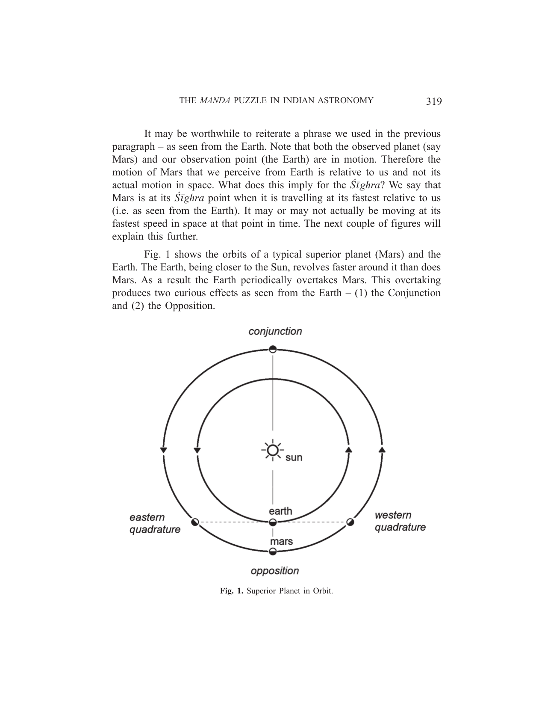

*Fig. 1. Superior Planet in Orbit.*

<!-- figure-resolved-page-render: page=3 image=media/p03_page.webp -->

<!-- figure-meta: page=3, position=bottom, type=diagram -->

---
320 INDIAN JOURNAL OF HISTORY OF SCIENCE
Conjunction refers to the situation where the Sun and the superior planet appear together in the sky at the same location, as seen from the Earth. We observe from Fig. 1 that this happens when all three objects (Sun, Earth and Mars) are in a straight line and Mars and the Sun are on the same side of the Earth (see top part of the figure). Of course, in this situation Mars cannot actually be observed due to the glare of the Sun. The noteworthy point here is that at conjunction the Earth and Mars are moving in exactly opposite directions, which implies that their relative velocity is a maximum. In other words, at conjunction the superior planet is seen from the Earth to be moving with maximal velocity against the background of the stars. This is the *Śīghra* situation. Thus, as a rule, whenever a planet is in conjunction with the Sun, it is said to be at its *Śīghra* point. In the Indian planetary system the position of the *Śīghra* for a superior planet is coincident with the Sun at all times.
The reverse of Conjunction is the Opposition. This occurs when all three objects are once again in a straight line, but this time the Sun and Mars are on opposite sides of the Earth (hence the word opposition). Referring to Fig. 1, this occurs when Mars is at the bottom of the figure. An interesting phenomenon occurs near opposition. As the faster-moving Earth approaches the planet from behind, it first reaches the position called ‘western quadrature’. From this point onwards Mars, as seen from the Earth, appears to slow down. A little later the planet comes to a complete stop. This first stop location is called the ‘first-station’. As the Earth continues to overtake it, Mars now appears to drift backward (retrograde). This is exactly similar to overtaking a slower vehicle on the road. To passengers in the faster vehicle the slower vehicle appears to be moving backwards though in reality both are moving forward. After a while this retrograde motion also stops (at the ‘second-station’). The planet then begins moving forward again and by ‘eastern quadrature’ has regained its normal forward motion. The exact moment of opposition occurs in the middle of retrograde motion.
Fig. 2 shows the equivalent situation for an inferior planet (Venus). The inferior planet revolves faster around the Sun than the Earth and so it overtakes the Earth periodically. Now in the case of an inferior planet there is no concept of opposition since the planet is always on the same side as the Sun as seen from Earth. However in this case there are two conjunctions
---
THE *MANDA* PUZZLE IN INDIAN ASTRONOMY 321

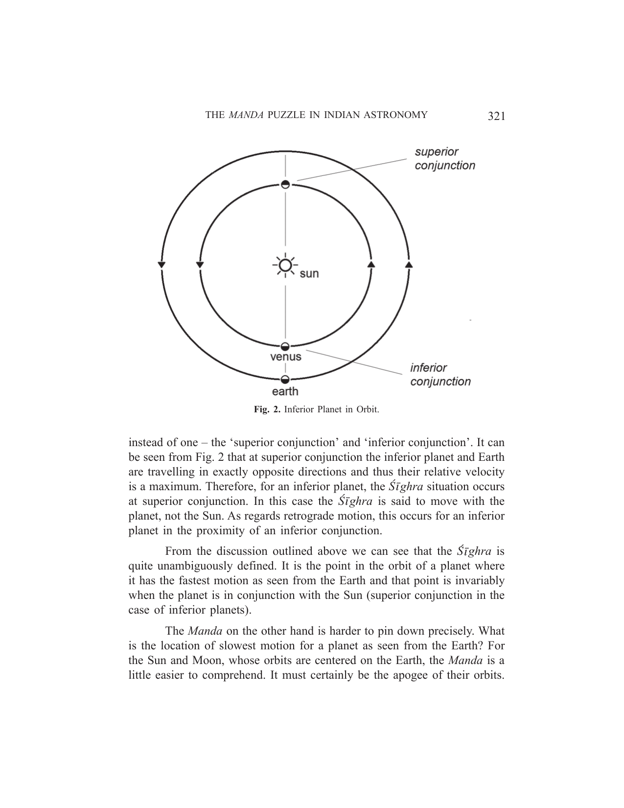

*Fig. 2. Inferior Planet in Orbit.*

<!-- figure-resolved-page-render: page=5 image=media/p05_page.webp -->

<!-- figure-meta: page=5, position=top, type=diagram -->

instead of one – the ‘superior conjunction’ and ‘inferior conjunction’. It can be seen from Fig. 2 that at superior conjunction the inferior planet and Earth are travelling in exactly opposite directions and thus their relative velocity is a maximum. Therefore, for an inferior planet, the *Śīghra* situation occurs at superior conjunction. In this case the *Śīghra* is said to move with the planet, not the Sun. As regards retrograde motion, this occurs for an inferior planet in the proximity of an inferior conjunction.
From the discussion outlined above we can see that the *Śīghra* is quite unambiguously defined. It is the point in the orbit of a planet where it has the fastest motion as seen from the Earth and that point is invariably when the planet is in conjunction with the Sun (superior conjunction in the case of inferior planets).
The *Manda* on the other hand is harder to pin down precisely. What is the location of slowest motion for a planet as seen from the Earth? For the Sun and Moon, whose orbits are centered on the Earth, the *Manda* is a little easier to comprehend. It must certainly be the apogee of their orbits.

But when considering the planets we begin to run into difficulties. How is it possible to define ‘peak-of-slowness’ for a body that comes to a complete stop at times? Technically, the slowest speed for such a body would be zero. So then is the *Manda* for the planets the location at which the planet stops moving?
Before we speculate any further let us continue examining other aspects of the problem. Next we look at how the *Manda* and *Śīghra* fit into the Indian planetary model and how they are used in planetary calculations.

## 3. THE *MANDA* AND *ŚĪGHRA* IN THE INDIAN PLANETARY MODEL

A detailed description of the Indian planetary model would be too lengthy and certainly beyond the scope of this article. Here we will mention only the basics while focusing on those parts of the model that involve the *Manda* and *Śīghra*.
The planetary system of the ancient Indians, like that of the ancient Greeks, is based on the epicycle model (Narayanan, 2011). The model is geocentric, i.e. the Earth is assumed to be the center of the universe and all heavenly bodies (Sun, Moon, Planets, etc) revolve around it. Each planet revolves around the Earth with a mean speed of revolution. Certain disturbing agents present in the orbit of a planet can cause perturbations in this mean speed.
The perturbing agents in longitude are the *Manda* and the *Śīghra*, while that in latitude is the *Pāta*. In the present paper we will not be discussing latitudinal perturbations. To obtain the true longitude of a planet at any time we simply apply a perturbation correction to the mean speed. In summary, the Indian planetary model is all about determining the corrections to be made to the mean position of the planet at any instant of time.
As shown in Fig. 3, the *Manda* and *Śīghra* are imagined as perturbing entities located in the orbit of a planet. As the Planet nears the *Manda* location it experiences a slowing-down effect. At the *Śīghra*, the opposite occurs – the planet experiences a speeding-up effect. The farther the planet is from either of these locations, the less perturbation it experiences. Thus the distance of the mean planet from these entities plays an important part in determining the perturbing effect.

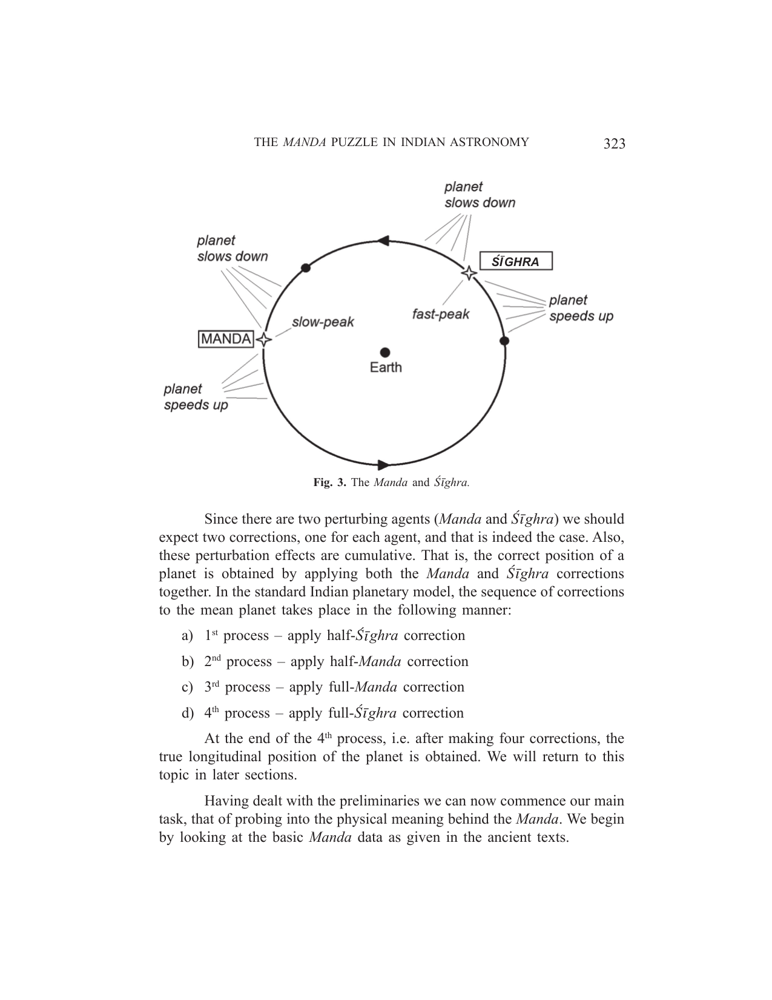

*Fig. 3. The Manda and Śīghra.*

<!-- figure-resolved-page-render: page=7 image=media/p07_page.webp -->

<!-- figure-meta: page=7, position=top, type=diagram -->

Since there are two perturbing agents (*Manda* and *Śīghra*) we should expect two corrections, one for each agent, and that is indeed the case. Also, these perturbation effects are cumulative. That is, the correct position of a planet is obtained by applying both the *Manda* and *Śīghra* corrections together. In the standard Indian planetary model, the sequence of corrections to the mean planet takes place in the following manner:
a) 1st process – apply half-*Śīghra* correction
b) 2nd process – apply half-*Manda* correction
c) 3rd process – apply full-*Manda* correction
d) 4th process – apply full-*Śīghra* correction
At the end of the 4th process, i.e. after making four corrections, the true longitudinal position of the planet is obtained. We will return to this topic in later sections.
Having dealt with the preliminaries we can now commence our main task, that of probing into the physical meaning behind the *Manda*. We begin by looking at the basic *Manda* data as given in the ancient texts.

## 4. THE BASIC *MANDA* DATA

The expectant reader will perhaps be a little disappointed to observe how meager the *Manda* data actually is. The *Manda* position is not fixed, but moves slowly over time, each planet’s *Manda* moving at a different rate. The one and only *Manda* data given in the ancient texts is this rate-of-movement - that’s all. To determine the *Manda* location at any instant of time we are required to multiply this rate by the time elapsed (since creation).
One of the remarkable things about the Indian planetary model is its completeness and a striking example of that is the moment of creation. It is stated in the ancient text that at the moment of creation all heavenly bodies (including their *Mandas*, *Śīghras* and Nodes) were situated at the same location in space, namely, the $0^{\text{th}}$ degree of Aries on the ecliptic. Combining these pieces of information, i.e. the starting point of the *Manda*, the rate of movement of the *Manda* and the time elapsed since creation of the universe we can compute where the *Manda* is located at any instant of time.
Table 1 shows the basic *Manda* data. The third column contains the raw *Manda* data for each planet as given in the *Sūrya-siddhānta*. The last column converts the raw *Manda* data into number-of-years per revolution of the *Manda*.
Table 1. The Basic *Manda* Data

| Group | Planet | Number of Revolutions of the *Manda* per Eon[^1] | Time for one revolution of the *Manda* |
| :--- | :--- | :--- | :--- |
| Geo-centric Orbits | Sun | 387 | 11.16 million years |
| | Moon | 488203000 | 8.85 years |
| Inferior Planets | Mercury | 368 | 11.74 million years |
| | Venus | 535 | 8.07 million years |
| Superior Planets | Mars | 204 | 21.18 million years |
| | Jupiter | 900 | 4.80 million years |
| | Saturn | 39 | 110.77 million years |

[^1]: Eon = 4.32 billion years

The first column segregates the planets into three distinct groups. The first group, comprising the Sun and the Moon, has its relative motion centered on the Earth i.e. they revolve around the Earth. The second group contains the inferior planets, Mercury and Venus, whose orbits are centered on the Sun and who are closer to the Sun than the Earth. The last group consists of the superior planets, Mars, Jupiter and Saturn, whose orbits too are centered on the Sun, but who are farther away from the Sun than the Earth.
It is quite apparent from the last column in Table 1 that, except for the Moon, the rate of movement of the *Manda* for all planets is extremely slow - of the order of millions of years for one revolution. Thus, taken over a few thousand years, these planetary *Manda* locations are effectively constant, almost unchanging. Note that this observation immediately negates our earlier conjecture that the first/second stations, where a planet appears to stop moving, could be the *Manda*. That is because the locations of these first/second stations shift significantly year-by-year, and thus cannot be the unchanging *Manda*.

## 5. CALCULATING THE *MANDA* LOCATIONS FOR 2000 AD

Now that we have all the *Manda* data there is, we can calculate the *Manda* position of each planet for any instant of time. Let us do that for 2000 AD. The task involves two steps:
(1) Find the total time elapsed from creation till 2000 AD.
(2) Multiply that time interval with the rate of movement of the *Manda*. The result will be the *Manda* location at 2000 AD as measured from the $0^{\text{th}}$ of Aries.
**Step-1:** To determine the total time elapsed till 2000 AD.
According to the *Sūrya-siddhānta*, 1,955,880,000 years have elapsed from creation till the beginning of the current Kali age. Furthermore, Āryabhaṭa was of the opinion that the age of Kali began in 3102 BC. Thus we may take that approximately 5000 years of the Kali have passed till 2000 AD.
Thus,
Total years passed from creation to 2000 AD = 1,955,885,000
Fraction-of-Eon passed till 2000 AD = 1,955,885,000 / 4,320,000,000
$= 0.4527512$
**Step-2:** To determine the *Manda* longitudes at 2000 AD.
Multiplying the Fraction-of-Eon obtained above with the third column in Table 1 gives the completed number of revolutions of the *Manda* for each planet as of 2000 AD. These are given in the second column of Table 2. The third column determines the partial revolutions completed as of 2000 AD. The last column converts the partial revolutions into degrees. The values in the last column are thus the current (2000 AD) locations of the *Manda* for each planet, as measured from the first of Aries.
Table 2. *Manda* Locations at 2000 AD

| Planet | Revolutions of the *Manda* completed till 2000 AD | Fractional Revolutions [2000 AD] | Longitude of *Manda*[^2] [=Fractional Rev x $360^{\circ}$] |
| :--- | :--- | :--- | :--- |
| Sun | 175.2147144 | 0.2147144 | $77.30^{\circ}$ |
| Mercury | 166.6124416 | 0.6124416 | $220.48^{\circ}$ |
| Venus | 242.221892 | 0.221892 | $79.88^{\circ}$ |
| Mars | 92.3612448 | 0.3612448 | $130.05^{\circ}$ |
| Jupiter | 407.47608 | 0.47608 | $171.39^{\circ}$ |
| Saturn | 17.6572968 | 0.6572968 | $236.63^{\circ}$ |

[^2]: Measured from the first of Aries

Note that we have left the Moon out of Table 2 because its *Manda* is unambiguously clear, as will be shown in the next section.

## 6. *MANDA* FOR THE SUN AND MOON

In Table 1 we observed that the Sun and the Moon belong to the first group of heavenly bodies, whose orbits are centered on the Earth. Let us consider the Moon first. Fig. 4 shows the orbit of the Moon about the Earth. This orbit is elliptical with the Earth situated at one focus. It has an apsidal line, which is the line passing through the Moon’s apogee and the center of the Earth. The apogee as we know is the location in the orbit of the Moon where it is farthest from the Earth and where its speed is the slowest. As shown in the figure, this apsidal line has a slow rotation eastward. The rotation period is well known to modern astronomers as 8.85 years. In other words, the apogee of the Moon’s orbit moves eastward and completes one revolution in 8.85 years. Referring back to the *Sūrya-siddhānta* data in Table

THE MANDA PUZZLE IN INDIAN ASTRONOMY 327

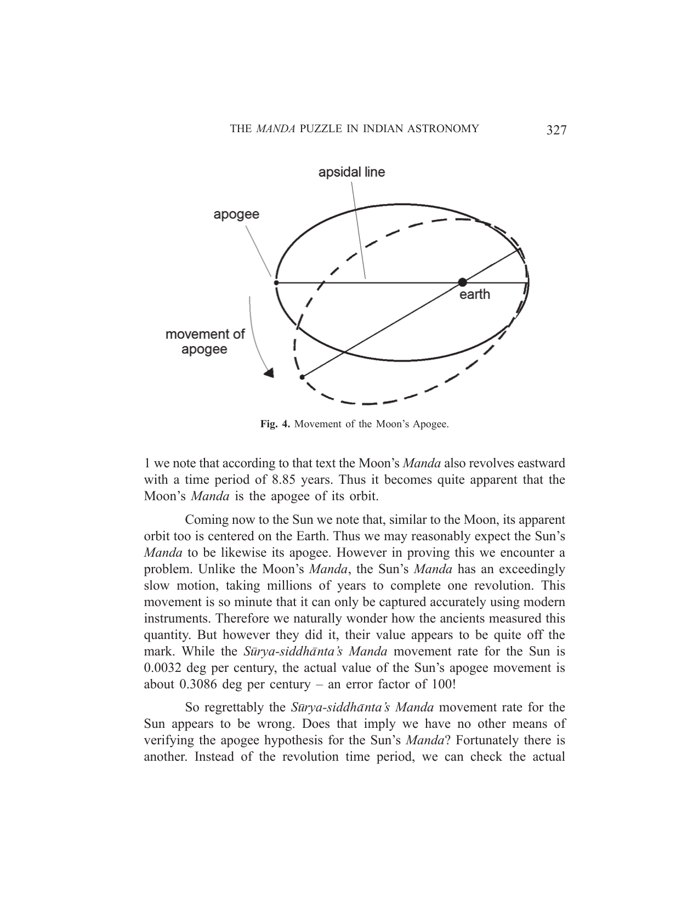

*Fig. 4. Movement of the Moon’s Apogee.*

<!-- figure-resolved-page-render: page=11 image=media/p11_page.webp -->

<!-- figure-meta: page=11, position=top, type=diagram -->

1 we note that according to that text the Moon’s *Manda* also revolves eastward with a time period of 8.85 years. Thus it becomes quite apparent that the Moon’s *Manda* is the apogee of its orbit.
Coming now to the Sun we note that, similar to the Moon, its apparent orbit too is centered on the Earth. Thus we may reasonably expect the Sun’s *Manda* to be likewise its apogee. However in proving this we encounter a problem. Unlike the Moon’s *Manda*, the Sun’s *Manda* has an exceedingly slow motion, taking millions of years to complete one revolution. This movement is so minute that it can only be captured accurately using modern instruments. Therefore we naturally wonder how the ancients measured this quantity. But however they did it, their value appears to be quite off the mark. While the *Sūrya-siddhānta’s* *Manda* movement rate for the Sun is $0.0032$ deg per century, the actual value of the Sun’s apogee movement is about $0.3086$ deg per century – an error factor of 100!
So regrettably the *Sūrya-siddhānta’s* *Manda* movement rate for the Sun appears to be wrong. Does that imply we have no other means of verifying the apogee hypothesis for the Sun’s *Manda*? Fortunately there is another. Instead of the revolution time period, we can check the actual
328 INDIAN JOURNAL OF HISTORY OF SCIENCE
position of the *Manda* at, say, 2000 AD. Using modern formulae (Meeus 2000), we first determine the longitude of the Sun’s apogee at the 2000 AD epoch. Next we correct this longitude with reference to the first of Aries.
Determining the first of Aries, it turns out, is more difficult than we anticipate. The problem is that this location is defined in the *Sūrya-siddhānta* with respect to a very faint star (*Revatī*), the exact location of which is still in debate. The colonial western scholars had assumed this star to be Zeta Piscium and many later authors have accepted that tentatively. This star is currently about $20^\circ$ from the J2000 equinox reference point.
Taking another viewpoint for the first of Aries, the next closest star defined in the *Sūrya-siddhānta* is *Aśvinī*. This star is better understood than *Revatī* and is generally accepted to be Beta-Arietis. Taking the modern (J2000) longitude of this star (approx $34^\circ$), and subtracting it from the *Sūrya-siddhānta’s* value for it ($8^\circ$), we get the difference as $26^\circ$. The Reader can see the problem now I hope. To convert J2000 longitudes for the first of Aries, do we use a correction factor of $20^\circ$ or $26^\circ$?
We will take a middle path here and assume a correction factor of $23^\circ$. That should not affect our results greatly as we are looking for good matches and not extremely accurate ones. However due to this inexactness for the first of Aries we need to keep in mind that the results we get are only accurate to within a few degrees. Proceeding on with our task, the calculation details for the Sun’s *Manda* are shown in Table 3.
Table 3. Comparing the Sun’s Apogee and *Manda* Positions

| Planet | *Sūrya-siddhānta* | Modern | Modern | Difference |
| :--- | :--- | :--- | :--- | :--- |
| | *Manda* Longitude [2000 AD] | Apogee Longitude [2000 AD] | Corrected Apogee Longitude* [J2000 – 23] | |
| Sun | $77.3^\circ$ | $102.95^\circ$ | 79.95 | $2.65^\circ$ |

\*measured from first of Aries.
The second column value in Table 3 is taken from Table 2 and it represents the *Sūrya-siddhānta’s* prediction for the Sun’s *Manda* location at 2000 AD. The third column is the longitude of the Sun’s apogee at 2000 AD. The fourth column corrects the third column data for the first of Aries. It can be seen that we have a fairly good match between the second and fourth
THE MANDA PUZZLE IN INDIAN ASTRONOMY 329
columns. Thus the Sun’s *Manda*, like the Moon’s, turns out to be the apogee of its orbit about the Earth. It may be mentioned here that recent research which employed the Sun’s apogee as its *Manda* has obtained excellent results.

## 7. MANDA FOR THE SUPERIOR PLANETS

Having determined that the *Manda* of the Sun and the Moon is their respective apogees, next we consider the superior planets. The orbits of these planets as we know are centered on the Sun and not the Earth and thus there is no concept of ‘apogee’ for them. We will have to look elsewhere for the *Manda* of these.
We begin by looking at a fascinating discovery made nearly 150 years ago by the colonial western scholars of yesteryear. Tucked away in an inconspicuous place in their translation of the *Sūrya-siddhānta* (Burgess 1858) is this note:
> ‘…by the first three processes of correction is found, as nearly as the Indians are able to find it, the true heliocentric place of the planet…’
This line talks about an astonishing discovery in the 4-step Indian planetary model. For the superior planets, the longitude obtained after the $3^{\text{rd}}$ process in the scheme is the true heliocentric longitude of a planet. A fascinating discovery indeed!
Let us illustrate this for the planet Mars. We consider three test cases using dates near 2000 AD, 1000 AD and 100 AD. One complete Earth-Mars synodic cycle of 780 days (conjunction to conjunction) was chosen as the time interval for each case. We will calculate the longitude of Mars after $3^{\text{rd}}$ process and compare it with the aphelion of Mars, in the three cases. The results are shown in Fig. 5. The solid lines depict the actual heliocentric longitude of Mars obtained by standard formulae (Meeus 2000). The unfilled circles depict the longitude resulting after the $3^{\text{rd}}$ process. It can be seen from the figure that the statement above is doubtless a correct one. The $3^{\text{rd}}$ process does indeed produce the true-heliocentric longitude of the planet.
The $4^{\text{th}}$ process merely translates this heliocentric longitude of the planet into the geocentric equivalent. The reader may note that this is exactly how modern astronomy computes the actual position of a planet (Meeus 2000). The heliocentric longitude of the planet is first determined and then converted to geocentric longitude.
330 INDIAN JOURNAL OF HISTORY OF SCIENCE

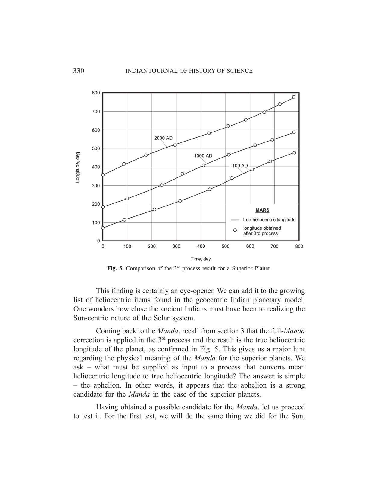

*Fig. 5. Comparison of the $3^{\text{rd}}$ process result for a Superior Planet.*

<!-- figure-resolved-page-render: page=14 image=media/p14_page.webp -->

<!-- figure-meta: page=14, position=top, type=graph -->

This finding is certainly an eye-opener. We can add it to the growing list of heliocentric items found in the geocentric Indian planetary model. One wonders how close the ancient Indians must have been to realizing the Sun-centric nature of the Solar system.
Coming back to the *Manda*, recall from section 3 that the full-*Manda* correction is applied in the $3^{\text{rd}}$ process and the result is the true heliocentric longitude of the planet, as confirmed in Fig. 5. This gives us a major hint regarding the physical meaning of the *Manda* for the superior planets. We ask – what must be supplied as input to a process that converts mean heliocentric longitude to true heliocentric longitude? The answer is simple – the aphelion. In other words, it appears that the aphelion is a strong candidate for the *Manda* in the case of the superior planets.
Having obtained a possible candidate for the *Manda*, let us proceed to test it. For the first test, we will do the same thing we did for the Sun,
THE MANDA PUZZLE IN INDIAN ASTRONOMY 331
i.e., check the predicted location of the *Manda* per the *Sūrya-siddhānta* against the actual location of the aphelion at 2000 AD. As earlier, we will correct the aphelion longitude with reference to the first of Aries by subtracting $23^\circ$. The results are shown in Table 4.
Table 4. Comparing the Aphelion and *Manda* Positions for Superior Planets

| Planet | SS* *Manda* Longitude [2000 AD] | Aphelion Longitude [2000 AD] | Corrected Aphelion Longitude** [2000 AD] | Diff. |
| :--- | :--- | :--- | :--- | :--- |
| Mars | $130.05^\circ$ | $156.03^\circ$ | $133.03^\circ$ | $2.98^\circ$ |
| Jupiter | $171.39^\circ$ | $194.83^\circ$ | $171.83^\circ$ | $0.44^\circ$ |
| Saturn | $236.63^\circ$ | $273.73^\circ$ | $250.73^\circ$ | $-14.10^\circ$ |

\* *Sūrya-siddhānta* \*\* Corrected for first of Aries
Comparing columns 2 and 4 of the Table we see that Mars and Jupiter show excellent agreement while Saturn is off by a somewhat bigger, though not excessive, amount. It would thus appear that the aphelion is indeed a good candidate for the *Manda* of superior planets. But before we conclude, let us do one more test.
The *Manda* as we saw is a vital component of the Indian planetary system. The question we now explore is this – considering the *Manda* to be variable, what value of the *Manda* would result in the most accurate value for the planet’s longitude after the 4-step correction process. That is, for each superior planet we will run computer simulations by varying the *Manda* location till we determine that *Manda* which gives us the most accurate result for the planet’s actual position. We call this the ‘optimized *Manda*’. Mars was optimized for a period of 10 years, Jupiter for 25 and Saturn for 60 years. The results are shown in Fig. 6. The solid lines in the figure show the variation of the aphelion over a period of 5000 years for each superior planet. The symbols are the ‘optimized *Manda*’ values, as described in the previous paragraph.
The results are spectacular! The optimized *Manda* values that result in the most accurate computation of a planet’s position are seen to be very close to the aphelion of each planet. This result may be treated as conclusive.

332 INDIAN JOURNAL OF HISTORY OF SCIENCE

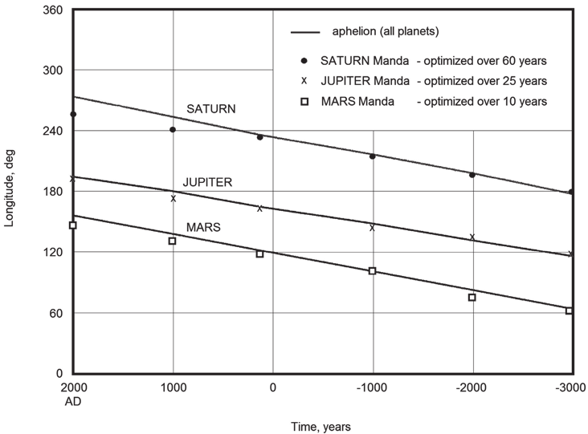

*Fig. 6. Comparing the Aphelion with Optimized *Manda* for the Superior Planets.*

<!-- figure-resolved-extracted: page=16 image=media/p16_fig01.webp -->

<!-- figure-meta: page=16, printed_page=332, position=top, type=graph -->

The *Manda* for the superior planets are without doubt the aphelions of their orbits about the Sun.
This conclusion also brings up some interesting questions. The aphelion of a superior planet is obviously not something that can be measured or even detected easily from the Earth. The perplexing question is this – how did the ancient Indians obtain the aphelion longitudes for each superior planet? Was it by observation or by calculation? Did their models and calculations throw up these mysterious constants repeatedly before they finally realized that these constants were not related to the model but were stand-alone constants? Did they suspect these constants were related to the Sun? These interesting questions will have to wait for further research.

## 8. MANDA FOR THE INFERIOR PLANETS

Having seen that the aphelion is the *Manda* for the superior planets, we may wonder whether the same might be true for the inferior planets as
---
THE *MANDA* PUZZLE IN INDIAN ASTRONOMY 333
well. After all, the inferior planets also circle the Sun and their orbits have an aphelion too. Let us begin by doing a *Manda*-location check on the inferior planets. Table 5 shows the result of that effort.

### Table 5. Comparing the Aphelion and *Manda* Positions for Inferior Planets

| Planet | SS* *Manda* Longitude [2000 AD] | Aphelion Longitude [2000 AD] | Corrected Aphelion Longitude** [2000 AD] | Difference |
| :--- | :--- | :--- | :--- | :--- |
| Mercury | $220.48^\circ$ | $257.27^\circ$ | $234.27^\circ$ | $-13.79^\circ$ |
| Venus | $79.88^\circ$ | $311.81^\circ$ | $288.81^\circ$ | $-208.93^\circ$ |

The second column values in the table are from Table 2. They show the *Manda* locations calculated as per the *Sūrya-siddhānta*, for Mercury and Venus, at 2000 AD. The third column contains the aphelion longitudes for the two planets at 2000 AD. The fourth column corrects the third column for the first of Aries. The last column shows the difference between the second and fourth columns. From this last column we clearly note that there are significant errors in the aphelion hypothesis for the inferior planets. While the Mercury error may be considered borderline, the Venus error is so large that it puts the aphelion hypothesis out of the reckoning for the inferior planets.
Let us now repeat something we did for the superior planets. Recall that for the superior planets the longitude obtained after the $3^{\text{rd}}$ process was the true-heliocentric longitude of the planet. Let us examine what the $3^{\text{rd}}$ process throws up for the inferior planets. The result, for the planet Venus, is shown in Fig. 7. It can be seen from the figure that the true-heliocentric longitude for the inferior planets (dashed-line) nowhere agrees with the longitude produced by the $3^{\text{rd}}$ process (unfilled circles). Thus what was true for the superior planets is not so for the inferior planets. But we now ask – if not the true-heliocentric longitude what in fact does the $3^{\text{rd}}$ process produce in the case of the inferior planets? The answer is shown in Fig. 7. It is seen that the longitude produced by the $3^{\text{rd}}$ process for the inferior planets agrees excellently with the true-Sun (solid line).
---
334 INDIAN JOURNAL OF HISTORY OF SCIENCE

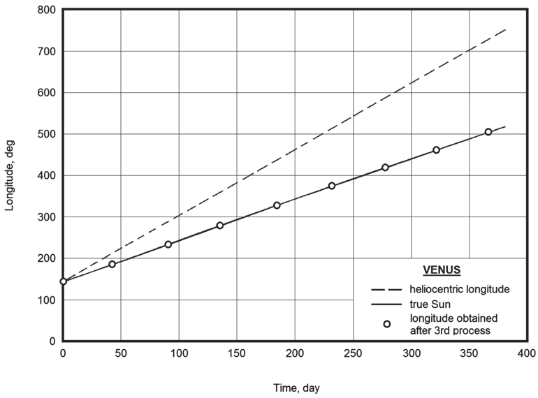

*Fig. 7. Comparison of the $3^{\text{rd}}$ process result for an Inferior Planet.*

<!-- figure-resolved-extracted: page=18 image=media/p18_fig01.webp -->

<!-- figure-meta: page=18, printed_page=334, position=top, type=graph -->

With that interesting result in hand we can perhaps obtain a clue to what the *Manda* may be for the inferior planets. Recall that the full *Manda* is applied in the $3^{\text{rd}}$ process for both superior and inferior planets. The inputs however are different in the two cases. For superior planets the input is the mean-planet while for the inferior planets it is the mean sun. The outputs are also different, as we have seen above. The superior planet scheme produces the true-heliocentric longitude while the inferior produces the true-sun. Once again we ask – what input is needed for a process that takes in mean-solar longitudes and produces true-solar longitudes? And once again the answer is simple – the Sun’s apogee.
Can the Sun’s apogee be the *Manda* for the inferior planets? A little thought shows that this cannot be true since the solar apogee, which is Earth-based, would be identical for both Mercury and Venus. The *Manda* values however given in the *Sūrya-siddhānta* (second column, Table 5) for the two inferior planets are substantially different from each other. Thus it
---
THE *MANDA* PUZZLE IN INDIAN ASTRONOMY 335
appears that while the Earth-based solar apogee is possibly one factor in the *Manda*, there are likely other factors. A little further thought nudges us in the direction of another solar apogee – the planet-based solar apogee.
The planet-based solar apogee is the equivalent of the earth-based solar apogee. It is the longitude of the Sun’s apogee as seen from the planet. Its value is easy to determine. It is simply the compliment of the aphelion longitude (i.e. $180^\circ$ + aphelion).
We are now ready to make a guesstimate and come up with a hypothesis. We say that the *Manda* in the case of inferior planets is an average of the two solar apogees - Earth-based and Planet-based. This term is henceforth called the Average-Planet-Solar-Apogee (or APSA). That is,

$$Manda_{\text{inferior}} = \text{APSA} = (\text{Earth-based Solar apogee} + \text{Planet-based Solar apogee}) / 2$$

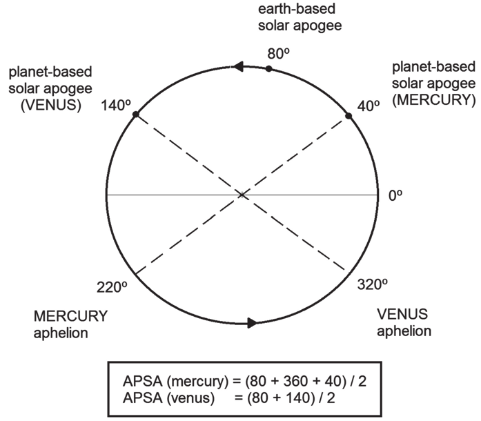

*Fig. 8. The Average-Planet-Solar-Apogee (APSA).*

<!-- figure-resolved-extracted: page=19 image=media/p19_fig01.webp -->

<!-- figure-meta: page=19, printed_page=335, position=bottom, type=diagram -->

---
336 INDIAN JOURNAL OF HISTORY OF SCIENCE
A caveat to keep in mind while calculating the APSA is that the Planet-based apogee is always assumed to be ahead of the Earth-based apogee. Fig. 8 illustrates the point for Mercury. Say, the Earth-based solar apogee is at $80^\circ$ and the aphelion of Mercury is situated at $220^\circ$ longitude. The planet-based solar apogee would thus be at ($220-180$)=$40^\circ$. Noting that this value is less that the Earth-based apogee ($80^\circ$), we apply the rule that the planet-based apogee must be ahead of the earth-based solar apogee and so we must add 360 to this value (i.e. $360 + 40$). Thus the APSA for Mercury would be as follows.

$$\text{APSA}_{\text{Merc}} = (360 + 40 + 80) / 2 = 240^\circ$$

Next, considering Venus, we see that the aphelion is situated at $320^\circ$ and thus the planet-based solar apogee is at $320-180 = 140^\circ$, which is already ahead of the Earth-based apogee ($80^\circ$). Thus the APSA for Venus would be as follows.

$$\text{APSA}_{\text{Venus}} = (140 + 80) / 2 = 110^\circ$$

Let us put the APSA to the *Manda*-location test as earlier. We use some earlier results from Tables 3 and 5, namely, the Sun’s corrected apogee ($79.95^\circ$) and the corrected aphelions of Mercury and Venus ($234.27^\circ$ and $288.81^\circ$). Table 6 shows the results of the *Manda*-location check.

### Table 6. APSA Computation for the Inferior Planets

| Planet | SS* *Manda* Longitude [2000 AD] | Corrected Aphelion Longitude** [2000 AD] | Planet-based Solar Apogee (Aph. $\pm 180$) | APSA | Difference |
| :--- | :--- | :--- | :--- | :--- | :--- |
| Mercury | $220.48^\circ$ | $234.27^\circ$ | $414.27^\circ$ | $247.11^\circ$ | $26.67^\circ$ |
| Venus | $79.88^\circ$ | $288.81^\circ$ | $108.81^\circ$ | $94.38^\circ$ | $14.5^\circ$ |

The last column in the Table shows the difference between the second column and the APSA (fifth column) for 2000 AD. While certainly not negligible, these APSA errors are not as substantial as the error in Table 5.
How does the APSA error vary with time? To answer this question we calculate the errors at various epochs in the past. Fig. 9 shows the

[^1]: *Sūrya-siddhānta

[^2]: ** Corrected for first of Aries

THE MANDA PUZZLE IN INDIAN ASTRONOMY 337

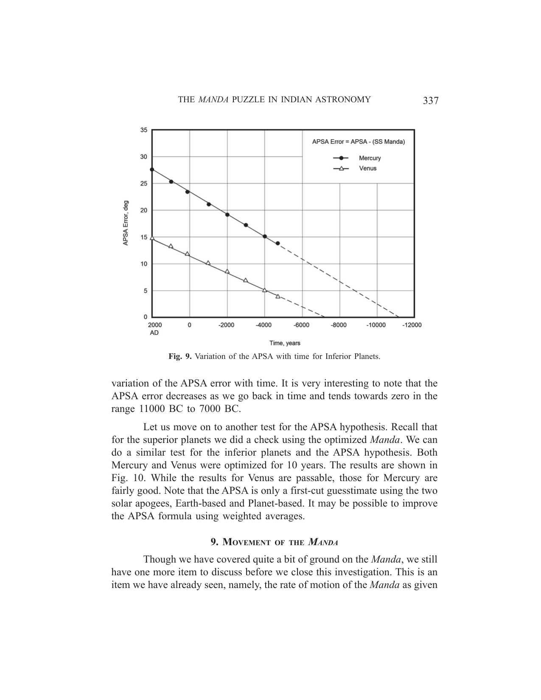

*Fig. 9. Variation of the APSA with time for Inferior Planets.*

<!-- figure-resolved-page-render: page=21 image=media/p21_page.webp -->

<!-- figure-meta: page=21, position=top, type=graph -->

variation of the APSA error with time. It is very interesting to note that the APSA error decreases as we go back in time and tends towards zero in the range 11000 BC to 7000 BC.
Let us move on to another test for the APSA hypothesis. Recall that for the superior planets we did a check using the optimized *Manda*. We can do a similar test for the inferior planets and the APSA hypothesis. Both Mercury and Venus were optimized for 10 years. The results are shown in Fig. 10. While the results for Venus are passable, those for Mercury are fairly good. Note that the APSA is only a first-cut guesstimate using the two solar apogees, Earth-based and Planet-based. It may be possible to improve the APSA formula using weighted averages.

## 9. MOVEMENT OF THE *MANDA*

Though we have covered quite a bit of ground on the *Manda*, we still have one more item to discuss before we close this investigation. This is an item we have already seen, namely, the rate of motion of the *Manda* as given
338 INDIAN JOURNAL OF HISTORY OF SCIENCE

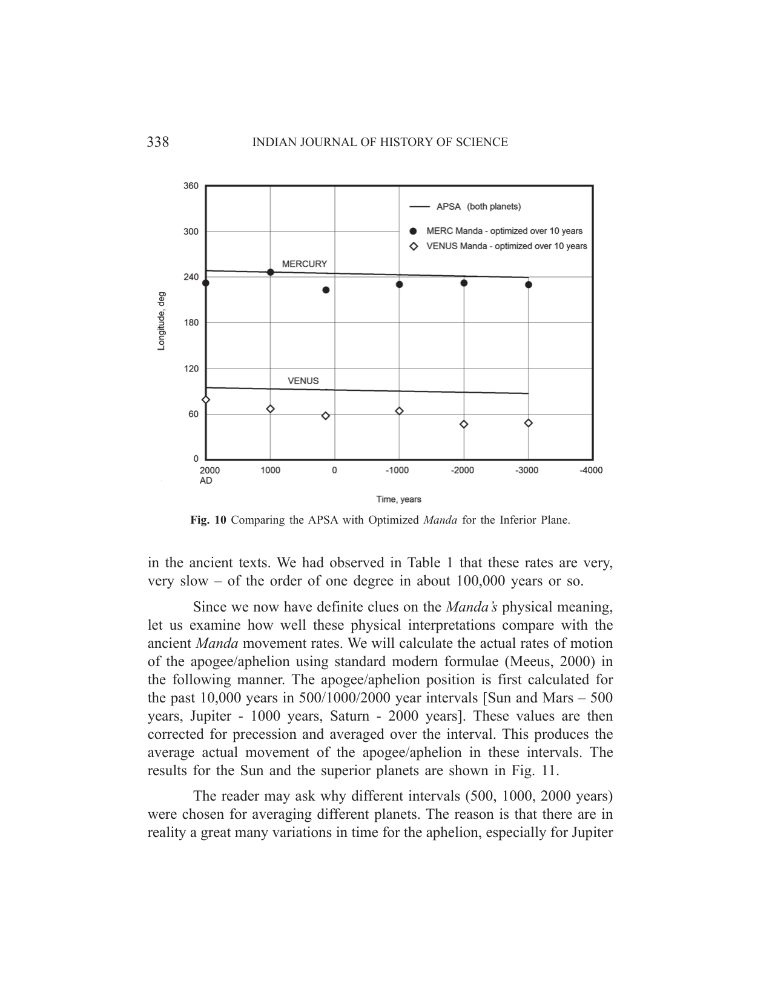

*Fig. 10. Comparing the APSA with Optimized Manda for the Inferior Plane.*

<!-- figure-resolved-page-render: page=22 image=media/p22_page.webp -->

<!-- figure-meta: page=22, position=top, type=graph -->

in the ancient texts. We had observed in Table 1 that these rates are very, very slow – of the order of one degree in about 100,000 years or so.
Since we now have definite clues on the *Manda*’s physical meaning, let us examine how well these physical interpretations compare with the ancient *Manda* movement rates. We will calculate the actual rates of motion of the apogee/aphelion using standard modern formulae (Meeus, 2000) in the following manner. The apogee/aphelion position is first calculated for the past 10,000 years in $500/1000/2000$ year intervals [Sun and Mars – 500 years, Jupiter - 1000 years, Saturn - 2000 years]. These values are then corrected for precession and averaged over the interval. This produces the average actual movement of the apogee/aphelion in these intervals. The results for the Sun and the superior planets are shown in Fig. 11.
The reader may ask why different intervals ($500, 1000, 2000$ years) were chosen for averaging different planets. The reason is that there are in reality a great many variations in time for the aphelion, especially for Jupiter
THE MANDA PUZZLE IN INDIAN ASTRONOMY 339

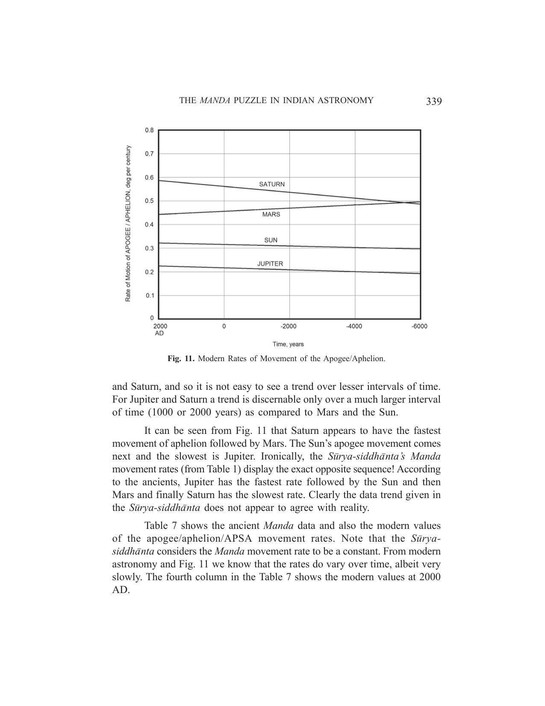

*Fig. 11. Modern Rates of Movement of the Apogee/Aphelion.*

<!-- figure-resolved-page-render: page=23 image=media/p23_page.webp -->

<!-- figure-meta: page=23, position=top, type=graph -->

and Saturn, and so it is not easy to see a trend over lesser intervals of time. For Jupiter and Saturn a trend is discernable only over a much larger interval of time (1000 or 2000 years) as compared to Mars and the Sun.
It can be seen from Fig. 11 that Saturn appears to have the fastest movement of aphelion followed by Mars. The Sun’s apogee movement comes next and the slowest is Jupiter. Ironically, the *Sūrya-siddhānta*’s *Manda* movement rates (from Table 1) display the exact opposite sequence! According to the ancients, Jupiter has the fastest rate followed by the Sun and then Mars and finally Saturn has the slowest rate. Clearly the data trend given in the *Sūrya-siddhānta* does not appear to agree with reality.
Table 7 shows the ancient *Manda* data and also the modern values of the apogee/aphelion/APSA movement rates. Note that the *Sūrya-siddhānta* considers the *Manda* movement rate to be a constant. From modern astronomy and Fig. 11 we know that the rates do vary over time, albeit very slowly. The fourth column in the Table 7 shows the modern values at 2000 AD.
340 INDIAN JOURNAL OF HISTORY OF SCIENCE
**Table 7.** Comparing *Sūrya-siddhānta* *Manda* Movement Rates with Actual Rates

| Planet | *Sūrya-siddhānta* | *Sūrya-siddhānta* | Modern | Modern |
| :--- | :--- | :--- | :--- | :--- |
| | *Manda* Movement (Rev. per Eon*) | *Manda* Movement (deg/century) | *Manda* Movement (deg/century) [2000 AD] | *Manda* interpreted as... |
| Sun | 387 | 0.0032 | 0.323 | apogee |
| Moon | 488203000 | 4068.358 | 4067.61 | apogee |
| Mercury | 368 | 0.0031 | 0.2403 | APSA |
| Venus | 535 | 0.0045 | 0.191 | APSA |
| Mars | 204 | 0.0017 | 0.4514 | aphelion |
| Jupiter | 900 | 0.0075 | 0.226 | aphelion |
| Saturn | 39 | 0.0003 | 0.59 | aphelion |

*Eon = 4.32 billion years
It is seen from columns 3 and 4 of the Table that, except for the Moon, the ancient *Manda* movement rates are off from the actual rates by as much as 2 orders of magnitude. We will discuss this further in the next section.

## 10. DISCUSSION

There are several things that are astounding about the Indian planetary model. Among the most sensational is the fact that a geocentric planetary model has heliocentric numbers at its core, and with substantial accuracy at that! The mean revolutionary period given in the ancient texts for a planet is its mean heliocentric period. In addition to that, in this article we have seen that the *Manda* for the superior planets is the aphelion of their orbits. That makes yet another heliocentric attribute in the geocentric Indian model.
How did the ancients obtain these heliocentric numbers - and with such accuracy? This must rank among the most intriguing puzzles in Indian astronomy. These numbers cannot be found by direct observation since the observer is situated on the Earth and the planetary model itself is geocentric. Obviously there are deeper waters here than we suspect. We may conjecture that perhaps in the process of experimenting with their planetary models and correlating it with observational data, the ancients frequently encountered
THE MANDA PUZZLE IN INDIAN ASTRONOMY 341
these mysterious constants whose import was only gradually understood. But in whatever manner they were obtained, full marks to the ancient Indian astronomer for discovering these fundamental constants of the Solar system.
Western scholars have often derided the Indian planetary model, in particular the 4-step process, as being unnecessarily abstruse (Burgess 1858). It now transpires that the Indian process is very similar to the modern technique. To find the true position of a planet we first find the true heliocentric longitude and then convert it to geocentric longitude. The penultimate step (3rd process) is seen to produce the true-heliocentric longitude for the superior planets and the true-Sun for the inferior planets, both remarkable discoveries. These findings highlight the uniquely advanced nature of Indian astronomy and put a very serious question mark on the western theory that Indian astronomy is an offshoot of Greek astronomy.
From the investigations and results presented in this paper it appears conclusive that the *Manda* is not simply a mathematical tool but represents a physical reality. The *Mandas* of the Sun and the Moon are their respective apogees. It is the aphelion in the case of the superior planets. For the inferior planets the APSA hypothesis advanced in this paper seems to provide fair results. We stress that the APSA is only a first-cut guesstimate and it may be possible to improve the APSA formula using weighted averages instead of a straight average. It is interesting to note that the APSA error for both Mercury and Venus decreases as we go back in time.
The Moon’s *Manda* movement rate agrees very well with its modern value. From this we may conclude that the ancient Indians were good if not excellent observers. How then can we explain the gross errors in the rate of-*Manda* movement for the other planets?
Probably one of the things we can safely assume is that the ancients did not possess sophisticated observational instruments. By that we mean something that could go down to arc-seconds in precision. Chapter 8 in the *Sūrya-siddhānta* is a good testimony to this statement. This chapter provides longitude and latitude data for several stars and the best precision of that data is 10 minutes of arc. Noting that the best accuracy achievable with the naked eye is about 1 minute of arc, it becomes clear that the ancients relied mostly on the naked eye while making observational measurements.

342 INDIAN JOURNAL OF HISTORY OF SCIENCE
If we concur with the above statement, we are left with the question as to how the ancients obtained the very minute rates of *Manda* movement for the Sun and the planets. Even assuming the best possible naked-eye precision it would still take several thousand years of observation to obtain these values. That seems altogether unlikely. Therefore we must look at the other possibility, namely, that these minute rates of movement were the result of calculation, not direct observation.

## 11. CONCLUSIONS

Some conclusions that may be drawn from this study on the *Manda* concept are as follows:
i. From all evidences the ancient Indian concept of the *Manda* appears to represent a physical reality.
ii. For the Sun and the Moon the apogee of their relative orbits around the Earth is the *Manda*.
iii. For the superior planets the aphelion of their orbits around the Sun is the *Manda*.
iv. For the inferior planets the APSA (average-planet-solar-apogee) appears to represent a fair first-cut formulation for the *Manda*. It is the average of two orbital parameters.
v. For superior planets, the 3 $^{rd}$ process of the Indian planetary model produces the true-heliocentric longitude of a planet.
vi. For inferior planets, the 3 $^{rd}$ process of the Indian planetary model produces the longitude of the true-Sun.
vii. These remarkable findings above concerning the 3 $^{rd}$ process put a serious question mark on the western hypothesis that the Indian planetary model is borrowed from the Greeks.
viii. Except for the Moon, the rates of *Manda* movement given in the ancient text do not agree at all with the actual rates. It appears that the ancients may have obtained these rates by calculation as opposed to actual observation.
THE *MANDA* PUZZLE IN INDIAN ASTRONOMY 343

## BIBLIOGRAPHY

Brennand, W., *Hindu Astronomy*, Caxton Publications, Delhi, 1988 (reprint ed of 1896)
Burgess, E., *Sūrya-siddhānta - A Text Book of Hindu Astronomy*, 1858
Meeus, J., *Astronomical Algorithms*, Willmann-Bell Inc, 2000
Narayanan, A., “Dating the *Sūrya-siddhānta* using computational simulation of proper motions and ecliptic variations”, *IJHS*, 45.4(2010)455-476
Narayanan, A., “The Pulsating Indian Epicycle of the Sun”, *IJHS*, 46.3(2011)411-426
Sen, S. N. & Shukla, K. S., *History of Astronomy in India*, Indian National Science Academy, 1985
Tilak, B. G., *The Orion or Researches into the Antiquity of the Vedas*, Bombay, 1893
