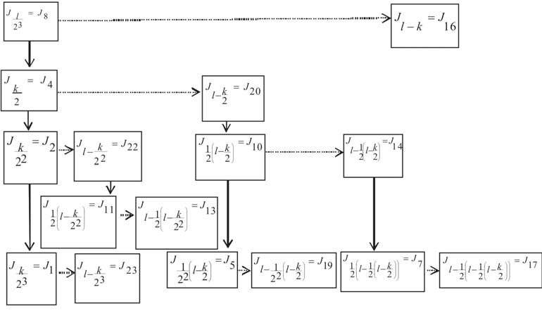
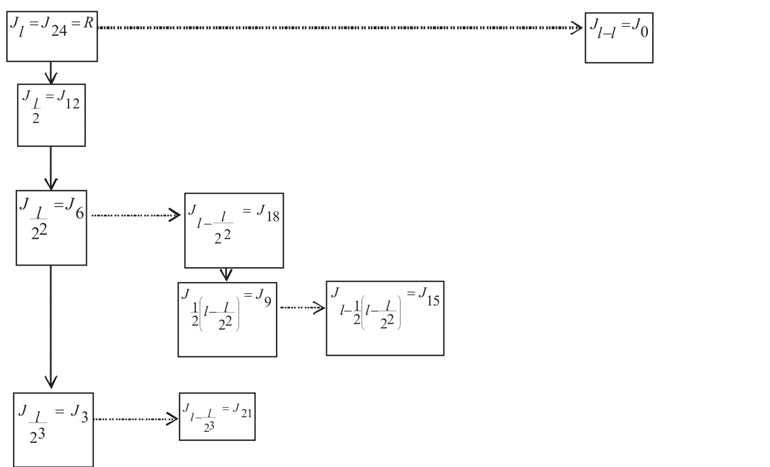
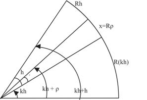

# Sines and Interpolation in India

- Author Display: V Madhukar Mallayya
- Year: 2012
- Journal Label: IJHS-47-2012-Issue-4
- Source Url: https://insa.nic.in/(S(eh1ucortlbqqezipwgliy3mn))/writereaddata/UpLoadedFiles/IJHS/Vol47_4_10_Malaya.pdf

<!-- source: page-chunk extraction; methods recorded in assembly-manifest.json -->
<!-- Page ranges and pdf-page markers are 1-based physical PDF positions, not printed pagination. -->

<!-- decode-chunk: pages=1-5 source_sha256=05cce5ea6629693652acb1f45c03c9435b7f359a83246d2dafc486bf414fe42c -->
<!-- pdf-page: 1 -->

Indian Journal of History of Science, 47.4 (2012) 737-770

# SINES AND INTERPOLATION IN INDIA

**V. MADHUKAR MALLAYYA***
(Received 23 April 2012)
Indian astronomers made great strides in the field of trigonometric computations and interpolation theory. Their discovery of trigonometric functions was mainly focussed to find the position and motion of planets, stars and other astronomical phenomena. They finally developed the infinite power series by interpolation and improved considerably value of sine, and versed sine tables and other trigonometric functions.
**Key words:** *Āryabhaṭīya*, *Brahmagupta*, *Golasāra*, *Mādhava*, *Marīci*, *Parameśvara*, *Vaṭeśvara-siddhānta*, *Yuktibhāṣā*

## INTRODUCTION

If an arc *BOW* of length $2s$ subtends an angle $2\theta$ at the centre $K$, $O$ being the mid point of the arc, then the arc *BO* is of length $s$ and subtend an angle $\theta$ at $K$. The half chord $BJ$ of the arc *BOW* is called the *jyā* or *jīvā* of the arc $BO$, the upright $KJ$ on $BJ$ the *koṭi-jyā* of the arc, and the arrow like protruding part $JO$ the *śara* or *bāṇa* or *utkrama-jyā* of the arc. If the radius is $R$ then its *jyā* $= BJ = R \sin \theta$, *koṭi-jyā* $= KJ = R \cos \theta$, and *utkrama-jyā* $= JO = KO - KJ = R - R \cos \theta$. Tabular values of trigonometric functions and their differences are constructed for the purpose of interpolation and this is a general feature Indian astronomical texts (Bag, 1969, 79-85).
If $h = \frac{5400'}{l}$ is the angular measure of an arc bit, then for $i = 0, 1, 2, \dots, l$ where $l = 3 \times 2^m$, $m = 0, 1, 2, 3, \dots$ denote the $i^{\text{th}}$ tabular Rsine, Rcosine and Rversine by $J_i = R \sin(ih)$, $K_i = R \cos(ih)$ and
---
\* Head, Department of Mathematics, Mar Ivanios College, Trivandrum. Res: T. C 25/1974(2), MELTRA A-23, Near Gandhariamman Kovil, Trivandrum-695001, Kerala; email:crimstvm@yahoo.com

<!-- pdf-page: 2 -->

738 INDIAN JOURNAL OF HISTORY OF SCIENCE

*Fig. 2. Diagram showing arc BOW, mid-point O, half-chord BJ, and radius R in a circle*

<!-- figure-resolved-page-render: page=2 image=media/p02_page.png reason=no-extracted-figure -->

<!-- figure-meta: page=2, position=top, type=diagram -->

$V_i = R - R \sin(l - i)h = R - J_{l-i}$ respectively where $J_0 = 0$. Also for $i = 0, 1, 2, \dots, l-1$ denote the tabular Rsine difference $J_{i+1} - J_i = R \sin(i+1)h - R \sin(ih)$ by $\Delta J_i$. The $l$ tabular values are computed at every increase of $h$ minutes of arc. Generally $l = 24$ is found to have been used for which $m = 3$ and $h = 225'$. The Rsine of a third part of the quadrantal arc (i.e. of a *rāśi*) is $J_k = R \sin 30^\circ = \frac{R}{2}$ where $k = \frac{l}{3}$. The last tabular Rsine $J_l$ is the Rsine of the whole quadrantal arc or the *jyā* of three *rāśis* (often called *trijyā* or *trirāśi-jyā*) and is equal to $R$. Different values for $R$ are found to have been used by different astronomers. In some of the works such as the *Āryabhaṭīya* of *Āryabhaṭa I*; the *Sūrya-siddhānta*; the *Mahābhāskarīya* of *Bhāskara I*; the *Śiṣyadhīvṛddhida-tantra* of Lalla; the *Mahā-siddhānta* of *Āryabhaṭa II*; and the *Siddhānta-śiromaṇi* of *Bhāskara II* the value of $R$ is taken as $3438'$. The *Vaṭeśvara-siddhānta* of *Vaṭeśvara* and *Parameśvara*'s commentary on the *Laghubhāskarīya* gives a more refined value $3437'44''$ and a further refined value $3437'44''19'''$ ($= 1237589'''$) can be had from the works such as the *Mahābhāskarīyabhāṣya* of *Govindasvāmin* and *Udayadivākara*'s commentary on the *Laghubhāskarīya*.

<!-- pdf-page: 3 -->

SINES AND INTERPOLATION IN INDIA 739
Utpala’s commentary on *Bṛhat-saṃhitā* gives $R = 3437 + \frac{967}{1309}$. The value $3437'44''48'''$ attributed to *Mādhava* can be had from the works of *Nīlakaṇṭha*, *Śaṅkara Vāriar*, and *Jyeṣṭhadeva*. Apart from these the value $900'$ can be had from the *Dhyāna-grahopadeśa adhyāya* and the *Khaṇḍakhādyaka* of *Brahmagupta* and the *Śiṣyadhīvṛddhida-tantra* of Lalla. *Brahmagupta* also used the value $3270'$ for $R$. Another value $120'$ is found to have been used in the *Pañca-siddhāntikā* of *Varāhamihira*, the *Karaṇaprakāśa* of *Brahmadeva*, the *Siddhānta-śiromaṇi* and *Karaṇakutūhala* of *Bhāskara II*.
Since the accuracy in the interpolated value depends on the accuracy of the tabular values used as well as on the method of interpolation, various methods for construction of tabular values with desired degree of accuracy and several methods for interpolation are found to have been developed from time to time. Some of these methods from select works are briefly described here.

## 1. *ĀRYABHAṬĪYA* OF *ĀRYABHAṬA I*

*Āryabhaṭa I* (b. 476 AD) describes a geometrical method[^1] based on two important formulae namely $J_{l-i} = \sqrt{R^2 - J_i^2}$ and $J_{i/2} = \frac{1}{2} \sqrt{J_i^2 + V_i^2}$ with which one can compute i) $l$ tabular values at every increase of $h$ minutes of arc and ii) the first Rsine $J_1 = R \sin h$ that is needed for the construction of $l$ tabular values by means of other algorithms prescribed for the purpose. *Āryabhaṭa*’s scheme for computation of $l(=24)$ tabular sines consists of two parts. While the first part of the scheme is initiated from $J_k = \frac{R}{2} \left(k = \frac{l}{3} = 8\right)$ to compute $J_i$ for $i = 4, 2, 1; 23; 16; 20, 10, 5; 19; 22, 11; 13; 14, 7; 17$, the second part is initiated from $J_l = J_{24} = R$ to compute $J_i$ for $i = 12, 6, 3; 21; 18; 9; 15$.
The geometrical method also gives first Rsine that is needed for computation of tabular Rsine differences and Rsines by another method stated by *Āryabhaṭa I*[^2] according to which the tabular Rsine differences $\Delta J_i$ and tabular Rsines $J_i$ for $i = 1, 2, 3 \dots, l-1$ are given by

<!-- pdf-page: 4 -->

740 INDIAN JOURNAL OF HISTORY OF SCIENCE
**First Part**

*Fig. 4. Flowchart showing the first part of the computation scheme beginning with J_l/k = J_8*

<!-- figure-resolved-extracted: page=4 image=media/p04_fig01.jpg -->

<!-- figure-meta: page=4, position=top, type=diagram -->

**Second Part**

*Fig. 4. Flowchart showing the second part of the computation scheme beginning with J_l = J_24 = R*

<!-- figure-resolved-extracted: page=4 image=media/p04_fig02.jpg -->

<!-- figure-meta: page=4, position=middle, type=diagram -->

<!-- pdf-page: 5 -->

SINES AND INTERPOLATION IN INDIA 741
$\Delta J_i = J_1 - \frac{J_1 + J_2 + \dots + J_i}{J_1}$ and $J_{i+1} = J_i + \Delta J_i$. Some of the commentators recommend the use of the formula $\Delta J_i = \Delta J_{i-1} - \frac{\Delta J_0 + \Delta J_1 + \dots + \Delta J_{i-1}}{J_1}$ for computation of tabular Rsine differences where $\Delta J_0 = J_1$ (which in short gives $\Delta J_i = \Delta J_{i-1} - \frac{J_i}{J_1}, J_{i+1} = J_i + \Delta J_i$) or the formula $\Delta J_i = \Delta J_{i-1} - \frac{J_i}{J_1}(\Delta J_0 - \Delta J_1)$ for $i = 2, 3, \dots, l-1$, where $\Delta J_0 = J_1$, $\Delta J_1 = J_1 - \frac{J_1}{J_1}$, and $J_2 = J_1 + \Delta J_1$. *Āryabhaṭa*’s first Rsine is $225'$ and the twenty four tabular Rsine-differences listed[^3] are 225, 224, 222, 219, 215, 210, 205, 199, 191, 183, 174, 164, 154, 143, 131, 119, 106, 93, 79, 65, 51, 37, 22, 7 minutes for every increase of 225 minutes (3°45′) of arc.

## 2. *PAÑCASIDDHĀNTIKĀ* OF *VARĀHAMIHIRA*

*Varāhamihira* (b. 505 AD) gives a detailed discussion of Rsines and construction of trigonometric tables in the famous astronomical treatise *Pañcasiddhāntikā* (Thibaut & Dvivedi, 1997 iv. 1-11, pp 22-24). Rsines are derived successively for every 3°45′ increase of arc with $R = 120'$ using a procedure[^4] based on repeated application of the formula $J_{i/2} = \frac{1}{2} \sqrt{J_i^2 + V_i^2}$ or $J_{i/2} = \sqrt{\left(\frac{R}{2}\right) V_i}$, and $(J_{l-i}) = \sqrt{R^2 - (J_i)^2}$ starting from the values of Rsin 30°, Rsin 45°, Rsin 60° and Rsin 90°. The squares of Rsines of 30°, 45°, 60° and 90° are respectively 3600, 7200, 10800 and 14400 minutes. The twenty four Rsines are: 7′ 51′′, 15′ 40′′, 23′ 25′′, 31′ 4′′, 38′ 34′′, 45′ 56′′, 53′ 5′′, and 60′ 0′′ in the first sign (ie, up to 30°); 66′ 40′′, 73′ 3′′, 79′ 7′′, 84′ 51′′, 90′ 13′′, 95′ 12′′, 99′ 46′′, 103′ 55′′ in the second sign, and 107′ 37′′, 110′ 52′′, 113′ 37′′, 115′ 55′′, 117′ 42′′, 118′ 59′′, 119′ 44′′ and 120′ 0′′ in the third sign.

[^1]: *Āryabhaṭīya*, Gaṇitapāda, 11

[^2]: *Āryabhaṭīya*, Gaṇitapāda, 12

[^3]: *Āryabhaṭīya*, Daśagītikāpāda, 12

[^4]: *Pañcasiddhāntikā*, iv, 1-11
<!-- /decode-chunk -->

<!-- decode-chunk: pages=6-10 source_sha256=908a2242b58eea860ea6552cf36a4f3cc118b577597ac8527fc99ca86010814e -->
<!-- pdf-page: 6 -->

742 INDIAN JOURNAL OF HISTORY OF SCIENCE

### 3. *MAHĀBHĀSKARĪYA* OF BHĀSKARA I

Bhāskara I (c. 600 AD) gives two methods for computation of Rsines in the *Mahābhāskarīya*. One is without using tabular values of Rsine differences and the other using tabular Rsine-differences. The rule for finding desired Rsines without using tabular values given by Bhāskara I is based on the approximate formula[^5],

$$RSin\theta = \frac{R(180-\theta)\theta}{\frac{1}{4}[40500-(180-\theta)\theta]} \text{ where } \theta \text{ is in degrees.}$$

[This is of the form $Sin\theta = \frac{16\theta(\pi-\theta)}{5\pi^2-4\theta(\pi-\theta)}$ if $\theta$ is in radians]
The other rule given by Bhāskara I for computing Rsines and Rversed sines is based on a simple interpolation technique using the concept of proportion[^6]. According to this rule, the desired $jy\bar{a}$

$$= \text{Sum of first n Rsine differences} + \frac{\text{remainder} \times \text{current difference}}{h} =$$

$$\sum_{i=0}^{n-1} \Delta J_i + \frac{\rho \times \Delta J_n}{h}, \text{ where } h = 225, n \text{ is the quotient and } \rho \text{ is the remainder}$$

when the desired arc is divided by $h$.
i.e, $RSin(nh+\rho) =$

$$\sum_{i=0}^{n-1} \Delta J_i + \frac{\rho \times \Delta J_n}{h} = (J_1 - J_0) + (J_2 - J_1) + \dots + (J_n - J_{n-1}) + \frac{\rho \times (J_{n+1} - J_n)}{h}$$

$$= J_n + \frac{\rho(J_{n+1} - J_n)}{h}$$

Thus $f(x+\rho) = f(x) + \frac{\rho}{h} \Delta f(x)$ where $nh = x$, and $\Delta f(x) = f(x+h) - f(x)$.
Denoting $\frac{\rho}{h} = u$, the rule gives $f(x+hu) = f(x) + u \Delta f(x)$ which is exactly the Newton’s interpolation formula up to first order. Using this, the values

<!-- pdf-page: 7 -->

SINES AND INTERPOLATION IN INDIA 743
of Rsines can be interpolated for different $u < 1$ (since $\rho < h$). Desired Rsines (and also Rversines) can be computed using this formula and the given tabular Rsine-differences up to $90^\circ$ of arc. For finding Rsines corresponding to arcs having angular measure greater than $90^\circ$, Bhāskara I prescribes the following formulae[^7]

$$Rsin (90^\circ + \theta) = Rsin 90^\circ - Rversin \theta$$

$$Rsin (180^\circ + \theta) = - Rsin \theta$$

$$Rsin (270^\circ + \theta) = - Rsin 90^\circ + Rversin \theta \text{ for } \theta < 90^\circ.$$

## 4. *BRĀHMASPHUṬA-SIDDHĀNTA*; *DHYĀNAGRAHOPADEŚĀDHYĀYA* & *KHAṆḌAKHĀDYAKA* OF BRAHMAGUPTA

In his standard works Brahmagupta (7th cent) dealt not only with construction of tabular values at equal arc bits and computation of desired Rsine values using such tabular values at equal intervals but also with computation of desired Rsines from a given set of tabular values at unequal intervals.
i) Of the two methods for computation of tabular Rsines for every increase of equal arc bits given in the *Brāhmasphuṭa siddhānta* (Sharma, Rama Swarup, 1966, verse xxi, 17-23, pp. 1349-58) one is graphical and the other one based on the two formulae:
$\text{F}_1: J_{i/2} = \frac{1}{2} \sqrt{J_i^2 + V_i^2}$ (or in an alternate form $J_{i/2} = \sqrt{\frac{D \times V_i}{4}}$ where $D = 2R$) and
$\text{F}_2: J_{l-i/2} = \sqrt{R^2 - J_{i/2}^2}$ where $V_i = R - J_{l-i} = R - \sqrt{R^2 - J_i^2}$
Starting from $J_k = \frac{R}{2}$, where, $k = \frac{l}{3}$, $l = 3 \times 2^m, m = 0, 1, 2, \dots$ ($m = 3$ for 24 tabular values so that $k = 8$) and applying $F_1$ and $F_2$ on $J_n$ for every even $n$, $J_i$ can be computed along with $J_{l-i}$ for $i = k, \frac{k}{2}, \frac{k}{4}, \dots, \frac{k}{2^{m-1}}$ and starting from $J_l = R$ and applying the same procedure can be computed along with $J_{l-i}$ for $i = l, \frac{l}{2}, \frac{l}{4}, \dots, \frac{l}{2^{m-1}}$.

<!-- pdf-page: 8 -->

744 INDIAN JOURNAL OF HISTORY OF SCIENCE
Brahmagupta’s tabular values[^8] at arc bits of with $R = 150$ are as follows:

| arc $i$ in degrees | 0 | 15 | 30 | 45 | 60 | 75 | 90 |
| :--- | :---: | :---: | :---: | :---: | :---: | :---: | :---: |
| $J_i$ | 0 | 39 | 75 | 106 | 130 | 145 | 150 |
| $\Delta J_i$ | | 39 | 36 | 31 | 24 | 15 | 5 |
| $\Delta^2 J_i$ | | | - 3 | - 5 | - 7 | - 9 | -10 |

Using these tabular values the desired intermediate Rsine values can be computed by applying the interpolation technique prescribed by Brahmagupta. While Bhāskara I introduced the first order interpolation technique, Brahmagupta extended it to the second order as found mentioned in his works[^9] *Brāhmasphuṭa-siddhānta* -*Dhyānagrahopadeśādhyāya* (before 628AD) and *Khaṇḍakhādyaka* (of 665 AD). Denoting the tabular difference passed over (*gata khaṇḍa*) by $d_g$, the difference to be passed over (*bhogya khaṇḍa*) or that in the current interval by $d_b$, and the residual arc in minutes by $\rho$, then the true functional difference in the current interval is

$$d = \frac{1}{2}(d_g + d_b) + \frac{1}{2}(d_g - d_b) \frac{\rho}{h} \quad \text{ or }$$

$$d = \frac{1}{2}(d_g + d_b) - \frac{1}{2}(d_g - d_b) \frac{\rho}{h} \text{ according as } \frac{1}{2}(d_g + d_b) < \text{or} > d_b. \text{ That is,}$$

according as $d_g < d_b$ or $d_g > d_b$ where $h = 900'$, and $d_b = d_{g+1}$. This true difference $d$ is over the current tabular arc interval of size $h$ containing the residual arc and so the true difference applicable over $\rho$ is $\frac{\rho}{h} \times d$.
Therefore the desired functional value is obtained by adding this to the just preceeding tabular functional value. If $\frac{\rho}{h} = u$ and $f$ stands for Rsine or Rversine then the desired functional value is $f(x + \rho) = f(x) + \frac{\rho}{h} d$.
This gives $f(x + hu) = f(x) + ud = f(x) + \frac{u}{2}(d_g + d_b) - \frac{u^2}{2}(d_g - d_b)$ if $d_g > d_b$

<!-- pdf-page: 9 -->

SINES AND INTERPOLATION IN INDIA 745
That is, $f(x+hu) = f(x) + \frac{u}{2}(d_g + d_{g+1}) - \frac{u^2}{2}(d_g - d_{g+1})$ if $d_g > d_{g+1}$
Thus, $f(x+hu) = f(x) + \frac{u}{2} \{ \Delta f(x-h) + \Delta f(x) \} - \frac{u^2}{2} \{ \Delta f(x-h) - \Delta f(x) \}$
$= f(x) + u \left\{ \frac{\Delta f(x-h) + \Delta f(x)}{2} \right\} + \frac{u^2}{2} \{ \Delta^2 f(x-h) \}$
This is exactly the Newton-Stirling’s interpolation formula up to second order term(Gupta, 1969, pp. 86-98).
ii) For a given set of tabular values at unequal intervals, Brahmagupta has given the following method for interpolation of desired values[^10]. Let the angular measure of the tabular arcs $s_i$ be $x_i = h_1 + h_2 + h_3 + \dots + h_i$ for $i=1, 2, 3, \dots, n$ (where $h_1, h_2, h_3, \dots, h_n$ are different for tables with unequal arc bits and all equal to say $h$ for tables with equal arc bits). Let the corresponding functional values be $J_i = jy\bar{a} (s_i) = R \sin x_i = f(x_i)$ where $s_i = R x_i$ for $i=1, 2, 3, \dots, n$. Tabular differences are $\Delta J_i = J_{i+1} - J_i = f(x_{i+1}) - f(x_i)$, where $J_0 = 0$, and $i=0, 1, 2, \dots, n-1$. Let $\alpha$ be the intervening argument between $x_q$ and $x_{q+1}$ whose functional value $R \sin \alpha$ is desired and $\alpha = x_q + \rho$ where $\rho$ is the residual arc (*vikala*) such that $0 < \rho < h_{q+1}$. The interval crossed is $(x_{q-1}, x_q)$ and the current interval within which it lies is $(x_q, x_{q+1})$.
*bhukta gati* = length of the crossed interval = $x_q - x_{q-1} = h_q$
*bhogya gati* = length of the current interval = $x_{q+1} - x_q = h_{q+1}$
*bhukta gati phalāṃśa* = tabular difference in the crossed interval
$= J_q - J_{q-1} = \Delta J_{q-1}$.
*bhogya gati phalāṃśa* = tabular difference in the current interval
$= J_{q+1} - J_q = \Delta J_q$. (This will be attained only on reaching $J_{q+1}$ (i.e., on crossing the current interval).

<!-- pdf-page: 10 -->

746 INDIAN JOURNAL OF HISTORY OF SCIENCE
According to Brahmagupta’s rule $bhukta \ gati \ phalāṃśa \times \frac{bhogya \ gati}{bhukta \ gati} = labdham$, which is the estimate of the functional difference $d_q$ in the current interval at the rate of that in the preceeding interval. Thus
$\Delta J_{q-1} \times \frac{h_{q+1}}{h_q} = d_q$. [Along the arc bit $h_q$, the tabular difference is $\Delta J_{q-1}$ and so expecting proportional change in the difference, applying rule of three, the difference along $h_{q+1}$ is estimated as $\Delta J_{q-1} \times \frac{h_{q+1}}{h_q} = d_q$. In this,
$\frac{\Delta J_{q-1}}{h_q} = \frac{\Delta J_{q-1}}{\Delta x_{q-1}}$ is the rate of change of Rsine in the interval just crossed. Hence the difference in the current interval of size $h_{q+1}$ following the crossed interval is estimated as $d_q = \frac{\Delta J_{q-1}}{h_q} \times h_{q+1}$. (In modern terms $\frac{\Delta J_{q-1}}{h_q} = \frac{\Delta J_{q-1}}{\Delta x_{q-1}}$ is the divided difference in the crossed interval)].
Now using the estimated difference $d_q$ in the current interval and the known tabular difference $\Delta J_q$ in the current interval, the true functional difference $d$ in the current interval is given by
$d = \frac{1}{2}(d_q + \Delta J_q) \mp \frac{1}{2}(d_q - \Delta J_q) \frac{\rho}{h_{q+1}}$ according as the mean
$\frac{1}{2}(d_q + \Delta J_q) > \text{or} < \Delta J_q$ (i.e. according as $d_q > \text{or} < \Delta J_q$)
[Since the estimated difference is $d_q$ and tabular difference is $\Delta J_q$, the actual difference is assumed to be their mean $m = \frac{1}{2}(d_q + \Delta J_q)$ which is also in fact not true. So it has to be corrected by subtracting or adding the amount of change in the residual bit of the interval according as the mean is $> \text{or} < \Delta J_q$. If the mean $> \Delta J_q$, then the amount of decrease in
<!-- /decode-chunk -->

<!-- decode-chunk: pages=11-15 source_sha256=4da2a151440007754ff9274570dc12cdad3b060dc1b04ee408b95bf9b1fbf141 -->
<!-- pdf-page: 11 -->

SINES AND INTERPOLATION IN INDIA 747
the interval has to be deducted from the mean to get the rectified value. So the first approximation is $\frac{1}{2}(d_q - \Delta J_q)$. Now since the amount of decrease along $h_{q+1}$ is $\frac{1}{2}(d_q - \Delta J_q)$, by the rule of three the decrease along $\rho$ is $\frac{\rho}{h_{q+1}} \left\{ \frac{1}{2}(d_q - \Delta J_q) \right\}$. Hence the rectified difference applicable in the desired bit is $d = m - \frac{\rho}{h_{q+1}} \left( \frac{d_q - \Delta J_q}{2} \right)$. Similarly, if the mean $< \Delta J_q$, then $d = m + \frac{\rho}{h_{q+1}} \left[ \frac{d_q - \Delta J_q}{2} \right]$. Hence at $\alpha$, the difference in the functional value is $\frac{\rho}{h_{q+1}} d$ so that the desired functional value is:
$f(\alpha) = f(x_q) + u.d$, where $u = \frac{\rho}{h_{q+1}}$.

## 5. GOVINDASVĀMIN’S COMMENTARY ON THE *MAHĀBHĀSKARĪYA*

In his commentary on the *Mahābhāskarīya* of Bhāskara I (Sastry, 1957, iv 22, pp. 201-2), Govindasvāmin (c. 800 AD) gives the following formulae for computing the desired functional value $f(\alpha) = R \sin \alpha$ for some intervening arc of angular measure $\alpha = x_q + \rho = qh + \rho$; $0 < \rho < h$, and $x_q < \alpha < x_{q+1}$ using tabular values at equal arc bits of size $h$.
$f(\alpha) - f(x_q) = \frac{\rho}{h} \Delta f(x_q) + \lambda_q$
where

$$
\lambda_q = 
\begin{cases} 
\frac{3 \rho (h - \rho)}{4h^2} [\Delta f(x_{q-1}) - \Delta f(x_q)], & \text{when } q = 1 \text{ to } 7 \\
\frac{3 \rho (h - \rho)}{6h^2} [\Delta f(x_{q-1}) - \Delta f(x_q)], & \text{when } q = 8 \text{ to } 15 \\
\frac{(h - \rho) \rho}{h \cdot h} [\Delta f(x_q)] \frac{1}{47 - 2(q-1)}, & \text{when } q = 16 \text{ to } 23 
\end{cases}

$$

<!-- pdf-page: 12 -->

748 INDIAN JOURNAL OF HISTORY OF SCIENCE

$$
f(\alpha) = J_q + 
\begin{cases} 
u \Delta J_q + \frac{3}{4} u(u-1) (\Delta J_q - \Delta J_{q-1}) & \text{for } q = 1 \text{ to } 7; \\
u \Delta J_q + \frac{1}{2} u(u-1) (\Delta J_q - \Delta J_{q-1}) & \text{for } q = 8 \text{ to } 15; \\
u \Delta J_q + \frac{1}{47 - 2(q-1)} u(u-1) (\Delta J_q) & \text{for } q = 16 \text{ to } 23 \text{ where } \frac{\rho}{h} = u
\end{cases}

$$
In particular, for $q = 8$ to 15,

$$
\begin{aligned}
f(\alpha) &= f(x_q) + u \Delta J_q + \frac{u(u-1)}{2} (\Delta J_q - \Delta J_{q-1}) \\
&= f(x_q) + u \Delta f(x_q) + \frac{u(u-1)}{2} \Delta^2 f(x_{q-1}) \text{ which is exactly the}
\end{aligned}

$$
second order Newton Gauss forward interpolation formula.

## 6. *VAṬEŚVARA-SIDDHĀNTA* OF VAṬEŚVARA

Various relations between *R*sines, *R*cosines and *R*versines in various quadrants along with several methods for computing desired *R*sines from given arc and tabular values are given in the *Vaṭeśvarasiddhānta* (904 AD) throwing light on several forms of first and second order interpolation techniques. Several inverse interpolation methods for finding the desired arc from given *R*sines and tabular values are also given in the *Vaṭeśvarasiddhānta*. Tabular *R*sines and versed *R*sines are given in verses from 2 - 51 of the *Vaṭeśvarasiddhānta* and the interpolation techniques are embedded in verses from 55 – 92. For constructing tabular values, Vaṭeśvara divided a quadrantal arc into 96 equal parts instead of usual 24 so that each part is of angular measure 56′15′′. This being much smaller than the 24th part is more qualified to be considered straight than the 24th part so that the first tabular sine can be equated to the angular measure of the first tabular arc and greater accuracy can be attained in the tabular values with smaller interval of differencing. Vaṭeśvara constructed tables of 96 *R*sines and *R*versines using the formulae $J_{i+1} = J_i + \Delta J_i$ for $i = 1, 2, 3, \dots 95$ where
$\Delta J_i = \Delta J_{i-1} - \frac{J_i}{\lambda}$, where $\lambda = \frac{R}{2V_1}$, $V_1 = R - K_1$, $K_1 = \sqrt{R^2 - J_1^2}$, $J_1 = h$,

<!-- pdf-page: 13 -->

SINES AND INTERPOLATION IN INDIA 749
$J_0 = 0$, $R = 3437'44''$, and $R^2 = 11818047'35''$, *R*cosines $K_{i+1}$ and *R*versines $V_{i+1}$ are respectively obtained from $K_{i+1} = \sqrt{R^2 - J_{i+1}^2}$ and $V_{i+1} = R - K_{i+1}$ for $i = 1, 2, 3, \dots, 95$.
A few features of *Vaṭeśvara-siddhānta* as described by K.S. Shukla are given below:
**(A) Tabular *R*sines and *R*versines for every increase of 56′15′′ of arc (Shukla, 1986, ch. 2, verses I 2-51, pp. 81-92) are:**
The values of 96 *R*sines and 96 *R*versines at interval of $56 \frac{1}{4}'$ are fairly accurate. Then Vaṭeśvara gives several rules for interpolation of desired *R*sines from given arc and several rules for inverse interpolation of arc from given *R*sine using the tabular *R*sines. As a pre-requisite some important relations between the *R*sines, *R*cosines and versed *R*sines are given. If $s$ is the arc ‘approached’ or arc ‘completed’, then the arc ‘remaining’ or ‘yet to

*Fig. 13. Diagram of a circle quadrant showing an arc $s = R\theta$, and the complementary arc $(c/4) - s$.*

<!-- figure-resolved-page-render: page=13 image=media/p13_page.png reason=no-extracted-figure -->

<!-- figure-meta: page=13, position=middle, type=diagram -->

be completed’ in a quadrant is $\frac{c}{4} - s$ where $c$ is the circumference. If $\theta$ is the angular measure of the arc $s$ completed, then $s = R\theta$ and the arc yet to be completed or the remaining arc or approaching arc or the complementary arc $= R \left( \frac{\pi}{2} - \theta \right)$.
In an odd quadrant, *R*sine for a completed arc $s$ is *jyā* = $R \sin \theta$ and *R*sine of the remaining arc or complementary arc is *agra* = *jyā* $\left( \frac{c}{4} - s \right) =$

<!-- pdf-page: 14 -->

750 INDIAN JOURNAL OF HISTORY OF SCIENCE
$R \sin \left( \frac{\pi}{2} - \theta \right) = R \cos \theta$ which is the *koṭi*. Here *agra* means that of the remaining or ‘tail’ or ‘tip’.
In an even quadrant, *R*sine of the remaining is *agra* = *jyā* of $\left( \frac{c}{2} - s \right) = R \sin (\pi - \theta) = R \sin \theta$.
Now, $R - \text{utkrama}(s) = \text{jyā}$ of $\left( \frac{c}{4} - s \right)$ and $R - \text{utkrama} \left( \frac{c}{4} - s \right) = \text{jyā}$ of $s$, where $R$ is the *trimaurvikā*, the *sinus totus*. The following relations are given in the *siddhānta*[^11]:
$\sqrt{R^2 - (R \sin \theta)^2} = R \sin (90 - \theta)$;
$\sqrt{R^2 - (R \sin(90 - \theta))^2} = R \sin \theta$
$\sqrt{(R - R \sin \theta)(R + R \sin \theta)} = R \sin (90 - \theta)$;
$\sqrt{[R - R \sin(90 - \theta)][R + R \sin(90 - \theta)]} = R \sin \theta$
$\sqrt{(d - R \text{ ver sin } \theta)(R \text{ ver sin } \theta)} = R \sin \theta$; and
$\sqrt{d \times R \text{ ver sin } \theta - (R \text{ ver sin } \theta)^2} = R \sin \theta$;
$\frac{(R \sin \theta)^2}{R \text{ ver sin } \theta} - R = R \sin (90 - \theta)$
$= \frac{[R \sin(90 - \theta)]^2}{R \text{ ver sin } (90 - \theta)} - R = R \sin \theta$ and $R \sin (90 - agra) = R \sin \theta$,
where $agra = 90^\circ - \theta$ and $R \sin (90 - bhuja) = R \cos \theta$.

<!-- pdf-page: 15 -->

SINES AND INTERPOLATION IN INDIA 751
**(B) First order interpolation techniques as given in the *siddhānta* (Shukla, 1986, verses 58-62, pp. 94-95) are:**
i) $\frac{\text{Desired arc}}{\text{arc bit}} = \text{quotient} + \frac{\text{remainder}}{\text{arc bit}}$ where quotient = number of preceeding tabular *R*sines, and 
$\text{desired } R\text{sine} = \frac{\text{remainder} \times R \text{ sine difference}}{\text{arc bit}} + \text{tabular } R\text{sine just before desired } R\text{sine}$;
If $\alpha = kh + \rho$; $0 < \rho < h$ is the angular measure of the arc whose functional value is desired then $\frac{\alpha}{h} = k + \frac{\rho}{h}$ where quotient $k$ = number of preceeding tabular *R*sines, and $\frac{\rho}{h} \Delta J_k + J_k = R \sin (kh + \rho)$.
In short denoting $\frac{\rho}{h} = u$, the rule gives $f(x + hu) = f(x) + u \Delta f(x)$ which is exactly the Newton’s interpolation formula up to the first order term.

*Fig. 15. Diagram showing points on a circle with arc segments $kh$, $kh+\rho$, $kh+h$ and labels $R(kh)$, $x=R\rho$, $Rh$.*

<!-- figure-resolved-extracted: page=15 image=media/p15_fig05.jpg -->

<!-- figure-meta: page=15, position=middle, type=diagram -->

ii) The angular measure $r$ *rāśis* (where $1 \text{ rāśi} = 30^\circ$) and $b$ *bhāgas* (i.e $b^\circ = \frac{b}{30} \text{ rāśi}$) of the arc (i.e $r + \frac{b}{30} \text{ rāśis}$) is multiplied by 32 to get an integer part $k$ *rāśis* and fractional part $\beta$ degrees. That is,
$(r + \frac{b}{30}) \times 32 = k + \frac{\beta}{30}$, $0 \le \beta < 30, 32 = \frac{30 \times 60}{h}, h = $

[^11]: [The original text likely provides the definition for this citation, though it is not fully visible on these pages.]
<!-- /decode-chunk -->

<!-- decode-chunk: pages=16-20 source_sha256=ce74ebc51f2162d27e1f72eafb94da5070afcaf5b78693e0c50a7179e120148e -->
<!-- pdf-page: 16 -->

752 INDIAN JOURNAL OF HISTORY OF SCIENCE
$56.25'$. The $k$ so obtained is the number of tabular Rsines that have preceeded the desired, and the desired Rsine is given by

$$R \sin(kh + \rho) = J_k + \beta \left( \frac{\Delta J_k}{30} \right) \text{ where } kh + \rho = (r \times 30 + b) \text{ 60 minutes}$$

and the residual arc is of angular measure $\rho = \left( \frac{\beta}{30} \right) h$.
iii) If the given arc $s$ is of angular measure $b$ degrees (ie. $60 \times b$ minutes), and
$\frac{b}{15} = a + \frac{r}{15}$, $0 < r < 15$ then the number of tabular Rsines that have preceeded the desired Rsine is $k = a + b$ and the desired Rsine is

$$R \sin b^0 = J_k + r \left( \frac{\Delta J_k}{15} \right) \text{ where } J_k = R \sin kh \text{ is the tabular Rsine just}$$

before the desired Rsine. In general, if the quadrantal arc is divided in to $l$ equal parts, then there will be $l$ tabular Rsines. Since $90^0$ corresponds to the $l^{\text{th}}$ tabular Rsine, $b^0$ corresponds to the $\left( \frac{b}{90} \times l \right)^{\text{th}}$ tabular Rsine
where $\frac{bl}{90} = b + \left( \frac{l - 90}{90} \right) b = b + \left\{ a + \frac{r}{\left( \frac{90}{l - 90} \right)} \right\} = k + \frac{r}{\left( \frac{90}{l - 90} \right)}$
where $b + a = k$ is the number of tabular Rsines that has preceded the desired Rsine and the desired Rsine is

$$R \sin(b^0) = R \sin(kh + \rho) = J_k + \frac{r}{\left( \frac{90}{l - 90} \right)} \times \Delta J_k .$$

iv) The fourth method described in verse 61 is to compute the desired Rsine of arc of angular measure $b^0$ using the formula $R \sin b^0 = J_k + r \left( \frac{\Delta J_k}{15} \right)$ where the number $k$ and $r$ are the quotient and remainder obtained from

<!-- pdf-page: 17 -->

SINES AND INTERPOLATION IN INDIA 753
$\frac{b \times 16}{15} = k + \frac{r}{15}$. Comparing with the third method, the only difference here is that the quotient of division gives the number of preceding Rsines directly.
v) The desired arc whose angular measure is $\alpha$ is multiplied by 4 and divided by 225 to get a quotient which is the number of preceeding tabular Rsines and the remainder when multiplied by the Rsine diference and divided by 225 gives a result which when added to the Rsine just before gives the desired Rsine. That is $\frac{\alpha \times 4}{225} = k + \frac{r}{225}$ and the desired Rsine is $J_k + r \times \left( \frac{\Delta J_k}{225} \right) = J_k + r \times \left( \frac{\Delta J_k}{4h} \right)$ where $4h = 225$, since $h = 56.25'$.
**(C) Second order interpolation techniques** as given in the *siddhānta* (Shukla, 1986, verse pp. 95). For computing desired Rsine corresponding to the given arc of angular measure $kh + \rho$, $0 < \rho < h$ the following formulae are prescribed.
i) $R \sin(kh + \rho) = R \sin(kh) + \frac{\rho}{h} \left[ \Delta J_{k-1} \mp \frac{\rho}{h} \left( \frac{\Delta J_k \sim \Delta J_{k-1}}{2} \right) \right]$, $\Delta J_k \sim \Delta J_{k-1} = \begin{cases} \Delta^2 J_{k-1} & \text{if } \Delta J_k > \Delta J_{k-1} \\ -\Delta^2 J_{k-1} & \text{if } \Delta J_k < \Delta J_{k-1} \end{cases}$
$= R \sin kh + \frac{\rho}{h} \Delta J_{k-1} + \frac{\rho^2}{h^2} \left( \frac{\Delta^2 J_{k-1}}{2} \right)$ where $\Delta^2 J_{k-1} = \Delta J_k - \Delta J_{k-1}$
Since $\rho = hu$, $0 < u < 1$, $J_{k+u} = J_k + u \Delta J_{k-1} + \frac{u^2}{2!} \Delta^2 J_{k-1}$.
ii) $R \sin(kh + \rho) - R \sin kh = \frac{\left\{ \Delta J_{k-1} \mp \frac{1}{2} \left( \frac{\rho}{h} \right) (\Delta J_k \sim \Delta J_{k-1}) \right\} \rho}{h}$
which is same as the above.
iii) $R \sin(kh + \rho) - R \sin kh = \frac{\rho}{h} \left[ \Delta J_{k-1} \mp \left\{ \frac{\Delta J_k \sim \Delta J_{k-1}}{2} + \frac{\rho}{h} \left( \frac{\Delta J_k \sim \Delta J_{k-1}}{2} \right) \right\} \right]$
where $-$ or $+$ is to be taken according as $\Delta J_k <$ or $> \Delta J_{k-1}$

<!-- pdf-page: 18 -->

754 INDIAN JOURNAL OF HISTORY OF SCIENCE
i.e, $R \sin(kh + \rho) = R \sin kh + \frac{\rho}{h} \Delta J_{k-1} + \frac{\frac{\rho}{h} \left( \frac{\rho}{h} + 1 \right)}{2} (\Delta^2 J_{k-1})$ where $\Delta^2 J_{k-1} = \Delta J_k - \Delta J_{k-1}$.
If $\rho = hu$ then it is of the form $J_{k+u} = J_k + u \Delta J_{k-1} + \frac{u(u+1)}{2} (\Delta^2 J_{k-1})$
$f(x_0 + hu) = f(x_0) + u \Delta f(x_0 - h) + \frac{u(u+1)}{2!} \Delta^2 f(x_0 - h)$ which is exactly the second order formula now popularly known by the name Gauss backward interpolation formula. The first formula is in short equivalent to $J_{k+u} = J_k + u \left[ \frac{\Delta J_{k-1} + \Delta J_k}{2} \right] + \frac{u^2}{2!} \Delta^2 J_{k-1}$ which is same as that of Brahmagupta and is seen to be a forerunner of the Stirlings formula $f(x_0 + hu) = f(x_0) + u \left\{ \frac{\Delta f(x_0 - h) + \Delta f(x_0)}{2} \right\} + \frac{u^2}{2!} \Delta^2 f(x_0 - h)$.
iv) $R \sin(kh + \rho) - R \sin kh = \frac{\rho}{h} \left\{ \Delta J_{k-1} \mp (\rho + h) \left( \frac{\Delta J_k \sim \Delta J_{k-1}}{2h} \right) \right\}$ according as $\Delta J_k <$ or $> \Delta J_{k-1}$
v) $R \sin(kh + \rho) - R \sin kh = \frac{\rho}{h} \Delta J_{k-1} \mp \frac{1}{2} \left( \frac{\left[ \frac{\rho^2}{h} + \rho \right]}{h} (\Delta J_k \sim \Delta J_{k-1}) \right)$ as $\Delta J_k <$ or $> \Delta J_{k-1}$
vi) $R \sin(kh + \rho) - R \sin kh = \frac{1}{8} \left[ \left\{ 2 \Delta J_{k-1} \mp \left( \frac{\Delta J_k \sim \Delta J_{k-1}}{2} \right) \left( \frac{\rho}{h} + 1 \right) \right\} \pm \{ (\Delta J_k \sim \Delta J_{k-1}) \} \right]^2 \sim \lambda \mu$

<!-- pdf-page: 19 -->

SINES AND INTERPOLATION IN INDIA 755
where $\lambda = 8 \left[ \frac{1}{2} \left\{ \Delta J_{k-1} \mp \frac{\Delta J_k \sim \Delta J_{k-1}}{2} \left( \frac{\rho}{h} + 1 \right) \mp \frac{\Delta J_k \sim \Delta J_{k-1}}{2} \right\}^2 \right]$ and
$\mu = \frac{\rho}{h} \left( \frac{1}{\Delta J_k \sim \Delta J_{k-1}} \right)$
vii) $R \sin(kh + \rho) - R \sin kh = [\Delta J_{k-1} \pm (\Delta J_k \sim \Delta J_{k-1})] \frac{\rho}{h} \pm (\Delta J_k \sim \Delta J_{k-1}) \mp \lambda$
where $\lambda = \left( \frac{\rho}{2} + h \right) \left( \frac{\Delta J_k \sim \Delta J_{k-1}}{h} \right) \frac{\rho}{h} \pm \left[ \left( \frac{\rho}{2} + h \right) \left( \frac{\Delta J_k \sim \Delta J_{k-1}}{h} \right) \right]$
viii) $R \sin(kh + \rho) - R \sin kh = \left[ \left( \frac{\Delta J_{k-1}}{\Delta J_k \sim \Delta J_{k-1}} \mp \frac{1}{2} \right)^2 \sim \left\{ \left( \frac{\Delta J_{k-1}}{\Delta J_k \sim \Delta J_{k-1}} \mp \frac{1}{2} \right) \pm \frac{\rho}{h} \right\}^2 \right] \left( \frac{\Delta J_k \sim \Delta J_{k-1}}{2} \right)$
ix) $R \sin(kh + \rho) - R \sin kh = \left[ \lambda \sim \left( q \mp \frac{\rho}{h} \mp \frac{1}{2} \right)^2 \right] \left( \frac{\Delta J_k \sim \Delta J_{k-1}}{2} \right); \lambda = q^2 \mp q + \frac{1}{4}, q = \frac{\Delta J_{k-1}}{\Delta J_k \sim \Delta J_{k-1}}$
x) $R \sin(kh + \rho) - R \sin kh = \left[ \Delta J_{k-1} \mp \left( \frac{\rho + 1}{2} \right) (\Delta J_k \sim \Delta J_{k-1}) \right] \rho$, for $h = 1$
xi) $R \sin(kh + \rho) - R \sin kh = \frac{\left[ \Delta J_{k-1} \mp \left( \frac{\frac{h + \rho}{2} (\Delta J_k \sim \Delta J_{k-1})}{h} \right) \right]}{\left( \frac{h}{\rho} \right)}$
**(D) To compute certain Rsine differences**, a few other methods are prescribed in the *siddhānta* $^{12}$
i) The difference of Rsine differences in a unit arc bit can be determined using the formula

<!-- pdf-page: 20 -->

756 INDIAN JOURNAL OF HISTORY OF SCIENCE

$$\Delta J_k \sim \Delta J_{k-1} = \frac{\frac{1}{\rho} (R \sin(kh + \rho) - R \sin kh) \sim \Delta J_{k-1}}{\frac{1}{2} (\rho + 1)} \text{ where the arc interval } h \text{ is 1.}$$

ii) The difference of Rsine differences in an arc bit of size $h$ is given by

$$\Delta J_k \sim \Delta J_{k-1} = \frac{\frac{h}{\rho} [R \sin(kh + \rho) - R \sin kh] \sim \Delta J_{k-1}}{\frac{1}{2} \left( \frac{\rho + h}{h} \right)}$$

iii) For finding Rsine difference $\Delta J_{k-1}$ in the arc bit just preceeding the current arc bit the formula is $\Delta J_{k-1} = \frac{[R \sin(kh + \rho) - R \sin kh] h}{\rho} \pm \frac{\left( \frac{h}{2} + \frac{\rho}{2} \right) (\Delta J_k \sim \Delta J_{k-1})}{h}$.
**(E) Inverse interpolation methods** for finding desired arc are also described (Shukla, 1986, II.i. verses 83-92, pp. 99-101).
i) The angular measure $\alpha$ of the desired arc is given by
$\alpha = kh + \left[ \frac{(R \sin(kh + \rho) - R \sin kh) h}{R \sin(k + 1)h - R \sin kh} \right]$ where $k$ is the cardinal number of the (greatest) tabular Rsine that can be subtracted from the given functional value $R \sin \alpha$.
ii) If the Rsine corresponding to the arc $\alpha = kh + \rho$ is given where $k$ is the cardinal number of the tabular Rsine just crossed and $h = 56 \frac{1}{4}'$ is the arc bit then the desired $\alpha$ is given by $\alpha = \left[ \frac{(R \sin(kh + \rho) - R \sin kh) 15^2}{(R \sin(k + 1)h - R \sin kh) 4} \right] + kh$
where $R \sin(kh)$ is the tabular Rsine just before the given Rsine that can be subtracted from the given Rsine. This formula is same as that given above where the only difference is $h = 56 \frac{1}{4}' = \frac{15^2}{4}$.
<!-- /decode-chunk -->

<!-- decode-chunk: pages=21-25 source_sha256=83a53304d2c8cd60ceb97f48efc304a29f9f012ebc6fe6cafe4d1347149e0021 -->
<!-- pdf-page: 21 -->

SINES AND INTERPOLATION IN INDIA $\quad$ 757
iii) If the desired arc is $\alpha = kh + \rho$, then its residual arc is

$$ \rho = h \left[ \sqrt{\left(\frac{F}{2}\right)^2 \mp S} \pm \frac{F}{2} - 1 \right] \text{ where } F = \frac{[2\Delta J_{k-1} \pm (\Delta J_k \sim \Delta J_{k-1})]}{\Delta J_k \sim \Delta J_{k-1}} \text{ and} $$

$$ S = \frac{2[\Delta J_{k-1} + R \sin(kh + \rho) - R \sin kh]}{(\Delta J_k \sim \Delta J_{k-1})} \text{ according as } \Delta J_k < \text{ or } > \Delta J_{k-1}. \text{ In other} $$

words, $\rho = h \left[ \sqrt{\left(\frac{f}{2}\right)^2 + s} - \frac{f}{2} - 1 \right]$ where $f = \frac{2\Delta J_{k-1} - \Delta^2 J_{k-1}}{\Delta^2 J_{k-1}}$ and

$$ s = \frac{2[\Delta J_{k-1} + (R \sin(kh + \rho) - R \sin kh)]}{\Delta^2 J_{k-1}}, \text{ because} $$

$\Delta J_k \sim \Delta J_{k-1} = \begin{cases} -\Delta^2 J_{k-1} \text{ if } \Delta J_k < \Delta J_{k-1} \\ \Delta^2 J_{k-1} \text{ if } \Delta J_k > \Delta J_{k-1} \end{cases}$ where $\Delta^2 J_{k-1} = \Delta J_k - \Delta J_{k-1}$.
iv) If the desired arc is $\alpha = kh + \rho$, then the residual arc is given by $\rho = $

$$ \sqrt{\left(\frac{p_c}{2}\right)^2 \mp q_c} \sim \frac{p_c}{2} = \text{ where } p_c = \frac{2p}{\Delta J_k \sim \Delta J_{k-1}}, q_c = \frac{2q}{\Delta J_k \sim \Delta J_{k-1}}, $$

and $p = h \left( \frac{\Delta J_{k-1} + \Delta J_k}{2} \right); q = h^2 [R \sin(k+1)h - R \sin kh]$.
v) The residual arc $\rho$ is given by $\rho = h \left[ \sqrt{q^2 + \frac{1}{4}} \pm q \pm \frac{2\Delta_r}{\Delta J_k \sim \Delta J_{k-1}} \sim q \mp \frac{1}{2} \right]$
where $q = \frac{\Delta J_{k-1}}{\Delta J_k \sim \Delta J_{k-1}}, \Delta_r = R \sin(kh + \rho) - R \sin kh$
vi) Residual arc is $\rho = h \times \left[ f \sim \sqrt{f^2 \mp \frac{\Delta_r}{\delta}} \right]$ or $\rho = h \times \left[ f \pm \sqrt{f^2 \sim \frac{\Delta_r}{\delta}} \right]$
where $f = \frac{\Delta J_{k-1} \mp \delta}{\Delta J_k \sim \Delta J_{k-1}}, \delta = \frac{\Delta J_k \sim \Delta J_{k-1}}{2}$ and $\Delta_r = R \sin(kh + \rho) - R \sin kh$.
Thus *Vaṭeśvarasiddhānta* is a treasure trove for theory of interpolation and inverse interpolation.

<!-- pdf-page: 22 -->

758 $\quad$ INDIAN JOURNAL OF HISTORY OF SCIENCE

### 7. SIDDHĀNTA-ŚIROMAṆI OF BHĀSKARA II AND MUNIŚVARA’S COMMENTARY MARĪCI

In the *Siddhānta śiromaṇi* (Joshi, 1988, pp. 152, 153; 198-200) Bhāskara II (1150 AD) has stated several methods for finding tabular values which includes some of the earlier methods along with some new methods.
i) Starting from, $J_l = R$, and $J_k = \frac{R}{2}$ and using the formulae
$J_{\frac{p-q}{2}} = \frac{1}{2} \sqrt{(J_p - J_q)^2 + (K_p - K_q)^2}$ and $K_{l-i} = J_{l-i} = \sqrt{R^2 - J_i^2}$ all the $l$ tabular values can be computed where $l = 3 \times 2^m$. For tables of 24 values $m = 3$; $k = \frac{l}{3} = 8$.
ii) Another method is by using the formulae $J_{\frac{l}{2}-i} = \sqrt{\frac{1}{2}(K_i - J_i)^2}$ and $K_i = \sqrt{R^2 - J_i^2} = J_{l-i}$
iii) Without extracting square roots some tabular values can be obtained using the formulae $K_i = R - \frac{2}{R} J_{\frac{i}{2}}^2$ and $J_{l-i} = K_i$.
iv) Another method is by using the formulae, $J_{i \pm 1} = \left( J_i - \frac{J_i}{467} \right) \pm \frac{100}{1529} K_i$,
$i = 1, 2, 3, \dots, 24$; $J_1 = 225 - \frac{1}{7}'$, arc bit being $225'$.
v) Tabular Rsines for every degree increase of arc can be computed using the formulae $J_{(i \pm 1)^\circ} = \left[ J_{i^\circ} - \left( \frac{J_{i^\circ}}{6569} \right) \right] \pm \frac{10}{573} K_{i^\circ}$, $K_{i^\circ} = \sqrt{R^2 - J_i^2}$ for $i = 1^\circ, 2^\circ, \dots, 89^\circ$ where $J_{1^\circ} = 60'$.
vi) Another method based on refining the Rsine differences corresponding to the tabular arc bits so as to make it applicable at the desired argument

<!-- pdf-page: 23 -->

SINES AND INTERPOLATION IN INDIA $\quad$ 759
in the interstices of the tabular bits is given in the *Spaṣṭādhikāraḥ* of the *Siddhānta-śiromaṇi*[^13]. A scheme for further refinement was introduced by the commentator Muniśvara (1653 AD) by formulating an iterative procedure developed from Bhāskara’s method. Using this method, refined second generation tables at smaller arc bits can also be extracted from a given coarser table at larger arc bits. Bhāskara’s formula for refining the functional difference is given by

$$ d = \begin{cases} \frac{1}{2}(d_g + d_b) - (d_g - d_b) \frac{\rho}{2h} & \text{for Rsine} \\ \frac{1}{2}(d_g + d_b) + (d_g - d_b) \frac{\rho}{2h} & \text{for Rversine where } d \text{ is the refined difference applicable in the} \end{cases} $$

interstice of the tabular interval $(qh, qh + h)$ containing the desired arc $\alpha = qh + \rho$, $0 < \rho < h$; $h = 10^\circ$; where $d_g = \Delta J_{q-1}$ and $d_b = \Delta J_q$ are respectively the tabular differences just before (*gata*) and just after (*bhogya*) that interval (clearly $d_b = d_{g+1}$). This formula can be had from the works of Brahmagupta[^14]. Taking this refined value $d$ for Rsines the desired Rsine = the tabular Rsine just before $+ \frac{\rho}{h} d$. Tabular Rsines and differences for every $10^\circ$ increase of arc with $R = 120'$ as given by Bhāskara[^15] are as follows.

| arc $ih$ | 0 | 10 | 20 | 30 | 40 | 50 | 60 | 70 | 80 | 90 |
| :--- | :--- | :--- | :--- | :--- | :--- | :--- | :--- | :--- | :--- | :--- |
| $\Delta J_i$ | 21 | 20 | 19 | 17 | 15 | 12 | 9 | 5 | 2 | |
| $J_i$ | 0 | 21 | 41 | 60 | 77 | 92 | 104 | 113 | 118 | 120 |

Using this table, $R \sin(qh + \rho) = J_q + \frac{\rho}{h} d$ can be computed, where the refined difference $d$ is given by $d = m - \frac{\rho}{h} \left( \frac{\Delta J_{q-1} - \Delta J_q}{2} \right)$ where $m = \frac{\Delta J_{q-1} + \Delta J_q}{2}$. Muniśvara in his commentary *Marīci* on the *Siddhānta-śiromaṇi* gives an iterative procedure for further refining the difference with desired degree of accuracy (Mallaya, 2008) using the formula

<!-- pdf-page: 24 -->

760 $\quad$ INDIAN JOURNAL OF HISTORY OF SCIENCE
$d^{(r+1)} = m - \frac{\rho}{h} \left( \frac{\Delta J_{q-1} - d^{(r)}}{2} \right)$ for $r = 0, 1, 2, \dots$ taking $d^{(0)} = \Delta J_q$ and continuing the iterations till stable values up to desired subdivision of degrees are obtained. For this examine whether $|d^{(r+1)} - d^{(r)}| < \varepsilon$ for each $r$, where the small positive quantity is so chosen as to get the desired degree of accuracy. The stabilized value is taken as the value of the refined difference $d$. (The process when terminated with $r = 0$ gives Bhāskara’s value). Using the stabilized value $d$, the desired Rsine is computed using the formula $R \sin \alpha = J_q + \frac{\rho}{h} d$. At the end of the iterative procedure since $d^{(r+1)} = d^{(r)} = d$ it follows that $d = \frac{1}{2}(d_g + d_b) - \frac{\rho}{2h} d_g + \frac{\rho}{2h} d$. Hence $d = \frac{(h - \rho)d_g + h.d_b}{2h - \rho}$.
Using this $d$ in $f(x + hu) = f(x) + ud$, the desired value is $f(x + hu) = f(x) + u \left\{ \frac{(h - \rho)d_g + h.d_b}{2h - \rho} \right\}$.
Applying this procedure on the known tabular Rsine differences and Rsines for every $10^\circ$ increase of arc, refined tabular Rsines can be constructed for every $1^\circ$ increase of arc and using this finer table the desired Rsines can be interpolated with greater degree of accuracy.
The refined Rsine table given is as follows:

| $ih$ | $1^\circ$ | $2^\circ$ | $3^\circ$ | $4^\circ$ | $5^\circ$ | $6^\circ$ | $7^\circ$ | $8^\circ$ | $9^\circ$ | $10^\circ$ |
| :--- | :--- | :--- | :--- | :--- | :--- | :--- | :--- | :--- | :--- | :--- |
| $J_i$ | 2;5;40 | 4;11;16 | 6;17;10 | 8;22;14 | 10;27;30 | 12;33;36 | 14;37;2 | 16;42;2 | 18;46;20 | 20;50;36 |
| | | | | | | | | | | |
| $ih$ | $11^\circ$ | $12^\circ$ | $13^\circ$ | $14^\circ$ | $15^\circ$ | $16^\circ$ | $17^\circ$ | $18^\circ$ | $19^\circ$ | $20^\circ$ |
| $J_i$ | 22;53;50 | 24;56;56 | 26;59;38 | 29;1;50 | 31;3;30 | 33;4;56 | 35;5;4 | 37;4;56 | 39;04;06 | 41;02;32 |
| | | | | | | | | | | |
| $ih$ | $21^\circ$ | $22^\circ$ | $23^\circ$ | $24^\circ$ | $25^\circ$ | $26^\circ$ | $27^\circ$ | $28^\circ$ | $29^\circ$ | $30^\circ$ |
| $J_i$ | 43;0;16 | 44;57;12 | 46;53;18 | 48;48;30 | 50;42;52 | 52;36;16 | 54;30;40 | 56;20;16 | 58;10;20 | 60;00;00 |
| | | | | | | | | | | |
| $ih$ | $31^\circ$ | $32^\circ$ | $33^\circ$ | $34^\circ$ | $35^\circ$ | $36^\circ$ | $37^\circ$ | $38^\circ$ | $39^\circ$ | $40^\circ$ |
| $J_i$ | 61;48;16 | 63;25;24 | 65;21;24 | 67;06;12 | 68;49;24 | 70;32;02 | 72;13;44 | 73;52;46 | 75;31;06 | 77;08;04 |
| | | | | | | | | | | |
| $ih$ | $41^\circ$ | $42^\circ$ | $43^\circ$ | $44^\circ$ | $45^\circ$ | $46^\circ$ | $47^\circ$ | $48^\circ$ | $49^\circ$ | $50^\circ$ |
| $J_i$ | 79;23;30 | 80;17;44 | 81;50;22 | 82;20;32 | 84;50;50 | 86;19;34 | 87;45;44 | 89;10;38 | 90;33;54 | 91;55;30 |
| | | | | | | | | | | |
| $ih$ | $51^\circ$ | $52^\circ$ | $53^\circ$ | $54^\circ$ | $55^\circ$ | $56^\circ$ | $57^\circ$ | $58^\circ$ | $59^\circ$ | $60^\circ$ |
| $J_i$ | 93;15;26 | 94;33;40 | 95;50;10 | 97;04;54 | 98;17;52 | 99;29;04 | 100;38;26 | 101;46;56 | 102;51;36 | 103;55;23 |

<!-- pdf-page: 25 -->

SINES AND INTERPOLATION IN INDIA $\quad$ 761

| $ih$ | $61^\circ$ | $62^\circ$ | $63^\circ$ | $64^\circ$ | $65^\circ$ | $66^\circ$ | $67^\circ$ | $68^\circ$ | $69^\circ$ | $70^\circ$ |
| :--- | :--- | :--- | :--- | :--- | :--- | :--- | :--- | :--- | :--- | :--- |
| $J_i$ | 104;57;16 | 105;57;14 | 106;55;10 | 107;51;20 | 108;45;26 | 109;37;32 | 110;27;38 | 111;14;26 | 112;01;46 | 112;45;48 |
| | | | | | | | | | | |
| $ih$ | $71^\circ$ | $72^\circ$ | $73^\circ$ | $74^\circ$ | $75^\circ$ | $76^\circ$ | $77^\circ$ | $78^\circ$ | $79^\circ$ | $80^\circ$ |
| $J_i$ | 113;27;44 | 114;05;36 | 114;45;26 | 115;21;06 | 115;14;40 | 116;26;08 | 116;55;28 | 117;22;40 | 117;47;42 | 118;10;38 |
| | | | | | | | | | | |
| $ih$ | $81^\circ$ | $82^\circ$ | $83^\circ$ | $84^\circ$ | $85^\circ$ | $86^\circ$ | $87^\circ$ | $88^\circ$ | $89^\circ$ | $90^\circ$ |
| $J_i$ | 118;31;22 | 118;49;56 | 119;06;22 | 119;20;34 | 119;32;18 | 119;42;28 | 119;50;08 | 119;55;36 | 119;58;54 | 120;00;00 |

### 8. BUDDHIVILĀSINĪ OF GAṆEŚA DAIVAJÑA

In his commentary *Buddhivilāsinī* (1545 AD)[^16] on the *Līlāvatī* of Bhāskara II, Gaṇeśa gives a rule for finding the Rsine corresponding to a desired arc from the angular measure of its complementary arc and quadrantal arc. As per the rule, if $\alpha$ is the angular measure in degrees of the arc whose Rsine is desired then $\beta = 90 - \alpha$ is the angular measure in degrees of the complementary arc and the desired Rsine is $R \sin \alpha = R \left[ \frac{(360/4)^2 - \beta^2}{(360/4)^2 + \beta^2/4} \right]$.
Rversines are given by the formula $R \text{versin} \alpha = R \left[ \frac{5 \alpha^2}{180^2 + \alpha^2} \right]$. In terms of radians the formula for Rsines assumes the form $R \sin \theta = R \left[ \frac{\left(\frac{\pi}{2}\right)^2 - \left(\frac{\pi}{2} - \theta\right)^2}{\left(\frac{\pi}{2}\right)^2 + \frac{1}{4} \left(\frac{\pi}{2} - \theta\right)^2} \right] = R \left[ \frac{16 \theta (\pi - \theta)}{5 \pi^2 + 4 \theta(\theta - \pi)} \right]$.

### 9. PARAMEŚVARA AND SIDDHĀNTADĪPIKĀ OF PARAMEŚVARA

While the commentary *Parameśvara* of Parameśvara (AD 1360-1455) on the *Laghubhāskarīya*[^17] gives the interpolation formulae for interpolation of the desired functional values mentioned below in (i), his commentary *Siddhāntadīpikā* (Sastry, 1957, iv 22, pp. 204-205) on the Govindasvāmin’s commentary on the *Mahābhāskarīya* gives the formulae listed below in (i), (ii), and (iii).
<!-- /decode-chunk -->

<!-- decode-chunk: pages=26-30 source_sha256=03f33999ecb39e75670494a56919084c9105a83e3ac5a584cb340f87dd25946b -->
<!-- pdf-page: 26 -->

762 INDIAN JOURNAL OF HISTORY OF SCIENCE
i) For computing the desired functional value $f(\alpha) = R \sin \alpha$ corresponding to some intermediary arc of angular measure $\alpha = x_q + \rho = qh + \rho$; $0 < \rho < h$, $h$ being the size of arc bits and $x_q < \alpha < x_{q+1}$

$$f(\alpha) - f(x_q) = \frac{\rho}{h} \Delta f(x_q) + \lambda_q \text{ where } \lambda_q = \pm \frac{\rho(h-\rho)}{h^2} \left[ \frac{\Delta f(x_{q-1}) - \Delta f(x_q)}{2} \right] \text{ so }$$

that

$$f(x_q + \rho) = f(x_q) + u \Delta f(x_q) + \frac{1}{2} u(u-1) [\Delta f(x_q) - \Delta f(x_{q-1})]$$

$$= f(x_q) + u \Delta f(x_q) + \frac{u(u-1)}{2} \Delta^2 f(x_{q-1}) \text{ where } \frac{\rho}{h} = u$$

ii) For determination of desired functional values as well as for finding the functional values at the centre of a residual arc the *Siddhāntadīpikā* gives the following formulae.
a) $R \sin(x_q + \rho) - R \sin x_q = \rho \left[ R \cos(x_q + \frac{\rho}{2}) \right]$ where $R \cos(x_q + \frac{\rho}{2}) = R \cos x_q - \frac{\rho}{2} [R \sin x_q]$
for the determination of residual Rsine difference and Rcosine at centre of the residual arc
b) $R \cos(x_q + \rho) - R \cos x_q = - \rho \left[ R \sin(x_q + \frac{\rho}{2}) \right]$ where $R \sin(x_q + \frac{\rho}{2}) = R \sin x_q + \frac{\rho}{2} [R \cos x_q]$
for residual Rcosine difference and Rsine at the centre of the residual arc and these are the forerunners of the Taylors Series up to second order
$f(x + \rho) = f(x) + \rho f'(x) + \frac{\rho^2}{2} f''(x)$ for $f(x) = R \sin x$ as well as for $f(x) = R \cos x$ where $x = \frac{s}{R}$ is the angular measure of the tabular arc $s$ just crossed and $\rho = \frac{\varepsilon}{R}$ is the angular measure of the residual arc $\varepsilon$. The rule also gives a method for finding the functional values at the centre of the residual arc.

<!-- pdf-page: 27 -->

SINES AND INTERPOLATION IN INDIA 763
iii) Apart from these Parameśvara gives a mean value type formula for inverse interpolation (Gupta, 1976) in the *Siddhāntadīpikā* to find the arc corresponding to a given Rsine using the tabular Rsine and Rcosine just crossed. If the arc corresponding to given $R \sin \alpha$ is desired and the tabular Rsine and Rcosine just crossed are $R \sin(x_q)$ and $R \cos(x_q)$ then the Rsine difference $S_d = R \sin \alpha - R \sin(x_q)$ and Rcosine sum $K_s = R \cos \alpha + R \cos(x_q)$ are determined. Then if $\lambda = \frac{K_s}{S_d}$ the desired residual arc is given by the quotient $\frac{2R}{\lambda}$.
Since $\frac{2R}{\lambda} = \frac{2R \{ R \sin \alpha - R \sin x_q \}}{R \cos \alpha + R \cos x_q} = \frac{2R \sin \left( \frac{\alpha - x_q}{2} \right)}{\cos \left( \frac{\alpha - x_q}{2} \right)} \cdot \frac{2R \left( \frac{\alpha - x_q}{2} \right)}{1} = R\alpha - Rx_q$
(if $\alpha$ is close to $x_q$), it follows that the desired arc is $R\alpha = Rx_q + \frac{2R}{\lambda}$.

## 10. TANTRASAṂGRAHA AND GOLASĀRA OF NĪLAKAṆṬHA

a) Nīlakaṇṭha (1443 - 1545), in his *Tantrasaṃgraha*, enunciates several methods attributed to Mādhava for determination of desired Rsines, tabular Rsines, versed Rsines and Rsine differences (Sarma, 1977, verse ii. 2-21). Some of these are briefly mentioned here.
i) The Rsine differences are to be computed using the formula

$$\Delta J_i = \Delta J_{i-1} - \frac{J_i}{233 \frac{1}{2}} \text{ (i.e., } \Delta^2 J_{i-1} = - \frac{R \sin(ih)}{233 \frac{1}{2}} \text{ using second order}$$

difference notation) and the Rsines using $J_{i+1} = J_i + \Delta J_i$ for $i = 1, 2, \dots, l-1$; $l=24$ for usual tables of size 24; the first Rsine difference being $\Delta J_0 = J_1 - J_0 = J_1$. (The first Rsine is $J_1 = R \sin 225' = 224'50''$, and the first Rsine difference is $\Delta J_0 = 224'50''$ for a table of size 24)

<!-- pdf-page: 28 -->

764 INDIAN JOURNAL OF HISTORY OF SCIENCE
ii) For for $i = 1, 2, \dots, l-1$; Rsine differences are to be computed using the formula $\Delta J_i = J_1 - \left\{ \frac{J_1 + J_2 + J_3 + \dots + J_i}{233 \frac{1}{2}} \right\}$ where $\Delta J_0 = J_1 - J_0 = J_1$, the first Rsine and the successive Rsines are to be computed using $J_{i+1} = J_i + J_1 - \left\{ \frac{J_1 + J_2 + J_3 + \dots + J_i}{233 \frac{1}{2}} \right\}$ ($l = 24$ for 24 tabular values).
iii) Second order differences $\Delta J_{i-1} - \Delta J_i = \left( \frac{M}{R} \right) J_i$ are computed where $M = 2(R - J_{l-1})$, $J_{l-1} = \sqrt{R^2 - J_1^2}$, $J_l = R$, $R = \frac{d}{2}$, $d = \frac{21600 \times 113}{355}$ and the successive Rsines are given by $J_{i+1} = \Delta J_{i-1} + \left( 1 - \frac{M}{R} \right) J_i$ or $J_{i+1} = 2J_i - \left( \frac{M}{R} \right) J_i - J_{i-1}$. In other terms compute $J_{i+1} = \left( \frac{2J_{l-1} \times J_i}{R} \right) - J_{i-1}$ for $i = 1, 2, 3, \dots, l-1$; where $l = 24$ $h = 225'$ for 24 tabular Rsines.
iv) If the angular measure of the arc whose Rsine is desired is $\theta h$, $J_k$ and $J_{k+1}$ are the tabular Rsines that are close to the desired $J_\theta$ then $k < \theta < k+1$ and $\theta = k + u$ where $0 < u < 1$ so that $\theta h = kh + uh$. The residual arc subtends an angle $\rho = uh$ minutes at the centre and the $\theta$ is closer to either $k$ or $k+1$. Then according as the arc difference is in deficit or surplus, the desired Rsine and Rcosine are $R \sin \theta h = R \sin kh \pm \frac{R \cos kh}{\lambda}$ and $R \cos \theta h = R \cos kh \mp \frac{R \sin kh}{\lambda}$, where $\lambda = \frac{13751}{2(R u h)} = \frac{4R}{2 R u h} = \frac{2}{uh} = \frac{2}{\rho}$ since $R = 3437.75'$. To get more accurate values compute the desired Rsine and Rcosine by $R \sin \theta h = R \sin kh \pm \left\{ \frac{R \cos kh}{\lambda} \mp \frac{R \sin kh}{\lambda} \cdot \frac{1}{2\lambda} \right\}$ and $R \cos \theta h = R \cos kh \mp \left\{ \frac{R \sin kh}{\lambda} \pm \frac{R \cos kh}{\lambda} \cdot \frac{1}{2\lambda} \right\}$

<!-- pdf-page: 29 -->

SINES AND INTERPOLATION IN INDIA 765
according as the arc difference is in deficit or surplus. This is of the form $f(x+\rho) = f(x) + \rho f'(x) + \frac{\rho^2}{2} f''(x)$. Having obtained the values of $R \sin \theta h$ or $R \cos \theta h$ corresponding to the lesser arc, the values corresponding to the greater arc are given by the following formula $v_g = \sqrt{R^2 - v_s^2}$ where $v_g$ and $v_s$ are respectively the values corresponding to the greater and smaller arcs. Therefore if $R \sin \theta h$ and $R \cos \theta h$ are the values of Rsine and Rcosine respectively corresponding to the smaller arc, then corresponding to the bigger arc the Rsine is $\sqrt{R^2 - (R \cos \theta h)^2} = R \cos \theta h$; and Rcosine is $= \sqrt{R^2 - (R \cos \theta h)^2} = R \sin \theta h$
v) As given by Parameśvara to find the arc corresponding to a given Rsine using a known Rsine in its close proximity the following inverse interpolation method attributed to Mādhava is stated. If the arc corresponding to given $R \sin \alpha$ is desired, then the just approaching known functional value $R \sin \theta$ in its proximity is taken and the sine difference $S_d = R \sin \theta - R \sin \alpha$ and the cosine sum $K_s = R \cos \theta + R \cos \alpha$ are computed. If $\lambda = \frac{K_s}{S_d}$, then the arc difference $= \frac{2R}{\lambda}$ and the desired arc $= R\theta - \frac{2R}{\lambda}$.
vi) For determination of more accurate values of Rsines corresponding to compound arcs the following method attributed to Mādhava based on the rule of mutual (addition and subtraction) of Rsines (*jīve paraspara nyāya*) is prescribed. If $R \sin A$, $R \sin B$, $R \cos A$, $R \cos B$ are known then $R \sin(A+B) = q_1 + q_2$ and $R \sin(A-B) = q_1 - q_2$ where $q_1 = \frac{(R \sin A)(R \cos B)}{R}$, $q_2 = \frac{(R \cos A)(R \sin B)}{R}$. In other terms $q_1 = \sqrt{(R \sin A)^2 - L^2}$ and $q_2 = \sqrt{(R \sin B)^2 - L^2}$, where $L = \frac{(R \sin A)(R \sin B)}{R}$. The underlying formulae in this are equivalent to $\sin(A+B) = \sin A \cos B + \cos A \sin B$ and $\sin(A-B) = \sin A \cos B - \cos A \sin B$.

<!-- pdf-page: 30 -->

766 INDIAN JOURNAL OF HISTORY OF SCIENCE
vii) If the residual arc $\varepsilon$ (ie; the remaining arc after the just preceding tabular arc $s_t$ of angular measure say $kh$) is of angular measure $\rho$, then a near accurate value of $jy\bar{a}(\varepsilon) = R \sin \rho$ is computed using the formula $jy\bar{a}(\varepsilon) = \varepsilon - \frac{\varepsilon^3}{6R^2}$ where $\varepsilon$ is small and $R$ is the half diameter. Since $\varepsilon = R\rho$, $R \sin \rho = R\rho - \frac{(R\rho)^3}{6R^2}$, for small values of $\rho$. After getting $jy\bar{a}(\varepsilon) = R \sin \rho$, the desired value $jy\bar{a}(s) = R \sin \alpha$ can be determined using the formula $jy\bar{a}(s) = \frac{jy\bar{a}(s_t) \times kotijy\bar{a}(\varepsilon)}{vyasādala} \pm \frac{kotijy\bar{a}(s_t) \times jy\bar{a}(\varepsilon)}{vyasādala}$ according as $s = s_t + \varepsilon$. That is $R \sin \alpha = \frac{R \sin kh \times R \cos \rho}{R} \pm \frac{R \cos kh \times R \sin \rho}{R}$ according as $\alpha = kh + \rho$ or $kh - \rho$.
b) In the *Golasāra* (Sarma, 1970, verse iii. 6-14, pp. 17-19) Nīlakaṇṭha gives a method to construct accurate tabular Rsines and Rversines. Nīlakaṇṭha suggests the repeated application (*muhurmuhuḥ*) of his geometrical method so as to get the values $j_i = R \sin \left( \frac{\theta}{2^i} \right)$, $v_i = Rversin \left( \frac{\theta}{2^i} \right)$, and $k_i = R \cos \left( \frac{\theta}{2^i} \right)$ (for $i = 0, 1, 2, 3, \dots, m$; $m = 3$ for $l = 3 \times 2^m = 24$ tabular values) starting from the known Rsine $j_0 = \frac{R}{2} (= R \sin 30^\circ)$. The formulae embedded in this geometric method are $j_i = \frac{1}{2} \sqrt{j_{i-1}^2 + v_{i-1}^2}$ where $v_{i-1} = R - k_{i-1}$ and $k_{i-1} = \sqrt{R^2 - j_{i-1}^2}$ for $i = 1, 2, 3, \dots, m$. Now taking the $j_m$ so obtained as the first tabular Rsine $J_1$ and the given last Rsine $J_l = R \sin(lh) = R$ where $R = \frac{21600 \times 113}{2 \times 355}$, compute $J_{l-1} = \sqrt{R^2 - J_1^2}$, $K_{l-1} = \sqrt{R^2 - J_{l-1}^2}$ and $V_{l-1} = R - K_{l-1}$ and then compute $\Delta J_{l-1} = J_l - J_{l-1}$ and $\lambda = 2 \left( \frac{\Delta J_{l-1}}{R} \right)$. Using these compute
<!-- /decode-chunk -->

<!-- decode-chunk: pages=31-34 source_sha256=ed0c03b3f511bd05161c50a5d25dc8fe955895b359b3330bf20ea38acd0e57ce -->
<!-- pdf-page: 31 -->

SINES AND INTERPOLATION IN INDIA 767
$\Delta J_{l-i} = \lambda \times J_{l-(i-1)} + \Delta J_{l-(i-1)}$, $J_{l-i} = J_{l-(i-1)} - \Delta J_{l-i}$, $K_{l-i} = \sqrt{R^2 - J_{l-i}^2}$ and $V_{l-i} = R - K_{l-i}$, for $i = 2, 3, 4, \dots, l-2$. This is an excellent method for constructing very accurate sine, versine and cosine tables (Mallaya, 2004).

## 11. *YUKTIBHĀṢĀ* OF JYEṢṬHADEVA (1530 AD)

Jyeṣṭhadeva gives a number of methods for determination of tabular Rsine differences, Rsines, Rversines, and Rcosines in the *Yuktibhāṣā* (Thampuran and Aiyer, 1948)
i) One is the geometrical method of Āryabhaṭa I using which $J_i$ for $i = 1, 2, 4, 5, 7, 10, 11, 13, 14, 16, 17, 19, 20, 22, 23$ are derived starting from $J_8 = \frac{R}{2}$ and the remaining $J_i$ for $i = 3, 6, 9, 12, 15, 18, 21$ are derived starting from $J_{24} = R$
ii) Another procedure is by cumulating the tabular Rsine differences as follows. Taking $\Delta J_0 = J_1$, compute $J_i = \Delta J_0 + \Delta J_1 + \Delta J_2 + \dots + \Delta J_{i-1}$; $V_i = \Delta J_{l-1} + \Delta J_{l-2} + \dots + \Delta J_{l-i}$; and $K_i = R - V_i$; for $i = 1, 2, 3, \dots, l$ ($l = 24$ in particular for a table of length 24). Tabular Rsine differences 225, 224, 222, 219, 215, 210, 205, 199, 191, 183, 174, 164, 154, 143, 131, 119, 106, 93, 79, 65, 51, 37, 22, 7 as stated by Āryabhaṭa I and others, are to be used for the prescribed computation.
iii) The method based on ‘*jīve paraspara nyāya*’ is as follows. Using $J_1 = R\sin(h)$ and $K_0 = R$, the value of $K_1 = \sqrt{R^2 - J_1^2}$ is first computed. Then for $i = 2, 3, 4, \dots l$ the Rsines and Rcosines are computed successively using $J_i = \frac{J_{i-1} \times K_1 + K_{i-1} \times J_1}{R}$ and $K_i = \sqrt{R^2 - J_i^2}$.
iv) Another method for computing tabular values without using the value of $R$ is given. Using the values of $J_1$ and $J_2$ ($J_2$ can be derived without using $R$ from $J_2 = J_1 + \Delta J_1$ if $\Delta J_1$ is known) the tabular values $J_{i+1} = \frac{J_i^2 - J_1^2}{J_{i-1}}$ can be computed for $i = 2, 3, \dots, l - 1$

<!-- pdf-page: 32 -->

768 INDIAN JOURNAL OF HISTORY OF SCIENCE
v) The following method is for determination of tabular values with desired degree of accuracy. Starting from $J_0 = 0, V_0 = 0$ and $K_0 = R$, compute
$J_i = J_{i-1} + \left( \frac{h}{R} \right) K_{i - \frac{1}{2}}$; $V_i = V_{i-1} + \left( \frac{h}{R} \right) J_{i - \frac{1}{2}}$; and $K_i = K_{i-1} - \left( \frac{h}{R} \right) J_{i - \frac{1}{2}}$ for $i = 1, 1\frac{1}{2}, 2, 2\frac{1}{2}, \dots, l - \frac{1}{2}, l$. This gives $2l$ tabular Rsines and the corresponding the Rversines and hence the Rcosines at arc bits of $\frac{h}{2}$ minutes. Of these, $l$ tabular values are at arc bits of $h$ minutes. For usual tables of size 24, $l = 24$ and $h = 225'$. The method gives 48 tabular values at equal arc bits of $112 \frac{1}{2}'$ of which 24 of them are for every increase of $225'$.

### REFERENCES

1. Shukla & Sarma, 1976, verse ii. 11, p.45
2. Shukla & Sarma, 1976, verse ii. 12, p. 51
3. Shukla & Sarma, 1976, verse i.12, p. 29
4. Thibaut and Dvivedi, 1997, verse iv.2-5, p. 22
5. Sastry 1957, vii. 17 - 19, p. 378.
6. Sastry 1957, iv.3-4. (a), p. 178
7. Sastry 1957, iv.2, p. 178
8. Sengupta, 1934, I. iii. 6
9. Sharma, Rama Swarup, 1966, Vol. IV, *Dhyāna-grahopadeśa adhyāya*, verse 17, p1540, Vol. I, p. 325; Sengupta, 1934, 12, ix.8, p. 141
10. Sengupta, 1934 ix.12 – 13, p. 145
11. Shukla, 1986, verses 56 – 57, p. 94
12. Shukla, 1986, verses 81 – 82, pp. 99
13. Joshi, 1964, *Grahagaṇitādhyāya*, *Spaṣṭādhikāraḥ*, verse 16
14. Sengupta, 1934, ix.8, p. 141
15. Joshi, 1964, *Grahagaṇitādhyāya*, *Spaṣṭādhikāraḥ*, verse 13
16. Apte, 1937, p. 213
17. Apte, 128, 1946, ii. 2-3, p. 16; Gupta, 1969, p. 94.

<!-- pdf-page: 33 -->

SINES AND INTERPOLATION IN INDIA 769

### BIBLIOGRAPHY

Apte, V.D. ed., *Laghubhāskarīya* of Bhāskara I, Commentary of Parameśvara, Anandasram Sanskrit Series, 128, Poona, 1946
Apte, V. D. ed., *Līlāvatī* of Bhāskarācārya with the *Buddhivilāsinī* of Gaṇeśa and *Līlāvatī Vivaraṇa* of Mahīdhara, Anandasram, Poona, Part II, 1937
*Āryabhaṭīya* of Āryabhaṭa, Critically edited with Introduction, English Translation, Notes, Comments and indexes by in collaboration with K.V Sarma, INSA, New Delhi, 1976
Bag, A.K. “Sine Tables in Ancient India”, *IJHS*, 4.1-2 (1969) 79-85
*Brāhmasphuṭasiddhānta* of Brahmagupta, ed,. Sharma, Rama Swarup, with *Vāsanā*, *Vijñāna*, and Hindi Commentaries, Vol. IV, Indian Institute of Astronomical and Sanskrit Research, Delhi, 1966
*Golasāra* of Nīlakaṇṭha Somayājī, Critically edited with Introduction by Sarma, K.V, Vishveshvaranand Institute, Hoshiarpur, 1970
Gupta, R.C., “Second Order Interpolation in Indian Mathematics up to the Fifteenth Century”, *IJHS*, INSA, New Delhi, 4.1-2(1969) 86-98
Gupta, R.C. “A mean – value - type formula for inverse interpolation of the sine”, *The Mathematics Education*, 10.1 (1976) 17-20.
Joshi, Kedar Datta, commentary of Marīci of Munīśvara and *Siddhāntaśiromaṇi*, *Golādhyāya* of Bhāskarācārya, ed. with own commentary *Vāsanābhāṣya*, Motilal Banarsidass, New Delhi, 1988
Joshi, Kedar Datta, ed., *Siddhāntaśiromaṇi*, *Golādhyāya* of Bhāskarācārya, ed. with own commentary, *Vāsanābhāṣya* and the Commentary *Marīci* of Munīśvara, Motilal Banarsidass, New Delhi, 1988
Joshi, K.D, ed., *Siddhāntaśiromaṇi* of Bhāskarācārya, Part II, The Banaras Hindu University, Varanasi, 1964
*Khaṇḍakhādyaka* of Brahmagupta, (tr) Sengupta, P.C., University of Calcutta, 1934
*Līlāvatī* of Bhāskarācārya ed. by Apte, V. D. with the *Buddhivilāsinī* of Gaṇeśa and *Līlāvatī Vivaraṇa* of Mahīdhara, Anandasram, Poona, Part II, 1937
*Mahābhāskarīya* of Bhāskarācārya, ed., Sastry, T.S. Kuppanna with *bhāṣya* of Govindasvāmin and the super commentary *Siddhāntadīpikā* of Parameśvara, Govt Oriental Manuscripts Library, Madras, 1957
Mallayya, V. Madhukar “An Interesting Algorithm for Computation of Sine Tables from the *Golasāra* of Nīlakaṇṭha”, *Gaṇita Bhāratī*, Bulletin of Indian Society for History of Mathematics, Delhi, 26.1-4 (2004) 40-55
Mallayya, V. Madhukar, “Interpolation of Sines by Successive Approximation Method”, *IJHS*, INSA, New Delhi, 43.4 (2008) 553-568

<!-- pdf-page: 34 -->

770 INDIAN JOURNAL OF HISTORY OF SCIENCE
*Pañcasiddhāntikā* of Varāhamihira, Text Edited with an Original Commentary in Sanskrit and an English Translation and Introduction by G. Thibaut and M. M. Sudhakar Dvivedi, Chowkhamba, Varansi, 1997
Sarma, K.V. ed., *Tantrasaṅgraha* of Nīlakaṇṭha Somayājī, Critically edited with the *Yuktidīpikā* and *Laghuvivṛti* of Śaṅkara, Vishveshvaranand Vishva Bandhu Institute of Sanskrit and Indological Studies, Hoshiarpur, 1977
Sarma, K.V, ed. with tr. and intro., *Golasāra* of Nīlakaṇṭha Somayājī, Vishveshvaranand Institute, Hoshiarpur, 1970
Sastry, Kuppanna T.S., ed., *Mahābhāskarīya* of Bhāskarācārya, with *bhāṣya* of Govindasvāmin and the super commentary *Siddhāntadīpikā* of Parameśvara, Govt Oriental Manuscripts Library, Madras, 1957
Sengupta, P.C., *Khaṇḍakhādyaka* of Brahmagupta, (tr.) University of Calcutta, 1934
Sharma, Rama Swarup, *Brāhmasphuṭasiddhānta* of Brahmagupta, with *Vāsanā*, *Vijñāna*, ed. and Hindi Commentaries, Vol. IV, Indian Institute of Astronomical and Sanskrit Research, Delhi, 1966
*Siddhāntaśiromaṇi* of Bhāskarācārya, Part II, ed., Joshi, K. D., Banaras Hindu University, Varanasi, 1964
Shukla, K.S and Sarma, K. V., *Āryabhaṭīya* of Āryabhaṭa (Eng tr., Notes & commentary), INSA, New Delhi, 1976
Shukla, K. S., *Vaṭeśvara siddhānta* and *Gola* of Vaṭeśvara, Edited with English Translation and Commentary, Part I, INSA, New Delhi, 1986
*Tantrasaṅgraha* of Nīlakaṇṭha Somayājī, Critically edited with the *Yuktidīpikā* and *Laghuvivṛti* of Śaṅkara, by Sarma, K. V., Vishveshvaranand Vishva Bandhu Institute of Sanskrit and Indological Studies, Hoshiarpur, 1977
Thibaut, G. and Dvivedi, Sudhakar, M. M., *Pañcasiddhāntikā* of Varāhamihira, ed. with an Original Commentary in Sanskrit and an Eng. Tr. and introduction, Chowkhamba, Varanasi, 1997
Thampuran, Ramavarma Maru, and Aiyer, Akhileshvara, ed., *Yuktibhāṣā* of Jyesthadeva, Mangalodayam, Trichur, 1948
*Vaṭeśvara siddhānta* and *Gola* of Vaṭeśvara, Critically Edited with English Translation and Commentary by Shukla, K. S., Part I, INSA, New Delhi, 1986
*Yuktibhāṣā* of Jyesthadeva, ed., Thampuran, Ramavarma Maru, and Aiyer, Akhileshvara, Mangalodayam, Trichur, 1948
<!-- /decode-chunk -->
