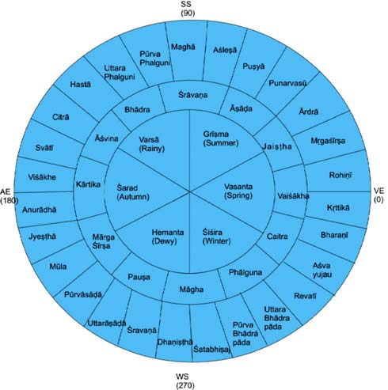
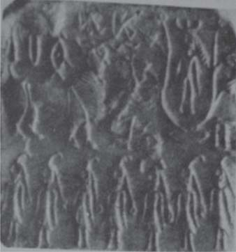

# Early System of Naksatras, Calendar and Antiquity of the Vedic & Harappan Traditions

- Author Display: A K Bag
- Year: 2015
- Journal Label: IJHS-50-2015-Issue-1
- Source Url: https://insa.nic.in/(S(eh1ucortlbqqezipwgliy3mn))/writereaddata/UpLoadedFiles/IJHS/Vol50_2015_1_Art02.pdf

<!-- source: gemini page-chunk extraction -->

Indian Journal of History of Science, 50.1 (2015) 1-25 $\quad$ DOI: 10.16943/ijhs/2015/v50i1/48109

# Early System of Nakṣatras, Calendar and Antiquity of Vedic & Harappan Traditions

A K Bag*
(Received 01 February, 2015)

### Abstract

The fixation of time for Fire-worships and rites was of prime importance in the Vedic traditions. The apparent movement of the Sun, Moon, and a Zodiacal system along the path of the Sun/Moon with nakṣatras (asterisms or a group of stars) were used to develop a reasonable dependable calendar maintaining a uniformity in observation of nakṣatras, from which the antiquity of these early traditions could be fixed up. The Ṛgvedic tradition recognized the northern and the southern (*uttarāyana* and *dakṣiṇāyana*) motions of the Sun, referred originally to six nakṣatras (raised to 28 or 27) including Aśvinī nakṣatra citing it about 52 times. It recommended the beginning of the Year and a calendric system with the heliacal rising of Aśvinī at the Winter solstice. When Aśvinī was no longer found at Winter solstice because of the anti-clockwise motion of the zodiacal nakṣatras due to precision (not known at the time), the Full-moon at Citrā nakṣatra in opposition to the Sun at Winter solstice was taken into account as a marker for the Year-beginning, resulting in the counting of the lunar months from Caitra at the Winter solstice during *Yajurvedic Saṃhitā* time. The same system continued during the Brāhmaṇic tradition with the exception that it changed the Year-beginning to the New-moon of the month of Māgha (when Sun and Moon were together after 15 days of Full-moon at Maghā nakṣatra), resulting in the corroboration of the statement, ‘Kṛttikā nakṣatra rises in the east’. The *Vedāṅga-jyautiṣa* continued the same counting system from the New-moon, assigning the beginning of Śraviṣṭhā segment of the nakṣatras as the beginning of 5-year Yuga at Winter solstice. The antiquity of these Ṛgvedic, Yajurvedic, Brāhmaṇic and *Vedāṅga-jyautiṣa* traditions may be found by comparing the old and new longitudes of nakṣatras and fixed at 6500 BC, 5000 BC, 2500 BC and 1000 BC respectively after corrections due to visibility error. This system of astronomical dating, based on long uniform pattern of observations, are possible in a culture obsessed with satisfactory domestic cultivation and regular worships. The Harappan tradition around c.2000 BC followed the Yajurvedic tradition of counting of month from the Full-moon in a star in opposition, still prevalent in some parts of North India, unlike New-moon Brāhmaṇic system in South India. The calendric elements were found to be luni-solar, and in the process, the types of years, months, days, day-lengths, intercalation, seasons, nakṣatras & nakṣatra space (*aṃśa*, *bhāṃśa*), tithis, full-moon & new-moon in a Yuga, eighteen/nineteen years’ cycle for adjustment of synodic tropical year with lunar year have been explained and discussed.
**Key words:** Antiquity of Ṛgvedic, Yajurvedic, Brāhmaṇic, Harappan and *Vedāṅga-jyautiṣa* traditions, Bhāṃśa, Civil year, Day-length, Eighteen years’ cycle, Five years’ yuga, Intercalation, Jāvādi system, Lunar month, Lunation, Nakṣatra system, New & Full-moon calculation, Sidereal year, Solar year, Summer solstice, Tithi, Vedic calendar, Winter solstice.
---
\* Editor, Indian Journal of History of Science, Indian National Science Academy, Bahadur Shah Zafar Marg, New Delhi-110002, E-mail: akbag99@gmail.com

## 1. INTRODUCTION

Every culture recognized a series of stars, *nakṣatras*, along the path of Moon and Sun (ecliptic / zodiac). Babylonian list given by Weber, Whitney, Thibaut, Hommel varies, while the first three authors recognized twenty four star groups,
---
page 2
the fourth gave eighteen constellations on the basis of the *Mul-Apin* series (c. 700 BC), which were ultimately raised to thirty three star groups[^1] or more. Indians on the other hand first recognized six, raised to twenty eight or twenty seven *nakṣatras* in the Vedic traditions since antiquity. The twenty-eight stars were also known in Chinese *hsiu*[^2] and Arabic *manāzil*[^3] system. Whether Indian, Chinese and the Arabic system of star groups originated from the same source is a matter of investigation. That the Indian *nakṣatras*[^4] conceived as a zodiacal framework is one of the oldest in South Asia. Indians used the motion of Sun and Moon along the zodiac as a workable calendar for worship and agricultural purposes. The Ṛgvedic statements (ṚV.X.85.2) like “*Soma* (Moon) is stationed in the vicinity of *nakṣatras*” suggests that even in this early text the position of Moon in the sky might have been defined by reference to *nakṣatras*.

## 2. CALENDRIC FEATURES OF VEDIC TRADITIONS AND THEIR ANTIQUITY

### 2.1. Ṛgvedic Saṃhitā Tradition

The Ṛgvedic tradition recognized and worshiped Agni (Fire) as a first great well-wisher, and even constructed *agnicitis* (Fire-altars) for daily, monthly, seasonal and other rites invoking wealth, solace and happiness (ṚV.I.1.1;I.35.1). The *Gārhapatya*, one of the three primary fire-altars for house holder, is found mentioned in several places (ṚV.I.15.12; VI.15.19; X.85.27). Obviously, the fixation of time for Fire-worships and rites was of primary importance. The basic features of Ṛgvedic calendrical elements include Year (*Samvatsara* as seasonal based on movements of Sun and Moon), Half-years (*Uttarāyana*, Sun’s movement towards north for 6 months starting with the *Mahāvrata* day at Winter solstice, or *Dakṣiṇāyana*, Sun’s movement towards south beginning with the *Viṣuvrata* day at Summer solstice), Yearly period (12 solar months of 30 days each, covering in 360 days or 720 day-nights), three *ṛtus* (grouping 4 months together connected to *cāturmāsya* festival), then raising it to 6 (*ṛtus*) each spreading for 2 months. Intercalary or Leap days (*atirātra* of 4, 5 or 6 days were also added at the end of *Samvatsara*), which are recorded in the Ṛgveda. The Ṛgveda has also reference to a few *nakṣatras*, like Aśvayujau (ṚV.I.3.1; III.58.1-9), Pūṣya (ṚV.I.42.1;VI.54.2), Aghā (or Maghā), Arjunī (or Phālgunī) (ṚV.X.85.13), suggesting that the prominent *nakṣatras* were possibly known as

[^1]: Weber (1860 & 1862), Whitney (1872-74), Hommel (1891), Thibaut (1894) and other Assyrologists favoured the idea that Babylonian series of normal stars encouraged the origin of Lunar zodiac. Hommel first compiled 24 star groups on the basis of Epping’s table from the Babylonian stars, and conjectured that they might refer to 24 stations of the zodiac. There is of course no proof that the series of 24 stations have ever been actually employed. Van der Waerden (1951, p.20) examined the whole issue and found that during the Babylonian period (c.1400-1000 BC) a number of clay tablets with planisphere divided the sky into three zones. The inner zone was meant for northern and circumpolar asterism, the central zone for equatorial asterism, and the outer for asterism for the south of the equator. The months were heliacal. *Mul-Apin* (c.700 BC) gave of course 18 constellations more or less along the ecliptic which rose to 33 or more.

[^2]: Needham (1963, p.242) notes that the Chinese had made a reference to four quadrant Hsius appearing in Shang oracle bone (14th century BC), eight Hsius in the Shih Ching folk songs (9-8th century BC), twenty-three in Yueh Ling (Monthly Ordinances of Chou, 850 BC) and a full list of 28 Hsius in the reign of Huai Nan Tzu (150-100 BC). According to Needham, the Chinese Hsiu is as old as that of the Indians.

[^3]: Arabic star groups (*Manāzil*) might have its origin in Qu’rān. According to Weber (*Indische Studien*, 3, p.277), the recording of an ancient Harranian festival which followed a 27 day Moon month and observation of the practice of visiting their holy temple and offering food and drink to the Moon-god in the Fihrist, and the close similarity of the Arabic word, *manzil* (pl.*monāzil*), and the expression, *mazzalloth* by king Josias (II, Reg. 23.5) meaning ‘zodiacal portrait’ are indicative of the Babylonian influence on the Arabic tradition. This does not appear to be meaningful, since Hindus, Chinese and Arabs had acknowledged 28 or 27 star names while the Babylonian series gave only 33 or more.

[^4]: The etymology of *nakṣatras*, according to Theodor Aufrecht (*Zeit fur vergl. Sprachf.*, VII, pp.71-72), is *nakta-tra* meaning night protector. However, term *nakṣatras* has always been used to indicate asterisms, stars or star-groups along the Moon or Sun’s path.

---
page 3
a part of the Zodiacal system during the time of Ṛgveda.
Aśvayujau is referred about fifty two times in the Ṛgveda, and there are large number of hymns in the Ṛgveda offered as prayers to Aśvayujau at dawn [ṚV.V.77.1-2; VII.67.2; VII.71.1 and so on; see also Abhayankar, 1993, pp.5-6; Bhatnagar, 2012, pp.59-62].
**Heliacal rising:** Ṛgveda refers to heliacal rising of Aśvayujau at the Winter solstice. Just to cite one example,
> ….,,,…….. *putraścarati dakṣiṇāyāḥ /*
> *ā dyotanim vahati śubhraśāmoṣasaḥ*
> *stomo aśvināvajīgāḥ /*
> ṚV.III.58.1
‘(Aśvinayujau), the son of *Dakṣiṇāyana*, has entered into the Sun, then carries the white dazzled day-maker Sun with it, when the reciter of Aśvayujau are getting assembled before dawn’.
ṚV.III.58.1
It refers to Aśvayujau or Aśvinī *nakṣatra* (β Arietis) as the son of *Dakṣiṇāyana* (South point or Winter solstice) and its heliacal rising with Sun at dawn, an important event for the reciter who had assembled for the observation. It is a special type of ritual connected to a year beginning at the Winter solstice. The ritual was to observe the Heliacal rising (the first sighting) of Aśvinī, when they emerge from behind the Sun on the eastern horizon just before Sunrise. The Aśvins then represented as the southernmost point (Winter solstice).
**Yearning for non-visibility of Aśvinī:** The Ṛgveda also records yearning by the worshippers for the event that Aśvinī (Aries) is no longer being seen at the Winter solstice in the early morning, or there was no heliacal rising? This also gives an indication that the Ṛgvedic tradition went on for a long period of time. A few quotes will be of interest:
> *kūṣṭho devāvaśvinādyā divo manāvasū/*
> *tacchravatho vṛṣaṇvasū atrirvāmā*
> *vivāsati //*
> ṚV. V. 74.1.
‘Where in the heaven are ye today, Gods Aśvins, rich in consistency? Hear this, ye excellent bestowers; Atri invites you to come. Where are they now? Where are the twins, the fumed Nāsatyā, gods in heaven’.
ṚV. V.74.1.
> *kuha tyā kuha nu śrutā divi devā nāsatyā /*
> *kasmitrā yatatho jane ko vām nadīnām*
> *sacā //*
> ṚV.V.74.2
‘The divine Nāsatya, where are they/ Where are they heard if in heaven/? To what worshipper do you come? Who may be associate of your praises?’
ṚV. V.74.2.
These are some of the passages which justifies that the Aśvayujau is no longer seen at the Winter solstice with the rise of the Sun. The Ṛgvedic people did not know what had happened and had no idea that it has moved up anticlockwise due to precession of the equinoxes.
**Antiquity of the Ṛgvedic tradition:** It is now known that the equinox has a backward motion (precession of the equinox) at the rate of 50.2 arcs per second per year (or 1 degree in 72 years) which results in slow increase of longitude of the stars with time. It was not known at the time. The Ṛgvedic people had no idea that the star has moved up due to the precession of the equinoxes and not visible because of Sunlight. That is why there was so much hue and cry. The longitude of Aśvinī (Aries) as on today is about $36^\circ$. By comparing the position of Aśvinī at the Winter solstice ($270^\circ$) during Ṛgvedic time and present time, there is a longitude difference of ($90^\circ + 36^\circ$), i.e. $126^\circ$, the time difference being $126^\circ \times 72$ or roughly 9000 years from the present or about 7000 years before the beginning of Christian era. Presently, vast amount of high precision data on positions of stars and solar simulation elements have helped to develop Sky Simulation Software by different organizations (NASA, USA, VSOP87 of France and others). From the Planetarium Software (Planetarium Gold, version 2.2 and Stellarium
---
page 4
12.4), it is found that Sky Map matched very well with the time being **19 December 7000 BC at 0735 hrs.**(Bhatnagar,A.K. 2012, p.63). Allowing a free eye observation error of $6^\circ$ to $7^\circ$ (about 500 years), the time of Ṛgveda may be taken at c. 6500 BC[^5].

### 2.2. Yajurvedic Saṃhitā tradition

The Yajurvedic tradition gave a list of 28 and 27 *nakṣatras* along with the deities assigned to them. The *Maitrāyanī* (II.13.20), and *Atharvaveda Saṃhitās* (XIX.7) have maintained the list as twenty eight (including Abhijit *nakṣatras*), the *Taittirīya Sam.*( IV.4.10), *Kāthaka Sam.*(XXXIX,13 (of the *Yajurveda Saṃhitā* tradition) and a few later Vedic texts including *Vedāṅga Jyautiṣa* (ṚVJ 15; YVJ 17) gave the list as twenty seven. This is perhaps that the Moon appeared to complete one round among the *nakṣatras* in more than twenty seven days (27.32 days). Later, the *nakṣatras* Abhijit was dropped reducing the number to 27, because it was found that the period was more closer to 27 days. It was also found that it fits very well with zodiac of 12 *rāśis* in the zodiacal circumference of 360 degrees, each *rāśi* being $2\frac{1}{4}$ *nakṣatras*, and covering an ecliptic space of $13^\circ 20'$.
**Nakṣatra names:** The 27 *nakṣatra* names are listed with magnitudes as given in the *Report of the Calendar Reform Committee* (Saha and Lahiri, 1955) with *yogatārā* in bold. **1. Aśvinī** (β, γ Arie.), **2. Bharaṇī** (35,39,41 Arie.), **3. Kṛttikā** (η Tauri), **4. Rohiṇī** (α, θ, δ, ε Tauri), **5. Mṛgaśiras** (λ, $\phi_1$, $\phi_2$ Orio.), **6. Ārdrā** (α Orio.), **7. Punarvasū** (α, β Gemi.), **8. Puṣya** (ν, δ, γ Canc.), **9. Āśleṣā** (ε, δ, σ, η, ζ, θ Hydr.), **10. Maghā** (α, η, γ, ξ, μ, ε Leon.), **11. Pūrvaphālgunī** (δ, θ Leon.), **12. Uttaraphālgunī** (β, 93 Leon.), **13. Hastā** (δ, γ, ε, α, β Corv.), **14. Citrā** (α Virg.), **15. Svātī** (α Boot.), **16. Viśākhe** (ι, γ, β, α Libr.), **17. Anūrādhā** (δ, β, π Scorp.), **18. Jyeṣṭhā** (α, σ, τ Scorp.), **19. Mūla** (λ, ν, κ, ι, θ, η, ξ, μ Scorp.), **20. Pūrvāṣāḍhā** (δ, ε Sagitt.), **21. Uttarāṣāḍhā** (σ, ξ Sagitt.), **22. Śravaṇā** (α, β, γ Aquil.), **23. Dhaniṣṭhā** (β, α, γ, δ Delphi.), **24. Śatabhiṣaj** (λ Aquar.), **25. Pū. Bhādrapadā** (α, β Pega.), **26. Utt. Bhādrapadā** (γ Pega.), and **27. Revatī** (ζ Pisci.).
**Search for New Marker with Full-moon at a Nakṣatras in Opposition and Month names:** Due to precession, Aśvinī has gone up and the *nakṣatra* Revatī (ζ Pisci.) appeared near the Winter solstice but was not easily detected for its lower magnitude. This created problem and a search for a new time-marker possibly went on. The absence of a bright marker at the Winter solstice possibly gave an opportunity to spot the bright star Citrā (α Virginis) on the opposite side, and it is quite likely that the Full-moon at Citrā *nakṣatra* near the North point at the Summer solstice (*Viṣuva*) was taken as the possible marker for starting the year. This new marker with Full-moon in opposite star (opposition) and Sun in Winter solstice was made a reference point, very much needed for worship. The lunar month-names [Caitra,

[^5]: Ṛgveda itself refers to Sapta-nadī (I.71.7; VI.7.6.., seven times), Sindhu-nadī and its tributaries (V.53.9; V.61.19; VII.36.6;.., five times, Śatadru, Vipāśā (six times), Vitastā (one time) and Saraswati (VI.61; VII.5;.. 8 times) as the pre-eminent river of the age flowing from mountains to the sea. Prior to techtonic movement of the Vedic people, according to Kochhar (2000, p. 121), the perennial streams of Sutlej (hundred Paleolithic channels of Śatadru) and Yamuna, both coming from Himalayas, joined and widened the river bed to a constant width of several kilometres to meet Saraswati and made it mighty. The Saraswati is mentioned not only as *nadittamā* (the best of rivers) but also as *devīttamā* (best of goddesses, ṚV.II.41.16), which indicate that the region around Saraswati river was the centre of Vedic people. There is also a reference to construction of Fire-altars representing activities of the Vedic people (ṚV.III.23.4). The land between Saraswati and Dṛṣadvatī is also cited as most sacred (*brahmāvarta*) by a later work, *Mānava Dharmaśāstra* (II.17.19). Gupta (1996, pp.7-10), the well-known archaeologist believes that Indus Valley civilizations is Vedic civilization, and there is only civilizational continuity in the Indus Saraswati area from 5000 BC down to mature phase of Indus Valley civilization and afterwards. Lal (2002, pp.12-13) observed that, “An in depth study of the literary cum archaeological cum hydrological cum radio-carbon evidence duly establishes that Ṛgveda must antidate c.2000 BC. By how many centuries, it can be anybody’s guess’.

---
page 5
Vaiśākha, Jyaiṣṭha, Āṣāḍha, Śrāvaṇa, Bhādra, Āśvina, Kārtika, Agrahāyanī (Mṛgaśira), Pauṣa, Māgha, and Phālguna,] in all probability were derived from the names of the prominent nakṣatras (asterisms) after its conjunction with Full-moon is completed with the Sun at Winter Solstice.
Why and how the lunar month names were restricted to only 12 is not clear? Possibly the magnitude or brightness of the main star in the nakṣatra might be the possible answer. The *pūrṇimānta* (*pūrṇimā-anta* meaning, Full-moon ending— first *kṛṣṇa-pakṣa* followed by *śukla-pakṣa*) was known from the Yajurvedic Saṃhitā time. The *amānta* (*amāvasya-anta*, New-moon ending— first bright fortnight- *śukla-pakṣa* followed by dark fortnight, *kṛṣṇa-pakṣa*) based on lunar phases was later known from the Brāhmaṇic time, possibly for different reason, to be discussed later.
**Caitra month from Winter solstice:** Following the Yajurveda Saṃhitā tradition, the counting of Caitra month after the Full-moon in the Citrā nakṣatras in opposition and Sun at or near the Winter solstice in the circular zodiac came into practice. The Caitrādi month-scheme came into vogue and became popular, both as a marker and year-beginning in the Yajurvedic time. The following passage of the *Taittirīya Saṃhitā* indicates how the counting of Caitra-month started at the Winter solstice after the Full-moon at Citrā nakṣatra (see Table 1 & Fig. 1).
> *tasva ekaiva niryā yat sāmmedhye*
> *viṣuvāntasampadyate citrāpūrṇamāse*
> *dīkṣeran mukham vā etat samvatsarasya*

*Fig. 1. Schematic diagram showing the time of Yajurveda Samhitā (the outer circle represents nakṣatras and the inner circle lunar months moving in anticlockwise direction showing Full-moon at Citrā and the beginning of Caitra month at Winter solstice). SS, WS denote summer and winter solstices; VE & AE; vernal & autumnal equinoxes.*

<!-- figure-resolved-extracted: page=5 image=media/p05_fig01.jpg -->

<!-- figure-meta: page=5, position=middle, type=diagram -->

**Table 1: Lunar months, Nakṣatras in opposition, and Seasons during Vedic time (rough correspondence)**

| Lunar/ Seasonal months (Pūrṇimānta system) | Nakṣatras in opposition | Seasons (Ṛtus) |
| :--- | :--- | :--- |
| Caitra / Madhu | Citrā ($13^\circ 20'$), Svātī ($13^\circ 20'$), Viśākhe ($3^\circ 20'$) | |
| Vaiśākha / Mādhava | Viśākhe ($10^\circ$), Anūrādhā ($13^\circ 20'$), Jyeṣṭhā ($6^\circ 40'$) | Spring (Vasanta) |
| Jyaiṣṭha / Śukra | Jyeṣṭhā ($6^\circ 40'$), Mūlā ($13^\circ 20'$), P. Āṣāḍhā ($10^\circ$) | |
| Āṣāḍha / Śucī | P. Āṣāḍhā ($3^\circ 20'$), U. Āṣāḍhā ($13^\circ 20'$), Śravaṇā ($13^\circ 20'$) | Summer (Grīṣma) |
| Śrāvaṇa / Nabha | Dhaniṣṭhā ($13^\circ 20'$), Śatabhiṣaj ($13^\circ 20'$), P. Bhādra ($3^\circ 20'$) | |
| Bhādra / Nabhasya | P. Bhadra ($10^\circ$), U. Bhadra ($13^\circ 20'$), Revatī ($6^\circ 40'$) | Rains (Varṣā) |
| Āśvina / Īṣa | Revatī ($6^\circ 40'$), Aśvinī ($13^\circ 20'$), Bharaṇī ($10^\circ$) | |
| Kārtika / Ūrja | Bharaṇī ($3^\circ 20'$), Kṛttikā ($13^\circ 20'$), Rohiṇī ($13^\circ 20'$) | Autumn (Śarat) |
| Mārgaśīra (Agrahāya)/Saha | Mṛgaśīra ($13^\circ 20'$), Ārdrā ($13^\circ 20'$), Punarvasū ($3^\circ 20'$) | |
| Pauṣa / Sahasya | Punarvasū ($10^\circ$), Puṣya ($13^\circ 20'$), Āśleṣā ($6^\circ 40'$) | Dewy (Hemanta) |
| Māgha / Tapas | Āśleṣā ($6^\circ 40'$), Maghā ($13^\circ 20'$), P.Phalg ($10^\circ$) | |
| Phālguṇa / Tapasya | P. Phalg ($3^\circ 20'$), U. Phalg ($13^\circ 20'$), Hastā ($13^\circ 20'$) | Winter (Śiśira) |

6 INDIAN JOURNAL OF HISTORY OF SCIENCE
_yaccitrāpūrṇamāso mukhat eva samvatsarasya dīkṣante tasya na kā can niryā bhavati caturahe purastāt paurṇamāsai dīkṣeran._’
Tait.S.VII.4.8.2
‘There is only one restriction that when Citra Full-moon is seen at the Viṣuvan (Summer solstice) it is the mouth of the year (Samvatsara). They should consecrate themselves on the Full-moon month of Caitra, the Full-moon at Citra is the beginning of the Year, verily they consecrate themselves grasping the year at the beginning with no restrictions; they should consecrate themselves from the four days onwards before the Full-moon’.
Tait. S.VII.4.8.2.
This testifies that the _Yajurveda Saṃhitā_ tradition followed the _Pūrṇimānta_ system and the New year starts with month of Caitra at Winter solstice with the rising of the Sun. The schematic diagram also shows that Aśvinī nakṣatra has moved away and phase of Revatī has started. It happened when there is a precision of at least $14^\circ$ (1000 years) from the time of Ṛgveda (c.7000 BC). During Yajurveda (_Taittirīya Saṃhitā_) time, the system of calendar for the worship appears to have used Citrā nakṣatra ($\alpha$ Virginis) in Full-moon opposite to the Sun with month of Caitrā beginning at the Winter solstice as reference point. **The date is verified to be 19 December 6000 BC on the basis of Sky Map** (Bhatnagar, 2012, p.65). Allowing an observation error, the date of Yajurveda Saṃhitā time may be at c.5500 BC.

### 2.3. Brāhmaṇa and Harappan Features and Times

During the Brāhmaṇic period, the month as well as nakṣatras get shifted in anti-clockwise direction and raised further due to precession, and a New-moon takes place at the Winter solstice, and the year-beginning started with the New-moon at the Winter solstice during this phase. This possibly is the beginning of both Full-moon and New-moon reckoning of New Year among different groups of people.
**Māgha Month New-moon at the Winter solstice:** By the time of Brāhmaṇa, the New moon of Māgha (the Sun and Moon are together with Maghā nakṣatras in the opposite side) was taken as the Year-beginning when the northward journey of the Sun began from the Winter solstice (See Fig. 2).
_sa vai māghasya amāvasyāyām upavasatya udanna āvartyasyan upa ime vasanti prāyaṇīyena atirātreṇa._
_Kauṣ. Br._ XIX.3
‘On the New-moon of Māgha he (Sun) rests, being about to turn northwards; these also rest, being about to sacrifice with the introductory _atirātra_….’’
_Kauṣ Br._ XIX.3; tr Keith 1920.
This indicates that the year beginning at Winter solstice started with the New- moon instead of Full-moon at Maghā ($\alpha$ Leon.). It was possible because of the precession (anti-clockwise movement of the zodiac nakṣatras not known at the time). However, the lunar month reckoning after Full-moon in a nakṣatras with the Sun in opposition, as in the Saṃhitā period, is still continued. New-moon and Full-moon were just reference points. It may be noted that the New moon in a month always takes place 15 days before or after the Full-moon. A few quotes from Brāhmaṇa texts justifying the New-moon counting and corroborating other information will be of interest.
_yo’sau vaiśākhasya amāvasyā tasyāmādadhīta sā rohiṇyā sampadyata….āgnyādheyarūpam tasmādamāvāsyāyām eva agni ādadhīta paurṇamāsyāmanvāravetāmāvāsyāyām dīkṣeta /_
_Śat. Br._ XI1.1.1.7
‘He may lay down the fires on the New-moon which falls in the (month) Vaiśākha, for that coincides with Rohiṇī (asterism)……, indeed, the new- moon is the form of the _agnyādheya_, let him therefore lay down the fires at New-moon, let him perform the preliminary ceremony
---
EARLY SYSTEM OF NAKṢATRAS, CALENDAR AND ANTIQUITY OF VEDIC TRADITIONS 7
at Full-moon and the initiation ceremony at New-moon’.
_Śat. Br._ XI.1.1.7; tr Eggeling 1882.
_etā ha vai prācyai diśo na cyavante / sarvāṇi ha vā’anyani nakṣatrāṇi prācyai diśaścavante tatprācyāmevāsyaitad diśyāhitau bhavatastasmātkṛttikā svādadhīta //_
_Śat.Br._ II.1.2.3.
‘And again, he (Kṛttikā) does not move away from eastern quarter, whilst the other asterisms do move from eastern quarter; thus his (two fires) are established in the eastern quarter; for this reason, the fires are set up under the Kṛttikā’.
_Śat Br._ II.1.2.3
_kṛttikā prathamam viśākhe uttamam/ tāni devanakṣatrāṇi / anurādhā prathamam apabharaṇīruttamam /tāni yamanakṣatrāṇi / yāni devanakṣatrāṇi tāni dakṣiṇena pariyanti/ yāni yamanakṣatrāṇi tānyuttareṇa /_
Tait. Br. I.5.2.
‘Kṛttikā are the first and Viśākhe is the last, these are Devanakṣatras; Anūrādhā is the first and Apabharaṇī the last, these are Yamanakṣatras. The Devanakṣatrass turn from South (to North) and Yama from North (to South)’.
Tait. Br. I.5.2.
The Māgha New-moon (middle of the Māgha month) at Winter solstice was the reference point when its longitude was roughly $270$ degrees. The Māgha Full-moon at Maghā nakṣatra ($\alpha$ Leon.) in opposition was still the indicator of the end of Māgha month and the beginning of Falguṇa month. The schematic representation as described fixes the longitude of the Kārttika New-moon (middle of kārttika month) to roughly assigning $0$ degree (seen rising exactly in the East). This corroborates the statements that Kṛttikā never deviates from the east, or Kṛttikā is the first and Viśākhe is the last (14th in opposition). These are features of the Brāhmaṇic period (Fig. 2). Does it refer to a new system when Kṛttikādi scheme at the vernal equinox is slowly opening up?

*Fig. 2. Schematic diagram showing the antiquity of the Brāhmaṇa period (outer circle represents nakṣatras and the inner circle lunar months as usual moving in anticlockwise direction with Māgha New-moon at Winter solstice).*

<!-- figure-resolved-extracted: page=7 image=media/p07_fig01.jpg -->

<!-- figure-meta: page=7, position=top, type=diagram -->

**Antiquity of the Brāhmaṇic tradition:** Jacobi (1894) and Tilak (1893) have tried to ascertain the date of the _Vedas_ (_Brāhmaṇas_) on the basis of statements like,’ they (Kṛttikās) do not move away from eastern quarter…, seven Ṛṣis (Saptarṣi) rise in the north, and they (Kṛttikās) rise in the east’. This statement was a made in connection with the establishment of ritual fires on the first occasion by a house holder in the section of _Agnādhāna_. The new house-holder should establish the traditional _Gārhapatya_ and _Āhavanīya_ fires on the day of Kṛttikā, for the presiding deity of Kṛttikā is Agni, and house-holder’s fire established in the east brings plenty. Tilak[^6] even gave emphasis in the Kṛttikā Period on the basis of constellation. Dikshit (1895) was perhaps the first one who
---
8 INDIAN JOURNAL OF HISTORY OF SCIENCE
strongly believed that Kṛttikās’ rising in the east has a close connection with the date of the _Śatapatha Brāhmaṇa_. Although this issue has been discussed by many others, it would worthwhile to quote once again Dikshit’s actual arguments. Thus, according to S.B.Dikshit (1896, Eng tr 1969, pp.128-29):
‘The statement about Kṛttikās rising in the east is made in the present tense and they cannot always do so because of the precessional motion of equinoxes. In our time we find them rising to the north of east and they used to rise to its south in 3100 BS (before Śaka). From this it can be inferred that the corresponding portion in _Śatapatha Brāhmaṇa_ was written about 3100 years before the Śaka era.’
Dikshit roughly places the time of _Śatapatha Brāhmaṇa_ on the basis of Kṛttikādi system to about 3000 BC[^7]. Weber believed that the time of Kṛttikā being the first nakṣatras comes to somewhere between 2780 to 1820 BC. Sengupta (1937, reprint ed, 1986, p.56) suggested that the Vernal equinox near Rohiṇī ($\alpha$ Tauri) and Summer solstice at Pūrva Falguṇī ($\delta$ Leonis) indicate a period close to c.3000 BC. He further added that the Vernal equinox at Kṛttikā ($\eta$ Tauri) and Summer solstice at Maghā ($\alpha$ Leonis) occurred around 2350 BC. Filliozat (1969, p.125) adduced evidence from the Buddhist texts, in spite of systematic doubts by Thibaut and Whitney, and suggested that these Buddhist references are reminiscent of the ancient era when Kṛttikā was really on due east. Chakravarty (1987, pp.23-28) accepted the time of Dikshit’s argument to 3000 BC. The major counter objection came from Pingree (1989, p.441) who says, “parts of the nakṣatras: Hastā, Viśākhe and perhaps Śravaṇā were also on the equator in 3000 BC and this fact would thereby contradict the claim in the _Śatapatha Brāhmaṇa_ that only Kṛttikās never swerve from the east add no significance, as attributed by Dikshit”. Narahari Achar (2000, pp. 4-9) has examined Pingree’s theory with actual view of the Vedic sky generated by using the software Sky Map version 2.2 corresponding to the latitude of Delhi and concluded that Dikshit’s conclusions of 3000 BC were correct. Prasanna (2011, pp.586-89) had however emphasized on the basis of _Kauṣ. Br._ (XIX.3) and _Śatapatha Brāhmaṇa_ (XI.1.1.7) that Rohiṇī ($\alpha$ Tauri) marked the Vernal equinox ($00$) with reference to _Mahāvrata_ (Winter solstice) and _Viṣuvrat_ (Summer solstice) day leading to 3000 BC. It is quite likely that _Cāturmāsya_ and other seasonal festivals were still taking place at Full-moon and the initiation ceremony at New-moon. Allowing an observation error, the antiquity of the Brāhmaṇic time may be taken as c.2500 BC.
**Harappan Tradition and Antiquity:** Four carbon dates of Mohenjo-daro sites are available which are in the range of 2155 BC with plus minus 165 BC. The radio-carbon dates available from other sites of Indus valley also testifies to the same period.
That this civilization belong to Brāhmaṇic phase is corroborated by a Mohenjo-daro Seal (M.2430) found in the D.K. area. It records a Full-moon month counting system in opposition. The Seal is known as ‘Seven Sisters Seal’ representing Kṛttikā standing at the middle along with his other six sisters at the eastern side of the Seal, and its western side shows ‘Kṛttikā in conjunction with Viśākhe nakṣatras’ (identified with two branches of a tree). The central place of the Seal shows a festival in progress introducing the month of Agrahāyaṇī or Mṛgaśīrṣa (the shape is ‘head of a deer with long horns’ or month of Agrahāyaṇī (two months are synonymous as per Pāṇini’s _Aṣṭādhyāyī_) at the end of the Full-moon night. The
---
EARLY SYSTEM OF NAKṢATRAS, CALENDAR AND ANTIQUITY OF VEDIC TRADITIONS 9

*Fig. 3. Mohenjo-daro seal (M.2430) showing the introduction of Mṛgaśīrṣa (Agrahāyaṇī lunar month) after the Full-moon ending.*

<!-- figure-resolved-extracted: page=9 image=media/p09_fig01.jpg -->

<!-- figure-meta: page=9, position=top-left, type=photograph -->

seal justifies the fact that the _pūrṇimānta_ scheme was still current in north-western and some parts of Rajasthan when Kṛttikā and Viśākhā are in opposition (Kṛttikā month end), and the month of Agrahāyana (or Mṛgaśīrṣa) is introduced after the Full moon (Bag, 1985, pp.102-104) (**Fig. 3**).
This is further strengthened by the fact that both Brāhmaṇic and Indus valley culture used the burnt bricks for various purposes and belong to the same period. The _Śatapatha_ mythologies about the drying up of Saraswatī river in the story of Videha Mādhava and his priest Gotama Rāhugaṇa (_Śat. Br._ I.4.1.10-15) would place the text in an age somewhat after the actual drying up of Saraswatī around 1900 BC. The hydrological evidence that the Saraswatī changed its course is quite suggestive that the myth was correct. A clear reference to the origin of Saraswatī in the mountains and that ‘it was 40 days journey on horseback from mountains to the place where it is lost in the desert’ (_Pañc. Br._ XXV.10.16).
The _pūrṇimānta_ scheme is still current in north India. There is also a difference of opinion among the scholars whether _amānta_ or _pūrṇimānta_ system was followed in the Brāhmaṇic period. The Fire-altars were also raised both at the New-moon and Full-moon. There is no doubt that lunar-month names follows from the star names in opposition both in the Saṃhitā and the Brāhmaṇic periods, irrespective of whether it followed _pūrṇimānta_ or _amānta_ system as a New Year-beginning. The _amānta_ scheme is still found practiced in South India (Andhra Pradesh, Karnataka and Maharashtra).
**Mahāvedi, Solar and Civil Year:** The _Mahāvedi_ was possibly the main observation altar, having an area larger than any other type of altars. Towards its west side, another altar was, known as _Prācīnavaṃśa_ altar (for homage to old family members) was constructed containing the _Dārśikyāpaurṇamāsikī-vedi_ (Full-moon and New-moon observation altar). The _Mahāvedi_ had the shape of an isosceles trapezium, and the _Taittirīya Saṃhitā_ says,
_triṃśat padāni paścāt tiraścī, bhavati ṣaṭtrimśat prācī, caturviṃśati pūrastāt, tiraścī daśa daśa sampadyate/_
Tait. S. VI.2.4.5
‘30 padas is the western side (of the _Mahāvedi_) which is drawn perpendicular (to the _prācī_), 36 (_padas_) is the _prācī_ (east-west measure), 24 (_padas_) is the eastern side, the perpendicular line (_tiraścī_) is accomplished by ten and ten measure (of units)’.
Tait. S. VI.2.4.5.
The measures of _Mahāvedi_: east 30, west 24, _prācī_ (perpendicular distance) 36 were found in padas, as well as prakramas ($1 \text{ prakrama} = 2 \text{ padas}$) in different Saṃhitās (_Mait.S._ III.8.4; _Kāṭh.S._ XXV.3; _Kapi.S._ III.8.6). The same measures in prakramas are also given in _Śatapatha Brāhmaṇa_ (_Śat.Br._ III.5.1.2-6). and in the _Śulbasūtras_ (_Bśl._ 4.3; _āśl._ 5.1-5.7). On the _Mahāvedi_ are found six perpetual fires (_ṣaḍ_ fires), two other fires (Āgnīdhra and Mārjālīya), one Havirdhāna (for extracting the juice from Soma plant, a great intoxicant, and for its use as havis, as well as drinks), besides small places to collect rubbish (**Fig.4**). The lay out of _Mahāvedi_ is given in many texts (Bag 1983b, p. 171).
---
10 INDIAN JOURNAL OF HISTORY OF SCIENCE

*Fig. 4. Lay-out of Mahāvedi; S - Sadas or Sadahas having six fire- hearths, M-Mahāvrata Day, V-Viṣuvat day, H - Havirdhāna for extracting juice of Soma plant, Āg & M - Āgnīdhra & Mārjālīya hearths, U-Uttara vedi); and of Prācīnavamśa (G-Gārhapatya, Ā- āhavanīya, D- Dakṣināgni and Dr- Dārśikyāpaurṇamāsikī vedi); Area of Mahāvedi: 972 sq padas (or 2,18,700 sq aṅg,); Area of Prācīnavaṃśa: 192 sq prakramas (5760 sq aṅg) or 120 prakramas (3600 sq aṅg)*

<!-- figure-resolved-extracted: page=10 image=media/p10_fig01.jpg -->

<!-- figure-meta: page=10, position=top, type=diagram -->

There is no doubt that It was a place of perpetual fires and its main focus was to maintain oblations in _Ṣaḍ-fires_ and _Havirdhāna_ which supplies continuous _havis_ obtained from the extracts of _soma_ plants for the fire! The _Ṣaḍ-fires_ were the perpetual-fires of _Mahāvedi_, used perhaps to count the apparent annual motion of the Sun from south to north (6 months, i.e., from _Mahāvrata_ day, the Winter solstice to _Viṣuvata_ day, the Summer-solstice), again from north to south (six months, i.e., from _Viṣuvrata_ to _Mahāvrata_ day) making a complete year cycle. It is quite likely that the name of _Mahāvedi_ is someway related to daily rotation of the Sun from East to West and its annual displacement or declination from North to South.
It is quite likely that _Mahāvedi_ got its name from the _Mahāvrata_ day sacrifice. The six circular _Ṣaḍ-agnis_ or _Ṣaḍ-fires_, managed by special priests, are nothing but _Ṣaḍ-aha-_ (six-day and six-night) fires starting on _Mahāvrata_ day sacrifice (starting at Winter solstice) continued for a month (30 days) in each fire, and then proceeding towards north reached _Viṣuvat_ day (Summer solstice) after completing worships in six months. The southward journey from _Viṣuvata_ day to _Mahāvrata_ day is completed by the priests after worships of six-_Ṣaḍ_-fire in another six months. While completing the sacrifices in twelve (12) months (of 360 solar sidereal days), one month each for northern and southern journey, using them as perpetual fires. An intercalation of 6 days (_atirātra_), two (2) days before & 3 days after _Mahāvrata_ day, one (1) day on _Viṣvat_ day were also observed, suggesting how the attempts were made to make a compromise between Solar year (of 360 days) and Civil or Seasonal year (of 366 days). In this context, Eggeling’s summary of fire ceremonies, as given in the _Śatapatha Brāhmaṇa_, will be of interest. The Circular design of these _Ṣaḍ-agnis_ may also be the indicator of this annual cycle. The _Taittirīya Saṃhitā_ says,
‘Those, who knowing thus perform (the rite) of six nights, mount evidently upon the gods. (The right) is of six nights, the seasons are six, the Pṛṣṭhās (or Prācīs) are six, verily by the Pṛṣṭhās they mount the seasons, by the seasons the year, verily in the year they find support’.
Tait. S.VII.2.1.1-2, Keith’s tr
Attempt to intercalation of extra days is also clear in the Vedic literature (see also _Vedāṅga Yājuṣa- Jyotiṣa_, 28). It appears that oblations to fires on _Mahāvedi_ went on without any break, and the ceremony was performed on a suitable ground to the locality. It appears that the purpose of _Mahāvedi_ was to keep observational data of both Solar and Civil years to keep on regular agreement. The _Mahāvedi_ has another adjoining altar known as _Prācīnavaṃśa_, considered a part of the _Mahāvedi_, to observe lunar phases on a regular basis side by side with those of the solar and seasonal or civil changes, and to advise the community with suitable measures.

[^6]: His Vedic Chronology has divided the period into four parts, viz Aditi period (starting with nakṣatras Punarvasū or Aditi), Orion period (starting with nakṣatras Mṛgaśīrṣa or Orion) Kṛttikā period (starting with nakṣatras Kṛttikā) and the Vedāṅga Jyautiṣa period, the first three periods beginning with solar nakṣatras at Vernal equinox (21 March according to Gregorian calendar).

[^7]: Dikshit’s observations were based on Sāyaṇa’s commentary (c. 1400 AD), which states that the Kṛttikā nakṣatras ‘rises in the east’ (_śuddha prācyam avodyanti_). Sāyaṇa’s commentaries on _Ṛgveda_ and _Śatapatha Brāhmaṇa_ were accepted as most authentic and carrier of old religious traditions by almost all western scholars.

EARLY SYSTEM OF NAKṢATRAS, CALENDAR AND ANTIQUITY OF VEDIC TRADITIONS 11
**Prācīnavaṃśa, Dārśikyāpaurṇamāsikī-vedi, Lunar Phases, Lunar Months and Years:** The *Prācīnavaṃśa* or *Prāgvaṃśa* (Rectangular altar of area: 16 x 12 or 12 x 10 in *prakramas*) is constructed traditionally towards the west side of the *Mahāvedi*, containing three Primary altars (*Gāhapatya*, *Āhavanīya* and *Dakṣiṇāvedi*), and the *Dārśikyāpaurṇamāsikī-vedi* (New- & Full-moon Observation Altar) in between the primary altars. The construction of *Dārśikyā-paurṇamāsikī-vedi* in the shape of an isosceles trapezium (face 48 *aṅg.*, base 64 *aṅg.*, and 96 *aṅg.* with curved sides) is not clearly defined, nor definitely understood, even though it was considered an extremely important service for the community. The huge arrangements along with that of *Mahāvedi* were undoubtedly arranged by kings, rich community leaders.
What is it that the *Prācīnavaṃśa* (altars for hereditary rites), *Dārśikyāpaurṇamāsikī-vedi* (new- & full-moon observation altar), and Primary *vedis* (altars for health and happiness to the family) are placed together? Is it the part of the routine perpetual worships/activities, as it is done in the present day temple! Eggeling, who has translated *Śatapatha Brāhmaṇa*, has given sufficient hint that it is for special purposes like observation of lunar phases which used to cater the ritual, seasonal and civil activities and for observing other lunar phenomenon. Taking Eggeling’s hypothesis as a correct indication, it may be said that the purpose of *Dārśikyā-paurṇamāsikī-vedi* was to observe lunar phases leading to lunar months and years passing through various phases of moon (or *tithis*) on a regular basis. It appears that the lunar phases were actually counted, and the purpose of constructing the New and Full-moon sacrifice (*Dārśikyāpaurṇmāsikī- vedi*) along with *Prācīnavaṃśa-vedi* was not only to count lunar months and years through New-moon and Full-moon, lunar phases (*tithi*) and rituals to be performed traditionally for peace, happiness, and atonement of sins. The *Śatapatha Brāhmaṇa* says,
> *sa ājiśṛmekaḥ ya evaṃ vidvām triṃśataṃ varṣāṇi yajate tasmādu triṃśatmeva varṣāṇi yajeta/ yaddu dākṣāyaṇayajñī syādatho api pañcadaśāiva varṣāṇi yajetātra hyeva sā sampatsampadyate dve hi paurṇmāsau yajate dve amāvāsye atro eva khalu sā sampadvabhati/*
>
> — *Śat. Br.XI.1.2.13.*
‘He who, knowing this, offers (New and Full-moon sacrifices) for thirty years, becomes one of the race-runners, whence one ought to offer sacrifice for not less than thirty years. But if he is a performer of the *Dākṣāyana* sacrifice, he needs only to offer for fifteen years, for therein that perfection is brought about, since he performs (every month) two Full-moon and two New-moon offerings, and thus that perfection is indeed brought about therein’.
— *Śat. Br.XI.1.2.13*, Keith’s tr.
In this context it is important to note that two types of experts for *Dakṣāyana* (when Sun moves towards south, i.e. from Summer solstice to Winter solstice) and *Uttarāyana* sacrifices (when Sun moves towards north, i.e. Winter solstice to Summer solstice) for a period of 6 months each were known. The sacrifices went on continuously for more than 30 years.

## 2.4. Vedāṅga-jautiṣa Tradition

The *Vedāṅga-jautiṣa* of Lagadha and *Śulbasūtras* of *Baudhāyana* and *Āpastamba* are placed in the same phase in the time scale, both traditions occupying the position before Pāṇini.
**Time:** The time of *Vedāṅga Jyautiṣa* (hereafter *VJ*) tradition is known for heliacal rising of *Śraviṣṭhā nakṣatra* at the Winter solstice. The details are as follows:
> *prapadyete śraviṣṭhādau sūryā candramāsāy udak /*
> *sārpārdhe dakṣiṇārkas tu māgha śrāvaṇayoḥ sadāh //*
>
> — *VJ. 19.2.*
‘When situated at the beginning of the *Śraviṣṭhā* segment, the Sun and Moon
12 INDIAN JOURNAL OF HISTORY OF SCIENCE
begin to move north. When they reach the midpoint of *Aśleṣā* segment, they begin moving south. In case of Sun this happens always in the month of Māgha and Śrāvaṇa respectively’.
This indicates that there is at least a difference of one *nakṣatra* space (i.e. 13 degree 20 minuts) or about 1000 years from the *Brāhmaṇa* time because of the precession of equinoxes. Varāhamihira, both in his *Pañcasiddhāntikā* and *Bṛhatsaṃhitā*, also noted Winter solstice at three-fourth *Uttarāṣāḍā* and Summer solstice at three-fourth *Punarvasu* having a difference of $1 \frac{3}{4}$ *nakṣatra* spaces (23 degree 20 minutes) due to precession which fixes *Vedāṅga Jautiṣa* time about 1680 years earlier from Varāhamihira’s time (c. 539 AD). These facts suggest the time of *Vedāṅga Jyotiṣa* between 1400 and 1200 BC (Kuppanna Sastri, 1985, p.13). Sengupta confirmed Lagadha’s time at about 1370 BC. corroborating more or less the same time for *Vedāṅga Jyautiṣa*. Other scholars (Kak, 1993, p.19.) has, however, referred to same date for *Vedāṅga Jyautisa* and *Srauta* periods as 1400 BC. Allowing the free eye observation error of 500 hundred years, the time of *Vedāṅga Jyautiṣa* be fixed up to 1000 BC. The same date may be more or less assigned for *Śrauta* and *Śulbasūtras*.

## 3. YUGA & TYPES OF YEARS & OTHER UNITS

The Vedic *Saṃhitās* and *Brāhmaṇas* tried to make compromises with 5, 6 and 7 years’ cycle (*yuga*). The names of 5-year cycle —*Saṃvatsara*, *Parivatsara*, *Idāvatsara*, *Anuvatsara*, and *Udvatsara* (*Vāj S.XXVII.25; Tait S.V.5.7.3-4*) are known. The reference to 6-year cycle (*Tait Br.III.10.4*) i.e. $6 \times 360 + \text{intercalation of 5 days every year or } 30 = 2190 \text{ days}$, modern value $6 \times 365.24 = 2191 \text{ days}$); 7-year cycle in the *Śatapatha Brāhmaṇa* (*IX.1.1.43, IX.3.3.18*; see also *X.4.3.8, X.4.3.19, X.5.4.5*) with intercalation of 35 or 36 days ($7 \times 360 + 35 = 2555 \text{ days}$, or $7 \times 360 + 36 = 2556 \text{ days}$, the modern value being $7 \times 365.24 = 2556.68 \text{ days}$) are also evident for their synchronizing attempt with tropical or civil year.
The traditions of *Ṛgveda* and the other *Vedas* are very old which recognized also four types of years viz, Solar year (of 360 days or $12 \times 30$ days), Seasonal/Ritual Civil year (365 / 366 days, or $12 \times 30 + 5 \text{ or } 6 \text{ days intercalation}$), Sidereal Lunar year (324 days or $27 \times 12$ days, 12 days being the successive passages of the Moon between two *nakṣatras*, and 351 days or $27 \times 13$ days), and Synodic Lunar year (Lunation of 354 days or $6 \times 29 + 6 \times 30$, average being $12 \times 29.5$ days). The *Lātyāyana* school of *Sāmaveda* (*Nidānasūtra, V.11-12*) recognized all these years. The *Śatapatha Br (XII.3.2.5)* also recognized,
$1\ \text{year} = 360\ \text{days}, 1\ \text{day} = 30\ \text{muhūrtas}, 1\ \text{muhūrta} = 15\ \text{kṣipras}, 1\ \text{kṣipra} = 15\ \text{etarhis}, 1\ \text{etarhi} = 15\ \text{idānis}, 1\ \text{idāni} = 15\ \text{prāṇas}.$
The *Vedāṅga Jyotiṣa* also recognized 5 year cycle and worked out the detailed calendar which became quite popular for several centuries. It also made an impact on Tibetan and Nepalese calendar and translated into Chinese. The relevant verses of *VJ* runs thus,
> *triśatyahnām ṣaṣṭaṣaṣṭir abdaḥ ṣaṭ ca ṛtavo’yane /*
> *māsā dvādaśa sūryāḥ syuḥ etat pañcaguṇam yugam //*
>
> — *VJ.11.1*
‘one solar year (*abda*) has 366 *ahanas*, 6 *ṛtus*, 2 *ayanas* (northward and southward course of the Sun), 12 solar months; 5 years make a *yuga*’.
Or, in other words, *VJ* has maintained the subdivisions of Year (*Saṃvatsara*) and Yuga cycle as follows:
1 Year = 2 *ayanas*
&nbsp;&nbsp;&nbsp;&nbsp;&nbsp;&nbsp;&nbsp;&nbsp;&nbsp;&nbsp;&nbsp;&nbsp;= 6 *ṛtus*
&nbsp;&nbsp;&nbsp;&nbsp;&nbsp;&nbsp;&nbsp;&nbsp;&nbsp;&nbsp;&nbsp;&nbsp;= 12 solar months
&nbsp;&nbsp;&nbsp;&nbsp;&nbsp;&nbsp;&nbsp;&nbsp;&nbsp;&nbsp;&nbsp;&nbsp;= 366 civil (*sāvana*) days = 372 *tithis*.
1 Yuga = 5 years
EARLY SYSTEM OF NAKṢATRAS, CALENDAR AND ANTIQUITY OF VEDIC TRADITIONS 13
The *VJ* (15.1) further says,
> *sāvanenduṣṭṛmāsānām ṣaṣṭiḥ saikadvisaptikā /*
> *dyutrimśat sāvanāsyārdhaḥ sūryaḥ stṛṇām sa paryayaḥ //*
>
> — *VJ.15.3*
‘There are 60 plus one, two and seven *sāvana* (61) months, lunar (62) months and sidereal (67) months respectively in a *yuga*; the solar sidereal cycle has 30 days in a month, $30\ \frac{1}{2}\ \text{sāvana}$ days.
— *VJ.15.3*
Or, in other words,
1 *Yuga* (5 yrs) = 60 solar months
&nbsp;&nbsp;&nbsp;&nbsp;&nbsp;&nbsp;&nbsp;&nbsp;&nbsp;&nbsp;&nbsp;&nbsp;&nbsp;&nbsp;&nbsp;&nbsp;&nbsp;&nbsp;&nbsp;&nbsp;&nbsp;&nbsp;&nbsp;&nbsp;= 61 *sāvana* months = 1830 *sāvana* days (civil days)
&nbsp;&nbsp;&nbsp;&nbsp;&nbsp;&nbsp;&nbsp;&nbsp;&nbsp;&nbsp;&nbsp;&nbsp;&nbsp;&nbsp;&nbsp;&nbsp;&nbsp;&nbsp;&nbsp;&nbsp;&nbsp;&nbsp;&nbsp;&nbsp;= 62 synodic (lunar) months = 124 *parvas* = 1860 *tithis*
&nbsp;&nbsp;&nbsp;&nbsp;&nbsp;&nbsp;&nbsp;&nbsp;&nbsp;&nbsp;&nbsp;&nbsp;&nbsp;&nbsp;&nbsp;&nbsp;&nbsp;&nbsp;&nbsp;&nbsp;&nbsp;&nbsp;&nbsp;&nbsp;= 67 sidereal months = 1835 sidereal days.
&nbsp;&nbsp;&nbsp;&nbsp;&nbsp;&nbsp;&nbsp;&nbsp;&nbsp;&nbsp;&nbsp;&nbsp;&nbsp;&nbsp;&nbsp;&nbsp;&nbsp;&nbsp;&nbsp;&nbsp;&nbsp;&nbsp;&nbsp;&nbsp;= $(5 \times 27)$ *nakṣatras* (1 *nakṣatras* = 124 *bhāṃśas*).
Actually 62 synodic months = $62 \times 29.53 = 1830 \text{ days}$;
67 sidereal months = $67 \times 27.32 = 1830 \text{ days}$.
Therefore, one *yuga* was taken as $5 \times 366 \text{ days} = 1830 \text{ civil days}$.
Babylonian and Egyptian year was of 365 days. Pingree’s conjecture that *Vedāṅga* year is similar, is not correct, for there would have created confusions if it had $5 \times 365 = 1825 \text{ civil days}$ which will make 5 days error in the determination of New and Full moon days. There was no doubt that one *yuga* of 1830 civil days of *VJ* was based on strong foundation.
**Units:** The Units as defined with their significance in *VJ* may be summarized thus:
**Solar month (*saura- māsa*):** It is defined here as one-twelfth of a year and is equivalent to 30 days;
**Civil days (*Sāvana dina*):** Civil or natural day is from sunrise to sunrise; in a year there are two *ayanas* (northward or southward), each having 183 days, total being 366 days; for the whole course, the increase or decrease is $183 \times 4/61\ \text{nādikās} = 12\ \text{nādikās}$ or 6 *muhūrtas* (*VJ.7.1 & 17.1*); 1 *sāvana* day = 30 *muhūrtas* (including day and night); day length at equinoxes = 15 *muhūrtas*; shortest day at Winter solstice = 12 *muhūrtas*; longest day at Summer solstice = 18 *muhūrtas*.
**Sāvana month:** Equivalent to 30 *sāvana* days.
**Synodic month (*cāndramāsa*) and lunar phases:** One *yuga* has 62 synodic months or 1860 *tithis*; in other words, 1 synodic month = 30 *tithis* (see above). There were 30 phases or *tithis* in a synodic or lunar month; 15 following Full moon (*pūrṇimā*), presently indicated by K1, K2, K3,.....K15 (*Kṛṣṇa-pakṣa*, dark fortnight), and 15 following New moon (*Āmavasyā*) indicated by S1,S2,S3....S15 (*Śukla pakṣa*, bright fortnight).
**Lunar day (*Tithi*):** Defined as one-thirtieth of a synodic month (about 29.53 days long); further 10 *ayanas* cover 62 synodic months, each *ayana* 6 synodic months (or 12 half months) and 6 *tithis*; the rule (*VJ 21.1-3*) says that $n$ th equinox in a *yuga* falls on $6(2n-1)$ half synodic months and $6(2n-1)/2\ \text{tithis}$.
**Intercalary (*Adhika*) months:** There are 62 synodic months, hence it is clear that there are two intercalary months in a *yuga* of 5 years; i.e after 30 months, an extra (*adhika*) month is added to complete the half- *yuga*.
**Half synodic month (*Pakṣas* or *Parvas*):** Each synodic month has 2 *pakṣas* or *parvas*; in one *yuga* of 5 years (or in 62 synodic months), one *yuga* has $62 \times 2 = 124$ *pakṣas* or *parvas* (syzygies); each *pakṣa* or *parva* having 15 *tithis*; each day is divided into 124 parts, which again divided into 4 *bhāga* or *pāda*, each *pāda* being 31 parts.
The verse (*VJ.25.1*) gives a rule for calculating *parvas* (or *parva-rāśis*), which says
14 INDIAN JOURNAL OF HISTORY OF SCIENCE
that $parva\ r\bar{a}\acute{s}i = [(n - 1) \times 12 + m] \times 2 + 1 + extra\ 2$ (for every 60 *parva* gone), where $n = \text{no. of years}$ of the *yuga* referred, and $m = \text{no. of months}$. An example for calculating *parva-rāśi* before the point of time of starting *Anuvatsara Kārttika Bahula Navamī*, i.e. when $n = \text{anuvatsara being the 4th year of the yuga} = 4$, $m = \text{months} = 9$, so $parva\ r\bar{a}\acute{s}i = [(4 - 1) \times 12 + 9] \times 2 + 1 + 2 = 93$ (Sastri, 1985, p.52).
**Kṣaya- or hīna-parvas:** A *yuga* had $1830 (= 61 \times 30)$ days and $1860 (= 62 \times 30)$ *tithis* in *VJ*. Normally, 30 *tithis* were dropped as *kṣaya-tithis*, and the droping of one *tithi* in every 61 *tithis* in a *yuga* is the answer. However, *VJ.23.1* has hinted that a *parva-tithi* (*pūrṇimā* or *amāvasyā*) is to be dropped if it lasts for less than one *pāda* (31 parts) of a day. Evidently, *amāvasyās* at the end of 14 even-parvas (4, 8, 12, 16, 20, 24, 28, & 64, 66, 70, 74, 78, 82, 86), and *pūrṇimās* at the [end] of 16 oddparvas (33, 37, 41, 45, 49, 53, 57, 61 & 95, 99, 103, 107, 111, 115, 119 and 123), total being 30, are to be dropped. Various corrections have been offered by different scholars which have led to 15-, 19-, 30-, 95- years *yuga* cycles.
**Season (Ṛtu):** Six *ṛtus* or seasons in a year are recognized; consecutive *ṛtus* occur at an interval of 2 synodic months and 2 *tithis*, covering 30 *ṛtus* in 62 synodic months in a *yuga*. Each *ṛtu* covers $\frac{27}{6}$ or $4 \frac{1}{2}$ *nakṣatras*, or in other words, the Sun or Moon, moving through $4 \frac{1}{2}$ segments, is related to a *ṛtu* (*VJ.10.1*). In a 5-year *yuga*, there are 30 *ṛtus* and 62 synodic months; 1st *ṛtu* in a *yuga* is *Śiśira* and the first *ṛtu*-month is *Tapas* (*Tait.S.IV.4.11.1; Vāj.S.XIII.25; VJ.10.1*), *Tapas* and *Tapasya* being the month of *Śiśira*; the consecutive *ṛtus* occur at an interval of 2 synodic months and 2 *tithis*; obviously, it says that the 8th *ṛtu* falls on 15th *tithi* which is *pūrṇimā* (*VJ.22.1*).
**Nakṣatra:** Number of *nakṣatras* is 27; each *nakṣatras* also conceived as a space of 1/27th of the stellar zodiac (or ecliptic) or $360^\circ$ (or an arc space of $13^\circ\ 20'$); the rule (*VJ.15.4*) however says that the sidereal rising is 1830 and lunar cycles being 67 in a *yuga*, Moon covers one *nakṣatras* space arc in $\frac{1830}{67 \times 27} = (1 + \frac{7}{603})\ \text{days}$, and Sun the *nakṣatras* space in $\frac{366}{27} = 13 \frac{5}{9}\ \text{days}$; the ecliptic division of 12 *rāśis* of $30^\circ$ each were not known, however, the word ‘rāśi’ was used in *VJ* (*VJ.25.1*) in the context of lunar phase but not in connection to ecliptic division.
**Bhāṃśa or Aṃśas:** The *nakṣatra* or asterismal segment is divided into 124 parts, and each part is known as one *bhāṃśa* or *aṃśa* (*RVJ18;YVJ.39*), or in otherwords, one *bhāṃśa* (or *aṃśa*) = 124th segment of *nakṣatras*, or an (hour) angle of *nakṣatra*; it is used for calculation of New moon and Full moon in connection to *Jāvādi nakṣatras*. However, the verse (*VJ.27.1*) gives a rule to calculate the *bhāṃśa* of Sun and Moon of each *nakṣatras* and at the end of a particular *parva*.
**Lunation:** One *yuga* cycle has 62 lunar months (lunations) and 67 sidereal months; 1 lunation = $\frac{67}{62} = (1 + \frac{5}{62})\ \text{sidereal months}$.
At New moon, the Moon is with the Sun and the *bhāṃśas* are the same. At Full moon, the Moon is opposite to the Sun i.e. $13\ \frac{1}{2}$ *nakṣatras* away or 13 *nakṣatras* and 62 *bhāṃśas* away. The *parva* ends with a Full moon, and the *sūtra* says that the Moon’s *bhāṃśa* is found by adding 62.
The Sun, in each *yuga* of 5 solar years, passes through $27 \times 5 = 135$ *nakṣatra*-segments in 62 synodic months or 124 *parvas*, so each *parva* passes through $\frac{135}{124} = 1 + \frac{11}{124}$ *nakṣatras*-segments, i.e at the end of 1 *parva*, the Sun’s *bhāṃśas* is 11, then the Moon’s *bhāṃśas* will be $(11 + 62) = 73$. Obviously, at the end of 93 *parvas*, Sun passes through $93(1 + \frac{11}{124})$ or $(20 + \frac{31}{124})$, i.e. Sun’s *bhāṃśas* with respect to (wrt) *nakṣatras Śraviṣṭhā* = 31, and Moon’s *bhāṃśas* = $31 + 62 = 93$.
EARLY SYSTEM OF NAKṢATRAS, CALENDAR AND ANTIQUITY OF VEDIC TRADITIONS 15
**Lagna:** Lagna at the end of any *parva* is the rising point of Sun with reference to *Śraviṣṭhā* asterism or zodiac:
$Lagna = (bh\bar{a}\text{ṃ}\acute{s}a\ of\ Sun\ wrt\ \acute{S}ravi\text{ṣ}\text{ṭ}h\bar{a} \times 27)/124$.
At the end of 93rd *parva*, the *bhāṃśa* of Sun with reference to *Śraviṣṭhā* = 31; hence the Lagna at the end of 93rd *parva* = $\frac{31 \times 27}{124} = (6 + \frac{93}{124})$, i.e 93 *bhāṃśas* of Bharaṇī; this is the rising point (*lagna*).
**Day Division:** 1 day = 30 *muhūrtas* (or 24 hours) = 60 *nādikās* (1 *nādikā* = 24 minutes) = 603 *kalās* (1 *nādikā* = 10 1/20 *kalās*); 1 *kalā* = 124 *kāṣṭhās*; 1 *kāṣṭhā* (*VJ.7.1*) = 5 *gurvakṣaras* or 10 *mātrās*. For *nādikā* measure, discussion on Clepsydra may also be seen.
**Tithi & Nakṣatra:** In a 5-year *yuga* cycle, there were 10 *ayanas* in 62 synodic months, so one *ayana* had 6 synodic months and 6 *tithis*, so every 7th *tithi* comes in the beginning of the solstices. The *VJ* says:
> ‘The 1st, 7th and 13th *tithis* of the bright fortnight and the 4th and 10th of the dark fortnight are at the beginnings of the first five *ayanas*. These occur twice’ (i.e.these five are to be repeated for the next five *ayanas*.
>
> — *VJ.20.1.*
> ‘The *nakṣatras* at the beginning of the *ayanas* are *Śraviṣṭhā, Citrā, Ārdrā, Pūrva Proṣṭhapadā, Anūrādhā, Aśleṣā, Aśvinī, Pūrvāṣāḍā, Uttaraphālgunī* and *Rohiṇī*’
>
> — [*VJ.20.2*].

## 4. DAY LENGTH

Day-length measurement of diurnal variation in time is an extremely important element. Instruments like Clepsydra and Shadow instruments were possibly used. The Commentator Somākara recognized Clepsydra of *VJ* used a copper vessel (*tāmraghaṭa*) (vide Sudhākara Dvivedī’s ed), where as, Fleet suggested that it may be earthern water-jar, *kumbha-ghaṭa* and the size may be to the extent of a *droṇa* (= 200 palas). As regards category, whether it is out-flow or in-flow type, Dikshit, Fleet and Sarma recommended it as an out-flow type but do not clarify how the pressure of the water column in the clepsydra was maintained? Is it by constant in-flow or addition of water from the top?
The day time measure has been specified in *VJ* (see above). How was it measured. It might be by shadow measurements of a gnomon (*śaṅku*)[^8].

[^8]: Atharva-jyotiṣa refers to *dvādaśāṅgula–śaṅku* (12 *aṅgula* gnomon), a *jyotiṣa* literature attributed to to *vedāṅga* of the *Atharvaveda*. The *Kautilīya Arthaśāstra* (*AŚ, II.20.39-40*, tr by Kangle) used a gnomon of 12 *aṅg.*. It gives diurnal shadow in *pāruṣi*-length; let $g = 12\ \text{aṅg}$, $s = \text{shadow length}$, $t = \text{time of the day elapsed}$, $d = \text{day length}$.

| Paruṣi-length (s/g) | 8 | 6 | 3 | 2 | 1 | 2/3 | 1/3 | 0 |
| :--- | :--- | :--- | :--- | :--- | :--- | :--- | :--- | :--- |
| Time elapsed (t/d) | 1/18 | 1/14 | 1/8 | 1/6 | 1/4 | 3/10 | 3/8 | 1/2 |
| d/2t | 9 | 7 | 4 | 3 | 2 | 5/3 | 4/3 | 1 |

From the table, it may be seen that the formula: $d/2t = s/g + 1$.
This is an uncorrected formula for an observer on or near one of the Tropics at Ujjain (latitude 23°.7 N) when the Sun is at the zenith (Abraham, 1981, p.216; Ohasi, 1993, p.216). The generalized formula is found to appear in the *Pañcasiddhāntikā* (IV.48-49). The *Arthśāstra* of Kautilya states thus:
*āṣāḍe māsi naṣṭacchāyo madhyāhno bhavati /ata paraṃ śrāvaṇādīnāṃ ṣaṇmāsāṃhyangulottarā māghādīnāṃhyangulavarā chāyā iti / (AŚ, II.20.41-42).*
‘In the month of Āṣāḍa, the midday looses shadow; after that, in the six months beginning with Śrāvaṇa, the shadow (at midday) increases by two angulas in each month, and in six months beginning with Māgha, it decreases by two aṅgulas in each month’. *(AŚ, II.20.41-42).*
From the quotation, it is clear that Summer solstice falls in āṣāḍa month when the midday shadow is zero, and it increases from Śrāvaṇa month, for a gnomon of 12- aṅgula (Kangle, II, p.140; Shamasastry, p.122).
The measurement of shadow–lengths played a significant role not only for measuring of time, but also latitude of the place and other elements of mathematical astronomy.

So was the problem for measurement of Day-length for Annual variation. The *VJ* records the increase and decrease of night time thus:
*gharmavṛddhir apām prasthaḥ*
*kṣapāhrāsa udaggatau /*
*dakṣiṇe tau voparyāsaḥ*
*ṣaṇmuhūrtyayanena tu //*
*VJ.17.1*
‘The increase of day-time and decrease of night-time (is the time equivalent of) one *prastha* of water (in the clepsydra per day) during the northward course (of the Sun). They are in reverse during the southward course. (The difference is) 6 *muhūrtas* during an *ayana* (half year)’.
*VJ.17.1*
*yad uttarasyāyanato gatam*
*syāche(cche)sam tathā*
*dakṣiṇato’yanyasya’/*
*tadek(a)ṣaṣṭyā dviguṇam vibhaktam*
*sadvādaśam syād*
*divasapramāṇam//*
*VJ.39.1*
‘The number of days) elapsed in the northward course or remaining in the southward course is doubled, divided by sixty-one, and added to twelve; the result is the length of daytime (in terms of *muhūrtas*.’
*VJ.39.1.*
*VJ* suggests that, the day-length (dt) increases from Winter to Summer solstice by 6 *muhūrtas*, and it suggests a relation:

$$D_t = (12 + \frac{2}{61} n) \text{ muhūrtas, } n \text{ is the number of day after or before the Winter solstice.}$$

This shows that dt is 12 *muhūrtas* ($n=0$) at Winter solstice day and 18 *muhūrtas* at the Summer solstice ($n = 183$), total duration of a year being 366 civil days. The day and night time length follow a reverse order during southern journey. The day-time[^9] and night-time maintains a ratio 12:18 i.e 2:3.

## 5. NEW-MOON AND FULL-MOON IN *VJ*

The *Vedāṅga Jyotiṣa* had followed the system of 27 *nakṣatras* with the same names as in earlier Vedic texts for finding the New moon, Full moon. Only difference is that *VJ* took *nakṣatra* as 27 equal space or divisions of the ecliptic, and each *nakṣatras* segment was divided into 124 parts, each part known as *bhāmśa* (i.e. one *bhāmśa* = 1/124 th segment of *nakṣatras*). It had started the five- year *yuga*-cycle from the New Moon of Śraviṣṭhā, as ‘zero point’ at the Winter solstice. The *nakṣatras* in this cycle are as follows (*RVJ.25-28*):
1. Dhaniṣṭhā/Śraviṣṭhā, 2. Śatabhiṣaj, 3. (Pū.)Proṣṭhapadās, 4. (Utt).Bhādrapadā, 5. Revatī, 6. Aśvayujau, 7. Bharaṇīs, 8. Kṛttikā, 9. Rohiṇī, 10. Mṛgaśīrṣa, 11. Ārdrā, 12. Punarvasū, 13. Puṣya, 14. Āśleṣā, 15. Maghās, 16. (Pū.) Phālgunī, 17. (Utt.) Phālgunī, 18. Hastā, 19. Citrā, 20. Svātī, 21. Viśākhe, 22. Anūrādhā, 23. Jeṣṭhyā, 24. Mūla, 25. (Pū.)Āṣāḍhās, 26. (Utt.)Āṣāḍhās, 27. Śravaṇā
*VJ* started with New-moon at Śraviṣṭhā *nakṣatra* at the Winter solstice, and found other New- and Full-moons in the cycle of 5-years at different *nakṣatras*. No algorithm is however found in the text, Thibaut (Thibaut, 1877, pp.425-28) and Gondalekar (Gondalekar, 2009, pp.485-86) have suggested the logistics thus:
1 lunation = 67/62 sidereal months (since one *yuga* cycle has 62 lunar months (lunations) and 67 sidereal months); in one sidereal month Moon passes through 27 *nakṣatras*. So in 1 lunation the Moon passes through $27 \times 67/62 = 29 \frac{22}{124}$ *nakṣatras*.
The separation of successive New (Full) moons is $29 \frac{22}{124}$ *nakṣatras*, and the separation of a New and Full-moon is half of this, i.e. $14 \frac{73}{124}$ *nakṣatras* each (since, naksatra no = 27; one *nakṣatra* = 124 *bhāmśas*). Obviously, the New/Full moon will occur at an interval of 14 *nakṣ* 73 *bhāmśa* $\times 1, .. \times 2, .. \times 3$ etc, as shown (**Table 2**).

[^9]: The mul-Apin (c.700 BC) had also used a formula t= c/s, where t = time of sunrise/ sunset, s = shadow length, and c = constant, i.e. 60 (WS), 75 (Eq) and 90 (SS), maintain a 2: 3 ratio of day length at WS and SS.

**Table 2: New- moon and Full- moon of 62 Synodic months with nakṣatra and bhāmśa in the 5- year yuga cycle; nakṣatra no=27, bhāmśa no=124**

| No | New moon | New moon | New moon | Full moon | Full moon | Full moon |
| :--- | :--- | :--- | :--- | :--- | :--- | :--- |
| | **nakṣatra no.** | **bhāmśa no.** | **nakṣatra names** | **nakṣatra no** | **bhāmśa no.** | **nakṣatra** |
| 1. | 0 | 0 | Śraviṣṭhā | 14 | 73 | Maghā |
| 2. | **2** | **22** | **Pū. Proṣṭhapāda** | 16 | 95 | Utt.Phālgunī |
| 3. | 4 | 44 | Revatī | 18 | 117 | Citrā |
| 4. | 6 | 66 | Bharaṇī | **21** | **15** | **Anūrādhā** |
| 5. | 8 | 88 | Rohiṇī | 23 | 37 | Mūla |
| 6. | 10 | 110 | Ārdrā | 25 | 59 | Utt.Āṣāḍā |
| 7. | **13** | **8** | **Āśleṣā** | 0 | 81 | Śraviṣṭhā |
| 8. | 15 | 30 | Pū.Phālgunī | 2 | 103 | Pū.Proṣṭhapāda |
| 9. | 17 | 52 | Hasta | **5** | **1** | **Aśvayujau** |
| 10. | 19 | 74 | Svātī | **7** | **23** | **Kṛttikā** |
| 11. | 21 | 96 | Anūrādhā | 9 | 45 | Mṛgaśīrṣa |
| 12. | 23 | 118 | Mūla | 11 | 67 | Punarvasū |
| 13. | **26** | **16** | **Śravaṇa** | 13 | 89 | Āśleṣā |
| 14. | 1 | 38 | Śataviṣaj | 15 | 111 | Pū.Phālgunī |
| 15. | 3 | 60 | Utt.Proṣṭhapāda | **18** | **9** | **Citrā** |
| 16. | 5 | 82 | Aśvayujau | 20 | 31 | Viśākhe |
| 17. | 7 | 104 | Kṛttikā | 22 | 53 | Jyeṣṭhā |
| 18. | **10** | **2** | **Ārdrā** | 24 | 75 | Pū.āṣāḍā |
| 19. | **12** | **24** | **Puṣyā** | 26 | 97 | Śravaṇa |
| 20. | 14 | 46 | Maghā | 1 | 119 | Śatabhiṣaj |
| 21. | 16 | 68 | Utt.Phālgunī | **4** | **17** | **Revatī** |
| 22. | 18 | 90 | Citrā | 6 | 39 | Bharaṇī |
| 23. | 20 | 112 | Viśākhe | 8 | 61 | Rohiṇī |
| 24. | **23** | **10** | **Mūla** | 10 | 83 | Ārdrā |
| 25. | 25 | 32 | Utt.Āṣāḍā | 12 | 105 | Puṣya |
| 26. | 0 | 54 | Śraviṣṭhā | **15** | **3** | **Pū.Phālgunī** |
| 27. | 2 | 76 | Pū.Proṣṭhapadā | **17** | **25** | **Hasta** |
| 28. | 4 | 98 | Revatī | 19 | 47 | Svātī |
| 29. | 6 | 120 | Bharaṇī | 21 | 69 | Anūrādhā |
| 30. | **9** | **18** | **Mṛgaśīrṣa** | 23 | 91 | Mūla |
| 31. | 11 | 40 | Punarvasū | 25 | 113 | Utt.Āṣāḍā |
| 32. | 13 | 62 | Āśleṣā | **1** | **11** | **Śatabhiṣaj** |
| 33. | 15 | 84 | Pū.Phālgunī | 3 | 33 | Utt.Proṣṭhapadā |
| 34. | 17 | 106 | Hasta | 5 | 55 | Aśvayujau |
| 35. | **20** | **4** | **Viśākhe** | 7 | 77 | Kṛttikā |
| 36. | **22** | **26** | **Jyeṣṭhā** | 9 | 99 | Mṛgaśīrṣa |
| 37. | 24 | 48 | Pū.Āṣāḍā | 11 | 121 | Punarvasū |
| 38. | 26 | 70 | Śravaṇā | **14** | **19** | **Maghā** |
| 39. | 01 | 92 | Śataviṣaj | 16 | 41 | Utt. Phālgunī |
| 40. | 3 | 114 | Utt.Proṣṭhapadā | 18 | 63 | Citrā |
| 41. | **6** | **12** | **Bharaṇī** | 20 | 85 | Viśākhe |
| 42. | 8 | 34 | Rohiṇī | 22 | 107 | Jyeṣṭhā |
| No | New moon | New moon | New moon | Full moon | Full moon | Full moon |
| :--- | :--- | :--- | :--- | :--- | :--- | :--- |
| | **nakṣatra no.** | **bhāmśa no.** | **nakṣatra names** | **nakṣatra no** | **bhāmśa no.** | **nakṣatra** |
| 43. | 10 | 56 | Ārdrā | **25** | **5** | **Utt.Āṣāḍā** |
| 44. | 12 | 78 | Puṣya | **0** | **27** | **Śraviṣṭhā** |
| 45. | 14 | 100 | Maghā | 2 | 49 | Pū.Proṣṭhapadā |
| 46. | 16 | 122 | Utt.Phālgunī | 4 | 71 | Revatī |
| 47. | **19** | **20** | **Svātī** | 6 | 93 | Bharaṇī |
| 48. | 21 | 42 | Anūrādhā | 8 | 115 | Rohiṇī |
| 49. | 23 | 64 | Mūla | **11** | **13** | **Punarvasū** |
| 50. | 25 | 86 | Utt.Āṣāḍā | 13 | 35 | Āśleṣā |
| 51. | 0 | 108 | Śraviṣṭhā | 15 | 57 | Pū.Phālgunī |
| 52. | **3** | **6** | **Utt.Proṣṭhapadā** | 17 | 79 | Hasta |
| 53. | 5 | 28 | Aśvayujau | 19 | 101 | Svātī |
| 54. | 7 | 50 | Kṛttikā | 21 | 123 | Anūrādhā |
| 55. | 9 | 72 | Mṛgaśīrṣa | **24** | **21** | **Pū.Āṣāḍā** |
| 56. | 11 | 94 | Punarvasū | 26 | 43 | Śravaṇa |
| 57. | 13 | 116 | Āśleṣā | 1 | 65 | Śatabhiṣaj |
| 58. | **16** | **14** | **Utt.Phālgunī** | 3 | 87 | Utt.Proṣṭhapadā |
| 59. | 18 | 36 | Citrā | 5 | 109 | Aśvayujau |
| 60. | 20 | 58 | Viśākhe | **8** | **7** | **Rohiṇī** |
| 61. | 22 | 80 | Jyeṣṭhā | 10 | 29 | Ārdrā |
| 62. | 24 | 102 | Pū.Āṣāḍā | 12 | 51 | Puṣya |

* the letterings in bold indicate the Jāvādi nakṣatras and their significance may be understood from the next table.
For pin-pointing the New- and Full-moons at the *nakṣatras*, *VJ* introduced the Jāvādi (*jau* + *adi*) system . *VJ* introduced an abbreviated list of *nakṣatras*, where *Jau* means Aśvayujau or Aśvinī *nakṣatra* (*RVJ 14;YVJ 18*).
The significance of this arrangement was originally not understood. This becomes evidently clear when the **Table 2** is rearranged according to the serial order of their *nakṣatras* and *bhāmśas* starting from Aśvinī (vide **Table 3**).Why Aśvinī is not clear. Possibly it was an old system clarified in *VJ*.
The list of New- and Full-moons appears at an interval of five *nakṣatras* and according to serial number of the *Bhāmśas*. The main purpose was to find a suitable time for performance. It is true that serious attempts were definitely made to find a theoretical system, but to what extent the system was correct and where they have failed depends on how the priest felt or could make up while performing the sacrifices. Two passages from the *Śatapatha Brāhmaṇa* (*Śat. Br.IX.1-5*) give enough hint about the situation when visibility of the New- and Full moon differed, as was seen in the sky, from the calculated one:
“He observes fast thinking ‘to day is the day of New moon’ and then the Moon seen in the west and the sacrificer departs from the path of sacrifice” (New moon occurs one day earlier than the calculated date).
“Some people enter upon first when they still see the Moon thinking ‘tomorrow he will not rise’ and in the morning he rises over again”(New moon is delayed by one day than the calculated date) [See also Eggeling, SBE, pt V,1963, pp.9-10; Chakravarty,1975, p.9].
This shows that the theoretical frame - work for determining *tithi* and *nakṣatras* were just made but not always strictly followed. This is obvious since the formulas were drawn on the basis of the mean motions of Sun and Moon.
**Table 3: New-moon and Full-moon according to the serial order of bhāmśa on a 5-year yuga cycle (based on above table) or Jāvādi nakṣatra. The nakṣatras in the Jāvādi arrangement is given by N where B=N mod 27.**

| No | List of New - and Full moons | List of New - and Full moons | List of New - and Full moons |
| :--- | :--- | :--- | :--- |
| | **nakṣatra no.** | **bhāmśa no.** | **nakṣatra (Jāvādi)** |
| 1. | 5 | 1 | Aśvayujau, Full moon |
| 2. | 10 | 2 | Ārdrā, New moon |
| 3. | 15 | 3 | Pū.Phālgunī, Full moon |
| 4. | 20 | 4 | Viśākhe, New moon |
| 5. | 25 | 5 | Utt.Āṣāḍā, Full moon |
| 6. | 3 | 6 | Utt.Proṣṭpadā, New moon |
| 7. | 8 | 7 | Rohiṇī, Full moon |
| 8. | 13 | 8 | Āśleṣā, New moon |
| 9. | 18 | 9 | Citrā, Full moon |
| 10. | 23 | 10 | Mūla, New moon |
| 11. | 1 | 11 | Śatabhiṣaj, Full moon |
| 12. | 6 | 12 | Bharaṇī, New moon |
| 13. | 11 | 13 | Punarvasu, Full moon |
| 14. | 16 | 14 | Utt.Phālgunī, New moon |
| 15. | 21 | 15 | Anūrādhā, Full moon |
| 16. | 26 | 16 | Śravaṇā, New moon |
| 17. | 4 | 17 | Revatī, Full moon |
| 18. | 9 | 18 | Mṛgaśīrṣa, New moon |
| 19. | 14 | 19 | Maghā, Full moon |
| 20. | 19 | 20 | Svātī, New moon |
| 21. | 24 | 21 | Pū.Āṣāḍā, Full moon |
| 22. | 2 | 22 | Pū.Proṣṭhapadā, New moon |
| 23. | 7 | 23 | Kṛttikā, Full moon |
| 24. | 12 | 24 | Puṣya, New moon |
| 25. | 17 | 25 | Hasta, Full moon |
| 26. | 22 | 26 | Jyeṣṭhā, New moon |
| 27. | 0 | 27 | Śraviṣṭhā, Full moon |

## 6. EIGHTEEN & NINETEEN-YEARS’ CYCLE

**Lunar Phases (18 Years’ Cycle!):** The *Dārśikyāpaurṇamāsikī-vedi* leaves enough indication that it was used as an observation altar to observe and count lunar phases, lunar months and lunar years. The *Ṛgveda* says,
*trīni śatā trī sahasrānyagnim triśacca*
*devā nava cāsaparyan /aukṣan*
*ghṛtairastṛnan varhirasmā ādiddvotāram*
*nyasādayanta //*
*RV.III.9.9*
‘3339 (or 3000 + 300 + 30 + 9) devas have been worshiping Agni by turn; bedewed with *ghṛta* (oil); strewn with sacred grass, and stabilized with sacrifice’
*RV.III.9.9.*
The number has appeared again and again in *Ṛgveda* (RV.X.52.6), *Taitirīya Brāhmaṇa* (*Tait. Br. II.7.12.2*), and *Brahmāṇa Purāṇa* (*Brah.P., Pt. I; 23.66-69*) and in other works. The passages relating to 3339 has been explained by many scholars in many ways. All these passages have been re-examined again by R.N. Iyengar (*IJHS, 2005, pp.140-43*). The translation and explanation in most cases does not appear to be meaningful, But there is no doubt that the *Ṛgvedic Sukta* (III.3.9), as quoted by Gāthina Viśvāmitra, has Agni as its deity, which from the overall context of the hymn, has got a celestial representation of lunar phases as gods (*devas*). Since the *Ṛgvedic* gods were only 33, K.V.Sarma (*IJHS, 20.1-4, 1985, 1-20*) indicated that ‘the number refers to a period of 30 years consisting of 371 lunar phases in a year’, while Kak represented 3339 as 9 x 371 representing 371 as the number of *tithis* in a solar year, indicating a nine year cycle of the moon. R.N. Iyengar however suggests on the basis of *Brahmāṇa Purāṇa* that this represents 18 years cycle in which 9 x 371 represents simply the dark phases in a 18 years cycle. Nothing definite is known. Before we guess for an answer.
The lunar months during Vedic times were known by its fifteen monthly lunar phases each from *Amāvasyā* to *Pūrṇimā* (*Śuklapakṣa*) and *Pūrṇimā* to *Amāvasyā* (*Kṛṣṇapakṣa*). It was also observed that the lunar month (Synodic month) which is the interval of two successive new moon covers in more or less in 29 ½ days covering extra 5 or 6 days in mean solar year. *Taittīriya Samhitā* recognized 372 annual lunar phases (*tithis*).
The *Taittirīya Samhitā* says,
*ṣadaimāsānta sampādyāharutsṛjanti*
*ṣadhairhi māsānta sampaśyanti,./*
*āmāvāsyā māsānta*
*sampādyāharutsṛjyantim āmāvāsyayā hi*
*māsānta sampaśyanti/ paurṇamāsyā*
*māsānta sampādyāharutsṛjanti*
*paurṇamāsyāhi māsānta sampaśyanti /*
*Tait.S.VII.5.6.1*
‘Having made up the months with six-day periods they leave out a day, for they behold the (lunar) months with six-day periods…Having made up the months by the new-moon night, they leave out a day, for they behold the months by the new moon night. Having made up the months by the full-moon night, they leave out a day, for they behold the month by the full moon night’.
*Tait. S.VII.5.6.1.*
This indicates that there was a clear effort made in the *Taiitiriya Samhitā* to correspond solar (360 days) and lunar year and lunar phases (372 *tithis*), having measured with six-day week of the lunar year, irrespective of measuring it from new moon or full-moon. The *Śatapatha Brāhmaṇa* also says that ‘the preliminary ceremony were performed at the full-moon, but the initiation ceremony took place at the new- moon’ (*paurṇamāsyāmnvārabheta āmāvāsyāyām dīkṣeta—Śat.Br.XI.1.1.7*). The *Ṛgvedic* number of lunar phases was possibly 371 which changed to 372 during later periods fits very well with the 18 year’s cycle of the *Ṛgvedic* number, for 18 x 371 = 6678 = 2 x 3339, the number 3339 being the number of the dark-fortnights (*Kṛṣṇapakṣas*), and this number along with brighter-halves makes the complete cycle. The number of darker fort-nights or *tithis* between two similar lunar eclipses in the cycle are mentioned possibly because soma drinks were widely available as intoxicants and the public were allowed an opportunity for atonement of their sins. The purpose of constructing *Mahāvedi* (Great Altar) & *Dārśikyāvedi* is indeed very significant from the context of adjusting solar, civil and lunar calendars and moves towards a unique foundation, if the explanation of Iyengar is taken to be true. Similar 18 years’ cycle was also known to the Babylonians, known as Saros cycle[^10].
**19 years’ cycle:** Holay (1994) for the first time reinterpreted some of the verses (4, 8,9,14,15, & so) of *RVJ* and suggested that *VJ* followed a 19-year cycle.The explanation has been re- examined by Chandra Hari (2004) who has supported this hypothesis. However, this does not appear to be tenable because *VJ* has always maintained a 5-year cycle (*pañca samvatsara*) and no where it has referred to 19-year cycle. Abhayankar, who had a close friendship with Holay, called the method as unconventional, and strongly disagreed with his views expressed and by Chandra Hari. Abhyankar dismissed it as a preconceived notion and superimposed interpretation even if the explanation is extremely ingenuous.
The explanation given by Abhyankar (Abhayankar, 2004, pp.228-29) are as follows:
> ‘The *Vedānga Jyotiṣa* had a luni-solar calendar based on lunar months. It makes use of nominal yuga of 1860 *tithis*.As the units of angle and time obtained from *YVJ* is also used in *RVJ*, it is obvious that that the two versions compliment each other. The *YVJ yuga* of 5 years is accepted by Holay, so is *RVJ yuga*, which is also of 5 years. The yuga concept is nominal, and the 5-year yuga has a year of 372 *tithis* or 366 days. Lagadha knew that the year contains 371 *tithis*, and 1860 *tithis* are covered in 1831 days and not in 1830 days. An extra *tithi* per year is nominal and good enough for practical purposes of seasons sacrifice. Only there is shift of religious functions with respect to seasona, to be corrected systematically as explained in section 5. Such shifts of $\pm 15$ days are allowed even in modern *pañcāṅga*’.

[^10]: The Saros cycle the Babylonian astronomer, c.290 BC) suggested a period of 223 lunations or 6586 days (18 years cycle, 18 years 11 days, or 18 years 10 days to be precise including four or five years in the interval) for adjustment of synodic and solar years or as the number of lunar and solar eclipse cycle (Neugebauer, 1969, pp.7, 102, 116, 140-141)

EARLY SYSTEM OF $NAKṢATRAS$, CALENDAR AND ANTIQUITY OF VEDIC TRADITIONS 21
So Lagadha has provided corrections which make the calendar more accurate by means of 15-, 30- and 95-year cycles (Kak, 1993 p. 29; Abhyankar, 2002, pp.219-20). Further $RVJ$ (vs.12) has followed a 15 year cycle which is also a unique feature of the Vedic calendar and thrown enough light on the evolution of Vedic calendar. Indians were also aware of a 95 years cycle, as shown by Kak (1993), which is also a modified 5-year cycle and it has nothing to do with the Metonic cycle[^11]. In order to accommodate 371 $tithis$ in a year, Holay has reduced the number of $bhāṃśas$ from 3348 to 3339 in a circle disturbing the unit of the angle, which is unnecessary.
Holay’s scheme of the lunar year does not always start with Sun in the $Dhaniṣṭhā$ $nakṣatra$. What he has done he has gone back to 5-year cycle and modified it by introducing three $vatsara$ year of 12 lunar months in the 16th, 27th, and 38th year. There is no hint of this in the $YVJ$, some numerical manipulation is done to fit the calendar to the 19 year cycle. As already there is a difference of one $nakṣatra$ at that point, it was manipulated by Lagadha by making the adjustment at the end of the 15 years period, instead of waiting for 19 years. On the basis of $RVJ$ (vs.5), it is not unlikely that this is adjusted to the second half of the 30 year cycle. Holay also does not explain the reduction of $kṣaya$ $tithis$ from 30 to 29 in one $yuga$. He has also used inconvenient fractions to make yearly adjustment which becomes more simpler at the end of 15 years in a 5 year $yuga$ system. Once discovered, the later astronomer will not leave the 19 year cycle as we find in Jewish and Chinese calendar, but on the other hand, 5 year cycle began to be continuously used by Jains and other astronomers. Holay’s idea, even though it is brilliant, does not appear to be tenable.

## 7. CONCLUDING REMARKS

The idea of $nakṣatras$ system, $Samvatsara$ (year) of 12 months of 30 days, or 360 mean solar days, six seasons, half-early motion of the Sun ($uttarāyana$, northward and $dakṣiṇāyana$, southward motions through Solstices), with $atirātra$ (leap days) of 4, 5 or 6 days at the end of $Samvatsara$ ($Tait.S.VII.1.8$) helped Vedic traditions to develop a reasonable calendric frame work. The dates and time for sacrifices were fixed from observation of Full / New moon, lunar phases and moon’s heliacal or rising time, that is why the construction of $Dārśapaurṇamāsikī\text{-}vedi$ was given so much importance. The antiquity of the $Ṛgvedic$ $Saṃhitā$, $Yajurvedic$ $Saṃhitā$, $Brāhmaṇic$ and $Jyautiṣa$ $Vedāṅga$ traditions is discussed on the position of the $nakṣatras$ at Winter or Summer solstices, Sun and Moon which are distinct, different and follow a uniformity in patteren. The knowledge of precision of equinoxes for the position of $nakṣatras$ which was different in different traditions has been taken into account, not known at the time, and gives a date for each of these traditions. Allowing an open eye observation error of 7 to 8 degrees (about 72 years per degree or possibility of error of 500 years), the corrected antiquity chart for early Vedic traditions are discussed and summarized as follows:
$\textit{Ṛgveda Saṃhitā}$ : c. 6500 BC;
$\textit{Yajurveda Saṃhitā}$ : c. 5500 BC;

[^11]: Athenic scholar Meton (c.432 BC) adopted a 19–year cycle for adjusting synodic years with tropical years. Moon’s phase after 19 synodic years with additional 7 months (235 lunations) recurring on the same day of the tropical year. The arithmetic rule runs thus: Length of the synodic month = 29.5306 days; Mean length of the synodic year = $12 \times 29.5306 = 354.3672$; 19 synodic years with 7 additional months (235 lunations) = 6939.6910 days; Mean length of the tropical year= 365.2422 days; 19 tropical years = $19 \times 365.2422 = 6939.39.6018$ days. The Metonic cycle was approximated to 6940 days (125 months of 30 days + 110 months of 29 days). Seven additional intercalary months were added to the years 3,6,8,11,14,17,19 to the synodic lunar years to make a compromise with the tropical years. It also gave an average length of tropical year of 365.25 days. The scheme was very successful and it formed the basis of calendar adopted in the Selucid empire (Mesopotamia) and was used in the Jewish calendar and the calendar of the Christian church.

22 INDIAN JOURNAL OF HISTORY OF SCIENCE
$\textit{Brāhmaṇas \& Harappan}$ : c. 2500 BC;
$\textit{Vedāṅga Jyautiṣa}$ : c. 1000 BC
The Vedic tradition struggled with 5, 6, 7 years $yuga$- cycles for calendric purposes, but ultimately boils down to 5 years’ $yuga$- cycle. Seasons and synodic months were determined by the position of the Full-moon, but the determination of solstices and equinoxes was neither so season specific nor depends on Sun’s position. One $sāvana$ day (civil day) is from sunrise to sunrise in $VJ$, so is defined a synodic month as interval between two successive Full or New-moons, and a sidereal month as time taken by the Moon to complete one circuit relative to the $nakṣatras$. What $VJ$ has done, it has reduced the knowledge to a simple rule based on 5 solar years ($yuga$) = 62 synodic months ($62 \times 29.53 \text{ days}$ or 1830.90 days) = 67 sidereal months ($67 \times 27.3217$ or 1830.55 days). This indicates that 5 solar years has actually $5 \times 360$ or 1800 mean solar days, 1830.90 civil days, 1830.55 sidereal days. There is of course a lack of synchronization between solar and lunar days, i.e. tropical and synodic years in a $yuga$, which is due to difference between the length of lunar day and solar day. That is why, it has recommended two extra months or lunations’ intercalation ($adhikamāsa$) to be added at half-$yuga$ and another at $yuga$-end ($YVJ.37$). The length 1830 is very fundamental to $VJ$, almost all parameters and algorithms of $VJ$ are based on this number. It is not naturally occurring number like a month or a year. It may be noted that the sidereal days were never used for civil purposes in ancient India. There is absolutely no doubt that $VJ$ made this number to adjust for intercalation scheme. This is similar to the scheme of intercalation adopted by the $cāturmāsya\text{-}yajña$ as described in $Mait.S.(I.10.8)$, following from $Tait.S.(VII.4.8)$. Pingree conjectured that the day in the $RVJ$ is not the civil day but the sidereal day (Pingree, 1973, p.3). This is not correct, for $YVJ$ (29a,b) has clearly defined that the number of sidereal days (lit. rising of $Śraviṣṭhā$) in a $yuga$ is the number days in a $yuga$ plus five, referring to $yuga$ having $1830 + 5$ or 1835 sidereal days. This justifies the statement of $VJ$, i.e. 5 years = 1830 civil days = 1835 sidereal days, and corroborates the above formula. It has nothing to do with the sidereal days of $Āryabhaṭīya$ which is based on the rotating theory of the earth. This was indeed a great achiement at such an early phase.

### ABBREVIATIONS

$AAWB$-$\textit{Abhandlungen der Akademie der Wissenschaften zu Berlin}$; $BAS$-$\textit{Bulletin of the Astronomical Society of India}$; $BI$-$\textit{Bibliotheca Indica}$; $AŚ$- $\textit{Arthaśāstra}$; $IA$-$\textit{Indian Antiquary}$; $IJHS$-$\textit{Indian Journal of History of Science}$ (Delhi); $JAOS$-$\textit{Journal of the American Oriental Society}$; $JASB$- $\textit{Journal of the Asiatic Society of Bengal}$ (Calcutta); $JDL$- $\textit{Journal of the Department of Letters}$ (Calcutta University); $JHA$-$\textit{Journal of the History of Astronomy}$; $JNES$-$\textit{Journal of the New Eastern Studies}$; $JRAS$-$\textit{Journal of the Royal Asiatic Society}$; $JUB$-$\textit{Journal of the University of Bombay}$ (Bombay); $JWP$- $\textit{Journal of the World Prehistory}$; $RV$- $\textit{Ṛgveda}$; $RVJ$-$\textit{Vedāṅga-Jyautiṣa (Ṛgvedic recension)}$; $YVJ$-$\textit{Vedāṅga-Jyautiṣa (Yajurvedic recension)}$; $VJ$-$\textit{Vedāṅga-Jyautiṣa}$; $ZDMG$-$\textit{Zeitschrift der deutschen morganlandischen Gesselschaft}$.

### BIBLIOGRAPHY

Abhyankar, K.D. Misidentification of Some Indian $Nakṣatras$, $IJHS$, 26.1 (1991):1-10
Abhyankar, K.D. A Search for the Earliest Vedic Calendar, $IJHS$, 28.1(1993):1-14.
Abhayankar, K.D. Antiquity of the Vedic Calendar, $BAS$, 26 (1998):61-66.
Abhyankar, K. D. On two Important Provisions in $Vedāṅga Jyotiṣa$, $IJHS$, 37.3 (2002):213-22.
Abhyankar, K.D. 5-year yuga in $Vedāṅga Jyotiṣa$, $IJHS$, 39.2(2004):227-230.
Abhayankar, K.D. Earliest Vedic Calendar, $IJHS$, 40.1(2005):1-7.
EARLY SYSTEM OF $NAKṢATRAS$, CALENDAR AND ANTIQUITY OF VEDIC TRADITIONS 23
Abhyankar, K.D. ‘3339 in the $Ṛgveda$’, $IJHS$, 41.3(2006):313-16.
$\textit{Aitareya Brāhmaṇa}$-Ed with comm. $\textit{Vedārthaprakāśa}$ of $\textit{Sāyanācārya}$ by Satyabrata Sāmaśramī, 4 Vols, Asiatic Society, Calcutta, 1894-1906; Tr into Eng by A B Keith, Oxford, 1920; rep Delhi, 1981.
$\textit{Āpastamba Śulbasūtra}$- The $\textit{Śulbasūtras of Baudhāyana, āpastamba, Kātyāyana and Mānava}$, Ed by S.N. Sen and A.K. Bag with Eng tr & notes, Indian National Science Academy, New Delhi, 1983; See also Edition of Damodara Jha with Comm of Kapardi, Karavinda, Sundararaja and Gopal, Koari Madan, 1988.
$\textit{Atharva Jyotiṣam}$- Ed by Bhagavad Datta, Panjab Sanskrit Series VI, Lahore, 1924; also ed. by Chotelal Sarma and Omnarayana Dvivedi, Datia, Madhya Pradesh, 1965.
$\textit{Atharvaveda Saṃhitā}$- Eng. Tr by W.D. Whitney, Cambridge, 3 Vols Harvard, 1905, rep Delhi, 1971; Ed by R. Roth and W.D. Whitney, Berlin, 1924; Ed also by Visvabandhu with the comm of $\textit{Sāyanacārya}$, VVR Institute, 4 Vols, Hoshiarpur, 1960-62. tr into Eng also by R T H Griffith as $\textit{Hymns of the Atharvaveda}$, 2 Vols, 1894; rep Varanasi, 1968.
$\textit{Baudhāyana Śulbasūtra}$-Ed and tr into Eng by S.N. Sen and A.K. Bag, in $\textit{The śulbasūtras}$, INSA, New Delhi, 1983.
Bag, A.K. Ancient Indian Scientists and Contribution to Science, $\textit{Bharatiya Samskriti}$, Second Volume, pp.409-421, Calcutta, 1983 a.
Bag, A.K. $\textit{The Śulbasūtras of Baudhāyana, Āpastamba, Kātyāyana and Mānava}$, ed with Eng tr and Comm (with S.N. Sen), INSA, New Delhi, 1983 b.
Bag, A.K. Origin of the Lunar Zodiac, $\textit{Scientific and Technological Exchanges between Tndia and Soviet Central Asia}$, ed. B.V. Subbarayappa, New Delhi, 1985, pp.90-95.
Bag, A.K. $\textit{Science and Civilisations in India-Harappan Period (3000-1500 BC)}$, Navrang, New Delhi, 1985.
Bag, A.K. Astronomy in Indus Civilization and during Vedic times, $\textit{History of Astronomy in India}$, ed S N Sen and K S Shukla, 2nd revised ed, INSA, New Delhi, 2000, pp.135-145.
Bag, A.K. and Sarma, S.R., $\textit{The Concept of Śūnya}$, New Delhi, 2003.
Bag, A.K. Genesis of Fire-worships, Fire-altars and Related Mathematical Knowledge in Vedic Traditions of India, 10th Hasi Majumdar Memorial Lecture of the Calcutta University, $\textit{Science and Culture}$, 80.1-2 (2014):12-28.
Bhatnagar, A.K. Astronomical Dating of Planetary References in $Ṛgveda$ and Epics using Planetarium Software, in $\textit{Historicity of Vedic and Ramayan Eras}$, eds Saroj Bala and Kulbhushan Mishra, pp.55-80, I-SERVE Deli Chapter, New Delhi, 2012.
Biot, J.B. $\textit{Etudes sur l’Astronomie indienne et sur l’Astronomie chinoise}$, Paris, 1862.
Chakravarty, A.K. $\textit{Origin and Development of Indian Calendrical Science}$, Indian Studies, Past & Present, Calcutta, 1975. The system of ‘$\textit{Vedāṅga Jyotiṣa Calendar}$’ is discussed in, pp.6-18.
Chandra Hari, K. P. V. Holay’s Interpretation of the $Ṛk$ $Jyotiṣa$ verses on 19-year yuga, $IJHS$, 39.2 (2004):157-176.
Dikshit, Sankar Balakrishna, $\textit{Bharatiya Jyotish Sastra}$ (1896), Pt. I—$\textit{Hist of Astronomy during Vedic and Vedanga period}$, tr into Eng by R V Vaidya, Calcutta, 1969.
Epping, F., $\textit{Astronomisches aus Babylon}$, Freiburg, 1889.
Fleet, J.R., Imaginative yojanas, $JRAS$, 229-39, 1912.
Gondhalekar, Prabhakar, $\textit{Vedāṅga Jyotiṣa-Where and When?}$, $IJHS$, 43.3(2008a):339-52.
Gondhalekar, Prabhakar, Intercalation in Vedic Texts, $IJHS$, 43.4 (2008b) 495-514.
Gondhalekar, Prabhakar, $\textit{The Vedic Nakṣatras—a Reappraisal}$, $IJHS$, 44.4(2009):479-496
$\textit{Gopatha Brāhmaṇa}$-Ed by D Gaastra, Leiden, 1919.
Gray, L.H., Calendar (Persian) in $\textit{Encyclopaedia of Religion and Ethics}$, ed. J. Hastings, Vol. III, Edinburge, 1908-21.
Gupta, S.P. $\textit{The Indus Saraswaty Civilisation, Origin, Problems and Issues}$, Pratibha Prakashan, New Delhi, 1996.
Holay, P.V., $\textit{Vedic Astronomy}$, Shri Babasaheb Apte Smarak Samitee, Nagpur, 1994.
Hommel, Fritz, Uber den Urspring und das Alter der Arabischen Sternammen und insbesondere der Mondstationen, $ZDMG$, 45 (1891) 592- 619.
Iyengar, R.N. Eclipse Period Number 3339, $IJHS$, 40.2(2005):139-54.
Iyengar, R.N. Connections between the $\textit{Vedāṅga Jyotiṣa}$ and other Vedic Literature, $IJHS$, 44.3 (2009):57-68.
Jacobi, H. On the Dating of $Ṛgveda$, $IA$, 23(1894):154-59.
24 INDIAN JOURNAL OF HISTORY OF SCIENCE
Kak, S. C. Astronomy of the $\textit{Śatapatha Brāhmaṇa}$, $IJHS$, 28.1 (1993):15-34.
Kak, S.C. The Sun’s Orbit in the $\textit{Brāhmaṇas}$, $IJHS$, 33.3 (1998):175-191.
$\textit{Kāmhaka Samhitā}$-Ed by Schroeder Von Leopold, 4 Vols, Leipzig, 1909-27.
$\textit{Kātyāyana Śulbasūtra}$- Ed with Karka’s $\textit{Bhāśya}$ and Mahidhara’s $\textit{Vṛtti}$, in KSS, Benaras, 1936; See also the edition and translation by Bag.
$\textit{Kauṣītaki Brāhmaṇa}$-Ed Anandasrama Sanskrit Series, Poona, 1911; Tr into Eng by A B Keith, Vide his $Ṛgveda$ $Brāhmaṇas$, 1920; rep Delhi, 1971.
Keith, A.B. Vedic Calendar, $JRAS$, 627-40, 1914.
Keith, A.B. $\textit{A History of Sanskrit Literature}$, London, 1920.
Kenoyer, J.M. Indus Valley Tradition of Pakistan and Western India, $JWP$, 5 (1991):331-85.
Kochhar, Rajesh, $\textit{The Vedic People: Their History and Geography}$, Orient Longman Ltd, Hyderabad, 2000.
Kuppanna Sastry, T.S., $\textit{Vedāṅga Jyotiṣa of Lagadha}$, in $Ṛk$ and $Yājuṣ$ recensions, Eng tr & notes with cr ed text by K.V. Sarma, INSA, New Delhi, 1985.
Lal, B.B. The Homeland of Indo-European Languages and Culture: Some Thoughts, Inaugural Address to ICHR Seminar at New Delhi, 7-9 Jan (2002):12-13.
$\textit{Lāmyāyana Śrautasūtra}$- Ed by Harinarayana Apte, Anandasrama Sanskrit Series, no. 53, Poona, 1907.
Macdonell, A.A. $\textit{A History of the Sanskrit Literature}$, London, 1905.
Macdonell, A.A. & Keith, A.B. $\textit{Vedic Index of Names and Subjects}$, Vols. I & II, London, 1912.
$\textit{Maitrāyanīya Śulbasūtram}$-Ed with Comm of $\textit{Śaṅkara}$ by Damodara Jha, VVR institute, Hoshiarpur, 2001. (Appears as an appendix to $\textit{Vārāha śrautasūtra}$).
$\textit{Mānava Śulbasūtra}$- ed & tr into Eng by J.M. Van Gelder, Satapitaka, Vols 19 and 27, New Delhi, 1961-63. (Appears as a part of the $\textit{Mānava śrautasūtra}$).
Narahari Achar, B. N. Enigma of the five-year yuga of $\textit{Vedānga-Jyotiṣa}$, $IJHS$, 33.2(1998):101-109.
Narahari Achar, B.N. On the Astronomical basis of the date of $\textit{Śatapatha Brāhmaṇa}$: A Re-examination of the Dikshit’s Theory, $IJHS$, 35.1(2000) 1-19.
Needham, Joseph, $\textit{Science and Civilisation in China}$, Cambridge University Press, Vol. 3, 1969, pp. 242-253.
Neugebauer, O. $\textit{The Exact Sciences in Antiquity}$, 2nd edition, Dover ed, 1969.
$\textit{Nidānasūtra}$- Maharshi Vedic University, E-Library, Maharshi University of Management, Vedic Literature Collection
Ohashi, Yukio. Development of Astronomical Observation in Vedic and Post-Vedic India, $IJHS$, 28.3(1993) 185-251
$\textit{Pañcavimśa Brāhmaṇa}$-Ed with comm of Sāyana by A. Vedāntavāgīśa, Calcutta, 1870-74; Tr into Eng by W. Caland, Calcutta, 1931, rep Calcutta, 1982.
Pingree, David, The Mesopotamian Origin of Early Indian Mathematical Astronomy, $JHA$, 4(1973):1-12.
Pingree, David. Mulapin and Vedic Astronomy, in $\textit{Dumu-E}_2\textit{-Dub-ba-a}$, (ed) Behrens, H., Loding, D., and Roth, M., Philadelphia, 1989.
Prasanna, T.R. Ancient Indian Astronomy and the Aryan Invasion Theory, $IJHS$, 46.4 (2011):573-610.
$\textit{Ṛgveda}$- Ed with comm of Sāyana by Max Muller, 6 Vols, London, 1854-74, rep 1890- 92; Tr into Eng by H.H.Wilson, 6 Vols, (1850); rep. Delhi 1977; Tr also by R.T.H.Griffith (1896); rep Delhi, 1973.
Saha, M.N. and Lahiri, N.C., $\textit{Report of the Calendar Reform Committee}$, CSIR, New Delhi, 1958.
Sastry, T.S.Kuppanna. $\textit{Vedāṅga Jyotiṣa of Lagadha}$, Indian National Science Academy, New Delhi, 1985.
$\textit{Śatapatha Brāhmaṇa}$-Ed with comm of Sāyana by A. Weber, Calcutta, 1903; Tr into Eng by Julius Eggeling, $\textit{Sacred Book of the East}$, Vols. 12, 26, 41, 43, 44, 1892-1900; rep Motilal Banarasidass, New Delhi, 1969; Ed also with $\textit{Ratna Dīpikā}$, Hindi tr by Pt Ganga Prasad Upadhyaya, Introduction in Eng by Satya Prakash, Research Institute of Ancient Scientific Studies, 3 vols, New Delhi, 1967-1970.
Sarma, S.R., $\textit{The Archaic and Exotic: Studies in the History of Indian Astronomical Instruments}$, New Delhi, 2008.
Sengupta, P.C. Astronomy in Ancient India, $\textit{The Cultural Heritage of India}$, first Published by Ramakrishna Mission, 1937, reprinted in Vol.VI (1986):56-82.
Sengupta, P.C. Solstice Days in Vedic Literature, $\textit{Journal of the Royal Society of Bengal}$, Letters, 4(1938):415-434.
Sengupta, P.C. $\textit{Ancient Indian Chronology}$, Calcutta, 1947.
Shamasastry, R. The Vedic Calendar, $IA$, 18(1912):26-32, 45-71.
EARLY SYSTEM OF $NAKṢATRAS$, CALENDAR AND ANTIQUITY OF VEDIC TRADITIONS 25
Shamasastry, R. $\textit{Drapsa, the Vedic Cycle of Eclipses}$, Mysore, 1938.
Swarup, G., Bag, A.K. and Shukla, K.S. (eds), $\textit{History of Oriental Astronomy}$, Cambridge University Press, Cambridge, 1987.
$\textit{Taittirīya Brāhmaṇa}$- Ed with Comm of Sāyana by R.L. Mitre, Calcutta, 1859; Ed with Comm. of Sāyana by Hari Narayana Apte, $\textit{Ānandāśrama Sans Series}$ 37, Poona, 1898.
$\textit{Taittirīya Samhitā}$- Ed with the Comm. of $\textit{Vedārthaprakāśa}$ of Sāyana by Roer and Cowell, 6 Vols, Calcutta, 1854-99; Tr into Eng by A.B. Keith, $\textit{Harvard Oriental Series}$, Nos 18 & 19, 1914; rep Delhi, 1967.
Thibaut, G. Contributions to the explanation of the Jyotisha Vedāṅga, $JASB$, No.4, 1877, pp. 411-437.
Thibaut, G. Babylonian Origin of the Lunar Zodiac, $JASB$, No. 4 (1894):144-163.
Tilak, B.G. $\textit{The Orion}$, Cosmo Pub. Poona, 1983.
$\textit{Vājasaneyī Saṃhitā}$-Ed with comm. by Uvvatacarya by V.L. Sastri, Bombay, 1929; Tr by R.T.H. Griffith, 1899.
$\textit{Vedāṅga Jyotiṣa of Lagadha}$- Text ed by K.V. Sarma with Eng tr by T. S. Kuppanna Sastry, INSA, New Delhi, 1985.
Weber, A. $\textit{History of Indian Literature}$ (First German ed), 1852. In p. 21 he makes a conjecture that the lunar zodiac or the system of lunar asterism of the Arabs, Hindus and Chinese had their origin in Babylon.
Weber, A. $\textit{Die vedischen Nachrichten von den Naxatra (Mondstationen)}$, Abhand. Der Konigl. Der Wisseenschaften, 2 parts (1860 & 1862).
Weber, A. (ed), $\textit{Uber den Vedakalender Namens Jyotisham}$, $AAWB$, No. 1, 1862, Berlin, 1862
Whitney, W.D. The Lunar Zodiac, $\textit{Oriental and Linguistic Essays}$, 1872-74, p. 351
Whitney, W.D. On the views of Biot and Weber respecting the relations of the Hindu and Chinese system of asterisms, with as addition, on Muller’s views respecting the same subject, $JAOS$, 8(1863):1-94.
Whitney, W.D. Reply to the strictures of Prof Weber…Asterism system of the Hindus, Arabs and Chinese, $JAOS$, 8(1866):382-398.
Whitney, W.D. On a recent attempt by Jacobi and Tilak to determine on astronomical evidence the date of the earliest Vedic period as 4000 BC, $IA$, 24(1895):361-69.
Winternitz, M., $\textit{A History of Indian Literature}$, 3 vols, Calcutta University, 1959; Rep. Motilal Banarasidass, 1963, 1967
$\textit{Yajurveda}$-$\textit{The Text of the White Yajurveda}$, tr by R.T.H. Griffith (1899), rep Benaras, 1976.
