# Lalah Bulhomal Lahori and the Production of Traditional Astronomical Instruments at Lahore in the Ni

- Author Display: S R Sarma
- Year: 2015
- Journal Label: IJHS-50-2015-Issue-2
- Source Url: https://insa.nic.in/(S(eh1ucortlbqqezipwgliy3mn))/writereaddata/UpLoadedFiles/IJHS/Vol50_2015_2_Art07.pdf

<!-- source: page-chunk extraction; methods recorded in assembly-manifest.json -->
<!-- Page ranges and pdf-page markers are 1-based physical PDF positions, not printed pagination. -->

<!-- decode-chunk: pages=1-5 source_sha256=482a751f6a89e739684fb53ad3b0fc75d3fec3c7c077f3aab2de95e17d1322a7 -->
<!-- pdf-page: 1 -->

*Indian Journal of History of Science*, 50.2 (2015) 259-305
DOI: 10.16943/ijhs/2015/v50i2/48240

# Lālah Bulhomal Lāhorī and the Production of Traditional Astronomical Instruments at Lahore in the Nineteenth Century

**Sreeramula Rajeswara Sarma\***
*(Received 07 January 2015; revised 29 March 2015)*
To Dr A. K. Bag,  
in memory of our first meeting  
in December 1962 when I joined  
the History of Science Unit I of the NISI  
at the Asiatic Society, Calcutta.

### Abstract

Even though the traditional naked eye astronomical instruments became obsolete after the introduction of the telescope, their production was vigorously cultivated in the nineteenth century at Lahore. The central figure in this production was a remarkable instrument maker named Lālah Bulhomal Lāhorī who produced instruments with Arabic/Persian inscriptions and legends as well as instruments with Sanskrit inscriptions and legends. He is indeed the last representative of both Islamic and Sanskrit traditions of astronomical instrumentation. This paper offers an overview of some forty-five extant instruments of diverse types made by Bulhomal and his associates thus forming the last phase of history of astronomical instruments in pre-modern India.
**Key words:** Astrolabe, Bulhomal, Celestial Globe, Dhruvabhrama-yantra, Ghulam Qādir Kapūrthalī, Horary Quadrant, Joshi Dharm Chand, Lahore Exhibition of 1864, Pīr Bakhsh, Raja Nihal Singh Ahluwalia of Kapurthala, Sir Henry Elliot.

## 1. INTRODUCTION

Lahore had been an important centre of production of astrolabes and celestial globes in the sixteenth and seventeenth centuries, when Ustād Shaykh Allāhdād Asṭurlābī Humāyūnī Lahūrī and his six descendants of four generations, Mullā ʿĪsā, Qāʾim Muḥammad, Muḥammad Muqīm, Ḍiyāʾ al-Dīn Muḥammad, Ḥāmid and Jamāl al-Dīn produced astrolabes and celestial globes of exquisite workmanship. They created astrolabes and globes in large numbers,[^1] but these are not mass products cast in the same mould; each instrument is unique for its size, decorations, ornaments and the configuration of various technical elements. Aside from the standard northern astrolabes, this family also took pleasure in incorporating in their astrolabes unusual projections invented in Andalusia in the tenth and eleventh centuries.[^2] They made innovations in the production of celestial globes as well. Up to this time, globes were produced first as two hollow hemispheres and then joined together. Qāʾim Muḥammad began to cast them as single hollow spheres by the *cire perdue* or lost wax method, a process in which brass or bronze images of the Hindu, Buddhist and Jain pantheon were cast for centuries in India.
The members of this family were encouraged in the production of lavishly decorated and large-sized astrolabes and celestial globes by royal patronage.

<!-- pdf-page: 2 -->

260 INDIAN JOURNAL OF HISTORY OF SCIENCE
The sobriquet ‘Asṭurlābī Humāyūnī’ indicates that Allāhdād produced astrolabes for the use of the second Mughal Emperor Humāyūn. Other members also fashioned astrolabes and celestial globes for high Mughal nobility like Nawāb Khwajā Abū al-Ḥasan who held many important positions under Jahāngīr, Nawāb Ītiqād Khān, brother of Nūr Jahān Begum, and even for the emperors Shāh Jahān and Aurangzeb.[^3]
The last dated piece signed by the members of this family is an astrolabe made by Jamāl al-Dīn in 1671-72. Thereafter their production seems to have come to an abrupt halt. Intriguingly enough, during exploration of the pre-modern astronomical instruments produced in India,[^4] the author did not come across a single astronomical instrument bearing a date in the eighteenth century. But this may not mean that the production had ceased completely in this century. There are extant several unsigned and undated instruments some of which may have been produced in the eighteenth century.

## 2. LĀLAH BULHOMAL LĀHORĪ

Towards the middle of the nineteenth century, however, there appears a sudden upsurge in the production of these traditional astronomical instruments at Lahore. The person responsible for this increased production of several types of astronomical instruments was Lālah Bulhomal Lāhorī. His name is rather problematic. On his Indo-Persian instruments, he signs his name as *b.l.h.w.m.l* (بلهومل) without vocalization. On Sanskrit instruments, there is some variation in the signatures. In a Dhruvabhrama-yantra made in 1839-40, his name appears, in its Sanskritized form, as *bulhomalla* (बुल्होमल्ल) and in a celestial globe of 1839 as *vulhomalla* (वुल्होमल्ल). In an undated horary quadrant, there is a different suffix *vulhovarmmā* (वुल्होवर्म्मा). Since one writes *va* (व) but pronounces it as *ba* (ब) in many parts of north India, the first syllable in the name should definitely be *bu* (बु), the second syllable *lho* (ल्हो) and the suffix without Sanskritization *mal* (मल). Thus he must have pronounced his name as ‘Bulhomal’ (बुल्होमल). The author is informed that such names are not known today either in Amritsar or in Lahore. Even so it would be proper to spell his name in a manner that corresponds both to the Persian and Devanagari forms he used on his instruments. At one time the author thought that his actual name was ‘Bhālūmal’ and used this form in his earlier publications. But this assumption is clearly untenable because, had the name been ‘Bhālūmal’, he would have written भालूमल without employing the more difficult conjunct consonant ल्ह.
Bulhomal was the true and the last representative of both the traditions of Indo-Persian and Sanskrit astronomical instruments. Instruments produced in India with Arabic/Persian inscriptions and legends are classified as ‘Indo-Persian’ instruments because these were produced in a cultural milieu where Persian had been dominant. Instruments bearing inscriptions and legends in Sanskrit language and Devanagari script are classified as Sanskrit instruments. Bulhomal produced well-crafted astrolabes and celestial globes with inscriptions and legends either in Arabic-Persian or in Sanskrit. He also fashioned *Dhruvabhrama-yantras* and *Turīya-yantras* of Sanskrit tradition. His oeuvre consists of about twenty-eight instruments of excellent workmanship belonging to eleven different varieties. Nine of these instruments bear Bulhomal’s signature and were produced between the years 1839 and 1851. Nineteen other instruments do not bear his signature, but because of their close similarity to the signed pieces, they too can be attributed to Bulhomal. In 1839 itself he produced at least four instruments of three different types. At this rate of production, he may have produced between 1839 and 1851 many more instruments than the 28 which are known to us. No instrument maker in India is known to have produced as many varieties of instruments as Bulhomal did, that too with labels in three different languages.

<!-- pdf-page: 3 -->

THE PRODUCTION OF TRADITIONAL ASTRONOMICAL INSTRUMENTS AT LAHORE 261
Bulhomal’s floruit coincided with the turbulent period in the history of Lahore. In 1839 Maharaja Ranjit Singh died and there were struggles for succession. Soon there were conflicts between the Sikh kingdom and the East India Company. The first Anglo-Sikh war took place in 1845-1846 and the second Anglo-Sikh war in 1848-1849 which resulted in the complete annexation of Punjab by the East-India Company.
Bulhomal was attached to the court of Nihal Singh Ahluwalia, the Raja of Kapurthala from 1837 to 1852, for whom he fashioned some astrolabes and globes. It is probably at this court that Bulhomal came in contact with Sir Henry Miers Elliot (1808-1853), an officer of the East India Company, who is well known for the *History of India, as Told by its Own Historians*, which he conceived and initiated and which was completed after his death by another servant of the Company, John Dawson, in eight volumes. Bulhomal made a very elegant Indo-Persian astrolabe for Elliot in 1849.
Of all the instruments, the production of celestial globes as single hollow spheres by the lost wax process is a very demanding process, requiring a very high order of technical skill. Bulhomal mastered this technique very well and cast several globes of huge dimensions. In fact, of all the varieties of instruments he had produced, the celestial globes constitute the largest group with ten extant specimens. Savage-Smith, the renowned expert on the history of celestial globes, remarks:
> The Balhumal workshop produced excellent and precise products that are easily identifiable by their workmanship and several distinctive features in the iconography, star positions, design of the stand and the rings, and the execution of the graduations.[^5]
But Bulhomal was not a mere metal worker specialising in astronomical instruments, but also a scholar well-versed in both the Islamic and the Sanskrit traditions of instrumentation and receptive to the new instruments that were being introduced from the West. On some Indo-Persian astrolabes and globes he engraves very long inscriptions in Persian referring to himself as *Lālah Bulhomal Lāhorī munajjim wa muhandis* (‘astronomer/astrologer and geometrician’). On five Sanskrit instruments he signs his name in pretty verses, laying emphasis on the fact that he is a devotee of Pārvatī and Śiva.
On Sanskrit instruments, he mentions the years of production in Vikrama Saṃvat (= VS). On Indo-Persian instruments also, he mentions the years generally in Vikrama Saṃvat and in Christian era (AD), sometimes also in the Hijrī era (AH).
It had been the general convention to write the numbers in the alpha-numeric system called *Abjad* in the various scales on the Islamic astrolabes and celestial globes. Instead, Bulhomal began to use the common Arabic/Persian numerals on his Indo-Persian instruments progressively. On some celestial globes, he employs both the *Abjad* system as well as the common numerals. His pupil Ghulām Ḥusayn Kapūrthalī employs only the common Arabic numerals on his astrolabes as will be discribed below.
On his Sanskrit astrolabes, Bulhomal uses Devanagari numerals, but in his globe of 1839 he makes an innovation. Emulating the practice in the Islamic astrolabes and celestial globes of using the alpha-numeric system *Abjad*, he employs on this globe the Sanskrit alpha-numeric system called *Kaṭapayādi*.
Besides producing the instruments widely known in Islamic and Sanskrit traditions, Bulhomal also attempted to create three new varieties on his own. Thus he produced altogether eleven different varieties of instruments as shown in the classified inventory below:[^6]

<!-- pdf-page: 4 -->

262 INDIAN JOURNAL OF HISTORY OF SCIENCE
[Abbreviations used here: Acc. No. = Accession Number; d. = diameter; ex- = formerly; Inv. No. = Inventory Number; nd = not dated; PC = private collection, PLU = present location unknown].
Note: Nos. 6, 15, 23, 24 belonged originally to the Sir Pratap Singh Museum, Srinagar. In 1980 they were transferred to the Central Asian Museum of the University of Kashmir. In February 2015, these were retransferred to the Sir Pratap Singh Museum.

### 1a. Indo-Persian Astrolabes signed by Bulhomal

* **[1]** 1849, d. 154 mm, 7 plates, 12 star-pointers, made for Sir Henry Elliot, Science Museum, London (Acc. No. 1986-777).

### 1b. Indo-Persian Astrolabes attributable to Bulhomal

* **[2]** nd, d. 155 mm, 7 plates, 12 star-pointers, gazetteer for 57 localities, PC, Dublin.
* **[3]** nd, d. 157mm, 4 plates, 12 star-pointers, ex-PC of Alain Brieux, PLU.

### 1c. Indo-Persian Astrolabe designed by Bulhomal

* **[4]** 1841, d. 235 mm, 7 plates, designed by Bulhomal, but fabricated by Ustād Pīr Bakhsh, Lahore Museum (Acc. No. MM-1649).

### 2. Sanskrit Astrolabes attributable to Bulhomal

* **[5]** nd, d. 133 mm, 4 plates, 7 star-pointers, Rampur Raza Library.
* **[6]** nd, d. 135 mm, 4 plates, 7 star-pointers, Central Asian Museum, University of Kashmir, Srinagar (Acc. No. 80.203).
* **[7]** nd, d. ?, plates ?, 8 star-pointers, PLU, photo in the archives of the Museum of the History of Science, Oxford.

### 3. Indo-Persian North-South Astrolabes

* **[8]** 1851, dedicated to the Raja of Kapurthala, ex. PC of Hew Kennedy, Shropshire, PLU.
* **[9]** nd, d. 40 cm 6.4 mm, height with stand 1m 47 cm 3.2 mm; 6 plates, exhibited in the Lahore Exhibition of 1864; ex- PC. Maharaja of Kapurthala, ex-PC. Hew Kennedy, Shropshire, PLU. Rép. 7.

### 4a. Indo-Persian Celestial Globes signed by Bulhomal

* **[10]** 1842, d. 330 mm, Science Museum, London (Acc. No. 1985-1257).
* **[11]** 1842, d. 177.8 mm, National Museum, Karachi.

### 4b. Indo-Persian Celestial Globes attributable to Bulhomal

* **[12]** nd, d. 184 mm, ex-Time Museum, Rockford, Illinois.
* **[13]** nd, d. 370 mm, Nasser D. Khalili Collection of Islamic Art, London (Acc. No. SC1285).
* **[14]** nd, d. ca. 214 mm, National Museum, New Delhi (Acc. No. 56.155/1).
* **[15]** nd, d. 195 mm, Central Asian Museum, University of Kashmir, Srinagar.
* **[16]** nd, d. ?, ex-PC of Maharaja of Kapurthala; ex-PC of Hew Kennedy, Shropshire, PLU.

<!-- pdf-page: 5 -->

THE PRODUCTION OF TRADITIONAL ASTRONOMICAL INSTRUMENTS AT LAHORE 263

### 5a. Sanskrit Celestial Globe signed by Bulhomal

* **[17]** 1839, d. ca 140 mm, ex-PC, Milan; now PC, London.

### 5b. Sanskrit Celestial Globe attributable to Bulhomal

* **[18]** nd, d. 205 mm, Butler Library, Columbia University, New York (Acc. No. 27-244).

### 6. English Celestial Globe attributable to Bulhomal

* **[19]** nd, d. 360 mm, Nasser D. Khalili Collection of Islamic Art, London (Acc. No. SC144).

### 7a. Dhruvabhrama-yantra signed by Bulhomal

* **[20]** 1839-40, 225mm × 179 mm, Butler Library, Columbia University, New York (27-254).

### 7b. Dhruvabhrama-yantra attributable to Bulhomal

* **[21]** nd, 115 mm × 130 mm, Victoria & Albert Museum, London (Acc. No. IM 11-1915).

### 8. Horary Quadrant signed by Bulhomal

* **[22]** nd, radius 119 mm, Museum of the History of Science, Oxford (Acc. No. 39884).

### 9. Astrolabes with solid rete, attributable to Bulhomal

* **[23]** Sanskrit astrolabe, nd, d. 260 mm, not signed, Central Asian Museum, University of Kashmir, Srinagar (Acc. No. 80-201).
* **[24]** Sanskrit Astrolabe, nd, d. 245 mm, not signed, Central Asian Museum, University of Kashmir, Srinagar (Acc. No. 80-202).

### 10a. Jyotiṣsattā signed by Bulhomal

* **[25]** 1839, d. 88 mm, Victoria & Albert Museum, London (Acc. No. IM 10-1915).
* **[26]** 1839, d. 92 mm, made for lat. 31;58°, National Museum, New Delhi (Acc. No. 56.155/7).

### 10b. Jyotiṣsattā attributable to Bulhomal

* **[27]** nd, d. 96 mm, made for lat. 31;58°, Butler Library, Columbia University, New York (Acc. No. 27-258).

### 11. Unnamed instrument attributable to Bulhomal

* **[28]** nd, d. 97 mm, Butler Library, Columbia University, New York (Acc. No. 27-199).

### Bulhomal’s Associates

Bulhomal did not operate alone in Lahore. He had associates, assistants and pupils, some of whom are known from their own instruments. His pupil Ghulām Qādir Kapūrthalī made an astrolabe in AH 1278/ VS 1918 (= AD 1861), which is now preserved in the National Museum, New Delhi; a few other items in that museum can be attributed to him. Another associate was Ustād Pīr Bakhsh Lāhorī who fabricated an astrolabe that was designed by Bulhomal. Joshi Dharam Chand was his contemporary and perhaps was also his associate. He also produced several interesting instruments.
The following pages offer an overview of all the instruments produced by Bulhomal and his associates towards the middle of the nineteenth century at Lahore.[^7] For convenience in cross-references, the description of each instrument is preceded by a serial number enclosed in square brackets.

### 2.1. Astrolabes made by Bulhomal

#### 2.1.1. Indo-Persian Astrolabes

There are at least five Indo-Persian astrolabes and three Sanskrit astrolabes which appear to have been made by Bulhomal. Of these
***

[^1]: In the first ever survey of 1994, I counted 94 astrolabes and 33 celestial globes; since then several more items came to light; cf. Sarma (1994-b).  

\* Höhenstrasse 28, 40227 Düsseldorf, Germany; Email: SR@Sarma.de , www.SRSarma.in

[^2]: On these unusual projections, see Sarma (forthcoming-a).

[^3]: For details about the royal patronage, see ibid.

[^4]: On this project, see Sarma (1994a).

[^5]: Maddison & Savage-Smith (1997): 242.

[^6]: Alain Brieux, Paris, and Francis Maddison, Oxford, began compiling an inventory of all astrolabes and celestial globes under the title *Répertoire des Facteurs d’Astrolabes, et leurs oeuvres. Islam, plus Byzance, Arménie, Géorgie et Inde Hindoue*. During my visit to Oxford in 1993, Mr Maddison kindly allowed me to photocopy the pages dealing with Indian instrument makers from the latest version. Now the two authors are no more, but there are vague reports that the book is being printed in Paris. In the 1993 version, Brieux and Maddison enumerated 7 items made by Bulhomal. These are indicated further with *Répertoire*, followed by the serial number of their list. In some cases, they have reproduced the complete Persian inscriptions, together with their translation in French.

[^7]: Full technical details of each instrument will be given in my *Descriptive Catalogue* which is in preparation.
<!-- /decode-chunk -->

<!-- decode-chunk: pages=6-10 source_sha256=6c9919a2b94f081da46fc0b35cb371786699b6ddcd44969caddb0635790d44ea -->
<!-- pdf-page: 6 -->

264 INDIAN JOURNAL OF HISTORY OF SCIENCE
only two Indo-Persian astrolabes carry Bulhomal’s signature. But it is certain that the other six were also made by Bulhomal, because they all share the following common traits. They are small in size with the diameters ranging between 133 mm and 157mm. Common Arabic/Persian numerals are used in the various scales on these astrolabes and not the conventional *Abjad* notation. The *kursī* in all these astrolabes has the same distinctive design. The limb is graduated in $1^\circ$ and $6^\circ$ as in most other Islamic astrolabes, but here groups of $6^\circ$ are numbered serially as 1, 2, 3 ... 60, and not as 6, 12, 18, ... 360. A very small number of star pointers are incorporated in the rete. From the practical point of view, this small number is adequate for any serious observation. There is a marked indifference to the geographical gazetteer and to the shadow squares; very few specimens carry these elements. The tablet of ecliptic coordinates (*mīzān al-ᶜankabūt*), which is invariably found in all the astrolabes of the Allāhdād family, is completely absent in Bulhomal’s astrolabes. On the back, a sine-cosine grid is drawn very carefully always in the upper right quadrant. In some astrolabes the remaining three quadrants are left blank; in some others they are filled with astrological tables. The alidades are all alike.
There is a sixth Indo-Persian astrolabe which is designed by Bulhomal, but the actual production was done by the master craftsman Pīr Bakhsh of Lahore. This astrolabe does not share some of the characteristic traits mentioned above.

### [1] Indo-Persian Astrolabe, 1849, diameter 154 mm, 7 plates, made for Sir Henry Elliot, Science Museum, London (Acc. No. 1986-777).[^8]

This astrolabe was produced, as the inscription engraved around the edge of the astrolabe informs, for Sir Henry Elliot of the East India Company. As mentioned earlier, he is better known for the *History of India, as Told by its Own Historians*.
The main body of the astrolabe, 154 mm in diameter, carries a small low suspension bracket (*kursī*) which is elegantly pierced with three perforations. This design of the *kursī* can be treated as Bulhomal’s signature, for it occurs frequently and helps to identify the maker even when there is no actual signature. The *kursī* is surmounted by a trifoliate finial to which is attached a trifoliate shackle. The trifoliate shape in the finial and in the shackle is a characteristic feature in the astrolabes produced by the members of the Allāhdād family of Lahore, which Bulhomal emulated. To the shackle is attached a tassel made of crimson cord of about 180 mm, bound at both ends by gold thread.
The upraised rim of the main body, known as the limb, is graduated in $1^\circ$ and $6^\circ$. Groups of $6^\circ$ are numbered serially from 1 to 60 clockwise in common Arabic numerals. In the rete, the Tropic of Capricorn ring and the much broader ecliptic ring are held together by the equinoctial bar which has no counter-change. The equatorial ring is represented only in the lower half. The entire space is filled by a delicate tracery of tendrils and leaves. The tendrils hold the segment of the equatorial ring in position. The ecliptic ring is divided into 12 divisions on which the names of the signs of zodiac are engraved, starting from the vernal equinox, as *al-Ḥamal*, *al-Thawr*, *al-Jawzā’*, *al-Saraṭān*, *al-Asad*, *al-Sunbulah*, *al-Mīzān*, *al-ᶜAqrab*, *al-Qaws*, *al-Jadī*, *al-Dalw* and *al-Ḥūt*. Each sign is divided into units of $6^\circ$ which are numbered as 6, 12, 18, 24, 30. These units of $6^\circ$ are subdivided into single degrees in the sloped edge of the ecliptic ring.
Twelve star pointers are represented by the pointed tips of the leaves, on which the star names are engraved. These stars, arranged in the order of increasing right ascension, are *Rās al-ghūl* ($\beta$

<!-- pdf-page: 7 -->

THE PRODUCTION OF TRADITIONAL ASTRONOMICAL INSTRUMENTS AT LAHORE 265

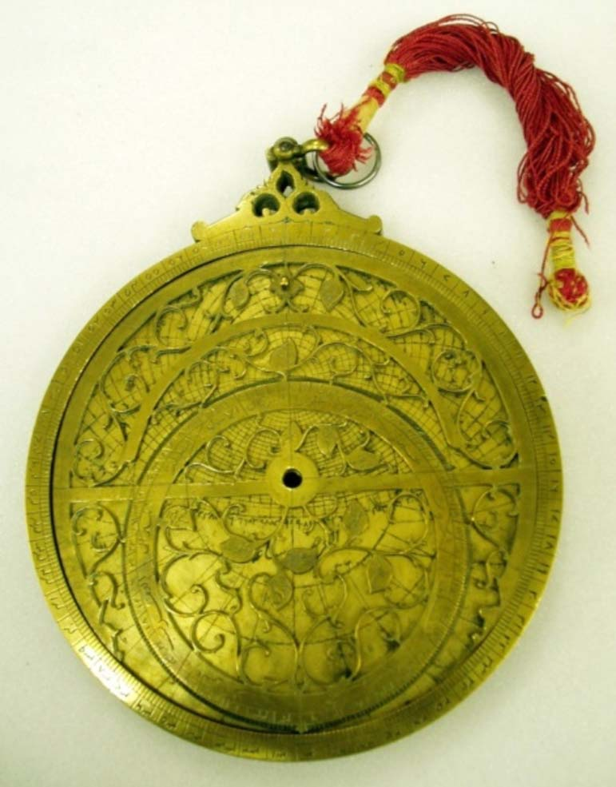

*Fig. 1. Indo-Persian Astrolabe made by Bulhomal for Sir Henry Elliot in 1849. Science Museum, London. Photo by the Author*

<!-- figure-resolved-extracted: page=7 image=media/p07_fig01.jpg -->

<!-- figure-meta: page=7, position=top, type=photograph -->

Persei), *Mirfaq al-thurayya* ($\alpha$ Persei), *Rijl al-jawzā’ [al-yusrā]* ($\beta$ Orionis), *ᶜAyyūq* ($\alpha$ Aurigae), *Yad al-jawzā’ [al-yumnā]* ($\alpha$ Orionis), *Shiᶜrā yamāniyyah* ($\alpha$ Canis majoris), *Simāk al-rāmiḥ* ($\alpha$ Boötis), *Nayyir al-fakka* ($\alpha$ Coronae Borealis), *Rās al-jāthī* ($\alpha$ Herculis), *Nasr wāqiᶜ* ($\alpha$ Lyrae), *Nasr ṭā’ir* ($\alpha$ Aquilae), and *Dhanab al-dajāja* ($\alpha$ Cygni).
Beneath the rete are seven plates, six of which are designed for latitudes $17^\circ$ and $20^\circ$; $23^\circ$ and $26^\circ$; $29^\circ$ and $32^\circ$; $35^\circ$ and $38^\circ$; $41^\circ$ and $44^\circ$; $47^\circ$ and $50^\circ$. On these six plates, altitude circles are drawn for every $3^\circ$ and labelled on both sides. Azimuth circles for every $5^\circ$ are drawn only above the horizon and labelled. In the lower half are lines

<!-- pdf-page: 8 -->

266 INDIAN JOURNAL OF HISTORY OF SCIENCE
for unequal hours and dotted lines for equal hours counted from the eastern and western horizons. On the oblique horizon are engraved *al-maghrib* in the west and *al-mashriq* in the east. At the central part of the plates, the arguments *sāᶜātah* (hour) and *ᶜarḍ* (latitude) are engraved in flamboyant calligraphy, but only the latitude values are mentioned and not the hours of the longest duration.
In the astrolabes made by the Allāhdād family of Lahore, the last plate carried on one side the tablet of ecliptic coordinates (*mīzān al-ᶜankabūt*) and on the reverse side the tablet of horizons (*ṣafīḥa āfāqiya*). Bulhomal did not follow this practice and engraved on both sides of the seventh plate tablets of horizons for latitudes of every single degree from $14^\circ$ to $90^\circ$. There is no label stating that this is the tablet of horizons. The inner side of the main body is blank; the geographical gazetteer is not engraved here.

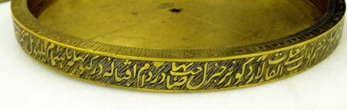

*Fig. 2. Indo-Persian Astrolabe made by Bulhomal for Sir Henry Elliot in 1849. Inscription around the edge. Science Museum, London. Photo by the Author*

<!-- figure-resolved-extracted: page=8 image=media/p08_fig01.jpg -->

<!-- figure-meta: page=8, position=middle, type=photograph -->

On the back, the rim is divided in $1^\circ$ and $6^\circ$ as in the front, but labelled separately in each quadrant from $6^\circ$ to $90^\circ$. A sine-cosine quadrant is engraved in the upper right quadrant with 30 horizontal and 30 vertical equidistant parallel lines. The seventh and the twelfth vertical and horizontal lines are numbered, starting from the radii as 1, 2, 3, ... 27/29. Upon this grid is drawn the quarter circle of obliquity. The other three quadrants are blank.
The alidade is straight without any counter change. The upright sights are ornate. The sloping edge is divided into 30 units in both halves. These are numbered in groups of 6 on both sides of the centre, starting from 6 and reaching up to 30.
Around the wide edge is engraved a long inscription in low relief against a hatched background, which reads thus:[^9]
> This tripartite (*thulthī*)[^10] astrolabe with a sine quadrant (*rubuᶜ mujayyab*) [on the back] and beneath it the limb (*ḥajra*) was designed for the honourable Sir Henry Elliot, K. C. B., Chief Secretary of His Lordship the Governor-General, by Bulhomal, the astronomer (*munajjim*) of Lahore [who is] attached to the court of [Rājā Nihāl Singh] Ahlūwālīyah, at Kapūrthala in 1849 of the Christian era.

### [2] Another astrolabe, 

with a diameter of 156 mm, 7 plates, and 12 star-pointers on the rete is almost identical to the astrolabe described above, but with two differences. On the back, besides the sine-cosine graph in the upper right quadrant, there are astrological tables in the upper left quadrant and in the lower left quadrant. Moreover, this astrolabe contains a gazetteer for 57 localities. It is in a private collection in Dublin, Ireland.[^11]

### [3] The *Répertoire* mentions 

yet one more astrolabe of about the same size (diameter 157 mm) and with 12 star-pointers on the rete. It has, however, 4 plates. It was not signed, nor dated, but the *Répertoire* opines that it is attributable to Bulhomal. It was formerly in the private collection of Alain Brieux. Its present location is unknown.[^12]

<!-- pdf-page: 9 -->

THE PRODUCTION OF TRADITIONAL ASTRONOMICAL INSTRUMENTS AT LAHORE 267

### [4] Indo-Persian Astrolabe designed by Bulhomal and made by Pīr Bakhsh, VS 1897, AH 1257, AD 1841, diameter 235 mm, Lahore Museum, Lahore (Acc. No. MM-1649).

While the three Indo-Persian astrolabes described above and the three Sanskrit astrolabes to be described below are elegant and handy pieces, a massive astrolabe was designed by Bulhomal probably because some client desired it. But the actual production of the astrolabe was done by the master craftsman (*ustād*) Pīr Bakhsh also of Lahore. According to the inscription engraved around the edge, it was made at the instance of ‘Maulvī Ghulām Muḥammad Khān Allāmī and was designed by Lālah Bulhomal Lāhorī in the capital city of Lahore for the obedient young Mubārak ᶜAlī Khān in Saṃvat 1897, 1257 Hijrī, 1841 Christian era.’ On the back of the *kursī* is engraved *ᶜamal ustād pīr bakhsh lāhorī*, ‘the work of the master craftsman Pīr Bakhsh of Lahore’.
This massive astrolabe is preserved in the Lahore Museum. It has a diameter of 235 mm, a height of 305 mm, a thickness of 20 mm and weighs 7 kg. Aside from the massive size, it is also distinct from the other astrolabes by Bulhomal in that it employs *Abjad* notation throughout.[^13]
The *kursī* is not pierced but is decorated in the front by intertwining vines with leaves and flowers; on the back there is a cartouche inside which the maker’s signature is incorporated. The limb is graduated in single degrees of arc and groups of $6^\circ$ are numbered in *Abjad* notation.
The rete consists of a narrow ring of the Tropic of Capricorn and a very broad ring of the ecliptic, both held together by the east-west equinoctial colure, which has no counter-change. The equatorial circle is shown only in the lower half; it is held in position by the tracery of leaves and tendrils, as in the other astrolabes by Bulhomal. The near-symmetric tracery, which fills the entire space, resembles the same in the other astrolabes by Bulhomal, but lacks their delicate elegance.
The ecliptic ring is divided into the twelve signs of the zodiac; each sign is named and divided into groups of $6^\circ$; the sloping edge of the ecliptic ring is divided into single degrees. There are 22 star pointers represented by the leaves in the tracery on which the star names are engraved. There is a handle at the north point to rotate the rete.
Under the rete, there are seven plates, six of which are calibrated for different latitudes. On both faces of the seventh plate are engraved tablets of horizons. As in the other astrolabes by Bulhomal, the tablet of ecliptic coordinates is not engraved on any plate.
On the inner side of the main plate is a geographical gazetteer providing the names, longitudes and latitudes of 54 localities.
The rim of the back is divided in $1^\circ$ and $6^\circ$. Groups of $6^\circ$ are numbered from $6^\circ$ to $90^\circ$, separately for each quadrant. In the upper half, the numbering commences at the east and west points and reaches up to the south point. In the lower half, the numbering proceeds in clockwise direction.
In the upper right quadrant is a sine-cosine graph with 15 vertical and 15 horizontal equidistant parallels. The lines are numbered along the radii in *Abjad* notation in both directions, i.e. from the centre to the periphery and from the periphery to the centre as 2, 4, ... 30. In the scale carrying the numbers from the periphery to the centre, common Arabic numerals are also written above the *Abjad* numerals.
In the lower half, there is the double shadow square; on the left for a gnomon of 12

<!-- pdf-page: 10 -->

268 INDIAN JOURNAL OF HISTORY OF SCIENCE
digits and on the right for a gnomon of 7 feet. Here the scales are numbered in common Arabic numerals. There are no labels of the shadow squares. Such shadow squares do not occur in Bulhomal’s astrolabes.
In the lower left quadrant, the names of the 12 signs are written in a zig-zag fashion in four concentric columns inside the degree scale. There is an elaborate astrological table in the upper left quadrant.
The alidade is straight without counter change. The sloping edge is divided into 30 units in both halves. These are numbered in *Abjad* notation in groups of 6 on both sides of the centre, starting from 6 and reaching up to 30. The pin is plain; the wedge is a straight rod with a flat circle at one end.

### 2.1.2. Sanskrit Astrolabes

The following three unsigned and undated Sanskrit astrolabes display an unmistakable similarity with the Indo-Persian astrolabe produced by Bulhomal in 1849 for Sir Henry Elliot. The *kursī* has exactly the same design; the rete also has the same pattern, but lacks the tracery of tendrils, and bears just 7 or 8 star pointers. Therefore, these three can be attributed to Bulhomal.

### [5] Sanskrit Astrolabe, not signed, not dated, attributable to Bulhomal, diameter 133 mm, Rampur Raza Library, Rampur.[^14]

The *kursī* of this astrolabe is designed exactly like the *kursī* in the astrolabe made for Sir Henry Elliot in 1849 [1]. The rim is also graduated in a like manner. As in the astrolabe of 1849, the inner side of the main body is blank and no geographical gazetteer was engraved here.
In the rete the Tropic of Capricorn, the ecliptic and the northern half of the celestial

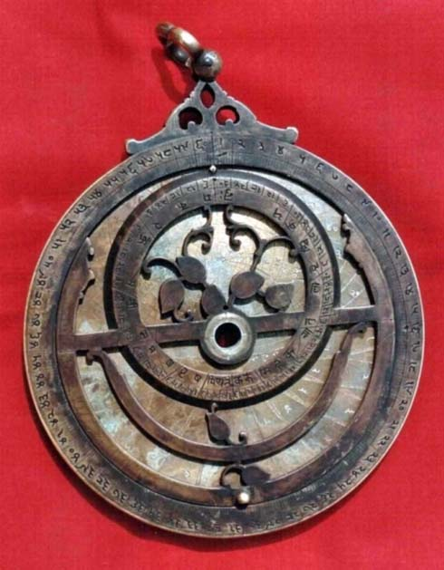

*Fig. 3. Sanskrit Astrolabe attributable to Bulhomal, front view, Rampur Raza Library; photo courtesy Rampur Raza Library*

<!-- figure-resolved-extracted: page=10 image=media/p10_fig01.jpg -->

<!-- figure-meta: page=10, position=right, type=photograph -->

equator are represented by wide circular bands. A complete equinoctial bar holds these bands together. The ecliptic ring is divided into the twelve signs of the zodiac and their names are engraved, starting from the vernal equinox, as Meṣa, Vṛṣa, Mithana (sic! Mithuna), Karka, Siṃha, Kanyā, Tulā, Vṛścika, Dhanuḥ, Makara, Kumbha, Mīna. Each sign is further subdivided into groups of $6^\circ$ and labelled as 6, 12, 18, 24, 30. The sloping edge of the ecliptic ring carries a scale of single degrees.
There are just seven leaf-shaped star pointers which are, however, not named. But from their position, it is possible to identify the stars they represent. Arranged according to their right

[^8]: Gunther (1932): 171-173; *Répertoire* 2.

[^9]: The full Persian text is reproduced in the *Répertoire* along with a French translation. A translation is also published in Gunther (1932): 171. There are slight errors in both translations.

[^10]: In a tripartite astrolabe altitude circles are drawn for every $3^\circ$ on the latitude plates.

[^11]: *Répertoire* 4; see also Mollan (1995): 152.

[^12]: *Répertoire* 5.

[^13]: This description is based on the information kindly provided to me by Mr Mubashir Ul-Haq Abbasi of Rawalpindi, who will soon publish a complete description of this astrolabe. There is a brief description in Dar (1994): 174-176, pls. VII-IX.

[^14]: Sarma (2003): 53-58. In this book I assigned this unsigned astrolabe to the seventeenth century, not realising that it could be by Bulhomal.
<!-- /decode-chunk -->

<!-- decode-chunk: pages=11-15 source_sha256=68cbd4e77b8fd5653d0c2a557cd562ffd767dff3786eff839864ff4a29be20d7 -->
<!-- pdf-page: 11 -->

# THE PRODUCTION OF TRADITIONAL ASTRONOMICAL INSTRUMENTS AT LAHORE 269

ascensions, these stars are *Rohiṇī* ($\alpha$ Tauri), *Lubdhaka-bandhu* ($\alpha$ Canis Minoris), *Svātī* ($\alpha$ Boötis), *Viśākhā-mātṛmaṇḍala* ($\alpha$ Coronae Borealis), *Abhijit* ($\alpha$ Lyrae), *Śravaṇa* ($\alpha$ Aquilae) and *Aśvaskandha* ($\beta$ Pegasi).
There are four plates, three of which serve two latitudes each, viz. $16^\circ$ and $22^\circ$; $24^\circ$ and $28^\circ$; $32^\circ$ and $38^\circ$. On these plates altitude circles are drawn for every $6^\circ$ and labelled; azimuths are marked for every $10^\circ$ both above and below the horizon and labelled likewise above and below horizon. The fourth plate has projections of multiple horizons on both the sides for each degree of latitudes between $24^\circ$ and $90^\circ$.

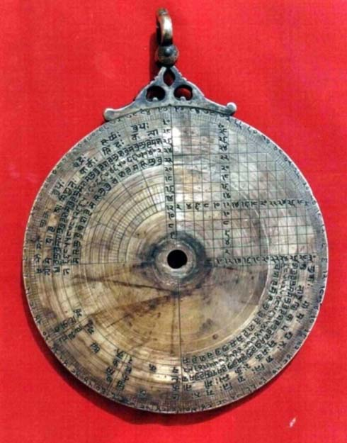

*Fig. 4. Sanskrit Astrolabe attributable to Bulhomal, back view, Rampur Raza Library; photo courtesy Rampur Raza Library*

<!-- figure-resolved-extracted: page=11 image=media/p11_fig01.jpg -->

<!-- figure-meta: page=11, position=middle, type=photograph -->

horizontal parallel lines. The intermediate spaces are labelled along the vertical and horizontal radii in ascending and descending order and once again along the twelfth vertical parallel and the twelfth horizontal parallel.

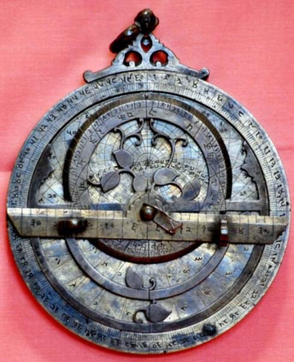

*Fig. 5. Sanskrit Astrolabe attributable to Bulhomal, front view, Central Asian Museum, University of Kashmir, Srinagar. Photo courtesy Central Asian Museum*

<!-- figure-resolved-extracted: page=11 image=media/p11_fig02.jpg -->

<!-- figure-meta: page=11, position=middle, type=photograph -->

The rim on the back is divided in $1^\circ$ and $6^\circ$ and numbered as in the other astrolabes. The upper right quadrant contains the sine and cosine grid which is divided by $14$ vertical and $14$
The upper left and lower right quadrants contain an elaborate astrological table, which begins in the upper left quadrant and continues in the lower right quadrant, displaying the regents and the limits of the twelve zodiac signs and the regents of the decans. In the lower left quadrant, the names of the $12$ zodiacal signs are arranged in groups of three.
As in other astrolabes, the alidade here is also divided in $30$ units in each half and numbered in groups of $6$.
**[6] Sanskrit Astrolabe,** not signed, not dated, attributable to Bulhomal, Central Asian

<!-- pdf-page: 12 -->

270 INDIAN JOURNAL OF HISTORY OF SCIENCE

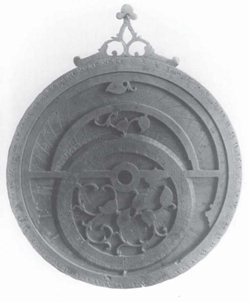

*Fig. 6. Sanskrit Astrolabe attributable to Bulhomal. Photo courtesy Museum of the History of Science, Oxford*

<!-- figure-resolved-extracted: page=12 image=media/p12_fig01.jpg -->

<!-- figure-meta: page=12, position=top, type=photograph -->

Museum, University of Kashmir, Srinagar (Acc. No. 80.203).
This astrolabe, with a diameter of $135\text{ mm}$, is slightly larger than the Sanskrit astrolabe at Rampur, otherwise it is identical in all respects. The only difference is that on the back, in the upper right quadrant (sine-cosine graph), radian lines join the centre with every sixth degree on the rim.
**[7] Sanskrit Astrolabe,** not signed, nor dated, attributable to Bulhomal, PLU.
The archives of the Museum of the History of Science at Oxford contain a photo of a third specimen which bears a close resemblance to the two Sanskrit astrolabes mentioned above. Here the shackle is missing. In the rete there is an eighth star pointer, which is likely to be *Mithuna-dakṣiṇa-hasta* ($\alpha$ Orionis). In the Rampur astrolabe, the ends of the semi-circular band of the equator curve downwards, whereas in the present astrolabe, the ends of the equatorial band merge with the equinoctial bar.

### 2.1.3 Indo-Persian North-South Astrolabes

Astrolabes are generally northern, i.e. they have the north celestial pole as the centre of the rete and contain pointers to stars that lie to the north of the Tropic of Capricorn. But astrolabe makers in India were fascinated also by the southern astrolabe and by the combined north-south astrolabe, although these do not have much practical utility. It is reported that Fīrūz Shāh Tughluq caused a huge and splendid north-south astrolabe to be made. Mahendra Sūri in his Sanskrit manual on the astrolabe which he composed in $1370$ at the court of Fīrūz discusses how to construct northern, southern and north-south astrolabes. Ḍiyā’ al-Dīn Muḥammad, the most prolific and versatile member of the Allāhdād family of Lahore produced a north-south astrolabe in $1674$, which is now preserved in Jai Singh’s Observatory at Jaipur. There are a few other unsigned north-south astrolabes which appear to have been made by the same Ḍiyā’ al-Dīn. Bulhomal also tried his hand in this genre and produced two north-south astrolabes.
**[8] Indo-Persian North-South Astrolabe** dated VS $1907$ and January $1851$ AD, PLU.
This astrolabe was dedicated to the Raja of Kapurthala in a long inscription, probably engraved on the edge, which is reproduced and translated in the *Repértoire*. On the rete there is a double projection of the ecliptic circle for the northern and southern astrolabes. Its diameter and the number of plates are not known. According to the *Repértoire*, it was formerly in the private collection of Hew Kennedy, Shropshire, but its present position is not known.[^15]

[^15]: *Répertoire* 3; Savage-Smith (1985): 304, n. 180.

<!-- pdf-page: 13 -->

THE PRODUCTION OF TRADITIONAL ASTRONOMICAL INSTRUMENTS AT LAHORE 271
**[9] Indo-Persian North-South Astrolabe** on a stand, diameter $406.4\text{ mm}$, PLU.[^16]
The second north-south astrolabe was originally in the collection of the Maharaja of Kapurthala and was exhibited by him in the Lahore Exhibition of $1864$. A wood-cut image of this astrolabe is published in B. H. Baden Powell, *Handbook of the Manufactures and Arts of the Punjab*.[^17]

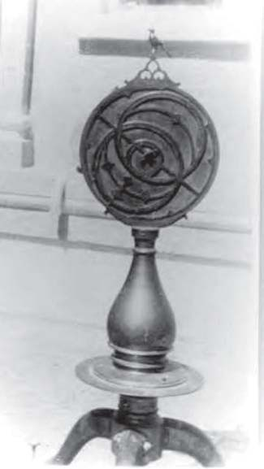

*Fig. 7. Indo-Persian North-South Astrolabe, attributable to Bulhomal. Photo from the archives of the Museum of the History of Science, Oxford*

<!-- figure-resolved-extracted: page=13 image=media/p13_fig01.jpg -->

<!-- figure-meta: page=13, position=middle, type=photograph -->

In the archives of the Museum of the History of Science, Oxford, there is a photo of this astrolabe with the remark, ‘Indo-Persian Astrolabe with a double rete, overall height $4' 10''$ [$= 1\text{m } 47\text{ cm } 3.2\text{ mm}$], astrolabe diameter $16''$ [$= 40\text{ cm } 6.4\text{ mm}$], submitted by Sotheby’s $1976$ for examination, said to be in a palace of a Maharaja, negative no. 76-27.35.s.’ Therefore it must have come for sale in UK sometime in the twentieth century. According to the *Répertoire*, this too was formerly in the collection of Hew Kennedy, Shropshire, but its present location is uncertain.
It is not known whether this astrolabe carries a signature or a date, but it can be immediately identified as Bulhomal’s production from the characteristic design of the *kursī*. In the photo, one can also see the double projection of the ecliptic circle for northern and southern astrolabes. The *Répertoire* states that there are no star pointers on the rete. On the back, in the upper left quadrant is an astrological table containing the names of the planets and those of $6$ signs; the upper right quadrant is occupied by sine and cosine graph, the lower left has the names of the $12$ signs of the zodiac, but the lower right is blank. There are said to be $6$ plates in this astrolabe.
An unusual feature of this large astrolabe is that it is mounted on a high stand. From the way it is attached to the stand, it does not seem possible that the astrolabe could be lifted from the stand, held in the upraised hand and tilted appropriately for observation. It could at the most be used for demonstration.

## 2.2. Celestial Globes made by Bulhomal

### 2.2.1. Indo-Persian Celestial Globes

With an impressive list of large celestial globes cast in the lost wax process, Bulhomal is a major producer of celestial globes, next only to Ḍiyā’ al-Dīn Muḥammad of the Allāhdād family whose signature adorns some $18$ globes. There are ten celestial globes which can be attributed to Bulhomal and these constitute the largest group of his production. Three of these globes carry his signature and date. Seven globes bear inscriptions and legends in Persian, two in Sanskrit and one in English.

[^16]: *Répertoire* 7.

[^17]: Powell (1872): between pages 260 and 261.

<!-- pdf-page: 14 -->

272 INDIAN JOURNAL OF HISTORY OF SCIENCE
While Bulhomal preferred astrolabes of small size, his globes are rather massive with diameters going up to $495.8\text{ mm}$ and are thus much larger than those of the Allāhdād family whose diameters ranged between $65$ and $188\text{ mm}$. Bulhomal’s astrolabes differ in many respects from those of the Allāhdād family, but his celestial globes closely follow the products of the Allāhdād family in the technical process of production and in the engraving of scales, constellation figures and so on.
These globes are mounted on distinctive three-legged stands consisting of the horizon ring, meridian ring which allows the celestial globe to be set according to the observer’s latitude, and a zenith ring placed at $90^\circ$ from the meridian. The three legs and the meridian ring and the zenith ring are detachable. They are joined to the horizontal ring by means of bolts and winged nuts. Just as the *kursī* with three perforations became the hallmark of Bulhomal’s astrolabes, there is also a distinctive characteristic trait of his celestial globes. It is the zenith ring with a prominent crown-like projection. Likewise, the ornate legs of the stand also are distinctive with their S-shaped forms. They are often decorated with a leaf pattern through the entire length (see Figs. 8 and 13).
**[10] Indo-Persian Celestial Globe signed by Bulhomal,** $1842$, diameter $330\text{ mm}$, Science Museum, London (Acc. No. 1985-1257).[^18]
The globe is mounted on a three-legged stand, on which rests the horizon ring. It is graduated in $1^\circ$ and $6^\circ$ and numbered separately in each quadrant. The meridian ring is also graduated and numbered in the same manner. There is also a zenith ring.
The globe is produced as a single hollow sphere by the lost wax process. On the globe are drawn the ecliptic and equator in double bands and graduated in $1^\circ$ and $6^\circ$. On the equator the groups of $6^\circ$ are numbered serially as $1, 2, 3 \dots 60$ from the vernal equinox. On the ecliptic groups of $6^\circ$ are numbered separately for each sign of $30^\circ$. The names of the signs are written along the ecliptic. Parallel to the equator are drawn the tropics, polar circles and two lesser circles at $12^\circ$ and $20^\circ$ on either side.
Six latitude circles cut the ecliptic at right angles. Besides these, there are other circles about which Savage-Smith remarks as follows:
> Balhumal also added to all his globes six meridian circles at right-angles to the equator, along with the ecliptic latitude-measuring circles. Meridian circles are unusual in Islamic globe design, but Bahlumal made them highly idiosyncratic by shifting them six degrees westward so that no meridian represents the equinoctial colure.[^19]
On the globe, a complete set of $48$ classical constellation figures are drawn together with their names and serial numbers. Prominent stars in each constellation are also named and numbered consecutively in each constellation.
Near the south equatorial pole is a long inscription in Persian in eight lines which states that it was made for Nihāl Singh Ahlūwāliya, the ruler of Kapurthala, by Lālah Bulhomal Lāhorī, astronomer/astrologer (*munajjim*) and geometrician (*muhandus*), who is attached to the court of Kapurthala. The year of manufacture is given in three eras, VS $1899$, AH $1258$ and AD $1842$.[^20]
**[11] Indo-Persian Celestial Globe signed by Bulhomal,** $1842$, diameter $177.8\text{ mm}$, National Museum, Karachi.[^21]

[^18]: Savage-Smith (1985): 235-236; *Répertoire* 1.

[^19]: Maddison & Savage-Smith (1997): 242.

[^20]: The full text of the inscription in Persian and an English translation are in Savage-Smith (1985): 291, 235. The Persian text and a French translation are given also in *Répertoire* 1.

[^21]: Savage-Smith (1985): No. 127, pp. 275-276.

<!-- pdf-page: 15 -->

THE PRODUCTION OF TRADITIONAL ASTRONOMICAL INSTRUMENTS AT LAHORE 273
It is somewhat smaller than the globe described above, but made exactly in the same fashion. The inscription near the South Pole states that it was made for the instruction of the son of Khushi Ram. The original stand is lost. From a recent photograph, it appears that the silver nails indicating the star positions are disintegrating. In the place of silver points, one sees large white patches.
**[12] Indo-Persian Celestial Globe,** not signed, not dated, attributable to Bulhomal, diameter $184\text{ mm}$, without constellation figures, ex-Time Museum, Rockford, PLU.[^22]
This globe was formerly in the Time Museum, Rockford, Illinois, USA. After the dissolution of the museum, the holdings were disposed of and it is not known who acquired the present globe. The circles and scales on this globe are as in the globes above. But there are no constellation figures. Just $32$ stars are indicated by inlaid silver nails and their names and serial numbers are engraved. The original stand is lost.
**[13] Indo-Persian Celestial Globe,** not signed, not dated, attributable to Bulhomal, diameter $370\text{ mm}$, Naseer D. Khalili Collection, London (Acc. No. SC1285).[^23]
The globe is mounted on an ornate stand whose legs are decorated with a pair of tulips which are joined base to base. The zenith ring is decorated with an ornate crown.
The globe is endowed with circles and scales as in the other globes by Bulhomal. The scales are numbered both in *Abjad* and in the common Arabic numerals. Outlines of $48$ constellation figures are drawn and the positions of about $1018$ stars are marked with inlaid silver nails.
However, there occurred a serious error in engraving. The engraving on the globe began at first at one end and shifted later inadvertently to the other end. Consequently there are some markings treating one end as the North Pole and some other markings treating the other end as the North Pole. Thus there are two small bears at both poles. Even so, according to Emilie Savage-Smith, the workmanship is excellent and the lines and the graduations are very precise.
Interestingly enough, an inscription on the zenith ring states that the owner is Jotishi Dharm Chand, who is himself an instrument maker known through ten extant instruments [29-38] which will be discussed below in section 3.
**[14] Indo-Persian Celestial Globe,** not signed, not dated, attributable to Bulhomal, diameter ca. $214\text{ mm}$, National Museum, New Delhi (Acc. No. 56.155/1).
This celestial globe is mounted on a $190\text{ mm}$ high stand which is similar to the stands made by Bulhomal. The horizon ring and the meridian ring in the stand are graduated in $1^\circ$ and $6^\circ$ and labelled both in *Abjad* notation and in common Arabic numerals from $6^\circ$ and $90^\circ$ separately in each quadrant. The ornate crown of the zenith ring is topped by a lotus-shaped finial.
The globe has a circumference of $673\text{ mm}$ and a diameter of ca. $214\text{ mm}$. On the globe are drawn the equator and the ecliptic, both graduated in $1^\circ$ and $6^\circ$, the tropics and two lesser circles at $12^\circ$ and $20^\circ$ from the equator on either side, but no polar circles. There are also latitude circles and meridian circles as in the other globes. A full set of the $48$ constellation figures is engraved together with their names, where great care is shown in depicting the details such as hair, beards and textile patterns on the clothing. The positions of about $1020$ fixed stars are indicated by inlaid silver nails.
**[15] Indo-Persian Celestial Globe,** not signed, not dated, attributable to Bulhomal,

[^22]: Savage-Smith (1985) No. 90, pp. 262-263, Fig. 26, p. 55.

[^23]: Maddison & Savage-Smith (1997): 242, Fig. on p. 243.
<!-- /decode-chunk -->

<!-- decode-chunk: pages=16-20 source_sha256=97a6b74366bd27b2baf4e5e8d79cde23a8fe7480a6e882144a5fe3c45a3490b8 -->
<!-- pdf-page: 16 -->

274 INDIAN JOURNAL OF HISTORY OF SCIENCE

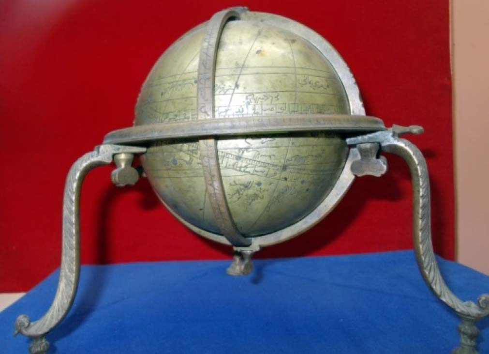

*Fig. 8. Indo-Persian Celestial Globe attributable to Bulhomal. Central Asian Museum, University of Kashmir, Srinagar. Photo courtesy Central Asian Museum*

<!-- figure-resolved-extracted: page=16 image=media/p16_fig01.jpg -->

<!-- figure-meta: page=16, position=middle, type=photograph -->

diameter 195 mm, Central Asian Museum,
University of Kashmir, Srinagar.
The globe is mounted on a three-legged
stand, similar to the stands of the globes described
above. The stand, 185 mm high, consists of an
ornate horizontal ring, a meridian ring and a zenith
ring without a crown. The curved legs are
decorated with a leaf pattern. Both the horizontal
and meridian rings are graduated in $1^\circ$ and $6^\circ$ and
labelled in *Abjad* notation. An axis passing through
the two celestial poles on the globe is pivoted to
the meridian ring in the stand.
On the globe are drawn the celestial
equator and the ecliptic as double bands. One of
these two bands is divided in $1^\circ$ and the other in
$6^\circ$. The ecliptic is divided in zodiac signs and
labelled with their names in Arabic/Persian script.
Interestingly enough, the names are preceded by
their serial numbers in Devanagari script. Seven
names can be seen in the available photos, viz. 5
*al-Asad*, 6 *al-Sunbulah*, 7 *al-Mīzān*, 8 *al-ᶜAqrab*,
10 *al-Jadī*, 11 *al-Dalw*, 12 *al-Ḥūt*. Each sign is
divided in groups of $6^\circ$ and labelled as 6, 12, 18,
24, 30. Parallel to the equator are drawn the
tropics, polar circles and two lesser circles at $12^\circ$
and $20^\circ$ from the equator on either side as in other
globes.
Six latitude circles cut the ecliptic at right
angles. But unlike in other globes, there are no
merididian circles here. No constellation figures are

<!-- pdf-page: 17 -->

THE PRODUCTION OF TRADITIONAL ASTRONOMICAL INSTRUMENTS AT LAHORE 275
drawn on this globe, but the positions of certain
stars are marked by inlaid silver points with the
names engraved next to the silver points.
**[16] Indo-Persian Celestial Globe,**
attributable to Bulhomal, diameter 495.3 mm, ex-PC of Maharaja of Kapurthala; ex-PC of Hew
Kennedy, Shropshire, PLU.[^24]
This globe is listed in the *Répertoire* as
the sixth instrument to be produced by Bulhomal.
In the archives of the Museum of the History of
Science, Oxford, there is a photo with the remark:
“Indo-Persian Globe (?). Overall height 2′3″
[= 685.8 mm] Globe diameter 19″ [= 495.3 mm].
Submitted by Sotheby’s 1976 for examination.
Said to be in a palace of a Maharaja. Neg. 76-
27.35.s.” Then this must be the largest extant
celestial globe cast by the lost wax process. The
photo of the north-south astrolabe mounted on a
stand, which has been described above [9], carries
also a similar remark. It suggests that this huge
globe as well as the very large astrolabe mentioned
above must have come to Sotheby’s in 1976 for
sale and they must have been acquired by Hew
Kennedy of Shropshire. Its present location is not
known.
From the photo it is not possible to
determine whether the script is Arabic/Persian or
Sanskrit, probably it is Arabic/Persian; nor can it
be determined whether it is signed or not. But the
stand and the zenith ring with the crown topped
by a circular finial suggest that it was certainly
made by Bulhomal.

### 2.2.2. Sanskrit Celestial Globes

While more than a hundred Sanskrit
astrolabes are extant, there are only three Sanskrit
celestial globes which carry the 48 constellation
figures. Of these two were produced by Bulhomal.
The third globe, which is preserved in Jai Singh’s
Observatory at Jaipur, may have been
commissioned by Sawai Jai Singh in the first

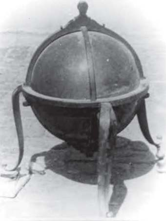

*Fig. 9. Indo-Persian Celestial Globe attributable to Bulhomal. Photo from the archives of the Museum of the History of Science, Oxford*

<!-- figure-resolved-extracted: page=17 image=media/p17_fig01.jpg -->

<!-- figure-meta: page=17, position=middle, type=photograph -->

quarter of the eighteenth century. There is a fourth
case: in 1767 a certain Nandarāma caused Sanskrit
names to be engraved on an Indo-Persian celestial
globe made by Muḥammad Ṣāliḥ in 1663. The
globe is with the Nasser D. Khalili Collection of
Islamic Art in London.[^25]
**[17] Sanskrit Celestial Globe signed by
Bulhomal, 1839,** diameter ca. 140 mm, ex-PC,
Milan; now PC, London.
This is the earliest celestial globe produced
by Bulhomal, in fact, his earliest dated instrument.
It has a diameter of about 140 mm and is mounted
on a 277 mm high stand with a horizon ring. The
meridian ring and the zenith ring are missing. This
globe is unique in the sense that on the scales of
the horizon ring, the meridian ring, the ecliptic
and the equator groups of $6^\circ$ are labelled in the
Sanskrit alpha-numeric notation called
*Kaṭapayādi* as a parallel to the practice of using
the Arabic alpha-numeric system *Abjad* in the
Islamic astrolabes and celestial globes. This

<!-- pdf-page: 18 -->

276 INDIAN JOURNAL OF HISTORY OF SCIENCE
system was invented in Kerala and was used there
extensively in Sanskrit texts on astronomy and
mathematics, and even in other kinds of texts.[^26]
Outside Kerala it was not used much. There is only
one instance where it was employed to number
the scales of an undated Sanskrit astrolabe.[^27] It is
not known whether Bulhomal was aware of this
astrolabe or whether he himself thought of using
the Sanskrit alpha-numeric system on the celestial
globe. In any case, he employed the system very
efficiently on his globe.
The *Kaṭapayādi* notation is based on the
decimal place-value system. Here the number 1
is denoted by the consonants *ka*, *ṭa*, *pa* and *ya*; 2
by *kha*, *ṭha*, *pha* and *ra*; ... zero by *ña* and *na*.
Vowels do not have any numerical value. In this
notation, numbers are written from right to left.
That is to say, 2015 is represented, e.g., *śa*
(5)*ka*(1)*na*(0)*ra*(2). Thus in Fig. 10 below, which
shows a quarter of the horizon ring of the present

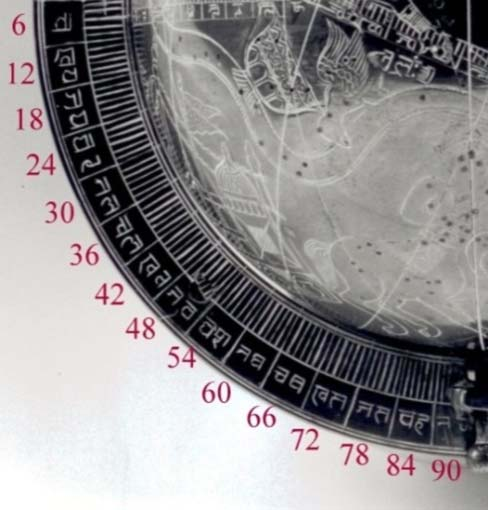

*Fig. 10. Sanskrit Celestial Globe by Bulhomal, horizon ring PC, London. Photo by Professor G. L’E. Turner*

<!-- figure-resolved-extracted: page=18 image=media/p18_fig01.jpg -->

<!-- figure-meta: page=18, position=middle, type=photograph -->

celestial globe, 6 is denoted by *ca*, 12 by *kha-ya*
and so on.[^28]
From the photos available to me, it is not
clear how the complete stand looks like; the photos
show only the horizon ring. The Devanagari letters
on the ring are different from those on the globe.
In the letters on the globe, there is a strong
influence of Gurmukhi script, but not so on the
horizon ring. Two different persons must have
engraved these.
The ecliptic and equator, as well as the
horizon ring, carry double bands of scales; one
band displaying single degrees of arc and the other
groups of six degrees. The groups of 6 degrees
are labelled, as mentioned above, in the
*Kaṭapayādi* notation. Tropics, polar circles or
other circles parallel to the equator are not visible.
There are latitude circles drawn perpendicular to
the ecliptic and meridian circles drawn at right
angles to the equator as in the other globes.

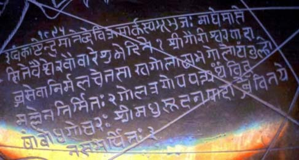

*Fig. 11. Sanskrit Celestial Globe by Bulhomal, 1839, Inscription. Photo by Professor G. L’E. Turner*

<!-- figure-resolved-extracted: page=18 image=media/p18_fig02.jpg -->

<!-- figure-meta: page=18, position=middle, type=photograph -->

In the lower half of the segment of Pisces,
under the tail feathers of Cetus, is engraved the
following inscription in six lines, consisting of
three verses in *Anuṣṭubh* metre:
> *iṣvaṅkāṣṭendumāne ’bde vikramārkasya*
> *bhūbhujah |*

<!-- pdf-page: 19 -->

THE PRODUCTION OF TRADITIONAL ASTRONOMICAL INSTRUMENTS AT LAHORE 277
> *māghe māse site vaiśve ravau vāre śubhe*
> *tithau ||1||*
>
> *śrīgaurīśvara-pādābja-sevānir-malacetasā |*
>
> *khagolāḍhya-bhagolo ’yam Vulhomallena*
> *nirmitaḥ ||2||*
>
> *golatrayopapattyartham viduṣām*
> *bodhagocaraḥ |*
>
> *śrī-Madhusūdana-pādābje vinayena*
> *samarpitaḥ ||3||*
In the year 1895 of king Vikrama, in the
bright [half] of the month Māgha, on
Sunday, the auspicious lunar day *vaiśva*,
[= Sunday, 20 or 27 January 1839], this
Celestial Globe (*bhagola*), including the
sphere of the sky (*khagola-āḍhya*?), was
constructed by Bulhomal (*vulhomalla*)
whose mind is clear owing to the devotion
to the lotus feet of the glorious Pārvatī
and Śiva, for the demonstration of three
types of spherics (*gola-traya-upapatti-artham*)[^29]; [this globe which is]
intelligible to the learned, is dedicated
with humility to the lotus feet of the
glorious Madhusūdana.[^30]
The globe appears to carry the full
complement of the 48 pictorial representations of
constellations. In the available photographs, I can
see about 12 of these figures, with interesting
iconography. On each of these figures, their names
are written in Sanskrit language and Devanagari
script, followed by a serial number. Within each
figure, various star positions are indicated by inlaid
silver points. These positions are marked by serial
numbers in Devanagari, separately for each
constellation, apparently in accordance with the
Ptolemaic tradition.
However, names are engraved only of all
the northern constellations, of just five of the
twelve zodiac signs, but of none of the southern
constellations. In the northern constellations, silver
points indicating star positions are numbered
serially; this was done only in some zodiac figures;
and only in Cetus among the southern
constellations. Thus the engraving of names and
numbering of stars in each constellation seems to
have been left incomplete for some inexplicable
reason.
**[18] Sanskrit Celestial Globe,** not signed,
not dated, attributable to Bulhomal, diameter 505
mm, Butler Library, Columbia University, New
York (Acc. No. 27-244).[^31]

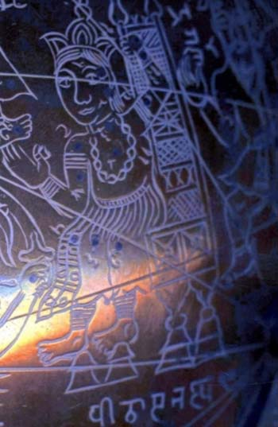

*Fig. 12. Sanskrit Celestial Globe by Bulhomal, 1839. Constellation Figure of Cassiopeia. photo by Professor G. L’E. Turner*

<!-- figure-resolved-extracted: page=19 image=media/p19_fig01.jpg -->

<!-- figure-meta: page=19, position=middle, type=photograph -->

Although this globe is not signed, there
cannot be any doubt in its being a creation of
Bulhomal. The globe rests on a highly ornate
stand. The heavy horizon ring is decorated on the
outside with a floral motif in two registers. The

<!-- pdf-page: 20 -->

278 INDIAN JOURNAL OF HISTORY OF SCIENCE

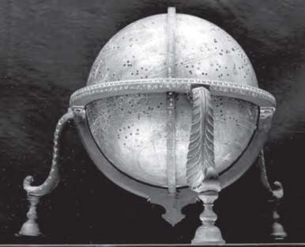

*Fig. 13. Sanskrit Celestial Globe, attributable to Bulhomal. The zenith ring is mounted upside down. Butler Library, Columbia University, New York. Photo courtesy Butler Library*

<!-- figure-resolved-extracted: page=20 image=media/p20_fig01.jpg -->

<!-- figure-meta: page=20, position=top, type=photograph -->

legs are patterned like leaves. In contrast the crown
on the zenith ring is rather simple.
The scales on the stand and on the globe
are divided in $1^\circ$ and $6^\circ$ and the groups are
numbered with common Devanagari numerals and
not in the *Kaṭapayādi* notation. Along the ecliptic,
names of the signs are written in Sanskrit. Full set
of 48 constellation figures are drawn on the globe
together with their Sanskrit names and serial
numbers in Devanagari numerals. About 1018 star
positions are marked and stars in each
constellation are serially numbered.
It is interesting to see how the names of
the 48 constellation figures are rendered in
Sanskrit on these globes. The human figures are
generally derived from Greek mythology. In their
transit to the Islamic world, their mythological
character is often lost and only their physical traits
are reflected in their nomenclature. Thus Hercules
became *al-Jāthī* (‘the kneeling man’) in Islamic
celestial globes and this name was translated
somewhat incorrectly as *Jānūpaviṣṭa* (‘seated on
the knee’) on the Sanskrit globes; Cassiopeia
becomes *Dhāt al-Kursī* (‘the Lady with the chair’)
in Arabic and *Pīṭhāsanastha* (‘[man] seated on a
chair’) in Sanskrit, where the term *pīṭhāsana* itself
appears to be a neologism to denote a chair with a
back and two armrests; see Fig. 12, where under
the figure of Cassiopeia, her name is engraved as
*Pīṭhāsanastha* followed by the serial number 9,
which ought to be 10.
**[19] Celestial Globe with Legends in
English,** not signed, nor dated, attributable to
Bulhomal, d. 360 mm, Nasser D. Khalili
Collection of Islamic Art, London (Acc. No.
SC144).[^32]
This has all the features of the globes
mentioned above including the 48 constellation
figures and star positions inlaid with silver nails.
The legs are decorated with double tulips and an
oval ring is attached to the crown of the zenith
ring. The distinguishing feature of this globe is
that Bulhomal attempted to number the scales with
the modern international numbers. The North Pole,
the South Pole, the signs of the zodiac along the
ecliptic are labelled with English names. Likewise
many of the constellation figures carry English
names. Savage-Smith notes that some are given
unusual names: Pegasus is named ‘Painter’s
Horse’, Equus is called ‘Pegasus’ and Cygnus is
labelled ‘Cerberus’. There are signs that the globe
was left unfinished; some constellation figures are
not completely drawn and some were not given
any names.

## 2.3. Dhruvabhrama-yantras and a Horary Quadrant made by Bulhomal

The *Dhruvabhrama-yantra* was invented
by Padmanābha in 1423. It consists of an oblong
metal plate with a horizontal slit at the top. Loosely
pivoted to the centre of the plate is a metal index
with four indicators projecting into the four
directions. A plumb is suspended from the
southern-most end of the index so that this end
would always point downwards. Around the centre
of the plate are concentric circles containing
various scales of *ghaṭis*, zodiac signs according
to their right ascensions and also oblique

[^24]: *Répertoire* 6.

[^25]: Savage-Smith (1985): No. 29, pp. 231-232, Figure 18 on p. 45; Maddison & Savage-Smith (1997): 234, 237.

[^26]: Sarma (2012-d).

[^27]: Sarma (1999).

[^28]: For a complete list, see Sarma (2012-d:56).

[^29]: *Gola-traya* means the ‘triad of spheres,’ namely *khagola* (the sphere of the sky), *bhagola* (the sphere of the fixed stars) and *grahagola* (the sphere of the planets).

[^30]: It is not known who this Madhusūdana was; he was probably Bulhomal’s teacher.

[^31]: Savage-Smith (1985): No. 54, p. 245, Figure 25, p. 54.

[^32]: Maddison & Savage-Smith (1997): 243, 245.
<!-- /decode-chunk -->

<!-- decode-chunk: pages=21-25 source_sha256=d9b75f30246543e327cd4d4a5d711e3c2bd3004a487636944a1b0611716d3743 -->
<!-- pdf-page: 21 -->

# THE PRODUCTION OF TRADITIONAL ASTRONOMICAL INSTRUMENTS AT LAHORE 279

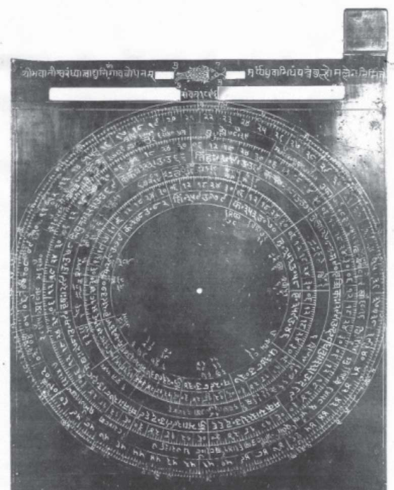

*Fig. 14. Dhruvabhrama-yantra by Bulhomal, 1839-40. Butler Library, Columbia University, New York. Photo courtesy Butler Library*

<!-- figure-resolved-extracted: page=21 image=media/p21_fig01.jpg -->

<!-- figure-meta: page=21, position=top, type=photograph -->

ascensions, lunar mansions, and the sub-multiples of these parameters. At night, the instrument is held in such a manner that $\alpha$ and $\beta$ Ursae Minoris are visible through the slit. When these two stars are sighted in a straight line by appropriately tilting the instrument, the eastern indicator will point to the ascendant (*lagna*) for this moment, the northern indicator will show the culminating point (*madhyama-lagna* or *daśama-bhāva*) and the western indicator the sidereal time in *ghaṭīs* and *palas*. From the ascendant and culmination can be easily determined other astrological houses (*bhāvas*) which are necessary in horoscopy. Padmanābha prescribes that a sine quadrant should be drawn on the reverse side of the plate for day time observations.[^33]

[^33]: Sarma (2012-a).

<!-- pdf-page: 22 -->

280 INDIAN JOURNAL OF HISTORY OF SCIENCE
Among the extant specimens of the *Dhruvabhrama-yantra*, there are two, one of which carries Bulhomal’s signature and the other, though unsigned, attributable to him because of its close resemblance to the former. Apparently he was fond of this instrument, because these two specimens are filled with much astronomical and astrological data. The first of these two is in the David Eugene Smith[^34] Collection of the Butler Library of Columbia University at New York.
**[20] Dhruvabhrama-yantra with a Sine Quadrant on the Back signed by Bulhomal,** 1839-40, $225 \times 179 \times 2$ mm, Butler Library, Columbia University, New York (Acc. No. 27-254).
The instrument is filled with so much numerical data that it looks more like a miniature encyclopaedia rather than a handy tool. The gilded plate is excellently produced and engraved. The index of the *Dhruvabhrama-yantra* and that of the sine quadrant are missing. One of the two sights attached at the two corners on the top is broken and lost. The remaining sight has two pinholes, one for viewing the sun and the other for the stars.
The obverse side is fashioned as the *Dhruvabhrama-yantra*. At the top there are two horizontal slits, one immediately below the other, one very short and another much longer. Both slits are interrupted in the middle by about 20 mm of space. On both sides of the upper slit is engraved an inscription in the *Anuṣṭubh* metre:
> *śrībhavānīśvaraṃ dhyāttvā dyuniśāṅgāvabodhanam |*
> *turyyaṃ dhruvābhidhaṃ yantraṃ vulhomallena nirmite (sic! read °aṃ) ||*
‘Having meditated upon the glorious Pārvatī and Śiva, this *Dhruvabhrama-yantra* (lit. the quadrant instrument designated as *Dhruva*), was constructed by Bulhomal (*vulhomalla*) for knowing the parts of the day and of the night.’
In the space between the two halves of the upper slit is engraved the Polar Fish (*dhruva-matsya*) with 12 inlaid silver points indicating the 12 stars which constitute the constellation *dhruva-matsya*. Below the fish figure, in the space between the two halves of the larger slit is engraved the year of manufacture: *saṃvat* 1896 (= AD 1839-40).
Below these longitudinal apertures are drawn thirteen concentric circular scales, which commence at $234^\circ$. They contain the following elements: time scales of *ghaṭīs* and *palas*; degrees of arc, zodiac signs according to their right

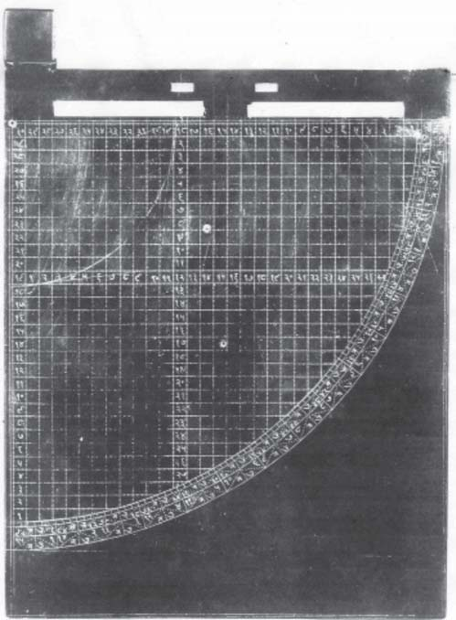

*Fig. 15. Sine Quadrant on the back of the Dhruvabhrama-yantra by Bulhomal, 1839-40. Butler Library, Columbia University, New York. Photo courtesy Butler Library*

<!-- figure-resolved-extracted: page=22 image=media/p22_fig01.jpg -->

<!-- figure-meta: page=22, position=bottom, type=photograph -->

[^34]: David Eugene Smith (1860-1944) is a historian of mathematics well known for his *History of Mathematics* (Dover Paperbacks). During his travels in India, he collected several Sanskrit manuscripts and astronomical instruments which are now preserved in the Butler Library.

<!-- pdf-page: 23 -->

THE PRODUCTION OF TRADITIONAL ASTRONOMICAL INSTRUMENTS AT LAHORE 281
ascensions and oblique ascensions, names of the 28 lunar mansions, their positions indicated by inlaid silver points and their meridian altitudes. Besides the 28 lunar mansions, three more stars are included in this scale: *prajāpati* ($\delta$ Aur), *lubdhaka* ($\alpha$ CMa) and *apāṃvatsa* ($\theta$ Vir).
On the reverse side of the plate is engraved the sine quadrant. Here thirty horizontal and thirty vertical parallels produce a grid of squares. Each square in the grid is sub-divided into 9 small sub-squares by dots along the horizontal and vertical lines. Thus the vertical and horizontal lines are divided into 90 parts. An arc of the obliquity of the ecliptic is drawn a little to the right of the vertical line 19. This gives a value of slightly higher than $24^\circ$ for the obliquity. In the space between the 19th and 18th vertical and horizontal lines, the lines are numbered from the radius up to the arc.
The arc carries three scales. The innermost scale is divided into 90 degrees. This scale and the other two scales are divided into 15 *ghaṭīs* and labelled from both ends. In the second scale, the degrees are numbered in groups of $6^\circ$ and labelled in both directions.
**[21] Dhruvabhrama-yantra,** not signed, not dated, attributable to Bulhomal, $116 \times 115$ mm, Victoria & Albert Museum, London (Acc. No. IM 11-1915).
The instrument is not signed, but there is such a close resemblance between the sine quadrant on the back of this instrument and the same in Bulhomal’s signed piece at the Columbia University that the present instrument too can be attributed to him. The plate is almost square with a length of 116 and width of 115 mm. The indices in the front and back are lost. The plate is highly polished and appears gilded.
On the front side is the *Dhruvabhrama-yantra* in which the instrument maker introduced an innovation. Since the rising times of the six signs from Aries to Virgo repeat in the reverse order in the next six signs from Libra to Pisces, he engraved, instead of the full zodiac circle, only one half of it, on which he marked the twelve signs in six pairs and the 28 lunar mansions in 14 pairs. Accordingly the *ghaṭī* scale carries only 30 *ghaṭīs*. He must have modified the multiple-armed index in the same manner, but unfortunately it is broken and lost. So we do not quite know how this modified version of the *Dhruvabhrama-yantra* functions.
There is no horizontal slit; the upper edge of the plate can be used for viewing the two stars $\alpha$ and $\beta$ Ursae Minoris in one line. A diagonal line is drawn joining the upper right hand side corner to the centre. This seems to be the starting point of the scales at $45^\circ$. There are seven concentric circular scales, consisting of a degree-cum-*ghaṭī* scale, zodiac signs and lunar mansions.
The arrangement of the scales, the arrangement of the zodiac signs and lunar mansions in pairs in scales 4 and 5, and especially the absence of a distinct *ghaṭī* scale are radically different from Padmanābha’s prescriptions.
Fortunately, there is no doubt about the instrument engraved on the back, which is clearly a sine quadrant. Because of the close similarity of this with the sine quadrant on the *Dhruvabhrama-yantra* at Columbia University, New York, because both show extraordinarily good workmanship, and because both are highly ornate pieces, it is quite certain that the present piece is also by Bulhomal. Here also the index is missing, but the hole is clearly visible where it would have been attached.
The borders on all four sides are decorated with a chain of flowers. The entire right-hand side corner outside the arc of the quadrant is filled with a floral pattern with the outlines of three large flowers.
Inside these ornate borders, the quadrant proper is engraved with a grid of 30 horizontal and 30 vertical lines. Each square in the grid is sub-divided into 4 small squares by dots at the

<!-- pdf-page: 24 -->

282 INDIAN JOURNAL OF HISTORY OF SCIENCE
middle of the horizontal and vertical lines. Thus the vertical and horizontal lines are divided into 60 parts each. An arc of the obliquity of the ecliptic is drawn a little to the right of cosine line 19. The lines are numbered as in the instrument described above.
The arc carries four scales: one scale of half degrees and another of single degrees, followed by two scales where groups of $6^\circ$ are marked. In the first one, the degrees are numbered in groups of $6^\circ$ and labelled in both directions. In the next column the *ghaṭīs* are numbered in the same style.
**[22] Horary Quadrant signed by Bulhomal,** nd, radius 119 mm, Museum of the History of Science, Oxford (Acc. No. 39884).[^35]
In a horary quadrant the sun’s altitude is converted into local time. Unlike the sine quadrant, the horary quadrant is latitude-specific, therefore it has to be made separately for each latitude. The present horary quadrant by Bulhomal is designed for the latitude of Lahore at $32^\circ$. It has a radius of 119 mm. To one of the radii are attached two sights at either end. One side is fashioned as a horary quadrant and the reverse side is blank. The index is missing. The maker’s signature is engraved below the scales in the form of a verse in *Anuṣṭubh* metre:
> *śrīgirijāpatipādaṃ natvā turyyaṃ vināyāsam |*
> *vulhovarmmakṛtaṃ śrīviduṣāṃ samayāvabodhāya ||*
‘Having bowed to the feet of [Śiva], the consort of Pārvatī, this quadrant (*turya*) was made by Bulhomal (*vulhovarmma*) for the glorious learned men to know time without effort.’
There are nine concentric scales drawn along the arc. The first scale counted from the outside is divided in 90 degrees of arc. In the next scale groups of $6^\circ$ are marked and numbered 6,

[^35]: Verdet (1994).

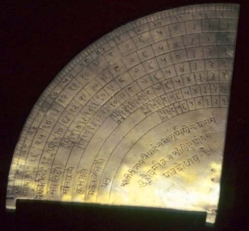

*Fig. 16. Horary Quadrant by Bulhomal. Museum of the History of Science, Oxford. Photo by the Author*

<!-- figure-resolved-extracted: page=24 image=media/p24_fig01.jpg -->

<!-- figure-meta: page=24, position=top, type=photograph -->

12, 18, ... 90. The remaining seven scales indicate the half-durations of day-lengths in *ghaṭīs* when the sun is in different signs of the zodiac. The length of these scales decreases in accordance with the gradually decreasing day length from the summer solstice onwards. In the last cell of each scale is given the half-duration of day length in that period. At the end of each scale are written the names of the signs in Sanskrit. In the first row the engraver wrote by mistake the name of the

| S. No. | Sign Names Sanskrit | Sign Names Latin | Half-duration of day length in *ghaṭīs* |
| :--- | :--- | :--- | :--- |
| 1 | Āṣāḍha [Mithuna] | Gemini | 17;40 |
| 2 | Vṛṣa-Karkaṭau | Taurus & Cancer | 17;15 |
| 3 | Meṣa-Siṃhau | Aries & Leo | 16;15 |
| 4 | Mīna-Kanye | Pisces & Virgo | 15 |
| 5 | Kumbha-Tule | Aquarius & Libra | 13;45 |
| 6 | Makara-Vṛścikau | Capricorn & Scorpio | 12;45 |
| 7 | Dhanuḥ | Sagittarius | 12;20 |

<!-- pdf-page: 25 -->

THE PRODUCTION OF TRADITIONAL ASTRONOMICAL INSTRUMENTS AT LAHORE 283
solar month *Āṣāḍha* instead of the zodiac sign *Mithuna* (Gemini).
According to this table the maximum duration of the day at the summer solstice is $17; 40 \times 2 = 35; 20$ *ghaṭīs*, which is equal to 14;8 hours. The astrolabes made by the Allāhdād family, in particular those by Ḍiyā’ al-Dīn, have generally the same value for Lahore.
For measuring time, one finds out first the zodiac sign in which the sun is traversing at that time and selects the relevant scale. Then one holds the quadrant in the vertical plane in such a manner that the sunlight passes through the two sights. Then the index shows, in the selected scale, the time that has elapsed since sunrise if it is forenoon or the time that is to elapse up to sunset if it is the afternoon.

## 2.4. New Instruments designed by Bulhomal

Besides producing the standard instruments of Islamic and Sanskrit traditions, Bulhomal also tried his hand at designing new Sanskrit instruments. Three types of new designs came to light, but none seem to be very successful.

### 2.4.1. Astrolabes with solid retes

The Central Asian Museum of the University of Kashmir, Srinagar, owns two rather large Sanskrit astrolabes in which there are no perforated retes containing star pointers but solid discs made to the size of the ecliptic circles and pivoted to the central pin eccentrically. The star pointers in the perforated rete allow the use of the astrolabe at night. In the absence of the star pointers, these astrolabes cannot be used at night. It is difficult to see what advantage was sought to be achieved by these unusual solid retes.
These two specimens are not signed or dated. On the back of both the astrolabes, the upper right quadrant contains a sine-cosine grid, which is exactly similar in style to the sine-cosine grids on the astrolabes and *Dhruvabhrama-yantras* made by Bulhomal. The rims on the front and back are divided in $1^\circ$ and $6^\circ$ and groups of $6^\circ$ are numbered as in all the astrolabes designed by Bulhomal. However, the Devanagari script varies from one astrolabe to the other. Therefore these must have been designed by Bulhomal, but engraved by two different assistants of Bulhomal in his workshop.
In one of these specimens [24], under the solid rete is engraved latitude $30^\circ$ together with the corresponding midday equinoctial shadow (*akṣabhā*) and the duration of the longest day (*paramadina*). It suggests that this specimen [24] or both were not made for Lahore like all the other instruments of Bulhomal, but for some other place $2^\circ$ south of Lahore, probably Patiala.
**[23] Sanskrit astrolabe,** not signed, not dated, attributable to Bulhomal, diameter 260 mm, Central Asian Museum, University of Kashmir, Srinagar (Acc. No. 8-201).
The suspension bracket is plain with a shackle and a large ring. On the circular plate, the south-north and east-west diameters are marked,

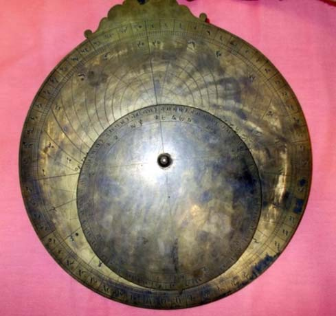

*Fig. 17. Sanskrit astrolabe attributable to Bulhomal, front view. Central Asian Museum, University of Kashmir, Srinagar. Photo courtesy Central Asian Museum*

<!-- figure-resolved-extracted: page=25 image=media/p25_fig01.jpg -->

<!-- figure-meta: page=25, position=bottom, type=photograph -->
<!-- /decode-chunk -->

<!-- decode-chunk: pages=26-30 source_sha256=372f2273bc24b6a56d24833bc035a276f9a2bef563c77387c3e0161350800a53 -->
<!-- pdf-page: 26 -->

284 INDIAN JOURNAL OF HISTORY OF SCIENCE
so also the circles of the celestial equator and of the Tropic of Cancer. Altitude circles are engraved for every $6^\circ$ and numbered on both sides. Azimuth lines are drawn for every $15^\circ$ above the horizon and numbered. In the lower half there are lines for seasonal and equal hours.
The rete is a solid disc whose outer circumference coincides with the ecliptic circle. The scale on its rim is divided into the twelve zodiac signs and labelled with the respective names of the signs. Each sign is divided into groups of $6^\circ$ and numbered 6, 12, 18, 24, 30 counter-clockwise. The first point of Capricorn (*makarāsya*) is extended as a sharp point. South-north and east-west lines are drawn which pass through the centre of the astrolabe.

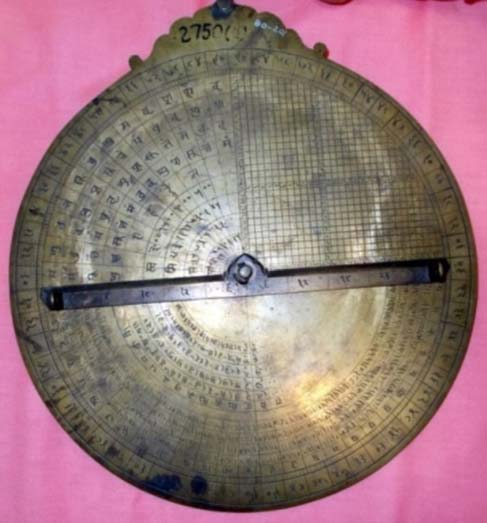

*Fig. 18. Sanskrit Astrolabe attributable to Bulhomal, back view. Central Asian Museum, University of Kashmir, Srinagar. Photo courtesy Central Asian Museum*

<!-- figure-resolved-extracted: page=26 image=media/p26_fig01.jpg -->

<!-- figure-meta: page=26, position=middle, type=photograph -->

On the back, the upper right quadrant carries the sine-cosine grid with 30 equidistant horizontal parallels and 30 equidistant vertical parallels. On this the quarter circle of obliquity is drawn. The design and numbering is exactly as in the instruments signed by Bulhomal. On the other three quadrants, there are elaborate astrological tables, as in the Sanskrit astrolabe at the Rampur Raza Library [5]. The alidade, divided in 30 units on either side, is also exactly like that in the other instruments by Bulhomal.
**[24] Sanskrit Astrolabe**, not signed, not dated, attributable to Bulhomal’s workshop, diameter 245 mm, Central Asian Museum, University of Kashmir, Srinagar (Acc. No. 80-202).
This astrolabe is almost similar to the previous one, but with certain differences. The suspension bracket is engraved with an ornate design on both sides. There is a shackle attached to the suspension bracket, but no ring.
The lines on the front side and their divisions are exactly as in the previous astrolabe. When the rete is removed, at the middle of the plate can be seen the following inscription in Devanagari:
अक्षांशः 30 अक्षभा 7
परमदिन 24/58
‘Latitude 30 [degrees] Midday equinoctial shadow 7 [digits]
Duration of the longest day 34 [*ghaṭīs*], 58 [*palas*] (i.e., 13;59 hours).’
On the back, the rim is graduated as in the previous astrolabe. The upper right quadrant carries a sine-cosine grid as in the previous astrolabe, but the other three quadrants are blank as in Bulhomal’s Indo-Persian astrolabe of 1849 [1].

### 2.4.2. Jyotiḥsattā

We have seen that Bulhomal was much impressed by Padmanābha’s *Dhruvabhrama-yantra* of which he produced two specimens, the second of which [21] modifies Padmanābha’s original prescriptions. The *Dhruvabhrama-yantra* provides the local time, the ascendant and the

<!-- pdf-page: 27 -->

THE PRODUCTION OF TRADITIONAL ASTRONOMICAL INSTRUMENTS AT LAHORE 285
culmination at night. For observations in the day, Padmanābha endowed the reverse side of the plate with a sine quadrant. But his rules for the use of the sine quadrant are quite complex. Bulhomal (and his associate Dharm Chand to be discussed below) tried to design a new instrument on the principle of the *Dhruvabhrama-yantra* with which time, ascendant and culmination can be determined at one go in daytime. Of course, these elements can be determined more easily both at night and in the daytime with the astrolabe, but it appears Bulhomal and Dharm Chand were interested in creating an alternative device.
To this new instrument Bulhomal gave the name *Jyotiḥsattā*. It is not clear what is intended to be conveyed by this name; *jyotiḥ* means a ‘light’, ‘luminary’ or ‘celestial body’ and the term *sattā* denotes ‘existence’ or ‘being’. Is the name supposed to mean ‘the power of the planets’ or something similar?
The instrument itself is a combination of the *Dhruvabhrama-yantra* and the *Yantrādhipati* designed by Sawai Madho Singh of Jaipur in the second half of the eighteenth century. A large specimen of the *Yantrādhipati* with a diameter of 345 mm is preserved at Jai Singh’s Observatory at Jaipur. It looks like an astrolabe with a circular body and a triangular suspensory bracket. In the eight quadrants on the two sides of the circular plate are engraved horary quadrants with a *ghaṭī* scale for each $3^\circ$ of solar longitude. Next to each scale is written the solar longitude to which this particular scale is related. Depending on the longitude of the sun at the given moment, an appropriate *ghaṭī* scale is chosen and the altitude of the sun is measured by means of an alidade. The altitude is automatically translated into local time of *ghaṭīs* and *palas* on the relevant *ghaṭī* scale.
In the middle of the *Yantrādhipati* on the obverse side are engraved four verses in *Anuṣṭubh* metre which state that this instrument was designed by Madho Singh and that with this instrument even a fool can become instantly a ‘knower of time’ (*mūrkho ’pi tatkālaṃ kālavid bhavet*).[^36] Bulhomal was obviously inspired by Madho Singh’s *Yantrādhipati* in designing the *Jyotiḥsattā*. He was also inspired by Madho Singh in composing metrical signatures for his Sanskrit instruments.
There are extant the three following specimens of the *Jyotiḥsattā*. The first two are dated *Saṃvat* 1896 (= AD 1839). The third specimen at New York, though unsigned and undated, resembles the first two very closely and therefore must have been produced by Bulhomal at about the same time.
**[25] *Jyotiḥsattā* signed by Bulhomal**, 1839, diameter 88 cm, Victoria & Albert Museum, London (Acc. No. IM 10-1915).
**[26] *Jyotiḥsattā* signed by Bulhomal**, 1839, diameter 92 mm, National Museum, New Delhi (Acc. No. 56.155/7).[^37]
**[27] *Jyotiḥsattā*, not signed, not dated**, attributable to Bulhomal, diameter 96 mm, Butler Library, Columbia University, New York (Acc. No. 27-258).
There are slight differences in the text as engraved on the specimens at London and New Delhi. The variations occurred probably because the engraving was not done by Bulhomal himself but by an artisan who was not strong in Sanskrit. The correct version should read
श्रीगौरीशकरुणापात्र-वुल्लोमल्लेन
निर्मितम् |
तर्काङ्कवसुचन्द्राब्दे ज्योतिषत्ता-
भिदं स्फुटं ||
This accurate [instrument] by name *jyotiḥsattā* was created by Bulhomal

[^36]: Sarma (2010): 94-96.

[^37]: Behari & Govind (1980): 96 treat it erroneously as an astrolabe.

<!-- pdf-page: 28 -->

286 INDIAN JOURNAL OF HISTORY OF SCIENCE
(*vulhomalla*), the receptacle of the grace of Gaurī and Śiva, in the [Vikrama] year [denoted by] the philosophical systems (*tarka* = 6), digits (*aṅka* = 9), the vasus (= 8) and the moon (*candra* = 1) (i.e. VS 1896 = AD 1839).
Since the horary quadrant is latitude-specific, the latitude (*akṣāṃśā*) and the length of the equinoctial midday shadow (*akṣabhā*) of the gnomon of 12 digits, which is a function of the altitude, are mentioned on the reverse side of all the three specimens; the latitude $31;58^\circ$ is that of Lahore; the length of the equinoctial midday shadow is $07;30$ digits.

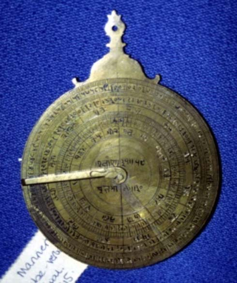

*Fig. 19. Jyotiḥsattā by Bulhomal, front view, Victoria & Albert Museum, London. Photo by the Author*

<!-- figure-resolved-extracted: page=28 image=media/p28_fig01.jpg -->

<!-- figure-meta: page=28, position=middle, type=photograph -->

We have seen that Bulhomal drew *ghaṭī* scales in the Sanskrit horary quadrant [22]. But in the horary quadrants on the three specimens of the *Jyotiḥsattā*, the time scales are in hours of 60 minutes. However, these hour scales are not properly defined so that one knows when to use which scale. Madho Singh, as mentioned above, wrote the solar longitude next to each *ghaṭī* scale. In his Sanskrit horary quadrant [22] Bulhomal wrote next to each *ghaṭī* scale the names of the zodiac signs traversed by the sun in which the particular scale is to be used. Bulhomal’s contemporary Dharm Chand, as will be shown below, emulates this practice in his horary quadrants [29], [30] and [32]. Such definition is lacking in the horary quadrants engraved on the specimens of the *Jyotiḥsattā*.
The reverse side of the *Jyotiḥsattā* is fashioned somewhat like a *Dhruvabhrama-yantra*, with concentric scales of hours and minutes, zodiac signs according to their right ascensions and according to their oblique ascensions. There is no slit here for viewing the two stars $\alpha$ and $\beta$ Ursae Minoris as in the *Dhruvabhrama-yantra*, nor a four-armed index at the centre. Instead, there is a rule one end of which is pivoted to the pin at the centre. Moreover, the placement of the two scales of zodiac signs on the three specimens is

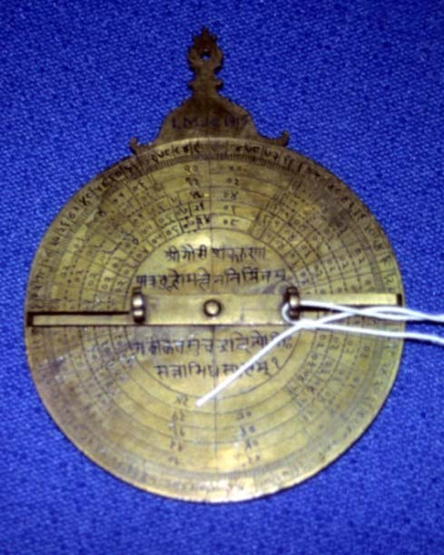

*Fig. 20. Jyotiḥsattā by Bulhomal, back view, Victoria & Albert Museum, London. Photo by the Author*

<!-- figure-resolved-extracted: page=28 image=media/p28_fig02.jpg -->

<!-- figure-meta: page=28, position=bottom, type=photograph -->

<!-- pdf-page: 29 -->

THE PRODUCTION OF TRADITIONAL ASTRONOMICAL INSTRUMENTS AT LAHORE 287
not uniform. In the specimen at London [25], the two sets of zodiac signs are $30^\circ$ apart. While Aries in the first set is at the west point, the same sign in the second set is at the south point. But in the two other specimens at Delhi [26] and New York [27], the two sets are congruent at the north and south points, but deviate in between these points.
About the function of this *Jyotiḥsattā*, the following procedure can be imagined. At the time of observation, one consults an almanac and finds out the longitude of the sun for the day. Then one chooses the appropriate hour scale. Holding the instrument aloft, one sights the sun through the two sights in the alidade. Where the alidade intersects the chosen hour scale can be seen the time elapsed since the sunrise (if it is forenoon) or the time which still remains up to sunset (if it is afternoon).
Then turning the disc to the reverse side, the rule is placed on the hours and minutes just obtained. Where the rule intersects the scale of the signs marked according to their oblique ascensions can be seen the ascendant and where the rule intersects the signs marked according to their right ascensions can be seen the culmination.
But then there are many problems in this scenario (to go into them would extend the length of this paper far beyond reasonable limits). The three specimens do not quite agree with the arrangement of different scales. Therefore, it may be assumed that Bulhomal himself was not satisfied with the design and was experimenting different variations.
**[28] Unnamed Object**, not signed, not dated, attributable to Bulhomal, diameter 97 mm, Butler Library, Columbia University, New York (Acc. No. 27-199).
The third new model which Bulhomal appears to have designed also looks like an astrolabe with a high *kursī*, but is different from the *Jyotiḥsattās* described above. On the front of the *kursī* is written *vijayacakram*, ‘diagram for victory’. The front of the circular plate is divided into four quadrants. The upper left quadrant carries a table of the regents of the decans with the title *dreṣkāṇa-cakra* (‘the table of decans’) written below. The upper right quadrant is filled with a table of the limits of the signs, below which is written *hāhā-cakra*, which is apparently a Sanskritized form of the Arabic *ḥudūd*. The lower right quadrant bears a sine-cosine graph which is drawn in the same manner as on all the instruments signed by Bulhomal. Finally, in the lower left is a horary quadrant with seven *ghaṭī* scales for different solar months. The month names are written at the left end of each scale but are hardly decipherable.
On the back of the *kursī* is engraved *śīcakrenuśeṣaraḥ* (?) which is undecipherable. On the circular plate below is an elaborate table written in several concentric circles containing probably the right ascensions. On each side, a pointed rule is pivoted to the pin at the centre. The workmanship and calligraphy are much different from the other instruments.
It is not clear how this instrument is supposed to function. The absence of an alidade shows that this instrument is not meant for measuring the altitude. The rules on both the sides can be used only to align the different elements in the table.

## 3. JOSHI DHARM CHAND

Joshi Dharm Chand (*fl.* 1854-73) is a contemporary and an associate of Bulhomal.[^38] His title ‘Jotishi’ or ‘Joshi’ (from Sanskrit *Jyotiṣī*) indicates that he was a traditional Hindu astrologer, trained in Sanskrit astronomy and astrology; his surviving instruments show that he was at home in Persian as well. Brahmin by birth, educated in Persian, trained in metal craft and in

[^38]: Sarma (2003): 78-84; Sarma (2010): 88-89.

<!-- pdf-page: 30 -->

288 INDIAN JOURNAL OF HISTORY OF SCIENCE
making traditional astronomical instruments, he was also open to new ideas from Europe. It is not known whether he was from Lahore, but it is certain that he was a resident of Punjab, for he uses the Punjabi phonetic forms of Sanskrit solar months (e.g. *hār* for *āṣāḍha*, or *maggar* for *mārgaśirā*) on some of his instruments. Ten instruments made by him are extant. These carry legends in Persian, Sanskrit, or English. Moreover his name is engraved on one of the Indo-Persian globes made by Bulhomal [13]. As will be shown below, there are several common features in his and Bulhomal’s instruments.
Like Bulhomal, Dharm Chand was also interested in designing an instrument to determine the time, ascendant and culmination in the daytime. Dharm Chand went a step further than Bulhomal and designed an instrument one side of which was meant for the determination of the time, ascendant and culmination and the other side made as a perpetual calendar. Dharm Chand did not give a name to this instrument. We shall refer to it as ‘Perpetual Calendar’ because it is an entirely new element in Indian instruments. These perpetual calendars, like Bulhomal’s *Jyotiḥsattās*, represent the attempts by the traditional instrument makers to bridge the gap between the traditional instruments of India and those that were being introduced from the West. His aim as well the aim of Bulhomal appear to be to create improved models to serve horoscopic astrology.

### 3.1. Perpetual Calendars made by Joshi Dharm Chand

Dharm Chand’s perpetual calendars combine two instruments in one, viz, a perpetual calendar on the obverse and a horary quadrant on the reverse with scales to measure the ascendant and culmination. The aim of the perpetual calendar is to provide the matching weekday for any date in the Christian calendar. For this purpose, the years, months and the dates are arranged in groups of seven. Brass perpetual calendars (Urdu: *dawāmī jantrī*) for 3 or 30 or 100 years are among the souvenirs offered for sale in India. Made in the shape of an astrolabe at Muradabad, a north Indian town famous for its brassware, these perpetual calendars consist of a circular disc with enamelled decorations in the border. A smaller circular disc with windows cut in it is pivoted at the centre of the main disc, so that the smaller disc rotates above the surface of the main disc, partly blocking and partly revealing the engraved numerical data on the main disc. The design of this perpetual calendar is clearly of European origin, but I have not been able to locate the exact prototype in any European collection.
Dharm Chand designed two models which are the forerunners of the perpetual calendars of Moradabad. The first prototype is represented by three nearly identical specimens with Persian inscriptions which are preserved at the Rampur Raza Library, the National Museum of New Delhi and the Lahore Museum. The second model with English inscriptions is with the Victoria & Albert Museum, London.
**[29] Perpetual Calendar and Horary Quadrant**, Persian, 1861-62, diameter 114 mm, Rampur Raza Library, Rampur.[^39]
In the specimen at Rampur, there is an inscription on the obverse side of the crown which reads *dharam chand joshī ikhtarac nau 1918 sambat*, ‘Dharam Chand Joshi, new invention, [Vikrama] Saṃvat 1918 [=1861-62]’. At the back of the crown there is another inscription in Persian which declares that this device is dedicated to some Maharaja, but does not mention his actual name.
The obverse side of this device constitutes a perpetual calendar. Here English months, weekdays and dates are arranged in groups of 7, but the years of the Christian era are not mentioned as is done in the perpetual calendars of Moradabad.

[^39]: Sarma (2003): 78-84.
<!-- /decode-chunk -->

<!-- decode-chunk: pages=31-35 source_sha256=4b2a9b6d23a0eb188cfc3286e8753c11146096e540e7fb1b939ac96763d2a9c0 -->
<!-- pdf-page: 31 -->

THE PRODUCTION OF TRADITIONAL ASTRONOMICAL INSTRUMENTS AT LAHORE 289

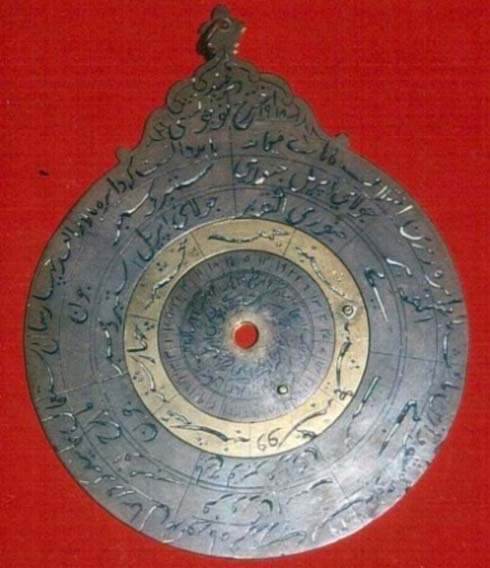

*Fig. 21. Perpetual Calendar by Joshi Dharm Chand, front view, Rampur Raza Library; photo courtesy Rampur Raza Library*

<!-- figure-resolved-extracted: page=31 image=media/p31_fig01.jpg -->

<!-- figure-meta: page=31, position=middle, type=photograph -->

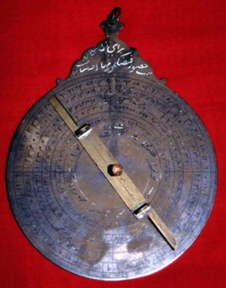

*Fig. 22. Perpetual Calendar by Joshi Dharm Chand, back view, Rampur Raza Library; photo courtesy Rampur Raza Library*

<!-- figure-resolved-extracted: page=31 image=media/p31_fig02.jpg -->

<!-- figure-meta: page=31, position=middle, type=photograph -->

The reverse side carries a horary quadrant with ghaṭī scales engraved in all the four quadrants of the plate and below them the signs of the zodiac in their oblique ascensions together with their sub divisions. A simple alidade pivoted to the centre allows the sighting and also the reading of the altitude and time. The alidade resembles very closely the alidades in the *Jyotiḥsattā* of Bulhomal. This horary quadrant is decidedly superior to those which Bulhomal attempted in the three specimens of his *Jyotiḥsattā* [25, 26, 27].

### [30] Perpetual Calendar and Horary Quadrant, Persian, VS 1929 / AD 1872-73,[^40] National Museum, New Delhi (Acc. No. 56.155/5).[^41]

Therefore, this calendar can be used only when one knows on which weekday the current English month commences. Thus its utility is limited. Dharm Chand made up this deficiency in another model which he inscribed in English (see [32]).
Moreover, all the four specimens give the equivalences between the first date of each month of the Christian calendar and the corresponding day in the Hindu solar months, e.g. 21 *māgh* = 1 *farwarī*; 20 *phāgun* = 1 *mārch*; and so on. Hindu Jyotiṣīs who were freshly exposed to the Christian calendar needed to understand the Christian months in terms of the familiar Hindu solar months. Otherwise, this data does not serve any calendrical purpose. This data is absent in the modern perpetual calendars of Muradabad.

<!-- pdf-page: 32 -->

290 INDIAN JOURNAL OF HISTORY OF SCIENCE
Dharm Chand made another Persian perpetual calendar, which is almost identical. It is slightly smaller with a diameter of 104 mm. It does not contain the inscription on the two sides of the crown, which are engraved on the specimen at the Rampur Raza Library.

### [31] Perpetual Calendar and Horary Quadrant, Persian, date ?, Lahore Museum (Acc. No. M-44-H).[^42]

Full details are not available, but it appears to be similar to the two specimens mentioned above.

### [32] Perpetual Calendar and Horary Quadrant, English, n.d., Victoria & Albert Museum, London (Acc. No. IM410-1924).[^43]

This perpetual calendar is endowed with an elegant crown and measures 102 mm in diameter and 127 mm in height. It is engraved completely in English alphabet and with so-called Indo-Arabic numerals. On the front of the crown is an inscription stating ‘subscribed Joutshee dhurm Chund.’ In the English engraving the upper and lower case fonts are mixed up. The letters and numbers appear to have been punched and not engraved. These are filled with black enamel.
In the description of the Persian perpetual calendars above, it was stated these can be used only when the weekday on the first day of the current month is known from another source. In this model, Dharm Chand attempts to remove this deficiency by adding the years from 1801 to 1900 in cycles of seven. This second prototype comes somewhat closer to modern specimens of Moradabad. But in this prototype also, Dharm Chand engraves the equivalences between the first date of each month of the Christian calendar and the corresponding day in the Hindu solar months. These are not carried any more in the specimens of Moradabad.

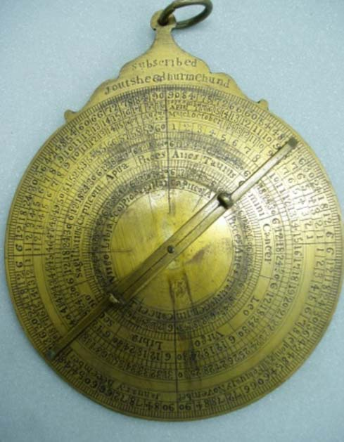

*Fig. 23. Perpetual Calendar in English by Joshi Dharm Chand, front view, Victoria & Albert Museum, London. Photo by the Author*

<!-- figure-resolved-extracted: page=32 image=media/p32_fig01.jpg -->

<!-- figure-meta: page=32, position=middle-right, type=photograph -->

On the reverse side is a combination of the horary quadrant and *Dhruvabhrama-yantra* somewhat in the same lines as in Bulhomal’s *Jyotiḥsattā*. In the present instrument there are 10 concentric rings. The outermost ring is divided in 1°. In the second ring groups of 6° are numbered from 6 to 90, separately in each quadrant, starting from the east and west points and reaching up to the north and south points. In the next rings are arranged six ghaṭī scales for different English months. Ring 7 is divided in the twelve signs of the zodiac and labelled with their Latin names, while in ring 6 each sign is divided in groups of 6° and numbered from 6 to 30. In ring 5, each of the divisions in ring 6 are divided in three parts of

<!-- pdf-page: 33 -->

THE PRODUCTION OF TRADITIONAL ASTRONOMICAL INSTRUMENTS AT LAHORE 291

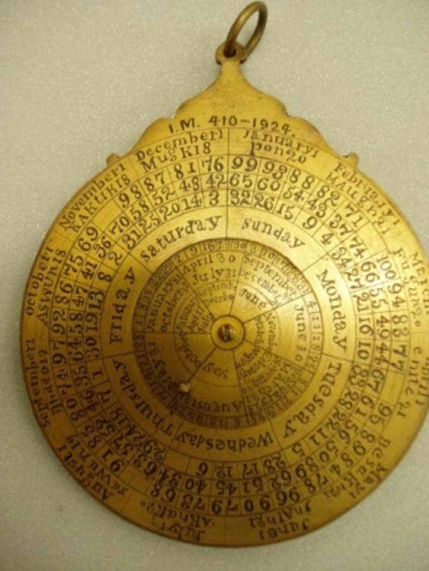

*Fig. 24. Perpetual Calendar in English by Joshi Dharm Chand, back view, Victoria & Albert Museum, London. Photo by the Author*

<!-- figure-resolved-extracted: page=33 image=media/p33_fig01.jpg -->

<!-- figure-meta: page=33, position=top, type=photograph -->

2° each. Rings 10, 9 and 8 are similarly divided, but here the Signs are 90° ahead of those in ring 7. There is an alidade which looks exactly like the alidades in Bulhomal’s *Jyotiḥsattā*. When the sun’s altitude is measured with the alidade, the cell where the alidade intercepts the ghaṭī appropriate for the current English month is the local time in ghaṭīs, where it intercepts the rings 5, 6, 7 can be seen the ascendant in signs and degrees and where it intercepts the rings 8, 9, 10 gives the culmination in signs and degrees.

### [33] Perpetual Calendar and Horary Quadrant, English, nd, PLU.

In the archives of the Museum of the History of Science, there are two photos of the

<!-- pdf-page: 34 -->

292 INDIAN JOURNAL OF HISTORY OF SCIENCE
front and back of another specimen engraved in English. It has the same kind of crown as the specimen above. On the obverse side with the perpetual calendar, there are slight differences. A strange inscription in two lines is engraved on the crown : ‘sheed / nuimeh UndjoUt.’ It is not clear what this is supposed to mean.
On the reverse side also there are certain differences. In ring 7 and 10 the zodiac signs are not labelled with their Latin names but with the symbols of the signs current in Europe. There is an 11th ring, divided and numbered from 1 to 24. If these are hours, it is not clear how these can be related to the six different ghaṭī scales. One arm of the alidade is broken.

## 3.2. Tablets of horizons with sine quadrants made by Joshi Dharm Chand

Dharm Chand designed another new instrument which consists of a rectangular plate with a tablet of horizons on one side and a sine quadrant on the other. Two specimens of this are extant.

### [34] Tablet of Horizons and Sine Quadrant by Joshi Dharm Chand, 1854-55, signature in Persian, legends in Sanskrit, 212 x 165 mm, Linden Museum, Stuttgart, Germany.[^44]

This instrument consists of a thick solid brass plate with two sighting vanes on one of the shorter sides. On the obverse side, at the top of the plate, there is the signature in Persian which reads *taṣnīf joshī dharam chand sambat 1911*, ‘engraved by Joshi Dharm Chand, Saṃvat 1911.’ The year corresponds to 1854-5. The rest of the legends on this instrument are in Sanskrit and in Devanagari Characters.
On the obverse side is engraved a circle, inside which is a degree scale, divided in 1° and 6° and numbered clockwise, as 01, 02, 03 … 60 in Devanagari numerals. Inside the circle are

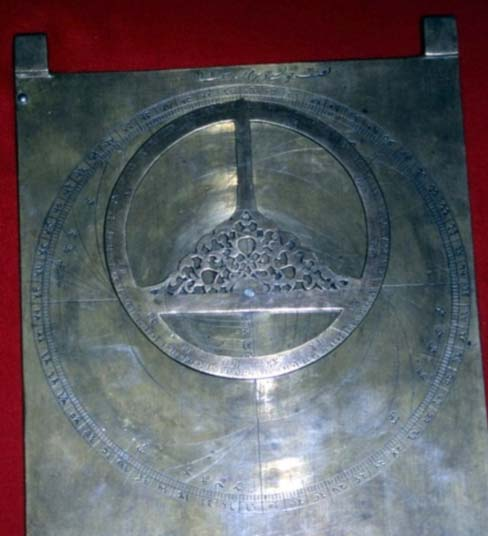

*Fig. 25. Tablet of Multiple Horizons on the front by Joshi Dharm Chand, 1854-55, Linden Museum, Stuttgart, Germany. Photo by the Author*

<!-- figure-resolved-extracted: page=34 image=media/p34_fig01.jpg -->

<!-- figure-meta: page=34, position=middle-right, type=photograph -->

drawn the south-north and west-east lines, the tropics and the equator as in the astrolabe plates. On this frame are engraved the families of horizons for 4 sets of latitudes as is done on the astrolabe plate for multiple horizons (ṣafīḥa āfāqiyya). These are labelled where each horizon begins and where it ends. Unlike on the astrolabe plates, declination scales are not engraved here.
To the centre of the circle is pivoted an ornate rete, which rotates on the circle eccentrically. The rete consists just of the circle of the ecliptic, held by two bars which are perpendicular to one another. The ecliptic is divided into the 12 zodiac signs and their parts and labelled with Sanskrit names of the zodiac signs. The edge is cut at right angles to the surface of the plate and marked with the degrees of arc.
This projection of multiple horizons is used for determining the times of sunrise and

<!-- pdf-page: 35 -->

THE PRODUCTION OF TRADITIONAL ASTRONOMICAL INSTRUMENTS AT LAHORE 293
sunset at latitudes other than one’s own, or to determine the latitude from the time of sunrise or sunset.[^45] Dharm Chand singled out this feature from the Islamic astrolabes to create a new device. We have seen that in his astrolabes Bulhomal uses both the sides of a plate for multiple horizons. This interest in multiple horizons is shared by Dharm Chand.
On the reverse side of this plate is engraved a sine quadrant which closely resembles the sine quadrant engraved by Bulhomal on the reverse side of his *Dhruvabhrama-yantra* of 1839 [20].

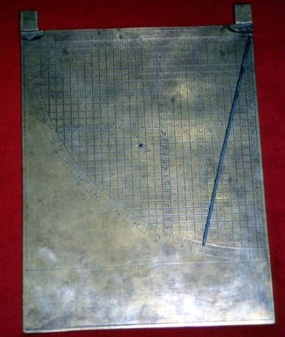

*Fig. 26. Sine Quadrant on the back by Joshi Dharm Chand, 1854-55, Linden Museum, Stuttgart, Germany. Photo by the Author*

<!-- figure-resolved-extracted: page=35 image=media/p35_fig01.jpg -->

<!-- figure-meta: page=35, position=middle-left, type=photograph -->

### [35] Tablet of Horizons and Sine Quadrant by Dharm Chand, nd, 9 x 6 ½ inches (228.6 x 165 mm), PLU.

This specimen, identical in all respects to the one described above, came up for auction at Skinner, Bolton, Massachusetts, USA, on 13 April 2002.[^46]

## 3.3. Other Instruments made by Joshi Dharm Chand

### [36] Sanskrit Astrolabe, not signed, not dated, attributable to Dharm Chand, diameter 303 mm, Kunstgewerbesammlung der Stadt Bielefeld, Bielefeld, Germany (Inv. No. H-W 93).[^47]

This well-crafted astrolabe bears a suspension bracket which is elegantly shaped with a pair of birds. There is only a single plate which is calibrated for the latitude of 27°, which is the latitude of Agra and Jaipur. On this plate are drawn equal altitude circles for every 6° and azimuth circles for every 6° above and below the horizon. Strangely there are no hour lines, thus depriving the astrolabe of its time-measuring function.

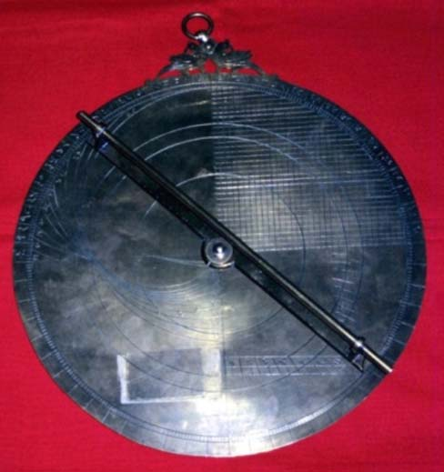

*Fig. 27. Sanskrit Astrolabe, attributable to Dharm Chand, back view, Kunstgewerbesammlung der Stadt Bielefeld, Bielefeld, Germany. Photo by the Author*

<!-- figure-resolved-extracted: page=35 image=media/p35_fig02.jpg -->

<!-- figure-meta: page=35, position=bottom-right, type=photograph -->

[^40]: Its date is uncertain. Of the four digits, the first two are illegible, the third and fourth read 29. If we assume that it refers to 1229 Hijrī, then this would corresponds to 1813 which is too early. The Rampur instrument is dated VS 1918 = AD 1861-62. Therefore, we may have to read 29 as VS 1929 = AD 1872-73.

[^41]: Behari & Govind (1980): 96 treat it erroneously as an astrolabe.

[^42]: Dar (1994): 165-198, pl. I-X, figs. 1-3. Dar realises that it is a ‘perennial calendar’, but still refers to it as a ‘planispheric astrolabe’!

[^43]: Here he signs his name in English as ‘Joutshee Dhurmchund’.

[^44]: Sarma (2008): 29-32.

[^45]: Saunders (1984): 15-16.

[^46]: Skinner (2002): 36, No.233.

[^47]: It is briefly described, without mentioning the unusual feature on the back, in Syndram (1989): 64-65.
<!-- /decode-chunk -->

<!-- decode-chunk: pages=36-40 source_sha256=6f48d372272d52235170f36446e99d93f3b7d687e508ff6c3d16a734f429b6cb -->
<!-- pdf-page: 36 -->

294 INDIAN JOURNAL OF HISTORY OF SCIENCE
On the back, the upper right quadrant is filled with a sine-cosine graph, and the lower right quadrant is occupied by a single shadow square drawn for a gnomon of 7 units. The left half consisting of the upper and lower left quadrants is filled with the projection of a family of horizons from 12° to 66° at intervals of 6°each. This is the only astrolabe where this feature occurs on the back. Because of Dharm Chand’s special interest in multiple horizons, it is reasonable to assume that this astrolabe may have been crafted by him. But it is intriguing why the reverse side is calibrated for the latitude of 27° and not for the latitude of Lahore at 32°.
Besides these two types of new designs, Dharm Chand appears to have produced some other kinds of instruments. There are two such specimens at London and New Delhi, but both are broken and incomplete.

### [37] Unidentified Device signed by Dharm Chand in Persian and English, n.d., Victoria & Albert Museum, London (Acc. Nos. IM 413 and 413c-1924).

The Victoria & Albert Museum of London possesses a device consisting of several rings and plates with graduated rims. One of these is a circular plate (d. 157 mm) with large perforations to which an alidade is attached. At the centre of the plate is engraved ‘N.S.L.’ in Roman characters and below it *Māna-yantra* (‘measuring instrument’) in Sanskrit and in Devanagari script. One of the rings (d. 209 mm) has its rim graduated in 1° and 6°; groups of 6° are numbered in fine Devanagari numerals from 6 to 90 separately in each quadrant. A groove is cut in its inner circumference so that another ring can freely rotate there, but such a ring is lacking. There is another ring (d. 195) similarly graduated on both sides; on one side, groups of 6° are numbered in modern “Indo-Arabic” numbers; on the other side, there are no numbers. This ring has two grooves cut in its thickness. Two other rings are broken. It is difficult to ascertain the exact nature and function of the device. It is possible that these are parts of an armillary sphere. What is of immediate interest is that one of the rings carries Dharm Chand’s name in Persian (*joshī dharm chand* …the rest undecipherable) and in English (JoUJshee duIMehUnd).

### [38] Circumferentor, not signed, not dated, attributable to Dharm Chand, National Museum, New Delhi (Acc. Nos. 56.155/3 and 56.155/7 (a)).

The circumferentor is a surveying instrument used for measuring horizontal angles. The present specimen is broken and the two components are accessioned under two different numbers. It is not signed or dated, but may have been made by Dharm Chand. The first component consists of a circular brass plate with a diameter of 131 mm. The rim is graduated in 1° and 6° and groups of 6° are numbered in common Persian numerals from 6 to 90, separately for each quadrant. At the centre is affixed a circular glass disc inside a brass frame. There ought to be a magnetic compass under the glass, but that is missing. The brass frame is extended on either side like an alidade with hinged sights, which, when not in use, can be folded flush with the surface of the brass plate or raised so that they are perpendicular to the plane of the plate. Each sight is endowed with a long slit and a circular hole. This brass plate fits snugly into a circular ring which is graduated in degrees and some legends in Persian.

## 4. GHULĀM QĀDIR KAPŪRTHALĪ

The National Museum, New Delhi, possesses a large astrolabe signed by Ghulām Qādir Kapūrthalī who calls himself a pupil (*shāgird*) of Bulhomal. There are two other astrolabes in this museum; both are unsigned and undated, but can be attributed to Ghulām Qādir. There is also an alidade which appears to belong to a lost astrolabe by Ghulām Qādir. Like Bulhomal’s astrolabes, Ghulām Qādir’s astrolabes

<!-- pdf-page: 37 -->

THE PRODUCTION OF TRADITIONAL ASTRONOMICAL INSTRUMENTS AT LAHORE 295
employ only common Persian numerals in the scales and do not contain a tablet of ecliptic coordinates; the sine-cosine graph is engraved always in the upper right quadrant and numbered in the same style.

### [39] Indo-Persian Astrolabe by Ghulām Qādir Kapūrthalī, 1861-62, diameter 337 mm, National Museum, New Delhi (Acc. No. 55.155/2(c)).[^48]

This well-crafted astrolabe has a low *kursī* with a large shackle to which an extravagant tassel in red silk is attached. The main plate is completely flat. The degree scale is divided in 1° and 6° and groups of 6° are numbered as 6, 12, 18, … 360 in common Persian numerals proceeding clockwise. The plate is extended beyond the degree scale and in this space is engraved the geographical gazetteer for 59 localities in a such a manner that each entry occupies 6° and thus coincides with the 6° divisions of the degree scale. The sixtieth division carries the argument. This is an unusual feature not found in any other astrolabe.

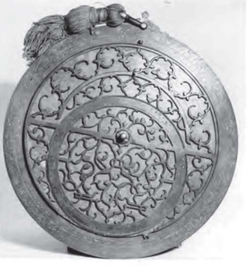

*Fig. 28. Indo-Persian Astrolabe by Ghulām Qādir Kapūrthalī, 1861-62, National Museum, New Delhi. Photo courtesy National Museum*

<!-- figure-resolved-extracted: page=37 image=media/p37_fig01.jpg -->

<!-- figure-meta: page=37, position=bottom, type=photograph -->

In the rete the band of the Tropic of Capricorn which forms the outer circumference is very narrow. The celestial equator is shown only in the lower half, its band is slightly broader, and the band of the ecliptic circle is much broader to accommodate the names and sub-divisions of the signs of the zodiac. The three bands are arranged in the same manner as in the astrolabes made by Bulhomal. The elaborate tracery closely resembles the same in the astrolabe made by Pīr Bakhsh in 1841. As in Pīr Bakhsh’s astrolabe, here also there are 22 star pointers.
Inside the circular degree scale, the main body is slightly depressed to accommodate two latitude plates. The depressed portion is designed as a *ṣafīḥa* for the latitude of Lahore at 32°. Here altitude circles are drawn for every 3°, azimuth circles for every 3° above and below the horizon. In the lower half are drawn the lines for unequal hours and dotted lines for equal hours counted from sunset as well as sunrise.
One of the two plates is calibrated for 36° on one side; the reverse side is blank. The second plate carries multiple horizons on both sides as in Bulhomal’s astrolabes.
On the back, in the upper left quadrant are drawn 60 horizontal parallels and 90 radian lines which join the centre to the 90 divisions of the arc. In the upper right quadrant, there is a sine-cosine graph with 30 horizontal and 30 vertical parallels, numbered in the same fashion as in the instruments by Bulhomal.
In the lower half is a double shadow square, on the left for 12 divisions and on the right for 7. The four scales carry legends. Inside the shadow square is the maker’s signature in bold letters, cut deeper than the other lines, which reads

[^48]: A brief description appeared in Behari & Govind (1980): 97.

<!-- pdf-page: 38 -->

296 INDIAN JOURNAL OF HISTORY OF SCIENCE
The work of Ghulām Qādir Kapūrthalī, the pupil (*shāgird*) of Bulhomal, the astronomer (*munajjim*) of Lahore, [made] at the behest of Raizādah Shankardas Harbanspūrī, Hijrī 1278, Sambat 1918 [= AD 1861-62].

### [40] Indo-Persian Astrolabe, not signed, not dated, attributable to Ghulām Qādir, diameter 153 mm, National Museum, New Delhi (Acc. No. 56.155/2(a)).

This astrolabe is not so well made as the one above, but even so it can be attributed to Ghulām Qādir. The *kursī* and a part of the rim is made separately and joined crudely to the main body with brass pins. The surface of the rete, that of the back, and those of the plates are rough, they are not properly smoothened.
The rim is divided in 1° and 6° and groups of 6° are numbered as 6, 12, 18, … 60 in common Persian numerals. In the rete, the three bands of the Tropic of Capricorn, equator and the ecliptic are arranged as in the above astrolabe. The space between these bands is filled with a pleasing tracery which contains six leaf-shaped star-pointers.
There are three plates serving latitudes 20° and 26°, 27° and 32°, 36° and 44°. On these only the latitude values are mentioned but not the duration of the longest day.
On the inner side of the main body is engraved a geographical gazetteer with the names, longitudes and latitudes of 59 localities.
On the back, a sine cosine grid occupies the upper right quadrant and a double shadow square the lower half.

### [41] Indo-Persian Astrolabe, not signed, not dated, attributable to Ghulām Qādir, diameter 139 mm, National Museum, New Delhi (Acc. No. 56.155/2(b)).

Though not signed, this single-plate astrolabe also can be attributed to Ghulām Qādir. The rim is graduated in 1° and 6° and the groups of 6° are numbered as 1, 2, 3 … 60 clockwise. The *kursī* is rather high with a design carved in low relief in the front. The rete is arranged as the retes in the above astrolabes. The tracery contains 12 leaf-shaped star-pointers.
The single plate is calibrated to the latitude of 32°. There are altitude circles for every 6°, azimuth circles also for every 6° above and below the horizon, and lines for unequal hour lines and dotted lines for equal hours counted from the western and eastern horizons.
As in the two astrolabes described above, on the back of this astrolabe also the upper right quadrant is occupied by a sine-cosine graph and the lower half by a double shadow square.
In this astrolabe all the engraved parts are filled with some white material.

### [42] Alidade of an Indo-Persian Astrolabe, 78 mm long, attributable to Ghulām Qādir, National Museum, New Delhi.

Along with the three astrolabes described above, there is a loose alidade which is 78 mm long. Like the alidades in the three astrolabes, this one is neatly made with ornate sights and centre piece, but is shorter than the three. It must belong to an astrolabe by Ghulām Qādir which is now lost.

## 5. GURMUKHI INSTRUMENTS PRODUCED AT PATIALA[^49]

The nineteenth century Punjab saw also, for the first time, the production of instruments with legends in Punjabi language and Gurmukhi script. Three instruments are known. One of these was produced for the Maharaja of Patiala in 1850. The other two also may have emanated from the same milieu about the same time.

[^49]: Dr Jaspal Singh, Cambridge, Massachusetts, USA, helped me in the decipherment of the Gurmukhi script and in the translation of the Punjabi sentences on these instruments.

<!-- pdf-page: 39 -->

THE PRODUCTION OF TRADITIONAL ASTRONOMICAL INSTRUMENTS AT LAHORE 297

### [43] Gurmukhi Astrolabe made by Rahīm Bakhsh for the Maharaja of Patiala, 1850, diameter 195 mm, PC, Germany.[^50]

In this elegantly produced and well-preserved brass astrolabe, the maker’s inscription is in the Punjabi language and Gurmukhi script. All numerals and legends are in Gurmukhi. The *kursī* is decorated with a symmetrical floral pattern in bas relief on both sides. The rim of the main body is graduated in 60 divisions, numbered in Gurmukhi numerals from 1 to 60, running clockwise.
The rete is neatly crafted. The ecliptic is divided into the 12 signs of zodiac and labelled in Punjabi as Mekha, Brikha, Mithana, Karaka, Siṃgha, Kaṃnyā, Tula, Brisacaka, Dhana, Makara, Kuṃbha and Mīna. There are 23 leaf-shaped star-pointers, 10 outside the ecliptic and 13 inside.
Beneath the rete there are six plates. On each face of the plates are engraved, besides the latitude for which it has been calibrated, also the names of other proximate localities with their longitudes and latitudes where this plate can be used. The serial number of the clime (*akalīm*, from Arabic *iqlīm*) and the governing planet (*satārā*, from Persian *sitāra*) are also mentioned. This is an unusual feature not found in the astrolabes produced in the Lahore family.
Interestingly, one of the plates is devoted to two capital cities. It carries on one side projections for the latitude of 30° on which lies Patiala, the capital city of the Maharaja who commissioned this astrolabe. The reverse side of the plate is calibrated for the latitude of 52° on which is situated the City of London (*shahar nandan*). The other plates are designed for the ‘second’ Dvārakā (24;45°) and Lahore (31;50°); Kashmir, i.e. Srinagar (35;1°) and Ayodhyā (27;22°); Cairo (30;30°) and Burhanpur (21;21°); Gangasagar (18;20°) and Almoda (28;53,20°);

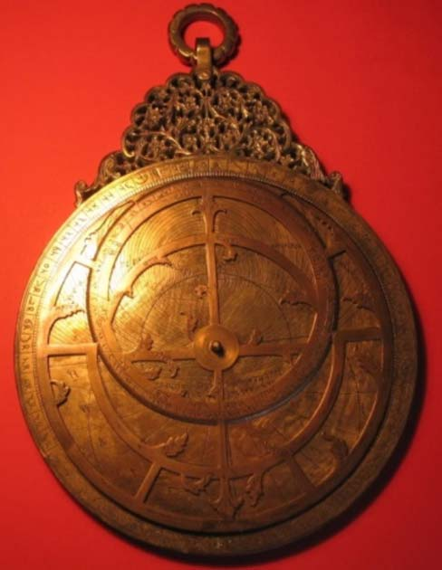

*Fig. 29. Gurmukhi Astrolabe made for the Maharaja of Patiala, 1850, Private Collection, Germany. Photo by the Author*

<!-- figure-resolved-extracted: page=39 image=media/p39_fig01.jpg -->

<!-- figure-meta: page=39, position=top, type=photograph -->

Delhi (28;39°) and an astrological table. The tablet of horizons and the tablet of ecliptic coordinates are not represented in this ensemble.
On the inner side of the mater is engraved the geographical gazetteer with the names and latitudes of 54 places in five annular rings.
On the back, the upper left quadrant bears a sine-cosine graph. The upper right quadrant displays a table, showing the regents (*svāmī*) and essences (*tatba*, from Sanskrit *tattva*) of the 7 planets. In the two lower quadrants, there are shadow squares, which are enclosed by four concentric semi circles, bearing astrological data.
Inside the space provided by the shadow squares is an inscription that reads: ‘This astrolabe (*jaṃtrarāja*) was made by the order of Srī

[^50]: For a detailed description and illustrations, see Sarma (2012-b).

<!-- pdf-page: 40 -->

298 INDIAN JOURNAL OF HISTORY OF SCIENCE
Mahārāje Rājagāna Mahārājedhirāja-Rājesvara-Mahārāje Nareṃdrasiṃgha Mahīṃdra Bahādrajī. [Under] the Seal of the Government of Patiala. Sambat 1907 Caitra sudī 1 Thursday (= Thursday 14 March 1850).’ Below the shadow squares are engraved the names of the designer Jotasī Risīkesa and the maker Rahīm Bakhhs.

### [44] Gurmukhi Cāpa-yantra or Double Quadrant, not signed, not dated, diameter 310 mm, PC, Germany.

In the first quarter of the seventh century, Brahmagupta described in his *Brāhmasphuṭa-siddhānta* the construction and use of the double quadrant which he called *Dhanur-yantra*, ‘bow-shaped Instrument’.[^51] It is also known as *Cāpa-yantra*. *Cāpa-yantras* must have been produced and used by astronomers of India from Brahmagupta’s time onwards. But only one specimen is extant today in a private collection in Germany. It is made of copper with a diameter of 310 mm. A brass sighting tube is attached to the diameter of the double quadrant. A 26.5 cm long handle with a fan-shaped top is attached to the double quadrant. On the fan-shaped top of the handle, on the obverse side, is engraved in Punjabi language and Gurmukhi script *hayahu cāp jīt rahai*, ‘May this bow [instrument] be victorious’.

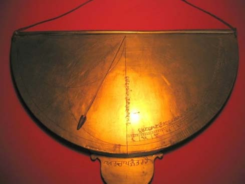

*Fig. 30. Gurmukhi Cāpa-yantra, PC, Germany. Photo by the Author*

<!-- figure-resolved-extracted: page=40 image=media/p40_fig01.jpg -->

<!-- figure-meta: page=40, position=bottom, type=photograph -->

The semicircle is divided into two halves by a radius in the middle. On the left quadrant two semicircles are drawn along the vertical and horizontal radii. Through their intersection another radius is drawn, along which is engraved: *is rekhā se ucāī makān darakht kā mālūm hotā hai*, ‘with this line, the height of houses and trees becomes known’.
Along the vertical radius which divides the semicircle into two quadrants is engraved: *is rekhā se nīcāī mālūm hotā hai*, ‘with this line, the depth becomes known’.
In the quadrant on the right hand side, there are three scales along the arc. The innermost scale is divided into single degrees. The middle scale is divided into groups of 6°, and is labelled as 6, 12, … 90, starting from the vertical radius and reaching up to the horizontal diameter. The outermost one is a co-tangent scale as is seen on the back of the astrolabes. Along these scales is engraved the fourth inscription. The first eight syllables could not be deciphered. The rest reads as follows: ... *ūcāī ke darje mālūm hotā hai [.] dariyāu kā cod?āī māpā jātā hai hor bhī kām nikase he (?)*, ‘[With this scale along the arc] the degrees of height (i.e. of altitude) become known [.] The breadth of rivers can be measured [.] Other tasks also can be performed.’
Thus these inscriptions emphasize the fact that the *Cāpa-yantra* or double quadrant can be used for astronomical observations as well as for land survey.
On the reverse side, there are three scales along the semi-circular arc. The outermost scale is divided into units of 3° each and is labelled as 3, 6, 9 … 174, 177, 180 from left to right. The middle scale is also calibrated for 3° and numbered in the same manner from the right to the left. The innermost scale is calibrated into single degrees. Below these scales, there are two elaborate tables. Though made in the nineteenth century, this specimen testifies to the fact that the *Cāpa-yantra*

[^51]: Sarma (1986-87).
<!-- /decode-chunk -->

<!-- decode-chunk: pages=41-45 source_sha256=d7cf4c540720e9e6f256412d09ec86fabf39967ce066b8d09ffd276efbb5f851 -->
<!-- pdf-page: 41 -->

THE PRODUCTION OF TRADITIONAL ASTRONOMICAL INSTRUMENTS AT LAHORE 299
has been in use throughout the centuries since Brahmagupta mentioned it for the first time in the seventh century.

### [45] Zarqālī Astrolabe, Gurmukhi and Arabic/Persian, not signed, not dated, diameter 9200 mm, ex-PC, Milan; PC, London.[^52]

This is the second largest astrolabe in the world.[^53] It was made up of two brass plates riveted together. Auctioned by Christie’s in 1992,[^54] it was acquired by a private collector in Milan in Italy; it is now in a private collection in London. Most of the inscriptions, including the arguments on the various scales, are in Arabic and Gurmukhi scripts. The first letters of the Sanskrit names of the signs of the zodiac and those of the planets are also engraved in Gurmukhi script. In the case of star names, however, the Gurmukhi version does not provide the Sanskrit names but only the Arabic names in transliteration.
On both sides the circular scale on the circumference is divided for each $5^\circ$, subdivided for each $1^\circ$ and then for each $1/6^\circ$. Groups of $5^\circ$ are labelled in Gurmukhi as well as in the standard Arabic numerals, separately for each quadrant, both in clockwise and in anti-clockwise directions.
Within the circular scale, the front side carries the Zarqālī universal projection, invented by Ibn al-Zarqālluh in Andalusia in the eleventh century. It was a major advance in the construction of the astrolabe, but not many specimens seem to have been produced in the subsequent centuries. In 1680, Ḍiyā’ al-Dīn Muḥammad of the Allāhdād family produced a Zarqālī astrolabe with a diameter of 555 mm. It is preserved now in the Jaipur Observatory of Jai Singh.[^55] The present astrolabe is the second known Zarqālī astrolabe to be produced in India. On the reverse side, there are diverse kinds of projections and a table showing the astrological limits (*ḥudūd*) and faces (*wujūh*).

## 6. ASTRONOMICAL INSTRUMENTS EXHIBITED AT THE LAHORE EXHIBITION OF 1864

In 1864, the British Colonial Government organised an exhibition at Lahore in order to promote the manufacturing industry in Punjab. The exhibits are described by B. H. Baden Powell in his *Handbook of the Manufactures and Arts of the Punjab*.[^56] The astronomical instruments displayed at this exhibition were listed in ‘Class XXIV: mathematical and philosophical instruments exhibited in the Lahore Exhibition of 1864.’ Powell remarks that
> Almost all the instruments that were exhibited were astrolabes, dials, and other instruments used either in the fancied computations of astrology, or in those real calculations of astronomy in which it is known the Hindus attained considerable excellence. His Highness the Maharaja of Kapurthala exhibited two fine astrolabes, one a small hand one, the other represented in the plate. Each is furnished with a number of variously engraved discs or plates, which are used in turn according to the purpose of observation.
>
> The following list of astronomical instruments is compiled for me by Pandit Rádha Kishan, late astrologer to the Court of Ranjit Singh, and by Pandit Durga Pershád.
There are 32 items in the list, but the two astrolabes exhibited by the Maharaja of Kapurthala are not included there. An image of the larger astrolabe is reproduced by Powell between pp. 200 and 201 of his book. It has been discussed above among the astrolabes made by

[^52]: Description based on photos kindly provided to me by the late Prof. G. L’E. Turner.

[^53]: The largest is obviously the iron astrolabe in the grounds of the Jaipur Observatory of Jai Singh, with a diameter of 211.5 cm; cf. Sharma (1995): 179-182.

[^54]: Christie’s (2002): 48-49, item 119.

[^55]: Sarma (1996).

[^56]: Powell (1872): 259-263.

<!-- pdf-page: 42 -->

300 INDIAN JOURNAL OF HISTORY OF SCIENCE
Bulhomal [9]. Powell mentions the Maharaja of Kapurthala but not Bulhomal, the instrument maker attached to his court. This may mean that Bulhomal was not alive in 1864; the same applies to Joshi Dharm Chand who was not mentioned by Powell.
The list prepared by the two Pandits is valuable, for it reflects the state of production of traditional astronomical instruments in the second half of the nineteenth century in Punjab. Therefore, it is reproduced below in tabular form. In the list, the Sanskrit names are not correctly transcribed and some of the names were not correctly explained. Correct transcriptions of the Sanskrit names, where necessary, are added in column 3 and my own comments in column 5.

| Name | Correct Name in Sanskrit | Description by the Pandits | My Comments |
| :--- | :--- | :--- | :--- |
| 1 | Digyantram | *Dig-yantra* | A brass disc with a movable index, used for finding the exact time of the sun’s crossing the meridian, and for fixing the quarters of the heavens. | |
| 2 | Trikon shankú yantram | *Trikoṇa- śaṅku-yantra* | Consisting of a wooden triangle with a cross bar, like the letter A; the cross bar is graduated, and a string and a ball depending from the apex shows how much out of perpendicular it is, and what the angle of the ground is. | It is actually a device to judge the level of the ground. It was described by Rāmacandra Vajapeyin in his *Kuṇākṛti* of 1449.[^57] |
| 3 | Sambhúmí yantram | *Sama-bhūmi- yantra* | An ordinary spirit level | |
| 4 | Ghati yantram | *Ghaṭī-yantra* | A water clock. A copper bowl perforated with a little hole, which, placed in a vessel of water, gradually fills and sinks: exactly one hour is consumed in filling. This article is in common use, and by it all police guards, &c, keep the time, striking their gong as each hour comes round. | |
| 5 | Bálú kā ghati yantram | | The hour glass of sand is also used, called ‘bálú kā ghati yantram.’ | Sand glass |
| 6 | Shanku yantram | *Śaṅku-yantra* | Graduated scales used in measuring. [!] | *Śaṅku* is a simple gnomon; the explanation is not correct. |
| 7 | Pratod yantram | *Pratoda-yantra* | A long graduated beam for finding out the time by the aid of the shadow. | The description is not very accurate; it is a column dial, known as *Pratoda-yantra* and similar other names.[^58] |
| 8 | Chakra yantram | *Cakra-yantra* | A graduated disc, and needle, for determining zenith distance and the altitude of the sun. | Mentioned by Brahmagupta and others. |

[^57]: Bhattacharya (1986-47).

[^58]: Sharma (1982).

<!-- pdf-page: 43 -->

THE PRODUCTION OF TRADITIONAL ASTRONOMICAL INSTRUMENTS AT LAHORE 301

| Name | Correct Name in Sanskrit | Description by the Pandits | My Comments |
| :--- | :--- | :--- | :--- |
| 8a | Chap yantram | *Cāpa-yantra* | Is a half disc, also used in determining the zenith distance. | Mentioned by Brahmagupta and others. A specimen with Gurmukhi labels has been described above [42]. Could this be the same one? |
| 9 | Túrí yantram | *Turīya-yantra* | The quadrant | Mentioned by Brahmagupta and others. Could it be one made by Bulhomal [22]? |
| 10 | Samay prabodhak yantram | *Samaya- prabodhaka- yantra* | A dial graduated so as to show the sub-divisions of time. | |
| 11 | Dhruv Bhraman yantram | *Dhruva- bhrama- yantra* | A square plate, having circles inscribed on it and an index rod, by means of this the time is ascertained at night, by the polar star (*Dhruv* polar star --*bhraman* --going, wandering.) | The explanation of the Sanskrit name is not quite correct; here *bhrama* should mean ‘rotating’. Bulhomal made at least two such instruments [20], [21]. |
| 12 | Rátri pradíp yantram | *Rātri-pradīpa- yantra* | Another instrument for telling time at night (*ratri* ---night, *pradip* ---lamp). | |
| 13 | Dakshinodak bhiti yantram | *Dakṣiṇodak- bhitti-yantra* | (Lit.—”from south-northerly separation”)—A square plate with the graduated quadrant of a circle, an index, and plumb line, used in ascertaining azimuth distances. | Must be a small model of the masonry mural quadrant of Jai Singh’s Observatories. The meaning of the Sanskrit name wrong; it should be ‘south-north wall instrument’ because the quadrant is drawn on a wall set up in the south-north direction. It is not used for ‘ascertaining azimuth distances,’ but for measuring the transit altitude of the sun, for determining the latitude of the place and for measuring the obliquity. The specimen exhibited may have been sent by the Maharaja of Jaipur, together with some other items mentioned below. |
| 14 | Sextant | | | A European sextant produced in Punjab? |
| 15 | Octant | | | A European octant produced in Punjab? |
| 16 | Rám yantram | *Rāma-yantra* | Used to show the declination. | Must be a small model of Jai Singh’s *Rāma-yantra*. But it does not measure declination, but the altitude and azimuth. |

<!-- pdf-page: 44 -->

302 INDIAN JOURNAL OF HISTORY OF SCIENCE

| Name | Correct Name in Sanskrit | Description by the Pandits | My Comments |
| :--- | :--- | :--- | :--- |
| 17 | Yámyottara yantra | *Yāmyottara- bhitti-yantra* | A dial with a tube for shewing zenith distance and the meridian shadow of a Gnomon, when the sun is in the equinoctial line –(*yámí*—south *uttara*—north) | Like 13 above, this too must be another small model of Jai Singh’s mural quadrant. |
| 18 | Falk yantra | *Phalaka-yantra* | A graduated oblong plate, with inscribed circle and bar to give the shadow—for measurement of hours, angular distances, &c. | One of the few specimens of the *Phalaka-yantra* invented by Bhāskara II in the twelfth century.[^59] |
| 19 | Yashti yantra or ishtí | *Yaṣṭhi-yantra* | A dial for computing time. | |
| 20 | Digansh Yantram | *Digaṃśa-yantra* | In Geodesy, to ascertain the bearings of a given object. | Must be a small model of Jai Singh’s instrument of the same name for measuring the azimuth. |
| 21 | Nárí valay yantram | *Nāḍī-valaya-yantra* | Shows the time according to the Indian division “Nári” — the Indian hour of 24 minutes. | A small model of Jai Singh’s masonry instrument of the same name. |
| 22 | Samrat Yantram | *Samrāṭ-yantra* | The form of the instrument is a semicircle, superscribed on the hypotenuse of a right angled triangle; the circle is graduated and intersected at its extreme ends by another arc. The brass plate on which the whole is engraved carries an observing tube. The instrument is used in measuring zenith distance and declination. | This is a small model. The original with the same name can be seen in all the observatories of Jai Singh. |
| 23 | Jaya prakásh yantra | *Jaya-prakāśa- yantra* | | A model of the Jai Singh’s masonry instrument of the same name. |
| 24 | Yanti ráj | *Yantra-rāja* | | Sanskrit astrolabe |
| 25 | Budhi yantra | *Buddhi-yantra* or *Dhī-yantra* | A large gnomon, the shadow of which is observed when the sun is in the equinoctial. | The *dhī-yantra* of Bhāskara II; it may have been made by Bulhomal. |
| 26 | Jar kalíya yantram | Zarqālī astrolabe | To show altitude and ascensional difference | It is the Zarqālī astrolabe discussed above [43]. Either it is the Gurmukhi version or the one made by Ḍiyā’ al-Dīn which was sent by the Maharaja of Jaipur. |
| 27 | Gol yantra | *Gola-yantra* | To show the motion of the planets, according to the Hindi [sic! Hindu] divisions of the sphere. | *Gola-yantra*, Sanskrit armillary sphere. See also 29 below in this table. |

[^59]: Sarma (forthcoming-b).

<!-- pdf-page: 45 -->

THE PRODUCTION OF TRADITIONAL ASTRONOMICAL INSTRUMENTS AT LAHORE 303

| Name | Correct Name in Sanskrit | Description by the Pandits | My Comments |
| :--- | :--- | :--- | :--- |
| 28 | Kránti-yantra | *Krānti-yantra* | Declination instrument | A model of the instrument at the Jaipur Observatory. |
| 29 | Játul halka yantri | *Dhāt al-ḥalaq* | For finding longitude, &c. | Armillary sphere made according to Ptolemy’s model by Muslim astronomers. Jai Singh got such armillary spheres made. |
| 30 | Bhugol yantra | *Bhūgola-yantra* | Globe | Terrestrial globe. |
| 31 | Swayambahu yantra | *Svayaṃvaha- yantra* | A revolving disc, set turning by a stream of water, which flows by a siphon tube out of a vessel properly placed and dropped on the cogs or teeth of the disc. A revolution is maintained at a certain rate, and by this means the time ascertained after the machine having been once started at a known hour. | Obviously a specimen made according to the description of Bhāskara II in his *Siddhāntaśiromaṇi*.[^60] |
| 32 | Vakra darasaná bhangí | *Vakra-bhaṅgī- darśana* ? | A vessel showing the reverse revolution of planets. | |

Seven of the instruments listed here carry the names of the masonry instruments erected by Sawai Jai Singh in his observatories. These are 13. *Dakṣiṇottara-bhitti-yantra*, 16. *Rama-yantra*, 17. *Yāmyottara-yantra*, 20. *Digaṃśa-yantra*, 21. *Nāḍīvalaya-yantra*, 22. *Samrāt-yantra*, and 23. *Jayaprakāśa-yantra*. Here, the names *Dakṣiṇodak-bhitti-yantra* (13) and *Yāmyotttara-yantra* (17) refer to the mural quadrant. Therefore what were exhibited at Lahore must be small models of the large instruments. It is possible that the Maharaja of Jaipur sent these from his personal collection for the exhibition. He may also have sent 26. *Zarqālī* astrolabe, 28. *Krānti-yantra*, and 29. *Dhāt al-ḥalaq*.
Some names like 1. *Dig-yantra*, 10. *Samaya-prabodhaka-yantra*, and 12. *Rātri-pradīpa-yantra*, and the corresponding descriptions, do not make much sense. It looks as if the Pandits Radhakrishna and Durgaprasad invented these fanciful names for instruments which were new to them.
More interesting for the present discussion is the fact that Bulhomal himself made *Yantrarājas* or Sanskrit astrolabes [5], [6], [7], *Turīya-yantra* [22] and *Dhruvabhrama-yantras* [20], [21]. Therefore, the instruments listed under 9, 11 and 24 could have been those produced by Bulhomal himself. Likewise, several of the traditional Sanskrit instruments like 2. *Trikoṇa-śaṅku-yantra*, 4. *Ghaṭī-yantra*, 7. *Pratoda-yantra*, 8. *Cakra-yantra*, 9. *Cāpa-yantra*, 19. *Yaṣṭhi-yantra*, 25. *Dhī-yantra*, 29. *Gola-yantra* and 31. *Svayaṃvaha-yantra* could have been made by Bulhomal himself or by his contemporaries.

## 7. CONCLUSION

It is hoped that this overview of the traditional astronomical instruments produced towards the middle of the nineteenth century would help museums, especially those at Lahore and other places in Pakistan, to identify instruments which may be lying unclassified in

[^60]: Sarma (forthcoming-b).
<!-- /decode-chunk -->

<!-- decode-chunk: pages=46-47 source_sha256=baed2c224069b930ebf2ae2d17af9c679579b52c74027ea5b73425cb17cc1fed -->
<!-- pdf-page: 46 -->

304 INDIAN JOURNAL OF HISTORY OF SCIENCE
their stores. It is possible that some of the instruments displayed at the Lahore Exhibition of 1864 may still be extant in the Lahore Museum. The more specimens that are identified, the more detailed would be the history of the production of traditional astronomical instruments in the nineteenth century.
There are no contemporary literary records for Allāhdād or any of his descendants who were active in Lahore in the sixteenth and seventeenth centuries. All that is known about them has been reconstructed from the extant specimens of the instruments they had produced. But the nineteenth century is not so remote and there must surely be some kind of contemporary records where Bulhomal and his associates like Pīr Bakhsh, Ghulām Qādir Kapūrthalī and Joshi Dharm Chand are mentioned. The author shall be grateful to receive any information on these persons.

# ACKNOWLEDGEMENTS

I am grateful to the following institutions for permitting me to study and photograph their instruments: National Museum, New Delhi; Rampur Raza Library, Rampur; Victoria & Albert Museum, London; Science Museum, London; Nasser D. Khalili Collection of Islamic Art, London; Museum of the History of Science, Oxford; Linden Museum, Stuttgart; Kunstgewerbesammlung der Stadt Bielefeld, Bielefeld. I am also grateful to the Butler Library, Columbia University, New York, for permitting me to study the instruments in their collection and for providing me photos of the instruments.
It will not be possible to mention here by name all the scholars who helped me in diverse ways in connection with my project, but I must remember with a deep sense gratitude the late Mr Francis Maddision, the long-time curator of the Museum of the History of Science, Oxford, who, besides permitting me to study the large collection of Indian Instruments in his Museum, gave me access to a vast amount of archival material of photographs and other information he had gathered over the years. I am equally indebted to the late Professor G. L’E. Turner for the detailed photos of the Sanskrit celestial globe made by Bulhomal in 1839.
I came to know of an interesting collection of instruments in the Central Asian Museum, University of Kashmir, Srinagar, just recently, but could not travel there to personally examine the instruments. The authorities of the museum kindly agreed to send me photos of their instruments. The photographer of the museum, Mr Nazir Ahmad Doshab prepared excellent photos and answered my queries very promptly, which is greatly appreciated. Thanks are also due to Dr Jaspal Singh, Cambridge, Massachusetts, USA, for his help in the decipherment of the Gurmukhi script and in the translation of the Punjabi sentences on these instruments and to Mr Mubashir Ul-Haq Abbasi of Rawalpindi for the information about an astrolabe in the Lahore Museum. I am thankful to the unknown referee for his meticulous reading of my paper and for his many useful suggestions which have been incorporated in the paper.
Part of the research for this paper was conducted during the project awarded by the Indian National Science Academy, New Delhi, for which I am deeply thankful to the authorities of the Academy.
This paper, like all my other papers on instruments, owes much to the encouragement and support by Dr A. K. Bag. It is dedicated to him in friendship.

# BIBLIOGRAPHY

Behari, Kailash and Govind, Vijai. A Survey of Historical Astrolabes of Delhi, *IJHS*, 15 (1980): 94-104.
Bhattacharya, Bibhuti Bhusan. Some Instruments of Ancient India and their Working Principles, *Journal of Ganganatha Jha Research Institute*, 4 (1946-47): 249-270.

<!-- pdf-page: 47 -->

THE PRODUCTION OF TRADITIONAL ASTRONOMICAL INSTRUMENTS AT LAHORE 305
Christie’s. Christie’s, London, auction catalogue of 24.09.1992.
Dar, Saifur Rahman. Three rare Astrolabes in the Collection of Lahore Museum and Lahore’s Contribution towards Astrolabe-Making, *Lahore Museum Bulletin*, 7.1-2 (January-December 1994): 165-198.
Gunther, R. T. *The Astrolabes of the World*, Oxford, 1932.
Maddison, Francis & Savage-Smith, Emilie. *Science, Tools & Magic*, Part I: *Body and Spirit, Mapping the Universe*, (The Nasser D. Khalili Collection of Islamic Art, Vol. XII), Oxford University Press, Oxford, 1997.
Mollan, Charles. *Irish National Inventory of Historic Scientific Instruments*, Samton Limited, Dublin, 1995.
Powell, B. H. Baden. *Handbook of the Manufactures and Arts of the Punjab*, Lahore, 1872. https://archive.org/details/handbookeconomi00powgoog, accessed on 16 January 2015.
*Répertoire* = Alain Brieux, Francis Maddison, avec la collaboration de Ludwik Kulus et Yusuf Ragheb. *Répertoire des Facteurs d’Astrolabes, et leurs oeuvres. Islam, plus Byzance, Arménie, Géorgie et Inde Hindoue* (in press ?).
Sanders, Harold N. *All the Astrolabes*, Oxford, 1984.
Sarma, Sreeramula Rajeswara. Indian Astronomical and Time-Measuring Instruments: A Catalogue in Preparation, *IJHS*, 29.4 (1994a): 507-528.
Sarma, Sreeramula Rajeswara. The Lahore Family of Astrolabists and their Ouvrage, *Studies in History of Medicine and Science*, 13.2 (1994b): 205-224.
Sarma, Sreeramula Rajeswara. The Ṣafīḥa Zarqāliyya in India, in Josep Casulleras and Julio Samsó (ed), *From Baghdad to Barcelona: Studies in the Islamic Exact Sciences in Honour of Prof. Juan Vernet*, Barcelona, 1996, pp. 719-735.
Sarma, Sreeramula Rajeswara. Kaṭapayādi Notation on a Sanskrit Astrolabe, *IJHS*, 34 (1999): 273-287.
Sarma, Sreeramula Rajeswara. *Astronomical Instruments in the Rampur Raza Library*, Rampur Raza Library, Rampur, 2003.
Sarma, Sreeramula Rajeswara. Indian Astronomical Instruments in German Collections, *XXX. Deutscher Orientalistentag*, Freiburg, 24.-28. September 2007. *Ausgewählte Vorträge*, hrsg. im Auftrag der DMG von Rainer Brunner et at. Online-Publikation, Februar 2008. http://orient.ruf.uni-freiburg.de/dotpub/sarma.pdf, accessed on 16 January 2015.
Sarma, Sreeramula Rajeswara. The Makers, Designers and Patrons of Sanskrit Astronomical Instruments: An Alphabetical Directory of Names and Related Inscriptions, *Journal of the Oriental Institute*, 60.1-2 (Sept-Dec 2010): 75-108.
Sarma, Sreeramula Rajeswara. The Dhruvabhrama-Yantra of Padmanābha, *Saṃskṛtavimarśaḥ, Journal of Rashtriya Sanskrit Samsthan, World Sanskrit Conference Special*, 6 (2012a): 321-343.
Sarma, Sreeramula Rajeswara. The Gurmukhi Astrolabe of the Maharaja of Patiala, *IJHS*, 47.1 (2012b) 63-92.
Sarma, Sreeramula Rajeswara. Yantrarāja for Dāmodara: the earliest extant Sanskrit Astrolabe, in Jean-Michel Delire (ed), *Astronomy and Mathematics in Ancient India – Astronomie et Mathématiques de l’Inde ancienne*, Peeters, Leuven, pp. 87-120 (2012c).
Sarma, Sreeramula Rajeswara. The Kaṭapayādi System of Numerical Notation and its Spread outside Kerala, *Revue d’histoire des mathématiques*, 18.1 (2012d): 37-66.
Sarma, Sreeramula Rajeswara. A Monumental Astrolabe made for Shāh Jahān and later reworked with Sanskrit Legends (forthcoming-a).
Sarma, Sreeramula Rajeswara. Astronomical Instruments in Bhāskarācārya’s *Siddhānta-śiromaṇi* (forthcoming b).
Savage-Smith, Emilie. *Islamicate Celestial Globes: Their History, Construction and Use*, Washington, D.C. 1985.
Sharma, Shakti Dhar. *Śrī Gaṇeśa-Daivajña-kṛta Pratoda Yantram : Pratoda Yantra (Chabuka Instrument by Sh. Ganesha Daivajna (A Gnomonic Whip-Shaped device to know time.)*, edited and commented by Shakti Dhar Sharma, Kurali, 1982.
Sharma, Virendra Nath. *Sawai Jai Singh and his Astronomy*, Delhi, 1995.
Skinner, *Science & Technology, featuring Mechanical Music* (Auction Catalogue), sale 2133, Bolton, Massachusetts, USA, 13 April 2002
Syndram, Dirk. *Wissenschaftliche Instrumente und Sonnenuhren, Kunstgewerbesammlung der Stadt Bielefeld, Stiftung Huelsmann*, München, 1989.
Verdet, Jean-Pierre. A propos de deux petits quadrants indiens, in W. D. Hackmann & A. J. Turner (ed), *Learning, Language and Invention: Essays presented to Francis Maddison*, Aldershot & Paris, 1994, pp. 309-321.
<!-- /decode-chunk -->
