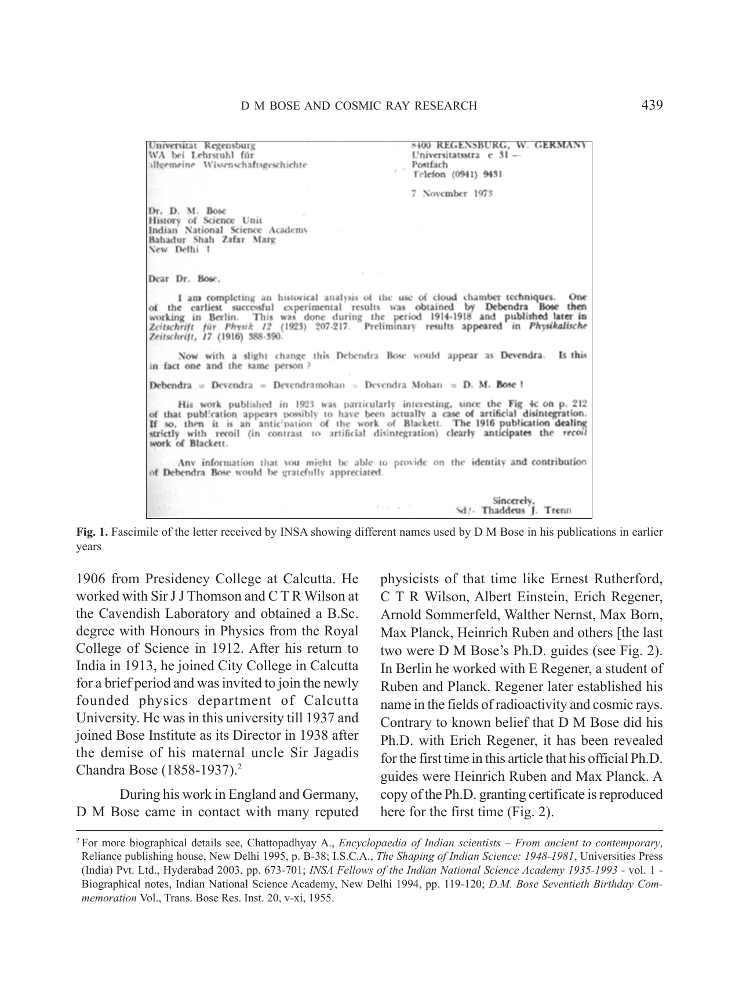
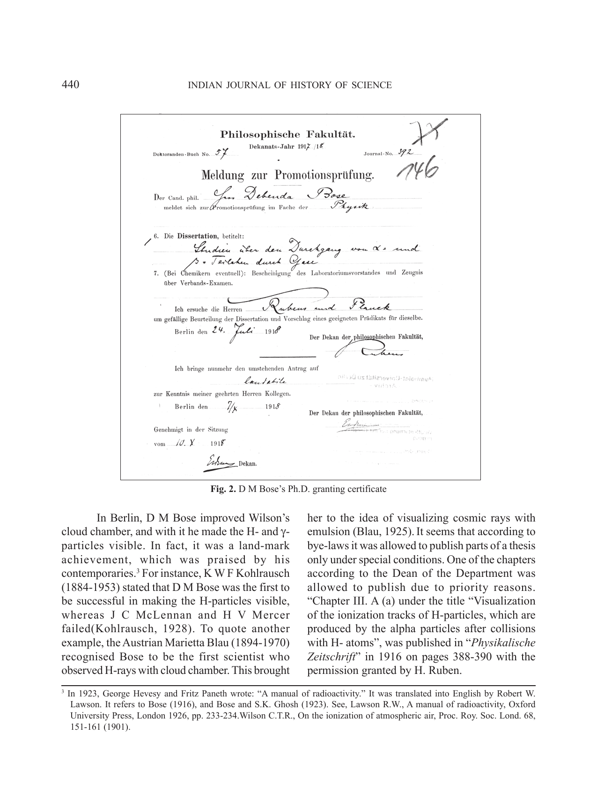
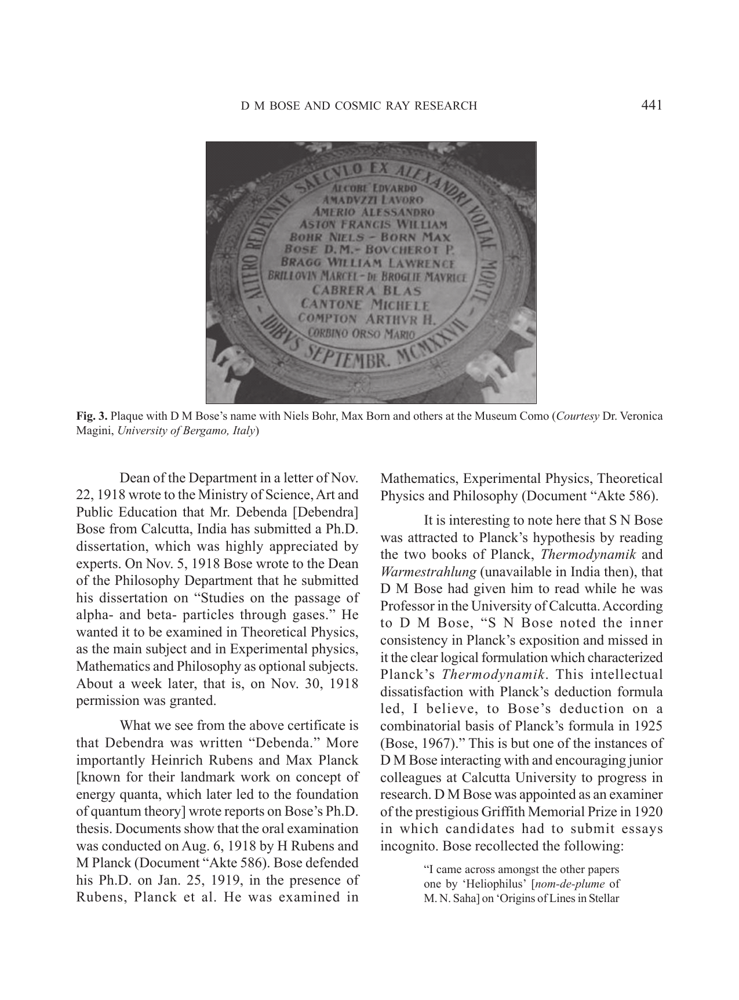
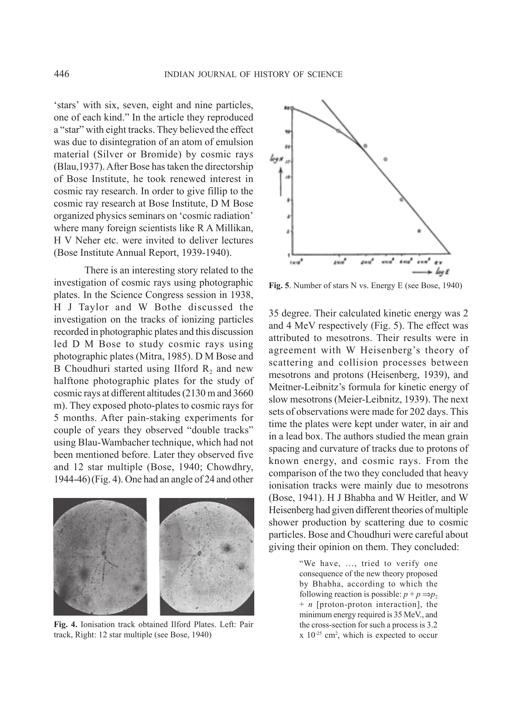
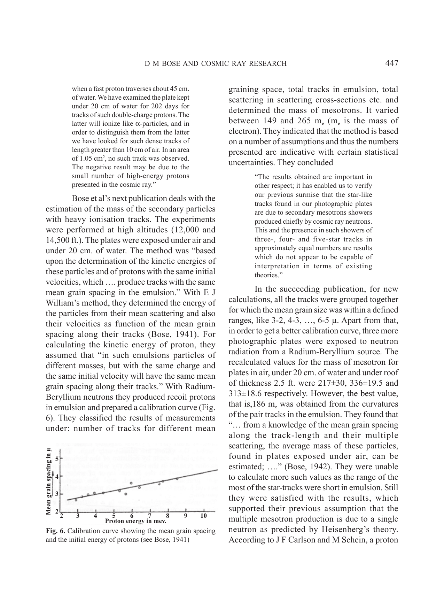
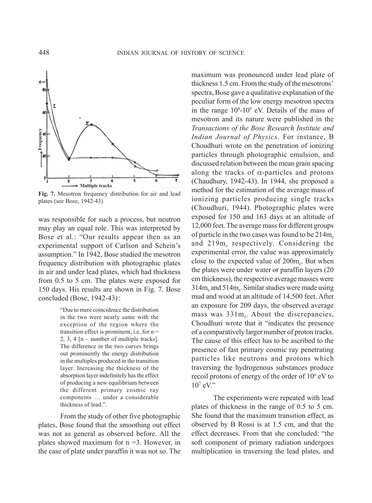
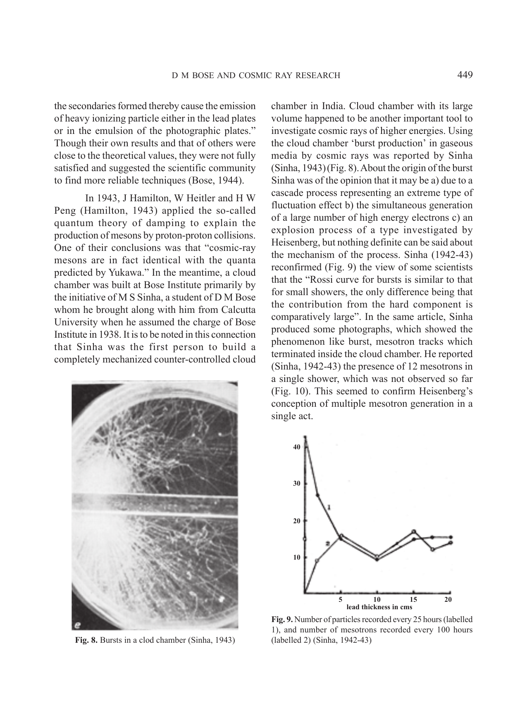
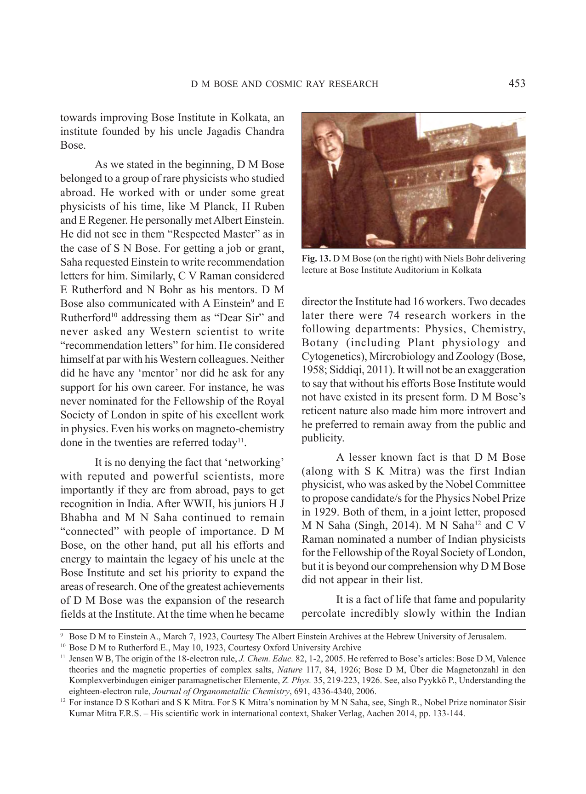

# D M Bose and Cosmic Ray Research

- Author Display: S C Roy
- Year: 2015
- Journal Label: IJHS-50-2015-Issue-3
- Source Url: https://insa.nic.in/(S(eh1ucortlbqqezipwgliy3mn))/writereaddata/UpLoadedFiles/IJHS/Vol50_2015_3_Art05.pdf

<!-- source: gemini page-chunk extraction -->

<!-- decode-chunk: pages=1-5 source_sha256=97eed0f89945adadbc2de2444a26c926295d7de4377f34eaff5f23563e9a5e94 -->
Indian Journal of History of Science, 50.3 (2015) 438-455 DOI: 10.16943/ijhs/2015/v50i4/48316

# D M Bose and Cosmic Ray Research

**S C Roy* and Rajinder Singh***
(Received 02 January 2015)

### Abstract

To the Historians of Science, D M Bose (1885-1975) is known for his monumental work ‘*A Concise History of Science in India*’, which was published by the Indian National Science Academy in 1971.[^1] This article is our tribute to D M Bose, on the occasion of the Golden Jubilee of the journal *Indian Journal of History of Science* (IJHS), who incidentally was the first editor of the journal. The purpose of this article is to focus on some aspects of D M Bose’s life which are immensely significant yet almost unknown to the scientific community. D M Bose made significant contributions in the areas of magnetism, radioactivity, cosmic rays and plant physiology. We, in this article, will concentrate on his pioneering works on cosmic ray research done at Bose Institute, Kolkata and discovery of meson. In a series of articles published in *Nature* in early forties, D M Bose and Bibha Choudhuri (also known as Biva Choudhuri or B Chowdhury) identified a cosmic particle having mass close to 200 times the mass of electron (later known as mu-meson). Many believe (Das, 2010) that they missed the Nobel Prize for this discovery because of their lack of access to modern scientific tools (Roy, 2010). In spite of pain-staking and tedious experiments done by Biva Chaudhuri, she is little known and less discussed in the scientific community. We have attempted here to put together a comprehensive review of their works related to this discovery, which, in the opinion of the present authors, has not done before.[^1] Contrary to known beliefs that D M Bose did his Ph.D. with Erich Regener, it has been revealed for the first time that his official Ph.D. guides were Heinrich Ruben and Max Planck. And lastly an attempt has been made to understand why, despite Bose’s scientific recognition and reputation in India and abroad, he has not become a public figure unlike his contemporaries.
**Key words:** Biva Chaudhuri, Cosmic rays, D M Bose, Mesons.

## 1. INTRODUCTION

A somewhat unexpected letter was received at the INSA office in 1973 from T J Trenn of the University of Regensburg in West Germany searching for the real identity of D M Bose! He was compiling a historical analysis of cloud chamber technique and was confused by different variants in spelling of D M Bose’s name in published papers in early years of his research asking whether “Debendra= Devendra= Devendramohan= Devendra Mohan= D M Bose!” ‘is the one and same person’? The letter reproduced below (Fig. 1.) is also significant to understand the high calibre of research D M Bose did in the areas of nuclear physics.
D M Bose was an exceptional physicist, like his colleagues and contemporary scientists like C V Raman (1888-1970), S K Mitra (1890-1963), M N Saha (1893-1956), and S N Bose (1894-1974). Unlike his contemporaries he proceeded for his higher education abroad immediately after obtaining the M.A. degree in 1906 from Presidency College at Calcutta. He worked with Sir J J Thomson and C T R Wilson at the Cavendish Laboratory and obtained a B.Sc. degree with Honours in Physics from the Royal College of Science in 1912. After his return to India in 1913, he joined City College in Calcutta for a brief period and was invited to join the newly founded physics department of Calcutta University. He was in this university till 1937 and joined Bose Institute as its Director in 1938 after the demise of his maternal uncle Sir Jagadis Chandra Bose (1858-1937).[^2]

*Fig. 1. Fascimile of the letter received by INSA showing different names used by D M Bose in his publications in earlier years*

<!-- figure-resolved-page-render: page=2 image=media/p02_page.webp -->

<!-- figure-meta: page=2, position=top, type=photograph -->

During his work in England and Germany, D M Bose came in contact with many reputed physicists of that time like Ernest Rutherford, C T R Wilson, Albert Einstein, Erich Regener, Arnold Sommerfeld, Walther Nernst, Max Born, Max Planck, Heinrich Ruben and others [the last two were D M Bose’s Ph.D. guides (see Fig. 2). In Berlin he worked with E Regener, a student of Ruben and Planck. Regener later established his name in the fields of radioactivity and cosmic rays. Contrary to known belief that D M Bose did his Ph.D. with Erich Regener, it has been revealed for the first time in this article that his official Ph.D. guides were Heinrich Ruben and Max Planck. A copy of the Ph.D. granting certificate is reproduced here for the first time (Fig. 2).

*Fig. 2. D M Bose’s Ph.D. granting certificate*

<!-- figure-resolved-page-render: page=3 image=media/p03_page.webp -->

<!-- figure-meta: page=3, position=top, type=photograph -->

In Berlin, D M Bose improved Wilson’s cloud chamber, and with it he made the H- and $\gamma$-particles visible. In fact, it was a land-mark achievement, which was praised by his contemporaries.[^3] For instance, K W F Kohlrausch (1884-1953) stated that D M Bose was the first to be successful in making the H-particles visible, whereas J C McLennan and H V Mercer failed(Kohlrausch, 1928). To quote another example, the Austrian Marietta Blau (1894-1970) recognised Bose to be the first scientist who observed H-rays with cloud chamber. This brought her to the idea of visualizing cosmic rays with emulsion (Blau, 1925). It seems that according to bye-laws it was allowed to publish parts of a thesis only under special conditions. One of the chapters according to the Dean of the Department was allowed to publish due to priority reasons. “Chapter III. A (a) under the title “Visualization of the ionization tracks of H-particles, which are produced by the alpha particles after collisions with H- atoms”, was published in “*Physikalische Zeitschrift*” in 1916 on pages 388-390 with the permission granted by H. Ruben.

*Fig. 3. Plaque with D M Bose’s name with Niels Bohr, Max Born and others at the Museum Como (Courtesy Dr. Veronica Magini, University of Bergamo, Italy)*

<!-- figure-resolved-page-render: page=4 image=media/p04_page.webp -->

<!-- figure-meta: page=4, position=top, type=photograph -->

Dean of the Department in a letter of Nov. 22, 1918 wrote to the Ministry of Science, Art and Public Education that Mr. Debenda [Debendra] Bose from Calcutta, India has submitted a Ph.D. dissertation, which was highly appreciated by experts. On Nov. 5, 1918 Bose wrote to the Dean of the Philosophy Department that he submitted his dissertation on “Studies on the passage of alpha- and beta- particles through gases.” He wanted it to be examined in Theoretical Physics, as the main subject and in Experimental physics, Mathematics and Philosophy as optional subjects. About a week later, that is, on Nov. 30, 1918 permission was granted.
What we see from the above certificate is that Debendra was written “Debenda.” More importantly Heinrich Ruben and Max Planck [known for their landmark work on concept of energy quanta, which later led to the foundation of quantum theory] wrote reports on Bose’s Ph.D. thesis. Documents show that the oral examination was conducted on Aug. 6, 1918 by H Rubens and M Planck (Document “Akte 586). Bose defended his Ph.D. on Jan. 25, 1919, in the presence of Rubens, Planck et al. He was examined in Mathematics, Experimental Physics, Theoretical Physics and Philosophy (Document “Akte 586).
It is interesting to note here that S N Bose was attracted to Planck’s hypothesis by reading the two books of Planck, *Thermodynamik* and *Warmestrahlung* (unavailable in India then), that D M Bose had given him to read while he was Professor in the University of Calcutta. According to D M Bose, “S N Bose noted the inner consistency in Planck’s exposition and missed in it the clear logical formulation which characterized Planck’s *Thermodynamik*. This intellectual dissatisfaction with Planck’s deduction formula led, I believe, to Bose’s deduction on a combinatorial basis of Planck’s formula in 1925 (Bose, 1967).” This is but one of the instances of D M Bose interacting with and encouraging junior colleagues at Calcutta University to progress in research. D M Bose was appointed as an examiner of the prestigious Griffith Memorial Prize in 1920 in which candidates had to submit essays incognito. Bose recollected the following:
> “I came across amongst the other papers one by ‘Heliophilus’ [nom-de-plume of M. N. Saha] on ‘Origins of Lines in Stellar Spectra’. As the paper was so outstanding compared to other essays submitted for the prize, there was no hesitation in recommending it (Bose, 1967).”
His significant research work using cloud chamber and magnetism in India and abroad, had established him a name as an internationally reputed physicist. He attended the Como conference, held during 11-20 September 1927 at Lake Como in Italy, with sixty invited participants from fourteen countries including eleven Nobel laureates. This conference was known to be a ‘meeting of exceptional interest’ in commemoration of the first centenary of the death of Alessandro Volta. It is to be noted that only two Indian scientists, D M Bose and M N Saha, participated in this meeting.[^4]
Many are unaware of Bose’s involvement in the national planning of science and technology in India. Vigorous activities for India’s scientific and technological development started around 1940. The Council of Scientific and Industrial Research (CSIR), constituted in 1942, made plans to build the National Physical Laboratory (NPL) and the National Chemical Laboratory (NCL). A Planning Committee was formed in 1943 towards this goal, and D M Bose, along with K S Krishnan, M N Saha and S S Bhatnagar, were the committee members. However, M N Saha resigned due to difference in opinion about the chairmanship of the committee and the location of NPL which M N Saha desired to be in Calcutta. Bose did not attend a single meeting of the Committee, possibly in solidarity to the causes raised by his colleague Saha. When the Atomic Energy Committee (AEC) was formed in 1945 as a sub-committee of the CSIR, Bose was inducted in the committee as an expert on nuclear chemistry, along with S S Bhatnagar, Nazir Ahmed, M N Saha, K S Krishnan and D N Wadia (Anderson, 2010). In 1946 AEC sanctioned a capital and recurring grants to D M Bose for research on trans-uranic elements at Bose Institute, and this was supplemented by research funds received by Bose in 1947 to study the separation of U-235 from uranium oxide ($U_3O_8$) imported from Canada. This intimate relationship between D M Bose and the Atomic Energy Committee (later changed to Atomic Energy Commission) continued for many years into independent India.
D M Bose was a pioneer of nuclear physics and cosmic ray research in India but not much is known about the work of D M Bose and B Choudhuri. Many believed that they missed the Nobel Prize for discovering the mu-meson, because of their lack of access to modern scientific tools (Das, 2010; Roy, 2010). The details of his investigation related to the discovery of meson will be presented here. While we are on the subject of discovery of meson, we think this is a good place to talk about the controversy and debate around the name ‘meson’ given to the elementary particle responsible for keeping the nucleons together. It is interesting to note that Homi Bhabha (1909-1966) was also involved in this debate. We will try to understand why D M Bose is not more known in the Indian scientific community compared to his contemporaries, despite his international stature and scientific achievements. For instance, he is known for Welo-Bose’s rule (Fahlenbrach, 1932), Bose’s theory of magnetism[^5] and discovery of a new photoeffect in chemicals(Selwood, 1933).

[^1]: The author Naba K. Mondal has given a good review of “Experimental high-energy physics”, (in: *History of science, philosophy and culture in Indian civilization*, vol. XIII – Part I – India in the world of physics – Then and now, Ed. Mitra A.N.), Pearson Longman, Delhi 2009, pp. 345-358. The summary of D.M. Bose et al. work is to found on pages 345 and 346.

[^2]: For more biographical details see, Chattopadhyay A., *Encyclopaedia of Indian scientists – From ancient to contemporary*, Reliance publishing house, New Delhi 1995, p. B-38; I.S.C.A., *The Shaping of Indian Science: 1948-1981*, Universities Press (India) Pvt. Ltd., Hyderabad 2003, pp. 673-701; *INSA Fellows of the Indian National Science Academy 1935-1993* - vol. 1 - Biographical notes, Indian National Science Academy, New Delhi 1994, pp. 119-120; *D.M. Bose Seventieth Birthday Commemoration Vol.*, Trans. Bose Res. Inst. 20, v-xi, 1955.

[^3]: In 1923, George Hevesy and Fritz Paneth wrote: “A manual of radioactivity.” It was translated into English by Robert W. Lawson. It refers to Bose (1916), and Bose and S.K. Ghosh (1923). See, Lawson R.W., *A manual of radioactivity*, Oxford University Press, London 1926, pp. 233-234. Wilson C.T.R., On the ionization of atmospheric air, *Proc. Roy. Soc. Lond.* 68, 151-161 (1901).

[^4]: For more detail see, Singh R., Celebrating 125th birth anniversary of DM Bose - Invitation to the Como conference, *Science and Culture* 76, 494-501, 2010.

[^5]: Fahlenbrach H., Über eine Konzentrationsabhängigkeit des Magnetismus von $Cr^{+++}$ in wässriger, violetter $Cr(NO_3)_3$ – Lösung. Beziehung zwischen den Konstanten C und $\theta$ des Weissschen Gesetzes, *Ann. Phys.* 14, 524-530, 1932. O.V. Auwers et al., while discussing the atomic-interaction in crystal reproduced the figure with slight modification. See, Auwers O.V., Kühlewein H., Beiträge zum Stereomagnetismus I – Über die Bedeutung der atomaren Wechselwirkung für den Magnetismus, *Ann. Phys.* 17, 107-120, 1933. W. Klemm and W. Schüth also reproduced the same figure, see, Klemm W., Schüth W., Magnetochemische Untersuchungen – 5, Magnetische Messungen an Cupriverbindungen, ein Beitrag zur Theorie des Magnetismus der Übergangselemente, *Z. anorganische und allgemeine Chemie* 203, 104-119, 1931.

<<<CONTINUE>>>
<!-- /decode-chunk -->

<!-- decode-chunk: pages=6-10 source_sha256=1778633abed1aefdbfad93a40771e946bb537d763db09d3511712bf224ee0a26 -->
To the best knowledge of the authors, no complete biography of D M Bose exists in the form of a published book, mini-biographies published ritually on various occasions excepted. It is to be noted in this connection that the present authors are writing a book on D M Bose, his scientific achievements including personal information and anecdotes obtained from some of his students and colleagues who are still alive. It is our pleasure to record, in this connection, that we have received encouraging response from the authorities of Bose Institute in publishing this book.

## 2. CONTROVERSY IN NAMING MESON: CONFLICT BETWEEN AMERICAN AND EUROPEAN SCIENTISTS?

Cosmic rays are high-speed particles with very high energy. These are the highest energies of known individual particles in the universe. The energy spectrum of primary cosmic rays extends from $1 \text{ GeV}$ ($10^9 \text{ eV}$) to above $10^{20} \text{ eV}$. C T R Wilson (1869-1959) who wanted to understand the formation of clouds under laboratory conditions suspected the existence of high energy radiation outside our atmosphere (Wilson, 1901). About a decade later, the Austrian scientist V F Hess (1883-1964) experimentally observed that with increase of altitude the intensity of ionising radiation increases in a dramatic way which he called as “Höhenstrahlung” (high altitude radiation) or “Ultra-Gammastrahlung” (ultra-gamma radiation) (Carlson, 2011). It was R A Millikan (1868-1953), who initially was sceptical about the existence of such rays (Jackson, 2001), later introduced the term ‘cosmic rays (Friedlander, 2012)[^6]. In 1929, W Bothe (1891-1957) and W Kolhöster (1887-1946) found that cosmic rays are not photons, but consist of charged particles. With the discovery of atomic nucleus, physicists tried to understand the forces which keep a nucleus or rather its constituent particles-protons and neutrons bound together. In order to explain the interaction between protons and neutrons Heisenberg and Fermi proposed theories but the energy calculated based on their assumptions was too small to account for the binding energy of the nucleus (the energy required to keep the particles together).
On November 17, 1935 Japanese physicist Hideki Yukawa[^7] (1907-1981) read a paper which was later published in the Proceedings of the Phys-Math Soc. Japan (Yukawa, 1935) in which Yukawa wrote:
> “Now such interaction between the elementary particles can be described by means of a field of force, just as the interaction between the charged particles is described by the electromagnetic field. … In the quantum theory this field [field of force] should be accompanied by a new sort of quantum, just as the electromagnetic field is accompanied by the photon. In this paper the possible nature of this field and the quantum accompanying it will be discussed briefly and also their bearing on the nuclear structure will be considered.”
By taking a particular wave-length, Yukawa calculated the mass of quanta as 200 times as that of an electron’s i.e. $100 \text{ MeV}$. Yukawa was skeptical about the correctness of his theory, as he noted: “As such a quantum with large mass and positive or negative charge has never been found by the experiment, the above theory seems to be on a wrong line.”
A particle with a heavy mass was first discovered in 1936 and was named as mesotron, with the understanding that the mass of the particle is ‘intermediate’ between the mass of electron and proton (whose mass is 1836 times the mass of the electron). “Mesos’ in Greek means ‘intermediate’. According to the Wikipedia article on mesons, it was W Heisenberg who pointed out to Yukawa that there is no “tr” in the Greek word “mesos”, thus Yukawa renamed the ‘mesotron’ as ‘meson’ (http://en.wikipedia.org/wiki/Meson#cite). Interestingly, Yukawa did not use the term ‘mesotron’ in any of his publications till the one published in 1939. However controversy grew up in naming the particle as ‘mesotron’ and ‘meson’ which can be looked upon as a conflict between American scientists versus the others.
Millikan was a strong advocator in naming the particle as ‘mesotron’. The name was first proposed in print in a letter published in Nature dated 30 September 1938 by C D Anderson and S H Neddermeyer. On 7 December 1938, Millikan wrote a letter to the Physical Review (Millikan, 1939).
> “After reading Professor Bohr’s address at the British Association in last September in which he tentatively suggested the name ‘yukon’ for the newly discovered particle, I wrote to him incidentally mentioning the fact that Anderson and Neddermeyer had suggested the name ‘mesotron’ (intermediate particle) as the most appropriate name. I have just received Bohr’s reply to this letter in which he says “I take pleasure in telling you that everyone at a small conference on cosmic ray problems including Auger, Blackett, Heisenberg and Rossi, which we have just held in Copenhagen, was in complete agreement with Anderson’s proposal of the name ‘mesotron’ for the penetrating cosmic ray particle.”
Naming of this new particle was so varied that to settle the issue it was voted for and settled for ‘mesotron’ as has been found from the foreword written by A H Compton in the Proceedings of the Chicago Conference on cosmic ray physics held in June 1939. Compton wrote:
> “An editorial problem has arisen with regard to the designation of the particle of mass intermediate between the electron and the proton. In the original papers and discussions (at the conference) no less than six names were used. A vote indicated equal choice between meson and mesotron with no considerable support for mesoton, barytron, yukon, and heavy electron. Except where the authors have indicated a distinct preference to the contrary, we have chosen the term mesotron.”
However, the naming controversy was still haunting the scientists. It is known that H J Bhabha, M H L Pryce et al. at a meeting in E Bretscher’s house in Cambridge agreed henceforth to use the word ‘meson” (Mukherji, 2009). It is to be noted in this connection that Bhabha in the meantime had received international recognition as one of the leading scientists in cosmic ray research for his detailed study on the meson lifetime and its consequences for cosmic ray phenomena. Bhabha, however, prefers to use the name meson. Bhabha sent a paper for publication in Nature under the title “The fundamental length introduced by the theory of the mesotron (meson)”, keeping the option open in changing the name if required. Bhabha while sending the paper on 17 December, 1938 wrote to Bohr that he had called the new particle as meson. Dirac and other physicists in Cambridge found ‘meson’ better than ‘mesotron’.[^8] But if he (Bohr) does not agree with the name meson, Bhabha was willing to change the name to mesotron and that the change can be made in the proof. The paper was published (Bhabha, 1939) in Nature in February 1939 with no change in the title. In the footnote Bhabha wrote his argument against the word mesotron as follows:
> “It is felt that ‘tr’ in this word is redundant, since it does not belong to the Greek root ‘meso’ for middle, the ‘tr’ in neutron or electron belong, of course, to the roots, “neutr” and “electra”. … It would therefore be more logical and also shorter to call the new particle a meson instead of mesotron.”
In the letter of December 17, 1938, Bhabha had informed Bohr about the footnote and the paper was published (Bhabha, 1939) on February 18, 1939. This leaves no doubt that Bhabha was the first to coin the term meson.
And so it settled for ‘meson’ until Millikan came back in the picture about six years later, when he wrote (Brown, 1996) to the Soviet physicist A Alichanow on 14 February, 1945 that he was “particularly pleased to find you, contrary to the British and Indian scientists, writing ‘mesotron’ and not ‘meson’”. On 5 November, 1946, he reported the following to Robert Borde at the University of California, Berkley in connection with the ‘history of the word ‘mesotron’.
> “I have no idea who started the use of “meson”. A couple of years ago I wrote to Bethe, about the only man in this country who was using “meson”, and asked him if he did not think it would not be desirable if we got together and tried to get some common usage.”
Hans Bethe, in the meantime, suggested that “it might be well to keep the name ‘mesotron’ for the experimental thing and ‘meson’ for the theoretical. Millikan found it neither wise nor practical. He also reported in his letter to Borde that he “spoke to [W F G] Swann about this recently in Philadelphia and he feels very vigorously about it that the use of ‘meson’ is a very unfortunate one, not only because it violates all historical and etymological properties but is also so close in name to a word that has come in French to be used as a word for a house of ill fame, that he will not tolerate its use at all.”
In 1946, M Conversi, E Pancini and O Piccioni (Conversi, 1947) showed that the “mesotron” which was discovered by Neddermeyer and Anderson, and by Street and Stevenson “was not the particle predicted by Yukawa as the mother of nuclear forces, but was instead almost completely unreactive in a nuclear sense” (Alvarez, 1969). The controversy died down after the discovery of $\pi$-meson and its subsequent decay to $\mu$-meson, the latter one is the controversial mesotron which is now known as muon. For our present article it is to noted that ‘mesotron’ was more popular at the time of D M Bose as we observe in the work done by D M Bose and his associates.

## 3. D M BOSE AND COSMIC RAY RESEARCH

A H Compton was the first person who started experiments on cosmic ray research in India. During 1926-27, he visited India to carry out Cosmic Ray explorations at High Altitudes on a Research Project funded by University of Punjab at Lahore (http://puchd.ac.in/vc-address/cvraman.pdf). S S Bhatnagar was a part of his experimental team. We are not going to present the history of cosmic ray research in India, instead we focus on D M Bose’s contributions on cosmic ray research in India particularly in discovering mu-meson. D M Bose primarily did his cosmic ray research while he was at Bose (Research) Institute, Kolkata.
According to the annual reports of the Bose Research Institute, in the beginning of the 1930s, cosmic rays study was a part of its programme. For instance, in 1934, R Ghosh (Ghosh, 1935-36) measured the East-West asymmetry in cosmic radiation at Darjeeling. In 1937, the Ilford-emulsion plates were utilized by M Blau and Hertha Wambacher. They observed “four cases with three particles, four with four and ‘stars’ with six, seven, eight and nine particles, one of each kind.” In the article they reproduced a “star” with eight tracks. They believed the effect was due to disintegration of an atom of emulsion material (Silver or Bromide) by cosmic rays (Blau, 1937). After Bose has taken the directorship of Bose Institute, he took renewed interest in cosmic ray research. In order to give fillip to the cosmic ray research at Bose Institute, D M Bose organized physics seminars on ‘cosmic radiation’ where many foreign scientists like R A Millikan, H V Neher etc. were invited to deliver lectures (Bose Institute Annual Report, 1939-1940).
There is an interesting story related to the investigation of cosmic rays using photographic plates. In the Science Congress session in 1938, H J Taylor and W Bothe discussed the investigation on the tracks of ionizing particles recorded in photographic plates and this discussion led D M Bose to study cosmic rays using photographic plates (Mitra, 1985). D M Bose and B Choudhuri started using Ilford R$_2$ and new halftone photographic plates for the study of cosmic rays at different altitudes ($2130 \text{ m}$ and $3660 \text{ m}$). They exposed photo-plates to cosmic rays for 5 months. After pain-staking experiments for couple of years they observed “double tracks” using Blau-Wambacher technique, which had not been mentioned before. Later they observed five and 12 star multiple (Bose, 1940; Chowdhry, 1944-46)(Fig. 4). One had an angle of $24$ and other $35$ degree. Their calculated kinetic energy was $2$ and $4 \text{ MeV}$ respectively (Fig. 5). The effect was attributed to mesotrons. Their results were in agreement with W Heisenberg’s theory of scattering and collision processes between mesotrons and protons (Heisenberg, 1939), and Meitner-Leibnitz’s formula for kinetic energy of slow mesotrons (Meier-Leibnitz, 1939). The next sets of observations were made for 202 days. This time the plates were kept under water, in air and in a lead box. The authors studied the mean grain spacing and curvature of tracks due to protons of known energy, and cosmic rays. From the comparison of the two they concluded that heavy ionisation tracks were mainly due to mesotrons (Bose, 1941). H J Bhabha and W Heitler, and W Heisenberg had given different theories of multiple shower production by scattering due to cosmic particles. Bose and Choudhuri were careful about giving their opinion on them. They concluded:
> “We have, …, tried to verify one consequence of the new theory proposed by Bhabha, according to which the following reaction is possible: $p + p \Rightarrow p_2 + n$ [proton-proton interaction], the minimum energy required is $35 \text{ MeV}$., and the cross-section for such a process is $3.2 \times 10^{-25} \text{ cm}^2$, which is expected to occur when a fast proton traverses about $45 \text{ cm}$. of water. We have examined the plate kept under $20 \text{ cm}$ of water for 202 days for tracks of such double-charge protons. The latter will ionize like $\alpha$-particles, and in order to distinguish them from the latter we have looked for such dense tracks of length greater than $10 \text{ cm}$ of air. In an area of $1.05 \text{ cm}^2$, no such track was observed. The negative result may be due to the small number of high-energy protons presented in the cosmic ray.”

<!-- figure-resolved-page-render-hidden: image=media/p09_page.webp caption="Fig. 4. Ionisation track obtained Ilford Plates. Left: Pair track, Right: 12 star multiple (see Bose, 1940)" -->

<!-- figure-meta: page=9, position=bottom, type=photograph -->

*Fig. 5. Number of stars N vs. Energy E (see Bose, 1940)*

<!-- figure-resolved-page-render: page=9 image=media/p09_page.webp -->

<!-- figure-meta: page=9, position=top, type=graph -->

Bose et al’s next publication deals with the estimation of the mass of the secondary particles with heavy ionisation tracks. The experiments were performed at high altitudes ($12,000$ and $14,500 \text{ ft.}$). The plates were exposed under air and under $20 \text{ cm}$. of water. The method was “based upon the determination of the kinetic energies of these particles and of protons with the same initial velocities, which …. produce tracks with the same mean grain spacing in the emulsion.” With E J William’s method, they determined the energy of the particles from their mean scattering and also their velocities as function of the mean grain spacing along their tracks (Bose, 1941). For calculating the kinetic energy of proton, they assumed that “in such emulsions particles of different masses, but with the same charge and the same initial velocity will have the same mean grain spacing along their tracks.” With Radium-Beryllium neutrons they produced recoil protons in emulsion and prepared a calibration curve (Fig. 6). They classified the results of measurements under: number of tracks for different mean graining space, total tracks in emulsion, total scattering in scattering cross-sections etc. and determined the mass of mesotrons. It varied between $149$ and $265 \text{ m}_e$ ($m_e$ is the mass of electron). They indicated that the method is based on a number of assumptions and thus the numbers presented are indicative with certain statistical uncertainties. They concluded
> “The results obtained are important in other respect; it has enabled us to verify our previous surmise that the star-like tracks found in our photographic plates are due to secondary mesotrons showers produced chiefly by cosmic ray neutrons. This and the presence in such showers of three-, four- and five-star tracks in approximately equal numbers are results which do not appear to be capable of interpretation in terms of existing theories.”
In the succeeding publication, for new calculations, all the tracks were grouped together for which the mean grain size was within a defined ranges, like $3-2, 4-3, \dots, 6-5 \text{ }\mu$. Apart from that, in order to get a better calibration curve, three more photographic plates were exposed to neutron radiation from a Radium-Beryllium source. The recalculated values for the mass of mesotron for plates in air, under $20 \text{ cm}$. of water and under roof of thickness $2.5 \text{ ft.}$ were $217 \pm 30, 336 \pm 19.5$ and $313 \pm 18.6$ respectively. However, the best value, that is, $186 \text{ m}_e$ was obtained from the curvatures of the pair tracks in the emulsion. They found that “… from a knowledge of the mean grain spacing along the track-length and their multiple scattering, the average mass of these particles, found in plates exposed under air, can be estimated; ….” (Bose, 1942). They were unable to calculate more such values as the range of the most of the star-tracks were short in emulsion. Still they were satisfied with the results, which supported their previous assumption that the multiple mesotron production is due to a single neutron as predicted by Heisenberg’s theory. According to J F Carlson and M Schein, a proton

*Fig. 6. Calibration curve showing the mean grain spacing and the initial energy of protons (see Bose, 1941)*

<!-- figure-resolved-page-render: page=10 image=media/p10_page.webp -->

<!-- figure-meta: page=10, position=bottom, type=graph -->

[^6]: In 1925 Millikan and G Harvey Cameron did a series of experiments in deep snow-fed lakes at high altitudes in the California mountains. Millikan claimed that these measurements showed for the first time that cosmic rays were of extra-terrestrial origin and he began to call them cosmic rays. However his claim originated (in)famous controversy with European scientists claiming the discovery for Victor F Hess. See the book ‘The origin of the concept of nuclear forces’ by L M Brown and H Rechenberg, IOP Publishing Ltd. 1996, p. 199.

[^7]: After the Indian C V Raman, H Yukawa was the second Asian to receive the Physics Nobel Prize in 1949 “for his prediction of the existence of mesons on the basis of theoretical work on nuclear forces.”

[^8]: Courtesy Niels Bohr Archive, Coppenhagen for H.J. Bhabha and N. Bohr correspondence.
<!-- /decode-chunk -->

<!-- decode-chunk: pages=11-15 source_sha256=4caffccbfffbde62b977a8f2db8c186003a65dc299f0464f9be1bdddc8b73413 -->
was responsible for such a process, but neutron may play an equal role. This was interpreted by Bose et al.: “Our results appear then as an experimental support of Carlson and Schein’s assumption.” In 1942, Bose studied the mesotron frequency distribution with photographic plates in air and under lead plates, which had thickness from 0.5 to 5 cm. The plates were exposed for 150 days. His results are shown in Fig. 7. Bose concluded (Bose, 1942-43):
> “Due to mere coincidence the distribution in the two were nearly same with the exception of the region where the transition effect is prominent, i.e. for $n = 2, 3, 4$ [$n$ – number of multiple tracks]. The difference in the two curves brings out prominently the energy distribution in the multiples produced in the transition layer. Increasing the thickness of the absorption layer indefinitely has the effect of producing a new equilibrium between the different primary cosmic ray components … under a considerable thickness of lead.”.
From the study of other five photographic plates, Bose found that the smoothing out effect was not as general as observed before. All the plates showed maximum for $n = 3$. However, in the case of plate under paraffin it was not so. The maximum was pronounced under lead plate of thickness 1.5 cm. From the study of the mesotrons’ spectra, Bose gave a qualitative explanation of the peculiar form of the low energy mesotron spectra in the range $10^8$–$10^9$ eV. Details of the mass of mesotron and its nature were published in the *Transactions of the Bose Research Institute* and *Indian Journal of Physics*. For instance, B Choudhuri wrote on the penetration of ionizing particles through photographic emulsion, and discussed relation between the mean grain spacing along the tracks of $\alpha$-particles and protons (Chaudhury, 1942-43). In 1944, she proposed a method for the estimation of the average mass of ionizing particles producing single tracks (Choudhuri, 1944). Photographic plates were exposed for 150 and 163 days at an altitude of 12,000 feet. The average mass for different groups of particle in the two cases was found to be $214m_e$ and $219m_e$ respectively. Considering the experimental error, the value was approximately close to the expected value of $200m_e$. But when the plates were under water or paraffin layers (20 cm thickness), the respective average masses were $314m_e$ and $514m_e$. Similar studies were made using mud and wood at an altitude of 14,500 feet. After an exposure for 209 days, the observed average mass was $331m_e$. About the discrepancies, Choudhuri wrote that it “indicates the presence of a comparatively larger number of proton tracks. The cause of this effect has to be ascribed to the presence of fast primary cosmic ray penetrating particles like neutrons and protons which traversing the hydrogenous substances produce recoil protons of energy of the order of $10^6$ eV to $10^7$ eV.”
The experiments were repeated with lead plates of thickness in the range of 0.5 to 5 cm. She found that the maximum transition effect, as observed by B Rossi is at 1.5 cm, and that the effect decreases. From that she concluded: “the soft component of primary radiation undergoes multiplication in traversing the lead plates, and

*Fig. 7. Mesotron frequency distribution for air and lead plates (see Bose, 1942-43)*

<!-- figure-resolved-page-render: page=11 image=media/p11_page.webp -->

<!-- figure-meta: page=11, position=top, type=graph -->

the secondaries formed thereby cause the emission of heavy ionizing particle either in the lead plates or in the emulsion of the photographic plates.” Though their own results and that of others were close to the theoretical values, they were not fully satisfied and suggested the scientific community to find more reliable techniques (Bose, 1944).
In 1943, J Hamilton, W Heitler and H W Peng (Hamilton, 1943) applied the so-called quantum theory of damping to explain the production of mesons by proton-proton collisions. One of their conclusions was that “cosmic-ray mesons are in fact identical with the quanta predicted by Yukawa.” In the meantime, a cloud chamber was built at Bose Institute primarily by the initiative of M S Sinha, a student of D M Bose whom he brought along with him from Calcutta University when he assumed the charge of Bose Institute in 1938. It is to be noted in this connection that Sinha was the first person to build a completely mechanized counter-controlled cloud chamber in India. Cloud chamber with its large volume happened to be another important tool to investigate cosmic rays of higher energies. Using the cloud chamber ‘burst production’ in gaseous media by cosmic rays was reported by Sinha (Sinha, 1943)(Fig. 8). About the origin of the burst Sinha was of the opinion that it may be a) due to a cascade process representing an extreme type of fluctuation effect b) the simultaneous generation of a large number of high energy electrons c) an explosion process of a type investigated by Heisenberg, but nothing definite can be said about the mechanism of the process. Sinha (1942-43) reconfirmed (Fig. 9) the view of some scientists that the “Rossi curve for bursts is similar to that for small showers, the only difference being that the contribution from the hard component is comparatively large”. In the same article, Sinha produced some photographs, which showed the phenomenon like burst, mesotron tracks which terminated inside the cloud chamber. He reported (Sinha, 1942-43) the presence of 12 mesotrons in a single shower, which was not observed so far (Fig. 10). This seemed to confirm Heisenberg’s conception of multiple mesotron generation in a single act.

<!-- figure-resolved-page-render-hidden: image=media/p12_page.webp caption="Fig. 8. Bursts in a clod chamber (Sinha, 1943)" -->

<!-- figure-meta: page=12, position=bottom-left, type=photograph -->

*Fig. 9. Number of particles recorded every 25 hours (labelled 1), and number of mesotrons recorded every 100 hours (labelled 2) (Sinha, 1942-43)*

<!-- figure-resolved-page-render: page=12 image=media/p12_page.webp -->

<!-- figure-meta: page=12, position=bottom-right, type=graph -->

It was known that the showers consist of soft (lower in energy) and penetrating components, and soft components produce showers, which further produce such particles in absorber. Rossi gave a curve to predict such a phenomenon. As the soft particles are of low energy, it would be expected that all soft components of the shower will be absorbed by a certain thickness of the absorber. Contrary to expectations, some scientists observed that, it was not so. In a thickness of between 17 and 18 cm, the second maximum was observed. Thus there was controversy about the phenomenon. M S Sinha studied the cascade- and bursts processes for lead absorbers up to 20 cm thickness. They were exposed to radiation between 87 to 188 hours. The existence of the second maxima was reconfirmed (Fig. 11). In the meantime D M Bose et al. (1944) observed the frequency distribution curve for occurrence of multiples of mesons and ‘cascade production of mesons’ (Fig. 12).

<!-- figure-resolved-page-render-hidden: image=media/p13_page.webp caption="Fig. 10. Tracks of Energetic electrons (above), Approximately 12 mesotrons obtained in a single shower (bottom) (Sinha, 1942-43)" -->

<!-- figure-meta: page=13, position=top-left, type=photograph -->

<!-- figure-resolved-page-render-hidden: image=media/p13_page.webp caption="Fig. 11. Observation of second maxima in Rossi curve (Sinha, 1943). Curve 1: Coincidence rate; Curve 2: when the side–showers (that is, those which had not passed through the solid angle defined by the top absorber) and blanks (were photographs which do not contain particles, they can account for the expansion of the chamber by tripping the counter) are excluded the second maximum is slightly flattened; Curve 3: Frequency of cascade after the side-showers are excluded" -->

<!-- figure-meta: page=13, position=top-right, type=graph -->

*Fig. 12. Production of mesons by cascade process (Bose, 1944). Group 1: Tracks originated outside the cloud chamber; Group 2: Tracks observed with the chamber, whereas the left hand side track of group 2 was absorbed in the lead plate of thickness 2.2 cm. Group 3 - Four tracks which start as a pair. They do not scatter while traversing the lead plate. They produce knock-out electrons*

<!-- figure-resolved-page-render: page=13 image=media/p13_page.webp -->

<!-- figure-meta: page=13, position=bottom, type=photograph -->

Sinha worked for some time with H.J. Bhabha and C V Raman at the Indian Institute of Sciences, Bangalore, and published (Bose, 1945) a paper on the scattering by slow mesons. He photographed meson having the energy range $1.55 \times 10^8$ and $2.55 \times 10^8$ eV. He set up that a cross-section for the non-Coulomb nuclear scattering has the value $1.84 \times 10^{-26}$ per nucleon for mesons of mean total energy $2 \times 10^8$ eV. This was in agreement with the theoretical values given by Bhabha, Weinberg and Ma for transversely polarized mesons of this energy. In his next publication (1944-46), Sinha talked about the production of penetrating multiples and criticized the Janossy experiments done in this direction. He was of the opinion that “[Janossy] experiments suffer from the inherent uncertainty of counter experiments as regards the nature and number of particles constituting a shower. Moreover the penetrating showers investigated by Janossy are very hard which penetrate more than 50 cm of lead. As practically no experimental data was available, Sinha decided to study the production of penetrating multiples and their transition effect in small thickness of lead absorbers. By utilizing the previous results he determined the cross-section for the production of meson pairs by scattering of mesons in the nuclear field of proton and neutron. One of his conclusions was: “…it appears that the theoretical results are quite in accord with experiment in the low energy region while some modification in the theory is necessary to make the experimental results consistent with the theory for the whole energy spectrum.” In 1951 A M Ghose and M S Sinha proposed (Ghose, 1949-51) a simple method to distinguish $\pi$- and $\mu$-mesons by the method of momentum loss in the region 100 to 300 MeV.
Looking at the list of publications, we came to the conclusion that after 1945 D M Bose discontinued cosmic ray research. The reasons for which may be that B Chaudhuri left for England to work in P M Blackett’s laboratory and also due to World War II restrictions it was almost impossible to procure full tone photographic plates. As has been noted in the December 8, 1945 issue of *Nature*, referring to the annual report of Bose Institute for the year 1943-44, that the institute had difficulty in procuring chemicals, photographic and glass materials. On the other hand, at the end of WWII, European scientists restarted their work on cosmic rays. C F Powell was one of them. C F Powell independently used the exact same method used by D M Bose and his team for determining mass of mesons (found to be 216 times the mass of electron) but with improved full-tone photographic emulsion plates. In 1947, he obtained a cosmic ray track in a nuclear emulsion showing one type of meson decaying into another. The parent meson in this process was called the $\pi$-meson or pion, which corresponded to the particle Yukawa predicted whereas the decay product is the mesotron which is now known as $\mu$-meson or muon. In recognition of this pursuit, Powell was awarded the Nobel Prize in 1950 “for his development of the photographic method of studying nuclear processes and his discoveries regarding mesons made with this method.” Shortly after this, while summarizing the results of the cosmic ray research done at Bose Institute D M Bose (1951) commented on the works done by Powell as follows:
> “During 1939-40 in the Bose Institute we commenced repeating some investigations of Blau and Wambacher in exposing Ilford New Halftone plates to cosmic rays. Unlike our predecessors we thought we detected tracks on these plates which could be attributed to cosmic ray mesons, and by a method developed by us we preceded to measure the mass of these particles and we obtained a fairly accurate values for the meson mass. This was the first instance of meson mass being determined by observations with photographic plates. We realized that for further progress improved types of emulsions were necessary, but we left it at that. On the other hand C F Powell of the Bristol University started in 1939 collaborating with Ilford Ltd. of London for the manufacture of improved nuclear emulsions. Due to the war he could only resume his investigations in 1945, and in 1946 he was able to announce the production of nuclear emulsions for the detection of fast charged particles. In 1947 he with his collaborators were able to announce the observation of the conversion of heavy pi mesons into light mu meson, a major scientific discovery for which he was deservedly awarded the Nobel Prize in Physics for 1950.”
Powell (1959), to his credit, admitted in his book, *The Study of Elementary Particles by the Photographic Method*, that the method developed by Bose and Choudhuri in 1941 on distinguishing between tracks of proton and meson in an emulsion was indeed the first attempt, and commented that
> “In 1941, Bose and Chaudhuri had pointed it out that it is possible, in principle, to distinguish between the tracks of protons and mesons in an emulsion. The method was based on the difference for a given value of the residual range, in the momenta of particles of different mass. This has the consequence that the ‘scattering’ of the particles will be different; the smaller its mass the more the track of a particle deviates from a straight line as it approaches the end of its range. Bose and Chaudhuri exposed ‘half-tone’ plates at mountain altitudes and examined the scattering of the resulting tracks. They concluded that many of the charged particles arrested in their plates were lighter than protons, their mean mass being $200m_e$ …. the physical basis of their method was correct and their work represent the first approach to the scattering method of determining momenta of charged particles by observation of their tracks in emulsion.”
From the above it is clear that D M Bose and B Chaudhury were indeed the first persons who observed the meson track in photographic plates. Not only that they have measured the mass of this cosmic particle for the first time long before Powell and the measured mass ($\sim 200m_e$) is quietly close to the accepted value ($\sim 216m_e$) as was measured by Powell using improved ‘full tone’ plates. So there are enough reasons to feel that D M Bose and B Chaudhuri missed the opportunity to get the Nobel Prize for this discovery.

## 4. A SCIENTIST INCOGNITO

It is a natural question as why D M Bose is not well known in the Indian scientific community, despite his international stature, scientific achievements and being the nephew of famous Acharya Jagadis Chandra Bose (Roy, 2010). His contemporary C V Raman, being the sole Nobel laureate in science from India, had obvious reasons to be a familiar name in India. Another colleague, M N Saha, was the only one among his contemporaries who was actively involved in socio-political movements of the country, and his proximity to powerful political and scientific leaders raised awareness of his achievements among the common people. (For example, M N Saha with Netaji Subhas Chandra Bose collected about Rs. 23 lakhs for flood relief in Bengal in 1922-23 under the direction of Acharya P C Ray. He also campaigned for Subhas Bose towards his election as the Congress President. He established the Indian Science News Association (ISNA) in Calcutta, National Science Academy in Allahabad and published powerful editorials in *Science and Culture* on issues related to overall development of the nation. He also contested the Parliamentary elections in 1952 and was elected a Member of Parliament. His active participation and powerful deliberations in Parliament, sometimes even criticizing Nehru, are well known). D M Bose had never been directly associated with politics, neither did he try to be connected with persons in the corridor of power, unlike M N Saha or H J Bhabha. After the WWII, D M Bose, on the other hand, dedicated himself
<!-- /decode-chunk -->

<!-- decode-chunk: pages=16-18 source_sha256=39f647a3bb13e768bbb18de52073e0dcb1478cde3e3013be4a9c2ac2392c62a9 -->
towards improving Bose Institute in Kolkata, an institute founded by his uncle Jagadis Chandra Bose.

*Fig. 13. D M Bose (on the right) with Niels Bohr delivering lecture at Bose Institute Auditorium in Kolkata*

<!-- figure-resolved-page-render: page=16 image=media/p16_page.webp reason=no-extracted-figure -->

<!-- figure-meta: page=16, position=top, type=photograph -->

As we stated in the beginning, D M Bose belonged to a group of rare physicists who studied abroad. He worked with or under some great physicists of his time, like M Planck, H Ruben and E Regener. He personally met Albert Einstein. He did not see in them “Respected Master” as in the case of S N Bose. For getting a job or grant, Saha requested Einstein to write recommendation letters for him. Similarly, C V Raman considered E Rutherford and N Bohr as his mentors. D M Bose also communicated with A Einstein[^9] and E Rutherford[^10] addressing them as “Dear Sir” and never asked any Western scientist to write “recommendation letters” for him. He considered himself at par with his Western colleagues. Neither did he have any ‘mentor’ nor did he ask for any support for his own career. For instance, he was never nominated for the Fellowship of the Royal Society of London in spite of his excellent work in physics. Even his works on magneto-chemistry done in the twenties are referred today[^11].
It is no denying the fact that ‘networking’ with reputed and powerful scientists, more importantly if they are from abroad, pays to get recognition in India. After WWII, his juniors H J Bhabha and M N Saha continued to remain “connected” with people of importance. D M Bose, on the other hand, put all his efforts and energy to maintain the legacy of his uncle at the Bose Institute and set his priority to expand the areas of research. One of the greatest achievements of D M Bose was the expansion of the research fields at the Institute. At the time when he became director the Institute had 16 workers. Two decades later there were 74 research workers in the following departments: Physics, Chemistry, Botany (including Plant physiology and Cytogenetics), Mircrobiology and Zoology (Bose, 1958; Siddiqi, 2011). It will not be an exaggeration to say that without his efforts Bose Institute would not have existed in its present form. D M Bose’s reticent nature also made him more introvert and he preferred to remain away from the public and publicity.
A lesser known fact is that D M Bose (along with S K Mitra) was the first Indian physicist, who was asked by the Nobel Committee to propose candidate/s for the Physics Nobel Prize in 1929. Both of them, in a joint letter, proposed M N Saha (Singh, 2014). M N Saha[^12] and C V Raman nominated a number of Indian physicists for the Fellowship of the Royal Society of London, but it is beyond our comprehension why D M Bose did not appear in their list.
It is a fact of life that fame and popularity percolate incredibly slowly within the Indian society for scientific achievements, compared to fields like cricket and cinema. Sometimes the christening of institutes and streets help the process of familiarization. For instance, M N Saha and S K Mitra established two separate institutes in the premises of Calcutta University Science College campus: Institute of Nuclear Physics (later renamed as Saha Institute of Nuclear Physics after Saha’s death) and Institute of Radiophysics and Electronics by Mitra. An institute named after S.N. Bose was established in Kolkata after about twelve years of Bose’s death, while C V Raman established his own institute in Bangalore. However, D M Bose has no institute or laboratory named after him. We feel it will be appropriate for Bose Institute, at least, to name the Astrophysics Laboratory at Mayapuri, Darjeeling to study high energy particles, after D M Bose.

## BIBLIOGRAPHY

Alvarez, L W. Recent development in particle physics, *Science* 165(1969):1071-1091.
Anderson, Robert S. Nucleus and Nation: Scientists, International Networks, and Power in India, The University of Chicago Press, 2010, pp. 186-191.
Bhabha, H J. The fundamental length introduced by the theory of the mesotron (meson). *Nature* 143 (1939): 276-77.
Brown, L M, Rechenberg H. The origin of the concept of nuclear forces, IOP Publishing Ltd. 1996, p.187.
Blau, M, Über die photographische Wirkung natürlicher H-Strahlen, *Sitzungsberichte Akademie der Wissenschaften in Wien*, IIa 134, 427-435, 1925. http://www.physics.ucla.edu/~cwp/articles/blau/blau-rosenz.html, May 18, 2014.
Blau, M. Wambacher, H. Disintegration processes by cosmic rays with the simultaneous emission of several heavy particles. *Nature*, 140(1937): 585.
Bose, D M (Chief Ed.), Sen, S N (Ed.), Subbarayappa, V (Ed.), *A Concise History of Science in India*, Indian National Science Academy, New Delhi, 1971.
Bose, D M, Chowdhury, B. Origin and nature of heavy ionization particles detected on photographic plates exposed to cosmic rays, *Nature* 147(1941):240-241.
Bose, D M, Chowdhury B. A photographic method of estimating the mass of mesotron, *Nature* 148(1941): 259-260.
Bose, D M, Chowdhury B. A photographic method of estimating the mass of mesotron, *Nature* 149 (1942): 302.
Bose, D M. Multiple creation of mesotrons and mesotron spectra, *Trans. Bose Res. Inst.* 15, (1942-43): 55-71.
Bose, D M, Choudhuri B, Sinha M S. Cosmic ray meson spectra, *Phys. Rev.* 65(1944): 341-343.
Bose, D M. Application of photographic emulsion to the detection of fundamental particles. *Sci. Cult.* 16(1951): 279-285.
Bose, D M. Bose Institute – A short account of its research activities since 1917, *Trans. Bose Res. Inst.*, 22, xvii-xxxviii, 1958.
Bose, D M, Chowdhury, B. Photographic plates as detector of mesotron showers, *Nature*, 145(1940):894-895
Bose Institute Annual Report, 1939-1940.
Bose, D M, Choudhuri, B. On the variation of the experimentally determined values of the meson mass. *Ind. J. Phys.* 18(1944): 285-292.
Bose D.M. [Debendra Bose], Sichtbarmachung der Ionisationsbahnen von H-Teilchen, die durch Zusammenstoß von $\alpha$-Teilchen mit H-Atomen erzeugt sind, *Physikalische Zeitschrift* 17 (1916): 388-390.
Bose D.M., Ghosh S.K., Tracks of $\alpha$-particles in Helium, *Nature* 111 (1923): 463-464.
Bose D.M., Ghosh S.K., Photography of ionisation-tracks of the rest atoms of radioactivity elements. *Phil. Mag.* 45 (1923): 1050-1053.
Bose D.M., Meghnad Saha Memorial Lecture, 1965, *Proceedings of Indian National Science Academy* 33A (1967): 111-132.
Carlson, P. A century of cosmic rays, *Phys. Today*, 65 (2012): 30-36.
Chaudhury, B. Passage of ionizing particles through photographic emulsion. Relation between energy, range, and mean grain spacing along the tracks of $\alpha$-particles and protons. *Trans Bose Res. Inst.* 15 (1942-43): 29-46.
Chowdhry B. Study of multiple ionization track spectra on photographic plates exposed to cosmic rays at different altitudes, *Trans Bose Res. Inst.* 16 (1944-46):47-63.
Choudhuri, B. Mass determination of ionizing particles recorded in photographic plates exposed to cosmic rays. *Ind. J. Phys.* 18 (1944): 57-70.
Conversi, M, Pancini, E, Piccioni, O. On the disintegration of negative mesons, *Phys. Rev.* 71(1947):209-210.
Das, Manas Pratim. D.M. Bose- The Indian who missed the Nobel, *Science Reporter*, 47(2010): 42-43.
Document “Akte 586, S. 147-148” Humboldt-Universität zu Berlin”.
Fahlenbrach, H. Über die Variabilität der magnetischen Ionenmomente einiger Elemente der Eisenreihe, *Ann. Physik* 13(1932): 265-296.
Friedlander, M. A century of cosmic rays. *Nature*, 483(2012): 400-401.
Ghosh, Radhesh C. On the angular distribution of cosmic rays, *Trans. Bose Res. Inst.* 11(1935-36): 159-175.
Ghose, A M, Sinha, M S. On the identification of $\pi$- and $\mu$-mesons by the method of momentum loss, *Trans. Bose Res. Inst.* 18(1949-1951): 115-122.
Grover, Arun Kumar, Bhatnagar, S S, Raman, C V. Homi Bhabha and research in physics at Lahore and Chandigarh, http://puchd.ac.in/vc-address/cvraman.pdf.
Hamilton, J, Heitler, W, Peng H W. Theory of cosmic ray mesons. *Phys. Rev.* 64 (1943): 78-94.
Heisenberg, W. Zur theorie der explosionsartigen Schauer in der kosmichen Strahlung, *Z. Phys.* 113 (1939): 61-86.
Jackson, D P, Welker, M T. Measuring and modelling cosmic ray showers with an MBL system: An undergraduate project. *Am. J. Phys.* 69(2001): 896-900.
Kohlrausch, K W F. *Radioaktivität*, Akademische Verlagsgesellschaft M.B.H., Leipzig 1928, pp. 611-612.
Meier-Leibnitz, H. Unterschungen mit der “langsamen” Wilson-Kammer, *Z. Phys.* 112(1939): 569-586.
Mitra, B. “D M Bose’s contributions to Physics”, in the *Dr. D M Bose Birth Cenetenary Commemoration volume*, 1985, pp.12-18.
Millikan, R A. Mesotron as the name of the new particle. *Phys. Rev.* 55(1939): 105.
Mukherji, V. A history of the meson theory from 1935 to 1952, www.springerlink.com/index/U0QH721G81Q75265.pdf, accessed on June 2, 2009. Courtesy Niels Bohr Archive, Coppenhagen for H.J. Bhabha and N. Bohr correspondence.
Powell, C F. *The Study of Elementary Particles by the Photographic Method*, Pergamon Press, New York, 1959.
Roy, S C. D.M. Bose: A scientist incognito (Editorial). *Science and Culture* 76(2010): 491-493.
Selwood, P W. Influence of light on paramagnetic susceptibility. *Nature* 131(1933): 761-762.
Siddiqi, M, Raha S. Bose Institute – A historical perspective 1917-1947 (in: *Science and Modern India: An Institutional History, c.1784-1947, History of Science, Philosophy and Culture in Indian Civilization*, vol. 15, Part 4 Das-Gupta U. (ed.)), Pearson Longman, Delhi 2011, pp. 966-988.
Singh, R. India’s Physics and Chemistry Nobel Prize nominators and nominees in colonial and international context, *Notes Rec. R. Soc. Lond.* 61, 333-345, 2007; Singh R., *Nobel Prize nominator Sisir Kumar Mitra F.R.S. – His scientific work in international context*, Shaker Verlag, Aachen 2014, pp. 113-132.
Sinha, M S. Burst production in a gas volume. *Phys. Rev.* 64(1943): 248-249.
Sinha, M S. Cloud chamber study of shower production in lead. *Trans. Bose Res. Inst.* 15(1942-43): 191-207.
Sinha, M S. On the scattering of slow mesons. *Phys. Rev.* 68(1945): 153-158.
Sinha, M S. Production of penetrating multiples, *Trans. Bose Res. Inst.* 16(1944-46): 105-119.
Wilson, C T R. On the ionization of atmospheric air. *Proc. Roy. Soc. Lond.* 68 (1901): 151-161.
Yukawa, H. On the interaction of elementary particles- I, *Proc. Phys.-Math. Soc. Japan* 17, (1935): 48-57. http://en.wikipedia.org/wiki/Meson#cite note-mesotron-7 Deember 12, 2014.
Yukawa H, Sakata, S. The mass and lifetime of the mesotron, *Proc. Phys-Math. Soc. Japan* 21, (1939): 138-139.

[^9]: Bose D M to Einstein A., March 7, 1923, Courtesy The Albert Einstein Archives at the Hebrew University of Jerusalem.

[^10]: Bose D M to Rutherford E., May 10, 1923, Courtesy Oxford University Archive

[^11]: Jensen W B, The origin of the 18-electron rule, *J. Chem. Educ.* 82, 1-2, 2005. He referred to Bose’s articles: Bose D M, Valence theories and the magnetic properties of complex salts, *Nature* 117, 84, 1926; Bose D M, Über die Magnetonzahl in den Komplexverbindugen einiger paramagnetischer Elemente, *Z. Phys.* 35, 219-223, 1926. See, also Pyykkö P., Understanding the eighteen-electron rule, *Journal of Organometallic Chemistry*, 691, 4336-4340, 2006.

[^12]: For instance D S Kothari and S K Mitra. For S K Mitra’s nomination by M N Saha, see, Singh R., *Nobel Prize nominator Sisir Kumar Mitra F.R.S. – His scientific work in international context*, Shaker Verlag, Aachen 2014, pp. 133-144.
<!-- /decode-chunk -->
