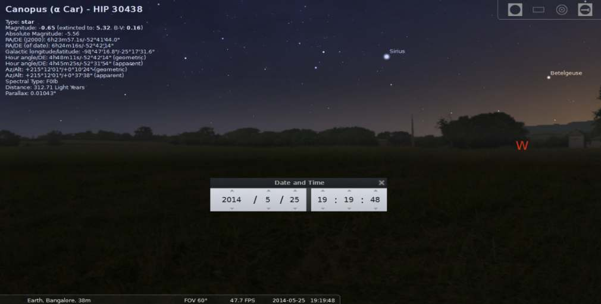
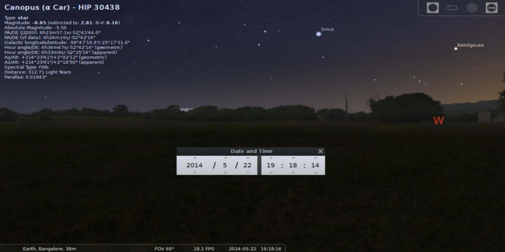

# Heliacal Rising of Canopus in Indian Astronomy

- Author Display: S Balachandra Rao, Rupa K and Padmaja Venugopal
- Year: 2016
- Journal Label: IJHS-51-2016-Issue-1
- Source Url: https://insa.nic.in/(S(eh1ucortlbqqezipwgliy3mn))/writereaddata/UpLoadedFiles/IJHS/Vol51_2016_1_Art10.pdf

<!-- source: page-chunk extraction; methods recorded in assembly-manifest.json -->
<!-- Page ranges and pdf-page markers are 1-based physical PDF positions, not printed pagination. -->

<!-- decode-chunk: pages=1-5 source_sha256=6a4ea1babb5367fea3615396e2c2e64283ddb8b5b70c8eac7aef4e5411540c63 -->
<!-- pdf-page: 1 -->

*Indian Journal of History of Science*, 51.1 (2016) 83-91 DOI: 10.16943/ijhs/2016/v51i1/48379

# Heliacal Rising of Canopus in Indian Astronomy

S Balachandra Rao\*, Rupa K\*\* and Padmaja Venugopal\*\*\*
(Received 8 June 2015; revised 30 November 2015)

### Abstract

In the present paper we discuss briefly the phenomenon of heliacal rising and setting of stars in general and of Canopus in particular. The importance of star *Agastya* (Canopus), apart from its religious significance, lies in its becoming circumpolar for different latitudes during different periods, usually in intervals of thousands of years. In this paper, we show how star Canopus which became circumpolar for an extreme North Indian latitude, attained some status after a couple of thousands of years for a lesser North Indian latitude. Thus, the course of circumpolarity of Canopus moves southwards reducing the terrestrial latitude successively until it reaches a southern limit. Then, the star reverses its course moving northward until it reaches the northern limit of terrestrial latitude.
Key words: *Agastya*, Canopus, Circumpolar, Heliacal rising.
---
\* Hon. Director, Gandhi Centre of Science and Human Values, Bharatiya Vidya Bhavan, #43/1, Race Course Road, Bangalore-560 001, India, Email: balachandra1944@gmail.com  
\*\* Global Academy of Technology, Rajarajeshwari Nagar, Bangalore-560098. Email: shr_rupak@yahoo.co.in  
\*\*\* Professor and Head, Dept. of Mathematics, SJB Institute of Technology, Kengeri, Bangalore-560 060, India

## 1. INTRODUCTION

The importance of the heliacal rising and setting of heavenly bodies was realized in two contexts: (i) the inferior planets Mercury and Venus visible in the eastern and western horizon respectively as ‘morning star’ and ‘evening star’; and (ii) the brightest star Sirius (*Lubdhaka*) heralding the famous floods in the Nile river in Egypt annually at its heliacal rising.
The visibility of star Canopus has been given great importance in Indian astronomical literature. A heavenly body is said to be heliacally rising if it rises in the eastern horizon a few minutes before the sunrise i.e. in the morning twilight. Similarly, a star or planet is heliacally setting a few minutes after the sunset i.e. in twilight of dusk.

## 2. DEFINITIONS

When a star or a planet is close to the Sun, within the prescribed limit, the concerned heavenly body is then said to be ‘combust’ or ‘*asta*’, and not visible due to the Sun’s effulgence. This is called the ‘heliacal setting’ of the concerned star or planet. This invisibility of the heavenly body continues for a few days until the body comes out of the prescribed angular range of the Sun’s brightness.
After a few days when the heavenly body is outside the prescribed angular distance from the Sun it becomes visible and remains so for quite a few days. This beginning visibility is called ‘heliacal rising’. The phenomenon of the heavenly body’s entry into the Sun’s range of effulgence is called ‘heliacal setting’ [Heliacal: related to the Sun]. Similarly the body’s coming out of the Sun’s range of brightness is called heliacal rising. Since the concerned star is close to the Sun in this interval of its heliacal setting and heliacal rising, the Sun and the star, set or rise together within a small interval of time.
The phenomenon of heliacal rising and setting of stars and planets is an important event

<!-- pdf-page: 2 -->

84 INDIAN JOURNAL OF HISTORY OF SCIENCE
discussed in all classical *siddhāntas* under the chapter ‘*Udayāstādhikāra*’. Even in modern astronomy great importance is given to this topic.
Over thousands of years of observation the ancient and medieval astronomers have estimated the altitudinal distance between the Sun and any particular star for the phenomenon of heliacal rise and set. The great Greek astronomer Ptolemy (c.150 AD) called this altitudinal (vertical) distance ‘*arcus visionis*’. This interesting phenomenon has been well studied and used in classical Indian astronomy. The star of particular interest for heliacal rising and setting is *Agastya* (Canopus, $\alpha$ Carinae). In almost all *siddhāntic* texts the celestial longitudes of the Sun for the heliacal rising and setting of Canopus are prescribed. These, two points are referred to as *udayāṃśa* and *astāṃśa* respectively.
The *udayāṃśa* and *astāṃśa* are different for different heavenly bodies and even for particular star these vary with the terrestrial latitude. Further, due to the precession of the equinoxes the rising and setting points for any given place change, though slowly, over centuries.
According to modern investigations the phenomenon of heliacal ‘rise/set’ depends on the following factors: (i) the light pollution, (ii) the altitude of the star above the horizon, (iii) the depression of the star, (iv) the brightness (magnitude) of the star, (v) the colour of star and (vi) the transparency (extinction) of the air.
All these factors contribute to fixing the ‘*arcus visionis*’, the vertical angular distance between the Sun and the star. Considering the above factors, it is estimated that for the heliacal rising and setting of *Agastya* the star should be $3^\circ$ above the horizon while the Sun is $5^\circ$ below the horizon.

## 3. CANOPUS’S RISING IN INDIAN TEXTS

As mentioned earlier the Indian classical astronomical texts refer to *Agastya*’s heliacal rising since the phenomenon was considered important for religious observances besides astronomical curiosity. The rising of *Agastya* is given importance in South India, particularly in Tamil Nadu. We mention a few of these references.

### 3.1 Heliacal rising and setting of *Agastya* in Bhāskara’s *Karaṇakutuhalam* (KK)

अक्षभाष्टाहतियुक्तवर्जिताः  
अष्टगोमितलवागजाद्रयः |  
तत्समैर्दिनमणौचकुम्भभूर्याति  
दर्शनमदर्शनंक्रमात् ||  
KK. bl. 15
The shadow of the gnomon (*akṣabhā* or *palabhā* in *aṅgulas*) multiplied by eight is added to and subtracted from $98^\circ$ and $78^\circ$ respectively for the appearance (rising) and disappearance (setting) of Canopus (*Agastya*, born out of the pot).
The Sun’s *nirayaṇa* positions in longitude are given. Bhāskara II has taken the *nirayaṇa* longitude as $88^\circ$.
It has to be noted that for a gnomon of 12 *aṅgulas* the length of the equinoctial midday shadow is $12\times\tan(\phi)$
**Example:** For Varanasi latitude of $\phi = 25^\circ 19'$ N and longitude $= 83^\circ 01'$ E  
*Palabhā* $= 12 \times \tan(25^\circ 19') = 5.676645223 =$ $5^\circ 40' 35''.92\ a\dot{n}gulas.$
(i) Long. at *lopa* $= 78^\circ - 8 \times palabh\bar{a} =$ $32^\circ 35' 12''.64$
(ii) Long. at *darśa* $= 98^\circ + 8 \times palabh\bar{a} =$ $143^\circ 24' 47''.36$.
This means the *lopa* and *darśa* of Canopus in Varanasi take place when the Sun’s true longitudes are respectively $32^\circ 35' 12''.64$ and $143^\circ 24' 47''.36$.
Note: *lopa*- Heliacal setting, *darśa*- Heliacal rising
**Remark:** The difference between the tropical longitudes of Canopus (*Agastya*) and Sirius (*Lubdhaka*) is about $1^\circ$ for 1150 AD., the year of

<!-- pdf-page: 3 -->

HELIACAL RISING OF CANOPUS IN INDIAN ASTRONOMY 85
the composition of *Siddhānta Śiromaṇi*. The tropical longitudes of *Agastya* and *Lubdhaka* respectively (correct to an arc-minute) were $93^\circ 0'$ and $92^\circ 02'$. According to Bhāskara’s method, the *Ayānāṃśa* for 1150 AD was $10^\circ 28'$ so that the *nirayaṇa* longitude of *Agastya* becomes $82^\circ 32'$. This seems to be the realistic value for the *nirayaṇa* position of *Agastya*.
Now taking the above value Bhāskara’s expressions for the heliacal setting and rising are
(i) $72^\circ 32' - 8 \times palabh\bar{a}$  
(ii) $92^\circ 32' + 8 \times palabh\bar{a}$.
When the *nirayaṇa* Sun occupies these positions we get the dates of heliacal setting and heliacal rising.

### 3.2 Heliacal rising of *Agastya* in *Bṛhat Saṃhitā*

Varāhamihira gives the approximate day of the solar year when *Agastya* becomes visible in the eastern horizon just before the sunrise as follows.
संख्याविधानाततिदेशमस्य विज्ञाय  
सन्दर्शनमादिशेज्ज्ञः ।  
तच्चोज्जयिन्यामपगतस्य कन्यां भागैःस्वरख्यैः  
स्फुटभास्करस्य ॥12॥
The time of rising of *Agastya*-Canopus for each country should be determined by calculation and announced by an astronomer. Now, for Ujjayini, it takes place when the Sun’s true position is $7^\circ$ short of Sign Virgo (*Kanyā*).
विषुवच्छायार्धगुणा पञ्चकृतिस्तत्कलास्तदंशोऽश्वम् ।  
छायात्रिसप्तकयुतं दशभिर्गुणिंतं विनाड्यस्ताः ॥  
ताभिः कर्कटकाद्यलग्नं तादृशे सहस्त्रांशौ।  
याम्याशावनितामुखविशेषतिलको मुनिरगस्त्यः॥
“Multiply half the length of the equinoctial shadow by 25; take from this product, expressed in minutes, the corresponding arc; add the length of the shadow multiplied by 21; multiply by 10; this gives the number in *vināḍīs* reckoning from the beginning of Cancer, stands the Sun when *Agastya* rises in the south, like a mark on the front of a damsel.”
A better and more explicit procedure is given by Varāhamihira in his famous astronomical work *Pañcasiddhāntikā* as follows.
विषुवच्छायार्धगुणा पञ्चकृतिस्तत्कलास्तदंशोऽश्वम्।  
छायात्रिसप्तकयुतं दशभिर्गुणिंतं विनाड्यस्ताः॥  
ताभिः कर्कटकाद्यलग्नं तादृशे सहस्त्रांशौ।  
याम्याशावनितामुखविशेषतिलको मुनिरगस्त्यः॥  
गणितविषयोपलब्धैश्छेद्यकयन्त्रैः प्रकाशतां याति।  
सुखयति मनांसि पुंसां दिव्यं कालाश्रयं ज्ञानम्॥
Multiply the square of 5(i.e. 25) by half the equinoctial midday shadow; (treating it as the Rsine of an arc) find the corresponding arc (in terms of degrees) and add 15(degrees) to that. Multiply that by 10 and add 21 times the equinoctial midday shadow. These are *vināḍīs*.
Assuming these *vināḍīs* as the time elapsed since sunrise and taking the Sun at the first point of Cancer, calculate the longitude of the rising point of the ecliptic. When (the longitude of) the Sun happens to be equal to that, then, by virtue of the graphical method and instruments available to the science of mathematical astronomy, the sage *Agastya* (i.e. the star Canopus) that looks like the special red *tilaka*-mark on the forehead of the lady-like southern direction shines forth and delights the minds of men. Such is the divine knowledge based on time.
Consider Fig. 1. It represents the celestial sphere for a place in latitude $\Phi$. SEN is the horizontal and Z the zenith; $\gamma\text{RET}$ is the equator and P and Q are its north and south poles; $\gamma\text{GSD}$ is the ecliptic. A is Canopus at the time of its heliacal rising and S the Sun at that time. PGAQ is the hour circle of Canopus and G the point where it intersects the ecliptic.
Assuming that the celestial longitude of Canopus is $90^\circ$ and the celestial latitude $75^\circ 20'$ S, we have $\gamma\text{G} = 90^\circ$, $\text{AG} = 75^\circ 20'$ and $\text{AA}' =$ $75^\circ 20' - 24^\circ = 51^\circ 20'$.

<!-- pdf-page: 4 -->

86 INDIAN JOURNAL OF HISTORY OF SCIENCE

*Fig. 1. Rising of Canopus*

<!-- figure-resolved-page-render: page=4 image=media/p04_page.png reason=no-extracted-figure -->

<!-- figure-meta: page=4, position=top, type=diagram -->

Therefore $R\sin A' E = R\sin\ (\text{asc. diff. of Canopus } A) = R \tan\delta \tan\Phi$,
Here $\delta$ is the declination $AA'$ of Canopus and $\Phi$ the latitude of the place,

$$= \frac{\sin\delta.\sin\Phi}{\cos\Phi} \times \frac{R}{\cos\delta}$$

$$= \frac{\sin 51^\circ 20'}{12} \cdot palabh\bar{a} \times \frac{120}{\cos 51^\circ 20'}$$

(according to Varāhamihira, $R=120'$)

$$= 25 \times \frac{palabh\bar{a}}{2} \quad (\text{approx})$$

$\therefore A'E = \text{arc (in terms of degrees) corresponding to}$ $R\text{ sine equal to}$

$$= 25 \times \frac{palabh\bar{a}}{2} \quad (\text{approx}).$$

$EG'' = \text{asc. diff. of } G\ (\text{approx}).$  
$= 21x\ palabh\bar{a},\ vin\bar{a}\d{d}\bar{\imath}s,\ \text{approx}.$
because for unit $palabh\bar{a}$, the ascensional difference for $G$ (the first point of Cancer) is 21 $vin\bar{a}\d{d}\bar{\imath}s$.
Also, assuming 15 to be the time-degrees for the visibility of Canopus,

$$G'S = G''S' \text{ approx.}$$

$$= 15\text{ degrees, approx.}$$

$$\therefore A'S' = A'E + EG'' + G''S' \text{ degrees}$$

$$= [10(A'E + 15) + 21\ palabh\bar{a}\ ]\ vin\bar{a}\d{d}\bar{\imath}s,$$

where $A'E + 15$ is in degrees and $palabh\bar{a}$ in digits. Degrees multiplied by 10 are $vin\bar{a}\d{d}\bar{\imath}s$.
Now GS is the arc of the ecliptic which rises above the horizon (of Laṅkā) in the time given by the arc $A'S'$ of the equator. Hence it is obvious that Canopus $A$ will rise heliacally when the Sun is at $S$, i.e., when

$$\begin{aligned}
\text{Sun's longitude} &= \text{longitude of } G + \text{arc } GS \\
&= \text{longitude of } G\ (i.e.,\ 90^\circ) + \text{arc of the} \\
&\quad \text{ecliptic which rises (at Laṅkā) in the time} \\
&\quad \text{given by the arc } A'S' \text{ of the equator}
\end{aligned}$$

hence the rule.
Obviously, the rule is very crude. It was discarded by the later astronomers who replaced it by better rules.

### 3.3 *Grahalāghavam* procedure for *Lopa* and *darśa* of *Agastya*

पलभाष्टवधोनासंयुता गजशैला वसुखेचरा लवाः।  
इह तावति भास्करे क्रमाद् घटजोऽस्तं ह्युदयं च गच्छति॥
Multiply the *Palabhā* by 8 and subtract from and add to $78^\circ$ and $98^\circ$ respectively. These values correspond respectively to the setting and rising of the *Agastya* star when the (true) sun is at those points.
**Example:** For Bangalore the latitude $\Phi = 13^\circ\text{N}$ therefore the shadow of the gnomon (*śaṅku*) on equinoctial day, $palabh\bar{a} = 12\tan\Phi\ a\dot{n}gulas.$  
$= 12 \times \tan(13^\circ) = 2.770418294\ a\dot{n}g.$  
$\therefore 8 \times palabh\bar{a} = 22.16334635\ a\dot{n}g.$  
(i) *Agastya*’s *asta* (*lopa*)-*dhruva*  
$= 78^\circ - 8 \times palabh\bar{a}$  
$= 55.83665365\text{ deg}$

<!-- pdf-page: 5 -->

HELIACAL RISING OF CANOPUS IN INDIAN ASTRONOMY 87
(ii) *Agastya*’s *udaya* (*darśa*)+*dhruva*  
$= 98^\circ + 8 \times palabh\bar{a}$  
$= 120.1633463\text{ deg}$
This means the *lopa* and *darśa* of *Agastya* in Bangalore take place when the Sun’s true longitudes are respectively $55^\circ.83665365$ and $120^\circ.1633463$. Currently since the sun enters *Meṣa* around April 15, the *Agastya*’s *lopa* (setting) occurs around June 11 and *Agastya darśa* (rising) takes place on Aug 15 respectively.

## 4. PROCEDURE FOR HELIACAL RISING AND SETTING

*Arcus visionis* (arc of visibility) is different for different stars. For a star risen above the eastern horizon, for its visibility there should be a corresponding amount of darkness in the sky which means that the Sun should be correspondingly below the horizon.
If the altitude of the Sun is denoted by $h$, and that of the star by $H$, both in degrees, then the arcusvisionis is $H + h = \gamma$. Here $h$ is below the horizon while $H$ is above the horizon. While the famous Greek astronomer Ptolemy ($2^{\text{nd}}$ cent AD) takes $\gamma$ as a constant, in modern investigations not only $\gamma$ is taken a variable, but even the altitudes of two bodies $H$ and $h$ are taken differently depending on the star’s magnitude and also the atmospheric and visibility conditions,
In case the tropical longitude $\lambda_0$ of the Sun is known, then it is transformed to the equatorial co-ordinates $(\alpha_0, \delta_0)$ by using the expressions

$$\delta_0 = \sin^{-1}(\sin\varepsilon\sin\lambda_0) \tag{1}$$

$$\alpha_0 = \tan^{-1}(\cos\varepsilon\tan\lambda_0) \tag{2}$$

where $\varepsilon$ is the obliquity of the ecliptic, taken approximately as $23^\circ.5$. It is to be noted that the expressions (1) and (2) follow from the more general formulae in which the latitude of the Sun $\beta = 0$.
Then in terms of $(\alpha_0, \delta_0)$ and the terrestrial latitude of the places $\phi$, the corresponding hour angle $H_0$ is given by

$$H_0 = \cos^{-1}\left\{\frac{\cos 97^\circ - \sin\phi\sin\delta_0}{\cos\phi\cos\delta_0}\right\} \tag{3}$$

Here the zenith distance of the Sun is taken as $97^\circ$ i.e. altitude $7^\circ$ below the horizon as a standard case. However, this value changes slightly for different stars, depending on their magnitude. The hour angle from (3), is taken negative for the heliacal rising in the morning twilight and positive for the heliacal setting in the evening twilight. Then the sidereal time (ST) at the time of the above event is given by

$$\text{S.T.} = \alpha_0 + H_0 \tag{4}$$

Now coming to the heliacal rising of the star, under the above conditions, for a place of latitude $\phi$, the hour angle is given by

$$H_R = \cos^{-1}(-\tan\phi\tan\delta) \tag{5}$$

and the corresponding S.T. at that time is given by

$$\text{S.T.} = \alpha_S + H_R \tag{6}$$

where $\alpha_S$ is the right ascension of the star.
With the data from the above expressions, we can find the corresponding tropical longitude of the Sun $\lambda_0$ and hence the calendar dates for the heliacal rising.
Similarly, by taking the positive value for $H_0$ in (3) we get the S.T., tropical longitude and hence the calendar dates for the heliacal setting of the star.
Table 1 provides the dates of heliacal rising and setting of some important stars for Bangalore latitude $\phi \approx 13^\circ$.
Helical rising and setting dates for different latitudes of India is shown in Table 2. In places of higher latitude Canopus sets early in the year than in the places of lesser latitude.
<!-- /decode-chunk -->

<!-- decode-chunk: pages=6-9 source_sha256=3abca9ec715ae46e6fcc8f6d3b9f9511100315eeece7409a1a9eee96b093efd9 -->
<!-- pdf-page: 6 -->

88 INDIAN JOURNAL OF HISTORY OF SCIENCE
**Table 1: Heliacal rising and setting of some important stars for the year 2014**

| Star | Heliacal set | Heliacal rise |
| :--- | :--- | :--- |
| Citrā (Spica) | Sept 26 | Oct 26 |
| Aśvinī (Beta Arietis) | Apr 3 | May 12 |
| Alpha Arietis | Apr 16 | May 3 |
| Lubdhaka (Sirius) | Jun 10 | Jul 19 |
| Rohiṇī (Aldebaran) | May 20 | Jun 12 |
| Abhijit (Vega) | Jan 2 | Jun 13 |
| Revatī (Piscium) | Mar 6 | May 10 |
| Jyeṣṭhā (Antares) | Nov 11 | Dec 14 |
| Alpha Centauri | Sept 21 | Dec 4 |
| Brahmahṛdaya (Capella) | Jun 6 | Jun 14 |
| Kratu (Kratu) | Apr 13 | Sep 1 |
| Angirasa | May 1 | Sep 26 |

**Table 2: Heliacal Rising and Setting of *Agastya* for Different Latitudes for the Year 2014**

| Latitude | Place | Heliacal set | Heliacal rise |
| :--- | :--- | :--- | :--- |
| $8^{\circ}04'$ | Kanyakumari | June 2 | July 18 |
| $13^{\circ}0'$ | Bangalore | May 25 | July 27 |
| $25^{\circ}19'$ | Varanasi | April 30 | August 20 |
| $26^{\circ}19'$ | Jaipur | April 26 | August 24 |
| $34^{\circ}06'$ | Srinagar | March 26 | September 24 |

Fig. 2 represents the last visibility of Canopus before it is heliacally set at Bangalore on 25th May 2014 at the evening sky as taken from Planetarium software. Fig. 1 indicates that Canopus is already set on 25th May 2014 for Bangalore latitude.
We have worked out the visibility period of *Agastya* for different latitudes in India for three different periods and the results are listed in Table 3.

## 5. CIRCUMPOLARITY

Stars rise and set heliacally for a given place on different dates in a year. In between the heliacal setting and rising dates the star will not be visible. On the other hand, in between the heliacal rising and setting the star will be visible in the sky. In the case of some stars, once it is set heliacally on some day, for a long period it will not be visible at all. This period of invisibility can be for several hundreds or thousands of years, depending on the declination ($\delta$), of the star and the terrestrial latitude of the place. Then, the star is said to be ‘Circumpolar’.
**Table 3: Visibility of Canopus for different latitudes in India**

| Year | Place | Heliacal Setting | Heliacal Rising |
| :--- | :--- | :--- | :--- |
| 500 AD | Jammu ($32^{\circ}43'$) | March 31 | Sep. 3 |
| | Varanasi ($25^{\circ}19'$) | April 22 | Aug. 11 |
| | Jaipur ($26^{\circ}55'$) | April 18 | Aug. 15 |
| | Cape Comorin ($8^{\circ}4'$) | May 25 | July 10 |
| 1520 AD | Jammu ($32^{\circ}43'$) | March 27 | Sep. 1 |
| | Varanasi ($25^{\circ}19'$) | April 19 | Aug. 9 |
| | Jaipur ($26^{\circ}55'$) | April 15 | Aug. 13 |
| | Cape Comorin ($8^{\circ}4'$) | May 22 | July 7 |
| 2013 AD | Jammu ($32^{\circ}43'$) | April 6 | Sep. 13 |
| | Varanasi ($25^{\circ}19'$) | April 30 | Aug. 20 |
| | Jaipur ($26^{\circ}55'$) | April 25 | Aug. 24 |
| | Cape Comorin ($8^{\circ}4'$) | June 2 | July 18 |

Note: (i) 500 AD was the time of Āryabhaṭa I (born 476 AD); (ii) 1520 AD is the epochal date of Gaṇeśa Daivajña’s *Grahalāghava*; and (iii) 2013 AD is a modern date.

<!-- pdf-page: 7 -->

HELIACAL RISING OF CANOPUS IN INDIAN ASTRONOMY 89

*Fig. 1. Evening Sky Picture at Bangalore for 25th May -2014 with Canopus not Visible in Western Sky*

<!-- figure-resolved-extracted: page=7 image=media/p07_fig01.jpg -->

<!-- figure-meta: page=7, position=top, type=photograph -->

*Fig. 2. Evening Sky Picture at Bangalore for 22nd May -2014 with Canopus Visible in Western Sky*

<!-- figure-resolved-extracted: page=7 image=media/p07_fig02.jpg -->

<!-- figure-meta: page=7, position=middle, type=photograph -->

Similarly, after a star has risen heliacally it may not set, again for hundreds or thousands of years in which case also the star is said to be ‘circumpolar’.

## 6. CIRCUMPOLARITY OF A STAR IN BHĀSKARA’S WORK

A star is said to be circumpolar when viewed from a particular terrestrial latitude either

<!-- pdf-page: 8 -->

90 INDIAN JOURNAL OF HISTORY OF SCIENCE

*Fig. 3. The motion of stars as viewed by a Northern Hemisphere observer*

<!-- figure-resolved-page-render: page=8 image=media/p08_page.png reason=no-extracted-figure -->

<!-- figure-meta: page=8, position=top, type=diagram -->

does not set at all (i.e. always visible) or does not rise at all (i.e. always invisible) for several years.
Bhāskara II in his *Siddhānta Śiromaṇi* explains about circumpolar stars or the “*sadodita*” stars as he calls them.
Stars that are circumpolar visible in one hemisphere are circumpolar invisible for corresponding latitudes in the opposite hemisphere. For a star of north declination $\delta$ to become circumpolar for the place of latitude $x$ in the northern hemisphere $\delta$ should be greater than $90^{\circ} - \phi$ (i.e. $\phi > 90^{\circ} - \delta$). Such a star will be always above the horizon. Also, if the southern declination of a star is greater than $90^{\circ} - \phi$ such a star will never be seen in a northern latitude, be it *Lubdhaka* (Sirius) or *Agastya* (Canopus).
Bhāskara II gives two examples namely (1) where the latitude is greater than $37^{\circ}$, there *Agastya* will not be visible (having a great south declination) and (2) where the latitude is greater than $52^{\circ}$, star *Abhijit* (Vega) is always above the horizon (having a small north polar distance).

### Modern example

For the year 2013 *Agastya*’s declination is about $52^{\circ}.71$ south.
Therefore, $90^{\circ} - 52^{\circ}.71 = 37^{\circ}.29$. Since we take into consideration the prescribed *arcus visionis* of the star, *Agastya* becomes circumpolar for even latitudes greater than $35^{\circ}$ as mentioned earlier.
It is to be noted that no star is circumpolar for places on the earth’s equator. On the other hand at the north pole or south pole all stars are circumpolar since one half of the celestial sphere can never be seen.
A star rises and sets heliacally for a given place on different dates in a year. In between the heliacal setting and rising dates the star will not be visible. On the other hand, in between the heliacal rising and setting the star will be visible in the sky. In the case of some stars, once it is set heliacally on some day, for a long period it will not be visible at all. This period of invisibility can be for several hundreds or thousands of years, depending on the declination ($\delta$), of the star and the terrestrial latitude $\phi$ of the place. Then, the star is said to be ‘circumpolar’ (*sadodita* in the opposite hemisphere).
Similarly, after a star has risen heliacally it may not set again for hundreds or thousands of years in which case the star is said to be ‘circumpolar’ in the same hemisphere.
Table 4 represents the Circumpolarity of *Agastya* (Canopus) for different latitudes. Columns 2 and 3 respectively represents the beginning and end of visibility and the last column gives the duration of visibility in years.
The heliacal ‘riset’ dates of Canopus during different periods for an exemplary latitude of $36^{\circ}47'$ north are listed in Table 5.

<!-- pdf-page: 9 -->

HELIACAL RISING OF CANOPUS IN INDIAN ASTRONOMY 91
**Table 4: Circumpolarity of *Agastya***
With Altitude of star = $3^{\circ}$ and Altitude of Sun = $-6.5^{\circ}$.

| Latitude ($\phi$) | Lower limit Year (AD) | Upper limit Year (AD) | Duration of visibility (years) |
| :--- | :--- | :--- | :--- |
| $23^{\circ}11'$ | $-6383$ | 7447 | 13,830 |
| $30^{\circ}$ | $-3635$ | 4934 | 8,569 |
| $33^{\circ}$ | $-1909$ | 3256 | 5,165 |
| $34^{\circ}$ | $-1017$ | 2380 | 3,397 |
| $34^{\circ}30'$ | 322 | 1693 | 2,015 |
| $34^{\circ}45'$ | 399 | 976 | 577 |
| $34^{\circ}46'$ | 542 | 833 | 291 |
| $34^{\circ}46.3'$ | 637 | 736 | 99 |
| $34^{\circ}46.33'$ | 662 | 713 | 51 |
| $34^{\circ}46.34'$ | 689 | 689 | 0 |

**Table 5: Circumpolarity of star Canopus for latitude $36^{\circ}47'$**

| Year | Heliacal Rising | Heliacal Setting |
| :--- | :--- | :--- |
| 6667 | Never above the horizon | |
| 6400 | 21 September | 19 March |
| 950 | 14 September | 16 March |
| 2012 | 22 September | 31 March |
| 2034 | Never above the horizon | |

Note: Altitude of Sun = $-6.7$ deg. Altitude of star = $1$ deg.

## 7. CONCLUSION

In this paper we have discussed briefly the phenomenon of heliacal rising and setting of a star as also its circumpolarity for a given place. In the case of star Canopus, we have shown how the star becomes circumpolar progressively for decreasing terrestrial latitude, over thousands of years of interval until it reaches lowest terrestrial latitude. Then the behaviour of the star reverses by becoming circumpolar during different increasing years as its declination progresses northward. In other words the phenomenon is periodic.

## BIBLIOGRAPHY

*Bṛhat Saṃhitā* of Varāhamihira, (two parts) Eng. tr. by M. Ramaksishna Bhat, Motilal Banarsidass, Delhi, 1981.
*Grahalāghavam* of Gaṇeśa Daivajña, Eng. Exposition with Expl. etc. by S. Balachandra Rao and S.K.Uma, IJHS, INSA, New Delhi, 2006.
Jean Meeus. *Mathematical Astronomy Morsels*, Willmann-Bell, Inc., Virginia, 2000.
*Pañcasiddhāntikā* of Varāhamihira, Eng. tr. and Notes by T.S. Kuppana Sastry, Cr. Ed. by K.V. Sarma, P.P.S.T. Foundation, Madras, 1993.
Rao Balachandra, S. *Indian Astronomy – An Introduction*, Universities Press, 2000-02.
Rao Balachandra, S. *Indian Astronomy – A Primer*, Bhavan’s Gandhi Centre of Science and Human Values, Bharatiya Vidya Bhavan, Bangalore, 2008.
Rao Balachandra, S and Padmaja Venugopal, *Eclipses in Indian Astronomy*, Bhavan’s Gandhi Centre of Science and Human Values, Bharatiya Vidya Bhavan, Bangalore, 2008.
Schaefer, B.E. Predicting Heliacal Rising and Settings, *Sky and Telescope*, lxx, 1989, pp. 261-3.
Schaefer, B.E. Heliacal Rise Phenomena, *Archaeoastronomy*, no. 11 *JHA*, xviii, 1987.
*Transits and Occultations in Indian Astronomy*, S. Balachandra Rao and Padmaja Venugopal, Bhavan’s Gandhi Centre of Science and Human Values, Bharatiya Vidya Bhavan, Race Course Road, Bangalore, 2009.
<!-- /decode-chunk -->
