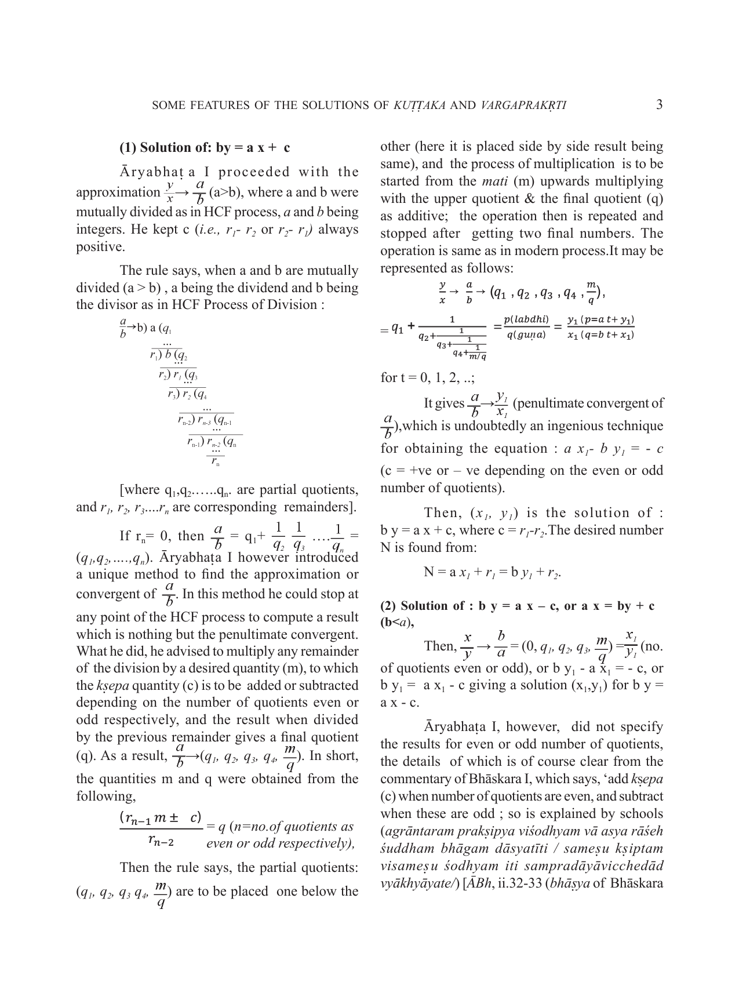

# Some Features of the Solutions of Kuttaka and Vargaprakrti

- Author Display: AK Bag
- Year: 2017
- Journal Label: IJHS-52-2017-Issue-1
- Source Url: https://insa.nic.in/(S(eh1ucortlbqqezipwgliy3mn))/writereaddata/UpLoadedFiles/IJHS/Vol52_1_2017_Art01.pdf

<!-- source: gemini page-chunk extraction -->

Indian Journal of History of Science, 52.1 (2017) 1-16 DOI:10.116943/ijhs/2017/v52i1/41294

# Some Features of the Solutions of *Kuṭṭaka* and *Vargaprakṛti*

**A K Bag***
(Received 15 March 2016)

### Abstract

The expertise in *Kuṭṭaka* and *Vargaprakṛti*, the methods used for the solution of first and second degree indeterminate equations respectively, were considered pre-requisite qualifications of an Acharya in ancient and medieval India. For solution of *Kuṭṭaka* of the type; $b y = a x + c$, the values of $\frac{y}{x}$ were approximated from the successive divisions of $a$ by $b$ as in HCF process and the number of steps was reduced with choice of a desired quantity [*mati*] at any step, even or odd. The solution of *Vargaprakṛti* of the type, $N x^2 \pm c = y^2$ [where $N$ = a non-square integer, and $c = kṣepa$ quantity] was in the manipulation of the value of $\sqrt{N} \to \frac{y}{x}$ based on two set of arbitrary values for $x, y,$ and $c$ and their cross multiplication when $c = \pm 1, \pm 2, \pm 4$, as given by Brahmagupta (c. 628 CE). The solution was concretized by Jayadeva [1100 CE] and Bhāskara II [1150 CE] by a process, known as *Cakravāla*. The number of steps used in *Cakravāla* is much lower than the regular and half-regular expansions for $\sqrt{N}$ used by Euler and Lagrange. The minimization property of *Cakravāla* is unique and the method may be treated as one of the major achievements of Indian mathematics in the history of solution of second degree equations.
**Key words:** Āryabhaṭa, Bhāskara I, Bhāskara II, Brahmagupta, Cakravāla, Diophantus, Euler, Half-regular expansion, Jayadeva, Kṣepa, Kuṭṭaka, Lagrange, Minimization properties, Nārāyaṇa, Pierre de Fermat, Regular expansion, Vargaprakṛti.

## 1. INTRODUCTION

Āryabhaṭa I, the pioneer siddhāntic mathematician cum astronomer who was born in Kusumpura (near Patna) in 476 CE wrote his *Āryabhaṭīya* (Ā) at the age of twenty-three. He concretized his knowledge of arithmetic, algebra including pulverizer (*kuṭṭaka*) and geometry in his second chapter on mathematics (*gaṇita*). Brahmagupta, the first great mathematician of Indian history after Āryabhaṭa I, wrote his *Brāhmasphuṭasiddhānta* (BSS) in 628 CE in Ujjain at the age of thirty, and is the earliest known Indian mathematician to have separated algebra from mathematics (*gaṇita*). He described the qualifications of an *ācārya* ('great teacher') in algebra, in the following words (BSS, xviii 2):[^1]
*kuṭṭaka-kha-ṛṇadhana-avyakta-madhyaharaṇa-ekavarṇa-bhāvitakaiḥ/ācārya sa tantravidām jñātaiḥ varga-prakṛtyā ca //*
**English translation:**
One who is well versed in [operations] with the *kuṭṭaka* (pulverizer), *kha* (zero), *ṛṇa-dhana* (negative and positive quantities), *avyakta* (unknown quantities), *madhya-haraṇa* (the elimination of the middle term), *ekavarṇa* (one unknown), *bhāvita* (equations involving products of unknowns) and also *varga-prakṛti* (second degree equations) is [recognized as] a great teacher (*ācārya*) among the specialists (*tantravids*).
The above verse shows that Brahmagupta set a very high standard for qualifications of an *ācārya* in algebra. It was emphasized that he should be expert in the operations of *Kuṭṭaka* and
***

[^1]: [Note: This footnote marker appears in the text as :1 but no definition is provided on the first page beyond the editor's note.]

\*Editor, IJHS, Indian National Science Academy, Email: akbag99@gmail.com

2 INDIAN JOURNAL OF HISTORY OF SCIENCE
*Vargaprakṛti* beside others. Both the operations had wide ramifications in both mathematics and astronomy.
In this paper, I will discuss the features of solutions of *Kuṭṭaka* of the type : $b y = a x \pm 1$ and $b y = a x \pm c$, and of *Vargaprakṛti* of the type: $N x^2 \pm 1 = y^2$ and $N x^2 \pm c = y^2$ as found in Indian tradition.

## 2. KUṬṬAKA OF THE TYPE: BY = AX ± C

The solution of indeterminate equations of the type :

$$b y = a x \pm c, \text{ leads to:}$$

$$y = \frac{(a x \pm c)}{b} (a > b) \dots (1), \text{ or } x = \frac{(b y \mp c)}{a} (b > a) \dots (2).$$

The solution was actually manipulated by Āryabhaṭa I from the approximations of $\frac{y}{x} \to \frac{a}{b}$ in (1), and $\frac{x}{y} \to \frac{b}{a}$ in (2).

### 2.1. Āryabhaṭa I (b. 476 CE)

Āryabhaṭa I, the pioneer siddhāntik mathematician, himself cited that he had his education in Kusumpura school (*kusumpure carcita jñānam*, Ā, ii.1). The place has been identified in North India between Patna and Nalanda by Shukla (vide his edition of the text, *Āryabhaṭīya*, Introduction p. xviii). Bhāskara I referred to Āryabhaṭa I as an *Āśmakīya*, which indicates that he belonged to Aśmaka tribe or country (*MBh*, Eng tr, p.2), and according to commentator Nīlakaṇṭha he was born in that country. The Aśmaka country has also been identified with Kerala by some scholars.
**A. Rule:** Āryabhaṭa I gives a rule in his *Āryabhaṭīya* for obtaining solution by mutual division of $a$ and $b$ as in HCF process ($a$, $b$ are integers) and is the knowledge of pulverization or *kuṭṭakāra*.
The rule (*Āryabhaṭīya*, Gaṇita, 32-33) runs thus:
*adhikāgra bhāgahāraṃ chindyāt unāgra bhāgahāreṇa /*
*śeṣaparaspara bhaktaṃ matiguṇam agrāntare kṣiptam /*
*adhaupari guṇitam antyayug ūnāgracchedabhājite śeṣam /*
*adhikāgracchedaguṇamdvicchedaāgramadhikāgrayutam // (Ā, Gaṇita, vs.32-33)*
**Tr.** Divide the divisor (*adhikāgra-bhāgahāra*) corresponding to the greater remainder (*adhikāgra*), by the divisor (*unāgra bhāgahāra*) corresponding to the smaller remainder (*unāgra*); the residue and the divisor corresponding to the smaller remainder being mutually divided (*śeṣaparaspara bhaktam*); the residue (at any stage) is to be multiplied by a desired integer (*mati*) to which the difference of the remainders (*kṣepa*) is added (the number of partial quotients being even) or subtracted (the number of partial quotients being odd), the result when divided by the penultimate remainder will give the final quotient; the partial quotients, the *mati* and the final quotient are placed one below the other; then, the *mati* is to be multiplied by the quotient above it to which the final quotient below it is to be added (*adhaupari guṇitam antyayug*), and the process (of multiplication and addition) is continued; the last number obtained is then divided by the divisor corresponding to the smaller remainder; the residue is then multiplied by the divisor corresponding to the greater remainder to which the greater remainder is added; the result will determine the number corresponding to the two divisors.
**Explanation:** Āryabhaṭa I might have been interested to find a number ($N$), which when divided by an integer ($a$) leaves a remainder ($r_1$), and by an integer ($b$) separately leaves a remainder ($r_2$).
Or, $N = a x + r_1 = b y + r_2$,
i.e., to solve: $b y = a x \pm (r_1 - r_2)$ accordingly as $r_1 > r_2$ or otherwise,
or $b y = a x \pm c$, where $c = (r_1 - r_2)$.

SOME FEATURES OF THE SOLUTIONS OF _KUṬṬAKA_ AND _VARGAPRAKṚTI_ 3

### (1) Solution of: $by = ax + c$

Āryabhaṭa I proceeded with the approximation $\frac{y}{x} \to \frac{a}{b}$ ($a > b$), where $a$ and $b$ were mutually divided as in HCF process, $a$ and $b$ being integers. He kept $c$ (i.e., $r_1 - r_2$ or $r_2 - r_1$) always positive.
The rule says, when $a$ and $b$ are mutually divided ($a > b$), $a$ being the dividend and $b$ being the divisor as in HCF Process of Division:

*Fig. 3. HCF process of division*

<!-- figure-resolved-page-render: page=3 image=media/p03_page.webp reason=no-extracted-figure -->

<!-- figure-meta: page=3, position=middle, type=diagram -->

[where $q_1, q_2, \dots, q_n$ are partial quotients, and $r_1, r_2, r_3, \dots, r_n$ are corresponding remainders].
If $r_n = 0$, then $\frac{a}{b} = q_1 + \frac{1}{q_2 + \frac{1}{q_3 + \dots}} = (q_1, q_2, \dots, q_n)$. Āryabhaṭa I however introduced a unique method to find the approximation or convergent of $\frac{a}{b}$. In this method he could stop at any point of the HCF process to compute a result which is nothing but the penultimate convergent. What he did, he advised to multiply any remainder of the division by a desired quantity ($m$), to which the _kṣepa_ quantity ($c$) is to be added or subtracted depending on the number of quotients even or odd respectively, and the result when divided by the previous remainder gives a final quotient ($q$). As a result, $\frac{a}{b} \to (q_1, q_2, q_3, q_4, \frac{m}{q})$. In short, the quantities $m$ and $q$ were obtained from the following,

$$\frac{(r_{n-1} m \pm c)}{r_{n-2}} = q \text{ (} n = \text{no. of quotients as even or odd respectively),}$$

Then the rule says, the partial quotients: $(q_1, q_2, q_3, q_4, \frac{m}{q})$ are to be placed one below the other (here it is placed side by side result being same), and the process of multiplication is to be started from the _mati_ ($m$) upwards multiplying with the upper quotient & the final quotient ($q$) as additive; the operation then is repeated and stopped after getting two final numbers. The operation is same as in modern process. It may be represented as follows:

$$\frac{y}{x} \to \frac{a}{b} \to (q_1, q_2, q_3, q_4, \frac{m}{q}),$$

$$= q_1 + \frac{1}{q_2 + \frac{1}{q_3 + \frac{1}{q_4 + \frac{m}{q}}}} = \frac{p(labdhi)}{q(guṇa)} = \frac{y_1(p = a \cdot t + y_1)}{x_1(q = b \cdot t + x_1)}$$

for $t = 0, 1, 2, \dots$;
It gives $\frac{a}{b} \to \frac{y_1}{x_1}$ (penultimate convergent of $\frac{a}{b}$), which is undoubtedly an ingenious technique for obtaining the equation: $a x_1 - b y_1 = -c$ ($c = +ve$ or $-ve$ depending on the even or odd number of quotients).
Then, $(x_1, y_1)$ is the solution of: $b y = a x + c$, where $c = r_1 - r_2$. The desired number $N$ is found from:

$$N = a x_1 + r_1 = b y_1 + r_2.$$

### (2) Solution of : $b y = a x - c$, or $a x = by + c$ ($b < a$),

Then, $\frac{x}{y} \to \frac{b}{a} = (0, q_1, q_2, q_3, \frac{m}{q}) = \frac{x_1}{y_1}$ (no. of quotients even or odd), or $b y_1 - a x_1 = -c$, or $b y_1 = a x_1 - c$ giving a solution $(x_1, y_1)$ for $b y = a x - c$.
Āryabhaṭa I, however, did not specify the results for even or odd number of quotients, the details of which is of course clear from the commentary of Bhāskara I, which says, ‘add _kṣepa_ ($c$) when number of quotients are even, and subtract when these are odd; so is explained by schools (_agrāntaram prakṣipya viśodhyam vā asya rāśeh śuddham bhāgam dāsyatīti / sameṣu kṣiptam viṣameṣu śodhyam iti sampradāyāvicchedād vyākhyāyate/_) [_ĀBh_, ii.32-33 (_bhāṣya_ of Bhāskara I)]. Brahmagupta (_BSS_, xviii, 3-5, Eng. Tr. Datta & Singh, pt.2, pp.1-2) gave exactly the same method.

4 INDIAN JOURNAL OF HISTORY OF SCIENCE
I)]. Brahmagupta ($BSS$, xviii, 3-5, Eng. Tr. Datta & Singh,pt.2, pp.1-2) gave exactly the same method.

### B. Features of Āryabhaṭa I’s solution:

(i) For solution of : $b y = a x + c$, Āryabhaṭa I gave an ingenious method actually manipulating $(\frac{y}{x} \rightarrow) \frac{a}{b} \rightarrow (q_1, q_2, q_3, q_4, \frac{m}{q}) = \frac{y_i}{x_i} (a > b)$, where $m$ and $q$ are found from: $\frac{(r_{n-1} m \pm c)}{r_{n-2}} = q$ ($n$=even or odd). The result $\frac{x_1}{y_1}$ is nothing but the penultimate convergent of $\frac{a}{b}$ leading to the solution of : $a x_1 - b y_1 = - c$, or $b y_1 = a x_1 + c$ (when number of quotients is even or odd, $c = kṣepa$ number). The value $(x_1, y_1)$ gives the solution of: $b y = a x + c$ from which the required number $N$ is obtained.
(ii) For solution of : $b y = a x - c$, or $a x = b y + c$, the original approximation $(\frac{x}{y} \rightarrow) \frac{b}{a} \rightarrow \frac{x_i}{y_i} (b > a)$, which is also the penultimate convergent leading to the solution of : $b y_1 - a x_1 = - c$, or $b y_1 = a x_1 - c$ (when number of quotients is even or odd, $c = kṣepa$ number). The values of $(x_1, y_1)$ gives the solution of $b y_1 = a x_1 - c$. Or in other words, $(x, y)$ gives the solution from which the required number $N$ is obtained.
(iii) Indicates that if $(x_1, y_1)$ is the solution of : $b y_1 = a x_1 = \pm 1$, then $(c x_1, c y_1)$ is the solution of $b y_1 = a x_1 \pm c$; and
(iv) Āryabhaṭa I managed to obtain the solution of $c (p_n q_{n-1} - q_n p_{n-1}) = \pm c$, $c$ being any $kṣepa$ quantity, for $n = $ even or odd.

### C. Examples:

**1. To find a number N such that N= 60 y + 7 = 137 x + 8**
This leads to : $60 y = 137 x + 1$ (here $r_1 = 7, r_2 = 8, c = r_2 - r_1 = 8 - 7 = 1$)
(i) $\frac{y}{x} \rightarrow \frac{137}{60} \rightarrow 2 + \frac{1}{3+} \frac{1}{1+} \frac{1}{1/1} = \frac{16}{7} = \frac{y_1(labdhi)}{x_1(guṇa)}$
[quotients = 2, 3, 1, $\frac{q}{m}$ (number even); remainders $(r_1, r_2, r_3) = 17, 9, 8$ respectively]; giving, $\frac{(r_3 \cdot m + c)}{r_2} = \frac{(8 \cdot 1 + 1)}{9} = 1$ ($m = mati = 1$, final quotient = $q = 1, c = \text{positive} = + 1$, number of quotients being even);
This leads to : $137 \cdot 7 - 60 \cdot 16 = - 1$, or $60 y_1 = 137 x_1 + 1$, giving $x_1 = 7, y_1 = 16$. This gives, $x = 7, y = 16$, fixing the minimum solution of $60 y = 137 x + 1$.
This suggests that $\frac{16}{7}$ is the penultimate convergent of $\frac{137}{60}$.
(ii) $\frac{y}{x} \rightarrow \frac{137}{60} \rightarrow 2 + \frac{1}{3+} \frac{1}{1+} \frac{1}{1+} \frac{1}{9/8} = \frac{153}{67} = \frac{(137 \cdot 1 + 16) = 153}{(60 \cdot 1 + 7) = 67} \xrightarrow{\frac{(137.1+16)=16(\text{mod } 137)}{(60.1+7)=7(\text{mod } 60)}} \frac{16(=y_1)}{7(=x_1)}$, [quotients (number odd): 2, 3, 1, 1. $\frac{q}{m}$; corresponding remainders : 17, 9, 8, 1]; for $\frac{(r_4 \cdot m - c)}{r_3} = \frac{(1 \cdot 9 - 1)}{1} = 8$; then $m = 9$; $q = \text{final quotient} = 8$, the number of quotients being odd.
This leads to : $137 \cdot 67 - 60 \cdot 153 = - 1$, or $60. (137 + 16) - 137. (60 + 7) = 1$, or $60. 16 = 137. 7 + 1$, or $60 y_1 = 137 x_1 + 1$, giving $x_1 = 7, y_1 = 16$.
Then, $x = 7, y = 16$, fixes the solution of $60 y = 137 x + 1$.
The solution fixes the penultimate convergent as $\frac{16}{7}$ of $\frac{137}{60}$ (the number being even or odd). This satisfies the relation $(p_n q_{n-1} - q_n p_{n-1}) = \pm 1$ (for $n$ = even or odd). The solution is same when the number of quotients is even or odd.
Now, $N = 137 x + 8 = 137 \cdot 7 + 8 = 967$, or $N = 60 y + 7 = 60 \cdot 16 + 7 = 967$.
**2. To solve : 60 y = 137 x – 1**
The equation reduces to : $137 x = 60 y + 1$.
$\frac{x}{y} \rightarrow \frac{b}{a} \rightarrow \frac{60}{137} = 0 + \frac{1}{2+} \frac{1}{3+} \frac{1}{1+} \frac{1}{1+} \frac{1}{7/1} =$

SOME FEATURES OF THE SOLUTIONS OF KUṬṬAKA AND VARGAPRAKṚTI 5
$\frac{53}{121}$ [quotients: 0, 2, 3, 1, 1, 1 (final quptient); remainders : 60, 17, 9, 8, 1]; $m$ is calculated from : $\frac{(r_5 m + 1)}{r_4} = \frac{(1.7 + 1)}{8} = 1$ (final quotient, no. of quotients being even). This leads to : $60 . 121 - 137 . 53 = - 1$, or $60 . 121 = 137 . 53 - 1$, or $b y = a x - 1$, or $x = 53, y = 121$ giving solution of $60 y = 137 x - 1$.
**3. To find a number $N$ such that $N = 60 y = 137 x + 10$**
(a) $\frac{y}{x} \rightarrow \frac{137}{60} \rightarrow 2 + \frac{1}{3+} \frac{1}{1+} \frac{1}{1+} \frac{1}{18/1} = \frac{297}{130}$
$\rightarrow \frac{(297 = 137.2 + 23) = 23 (=y_1)}{(130 = 60.2 + 10) = 10 (=x_1)} \rightarrow \frac{23 (=y_1)}{10 (=x_1)}$
[quotients (number odd): $2, 3, 1, 1, \frac{1}{18}$; corresponding remainders: $17, 9, 8, 1$; for $\frac{(r_4 . m - c)}{r_3} = \frac{(1 . 18 - 10)}{8} = 1$; hence $m = 18, q = 1$]. This leads to : $137 . 10 - 60 . 23 = - 10$, or $60 . 23 = 137 . 10 + 10$;
Comparing with $60 y = 137 x + 10$, it gives, $x = 10, y = 23$ as the solution of $60 y = 137 x + 10$. Now ; $N = 137 x + 10 = 137, 10 + 10 = 1380$.
(b) From **Example C.I**: $x = 7, y = 16$ is the solution of : $137 x + 1 = 60 y$. For, $c = 10$, obviously, $x = (7 . 10) = 70 = 10 \pmod{60}$ For, $70 = 60 . 1 + 10)$; $y = (16 . 10) = 160 = 23 \pmod{137}$; For, $160 = 137 . 1 + 23 = 23 \pmod{137}$;
This shows that if $(x = 7, y = 16)$ is the solution of : $137 x + 1 = 60 y$, then $(cx, cy)$ is the solution of : $137 x + 10 = 60 y$, for $c = 10$.

## 2.2 Bhāskara I (c. 600 CE)

Bhāskara I imbibed his knowledge of astronomy from his father, a follower of the school of Āryabhaṭa I. He wrote his *Mahābhāskarīya* (MBh), *Āryabhaṭīya-bhāṣya* (ĀBh) (in 629 CE) and *Laghu-bhāskarīya* (LBh) in order and used a large number of problems relating to *Kuṭṭaka*.

### A. Bhāskara I’s clarification and modification

of the rules are extremely interesting. He set a large number of examples for the solutions of indeterminate equations for (1) and (2), keeping *kṣepa* quantity ($c$) as positive, following Āryabhaṭa I. However, Bhāskara I emphasized more importance to the solution of : $b y = a x - c$, or $y = \frac{(ax - c)}{b}$ straightway, because of its application in solving astronomical problems, where $a$ = revolution number, $b$ = civil days in a Yuga, $c$ = residue of the revolutions of planet. $x$ = number of days passed from the epochal point (*ahargaṇa*), and $y$ = complete revolutions performed by the planet.

### B. Features of Bhāskara I's solution:

(i) Dividend and the divisor ($a$ and $b$) should be prime to each other (*hārabhājyau dṛḍhau syātām kuṭṭakāramtayorviduh* / MBh, i. 41);
(ii) For the solution of : $b y = a x - c$ ($a < b$); the mutual division of $\frac{y}{x} \rightarrow \frac{a}{b}$ leading to its solution.
Let : $\frac{y}{x} \rightarrow \frac{a}{b} = q_1 + \frac{1}{q_2+} \frac{1}{q_3+} \dots$, (where $q_1 = 0$). The first quotient being zero was not effective in the calculation. Obviously, Bhāskara I concluded that the *kṣepa* number is to be subtracted (*apanīyam*) for even number of quotients, and added for odd number of quotients (MBh, i.42-44).
(iii) Bhāskara I also suggests that if $(x_1, y_1)$ is the solution of : $b y = a x - c$, then $(b - x_1, a - y_1)$ is the solution of : $b y = a x + c$. Likewise, if $(x_1, y_1)$ is the solution of : $b y = a x + c$, then $(b - x_1, a - y_1)$ is the solution of : $b y = a x - c$.
(iv) He also explained that if $(x_1, y_1)$ is the solution of : $a x_1 - 1 = b y_1$, then $(x = c x_1, y = c y_1)$ is the solution of : $a x - c = b y$ (MBh, i.47);
(v) Bhāskara I also recommended that if $x = x_1, y = y_1$ is the minimum solution of: $b y = a x - c$, then the other solutions of the same equations are : $x = b t + x_1, y = a t + y_1$, for $t = 1, 2, 3, \dots$ (MBh. i.50)

6 INDIAN JOURNAL OF HISTORY OF SCIENCE
(vi) Bhāskara I had also the knowledge of successive convergents.
Let $\frac{a}{b} = q_1 + \frac{1}{q_2 +} \frac{1}{q_3 +} \dots \dots \dots \dots \frac{1}{q_n}$
Then,
$\frac{p_1}{Q_1} = \frac{q_1}{1}; \frac{p_2}{Q_2} = \left(q_1 + \frac{1}{q_2}\right); \frac{p_3}{Q_3} = \left(q_1 + \frac{1}{q_2 + \frac{1}{q_3}}\right) \dots$, where $\frac{p_1}{q_1}, \frac{p_2}{q_2}, \frac{p_3}{q_3} \dots$are the 1 $^{st}$, 2 $^{nd}$, 3 $^{rd}$ convergent (or approximation) values of the rational number $\frac{a}{b}$.
Bhāskara I’s application justifies his knowledge of convergents. In his formula for declination, he uses two variants of the same result as under:
(a) $R \text{ Sine } \delta = \frac{(1397 \times R \text{ Sine } \lambda)}{3438} (MBh. \text{ iii. 6-7 }), \text{ and}$
(b) $R \text{ Sine } \delta = \frac{(13 \times R \text{ Sine } \lambda)}{32} (MBh. \text{ iv. 25}),$
where $\delta$ = declination, $\lambda$ = longitude.
The result $\frac{13}{32}$, the fifth convergent of $\frac{1397}{3438}$ (vide **Example C.2** below) is used in the formula for declination, it is quite likely that Bhāskara I had the knowledge of successive convergents.

### C. Examples:

**1. To solve ; $3438 y = 1397 x - 1$**
According to Bhāskara I’s procedure, $\frac{y}{x} \to \frac{1397}{3438} = 0 + \frac{1}{2 +} \frac{1}{2 +} \frac{1}{5 +} \frac{1}{1 +} \frac{1}{10/1} = \frac{141 (= y_1)}{347 (= x_1)}$ where partial quotients = 0, 2, 2, 5, 1, and 1 (final quotient); the partial remainders = 1397, 644, 109, 99, 10; $m$ (*mati*) and the final quotient 1 is obtained from, ($c$ becomes negative no. of quotients being even) : $\frac{(r_5 \cdot m - 1)}{r_4} = \frac{(10 \cdot m - 1)}{99} = 1$ (final quotient) for $m = 10$. This leads to: $1397 \cdot 347 - 3438 \cdot 141 = 1$, or $3438 \cdot 141 - 1397 \cdot 347 = - 1$, or $3438 y_1 = 1397 x_1 - 1$, which gives $x_1 = 347, y_1 = 141$ as the required solution. This also indicates that $\frac{141}{347}$ is the penultimate convergent of $\frac{1397}{3438}$.
Bhāskara I suggests that then, $b - x_1 = 3438 - 347 = 3091, a - y_1 = 1397 - 141 = 1256$, will be the solution of $3438 y = 1397 x + 1$.
**2. To solve ; $3438 y = 1397 x - 1$**
Here, $\frac{y}{x} \to \frac{1397}{3438} = 0 + \frac{1}{2 +} \frac{1}{2 +} \frac{1}{5 +} \frac{1}{1 +} \frac{1}{9 +} \frac{1}{1 +} \frac{1}{9}$
$= 0, \frac{1}{2}, \frac{2}{5}, \frac{11}{27}, \frac{13}{32}, \frac{128}{315}, \frac{141}{347}, \frac{1397}{3438}$ (convergents).
This shows that the Indian method always calculated the value of penultimate convergent of $\frac{1397}{3438}$, which gives: $x = 347, y = 141$ ($n$ = even).
**3. The residue of the revolutions of Saturn being 24, find the *ahargaṇa* $x$ and the revolutions made by Saturn [*LBh*, viii. 17; see also Shukla, *MBh* edition, p. 30]**
Saturn’s revolution number = 146564, number of civil days = 1577917599, both numbers has an $HCF = 4$; dividing by 4, the number of Saturn’s revolutions, and the civil days in a yuga are: 36641, 394479375; to find the *ahargaṇa* ($x$) and the Saturn’s revolution number ($y$); this leads to; $y = \frac{36641x - 24}{394479375}$
Now, $\frac{y}{x} \to \frac{36641}{394479375} = 0 + \frac{1}{10766 +} \frac{1}{15 +} \frac{1}{2 +} \frac{1}{7 +} \frac{1}{22 +} \frac{1}{2 +} \frac{1}{27/1} = \frac{32292 (= y_1)}{346688814 (= x_1)}$
$= \frac{(36641 \cdot t + 32292)}{ (394479375 \cdot t + 346688814)}$; quotients: 0, 10766, 15, 2, 7, 22, 2, 1 (final quotient), remainders : 36641, 2369, 1106, 157, 7, 3, 1; $m$ (*mati* is obtained from : $\frac{(r_7 \cdot 27 - 24)}{r_6} = \frac{(1 \cdot 27 - 24)}{3} = 1$ for $m = 27$. This gives, $394479375 \cdot 32292 - 36641 \cdot 346688814 = - 24$; This gives, $394479375 y_1 = 36641 \cdot x_1 - 24$ where $x_1 = \textit{ahargaṇa} = 346688814, y_1 = \text{Saturn’s revolution} = 32292$.

## 2.3. Brahmagupta

The most prominent of Hindu mathematicians belonging to school of Ujjain was Brahmagupta. His *Brāhmasphuṭasiddhānta* (BSS) was composed in 628 CE.

SOME FEATURES OF THE SOLUTIONS OF *KUṬṬAKA* AND *VARGAPRAKṚTI* 7
**A. Features of Brahmagupta’s solution:**
(i) Recommended the same rule, as was prescribed by Āryabhaṭa I for the solution of: $b y = a x + c$ (*BSS*, xviii.3-5);
(ii) For the solution of : $b y = a x – c$ ($a < b$), Brahmagupta supported the method of Āryabhaṭa I and Bhāskara I, when first quotient is zero and not effectively taken part in the calculation. Brahmagupta categorically said, ‘Such cases become negative and positive for even and odd quotients being alternative to what is positive and negative in the normal cases, leading to the calculation of $guṇa$ ($x$) and $kṣepa$ ($c$) $[evam\ śameṣuviṣameṣuṛṇam\ dhanamdhanamṛṇam\ yaduktam\ tat\ /\ ṛṇadhanoyor\ vyastatvamguṇyaprakṣepayoh\ kāryam\ //\ BSS,\ xviii.\ 13];$
(iii) Pṛthudakasvāmi (860 CE) observes that it is not absolute, rather optional, so that the process may be conducted in the same way by starting with the division of the divisor corresponding to the smaller remainder by the divisor corresponding to the greater remainder. But in the case of inversion of the process, he continues, the difference of the remainders may be made negative.
Brahmagupta followed the earlier tradition and his method is no different than the method of Āryabhaṭa I and Bhāskara I. He clarified the method with a few examples from astronomical and mathematical problems. The most important contribution of Brahmagupta lies in the fact that he utilized the knowledge of continued division for solution of *Vargaprakṛti* of the : $N x^2 \pm c = y^2$.
**2.4. Bhāskara II (b.1114 CE)**
Bhāskara II, a versatile scholar from the school of Ujjain in the field of mathematics and astronomy was trained by astronomer father Maheśvara at Bijjalabiḍa under the patronage of Śaka king. His *Bījagaṇita* contains important contributions in algebra.
A Bhāskara II’s rules are far more simplified and may be summarized thus. This in short:
(i) For solution of $b y = a x + c$, Bhāskara II said that the mutual division may be continued to finish, i.e., till the last remainder is $1$; then the sequence of quotients should follow with $c$ and $0$. e.g., $\frac{y}{x} \to \frac{a}{b} = (q_1, q_2, q_3, q_4, c/0)$ $= q_1 + \frac{1}{q_2 +} \frac{1}{q_3 +} \frac{1}{q_4 +} \frac{1}{c/0} = \frac{c.y_1}{c.x_1}$ where $c = \text{any number}$, leading to the solution of ; $c (a x_1 - b y_1) = \pm c$ ($n = \text{even or odd}$).
(ii) If $(x, y)$ be the solution of $b y = a x + 1$, then $(c x, c y)$ is the solution of $b y = a x + c$.
(iii) If $(x_1, y_1)$ is the solution of $b y = a x – c$, then $(b - x_1, a - y_1)$ is a solution of $b y = a x + c$. This was already explained before by Bhāskara I. Likewise, if $(x_1, y_1)$ is the solution of : $b y = a x + c$, then $(b - x_1, a - y_1)$ is the solution of : $b y = a x - c$.
**B. Examples:**
**1. To solve : 23 y = 63 x + 1**
Bhāskara II says that for solution of $23 y = 63 x + 1$, the dividend $63$ and divisor $23$ are to be mutually divided as in HCF process till the remainder reduces to $1$, then place the quotients one below the other with $c$ and $0$, as is done for *mati* and final quotient by other authors. Obviously,

$$\frac{y}{x} \to \frac{63}{23} = 2 + \frac{1}{1 + \frac{1}{2 + \frac{1}{1 + \frac{1}{1/0}}}} = (2, 1, 2, 1, 1/0) = \frac{11}{4}.$$

This gives : $63. 4 – 23. 11 = - 1$, or $23. 11 = 63 . 4 + 1$ (no. of quotients = odd); then, $x = 4$, and $y = 11$ gives the solution of $23 y = 63 x + 1$;
**2. To solve : 63 y = 100 x + 13**

$$\frac{y}{x} \to \frac{100}{63} = 1 + \frac{1}{1 + \frac{1}{1 + \frac{1}{2 + \frac{1}{2 + \frac{1}{1 + \frac{1}{13/0}}}}}} = (1, 1, 1, 2, 2, 1, 13/0) = \frac{351}{221}$$

(penultimate convergent);
This gives : $100. 221 - 63. 351 = - 13$ ($n = \text{odd}$) , or $63. 351 = 100. 221 + 13; x = 221 = 63. 3 + 32$

8 INDIAN JOURNAL OF HISTORY OF SCIENCE
$= 32 \pmod{63}$; $y = 351 = 100 \cdot 3 + 51 = 51 \pmod{100}$. Hence $x = 32, y = 51$ is the least solution of $63 y = 100 x + 13$.

## 3. VARGAPRAKṚTI

### 3.1. Definition: 

The *Vargaprakṛti* involves solutions of indeterminate equations of the type: $Nx^2 \pm k = y^2$, where
$N \to$ a non-square integer, known as *prakṛti* or *guṇaka*;
$x \to$ known as lesser root, *kaniṣṭhapada*, *hrasvamūla*, or *ādyamūla*,
$y \to$ refers to greater root, *jyeṣṭhamūla*, *anyamūla*, or *antyamūla* and
$k \to$ refers to number added, *kṣepa*, *prakṣepa*, or *prakṣepaka*.
Brahmagupta obtained two sets of approximate values and applied the process of *Bhāvanā*. Jayadeva and Śrīpati (both of 11th century CE) established the process of *Cakravāla* and led the foundation, while Bhāskara II (c. 1150 CE) and Nārāyaṇa (c. 1350 CE) made further extention and clarification with examples in his *Gaṇita Kaumudi* (GK). The solution however is based on the theory of continued fraction as expounded by Āryabhaṭa I, Bhāskara I.
Nārāyaṇa following tradition had categorically said which runs thus
*mūlam grāhyam yasya ca tadrūpakṣepake pade tatra /*
*jyeṣṭham hrasvapadena ca samuddhan mūlamāsannam //*
“Obtain the roots (of the *Vargaprakṛti*) with *kṣepa* quantity as unity (i.e., $N x^2 + 1 = y^2$) and the number ($N$) whose square-root is to be obtained; then the greater root divided by the smaller root will determine an approximate value of the square-root ($\sqrt{N}$)’’ (GK, p.244).
This implies that Nārāyaṇa, following others, has categorically said that the solution lies in the approximation of $\sqrt{N} \to \frac{y}{x}$.
The complete theory of solutions was expounded by Euler and Lagrange later in 1767 CE.

## 3.2 Brahmagupta’s Solutions

Brahmagupta’s solutions in rational integers of both positive and negative types of the equation $Nx^2 \pm k = y^2$, may be explained with method of cross-multiplication, known as *Bhāvanā* or Lemmas.
**Lemma I:** Brahmagupta (*BSS*, xviii, 64-65) first formed a set of auxiliary equations described as follows:
*mūlam dvidhā iṣṭavargād guṇakaguṇād iṣṭa yuta vihinān ca /*
*ādyavadho guṇakaguṇah saha antyaghātena kṛtam antyam //*
*vajravadhaikam prathamam prakṣepah kṣepabadhatulyah/*
*prakṣepaśodhakahṛte mūle prakṣepake rūpe//*
**English Translation:**
‘From the square of an assumed number multiplied by the *guṇaka*, add or subtract a desired quantity and obtain the root, and place them twice. The product of the first [pair of roots] multiplied by the *guṇaka* increased by the product of the last [pair of roots] is the [new] greater root (*antya-mūlam*). The sum of the products of the cross-multiplication (*vajravadhaiam*) is the first [new] root (*prathama-mūlam*). The [new] *kṣepa* is the product of similar additive or subtractive quantities. When the *kṣepa* is equal (*tulya*), the root [first or last] is to be divided by it to turn the [new] *kṣepa* into unity’.
This explains *Samāsa* (additive), *Viśleṣa* (subtractive) and *Tulyabhāvanā* (equal roots)

SOME FEATURES OF THE SOLUTIONS OF *KUṬṬAKA* AND *VARGAPRAKṚTI* 9
discussed under Features (A&B).
**Lemma II :** Brahmagupta (*BSS*, xviii. 65) says, if $x = a, y = b$ be a solution of : $N x^2 + k^2 = y^2$, then $x = a/k, y = b/k$, is the solution of : $N x^2 + 1 = y^2$.
**Lemma III:** Brahmagupta (*BSS*, xviii, 66-69) prescribed his subsequent rules, which explains how the solution of the equation $N x^2 + k = y^2$ is obtained when $k = \pm 1, \pm 2, \pm 4$ by applying *tulyabhāvanā*.

## Features: Lemma I suggests the following:

### (A) *Samāsa* and *Viśleṣa Bhāvanā*:

If, $(a_1, b_1, k_1)$ and $(a_2, b_2, k_2)$ satisfy the equations of the type: $Nx^2 \pm k = y^2$ by choice, then put

| Prakṛti | Kaniṣṭha root | Jyeṣṭha root | Kṣepa |
| :--- | :--- | :--- | :--- |
| $N$ | $a_1$ | $b_1$ | $k_1$ |
| | $a_2$ | $b_2$ | $k_2$ |

[Then it satisfies] $N(a_1 b_2 \pm a_2 b_1)^2 + k_1 k_2 = (Na_1 a_2 \pm b_1 b_2)^2$ i.e. $x =$ Kaniṣṭha root $= (a_1 b_2 \pm a_2 b_1)$, $y =$ Jyeṣṭha root $= (Na_1 a_2 \pm b_1 b_2)$ will satisfy the equation, $N x^2 + k_1 k_2 = y^2$.
It will satisfy both the addition (*samāsa-bhāvanā*) and the subtraction rule (*viśleṣa-bhāvanā*). This was discovered by Brahmagupta, and later rediscovered by Euler in 1764. This also leads to *Tulya Bhāvanā* when both the roots are same.

### (B) *Tulya Bhāvanā* (when two roots are equal), which is a special case of *samāsa-bhāvanā*. The rule runs as follows:

If $(a, b, k)$ and $(a, b, k)$ the two equal roots of $Nx^2 + k = y^2$ is taken into consideration by choice, then put twice the roots,

| Prakṛti | Kaniṣṭha root | Jyeṣṭha root | Kṣepa |
| :--- | :--- | :--- | :--- |
| $N$ | $a$ | $b$ | $k$ |
| | $a$ | $b$ | $k$ |

Then it satisfies, : $N(2ab)^2 + k^2 = (N a^2 + b^2)^2$. By application of Lemma II, it is reduced to: $N \left( \frac{2ab}{k} \right)^2 + 1 = \left\{ \frac{Na^2 + b^2}{k} \right\}^2$. The aim was to obtain the solution of $N x^2 + 1 = y^2$, so on.

## C. Example (Brahmagupta):

Brahmagupta gave several examples of which one is to solve

$$92x^2 + 1 = y^2$$ (*Brāhmasphuṭasiddhānta* (Dvivedin 1902, *BSS*, xviii, 75), where $x$ refers to the *rāśiśeṣa*, $y$ to the *ahargaṇa* of the planet Mercury, and $N = 92$.
(i) For solution of the example, select $92.(1)^2 + 8 = (10)^2$, then *tulya bhāvanā* is applied as follows:

| Prakṛti | Kaniṣṭha root | Jyeṣṭha root | Kṣepa |
| :--- | :--- | :--- | :--- |
| 92 | 1 | 10 | 8 |
| | 1 | 10 | 8 |
| New root | 20 | 192 | 64 |

New Equation:
(2) $92\left( \frac{20}{8} \right)^2 + 1 = \left( \frac{192}{8} \right)^2$; or, $92\left( \frac{5}{2} \right)^2 + 1 = (24)^2$
Then again repeating the process of *tulya-bhāvanā*, we get:

| Prakṛti | Kaniṣṭha root | Jyeṣṭha root | Kṣepa |
| :--- | :--- | :--- | :--- |
| 92 | 5/2 | 24 | 1 |
| | 5/2 | 24 | 1 |
| New Roots | 120 | 1151 | 1 |

(3) New roots: $\frac{5}{2} \cdot 24 + \frac{5}{2} \cdot 24 = 120$; $92 \cdot \frac{5.5}{2.2} + 24 \cdot 24 = 1151$; $1 \cdot 1 = 1$. The roots satisfy, $92 (120)^2 + 1 = (1151)^2$ which gives the required solution. When compared

10 INDIAN JOURNAL OF HISTORY OF SCIENCE
with the original equation : $N x^2 + 1 = y^2$, then $x = 120, y = 1151, N$ being 92.;
The convergents of $\sqrt{92} \rightarrow \frac{y}{x} = \frac{10}{1}, \frac{48}{5}, \frac{1151}{120}$,
The solution is obtained in 3rd step. Brahmagupta’s method of solution of $N x^2 + 1 = y^2$ is, no doubt interesting but limited, and based on arbitrary choice.

# 4. SOLUTION OF VARGAPRAKṚTI BY JAYADEVA (1100 CE) AND OTHERS

The *Cakravāla* process, an improved method, was first given by Jayadeva and Śrīpati in the eleventh century, followed by Bhāskara II (1150 CE), Nārāyaṇa Paṇḍita (c. 1350 CE) and others.

## 4.1. Solutionof :$Nx^2 + 1 = y^2$ by the Cakravāla (Cyclic) Process

The *Sundarī*, Udayadivākara’s commentary on the *Laghubhāskarīya* of Bhāskara 1 (*Vargaprakṛti*, verses 8-15) quotes from Jayadeva’s work[^1]. This was brought to our notice by Shukla (1954) :
Jayadeva assumed in verse 8 one set of integer values ($a, b, k$) for lesser (*kaniṣṭha*) root, greater (*jyeṣṭha*) root and *kṣepa* number satisfying $Nx^2 + k = y^2$, then found the other set ($1, m, k$) satisfying the identity equation: $N. 1^2 + (m^2 - N) = m^2$ where *kṣepa* quantity, $k = (m^2 - N)$.
The process of *Bhāvanā* is then applied, by Jayadeva to find an arbitrary set, as follows:
(a) Taking  
$Na^2 + k = b^2$ and  
$N.1^2 + (m^2 - N) = m^2$ (an identity),
Jayadeva developed a new set of auxiliary roots by *Cakravāla* as follows:

| Prakṛti | Kaniṣṭha root | Jyeṣṭha root | Kṣepa |
| :--- | :--- | :--- | :--- |
| $N$ | $a$ | $b$ | $k$ |
| | $1$ | $m$ | $m^2 - N$ |
| (new root) | $am + b$ | $Na + bm$ | $k$   $(m^2 - N)$ |

The new root satisfies the equation :

$$N(am + b)^2 + k(m^2 - N) = (Na + bm)^2$$

Dividing by $k^2$ we get,
(b) $N \{ \frac{(am+b)}{k} \}^2 + \frac{(m^2 - N)}{k} = \{ \frac{(Na + bm)}{k} \}^2$
In verses 9-11, Jayadeva also hinted at a ready made new *kaniṣṭha* (lesser) root in the form of a *kuṭṭaka* i.e., $\frac{(am+b)}{k}$, a new *jyeṣṭha* (greater) root = $\frac{(Na+bm)}{k}$, and a new *kṣepa* = $\frac{(m^2-N)}{k}$. He said that they should be integers and that the value of $m$ should be so selected that the new *kṣepa* should be an integer as small as possible.
As regards new *kṣepa*, $\frac{(m^2-N)}{k}$, Ācārya Jayadeva said, *tāvat kṛteḥ prakṛtyā hīne prakṣepakena sambhakte svalpatarā avāpti syāt ityakalitā aparah kṣepa* (verse 9) i.e., *tāvatkṛteḥ* ($m^2$) *prakṛtyā hīne* diminished by ($N$) and *prakṣepakena sambhakte* divided by the interpolator ($k$), should be such that it yields the least value (*svalpatarā avapti syāt*).
As regards new *kaniṣṭha* (lesser) root $\frac{(am+b)}{k}$, he said, *prakṣipta-prakṣepa-kuṭṭakāre kaniṣṭhamūlahate sajyeṣṭhapade prakṣep(ak)eṇa labdham kaniṣṭhapadam* / (verse 10 ).i.e., *kaniṣṭhapadam* lesser root is obtained (*labdham*)

[^1]: *hrasvajyeṣṭhakṣepān pratirāśya kṣepabhaktayoh kṣepāt / kuṭṭakāre ca kṛte kiyadguṇam kṣepakam kṣiptvā // (8)*  

*tāvatkṛteh prakṛtyā hīne prakṣepakena sambhakte / svalpatarāvāptih syād ityakālito 'parah kṣepah //(9)*  
*prakṣiptaprakṣepakakuṭṭakāre kaniṣṭhamūlahate / sajyeṣṭhapade prakṣep(ak)eṇa labdham kaniṣṭhapadam //(10)*  
*kṣiptakṣepakakuṭṭaguṇitāt tasmāt kaniṣṭhamūlahatam / pāścātyam prakṣepam viśodhya. śeṣam mahānmūlam 1/ (11)*  
*kuryāt kuṭṭakāram punar anayoh kṣepabhaktayoh padayoh/ tat .sa iṣṭahatakṣepe sadṛśaguṇe 'sminprakrtihīne // (12)*  
*prakṣepah kṣepāpte prakṣiptakṣepakāc ca guṇakārāt / alpaghnāt sajyeṣṭhāt kṣepāvāptatn kaniṣṭhapadam // (13)*  
*etas kṣiptakṣepakakuṭṭaghātādanatarakṣepam / hitvā 'Ipahatam śeṣam jyeṣṭham tebhyaś ca guṇakādi (14)*  
*kuryād tāvad yāvat saṇṇāmekadvicaturnām patati / iti cakravāla karaṇe ‘vasaraprāptāniyojyāṇi (15).*

SOME FEATURES OF THE SOLUTIONS OF *KUṬṬAKA* AND *VARGAPRAKṚTI* 11
from the product (*hate*) of *prakṣipta-prakṣepa-kuṭṭakāra* (i.e., $m$) and *kaniṣṭha-mūla* ($a$), increased by *jyeṣṭha-mūla* ($b$) and divided by *kṣepa*.
Regarding new *jyeṣṭha* (greater) root, Jayadeva said *kṣiptakṣepakakuṭṭaguṇitāt tasmāt kaṇiṣṭhamūlahatam pāścātyam prakṣepam viśodhya śeṣam mahānmūlam* / (verse 11) i.e., from the product of *kṣipta-kṣepa-kuṭṭa* ($m$) and *tasmāt* i.e., the previous lesser root $\frac{(am+b)}{k}$, the product of *kaniṣṭhamūlam* ($a$) and the *pāścātyamprakṣepam* $\frac{m^2 - N}{k}$ is subtracted (*viśodhya*), the remainder (*śeṣam*) gives the greater root (*mahān-mūlam*).
i.e., $\frac{(Na+bm)}{k} = \left[ \frac{m(am+b)}{k} - \frac{a(m^2 - N)}{k} \right]$
**Features of Jayadeva’s solution** as given in steps of 4.1 actually reduces to the form:
(i) From $N a^2 + k = b^2$, Jayadeva found a solution:
$N a_1^2 + k_1 = b_1^2$ where $a_1 = \frac{(am+b)}{k}, b_1 = \frac{(Na+bm)}{k}$, and $k_1 = \frac{(m^2 - N)}{k}$ .. (4.2)
(ii) Treating 4.2 as an auxiliary equation, and proceeding as above, a new equation of the same type: $N a_2^2 + k_2 = b_2^2$, could be obtained, where $a_2, b_2$, and $k_2$ are whole numbers [verses 12-14].
(iii) Jayadeva said that the process could be repeated till it reduces to an equation with interpolator $k$ as $\pm 1, \pm 2, \pm 4$, where $a, b$ are integers [*tebhyaś ca guṇakādi kūryāt tāvad yāvat sannāma eka-dvi-caturṇām patati*, [footnote 8, vs. 14c-15b)].
(iv) Then apply again the *samāsa-bhāvanā*, leading to solution an equation of the type: $N a^2 + 1 = b^2$. The process is known as **cyclic process** (*cakravāla*) [verse 15]
Comparing with $N x^2 + 1 = y^2$, it gives the integral solution as $x = a, y = b$.

### 4.2 Śrīpati, Bhāskara II (1150 CE), Nārāyaṇa (1350 CE):

Śrīpati also obtained the solution of $N x^2 + 1 = y^2$ by using the identity equation and applying the principle of Composition. English translation of the relevant verse (*SiŚe*, xiv.33, Datta & Singh, Pt. II, pp. 152-153) runs thus:
> “Unity is the lesser root; its square multiplied by *Prakṛti* is increased or decreased by the *Prakṛti* combined with an (optional) number whose square root will be the greater root; from them will be obtained two roots by the Principle of Composition”.
In the identity equation, $N \cdot 1^2 + (m^2 - N) = m^2$, the roots, $(1, m, m^2 - N)$ by *tulya bhāvanā* gives new set of roots, $x = \frac{2m}{m^2 - N}, y = \frac{m^2 + N}{m^2 - N}$.
Bhāskara II based his ‘Cyclic Method’ or *Cakravāla* (*Bījagaṇita*, *Cakravāle karaṇasūtram*, verses 1-4) on the following Lemma:
> ‘For solution of $N x^2 + 1 = y^2$, if ($a, b, k$) be integers, $k$ being positive or negative, satisfying the equation, $N a^2 + k = b^2$, then it leads to :
> $N a_1^2 + k_1 = b_1^2$, where $a_1 = \frac{am+b}{k}, b_1 = \frac{bm+Na}{k}$, and $k_1 = \frac{m^2 - N}{k}$, $m = \text{an arbitrary integral number}$, and $(m^2 - N)$ is as small as possible’
This is the same rule as discovered by Jayadeva. Bhāskara II said that he got it from Śrīpati and Padmanābha but does not mention Jayadeva. Nārāyaṇa’s rule is no different from that of Bhāskara II.

## 5. ANALYSIS OF THE SECOND DEGREE

### 5.1. Regular Expansion

Pierre de Fermat (c.1608) first asserted that $N x^2 + 1 = y^2$ has infinite number of solutions in integers, possibly being influenced by the double equations of Diophantus. It is Euler (1732) followed by Lagrange (1766) in their classical

12 INDIAN JOURNAL OF HISTORY OF SCIENCE
theory first gives a solution of $Nx^2 + 1 = y^2$ which is based on the regular continued fraction expansion (Dickson 1919-1923: ch. 12) of the number $\sqrt{N}$, i.e

$$\sqrt{N} = [b_0, b_1, b_2, \dots, b_k^*] = b_0 + \frac{1}{b_1 + \frac{1}{b_2 + \dots \frac{1}{b_k^*}}};$$

where $b_1, b_2, \dots b_k$ is the primitive period ( $^*$ indicates the periodicity) and $b_k = 2b_0$.
**Example 1.**: $\sqrt{23} = \frac{\sqrt{23} + a_0}{r_0} = 4 + (\sqrt{23} - 4) = 4 + \frac{1}{\frac{1}{\sqrt{23}-4}}$
$\frac{1}{\sqrt{23}-4} = b_0 + \frac{1}{b_1}$ ($a_0 = 0, r_0 = 1, b_0 = 4$);
$\frac{\sqrt{23}+4}{7} = 1 + (\frac{\sqrt{23}+4}{7} - 1) = \frac{\sqrt{23}-3}{7} = 1 + \frac{1}{\frac{7}{\sqrt{23}+3}} = b_1 + \frac{1}{b_2}$ ($a_1 = 4, r_1 = 7, b_1 = 1$);
$\frac{\sqrt{23}+3}{2} = 3 + (\frac{\sqrt{23}+3}{2} - 3) = 3 + (\frac{\sqrt{23}-3}{2}) = 3 + \frac{1}{\frac{2}{\sqrt{23}+3}} = b_2 + \frac{1}{b_3}$ ($a_2 = 3, r_2 = 2, b_2 = 3$);
$\frac{\sqrt{23}+3}{7} = 1 + (\frac{\sqrt{23}+3}{7} - 1) = 1 + \frac{\sqrt{23}-4}{7} = 1 + \frac{1}{\sqrt{23}+4} = b_3 + \frac{1}{b_4}$ ($a_3 = 3, r_3 = 7, b_3 = 1$);
$\frac{\sqrt{23}+4}{1} = 8 + (\frac{\sqrt{23}+4}{1} - 8) = 8 + \frac{\sqrt{23}-4}{1} = 8 + \frac{1}{\frac{1}{\sqrt{23}-4}} = 8 + \frac{1}{\frac{1(\sqrt{23}+4)}{(\sqrt{23}-4)(\sqrt{23}+4)}} = 8 + \frac{1}{\frac{\sqrt{23}+4}{7}} = b_4 + \frac{1}{b_5}$ ($a_4 = 4, r_4, b_4 = 8$);
$\sqrt{23} = 4 + \frac{1}{1 + \frac{1}{3 + \frac{1}{1 + \frac{1}{8 + \dots}}}} = [b_0, b_1^*, b_2, b_3, b_4^*, b_5, \dots]$, here $b_0 = b_5$, obviously the partial quotients, $[b_1^*, b_2, b_3, b_4^*]$ will recur infinitely and so on. In other words, $k = 4$ form a cycle or a period.
The successive convergents are : $\frac{B_0}{A_0} = \frac{4}{1}, \frac{B_1}{A_1} = \frac{5}{1}, \frac{B_2}{A_2} = \frac{19}{4}, \frac{B_3}{A_3} = \frac{24}{5}$ or: $\sqrt{23} \simeq \frac{B_3}{A_3}$ where $x = 5, y = 24$ giving the solution of $23x^2 + 1 = y^2$.
**Features:** In short, the first non-trivial solution of $Nx^2 + 1 = y^2$ is given by :
(i) the convergent $\frac{B_{k-1}}{A_{k-1}}$ in $(k - 1)$ steps when $k$ is even number in the cycle; and
(ii) the $\frac{B_{2k-1}}{A_{2k-1}}$ in $(2k - 1)$ steps when $k$ is odd number in the cycle. In both cases, $\frac{B}{A} = \frac{y}{x}$.
**Example 2.** To solve : $58x^2 + 1 = y^2$, then by regular expansion,
$\sqrt{58} = [7, *1, 1, 1, 1, 1, 1, 14^* \dots]$.
Here, $b_k = 2b_0$, and $k = 7$ (odd); the solution is obtained in $(2k - 1)$, i.e. $13^{th}$ step.
Convergents: $\frac{B_0}{A_0} = \frac{7}{1}, \frac{B_1}{A_1} = \frac{8}{1}, \frac{B_2}{A_2} = \frac{15}{2}, \dots, \dots, \frac{B_{13}}{A_{13}} = \frac{19603}{2574}$
In the regular expansion of Euler and Lagrange, the $14^{th}$ step of the convergent of $\sqrt{58}$ gives the value $\frac{19603}{2574}$.

### 5.2. Half regular expansion

**Example:** Examples are shown below.
(a) $\sqrt{58} = [8, 2^*, 1, 1, 1, 1, 15^*]$
Convergents: $\frac{B_0}{A_0} = \frac{8}{1}, \frac{B_1}{A_1} = \frac{15}{2}, \frac{B_2}{A_2} = \frac{23}{3}, \dots, \dots, \frac{B_{11}}{A_{11}} = \frac{19603}{2574}$; or, $\frac{y}{x} = \frac{19603}{2574}$.
Here, $b_k = 2b_0 - 1$, $k = 6$ (even); the solution is obtained in $2k$ steps or $12^{th}$ step.
(b) $\sqrt{58} = [8, \underline{3^*}, 2, 1, 1, 15^*]$ (negative numerators are underlined),
Convergents:
$\frac{B_0}{A_0} = \frac{8}{1}, \frac{B_1}{A_1} = \frac{23}{3}, \frac{B_2}{A_2} = \frac{38}{5}, \dots, \dots, \frac{B_9}{A_9} = \frac{19603}{2574} = y/x$
Here also $b_k = 2b_0 - 1$ (i.e. $15 = 2.8 - 1$); here $k = 5$ (odd), the solution is also obtained in $2k$ or $10$ steps.
**In short, the solutions of (a) and (b) in half-regular expansion are obtained always in $2k$ steps, when $k$ = odd or even.**

## 6. ANALYSIS OF THE CAKRAVĀLA PROCESS

**6.1. For solution of $Nx^2 + 1 = y^2$, the *Cakravāla* process,**
first:
(a) found a solution, $Na_1^2 + k_1 = b_1^2$ (by selection)

SOME FEATURES OF THE SOLUTIONS OF _KUṬṬAKA_ AND _VARGAPRAKṚTI_ 13
(b) then obtained a solution in integers by the method of composition (explained before) in the form, $N a_2^2 + k_2 = b_2^2$, where

$$a_2 = \frac{a_1 m + b_1}{k_1}, \quad b_2 = \frac{N a_1 + m b_1}{k_1}, \quad \text{and } k_2 = \frac{m^2 - N}{k_1};$$

where, $m$ is so selected that $k_2$ becomes a smallest integer.
The process **6.1(b)** is repeated till the $k_2 = \pm 1, \pm 2, \pm 4$. Then by applying the method of composition, the infinite number of solutions including the final one is found by comparing with the original equation. This determines $\frac{a_n x_n + b_n}{k_n} = y_n$ (an integer), or $k_n y_n = a_n x_n + b_n$ which is evolved as _kuṭṭaka_ algorithm. This also suggests $| (y_n^2 - N) / k_n |$ is the minimum integer satisfying the _kuṭṭaka_ equation.

### 6.2. Examples:

**Example 1. To solve the same equation : $58x^2 + 1 = y^2$ by the _Cakravāla_ process**
**Step 1 : $58(1)^2 + 6 = (8)^2$**
Here, $a_1 = 1, b_1 = 8, k_1 = 6$
**Step 2 : $a_2 = \frac{(a_1 m + b_1)}{k_1} = \frac{(1.m + 8)}{6} = \lambda$ (say), then $m = 6\lambda - 8$;** $m$ should be so selected that the _kṣepa_ quantity $k_2$ becomes the smallest positive integer. For $\lambda = 1, k_2 = | \frac{m^2 - N}{k_1} | = | -9 |$; for $\lambda = 2, k_2 = | -7 |$; for $\lambda = 3, k_2 = 7$ (a smallest whole number); hence $m = 6.3 - 8 = 10$;. So $a_2 = \frac{(1.10 + 8)}{6} = 3$; $k_2 = \frac{(m^2 - 58)}{k_1} = \frac{(10^2 - 58)}{6} = 7$;
$b_2 = \frac{(58.a_1 + m.b_1)}{k_1} = \frac{(58.1 + 10.8)}{6} = 23$;
This satisfies, $58(3)^2 + 7 = (23)^2$, hence, $a_2 = 3, b_2 = 23, k_2 = 7$.
**Step 3 : $a_3 = \frac{(a_2 m + b_2)}{k_2} = \frac{(3m + 23)}{7} = \lambda$, then $m = \frac{(7\lambda - 23)}{3}$,**
when, $\lambda = 5, m = 4$; so $a_3 = \frac{3.4 + 23}{7} = 5$.
$k_3 = | \frac{(m^2 - 58)}{k_2} | = | \frac{(4^2 - 58)}{7} | = | -6 |$;
$b_3 = \frac{(58.a_2 + m.b_2)}{k_2} = \frac{(58.3 + 4.23)}{7} = 38$;
i.e., $58(5)^2 - 6 = (38)^2$, hence $a_3 = 5, b_3 = 38, k_3 = -6$,
**Step 4 : $a_4 = \frac{(a_3 m + b_3)}{k_3} = \frac{(5m + 38)}{-6} = \lambda$, or $m = \frac{(-6\lambda - 38)}{5}$,**
when $\lambda = -8, m = 2$; so $a_4 = \frac{(5.2 + 38)}{-6} = -8$.
$k_4 = | \frac{m^2 - 58}{k_3} | = | \frac{(2^2 - 58)}{-6} | = 9$,
$b_4 = \frac{(58.a_3 + m.b_3)}{k_3} = \frac{(58.5 + 2.38)}{-6} = -61$,
i.e., $58(-8)^2 + 9 = (-61)^2$, hence, $a_4 = -8, b_4 = -61, k_4 = 9$,
**Step 5 : $a_5 = \frac{(a_4 m + b_4)}{k_4} = \frac{(-8.m - 61)}{9} = \lambda$, or $m = \frac{(9\lambda + 61)}{-8}$**
Taking $\lambda = -13, m = \frac{(9.(-13) + 61)}{-8} = 7$; so $a_5 = \frac{(-8.7 - 61)}{9} = -13$.
$k_5 = | \frac{(m^2 - 58)}{k_4} | = | \frac{(7^2 - 58)}{9} | = | -1 | = 1$,
$b_5 = \frac{(58.a_4 + m.b_4)}{k_4} = \frac{58.(-8) + 7.(-61)}{9} = -99$ i.e., $58(-13)^2 + 1 = (-99)^2$,
hence $a_5 = -13, b_5 = -99, k_5 = 1$. Since $k_5 = 1$ _tulya-bhāvanā_ is applied
**Step 6 : Interpolator 1 is obtained, hence applying _tulya bhāvanā_,**

| Prakṛti | Kaniṣṭha root | Jyeṣṭha root | Kṣepa |
| :--- | :--- | :--- | :--- |
| **58** | **-13** | **-99** | **1** |
| | **-13** | **-99** | **1** |
| | **2574** | **19603** | **1** |

14 INDIAN JOURNAL OF HISTORY OF SCIENCE
i.e., $58 (2574)^2 + 1 = (19603)^2$
i.e., $a_6= 2574, b_6= 19603, k_6= 1$.
This gives the solution, $x = 2574$ and $y = 19603$.
**Comparison: (a) By the *cakravāla* process the convergents of $\sqrt{58}$ are:** $\frac{b_1}{a_1} = \frac{8}{1}, \frac{b_2}{a_2} = \frac{23}{3}, \frac{b_3}{a_3} = \frac{38}{5}, \frac{b_4}{a_4} = \frac{61}{8}, \frac{b_5}{a_5} = \frac{99}{13}, \frac{b_6}{a_6} = \frac{19603}{2574}$; the solution in 6th step.
**(b) By the regular expansion process of Euler and Lagrange (See 5.1. example 2),**
$\sqrt{58} = [7,* 1, 1, 1, 1, 1, 1, 14^* ...]$. $k = 7$, solution in $(2k -1)$ in $13^{th}$ step;
i.e., $\frac{B_{13}}{A_{13}} = \frac{19603}{2574}$ and
**(c) By half-regular expansion (See 5.2),** $\sqrt{58} = [8, 2^*, 1, 1, 1, 1, 15^*]$, here $k = 6$; the solution is obtained in $(2k -1)$ or 11step,
i.e. $\frac{B_{11}}{A_{11}} = \frac{19603}{2574}$ (with one negative numerator).
**Example 2.: To solve $97x^2 + 1 = y^2$ by the *Cakravāla* process**
**Step 1 :** $97(1)^2 + 3 = (10)^2$,
here $a_1= 1, b_1 = 10, k_1= 3$, and $\sqrt{97} \approx \frac{b_1}{a_1} = \frac{10}{1}$
**Step 2 :** $a_2 = \frac{(a_1 m + b_1)}{k_1} = \frac{(1 \cdot m + 10)}{3} = \frac{m + 10}{3} = \lambda$ (say),
then $m = 3\lambda - 10 = 11$, a whole number, when $\lambda = 7$. Obviously, $k_2 = \frac{(m^2 - N)}{k_1} = \frac{(11^2 - 97)}{3} = 8$,
$b_2 = \frac{(N a_1 + m \cdot b_1)}{k_1} = \frac{(97 \cdot 1 + 11 \cdot 10)}{3} = 69$,
i.e., $97 (7)^2 + 8 = (69)^2$,
hence, $a_2 = 7, b_2 = 69, k_2 = 8$. $\sqrt{97} \approx \frac{b_2}{a_2} = \frac{69}{7}$,
**Step 3 :** $a_3 = \frac{(a_2 m + b_2)}{k_2} = \frac{(7 \cdot m + 69)}{8} = \lambda$, then $m = \frac{(8\lambda - 69)}{7}$, Taking $\lambda = 20, m = 13$; $a_3 = \frac{(7 \cdot 13 + 69)}{8} = 20$,
$k_3 = \frac{(m^2 - N)}{k_2} = \frac{(13^2 - 97)}{8} = 9$,
$b_3 = \frac{(N a_2 + m \cdot b_2)}{k_2} = \frac{(97 \cdot 7 + 13 \cdot 69)}{8} = 197$,
i.e., $97.(20)^2 + 9 = (197)^2$,
hence, $a_3= 20, b_3= 197, k_3= 9$,
**Step 4 :** $a_4 = \frac{(a_3 m + b_3)}{k_3} = \frac{(20 \cdot m + 197)}{9} = \lambda$, or $m = \frac{(9\lambda - 197)}{20}$
Taking, $\lambda = 33, m = 5$; $a_4 = \frac{(20 \cdot 5 + 197)}{9} = 33$,
$k_4 = \frac{(m^2 - N)}{k_3} = \frac{(5^2 - 97)}{9} = -8$,
$b_4 = \frac{(N a_3 + m \cdot b_3)}{k_3} = \frac{(97 \cdot 20 + 5 \cdot 197)}{9} = 325$,
i.e., $97 (33)^2 - 8 = (325)^2$, hence, $a_4= 33, b_4= 325, k_4= -8$,
**Step 5 :** $a_5 = \frac{(a_4 m + b_4)}{k_4} = \frac{(33 \cdot m + 325)}{-8} = \lambda$, or, $m = \frac{(-8\lambda - 325)}{33}$
Taking $\lambda = -86, m = 11$; $a_5 = \frac{(33 \cdot 11 + 325)}{-8} = - 86$,
$k_5 = \frac{(m^2 - N)}{k_4} = \frac{(11^2 - 97)}{-8} = 3$,
$b_5 = \frac{(N \cdot a_4 + m \cdot b_4)}{k_4} = \frac{(97 \cdot 33 + 11 \cdot 325)}{-8} = - 847$,
i.e., $97(-86)^2 - 3 = (-847)^2$, or, $97(86)^2 - 3 = (847)^2$, hence, $a_5= 86, b_5= 847, k_5=-3$
**Step 6 :** $a_6 = \frac{(a_5 m + b_5)}{k_5} = \frac{(86 \cdot m + 847)}{(-3)} = \lambda$, or, $m = \frac{(-3\lambda - 847)}{86}$
Taking $\lambda = -569, m = 10$; $a_6 = \frac{(86 \cdot 10 + 847)}{(-3)} = - 569$,
$k_6 = \frac{(m^2 - N)}{k_5} = \frac{(10^2 - 97)}{-3} = 1$;
$b_6 = \frac{(N a_5 + m \cdot b_5)}{k_5} = \frac{(97 \cdot 86 + 10 \cdot 847)}{(-3)} = (-5604)$; i.e., $97(-569)^2 - 1 = (-5604)^2$,
or $a_6= 569, b_6= 5604, k_6=-1$

SOME FEATURES OF THE SOLUTIONS OF *KUṬṬAKA* AND *VARGAPRAKṚTI* 15
**Step 7 :** Since the interpolator is -1, the *tulya-bhāvanā* is applied:

| Kaniṣṭha root | Jyeṣṭha root | Kṣepa |
| :--- | :--- | :---: |
| 97 | 569 | **-1** |
| | 569 | **-1** |
| 6377352 | 62809633 | **1** |

$i.e., 97 (6377352)^2 + 1 = (62809633)^2.$
Comparing with the original equation, $x = 6377352, y = 62809633$ is the required solution.
**Comparison: (a) By *Cakravāla*,** the convergents of $\sqrt{97}$ are: $\frac{b_1}{a_1} = \frac{10}{1}, \frac{b_2}{a_2} = \frac{69}{7}, \frac{b_3}{a_3} = \frac{197}{20}, \frac{b_4}{a_4} = \frac{325}{33}, \frac{b_5}{a_5} = \frac{847}{86}, \frac{b_6}{a_6} = \frac{5604}{569}, \frac{b_7}{a_7} = \frac{62809633}{6377352}$ (solution in 7th step).
**(b) By Euler’s regular expansion,**
$\sqrt{97} = [9, 1^*, 5, 1, 1, 1, 1, 1, 1, 5, 1, 18^*.. .]$.
Here, $k = 11$ (odd) and the solution is obtained by Euler’s method in $(2k – 1)$ or in the 21 steps.
**Example 3. To solve $67x^2 +1 = y^2$ by the *Cakravāla* process**
(a) By *Cakravāla*, $\sqrt{67} = \frac{8}{1}, \frac{41}{5}, \frac{90}{11}, \frac{131}{16}, \frac{221}{27}, \frac{49042}{5967} = \frac{y}{x}$; the solutuin in 6th step.
(b) In regular expansion, $\sqrt{67} = (8, 5^*, 5, 2, 1, 1, 7, 1, 2, 5, 16^*, \dots )$. Here, $k = 10$, and the solution is obtained in $(k – 1)$ or 9th step.

## 6.4. Solution of $N x^2 \pm c = y^2$

If $(a, b)$ be an arbitrary rational solution of $N x^2 \pm c = y^2$ (obtained by any process), and $(c, d)$ be solution of $N x^2 + 1 = y^2$, then $x = (ad \pm bc), y = (bd \pm Nab)$ by applying *Samāsa Bhāvanā*, which gives the solution of $N x^2 \pm c = y^2$.

## 6.5. Features of *Vargaprakṛti*:

(1) The solution of *Vargaprakṛti* is undoubtedly an extension of the *Kuṭṭaka* process.
(2) What a beauty of the *Cakravāla* algorithm of Jayadeva (1100 CE) is in the solution of $N x^2 + 1 = y^2$ ! It is far better than the regular, and half-regular expansion of Euler and Lagrange (1754) as far as solution in number of steps are concerned. It corresponds to a new algorithm of minimal length having deep minimization properties, the reason of which needs further critical examination. The *Cakravāla* is undoubtedly a unique achievement of Indian mathematics.
(3) If $N x^2 \pm c = y^2$ has one rational solution (arbitrary or, otherwise), then it might have an infinite number of solutions.

### BIBLIOGRAPHY:

*Āryabhaṭīya* of Āryabhaṭa, ed & tr with notes by Kripa Shankar Shukla, Indian National Science Academy, New Delhi, 1976.
*Āryabhaṭīyabhāṣya* of Bhāskara I, ed with notes by Kripa Shankar Shukla, Indian National Science Academy, New Delhi, 1976.
Bag, A.K. The Method of Integral Solution of Indeterminate Equation of the Type : $b y = a x \pm c$ in Ancient and Medieval India, *IJHS*, 12.1 (1977) 1-16.
Bag, A.K. *Mathematics in Ancient and Medieval India*, Chaukhamba Orientalia, Varanasi & Delhi, 1979, pp. 193-228.
Bag, A. K. and Shen, K.S. *Kuttaka* and *Qiuyishu*, *IJHS*, 19.4 (1984) 397-405.
Bag, A.K., Solution of Second Degree Indeterminate Equations in Sanskrit Texts (Papers of the 12th World Sanskrit Conference, Vol. 7), in *Mathematics and Medicine* (Editor: Dominik Wujastyk, pp. 21-36, Motilal Banarsidass Publishers
*Brāhmasphuṭasiddhānta* of Brahmagupta, ed with commentary by Sudhakara Dvivedi, Benares, 1902.
Datta, B. B and Singh Avadesh, A. N., *History of Hindu Mathematics*, Part II, Motilal Banarsidass, Lahore, 1938;

16 INDIAN JOURNAL OF HISTORY OF SCIENCE
Dutta, Amartya Kumar, Nārāyaṇa’s Treatment of Varga-Prakṛti, *IJHS*, 47.4 (2012) 633-678.
Dickson, Leonard Eugene. *History of the Theory of Numbers*. Washington: Carnegie Institution of Washington. 3v.( 1919-1923); Reprinted, New York: Chelsea Pub. Co., 1966.
Dvivedin, Sudhakara (ed.). *Brāhmasphuṭasiddhānta and Dhyeinagraha paddadhyaya*. Edited with his own Commentary by Sudhakara Dvivedin. Benars: Medical Hall Press. [Reprint from *The Pandit*, v.23-24(1901-1902)].
Euler, L. Desolution problematum Siophanteorum per numerous integros, *Commentarii Academiae scientiarum imperialis Petropolitanae*, 6 (1732)175 ( St. Petersberg, 1738).
Jha Sarman, Acyutananda (ed.). *Bījaganitam*, with Subodhini Comm., Kashi Sanskrit Series, No. 148. Varanasi: Caukhambha Sarnskrta Sarnsthana, 2002.
Lagrange, J.L., Solution d’un problem d’arithmetique, *Miscellanea Taurinensis*, 4 (1766)41; (*Oeuvres de Lagrange*, Vol. I,p.671, 1867).
*Laghubhāskarīya*, ed & tr by Kripa Shankar Shukla, Lucknow University, 1968.
*Mahābhāskarīya*, ed & tr by Kripa Shankar Shukla, Lucknow University, 1960.
Selenius, Clas-Olof . Rationale of the cakravala process of Jayadeva and Bhāskara II. *Historia Mathematica* 2: 167-84,1975.
Shukla, Kripa Shankar (ed. & tr). *Mahābhāskarīya*, Lucknow University, 1960.
Shukla, Kripa Shankar. Acarya Jayadeva- the mathematician. *Gaṇita*, 5(I): 1-20, 1954.
Shukla, Kripa Shankar (ed. & tr), *Laghubhāskarīya*, Lucknow University, 1963.
Shukla, Kripa Shankar. *Aryabhaṭīya of Āryabhaṭa, ed & tr with notes, Comments*, Indian National Science Academy. New Delhi:, 1976.
*Siddhāntaśekhara* of Śripati, Part I, Chs I- XII, with comm. Of Makkibhaṭṭa, Calcutta Univ., 1936; Chs XIII – XX, ed with comm. Of BabuajiMiśra, and with an introduction of P.C.Sengupta and NirmalLahiri, Calcutta Univ, 1947.
Srinivasiengar, C.N.*The History of Ancient Indian Mathematics*, pp. 95-, 110-, The World Press Pvt Ltd, Calcutta, 1967.
