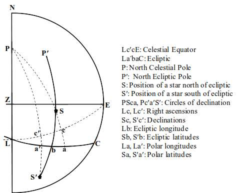
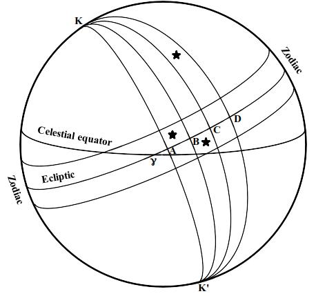
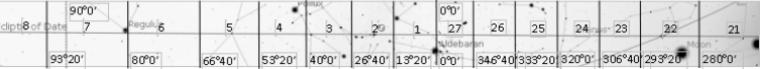
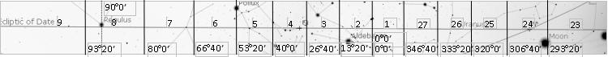

# Sidereal Ecliptic Coordinate System of Sūryasiddhānta

- Author Display: Raja Ram Mohan Roy
- Year: 2019
- Journal Label: IJHS-54-2019-Issue-3
- Source Url: https://insa.nic.in/(S(eh1ucortlbqqezipwgliy3mn))/writereaddata/UpLoadedFiles/IJHS/Vol54_3_2019__Art03.pdf

<!-- source: gemini page-chunk extraction -->

ARTICLES IJHS | VOL 54.3 | SEPTEMBER 2019

# Sidereal Ecliptic Coordinate System of Sūryasiddhānta

Raja Ram Mohan Roy*
Ryerson University, 350 Victoria St, Toronto, Ontario, Canada M5B 2K3
(Received 15 June 2018; revised 17 August 2019)

### Abstract

Indian astronomical texts give the coordinates of the *yogatārās* or junction stars of *nakṣatras*. These coordinates have been interpreted as polar coordinates, which depend on the position of the north celestial pole. Polar coordinates of a star should change with time due to precession. However, different astronomical texts written over many centuries give same coordinates for most *yogatārās*. This has resulted in Indian astronomers being called incompetent, who did not observe the positions of the stars with accuracy. In this paper it is proposed that Indian astronomers were using sidereal ecliptic coordinates, which does not change with time to a significant extent. Even though sidereal ecliptic coordinates do not change, order of *nakṣatras* was periodically changed to take into account the movement of vernal equinox due to precession. Ecliptic longitudes were updated by simple addition corresponding to the shift in origin of the *nakṣatra* system. It is proposed that a mix up of longitudes from different systems has resulted in a list that obfuscates the true understanding of Indian astronomy. To gain a better understanding of coordinates given in *Sūryasiddhānta*, precise boundaries of *nakṣatras* have been determined based on the *yogatārās* of *Rohiṇī* and *Kṛttikā nakṣatras*. Using the coordinates of the boundaries, the identifications of *yogatārās* of *nakṣatras* have been reassessed. Among the 28 *yogatārās*, alternative identifications of six *yogatārās* have been suggested.
**Key words:** Ecliptic coordinates, *Nakṣatra*, Polar latitude, Polar longitude, *Sūryasiddhānta*, *Yogatārā*.

## 1 Introduction

Vedic texts divide the ecliptic in 28 or 27 divisions called *nakṣatras*. Later astronomical texts such as *Sūryasiddhānta* adopted the system of 27 equal divisions. In this system, each *nakṣatra* has a span of $13^\circ 20'$. In addition to the *nakṣatra* being a geometrical division of ecliptic spanning over a certain segment of ecliptic, each *nakṣatra* is also characterized by a star or group of stars. Each *nakṣatra* is also assigned a *yogatārā* or junction star out of the group of stars belonging to the particular *nakṣatra*. If a *nakṣatra* has only one star in its group, then that star is the *yogatārā* of that *nakṣatra*. Astronomical text *Sūryasiddhānta* gives the coordinates of each *yogatārā*.
Burgess (1860) interpreted the coordinates given in *Sūryasiddhānta* as polar coordinates, which is universally accepted. These coordinates depend on the position of the North Celestial Pole, which changes over time due to precession. However, the coordinates given in different astronomical texts are nearly same, even though the texts were written many centuries apart. The change in coordinates
[^1] DOI: 10.16943/ijhs/2019/v54i3/49740
*Email: raja.roy@ryerson.ca.
---
IJHS | VOL 54.3 | SEPTEMBER 2019 ARTICLES
would have been obvious to the astronomers, if they had the skill to measure the coordinates of the stars. This has resulted in the opinion that Indian astronomers were borrowers from the west and incapable of making accurate astronomical observations. Pingree and Morrissey (1989) write the following about the Indian astronomers:
> ...that the catalogue of stars found in *Paitāmahasiddhānta*, which is almost exclusively the basis of the rest of the Indian tradition, since it is at the beginning of the Indian attempts to provide coordinates and uses a coordinate system derived from Greek astronomy, is more likely to be an Indian adaptation of a Greek star catalogue than to be based on observations that were made in India; and that the ineptitude with which Indians historically tried to ‘correct’ these coordinates militates against any theory that is founded upon the idea that the Indians of medieval period were experts in astronomical observation. ... Our apparent success in finding “identifications” for Lalla’s star catalogue, wherein the coordinates are so clearly a mixture of ecliptic and polar values, shows the futility of attaching any credence to them. ...Whichever stars the author of *Sūryasiddhānta* intended to indicate, he was incapable of determining their coordinates accurately, ...It is most astonishing to see an astronomer convert $\lambda^*$ into $\lambda$ and call the latter $\lambda^*$; even more astonishing is to see him take $\lambda$ to be $\lambda^*$, convert it on that assumption into another $\lambda$, and to assert that this wrongly derived $\lambda$ is $\lambda^*$! There is no excuse for Āryabhaṭa’s coordinates... The impression of incompetence does not disappear when we examine our last star catalogue, which Gaṇeṣa incorporated into his *Grahalāghava* (XI 1–5) in 1520. ...Therefore, either Gaṇeṣa was also incompetent, or he intended to give the coordinates of a different set of stars. ... We must conclude from this survey that the Indians did not observe the positions of the stars with accuracy; by implication, they also did not observe those of the planets with accuracy.
It is obvious that the interpretation of coordinates given in Indian astronomical texts as polar coordinates has resulted in Indian astronomers being called incompetent. In this paper it is proposed that the coordinates of *yogatārās* given in the Indian astronomical texts are ecliptic coordinates and since these coordinates don't change appreciably over time in a sidereal ecliptic coordinate system, Indian astronomers relied on the coordinates received from earlier astronomers. To account for precession, Indian astronomers changed the origin of the *nakṣatra* system periodically. The coordinates were updated to reflect the new origin of the *nakṣatra* system by adding the appropriate amount to ecliptic longitudes. With this insight, the coordinates of *yogatārās* given in *Sūryasiddhānta* have been compared to the coordinates of *yogatārās* identified by Burgess (1860) and new identifications of some *yogatārās* have been proposed. In addition, the exact boundary of each *nakṣatra* has been determined.

## 2 Textual information

The coordinates of *yogatārās* given in *Sūryasiddhānta* are shown in Table 1. Three different translations of *Sūryasiddhānta* were consulted, Burgess (1860) in English, Śrīvāstava (1982) in Hindi and Siṃha (1986) in Hindi. All translations provide identical information regarding the raw data given in *Sūryasiddhānta* and how the data is to be interpreted. The longitude data is given indirectly using a term “*svabhoga*”. Instead of giving *svabhoga* values, one tenth of these values are given as shown in the column “Data” in Table 1. After multiplying by ten, these values yield *svabhoga* in arcminutes, which is then converted to degree and arcminutes as shown under the column “*svabhoga*” in Table 1. *Svabhoga* represents the relative longitude and is to be added to the longitude of the beginning of the respective *nakṣatra* to obtain the longitude of the given *yogatārā*.
The list of *nakṣatras* begins with *Aśvinī* and ends with *Revatī*. Since *Sūryasiddhānta* follows the system of 27 equal divisions of the ecliptic, each *nakṣatra* has a span of $13^\circ 20'$. The beginning and end points of each *nakṣatra* can then be calculated as shown under the column “Span”. Adding relative longitude to the longitude of the beginning point of respective *nakṣatra* yields the longitude of the *yogatārā* and is called *dhruvaka* in *Sūryasiddhānta*. The calculated values of *dhruvaka* are shown in the column “Dhruvaka” in Table 1.
*Sūryasiddhānta* calls the latitude *vikṣepa* and gives the value and direction relative to ecliptic directly as shown in
---
ARTICLES IJHS | VOL 54.3 | SEPTEMBER 2019
**Table 1** The coordinate of *yogatārās* according to *Sūryasiddhānta* 8.1–9 Burges (1860), Śrīvāstava (1982), Siṃha (1986).

| No. | Nakṣatra yogatārā | Svabhoga (relative longitude) | | | Span | Dhruvaka (longitude) | Vikṣepa (latitude) |
| :--- | :--- | :--- | :--- | :--- | :--- | :--- | :--- |
| | | **Data** | **Arc min.** | **Deg.-min.** | **Deg.-min.** | **Deg.-min.** | **Deg.-min.** |
| 1 | *Aśvinī* | 48 | 480 | $8^\circ 0'$ | $0^\circ 0' - 13^\circ 20'$ | $8^\circ 0'$ | $10^\circ 0' \text{ N}$ |
| 2 | *Bharaṇī* | 40 | 400 | $6^\circ 40'$ | $13^\circ 20' - 26^\circ 40'$ | $20^\circ 0'$ | $12^\circ 0' \text{ N}$ |
| 3 | *Kṛttikā* | 65 | 650 | $10^\circ 50'$ | $26^\circ 40' - 40^\circ 0'$ | $37^\circ 30'$ | $5^\circ 0' \text{ N}$ |
| 4 | *Rohiṇī* | 57 | 570 | $9^\circ 30'$ | $40^\circ 0' - 53^\circ 20'$ | $49^\circ 30'$ | $5^\circ 0' \text{ S}$ |
| 5 | *Mṛgaśirā* | 58 | 580 | $9^\circ 40'$ | $53^\circ 20' - 66^\circ 40'$ | $63^\circ 0'$ | $10^\circ 0' \text{ S}$ |
| 6 | *Ārdrā* | 4 | 40 | $0^\circ 40'$ | $66^\circ 40' - 80^\circ 0'$ | $67^\circ 20'$ | $0^\circ 0' \text{ S}$ |
| 7 | *Punarvasu* | 78 | 780 | $13^\circ 0'$ | $80^\circ 0' - 93^\circ 20'$ | $93^\circ 0'$ | $6^\circ 0' \text{ N}$ |
| 8 | *Puṣya* | 76 | 760 | $12^\circ 40'$ | $93^\circ 20' - 106^\circ 40'$ | $106^\circ 0'$ | $0^\circ 0'$ |
| 9 | *Āśleṣā* | 14 | 140 | $2^\circ 20'$ | $106^\circ 40' - 120^\circ 0'$ | $109^\circ 0'$ | $7^\circ 0' \text{ S}$ |
| 10 | *Maghā* | 54 | 540 | $9^\circ 0'$ | $120^\circ 0' - 133^\circ 20'$ | $129^\circ 0'$ | $0^\circ 0'$ |
| 11 | *Pūrva-phālgunī* | 64 | 640 | $10^\circ 40'$ | $133^\circ 20' - 146^\circ 40'$ | $144^\circ 0'$ | $12^\circ 0' \text{ N}$ |
| 12 | *Uttara-phālgunī* | 50 | 500 | $8^\circ 20'$ | $146^\circ 40' - 160^\circ 0'$ | $155^\circ 0'$ | $13^\circ 0' \text{ N}$ |
| 13 | *Hasta* | 60 | 600 | $10^\circ 0'$ | $160^\circ 0' - 173^\circ 20'$ | $170^\circ 0'$ | $11^\circ 0' \text{ S}$ |
| 14 | *Citrā* | 40 | 400 | $6^\circ 40'$ | $173^\circ 20' - 186^\circ 40'$ | $180^\circ 0'$ | $2^\circ 0' \text{ S}$ |
| 15 | *Swāti* | 74 | 740 | $12^\circ 20'$ | $186^\circ 40' - 200^\circ 0'$ | $199^\circ 0'$ | $37^\circ 0' \text{ N}$ |
| 16 | *Viśākhā* | 78 | 780 | $13^\circ 0'$ | $200^\circ 0' - 213^\circ 20'$ | $213^\circ 0'$ | $1^\circ 30' \text{ S}$ |
| 17 | *Anūrādhā* | 64 | 640 | $10^\circ 40'$ | $213^\circ 20' - 226^\circ 40'$ | $224^\circ 0'$ | $3^\circ 0' \text{ S}$ |
| 18 | *Jyeṣṭhā* | 14 | 140 | $2^\circ 20'$ | $226^\circ 40' - 240^\circ 0'$ | $229^\circ 0'$ | $4^\circ 0' \text{ S}$ |
| 19 | *Mūla* | 6 | 60 | $1^\circ 0'$ | $240^\circ 0' - 253^\circ 20'$ | $241^\circ 0'$ | $9^\circ 0' \text{ S}$ |
| 20 | *Pūrvāṣāḍhā* | 4 | 40 | $0^\circ 40'$ | $253^\circ 20' - 266^\circ 40'$ | $254^\circ 0'$ | $5^\circ 30' \text{ S}$ |
| 21 | *Uttarāṣāḍhā* | \- | \multicolumn{2}{l|}{at the middle of *Pūrvāṣāḍhā*} | $266^\circ 40' - 280^\circ 0'$ | $260^\circ 0'$ | $5^\circ 30' \text{ S}$ |
| 22 | *Abhijīt* | \- | \multicolumn{2}{l|}{at the end of *Pūrvāṣāḍhā*} | None | $266^\circ 40'$ | $60^\circ 0' \text{ N}$ |
| 23 | *Śravaṇa* | \- | \multicolumn{2}{l|}{at the end of *Uttarāṣāḍhā*} | $280^\circ 0' - 293^\circ 20'$ | $280^\circ 0'$ | $30^\circ 0' \text{ N}$ |
| 24 | *Dhaniṣṭhā* | \- | \multicolumn{2}{l|}{At the junction of 3rd and 4th quarter of *Śravaṇa*} | $293^\circ 20' - 306^\circ 40'$ | $290^\circ 0'$ | $36^\circ 0' \text{ N}$ |
| 25 | *Śatabhiṣaja* | 80 | 800 | $13^\circ 20'$ | $306^\circ 40' - 320^\circ 0'$ | $320^\circ 0'$ | $0^\circ 30' \text{ S}$ |
| 26 | *Pūrva-bhādrapadā* | 36 | 360 | $6^\circ 0'$ | $320^\circ 0' - 333^\circ 20'$ | $326^\circ 0'$ | $24^\circ 0' \text{ N}$ |
| 27 | *Uttara-bhādrapadā* | 22 | 220 | $3^\circ 40'$ | $333^\circ 20' - 346^\circ 40'$ | $337^\circ 0'$ | $26^\circ 0' \text{ N}$ |
| 28 | *Revatī* | 79 | 790 | $13^\circ 10'$ | $346^\circ 40' - 360^\circ 0'$ | $359^\circ 50'$ | $0^\circ 0'$ |

---
IJHS | VOL 54.3 | SEPTEMBER 2019 ARTICLES
the column “*Vikṣepa*” in Table 1. *Dhruvaka* and *vikṣepa* are universally translated as polar longitude and polar latitude respectively. Since this interpretation is contested in this paper, *dhruvaka* and *vikṣepa* are translated simply as longitude and latitude respectively in Table 1. After *Uttarāṣāḍhā nakṣatra* (at number 21 in the list), *Abhijīt nakṣatra* is listed, but no span is given to this *nakṣatra*. *Abhijīt nakṣatra* was part of 28 *nakṣatra* system, but was dropped from the list in 27 *nakṣatra* system, and hence has no span in this system. The longitudes of the *yogatārās* of *Uttarāṣāḍhā*, *Abhijīt*, *Śravaṇa*, and *Dhaniṣṭhā nakṣatras* are given differently in terms of their positions relative to other *nakṣatras* as shown in Table 1. The *yogatārās* of *Uttarāṣāḍhā* and *Dhaniṣṭhā* fall outside the span of their respective *nakṣatras*.

## 3 Polar longitude and latitude

It is currently accepted that the coordinates of *yogatārās* given in *Sūryasiddhānta* are in terms of polar longitudes and latitudes. The terms polar longitude and polar latitude were coined by Burgess (1860) in his translation of *Sūryasiddhānta*, which uses the term *dhruvaka* for longitude and *vikṣepa* for latitude. Burgess has identified *dhruvaka* and *vikṣepa* as polar longitude and polar latitude respectively. The concept of polar coordinates of stars as illustrated by Burgess (1860) is shown in Figure 1. To determine the polar longitude and latitude of a star ($S$ or $S'$), a segment of circle of declination ($PSca$ or $Pc'a'S'$) is drawn from North Celestial Pole ($P$) passing through the star up to the ecliptic. Polar latitude is the angular distance of the star ($Sa$ or $S'a'$) from the ecliptic along the circle of declination. Polar longitude is the angular distance ($La$ or $La'$) from reference point ($L$) on the ecliptic and the point of intersection of the ecliptic with the circle of declination passing through the star ($a$ or $a'$). Burgess (1860) has shown ecliptic below the celestial equator in the illustration, which is wrong. For point $L$ to denote vernal equinox, ecliptic should be shown above the celestial equator in Figure 1.
It should be noted that this whole geometrical construction for determining polar longitude and latitude is very artificial. In ecliptic coordinate system, ecliptic latitudes are determined by measuring angular distances from ecliptic along the great circle passing through the North Ecliptic Pole. In celestial coordinate system,

*Fig. 1. Illustration of polar longitude and latitude of stars by Burgess (1860).*

<!-- figure-resolved-extracted: page=4 image=media/p04_fig01.jpg -->

<!-- figure-meta: page=4, position=top, type=diagram -->

declinations are determined by measuring angular distances from celestial equator along the great circle passing through the North Celestial Pole.
In every coordinate system, the latitude is measured respective to the corresponding pole. In the artificial construct of polar latitude, the angular distance is measured from the ecliptic along the great circle that does not pass through the pole of ecliptic (North Ecliptic Pole), but passes through North Celestial Pole instead. Burgess has justified this artificial construction by taking the meaning of *Dhruvaka* as pertaining to *Dhruva* or pole star, and therefore he has drawn great circle passing through North Celestial Pole. In accordance with *Dhruvaka*, Burgess has postulated that *vikṣepa* means polar latitude. There is absolutely nothing in any astronomical text that describes this method of measuring longitude and latitude. The term *vikṣepa* has been used many times in *Sūryasiddhānta* such as in 2.6, 2.63 and 7.7, and in all these places *vikṣepa* has not been interpreted as polar latitude even by Burgess (1860). It will be odd for the same text (*Sūryasiddhānta*) to use two different coordinate systems (ecliptic and polar) without providing any explanation. Moreover, *Dhruva* also means fixed or not moving and thus *Dhruvaka* simply means fixed longitude. Many Indian astronomers such as Bhāskara in *Mahābhāskarīya* (III. 62–71) refer to the coordinates of *yogatārās* as ecliptic longitude and latitude as described by Pingree and Morrissey (1989):
---
ARTICLES IJHS | VOL 54.3 | SEPTEMBER 2019
What is remarkable about Bhāskara’s ecliptic coordinates is that, in most cases, they are within $1^\circ$ of the *Paitāmaha*’s polar coordinates; this is the case for the longitudes of nos. 1, 4, 5, 8, 10, 12, 16, 18, 19, and 28, and for the latitudes of nos. 1, 2, 3, 4, 5, 6, 7, 8, 9, 10, 11, 12, 15, 16, 17, 18, 19, 23, 24, 25, 26, 27, and 28— that is, for 33 out of 54 possibilities. This fact denies to Bhāskara the possibility of his having himself made independent observations, or of his having used a source based on independent observations. This lack of observational input is emphasized by the fact that his changes of the *Paitāmaha*’s coordinates lead either to worse results or to dimmer stars or to both.
It is surprising that despite the emphatic declaration by Indian astronomers that they were using ecliptic coordinates, no one has challenged the prevailing view that Indian astronomers were using polar coordinates. First, the information provided by Indian astronomers has been incorrectly interpreted and then that false interpretation has been used to claim that Indian astronomers were inept and did not know how to measure the positions of stars and planets. If that is the case, then correct framework needs to be developed in which the coordinates given by Indian astronomers make better sense and currently accepted identifications of *yogatārās* need to be reassessed to check if other stars fit the given coordinates better.

## 4 Currently accepted identifications of *yogatārās*

Based on his assumption that coordinates given in *Sūryasiddhānta* are polar longitudes and latitudes, Burgess (1860) identified the *yogatārās* as shown in Table 2. These identifications are currently accepted by most scholars. For comparative purpose, ecliptic coordinates (J2000.0) of these *yogatārās* are also given in Table 2 along with the coordinates (*dhruvaka* and *vikṣepa*) given in *Sūryasiddhānta* (8.1–9). The data for ecliptic coordinates (J2000.0) were obtained using Stellarium software by setting the date to January 1, 2000 at 12:00 noon and noting the ecliptic longitudes and latitudes by selecting the specific stars. With the tabulation of currently accepted identifications of *yogatārās* and their ecliptic coordinates, these identifications can be reassessed to check if other stars fit the description in the astronomical texts better. For this purpose, a precise determination of the boundaries of *nakṣatras* is required.

## 5 Determination of *nakṣatra* boundaries

Figure 2 illustrates the principle of the division of celestial sphere in *nakṣatra* zones. $K$ and $K'$ represent north ecliptic pole and south ecliptic pole respectively. $A, B, C,$ and $D$ are the boundaries of *nakṣatras* on the ecliptic. In a 27 *nakṣatra* system, there will be 27 such points on the ecliptic through which the boundaries of *nakṣatras* will pass. As the *nakṣatras* have equal span in the 27 *nakṣatra* system according to *Sūryasiddhānta* 2.64, each *nakṣatra* has a span of $13^\circ 20'$ on the ecliptic. Each *nakṣatra* zone comprises of the area bound by two great semi-circles passing through $K$ and $K'$ and through its boundaries on the ecliptic such as $KAK'BK, KBK'CK, KCK'DK,$ and so on. It is expected that the *yogatārā* and stars belonging to a *nakṣatra* will fall in its *nakṣatra* zone. It should be noted that in the ancient Indian system it was not necessary for the *yogatārā* and stars belonging to a *nakṣatra* to fall within the zodiac, which is a region spanning $8^\circ$ on both side of the ecliptic.
Though later astronomical texts divide the celestial sphere in 27 *nakṣatras*, earlier texts also describe a system consisting of 28 *nakṣatra*. It takes the moon 27.32 days to return to the same position among the stars. Based on the observation that the sidereal month is more than 27 days but less than 28 days, the path of moon in the background of the stars was divided in 28 or 27 divisions. *Atharvaveda Saṃhitā* (19.7.1–5) lists 28 *nakṣatras* beginning with *Kṛttikā* and ending with *Bharaṇī*. *Taittirīya Saṃhitā* (iv.4.10) and *Taittirīya Brāhmaṇa* (1.5.2.7) list 27 *nakṣatra* beginning with *Kṛttikā* and ending in *Bharaṇī*. *Nakṣatra Abhijīt* is part of the list of 28 *nakṣatras*, but is dropped from the list in the system of 27 *nakṣatras*. There is a dialogue between gods Indra and Skanda regarding the dropping of *nakṣatra Abhijīt* in *Mahābhārata* (Vana Parva, Chapter 230, verses 8–10). In this dialogue, Indra says to Skanda that because of jealousy with *Rohiṇī*, her younger sister *Abhijīt* has gone to forest to do penance. Indra further says that Brahmā had fixed the counting of time from the beginning of *Dhaniṣṭhā* and earlier *Rohiṇī* was first. This story tells

IJHS | VOL 54.3 | SEPTEMBER 2019 ARTICLES
**Table 2** Identification of *yogatārās* by Burgess (1860).

| No. | Nakṣatra | Junction-star (*yogatārā*) $^a$ | Ecliptic longitude $^b$ | Dhruvaka (longitude) | Ecliptic latitude $^b$ | *vikṣepa* (latitude) |
| :--- | :--- | :--- | :--- | :--- | :--- | :--- |
| 1 | *Aśvinī* | $\beta$ Ari | $33^\circ 58'$ | $8^\circ 0'$ | $8^\circ 29'$ N | $10^\circ 0'$ N |
| 2 | *Bharaṇī* | 35 Ari | $46^\circ 56'$ | $20^\circ 0'$ | $11^\circ 19'$ N | $12^\circ 0'$ N |
| 3 | *Kṛttikā* | $\eta$ Tau | $60^\circ 00'$ | $37^\circ 30'$ | $4^\circ 03'$ N | $5^\circ 0'$ N |
| 4 | *Rohiṇī* | $\alpha$ Tau | $69^\circ 47'$ | $49^\circ 30'$ | $5^\circ 28'$ S | $5^\circ 0'$ S |
| 5 | *Mṛgaśirā* | $\lambda$ Ori | $83^\circ 42'$ | $63^\circ 0'$ | $13^\circ 22'$ S | $10^\circ 0'$ S |
| 6 | *Ārdrā* | $\alpha$ Ori | $88^\circ 45'$ | $67^\circ 20'$ | $16^\circ 02'$ S | $9^\circ 0'$ S |
| 7 | *Punarvasu* | $\beta$ Gem | $113^\circ 13'$ | $93^\circ 0'$ | $6^\circ 41'$ N | $6^\circ 0'$ N |
| 8 | *Puṣya* | $\delta$ Cnc | $128^\circ 43'$ | $106^\circ 0'$ | $0^\circ 05'$ N | $0^\circ 0'$ |
| 9 | *Āśleṣāu* | $\epsilon$ Hya | $132^\circ 21'$ | $109^\circ 0'$ | $11^\circ 06'$ S | $7^\circ 0'$ S |
| 10 | *Maghā* | $\alpha$ Leo | $149^\circ 50'$ | $129^\circ 0'$ | $0^\circ 28'$ N | $0^\circ 0'$ |
| 11 | *Pūrva-phālgunī* | $\delta$ Leo | $161^\circ 19'$ | $144^\circ 0'$ | $14^\circ 20'$ N | $12^\circ 0'$ N |
| 12 | *Uttara-phālgunī* | $\beta$ Leo | $171^\circ 37'$ | $155^\circ 0'$ | $12^\circ 16'$ N | $13^\circ 0'$ N |
| 13 | *Hasta* | $\delta$ Crv | $193^\circ 27'$ | $170^\circ 0'$ | $12^\circ 12'$ S | $11^\circ 0'$ S |
| 14 | *Citrā* | $\alpha$ Vir | $203^\circ 50'$ | $180^\circ 0'$ | $2^\circ 03'$ S | $2^\circ 0'$ S |
| 15 | *Swāti* | $\alpha$ Boo | $204^\circ 14'$ | $199^\circ 0'$ | $30^\circ 44'$ N | $37^\circ 0'$ N |
| 16 | *Viśākhā* | $\iota$ Lib | $231^\circ 00'$ | $213^\circ 0'$ | $1^\circ 51'$ S | $1^\circ 30'$ S |
| 17 | *Anūrādhā* | $\delta$ Sco | $242^\circ 34'$ | $224^\circ 0'$ | $1^\circ 59'$ S | $3^\circ 0'$ S |
| 18 | *Jyeṣṭhā* | $\alpha$ Sco | $249^\circ 46'$ | $229^\circ 0'$ | $4^\circ 34'$ S | $4^\circ 0'$ S |
| 19 | *Mūla* | $\lambda$ Sco | $264^\circ 35'$ | $241^\circ 0'$ | $13^\circ 47'$ S | $9^\circ 0'$ S |
| 20 | *Pūrvāṣāḍhā* | $\delta$ Sgr | $274^\circ 35'$ | $254^\circ 0'$ | $6^\circ 28'$ S | $5^\circ 30'$ S |
| 21 | *Uttarāṣāḍhā* | $\sigma$ Sgr | $282^\circ 23'$ | $260^\circ 0'$ | $3^\circ 27'$ S | $5^\circ 0'$ S |
| 22 | *Abhijīt* | $\alpha$ Lyr | $285^\circ 19'$ | $266^\circ 40'$ | $61^\circ 44'$ N | $60^\circ 0'$ N |
| 23 | *Śravaṇa* | $\alpha$ Aql | $301^\circ 47'$ | $280^\circ 0'$ | $29^\circ 18'$ N | $30^\circ 0'$ N |
| 24 | *Dhaniṣṭhā* | $\beta$ Del | $316^\circ 20'$ | $290^\circ 0'$ | $31^\circ 55'$ N | $36^\circ 0'$ N |
| 25 | *Śatabhiṣaja* | $\lambda$ Aqr | $341^\circ 35'$ | $320^\circ 0'$ | $0^\circ 23'$ S | $0^\circ 30'$ S |
| 26 | *Pūrva-bhādrapadā* | $\alpha$ Peg | $353^\circ 29'$ | $326^\circ 0'$ | $19^\circ 24'$ N | $24^\circ 0'$ N |
| 27a | *Uttara-bhādrapadā* $^c$ | $\alpha$ And | $14^\circ 19'$ | $337^\circ 0'$ | $25^\circ 41'$ N | $26^\circ 0'$ N |
| 27b | *Uttara-bhādrapadā* $^c$ | $\gamma$ Peg | $9^\circ 09'$ | $337^\circ 0'$ | $12^\circ 36'$ N | $26^\circ 0'$ N |
| 28 | *Revatī* | $\zeta$ Psc | $19^\circ 53'$ | $359^\circ 50'$ | $0^\circ 13'$ S | $0^\circ 0'$ |

$^a$ As identified by Burgess (1860)  
$^b$ J2000.0 ecliptic cooridnates based on Stellarium software..  
$^c$ For *Uttara-bhādrapadā*, longitude matches $\gamma$ Pegasi, while latitude matches $\alpha$ Andromeda.
291
***
ARTICLES IJHS | VOL 54.3 | SEPTEMBER 2019

*Figure 2 The division of celestial sphere in nakṣatra zones*

<!-- figure-resolved-extracted: page=7 image=media/p07_fig01.jpg -->

<!-- figure-meta: page=7, position=top, type=diagram -->

that during the time when *Mahābhārata* was written, it was still remembered that once upon a time *Rohiṇī* was the first *nakṣatra*. As shown in Table 1, the list of *nakṣatra* in *Sūryasiddhānta* begins with *Aśvinī*. A Jain astronomical text *Sūryaprajňapti* (10.1.32) gives five other systems besides the one followed by Jains, which started from *Abhijīt* and ended at *Uttarāṣāḍhā*. These five systems were: 1. *Kṛttikā* to *Bharaṇī*; 2. *Maghā* to *Āśleṣā*; 3. *Dhaniṣṭhā* to *Śravaṇa*; 4. *Aśvinī* to *Revatī*; and 5. *Bharaṇī* to *Aśvinī*.
According to *Yajuṣ Vedāṅga Jyotiṣa* (verse 7), sun was at the first point of the *Dhaniṣṭhā nakṣatra* on the day of winter solstice. This suggests that the system of *Dhaniṣṭhā* as the first *nakṣatra* was in place when sun was observed at the beginning of *Dhaniṣṭhā nakṣatra* on the day of winter solstice. Sun was in *Maghā nakṣatra* on summer solstice around the same time when it was in *Kṛttikā nakṣatra* on vernal equinox. Thus different systems of *nakṣatras* were related to the careful observation of solstices and equinoxes. A story in *Mahābhārata* not only shows the importance of winter solstice but also the desire of the writers of *Mahābhārata* to carry forward this knowledge to future generations. The story is that of the death of one of the most beloved characters of *Mahābhārata*, *Bhīṣma*, and is told in *Bhīṣma Parva* (120.51–53). According to this story, when *Bhīṣma* is incapacitated on the battlefield, he refuses to die. He says that he will lie on the bed of arrows till the time of winter solstice. When sun starts his northward journey, only then he will leave this world. He waited for close to two months for winter solstice to take place and then left this world. This story has been passed on from generation to generation, and the dramatic nature of this narrative ensures that the listener will know the definition of winter solstice, which is the day when sun starts its northward journey. To make sure that the message gets passed on to future generations, a very dramatic situation was created in the storyline. From the details of the story, it is clear that the event cannot be historic as no one can control his time of death and lying on a bed of arrows for close to two months is an improbable event. What the story tells us is that winter solstice, and by implication summer solstice and equinoxes, were being carefully observed in India for many millennia. It would have been obvious to Indian astronomers that the position of sun among the stars during solstices and equinoxes was slowly changing due to the effect of precession. When the change in the position of sun became significant, the order of *nakṣatras* in the list was revised to reflect the new position of the sun on vernal equinox. Out of the different systems mentioned above, the *nakṣatra* systems with orders *Rohiṇī* to *Kṛttikā*, *Kṛttikā* to *Bharaṇī*, *Bharaṇī* to *Aśvinī*, and *Aśvinī* to *Revatī* are important for correct interpretation of coordinates of *yogatārās* given in *Sūryasiddhānta*. From Table 1, it is seen that the order of *nakṣatras* is *Aśvinī*, *Bharaṇī*, *Kṛttikā*, and *Rohiṇī* according to *Sūryasiddhānta*. Thus first *nakṣatra* in the list was sequentially changed from *Rohiṇī* to *Kṛttikā*, then from *Kṛttikā* to *Bharaṇī*, and finally from *Bharaṇī* to *Aśvinī*. As the original list of *nakṣatras* started with *Rohiṇī*, it is reasonable to assume that the *yogatārā* of *Rohiṇī* was at zero longitude of the original *nakṣatra* system. The *Rohiṇī* system with *yogatārā* of *Rohiṇī*, Aldebaran, at zero longitude is shown in Figure 3. The part of celestial sphere close to ecliptic is shown, where *nakṣatra* boundaries have been approximated to straight lines for illustrative purpose. Actual construction of *nakṣatra* boundaries should be done according to the principle illustrated in Figure 2.
The ecliptic longitudes of *yogatārās*, as identified by Burgess (1860), in *Rohiṇī* system are shown in Table 3 along with the longitudes (*dhruvaka*) of *yogatārās* given
292
***
IJHS | VOL 54.3 | SEPTEMBER 2019 ARTICLES

*Figure 3 (a) Rohiṇī system (b) Rohiṇī system (continued)*

<!-- figure-resolved-extracted: page=8 image=media/p08_fig01.jpg -->

<!-- figure-meta: page=8, position=top, type=diagram -->

in *Sūryasiddhānta* (8.1–9). The numbers in Figure 3 refer to the serial number of *nakṣatras* shown in Table 3. The ecliptic longitudes in *Rohiṇī* system were obtained by setting a date on which the ecliptic longitude of the *yogatārā* of *Rohiṇī*, Aldebaran, became $0^\circ 0'$. This date was found to be June 12, -3044 by trial and error using Stellarium software. From Table 3, it is seen that the longitude of the *yogatārā* of *Rohiṇī* had shifted by approximately $50^\circ$ according to *Sūryasiddhānta* from its zero point in *Rohiṇī* system. As shown in Figure 3a, *nakṣatra* boundaries are at $13^\circ 20'$, $26^\circ 40'$, $40^\circ 0'$, $53^\circ 20'$, and so on. If the ecliptic longitudes were updated by shifting the zero point of longitude to the beginning of *Revatī nakṣatra*, which is fourth *nakṣatra* from *Rohiṇī*, then $53^\circ 20'$ should have been added to the ecliptic longitude in *Rohiṇī* system instead of $50^\circ$. This raises the possibility that another system was also in use, and there was confusion between these two systems resulting in a mix of data derived from two different systems. From Table 3, it is seen that the difference between ecliptic longitudes of the *yogatārās* of *Rohiṇī* and *Kṛttikā* is approximately $10^\circ$ or three quarters of a *nakṣatra*. A *nakṣatra* system with its origin at the *yogatārā* of *Kṛttikā* will have *nakṣatra* boundaries at one quarter of a *nakṣatra* or $3^\circ 20'$ from the *nakṣatra* boundaries in the *Rohiṇī* system. While *Sūryasiddhānta* gives $180^\circ$ as the longitude of *Citrā* (see Table 1), *Paitāmahasiddhānta* gives $183^\circ$ (Pingree and Morrissey, 1989). This could simply be a result of using coordinate systems having boundaries $3^\circ 20'$ apart. The *Kṛttikā* system with *yogatārā* of *Kṛttikā*, Alcyone, at zero longitude is shown in Figure 4. The part of celestial sphere close to ecliptic is shown, where *nakṣatra* boundaries have been approximated to straight lines for illustrative purpose. As mentioned earlier, actual construction of *nakṣatra* boundaries should be done according to the principle illustrated in Figure 2.
The ecliptic longitudes of *yogatārās*, as identified by Burgess (1860), in *Kṛttikā* system are shown in Table 4 along with the longitudes (*dhruvaka*) of *yogatārās* given in *Sūryasiddhānta* (8.1–9). The numbers in Figure 4 refer to the serial number of *nakṣatras* shown in Table 4. The ecliptic longitudes in *Kṛttikā* system were obtained by setting a date on which the ecliptic longitude of the *yogatārā* of *Kṛttikā*, Alcyone, became $0^\circ 0'$. This date was found to be April 17, -2336 by trial and error using Stellarium software. From Table 4, it is seen that the longitude of the *yogatārā* of *Kṛttikā* had shifted by $37^\circ 30'$ according to *Sūryasiddhānta* from its zero point in *Kṛttikā* system.
Some observations can be made regarding the *nakṣatra* boundaries in *Rohiṇī* and *Kṛttikā* systems. According to *Sūryasiddhānta*, *yogatārā* of *Revatī* ($\zeta$ Piscium) is near the origin of the coordinate system. However, $\zeta$ Piscium is a very dim star with an apparent magnitude of 5.20. Why would such a star be chosen at the origin? Pingree and Morrissey (1989) write:
> It is disturbing that $\zeta$ Piscium is so dim, and that its $\alpha$ is 0; 7h or nearly $2^\circ$ too high on the assumption that the original list was drawn up in ad 425, though the situation, of course, improves as one increases that date. But there are no other visible stars in the neighbourhood.
The *yogatārā* of *Revatī* was not at the origin of the coordinate system, when it was designed. The *yogatārā* of *Rohiṇī*, Aldebaran, was at the origin of the coordinate system, which is a bright star with apparent magnitude of
293
***
ARTICLES IJHS | VOL 54.3 | SEPTEMBER 2019
**Table 3** Longitudes of *yogatārās* in *Rohiṇī* system.

| No. | Nakṣatra | Junction-star (*yogatārā*) $^a$ | Ecliptic longitude $^b$ | Dhruvaka (longitude) $^c$ |
| :--- | :--- | :--- | :--- | :--- |
| 1 | *Rohiṇī* | $\alpha$ Tau | $0^\circ 00'$ | $49^\circ 30'$ |
| 2 | *Mṛgaśirā* | $\delta$ Ori | $13^\circ 58'$ | $63^\circ 0'$ |
| 3 | *Ārdrā* | $\alpha$ Ori | $18^\circ 58'$ | $67^\circ 20'$ |
| 4 | *Punarvasu* | $\beta$ Gem | $44^\circ 20'$ | $93^\circ 0'$ |
| 5 | *Puṣya* | $\delta$ Cnc | $58^\circ 56'$ | $106^\circ 0'$ |
| 6 | *Āśleṣā* | $\epsilon$ Hya | $63^\circ 02'$ | $109^\circ 0'$ |
| 7 | *Maghā* | $\alpha$ Leo | $80^\circ 29'$ | $129^\circ 0'$ |
| 8 | *Pūrva-phālgunī* | $\delta$ Leo | $91^\circ 11'$ | $144^\circ 0'$ |
| 9 | *Uttara-phālgunī* | $\beta$ Leo | $102^\circ 20'$ | $155^\circ 0'$ |
| 10 | *Hasta* | $\delta$ Crv | $124^\circ 04'$ | $170^\circ 0'$ |
| 11 | *Citrā* | $\alpha$ Vir | $134^\circ 11'$ | $180^\circ 0'$ |
| 12 | *Swāti* | $\alpha$ Boo | $134^\circ 10'$ | $199^\circ 0'$ |
| 13 | *Viśākhā* | $\iota$ Lib | $161^\circ 20'$ | $213^\circ 0'$ |
| 14 | *Anūrādhā* | $\delta$ Sco | $172^\circ 52'$ | $224^\circ 0'$ |
| 15 | *Jyeṣṭhā* | $\alpha$ Sco | $180^\circ 05'$ | $229^\circ 0'$ |
| 16 | *Mūla* | $\epsilon$ Sco | $194^\circ 54'$ | $241^\circ 0'$ |
| 17 | *Pūrvāṣāḍhā* | $\delta$ Sgr | $204^\circ 50'$ | $254^\circ 0'$ |
| 18 | *Uttarāṣāḍhā* | $\sigma$ Sgr | $212^\circ 40'$ | $260^\circ 0'$ |
| | *Abhijīt* | $\alpha$ Lyr | $215^\circ 22'$ | $266^\circ 40'$ |
| 19 | *Śravaṇa* | $\alpha$ Aql | $231^\circ 14'$ | $280^\circ 0'$ |
| 20 | *Dhaniṣṭhā* | $\beta$ Del | $246^\circ 44'$ | $290^\circ 0'$ |
| 21 | *Śatabhiṣaja* | $\lambda$ Aqr | $271^\circ 49'$ | $320^\circ 0'$ |
| 22 | *Pūrva-bhādrapadā* | $\alpha$ Peg | $283^\circ 57'$ | $326^\circ 0'$ |
| 23 | *Uttara-bhādrapadā* | $\alpha$ And | $304^\circ 51'$ | $337^\circ 0'$ |
| 24a | *Uttara-bhādrapadā* | $\gamma$ Peg | $299^\circ 36'$ | $337^\circ 0'$ |
| 24b | *Revatī* | $\zeta$ Psc | $310^\circ 01'$ | $359^\circ 50'$ |
| 25 | *Aśvinī* | $\beta$ Ari | $324^\circ 15'$ | $8^\circ 0'$ |
| 26 | *Bharaṇī* | 35 Ari | $337^\circ 19'$ | $20^\circ 0'$ |
| 27 | *Kṛttikā* | $\eta$ Tau | $350^\circ 18'$ | $37^\circ 30'$ |

$^a$ As identified by Burgess (1860).  
$^b$ Ecliptic longitudes on June 12, -3044 based on Stellarium software.  
$^c$ Longitudes as given in *Sūryasiddhānta* 8.1–9.
294
***
IJHS | VOL 54.3 | SEPTEMBER 2019 ARTICLES

*Figure 4 (a) Kṛttikā system (b) Kṛttikā system (continued)*

<!-- figure-resolved-extracted: page=10 image=media/p10_fig01.jpg -->

<!-- figure-meta: page=10, position=top, type=diagram -->

0.85. The *yogatārā* of *Revatī* was not even a boundary star in the original system. It became a boundary star in the *Kṛttikā* system devised later. The *yogatārā* of *Punarvasu*, Pollux, also became a boundary star in the *Kṛttikā* system (see Figure 4a).
The *yogatārā* of *Jyeṣṭhā*, Antares, is at $180^\circ$ in the *Rohiṇī* system (see Figure 3b and Table 3). When vernal equinox was at the *yogatārā* of *Rohiṇī*, then autumnal equinox was at the *yogatārā* of *Jyeṣṭhā*. The *yogatārā* of *Maghā*, Regulus, is a boundary star in the *Rohiṇī* system (see Figure 3a). Its longitude is close to $80^\circ$ in the *Rohiṇī* system as shown in Table 3. Its longitude is $90^\circ$ in the *Kṛttikā* system as shown in Table 4. Thus when vernal equinox fell on the *yogatārā* of *Kṛttikā*, the summer solstice fell on the *yogatārā* of *Maghā*. With the precise determination of *nakṣatra* boundaries, coordinates given in astronomical texts can be better analyzed to check whether some of the *yogatārās* have been misidentified.

## 6 Reassessing the identifications of *yogatārās*

It is clear that Indian astronomers did not keep measuring the coordinates because they believed the coordinates to be ecliptic coordinates which do not change when fixed to stars in a sidereal system. The coordinates of the *yogatārā* of *Aśvinī* is given as $8^\circ$ longitude and $10^\circ$ latitude in *Sūryasiddhānta*, *Paitāmahasiddhānta*, *Mahābhāskarīya* and *Laghubhāskarīya*, and by Brahmagupta, Vateśvara, Lalla, and Gaṇeśa (Pingree and Morrissey, 1989). It was never changed as would be expected in a sidereal ecliptic coordinate system. The reason the data given in texts do not fit to a single time period is due to a mix up of data during the last update when reference point was changed to account for precession as well as due to misidentification of some *yogatārās*. Based on the analysis of longitude data, following six *yogatārās* have been misidentified.

### 6.1 The *yogatārā* of *Aśvinī*

Since *Aśvinī* is the first *nakṣatra* in the list of *nakṣatras* given in *Sūryasiddhānta* and other texts of classical period, it is of vital importance to correctly identify the *yogatārā* of *Aśvinī*. As mentioned above, every text gives the coordinates of the *yogatārā* of *Aśvinī* as $8^\circ$ longitude and $10^\circ$ latitude. Currently accepted *yogatārā* of *Aśvinī* is Sheratan ($\beta$ Ari) with apparent magnitude of 2.60 and J2000.0 ecliptic longitude and latitude of $33^\circ 58'$ and $8^\circ 29'$ respectively. The star Hamal ($\alpha$ Ari) is the brightest star of the Aries constellation. Hamal ($\alpha$ Ari) has apparent magnitude of 2.00 and J2000.0 ecliptic longitude and latitude of $37^\circ 40'$ and $9^\circ 58'$ respectively. The ecliptic latitude of $9^\circ 58'$ of Hamal matches closely with the latitude of $10^\circ$ given in *Sūryasiddhānta*. This raises the possibility that the *yogatārā* of *Aśvinī* is Hamal instead of Sheratan. This is confirmed from the longitude of $8^\circ$ given in every text. The ecliptic longitude of Hamal is $327^\circ 50'$ in *Rohiṇī* system. That is when the ecliptic longitude of *Rohiṇī* was $0^\circ 0'$ on June 12, -3044, the ecliptic longitude of Hamal was $327^\circ 50'$ according to Stellarium software. Since *Aśvinī* is three *nakṣatras* away from *Rohiṇī*, the span of *Aśvinī nakṣatra* in *Rohiṇī* system is $320^\circ 0'$ to $333^\circ 20'$. This means that Hamal is $7^\circ 50'$ away from the beginning of *Aśvinī nakṣatra* in *Rohiṇī* system and when *nakṣatra* list was updated to begin with *Aśvinī*, Hamal would have eclip-
295

ARTICLES IJHS | VOL 54.3 | SEPTEMBER 2019
**Table 4** Longitudes of *yogatārās* in *Kṛttikā* system.

| No. | Nakṣatra | Junction-star (*yogatārā*)ª | Ecliptic longitudeᵇ | Dhruvaka (longitude)ᶜ |
| :--- | :--- | :--- | :--- | :--- |
| 1 | *Kṛttikā* | η Tau | $0^{\circ}00'$ | $37^{\circ}30'$ |
| 2 | *Rohiṇī* | α Tau | $9^{\circ}43'$ | $49^{\circ}30'$ |
| 3 | *Mṛgaśirā* | λ Ori | $23^{\circ}40'$ | $63^{\circ}0'$ |
| 4 | *Ārdrā* | α Ori | $28^{\circ}41'$ | $67^{\circ}20'$ |
| 5 | *Punarvasu* | β Gem | $53^{\circ}55'$ | $93^{\circ}0'$ |
| 6 | *Puṣya* | δ Cnc | $68^{\circ}39'$ | $106^{\circ}0'$ |
| 7 | *Āśleṣā* | ε Hya | $72^{\circ}41'$ | $109^{\circ}0'$ |
| 8 | *Maghā* | α Leo | $90^{\circ}08'$ | $129^{\circ}0'$ |
| 9 | *Pūrva-phālgunī* | δ Leo | $100^{\circ}56'$ | $144^{\circ}0'$ |
| 10 | *Uttara-phālgunī* | β Leo | $111^{\circ}59'$ | $155^{\circ}0'$ |
| 11 | *Hasta* | δ Crv | $133^{\circ}43'$ | $170^{\circ}0'$ |
| 12 | *Citrā* | α Vir | $143^{\circ}53'$ | $180^{\circ}0'$ |
| 13 | *Swāti* | α Boo | $143^{\circ}56'$ | $199^{\circ}0'$ |
| 14 | *Viśākhā* | ι Lib | $171^{\circ}02'$ | $213^{\circ}0'$ |
| 15 | *Anūrādhā* | δ Sco | $182^{\circ}34'$ | $224^{\circ}0'$ |
| 16 | *Jyeṣṭhā* | α Sco | $189^{\circ}47'$ | $229^{\circ}0'$ |
| 17 | *Mūla* | ε Sco | $204^{\circ}36'$ | $241^{\circ}0'$ |
| 18 | *Pūrvāṣāḍhā* | δ Sgr | $214^{\circ}32'$ | $254^{\circ}0'$ |
| 19 | *Uttarāṣāḍhā* | σ Sgr | $222^{\circ}22'$ | $260^{\circ}0'$ |
| | *Abhijīt* | α Lyr | $225^{\circ}08'$ | $266^{\circ}40'$ |
| 20 | *Śravaṇa* | α Aql | $241^{\circ}03'$ | $280^{\circ}0'$ |
| 21 | *Dhaniṣṭhā* | β Del | $256^{\circ}26'$ | $290^{\circ}0'$ |
| 22 | *Śatabhiṣaja* | λ Aqr | $281^{\circ}32'$ | $320^{\circ}0'$ |
| 23 | *Pūrva bhādrapadā* | α Peg | $293^{\circ}37'$ | $326^{\circ}0'$ |
| 24a | *Uttara bhādrapadā* | α And | $314^{\circ}31'$ | $337^{\circ}0'$ |
| 24b | *Uttara bhādrapadā* | γ Peg | $309^{\circ}17'$ | $337^{\circ}0'$ |
| 25 | *Revatī* | ζ Psc | $319^{\circ}44'$ | $359^{\circ}50'$ |
| 26 | *Aśvinī* | β Ari | $333^{\circ}57'$ | $8^{\circ}0'$ |
| 27 | *Bharaṇī* | 35 Ari | $347^{\circ}00'$ | $20^{\circ}0'$ |

ª As identified by Burgess (1860)
ᵇ Ecliptic longitudes on April 17, -2336 based on Stellarium software
ᶜ Longitudes as given in *Sūryasiddhānta* 8.1–9.
296
***
IJHS | VOL 54.3 | SEPTEMBER 2019 ARTICLES
tic longitude of $7^{\circ}50'$ in the new system. This is a close match with $8^{\circ}$ longitude of the *yogatārā* of *Aśvinī* given in all astronomical texts. Thus Hamal has excellent match for both latitude and longitude to be the *yogatārā* of *Aśvinī*.
The identification of Hamal as the *yogatārā* of *Aśvinī* with $8^{\circ}$ longitude from the beginning of *Aśvinī* provides a zero point from which the longitudes of some of the *yogatārā* have been measured. The date on which the ecliptic longitude of Hamal was $8^{\circ}0'$ is found to be April 13, -130 by trial and error using Stellarium software. Table 5 shows the ecliptic longitude of *yogatārās* when Hamal had an ecliptic longitude of $8^{\circ}0'$. This system has been named *Aśvinī*-beginning *Rohiṇī* system as it measures the longitude from the boundary of *Aśvinī* in *Rohiṇī* system.
Table 5 also shows the ecliptic longitude of *yogatārās* when the *yogatārā* of *Revatī* (ζ Piscium) had an ecliptic longitude of $359^{\circ}50'$. This system has been named *Aśvinī*-beginning *Kṛttikā* system as it measures the longitude from the boundary of *Aśvinī* nakṣatra in *Kṛttikā* system. According to Table 4, the ecliptic longitude of the *yogatārā* of *Revatī* (ζ Piscium) is $319^{\circ}44'$ in *Kṛttikā* system, which means the *yogatārā* of *Revatī* is a boundary star in *Kṛttikā* system as the nakṣatra boundary between *Revatī* and *Aśvinī* is at $320^{\circ}$. Since the boundary of *Revatī* is $40^{\circ}$ from the boundary of *Kṛttikā*, the coordinate of the *yogatārā* of *Revatī* is $359^{\circ}44'$ in *Aśvinī*-beginning *Kṛttikā* system, which is an excellent match with the value of $359^{\circ}50'$ given in *Sūryasiddhānta*. The date on which the ecliptic longitude of *Revatī* star (ζ Piscium) was $359^{\circ}50'$ is found to be December 12, 563 by trial and error using Stellarium software. It should be noted that vernal equinox moves in the opposite direction of the order of nakṣatras. Since vernal equinox was at the boundary of *Aśvinī* and *Revatī* in 130 BCE in *Aśvinī*-beginning *Rohiṇī* system, it implies that vernal equinox was in *Aśvinī* nakṣatra for approximately 960 years prior to c. 130 BCE. So the order of nakṣatra could have been updated to begin with *Aśvinī* at any time between c. 1090 BCE and c. 130 BCE. Similarly, the coordinates of the *yogatārā* of *Revatī*, ζ Piscium, could have been updated to $359^{\circ}50'$ at any time period between c. 400 BCE and c. 560 CE. Since the longitude of many *yogatārās* given in *Sūryasiddhānta* match the respective longitudes in *Aśvinī*-beginning *Kṛttikā* system, it stands to reason that an attempt was made to update the coordinates between c. 400 BCE and c. 560 CE. The updating of coordinates in two different systems created a confusion resulting in a list that has some coordinates from *Aśvinī*-beginning *Rohiṇī* system, some coordinates from *Aśvinī*-beginning *Kṛttikā* system, and some coordinates resulting from confusion between *Rohiṇī* and *Kṛttikā* systems.
To illustrate this point, another column with title “*Aśvinī*-beginning *Kṛttikā* offset” has been added in Table 5. The values in this column are $3^{\circ}20'$ (one quarter of the span of a nakṣatra) lesser than the values in *Aśvinī*-beginning *Kṛttikā* system. It should be noted that the nakṣatra boundaries in *Rohiṇī* and *Kṛttikā* systems are separated by one quarter of the span of a nakṣatra. Confusion between these two systems would have resulted in subtracting $3^{\circ}20'$ from the values in *Aśvinī*-beginning *Kṛttikā* system. Another reason for error in longitudes would have been an attempt to keep the *yogatārās* within their boundaries. Since the difference in longitude between *Aśvinī*-beginning *Rohiṇī* and *Aśvinī*-beginning *Kṛttikā* systems is $10^{\circ}$, the longitude of Hamal would be $18^{\circ}$ in *Aśvinī*-beginning *Kṛttikā* system, but this would put Hamal outside the boundary of *Aśvinī*, as each nakṣatra has span of $13^{\circ}20'$. So the longitude of Hamal in *Aśvinī*-beginning *Rohiṇī* system was kept in *Aśvinī*-beginning *Kṛttikā* system.

## 6.2 The yogatārā of Bharaṇī

Currently accepted *yogatārā* of *Bharaṇī* is Barani II (35 Ari) with apparent magnitude of 4.65 and J2000.0 ecliptic longitude and latitude of $46^{\circ}56'$ and $11^{\circ}19'$ respectively. However, nearby star *Bharaṇī* (41 Ari) is brighter than Barani II and should be the *yogatārā* of *Bharaṇī*. As seen in Table 5, the longitude of Barani II (35 Ari) in *Aśvinī*-beginning *Rohiṇī* system is $17^{\circ}22'$, while the longitude given in *Sūryasiddhānta* is $20^{\circ}$. The longitude of *Bharaṇī* (41 Ari) in *Aśvinī*-beginning *Rohiṇī* system is $18^{\circ}36'$, which is a better match with the longitude given in *Sūryasiddhānta*. *Bharaṇī* (41 Ari) has latitude of $10^{\circ}27'$, which is a reasonable match with $12^{\circ}$ latitude given in *Sūryasiddhānta*. *Bharaṇī* (41 Ari) is better suited to be the *yogatārā* of *Bharaṇī* due to it being brighter and matching longitude better.

## 6.3 The yogatārā of Hasta

The accepted *yogatārā* of *Hasta* is Algorab (δ Crv) with apparent magnitude of 2.90 and J2000.0 ecliptic longi-
297
***
ARTICLES IJHS | VOL 54.3 | SEPTEMBER 2019
**Table 5** Ecliptic lognitude of *yogatārās* in *Aśvinī*-beginning *Rohiṇī* and *Aśvinī*-beginning *Kṛttikā* systems.

| | | | *Aśvinī* beginning *Rohiṇī* system (Apr 13, -130) | *Aśvinī* beginning *Kṛttikā* system (Dec 12, 563) | *Aśvinī* beginning *Kṛttikā* offset | *Sūryasiddhānta* |
| :--- | :--- | :--- | :--- | :--- | :--- | :--- |
| **No.** | **Nakṣatra** | **Junction-star (*yogatārā*)ª** | **Relative longitude** | **Relative longitude** | **Relative longitude** | **Dhruvaka (longitude)** |
| 1 | *Aśvinī* | β Ari | $4^{\circ}21'$ | $13^{\circ}58'$ | $10^{\circ}38'$ | $8^{\circ}0'$ |
| 2 | *Bharaṇī* | 35 Ari | $17^{\circ}22'$ | $26^{\circ}58'$ | $23^{\circ}38'$ | $20^{\circ}0'$ |
| 3 | *Kṛttikā* | η Tau | $30^{\circ}23'$ | $40^{\circ}00'$ | $36^{\circ}40'$ | $37^{\circ}30'$ |
| 4 | *Rohiṇī* | α Tau | $40^{\circ}09'$ | $49^{\circ}46'$ | $46^{\circ}26'$ | $49^{\circ}30'$ |
| 5 | *Mṛgaśirā* | λ Ori | $54^{\circ}05'$ | $63^{\circ}42'$ | $60^{\circ}22'$ | $63^{\circ}0'$ |
| 6 | *Ārdrā* | α Ori | $59^{\circ}07'$ | $68^{\circ}45'$ | $65^{\circ}25'$ | $67^{\circ}20'$ |
| 7 | *Punarvasu* | β Gem | $83^{\circ}57'$ | $93^{\circ}27'$ | $90^{\circ}07'$ | $93^{\circ}0'$ |
| 8 | *Puṣya* | δ Cnc | $99^{\circ}05'$ | $108^{\circ}42'$ | $105^{\circ}22'$ | $106^{\circ}0'$ |
| 9 | *Āśleṣāu* | ε Hya | $102^{\circ}55'$ | $112^{\circ}28'$ | $109^{\circ}08'$ | $109^{\circ}0'$ |
| 10 | *Maghā* | α Leo | $120^{\circ}22'$ | $129^{\circ}56'$ | $126^{\circ}36'$ | $129^{\circ}0'$ |
| 11 | *Pūrva-phālgunī* | δ Leo | $131^{\circ}31'$ | $141^{\circ}12'$ | $137^{\circ}52'$ | $144^{\circ}0'$ |
| 12 | *Uttara-phālgunī* | β Leo | $142^{\circ}11'$ | $151^{\circ}45'$ | $148^{\circ}25'$ | $155^{\circ}0'$ |
| 13 | *Hasta* | δ Crv | $163^{\circ}59'$ | $173^{\circ}33'$ | $170^{\circ}13'$ | $170^{\circ}0'$ |
| 14 | *Citrā* | α Vir | $174^{\circ}15'$ | $183^{\circ}52'$ | $180^{\circ}32'$ | $180^{\circ}0'$ |
| 15 | *Swāti* | α Boo | $174^{\circ}30'$ | $184^{\circ}09'$ | $180^{\circ}49'$ | $199^{\circ}0'$ |
| 16 | *Viśākhā* | ι Lib | $201^{\circ}25'$ | $211^{\circ}01'$ | $207^{\circ}41'$ | $213^{\circ}0'$ |
| 17 | *Anūrādhā* | δ Sco | $212^{\circ}58'$ | $222^{\circ}35'$ | $219^{\circ}15'$ | $224^{\circ}0'$ |
| 18 | *Jyeṣṭhā* | δ Sco | $220^{\circ}10'$ | $229^{\circ}46'$ | $226^{\circ}26'$ | $229^{\circ}0'$ |
| 19 | *Mūla* | λ Sco | $234^{\circ}59'$ | $244^{\circ}35'$ | $241^{\circ}15'$ | $241^{\circ}0'$ |
| 20 | *Pūrvāṣāḍhā* | δ Sgr | $244^{\circ}57'$ | $254^{\circ}34'$ | $251^{\circ}14'$ | $254^{\circ}0'$ |
| 21 | *Uttarāṣāḍhā* | σ Sgr | $252^{\circ}46'$ | $262^{\circ}23'$ | $259^{\circ}03'$ | $260^{\circ}0'$ |
| 22 | *Abhijīt* | α Lyr | $255^{\circ}40'$ | $265^{\circ}18'$ | $261^{\circ}58'$ | $266^{\circ}40'$ |
| 23 | *Śravaṇa* | α Aql | $271^{\circ}50'$ | $281^{\circ}33'$ | $278^{\circ}13'$ | $280^{\circ}0'$ |
| 24 | *Dhaniṣṭhā* | β Del | $286^{\circ}47'$ | $296^{\circ}23'$ | $293^{\circ}03'$ | $290^{\circ}0'$ |
| 25 | *Śatabhiṣaja* | λ Aqr | $311^{\circ}57'$ | $321^{\circ}34'$ | $318^{\circ}14'$ | $320^{\circ}0'$ |
| 26 | *Pūrva bhādrapadā* | α Peg | $323^{\circ}57'$ | $333^{\circ}32'$ | $330^{\circ}12'$ | $326^{\circ}0'$ |
| 27a | *Uttara bhādrapadā* | α And | $344^{\circ}48'$ | $354^{\circ}22'$ | $351^{\circ}02'$ | $337^{\circ}0'$ |
| 27b | *Uttara bhādrapadā* | γ Peg | $339^{\circ}36'$ | $349^{\circ}12'$ | $345^{\circ}52'$ | $337^{\circ}0'$ |
| 28 | *Revatī* | ζ Psc | $350^{\circ}12'$ | $359^{\circ}50'$ | $356^{\circ}30'$ | $359^{\circ}50'$ |

ª As identified by Burgess (1860).
298
***
IJHS | VOL 54.3 | SEPTEMBER 2019 ARTICLES
tude and latitude of $193^{\circ}27'$ and $-12^{\circ}12'$ respectively. As seen in Table 5, the longitude given in *Sūryasiddhānta* is $170^{\circ}0'$, which is $3^{\circ}33'$ lesser than the relative longitude of $173^{\circ}33'$ in *Aśvinī*-beginning *Kṛttikā* system. Nearby star Gienah (γ Crv) has apparent magnitude of 2.55 and J2000.0 ecliptic longitude and latitude of $190^{\circ}44'$ and $-14^{\circ}30$ respectively. The relative longitude of Gienah is $170^{\circ}50'$ in *Aśvinī*-beginning *Kṛttikā* system, which is a good match with the relative longitude of $170^{\circ}0'$ given in *Sūryasiddhānta*. Though the latitude of Algorab is a better match for $-11^{\circ}0'$ latitude given in *Sūryasiddhānta* compared to Gienah, on account of brightness and better match of longitude, Gienah has a better claim to be the *yogatārā* of *Hasta* nakṣatra.

## 6.4 The yogatārā of Swāti

The currently accepted *yogatārā* of *Swāti* is Arcturus (α Boo), which is a very bright star with apparent magnitude of 0.15 and J2000.0 ecliptic longitude and latitude of $204^{\circ}14'$ and $30^{\circ}43'$ respectively. As seen in Table 5, the longitude given in *Sūryasiddhānta* is $199^{\circ}0'$, which is $14^{\circ}51'$ more than the relative longitude of $184^{\circ}9'$ in *Aśvinī*-beginning *Kṛttikā* system. The latitude given in *Sūryasiddhānta* is $37^{\circ}0'$, which is $6^{\circ}17'$ greater than the J2000.0 ecliptic latitude of $30^{\circ}43'$ of Arcturus. The ecliptic longitude of Arcturus is within one degree of the ecliptic longitude of Spica, the *yogatārā* of nakṣatra *Citrā*. According to *Sūryasiddhānta*, the difference in longitudes of the *yogatārās* of *Citrā* and *Swāti* is $19^{\circ}0'$. Thus Arcturus is not a good fit to be the *yogatārā* of *Swāti*. There is another star, Alphecca, which fits the longitude of the *yogatārā* of *Swāti* better. Alphecca (α CrB) has apparent magnitude of 2.20 and J2000.0 ecliptic longitude and latitude of $222^{\circ}18'$ and $44^{\circ}19'$ respectively. In terms of latitude, Alphecca is approximately $7^{\circ}$ higher and Arcturus is approximately $7^{\circ}$ lower. The relative longitude of Alphecca is $202^{\circ}5'$ in *Aśvinī*-beginning *Kṛttikā* system, which is $3^{\circ}5'$ greater than the longitude of $199^{\circ}0'$ given in *Sūryasiddhānta*. The longitude matches well with *Aśvinī*-beginning *Kṛttikā* offset value of $198^{\circ}45'$. Thus, Alphecca is a much better match in terms of longitude compared to Arcturus.

## 6.5 The yogatārā of Uttarāṣāḍhā

Currently accepted *yogatārā* of *Uttarāṣāḍhā* is Nunki (σ Sgr) with apparent magnitude of 2.05 and J2000.0 ecliptic longitude and latitude of $282^{\circ}23$ and $-3^{\circ}27'$ respectively. As seen in Table 5, the longitude given in *Sūryasiddhānta* is $260^{\circ}0'$, which is $2^{\circ}23'$ lesser than the relative longitude of $262^{\circ}23'$ in *Aśvinī*-beginning *Kṛttikā* system. Latitude given in *Sūryasiddhānta* is $-5^{\circ}0'$, which is $1^{\circ}33'$ lesser than the J2000.0 ecliptic latitude of $-3^{\circ}27'$ of Nunki (σ Sgr). There is a star in the vicinity that fits the longitude and latitude given in *Sūryasiddhānta* better than Nunki (σ Sgr). The star Namalsadirah I (φ Sgr) has apparent magnitude of 3.15 and J2000.0 ecliptic longitude and latitude of $280^{\circ}11'$ and $-3^{\circ}57'$ respectively. It has relative longitude of $260^{\circ}10'$ in *Aśvinī*-beginning *Kṛttikā* system, which is an excellent match with the $260^{\circ}0'$ longitude given in *Sūryasiddhānta*. Since Namalsadirah I (φ Sgr) is a better fit in terms of both longitude and latitude compared to Nunki (σ Sgr), Namalsadirah I (φ Sgr) has a better claim to be the *yogatārā* of *Uttarāṣāḍhā*.

## 6.6 The yogatārā of Dhaniṣṭhā

The accepted *yogatārā* of *Dhaniṣṭhā* is Rotanev (β Del) with apparent magnitude of 4.10 and J2000.0 ecliptic longitude and latitude of $316^{\circ}20'$ and $31^{\circ}55'$ respectively. As seen in Table 5, the longitude given in *Sūryasiddhānta* is $290^{\circ}0'$, which is $6^{\circ}23'$ lesser than the relative longitude of $296^{\circ}23'$ of Rotanev (β Del) in *Aśvinī*-beginning *Kṛttikā* system. Latitude given in *Sūryasiddhānta* is $36^{\circ}0'$, which is $4^{\circ}5$ greater than the J2000.0 ecliptic latitude of $31^{\circ}55'$ of Rotanev (β Del). There is a star in the vicinity that fits the longitude and latitude given in *Sūryasiddhānta* better than Rotanev (β Del). The star Al Salib (γ2 Del) has apparent magnitude of 4.25 and J2000.0 ecliptic longitude and latitude of $319^{\circ}22'$ and $32^{\circ}42'$ respectively. It has relative longitude of $289^{\circ}57'$ in *Aśvinī*-beginning *Rohiṇī* system, which is an excellent match with the $290^{\circ}0'$ longitude given in *Sūryasiddhānta*. Since Al Salib (γ2 Del) is a better fit in terms of both longitude and latitude compared to Rotanev (β Del), Al Salib (γ2 Del) has a better claim of being the *yogatārā* of *Dhaniṣṭhā*.
Based on the reassessment of the identifications of *yogatārās* above, alternative identifications of six *yogatārās* have been proposed. Table 6 shows the J2000.0 ecliptic coordinates of these six *yogatārās* along with the longitudes given in *Sūryasiddhānta*. The ecliptic coordinates of other *yogatārās* along with the longitudes given in *Sūryasiddhānta* have been listed in Table 2. As pointed above, the longitudes given in *Sūryasiddhānta* have some
299
***
ARTICLES IJHS | VOL 54.3 | SEPTEMBER 2019
**Table 6** *Yogatārā* identifications different than Burgess (1860).

| No. | Nakṣatra | Junction-star (*yogatārā*) | Ecliptic longitudeª | Dhruvaka (longitude) | Ecliptic latitudeª | Vikṣepa (latitude) |
| :--- | :--- | :--- | :--- | :--- | :--- | :--- |
| 1 | *Aśvinī* | Sheratan (β Ari)ᵇ | $33^{\circ}58'$ | $8^{\circ}0'$ | $8^{\circ}29'$ N | $10^{\circ}0'$ N |
| 1 | *Aśvinī* | Hamal (α Ari)ᶜ | $37^{\circ}40'$ | $8^{\circ}0'$ | $9^{\circ}58'$ | $10^{\circ}0'$ N |
| 2 | *Bharaṇī* | Barani II (35 Ari)ᵇ | $46^{\circ}56'$ | $20^{\circ}0'$ | $11^{\circ}19'$ N | $12^{\circ}0'$ N |
| 2 | *Bharaṇī* | *Bharaṇī* (41 Ari)ᶜ | $48^{\circ}12'$ | $20^{\circ}0'$ | $10^{\circ}27'$ N | $12^{\circ}0'$ N |
| 13 | *Hasta* | Algorab (δ Crv)ᵇ | $193^{\circ}27'$ | $170^{\circ}0'$ | $12^{\circ}12'$ S | $11^{\circ}0'$ S |
| 13 | *Hasta* | Gienah (γ Crv)ᶜ | $190^{\circ}44'$ | $170^{\circ}0'$ | $14^{\circ}30'$ S | $11^{\circ}0'$ S |
| 15 | *Swāti* | Arcturus (α Boo)ᵇ | $204^{\circ}14'$ | $199^{\circ}0'$ | $30^{\circ}44'$ N | $37^{\circ}0'$ N |
| 15 | *Swāti* | Alphecca (α CrB)ᶜ | $222^{\circ}18'$ | $199^{\circ}0'$ | $44^{\circ}19'$ N | $37^{\circ}0'$ N |
| 21 | *Uttarāṣāḍhā* | Nunki (σ Sgr)ᵇ | $282^{\circ}23'$ | $260^{\circ}0'$ | $3^{\circ}27'$ S | $5^{\circ}0'$ S |
| 21 | *Uttarāṣāḍhā* | Namalsadirah I (φ Sgr)ᶜ | $280^{\circ}11'$ | $260^{\circ}0'$ | $3^{\circ}57'$ S | $5^{\circ}0'$ S |
| 24 | *Dhaniṣṭhā* | Rotanev (β Del)ᵇ | $316^{\circ}20'$ | $290^{\circ}0'$ | $31^{\circ}55'$ N | $36^{\circ}0'$ N |
| 24 | *Dhaniṣṭhā* | Al Salib (γ2 Del)ᶜ | $319^{\circ}22'$ | $290^{\circ}0'$ | $32^{\circ}42'$ N | $36^{\circ}0'$ N |

ª J2000.0 ecliptic coordinates based on Stellarium software.
ᵇ Identifications by Burgrss (1860).
ᶜ This Study.
coordinates from *Aśvinī*-beginning *Rohiṇī* system, some coordinates from *Aśvinī*-beginning *Kṛttikā* system, and some coordinates resulting from corrections made due to confusion between *Rohiṇī* and *Kṛttikā* systems. A comparison of longitudes of *yogatārās* in these different systems is presented in Table 7 to show the best fit with the longitudes given in *Sūryasiddhānta*.
Some researchers have used the best fit method to date *Sūryasiddhānta*. Burgess (1860) had assumed a base year of 560 CE for identifications of *yogatārās*. He then calculated the average error in longitudes of the *yogatārās* and came to the conclusion that the star coordinates given in *Sūryasiddhānta* were measured around 490 CE. Abhyankar (1991) used a least square method to conclude that the best fit was obtained for 430 CE.
Pingree and Morrissey (1989) compared the star coordinates given in *Sūryasiddhānta* with star coordinates in 400, 425, 450, 475 and 500 CE and concluded that best fit was close to 425 CE. As discussed above, the longitudes given in *Sūryasiddhānta* are inconsistent due to a mix up between different systems and therefore a best fit approach cannot be applied to determine the date of observations. Since some of the *yogatārās* fit the *Aśvinī*-beginning *Rohiṇī* system, which has zero longitude in 131 BCE, current list of coordinates was updated before c. 130 BCE. Since most of the *yogatārās* fit the *Aśvinī*-beginning *Kṛttikā* system, which has zero longitude in 563 CE, current list of coordinates was updated again before c. 560 CE. Since vernal equinox stays in a *nakṣatra* for approximately 960 years, the updates could have taken place up to 960 years before these dates. As the original system, *Rohiṇī* system, has zero longitude in 3045 BCE, the original list of *nakṣatras* was compiled in fourth millennium BCE.
Misidentification of the *yogatārās* has also been investigated by Abhyankar (1991) and Venkatachar (2014). Abhyankar (1991) identified the *yogatārās* of *Bharaṇī* as *Bharaṇī* (41 Ari) instead of Barani II (35 Ari), *Ārdrā* as Alhena (γ Gem) instead of Betelguese (α Ori), *Āśleṣā* as Minazal V (η Hya) instead of Minazal III (ζ Hya), *Hasta* as Gienah (γ Crv) instead of Algorab (δ Crv), *Viśākhā* as Zubenelgenubi (α Lib) instead of HIP 74392 (ι Lib), Ab-
300

IJHS | VOL 54.3 | SEPTEMBER 2019 ARTICLES
**Table 7** Comparision of longitudes of *yogatārās*.
**(a)**

| | 1. Aśvinī | 2. Bharaṇī | 3. Kṛttikā | 4. Rohiṇī | 5. Mṛgaśirā | 6. Ārdrā | 7. Punarvasu |
| :--- | :---: | :---: | :---: | :---: | :---: | :---: | :---: |
| | $\alpha$ Ari | 41 Ari | $\eta$ Tau | $\alpha$ Tau | $\lambda$ Ori | $\alpha$ Ori | $\beta$ Gem |
| Aśvinī beginning *Rohiṇī* system | $8^{\circ} 0'$ | $18^{\circ} 36'$ | $30^{\circ} 23'$ | $40^{\circ} 23'$ | $54^{\circ} 05'$ | $59^{\circ} 07'$ | $83^{\circ} 57'$ |
| Aśvinī beginning *Kṛttikā* system | $17^{\circ} 38'$ | $28^{\circ} 13'$ | $40^{\circ} 0'$ | $49^{\circ} 46'$ | $63^{\circ} 42'$ | $68^{\circ} 45'$ | $93^{\circ} 27'$ |
| Aśvinī beginning *Kṛttikā* offset | $14^{\circ} 18'$ | $24^{\circ} 53'$ | $36^{\circ} 40'$ | $46^{\circ} 26'$ | $60^{\circ} 22'$ | $65^{\circ} 25'$ | $90^{\circ} 07'$ |
| *Sūryasiddhānta* | $8^{\circ} 0'$ | $20^{\circ} 0'$ | $37^{\circ} 30'$ | $49^{\circ} 30'$ | $63^{\circ} 0'$ | $67^{\circ} 20'$ | $93^{\circ} 0'$ |
| Best fit | Aśvinī beginning *Rohiṇī* system | Aśvinī beginning *Rohiṇī* system | Aśvinī beginning *Kṛttikā* offset | Aśvinī beginning *Kṛttikā* system | Aśvinī beginning *Kṛttikā* system | Aśvinī beginning *Kṛttikā* system | Aśvinī beginning *Kṛttikā* system |
| Deviation | $0^{\circ} 0'$ | $-1^{\circ} 24'$ | $-0^{\circ} 50'$ | $0^{\circ} 16'$ | $0^{\circ} 42'$ | $1^{\circ} 25'$ | $0^{\circ} 27'$ |

**(b)**

| | 8. Puṣya | 9. Āśleṣā | 10. Maghā | 11. *Pūrvaphālgunī* | 12. *Uttara-phālgunī* | 13. Hasta | 14. Citrā |
| :--- | :---: | :---: | :---: | :---: | :---: | :---: | :---: |
| | $\delta$ Cnc | $\epsilon$ Hya | $\alpha$ Leo | $\delta$ Leo | $\beta$ Leo | $\gamma$ Crv | $\alpha$ Vir |
| Aśvinī beginning *Rohiṇī* system | $99^{\circ} 05'$ | $102^{\circ} 55'$ | $120^{\circ} 22'$ | $131^{\circ} 31'$ | $142^{\circ} 11'$ | $161^{\circ} 17'$ | $174^{\circ} 15'$ |
| Aśvinī beginning *Kṛttikā* system | $108^{\circ} 42'$ | $112^{\circ} 28'$ | $129^{\circ} 56'$ | $141^{\circ} 12'$ | $151^{\circ} 45'$ | $170^{\circ} 50'$ | $180^{\circ} 32'$ |
| Aśvinī beginning *Kṛttikā* offset | $105^{\circ} 22'$ | $109^{\circ} 8'$ | $126^{\circ} 36'$ | $137^{\circ} 52'$ | $148^{\circ} 25'$ | $167^{\circ} 30'$ | $180^{\circ} 32'$ |
| *Sūryasiddhānta* | $106^{\circ} 0'$ | $109^{\circ} 0'$ | $129^{\circ} 0'$ | $144^{\circ} 0'$ | $155^{\circ} 0'$ | $170^{\circ} 0'$ | $180^{\circ} 0'$ |
| Best fit | Aśvinī beginning *Kṛttikā* offset | Aśvinī beginning *Kṛttikā* offset | Aśvinī beginning *Kṛttikā* system | Aśvinī beginning *Kṛttikā* system | Aśvinī beginning *Kṛttikā* system | Aśvinī beginning *Kṛttikā* system | Aśvinī beginning *Kṛttikā* offset |
| Deviation | $-0^{\circ} 38'$ | $0^{\circ} 8'$ | $0^{\circ} 56'$ | $-2^{\circ} 48'$ | $-3^{\circ} 15'$ | $0^{\circ} 50'$ | $0^{\circ} 32'$ |

301
***
ARTICLES IJHS | VOL 54.3 | SEPTEMBER 2019
**(c)**

| | 15. Swāti | 16. Viśākhā | 17. Anūrādhā | 18. Jyeṣṭhā | 19. Mūla | 20. *Pūrvāṣāḍhā* | 21. *Uttarāṣāḍhā* |
| :--- | :---: | :---: | :---: | :---: | :---: | :---: | :---: |
| | $\alpha$ CrB | $\iota$ Lib | $\delta$ Sco | $\delta$ Sco | $\lambda$ Sco | $\delta$ Sgr | $\phi$ Sgr |
| Aśvinī beginning *Rohiṇī* system | $192^{\circ} 22'$ | $201^{\circ} 25'$ | $212^{\circ} 58'$ | $220^{\circ} 10'$ | $234^{\circ} 59'$ | $244^{\circ} 57'$ | $250^{\circ} 32'$ |
| Aśvinī beginning *Kṛttikā* system | $202^{\circ} 05'$ | $211^{\circ} 01'$ | $222^{\circ} 35'$ | $229^{\circ} 46'$ | $244^{\circ} 35'$ | $254^{\circ} 34'$ | $260^{\circ} 10'$ |
| Aśvinī beginning *Kṛttikā* offset | $198^{\circ} 45'$ | $207^{\circ} 41'$ | $219^{\circ} 15'$ | $226^{\circ} 26'$ | $241^{\circ} 15'$ | $251^{\circ} 14'$ | $256^{\circ} 50'$ |
| *Sūryasiddhānta* | $199^{\circ} 0'$ | $213^{\circ} 0'$ | $224^{\circ} 0'$ | $229^{\circ} 46'$ | $241^{\circ} 0'$ | $254^{\circ} 0'$ | $260^{\circ} 0'$ |
| Best fit | Aśvinī beginning *Kṛttikā* offset | Aśvinī beginning *Kṛttikā* system | Aśvinī beginning *Kṛttikā* system | Aśvinī beginning *Kṛttikā* system | Aśvinī beginning *Kṛttikā* offset | Aśvinī beginning *Kṛttikā* system | Aśvinī beginning *Kṛttikā* system |
| Deviation | $-0^{\circ} 15'$ | $-1^{\circ} 59'$ | $-1^{\circ} 25'$ | $0^{\circ} 46'$ | $0^{\circ} 15'$ | $0^{\circ} 34'$ | $0^{\circ} 10'$ |

**(d)**

| | 22. Abhijita | 23. Śravaṇa | 24. Dhaniṣṭhā | 25. Śatabhiṣaja | 26. *Pūrva-bhādra-padā* | 27. *Uttara-bhādra-padā* | 28. Revatī |
| :--- | :---: | :---: | :---: | :---: | :---: | :---: | :---: |
| | $\alpha$ Lyr | $\alpha$ Aql | $\gamma^2$ Del | $\delta$ Aqr | $\alpha$ Peg | $\gamma$ Peg | $\zeta$ Psc |
| Aśvinī beginning *Rohiṇī* system | $255^{\circ} 40'$ | $271^{\circ} 50'$ | $289^{\circ} 57'$ | $311^{\circ} 57'$ | $323^{\circ} 57'$ | $339^{\circ} 36'$ | $350^{\circ} 12'$ |
| Aśvinī beginning *Kṛttikā* system | $265^{\circ} 18'$ | $281^{\circ} 33'$ | $299^{\circ} 31'$ | $321^{\circ} 34'$ | $333^{\circ} 32'$ | $349^{\circ} 12'$ | $359^{\circ} 50'$ |
| Aśvinī beginning *Kṛttikā* offset | $261^{\circ} 58'$ | $278^{\circ} 13'$ | $296^{\circ} 11'$ | $318^{\circ} 14'$ | $330^{\circ} 12'$ | $345^{\circ} 52'$ | $356^{\circ} 30'$ |
| *Sūryasiddhānta* | $266^{\circ} 40'$ | $280^{\circ} 0'$ | $290^{\circ} 0'$ | $320^{\circ} 0'$ | $326^{\circ} 0'$ | $337^{\circ} 0'$ | $359^{\circ} 50'$ |
| Best fit | Aśvinī beginning *Kṛttikā* system | Aśvinī beginning *Kṛttikā* system | Aśvinī beginning *Rohiṇī* system | Aśvinī beginning *Kṛttikā* system | Aśvinī beginning *Rohiṇī* system | Aśvinī beginning *Rohiṇī* system | Aśvinī beginning *Kṛttikā* system |
| Deviation | $-1^{\circ} 22'$ | $1^{\circ} 33'$ | $-0^{\circ} 3'$ | $1^{\circ} 34'$ | $-2^{\circ} 3'$ | $2^{\circ} 36'$ | $0^{\circ} 0'$ |

302
***
IJHS | VOL 54.3 | SEPTEMBER 2019 ARTICLES
hijīt as Altair ($\alpha$ Aql) instead of Vega ($\alpha$ Lyr), *Śravaṇa* as Rotanev ($\beta$ Del) instead of Altair ($\alpha$ Aql), *Dhaniṣṭhā* as Sadalsuud ($\beta$ Aqr) instead of Rotanev ($\beta$ Del), and *Śatabhiṣaja* as Fomalhaut ($\alpha$ PsA) instead of Hydor ($\lambda$ Aqr). These identifications of alternative stars as the *yogatārās* have been justified based on the accepted *yogatārās* not being within their boundaries or being too far away from ecliptic. Both of these reasons are unjustified. Many *yogatārās* are outside their boundaries in uniform division of ecliptic because the original span of *nakṣatras* was not uniform. This will be discussed in detail in a future paper. There was no constraint on *yogatārās* to be close to ecliptic, which is evident from the latitudes of many *yogatārās* being over 20 degrees. Also, many of these identifications completely disregard the latitudes given in *Sūryasiddhānta*, and hence are unacceptable. Venkatachar (2014) has also proposed alternative identifications of *yogatārās* and justified the identifications based on the accepted *yogatārās* not being within their boundaries. This reasoning, as discussed above, is unjustified. Similar to Abhyankar (1991), many of these identifications completely disregard the latitudes given in *Sūryasiddhānta*, and hence are unacceptable.

## 7 Conclusions

(i) Contrary to accepted view that Indian astronomers were using polar coordinates, Indian astronomers were using sidereal ecliptic coordinates, which does not change with time to a significant extent. (ii) Indian astronomers had developed precise *nakṣatra* boundaries with zero points at the *yogatārās* of *Rohiṇī* and *Kṛttikā*. (iii) The origin of the *nakṣatra* system can be traced to 4th millennium BCE. (iv) The star positions given in *Sūryasiddhānta* are an extrapolation of the earlier sidereal ecliptic longitudes after applying correction for the change in zero point due to shift of equinox. (v) The star positions based on zero points corresponding to two different epochs seem to have been mixed up. The coordinates given in astronomical texts are a mix of coordinates from *Rohiṇī* and *Kṛttikā* systems. This would imply that an earlier Indian tradition of making observations of star coordinates was lost by the time of *Sūryasiddhānta*. (vi) Some of the *yogatārās* have been misidentified. Most importantly, the *yogatārā* of *Aśvinī* is Hamal ($\alpha$ Ari) instead of Sheratan ($\beta$ Ari).

### Acknowledgement

Financial support received from the Federation of Jain Associations in North America (JAINA) is gratefully acknowledged. Author would also like to thank Dr. Manish Mehta, Dr. Sulekh Jain and Dr. Shugan Jain for their comments and encouragement. Additionally, author would like to thank one of the reviewers for pointing out that *Sūryasiddhānta* uses ecliptic coordinates for its planetary model and it would not make sense for *Sūryasiddhānta* to use polar coordinates for star positions.

### Bibliography

[1] Abhyankar, K. D. Misidentification of some Indian *nakṣatras*, *Indian Journal of History of Science*, 26.1 (1991): 1–10.
[2] Burgess, E. Translation of the *Surya-Siddhanta*: A Text Book of Hindu Astronomy, with Notes, and an Appendix, *Journal of the American Oriental Society*, 6 (1860): 141–498.
[3] Pingree, D. and Morrissey, P. On the Identification of the *Yogatārās* of the Indian *nakṣatras*, *Journal for the History of Astronomy*, 20. 2 (1989): 99–119.
[4] Siṃha, U. N. *Sūryasiddhānta* with Hindi translation and extensive Introduction, Śrīmatī Savitrī Devī Bāgaḍia Trust, Kolkata, 1986.
[5] Śrīvāstava, M. P. *Sūryasiddhānta*, with scientific commentary, Dr. Ratnakumarī Swādhyāya Saṃsthāna, Allahabad, 1982.
[6] Venkatachar, M. A. *Yogataaras*, their Misidentifications and Corrective Measures, 2014. https://astronomyrevisitedbymav.files.wordpress.com/2017/06/yoga-final-with-figures-date.pdf
303
